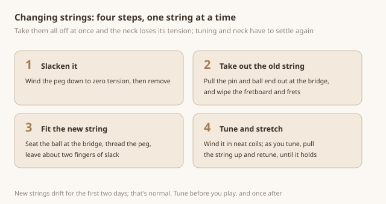
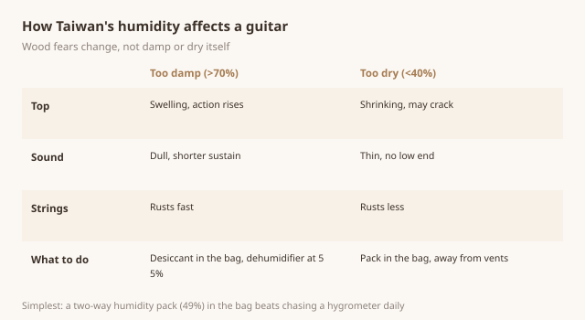

# Chapter 22: Changing Strings and Everyday Care, Fully Illustrated

> **What this chapter covers**
> 1. How to tell when a string has aged and started to rust, and how to choose the gauge of the new set (`.011` vs `.012`).
> 2. The safe restringing routine for an acoustic guitar — **one string at a time** — so the tension on the neck never lurches.
> 3. How many turns to wind around the post, and the **stretching** trick that settles a new string within five minutes, so it stops dropping in pitch.
> 4. The right habits for Taiwan's humid climate: keeping the guitar dry, and the temperature and humidity numbers to aim for.

---

## 22.1 When should you change strings? Restringing an acoustic guitar in four steps

Strings are consumables. When you see dark brown patches of rust on the surface, when they feel rough under your fingers instead of smooth, or when strummed chords turn dull and lose their shine — for ordinary uncoated strings that's about **1 ~ 2 months**, for coated strings about **3 ~ 6 months** — it's time for a new set.

### The four standard steps for a safe restring (take one off, put one on, in order)

1. **Loosen the old string and lift out the bridge pin**:
   Turn the tuning peg until the string has no tension left, then use the notch at the end of a string winder to ease the **bridge pin** straight up out of the bridge. Never grab it with pliers — you'll crush the pin.

2. **Seat the ball end of the new string and press the pin home**:
   Push the end with the little metal ball into the string hole, press the bridge pin down (its groove facing the neck), and at the same time pull the string gently upward with your other hand. Check that the ball is caught tight against the wood inside the top, so the pin won't come flying out.

3. **Leave two fingers' width of slack to wind up**:
   Thread the string through the hole in the tuning peg, pull it straight, then **back it off by about two fingers' width (roughly 4 ~ 5 cm)** before you start winding. That gives you a tidy **2 ~ 3 turns** around the post — too few and the string slips out of tune, too many and the turns overlap and jam.

4. **Wind downwards in neat turns, and finish on the correct side of the post**:
   As you turn the peg, press the string lightly with your other hand so every turn sits **neatly below the one before**; the downward pressure also holds the string tight against the nut. Which side you wind on depends on the headstock: on a **3+3 headstock** facing you, the strings on the three left pegs wind on the **right side** of the post, and the three right ones wind on the **left** — both sides wind toward the centre line — so the string never rubs against the neighbouring post. The first turn should trap the loose end you threaded through, locking it inside.

5. **Tune up first, then cut, and leave a little**:
   Cut the loose end only after the string is at pitch, and don't cut flush against the post — leave about **3 ~ 5 mm**. Cover the end with your hand as you cut. A snipped end flicking off is the commonest accident in restringing, and it can take an eye.

> **🎸 After every restring: stretch the strings**
> A new string keeps dropping in pitch as the metal stretches. Once it's in tune, hook a finger under each string above the soundhole and pull it gently upward about **1 ~ 2 cm** — the way you'd draw a bow, firm but never a hard yank — and you'll hear the pitch fall at once. Tune it back up and repeat **3 times**, and the new string settles immediately.

---

## 22.2 Required reading for Taiwan's humid climate: the temperature and humidity chart for guitar care

A guitar is a precision instrument made of natural wood, and Taiwan's relative humidity sits at 75% ~ 85% most of the year. Without care, the top takes on moisture and swells, which **raises the action until the guitar is hard to play** — and in bad cases the bridge comes unglued.

| What to measure | The comfortable range for an acoustic guitar | What too high or too low does | What to do about it at home |
| :--- | :--- | :--- | :--- |
| **Relative humidity (RH)** | **`45% ~ 55%`** | Above 70%: the top swells, the tone goes dull, the strings rust fast. Below 35%: the top cracks from drying out. | Put the guitar back in its gig bag or case after practising, with a **moisture-absorbing pack made for guitars**; or set the room's dehumidifier to `50% ~ 55%`. |
| **Room temperature** | **`20°C ~ 26°C`** | Big temperature swings, or baking in direct sun, crack and warp the glued joints in the wood. | **Never leave the guitar in a car boot in the sun**, and don't stand it against an air-conditioning vent or a damp bathroom wall. |
| **Daily cleaning habit** | After every time you play | The salt and oil in sweat corrode the fret wire and the strings fast. | Keep a microfibre guitar cloth, and spend 10 seconds after each session wiping both sides of the strings and the back of the neck. |

---

## 22.3 Chapter checklist

- [ ] **Restringing on your own.** You can change all six strings yourself, the turns on each post are neat, and the trimmed ends are safe and don't prick your fingers.
- [ ] **Humidity awareness.** There's a hygrometer where the guitar lives, and wiping the strings after playing has become a habit.
