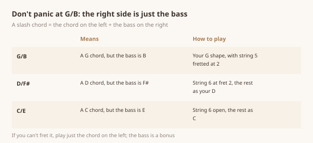
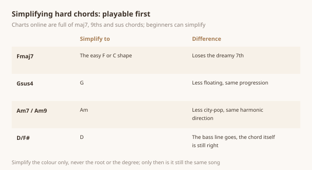

# Chapter 23: Reading Guitar Charts Online — Surviving Complicated Chords by Simplifying Them

> **What this chapter covers**
> 1. How to take apart the **slash chords** you meet in online guitar charts (`G/B`, `C/E` and the like).
> 2. The **strip-it-back rule for simplifying**: see the plain triad underneath a complicated chord, and stop being scared off by long strings of letters and numbers.
> 3. A **beginner's conversion chart for complicated chords** you can check any time, so you can play any new song you find online.

---

## 23.1 Don't panic at `G/B` or `F#m7-5`: how a complicated symbol is built

Once you start hunting online for charts of the newest pop songs, you'll keep meeting chord names that make your eyes swim: `G/B`, `Cadd9`, `Dsus4`, `F#m7-5`. In fact most of these long symbols are just **a basic chord plus a decoration, or a basic chord with a bass note named for you**.

### The one idea you need: what is a slash chord?

Take any chord with a slash through the middle, such as **`G/B`** or **`Am7/G`**:

*   **Left of the slash (`G`)**: the name of **the chord your left hand already frets**.
*   **Right of the slash (`B`)**: **the lowest note, the bass, is now `B`** — the root of `G/B` is still `G`, it's just that something else has taken over the bass job. Fret the `G` chord, skip the 6th string, and start your strum from the `B` at the 2nd fret of the 5th string.
*   **The beginner's emergency simplification**: if a fast change leaves you no time for the bass note on the right of the slash, just play the basic chord on the left — play `G/B` as `G`. Nothing clashes, so it's safe on that count, but the bass jumps from B back up to G, and the descending line `C–G/B–Am7–Am7/G` breaks. It works; it isn't the same thing.

---

## 23.2 The chart that keeps beginners afloat

This table is your safety net for every chart you teach yourself from here on. When a song is too fast, or one chord is too hard to grab, reach straight for the simplified substitute in the right-hand column:

| Chord as printed online | The core it's built from | A beginner-friendly substitute | How it sounds different, and what to watch for |
| :--- | :--- | :--- | :--- |
| **`Cmaj7`**, **`Cadd9`** | Both are `C` with a decoration added | Just play **`C`** | Drop the added note and the harmony is still a C major triad. |
| **`Csus4`** | The third replaced by a fourth (C–F–G) | Play **`C`** | On its own it has no third, so it isn't a major chord; simplifying to `C` resolves the suspended note. |
| **`Fmaj7`**, **`Fadd9`** | `F` with a decoration added | Play **`Fmaj7`** (no full barre needed) | `Fmaj7` only presses the 1st to 4th strings, the version taught back in Chapter 5. |
| **`Fm`** | F–A♭–C | The **three-string partial barre** `Fm` (press only the 1st to 3rd strings) | **Don't substitute `Dm7`**: `Dm7` is D–F–A–C, and its third, A, fights the A♭ of `Fm`, so the two clash. |
| **`G/B`** | A G major triad with B in the bass (B is not the root) | Play **`G`** | Fine in an emergency, but the bass line (C–G/B–Am…) breaks; if you want that bass note, practise the slash chord slowly. |
| **`G7`** | G with a minor seventh, F | Play **`G7`** (`320001`) | The pull of a dominant chord comes from that F; changing it to `G` takes the tension away, it doesn't keep it. |
| **`Gsus4`** | The third replaced by a fourth | Play **`G`** | The suspended note resolves and you're back on a G major triad. |
| **`Am7`**, **`Am/G`** | `Am` with a minor seventh / G in the bass | Play **`Am`** | Same root, same family; it sounds almost identical. |
| **`Asus2`** | A–E–B, with no third | Play **`A`** | Going to `A` (A–C♯–E) only adds the third; going to `Am` adds a C natural, which collides with the original B. |
| **`Em7`**, **`E7`**, **`E/G#`** | The `E` family | Use **`Em`** for the minor; play `E7` straight as **`E`** | Keeping the rhythm unbroken comes first; you lose a little of the pull of `E7`. |
| **`Dm7`**, **`Dsus2`** | The `Dm` / `D` family | Play **`Dm`** (or `D`) | A same-root swap is the safest substitution there is. |
| **`Dm7/G`**, **`F/G`** | Essentially a dominant colour over a G bass | Just play **`G`** | Placed before the chorus it works well; this is one you can genuinely swap out whole. |
| **`Bm7`** | B–D–F♯–A | In the key of C, use **`Bm7♭5`** or **`Dm6`** instead | `Bm7` carries an F♯, which **is not in C major**; chord 7 of C is `Bm7♭5` (B–D–F–A), the same notes as `Dm6`. `G/B` can't stand in for it (G–B–D has no F♯ and adds a G). |

---

## 23.3 Chapter checklist

- [ ] **Reading a slash chord.** When you see `C/E`, you know the `C` on the left of the slash is the chord itself, and in a pinch you can just play `C`.
- [ ] **Finding your own charts.** You can open any online guitar-chart site, pick a new song you like, and use the simplification chart to play and sing the verse and the chorus smoothly.
