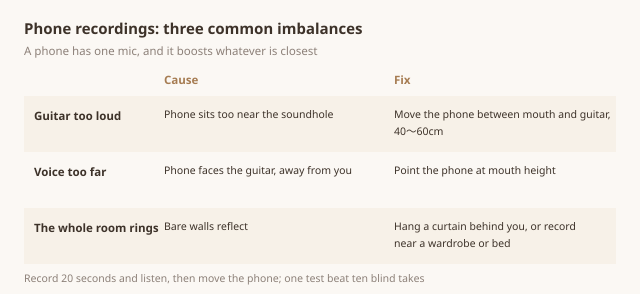
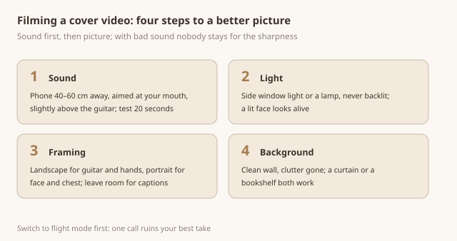

# Chapter 24: Good Sound from a Phone — Recording and Filming Yourself at Home

> **What this chapter covers**
> 1. A good recording with nothing but a phone and no studio gear, with **the voice and the guitar balanced in level** against each other.
> 2. The **distance and angle test** that finds the sweet spot for a single-point recording on a phone.
> 3. Zero-cost tricks for taming the **room reverb** of a bedroom.
> 4. Lighting and framing for a cover video, so you can share your music with confidence.

---

## 24.1 Why does a phone recording always come out with the guitar huge and the voice missing?

A lot of beginners record themselves on a phone for the first time and get knocked flat: "It felt full of feeling while I was singing it, so why does the recording have the guitar roaring like thunder and the voice hiding somewhere far away?"

It's because the soundhole faces up, toward the player's chest. The guitar's sound pours straight into a phone held at chest or chin height, while your voice arrives from further away — and a phone microphone picks up from every direction, so the two are out of proportion before you start. Learn to adjust the phone's **distance** and its **height and angle**, and you can even the two out without spending a cent on a microphone.

### The sweet-spot test chart for a single-point recording on a phone (record 15 seconds and check before the real take)

| What you hear | The placement that causes it | The fix |
| :--- | :--- | :--- |
| **The strumming drowns out the voice** | Phone at thigh height, aimed straight at the soundhole. | **Raise the phone to chin or shoulder height**, and swing it about 15 degrees toward **the headstock side, your left**, out of the soundhole's direct line. |
| **The voice sounds thin, and the room rings** | Recording in the middle of a bare tiled room with no curtains. | Sing facing **an open wardrobe full of clothes**, or a heavy curtain: fabric soaks up the reflections, and the voice comes out warm and solid, close to a studio sound. |
| **The sound clips and distorts** | Phone closer to your body than 40 cm. | Set the phone about **`70 ~ 100 cm`** away, leaving enough headroom for the big strums in the chorus. |

---

## 24.2 Filming a cover at home: making the picture look good

When you're ready to film what you've learned and put it on Instagram or YouTube, or send it to friends, three small visual details will lift the video straight away:

1. **Keep the light in front of your face (from the front, or 45 degrees to the side)**:
   Never film with a bright window behind you — your face turns into a black shape. Put a desk lamp, or the daylight from a window, behind the phone camera, so it lights your face and the grain of the guitar's top, and the picture looks warm and clear.

2. **Framing: landscape (16:9) or portrait (9:16)**:
   * When you shoot a portrait short (Reels / Shorts), pull the camera back a little, so there's **clear space above your head** and **both the headstock in your left hand and the strumming of your right hand are fully in frame**. Don't cut the headstock in half.

3. **Before you record, turn off notifications and switch to airplane mode**:
   You finally reach the peak of the chorus, a LINE message chimes, and the whole take has to be done again. Before you press record, turn on Do Not Disturb.

---

## 24.3 Chapter checklist

- [ ] **The balance test.** Do one test recording with the phone at `70 ~ 100 cm` and chin height, and check that the voice is clear and the guitar's low end doesn't boom over it.
- [ ] **Your first finished piece.** You've recorded and saved one complete song of your own, on video or as an audio file.
