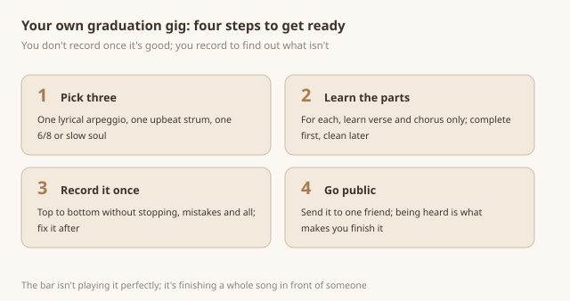
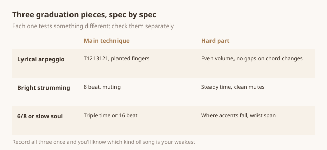
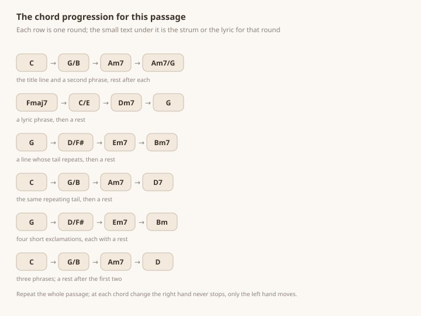

# Chapter 25: The Graduation Test — Three Complete Songs in Three Different Styles

> **What this chapter covers**
> 1. Pull together every core skill from the first 24 chapters, and put it on stage in three complete songs, each in a very different style.
> 2. Be tested on the three dimensions of playing and singing: **a delicate fingerpicked bass line**, **the light sway of 6/8 time**, and **holding back in the verse so the chorus can open up**.
> 3. Graduate, officially, from absolute beginner to a pop guitarist who can read a chart, shape the layers of an arrangement, and sing while playing.

---

## 25.1 Your own graduation concert

Do you remember the first day you opened this book, when you had to look down to check which of the 1st and 6th strings was the thicker one, and your fingertips stung a little on your first chord? Now you have open chords, fingerpicking, muted strumming, the capo, full barre chords and colour chords — and you can even put a simple arrangement together and record it on a phone.

To put the best possible marker at the end of this journey, I've picked three graduation pieces in very different styles (you can later swap in originals in the same styles from The Weaver Next Door (隔壁織音人)). Pour yourself a drink you like, set up the phone, and put on this home concert of yours.

---

## 25.2 The three graduation pieces, in technical terms

| Order | The piece (and singer) | Style and metre | The skills being tested | What to watch on stage |
| :--- | :--- | :--- | :--- | :--- |
| **First: a quiet confession** | **〈刻在我心底的名字〉 ("The Name Engraved in My Heart")** (Crowd Lu) | A slow modern ballad in 4/4 | Fingerpicking `T1213121` + colour chords (`Maj7`, `m7`) + a descending bass line | Concentrate on gentle control in the right-hand fingers; leave space in the verse, so the feeling in the voice comes through on its own. |
| **Second: sunlight and a breeze** | **〈魚仔〉 ("Little Fish")** (Crowd Lu, rearranged in 6/8) | **A 6/8 arrangement**, light and swaying | The 6/8 sway of "strong-weak-weak, second-strong-weak-weak", switching between fingerpicking and strumming (the original is in 4/4; here it's reworked into a different groove) | Catch the wave-like swing of 6/8, keep the diction easy and natural, and sing with a smile. |
| **Third: rock tension** | **〈溫柔〉 ("Tenderness")** (Mayday) | A ballad-rock epic in 4/4 | Barre chord changes + ascending arpeggios that are nearly silent in the verse, then a full strum in the chorus | It tests the limits of your dynamics. Keep the wrist loose, not tense, when you strum flat out in the chorus. |

---

## 25.3 The key passages for the graduation concert

### Piece one: 〈刻在我心底的名字〉 ("The Name Engraved in My Heart") — a delicate bass line and colour chords

> **The point of the performance**: use the descending bass line of `C - G/B - Am7 - Am7/G - Fmaj7 - C/E - Dm7 - G`, so each root note holds the voice up gently, the way a cello would.

| Chord progression | Lyric |
| :--- | :--- |
| `C` → `G/B` → `Am7` → `Am7/G` | an eight-syllable phrase (empty), then a second eight-syllable phrase (empty) |
| `Fmaj7` → `C/E` → `Dm7` → `G` | a twelve-syllable phrase (empty) |

### Piece two: 〈魚仔〉 ("Little Fish") — rearranged into a swaying 6/8

> **The point of the performance**: count the 6/8 sway steadily, `1 2 3 4 5 6`. In the verse use the picking pattern `T 1 2 3 2 1`; in the chorus switch to a light strum, `↓(strong) ↓ ↓ ↓(second strong) ↓ ↑`.

| Chord progression | Lyric |
| :--- | :--- |
| `G` → `D/F#` → `Em7` → `Bm7` | a twelve-syllable phrase (empty), its last four syllables repeated |
| `C` → `G/B` → `Am7` → `D7` | an eleven-syllable phrase (empty), its last four syllables repeated |

### Piece three: 〈溫柔〉 ("Tenderness") — from a quiet confession to a chorus that opens up

> **The point of the performance**: open with the verse's three phrases (four, four and five syllables) on a single ascending arpeggio, almost unaccompanied, to set the picture; then, as the chorus arrives with three clipped three-syllable phrases, switch in an instant to a full, ringing 8 Beat / 16 Beat strum.

| Chord progression | Lyric |
| :--- | :--- |
| `G` → `D/F#` → `Em7` → `Bm` | four three-syllable phrases, a rest after each: (empty) (empty) (empty) (empty) |
| `C` → `G/B` → `Am7` → `D` | a three-syllable phrase (empty), a six-syllable phrase (empty), then a six-syllable phrase with no rest |

---

## 25.4 Closing: take the guitar into your next stretch of music

Congratulations, my friend. When you play the last note of the last of these three pieces and watch the strings quiver in the air until they come to rest, you are no longer the outsider who once stood lost in front of a staff and a chord diagram.

Remember: the end of this book is not the end of your guitar learning. It's the real starting point for using music to record your life. Whatever comes — happiness, loneliness, confusion, or hope — pick up the wooden guitar beside you and set the strings moving, and you will always have the most faithful, warmest companion there is, to sing every ordinary day into a song.

May music always keep you company. See you on stage.
