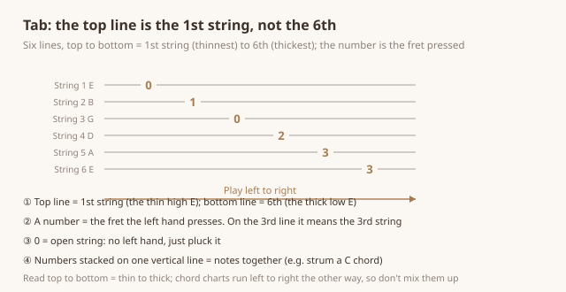
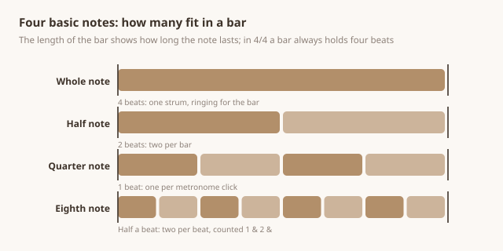
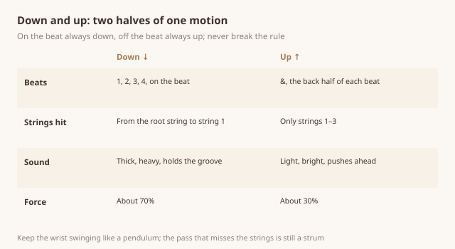
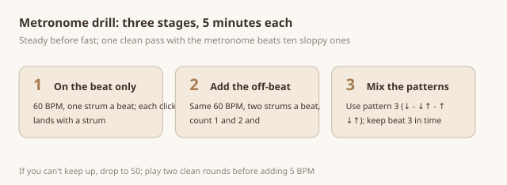

# Chapter 3: Reading the Guitar's Own Language

> **What this chapter covers**
> 1. How to read the guitar world's most widely used notation, **tab (TAB)**, and in five minutes be able to tell which string and which fret it's asking for.
> 2. How to read the `○`, the `✕` and the finger numbers in a **chord diagram**.
> 3. The basics of rhythm: **4/4**, bar lines, and how long a whole note, half note, quarter note and eighth note each last.
> 4. How to play along with a **metronome**, so that singing over your own playing stands on steady ground.

---

## 3-1 Forget the staff: the guitar's own map, tab (TAB)

A lot of people get a headache the moment they hear "read music", and what comes to mind is the school songbook: those tadpole-shaped notes scattered up and down a five-line staff. The good news is that **playing pop songs on the guitar almost never needs the five-line staff at all**.

Guitarists have their own picture-based notation, called **tablature**, or **tab** for short. It works like a very direct satnav map: it tells you **which string of the guitar and which fret** to put a finger on.

### How tab is laid out (whatever you do, don't read it upside down)

Tab is made of six parallel horizontal lines, one for each of the guitar's strings. Pay particular attention to the order from top to bottom:

- **The top line** is the **thinnest string, the 1st** (the high E string).
- **The bottom line** is the **thickest string, the 6th** (the low E string).

Why is the thinnest, the 1st string, on top? Picture this: **you're looking down at the fretboard of the guitar in your arms**. The string furthest from your eyes (the top of the screen or the page) is the 1st string, and the one nearest your chest (the bottom of the page) is the 6th string.

### Tab symbols, at a glance

| Symbol | What it means | What you actually do |
| :--- | :--- | :--- |
| **A number on a line (such as `1`, `3`, `5`)** | The **fret** to press on that string. | A `2` on the 3rd string means: the left hand presses the 3rd string at fret 2, the right hand plucks the 3rd string. |
| **A `0` on a line** | An **open string**. | A `0` on the 1st string means: the left hand presses nothing at all, the right hand plucks the 1st string directly. |
| **A vertical row of numbers** | **Notes sounding at the same time** (a chord or a pair of notes). | If the 5th string through to the 1st all have numbers on the same vertical line, the left hand holds all of those positions and the right hand strums down across those five strings in one motion. |
| **An `✕` on a line** | **Mute** (a percussive click instead of a note). | The left hand touches the string without pressing it down; when the right hand plucks or strums, you get a dry percussive knock. |

---

## 3-2 Reading a chord diagram: one box, a whole accompaniment

When we play pop songs, writing out every note in tab, fret by fret, would make a whole chart endlessly long. So pop guitar charts usually put small grid boxes above the lyrics instead. That's a **chord diagram**.

A chord diagram is the guitar seen from the front with the headstock **standing upright**:

### Three steps to reading one

1.  **Read the left-to-right direction**: the leftmost vertical line is always the **thickest string, the 6th**; the rightmost vertical line is always the **thinnest string, the 1st**.
2.  **Read the dots (`●`)**: whichever line a dot sits on, and whichever fret it's in, a left-hand finger presses there vertically. The number inside the dot (`1`, `2`, `3`, `4`) is the number of the left-hand finger to use.
3.  **Read the `○` and `✕` marks above the headstock**:

    - **`○` (hollow circle)**: no dot means no left-hand finger, but **the right hand must sound this string as part of the strum** (an open string).
    - **`✕` (cross)**: **don't play this string when you strum**. Most often it's to stop the string from becoming the lowest note: in a C chord, the open 6th string is `E` (a chord tone in its own right), but strum it and the bass becomes E, which sounds like a `C/E` inversion with a bass that isn't solid enough. The other case is that the string, if pressed, would clash with the other notes.

---

## 3-3 The beating heart of a pop song: beats, bars and note values

Music is the art of time. If chords are a song's **colour**, then **rhythm** is a song's **heartbeat**. Most pop songs are in **4/4 (four-four time)**.

### What does 4/4 mean?

- The `4` in the denominator: a **quarter note** counts as 1 beat.
- The `4` in the numerator: **every bar holds 4 beats in total**.
You can picture it as walking: **"1, 2, 3, 4 | 1, 2, 3, 4 |"**. Every four beats you draw a vertical line, and the space between two lines is a **bar**.

### The four most basic notes and how long they last (in 4/4)

Under the guitar tab you'll see lots of vertical **stems** and horizontal **beams** joining them. They're there to tell you **how long this note should last**:

| Note name | How it's written under the tab | Beats it takes | How to count it out loud (one bar = 4 beats) | How it feels to play on the guitar |
| :--- | :--- | :--- | :--- | :--- |
| **Whole note** | A number on its own, with no stem | **4 beats** | **`1`** - 2 - 3 - 4 | Pluck or strum once and let the sound ring out for the full 4 beats. |
| **Half note** | A short vertical stem below the number | **2 beats** | **`1`** - 2 - **`3`** - 4 | Each note lasts 2 beats, so one bar holds exactly 2 of them. |
| **Quarter note** | A full vertical stem below the number | **1 beat** | **`1` - `2` - `3` - `4`** | Play one note for every click of the metronome. |
| **Eighth note** | The bottoms of two stems joined by a single horizontal line | **0.5 beat (half a beat)** | **`1` & `2` & `3` & `4` &** | Two notes evenly inside one beat! Say it as "1-and, 2-and, 3-and, 4-and". |

> **🎯 The one idea that matters most: what is that "& (and)" in an eighth note?**
> When we practise counting eighth notes on the guitar, never count "1, 2, 3, 4, 5, 6, 7, 8" — that way you forget where the accent falls on beat 1 and beat 2.
> Always say it as: **"1 - and - 2 - and - 3 - and - 4 - and"** (in Chinese you can stretch out the end of the syllable — yi, er, san, si — or say the number as your foot goes down and say "and" as it comes up). A number always means **on the beat**; `and` always means **off the beat**.

---

## 3-4 Strumming direction symbols: down and up

In a guitar strumming chart, besides the note values, the direction of the right hand's stroke is marked above the staff, so you can see at a glance whether this one goes down or up:

| Symbol | English name | What you say | What the right hand actually does |
| :--- | :--- | :--- | :--- |
| **`↓`** or **`Π`** | Downstroke | **down** | The right hand brushes from above downward (from the thick 6th and 5th strings across toward the thin 1st string). |
| **`↑`** or **`V`** | Upstroke | **up** | The right hand brushes from below upward (from the thin 1st string lightly hooking back toward the 3rd and 4th strings). |

### The golden rule of strumming direction: down on the beat, up off the beat

This rule will run through every pop accompaniment you play for the rest of your life. Keep it in mind:

- **Every beat (`1`, `2`, `3`, `4`)**: the right hand always goes **down (`↓`)**.
- **Every off-beat (`and`)**: the right hand always comes **up (`↑`)**.
Your right hand is like a pendulum, swinging down and up, down and up, in time with the beat. There is never a strange motion where a beat gets an upstroke.

---

## 3-5 Your first metronome practice session

A lot of self-taught players speed up as they play, or slow down automatically whenever a chord is hard to press, and that makes the music sound unstable to the listener. Starting today, open the free metronome app on your phone (or a physical metronome) and set it to **`4/4`, tempo `60 BPM`** (BPM = Beats Per Minute: 60 beats a minute, exactly one per tick of a clock's second hand).

### Three stages of playing to the beat, from zero

Rest your left hand lightly on the guitar's neck (no chords for now — leave the strings muted), take the pick in your right hand, and work through these three exercises with the metronome at `60 BPM`:

1.  **Exercise one: quarter-note downstrokes (1 per beat)**

    - Count: `1` (down) — `2` (down) — `3` (down) — `4` (down)
    - The point: the instant the metronome clicks, the pick should be brushing the strings. Feel the arm and the beat land at exactly the same moment.

2.  **Exercise two: eighth-note down-up strums (2 per beat)**

    - Count: `1` (down) `and` (up) — `2` (down) `and` (up) — `3` (down) `and` (up) — `4` (down) `and` (up)
    - The point: on the way down you can brush across all six strings (full and thick). On the way up you only need to catch the bottom **3 ~ 4 thin strings** lightly. It sounds brighter and cleaner, and your right hand is less likely to snag.

3.  **Exercise three: a mixed basic groove (the shape most pop songs use)**

    - Count: `1` (down) — `2` (down) `and` (up) — `3` (down) — `4` (down) `and` (up)
    - The point: note that beats 1 and 3 are **quarter notes (1 beat each)**. After the downstroke, the wrist lifts lightly in the air and comes back up, ready for the next stroke (this motion is called a **ghost strum** — it doesn't touch the strings), and then on beat 2 you come down again.

---

## 3-6 Chapter checklist

Before chapter 4, where you start playing single-note melodies with your fingers, make sure you have this notation and rhythm language in hand:

- [ ] **Tab orientation**: when you see the top line of a tab, you can instantly tell that it's the **thinnest string, the 1st**.
- [ ] **Reading chord diagrams**: you can read the `○` (play the open string) and `✕` (leave it out) on a chord diagram, and match them correctly to left-hand fingers `1, 2, 3, 4`.
- [ ] **Telling note values apart**: at a glance you can tell how a quarter note (1 beat) and an eighth note (0.5 beat, two notes joined together) are written.
- [ ] **Playing to a metronome**: with the metronome at `60 BPM`, you can say `1 and 2 and 3 and 4 and` steadily out loud and do the down-up strum at the same time.
