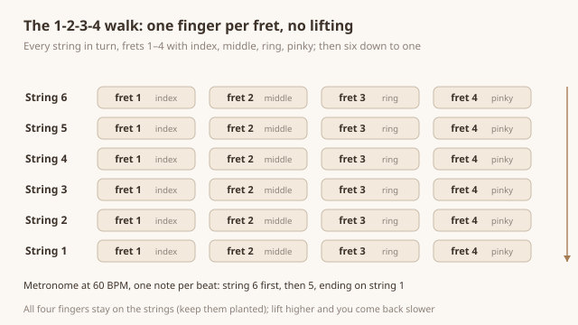
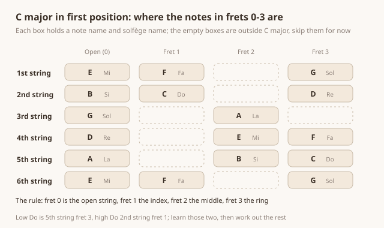
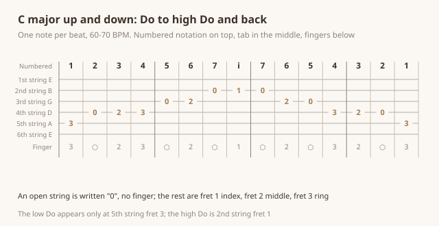
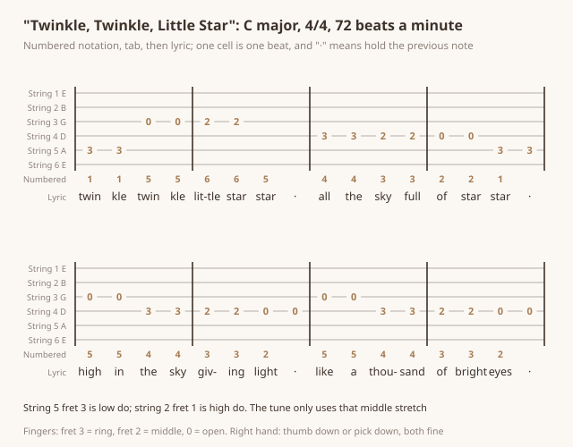
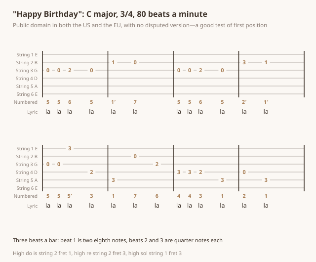
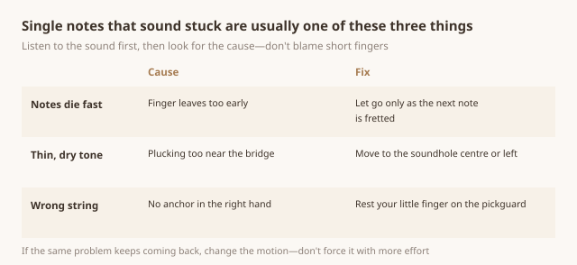

# Chapter 4: Finger Warm-ups and Single-Note Melodies

> **What this chapter covers**
> 1. Learn the **"1-2-3-4 spider walk" finger warm-up** you play every day, and wake up independent control in the ring finger and little finger.
> 2. Find the **C major scale in first position (frets 0-3)** on the fretboard.
> 3. Train left-right coordination: "left hand frets first, right hand plucks second", with no noise between notes.
> 4. Play two familiar single-note melodies, **〈小星星〉 ("Twinkle, Twinkle, Little Star")** and **〈祝你生日快樂〉 ("Happy Birthday to You")**, and work on quarter notes and eighth notes at the same time.

---

## 4-1 Why guitarists walk the spider every day

Before exercise we stretch, so we don't cramp. Before playing guitar our fingers need their own warm-up too. In the guitar world the classic is the **spider walk (Spider Walk / chromatic exercise)**.

In daily life the brain is most at home driving the index and middle fingers (chopsticks, phone, pen). The **ring finger (finger 3) and little finger (finger 4)** are practically conjoined: ask the ring finger to move and the little finger twitches along with it. The spider walk is four fingers fretting in a regular rotation. Done daily, it builds independent nerve connections between the brain and each finger, and trains the endurance and the stretch of the fingertips.

### Step by step: the standard "1-2-3-4 spider walk"

Put your left hand over the first four frets (index finger takes fret 1, middle finger fret 2, ring finger fret 3, little finger fret 4). Set the metronome to **`60 BPM`** and play one note per beat:

### Three golden anchor-finger rules for the spider walk

Plenty of beginners finish the walk in the wrong shape, and the more they practise the further the fingers fly. Watch these three details:

1.  **"Once it's down, don't lift it yet." (the anchor-finger principle)**
    You fret the 6th string, 1st fret with the index finger (1) and pluck it. The next note is the middle finger (2) at fret 2 — **keep the index finger on fret 1, don't lift it**! Then the ring finger (3) takes fret 3, the little finger (4) takes fret 4, until all four fingers are lined up neatly on the 6th string. Only when you move over to the 5th string do you shift them one at a time. This stops the fingers flicking out like springs, and it makes your chord changes much faster later on.

2.  **Keep the fingers close to the fretboard; don't let them fly**
    Keep the height a finger lifts off the string within **1 cm**. The further it flies, the longer it takes to come back down.

3.  **Better slow than broken**
    If the little finger can't press fret 4 firmly and the note sounds muted, check two things. First, is the little finger close to the fret wire on the right side of fret 4? Second, is there room in the palm of the left hand for the little finger to stand up?

---

## 4-2 Do Re Mi on the fretboard: the C major scale

Before you play pop songs as single notes, meet the most basic scale in pop music, the **diatonic C major scale (`Do - Re - Mi - Fa - Sol - La - Si - Do`)**. In numbered notation it is written **`1 - 2 - 3 - 4 - 5 - 6 - 7 - i`**.

Learn the scale positions in the first three frets — this is what players call **first position** — and you can play the melody of countless classic songs.

### The C major scale in first position, mapped

### One fret, one finger: the C major scale chart

So the left hand doesn't get confused, keep one rule strictly in first position: **each fret belongs to one finger, and no other.**

| Fret | Finger | C major notes in that fret |
| :--- | :--- | :--- |
| **Fret 0 (open string)** | no finger needed | 6th string (low Mi), 5th string (low La), 4th string (Re), 3rd string (Sol), 2nd string (Si), 1st string (high Mi) |
| **Fret 1** | **index finger (1)** | 6th string (low Fa), 2nd string (high Do), 1st string (high Fa) |
| **Fret 2** | **middle finger (2)** | 5th string (low Si), 4th string (Mi), 3rd string (La) |
| **Fret 3** | **ring finger (3)** | 6th string (low Sol), 5th string (Do), 4th string (Fa), 2nd string (high Re), 1st string (high Sol) |

### The basic C major scale, up and down (suggested tempo: 60-70 BPM)

---

## 4-3 A single-note melody in practice (1): 〈小星星〉 ("Twinkle, Twinkle, Little Star")

Now that you know where `Do` through `high Do` sit, use those eight notes to play your first complete melody: "Twinkle, Twinkle, Little Star". The whole song is regular quarter notes and half notes, which makes it a good drill for doing three things at once: **eyes on the tab, voice singing the melody, fingers landing in the right place.**

### Practice notes
*   **Left-hand discipline**: any note marked `1` is the **index finger**; `2` is always the **middle finger**; `3` is always the **ring finger**.
*   **Right-hand plucking**: pluck downward with the right thumb (`P`), or downward with a pick (`↓`). With every note you play, sing the matching solfège name or lyric.

*(Note: the melody of the last two bars is exactly the same as the opening. Repeat once and you have the ending.)*

---

## 4-4 A single-note melody in practice (2): 〈祝你生日快樂〉 ("Happy Birthday to You")

"Twinkle" has nothing but quarter notes. Next, a tune with eighth notes: "Happy Birthday to You". It is in the public domain in both the United States and the European Union (the copyright claim was ruled invalid in 2016), so there is no dispute about which version the melody is, and anyone can hear at once whether you played it right. That makes it the best test of first position.

It is in 3/4. Beat 1 is two eighth notes (the two syllables Hap—py), and beats 2 and 3 are one quarter note each. So **one bar uses eighth notes and quarter notes together**: the right hand plucks twice inside one beat and once in the next.

### Practice notes

- **Right hand**: on beat 1, two strokes down-down (or two thumb plucks in a row); on beats 2 and 3, one each. Don't let the wrist stop between beats — it just doesn't touch the strings.
- **Left hand**: fret 1 index finger, fret 2 middle finger, fret 3 ring finger. If the ring finger feels awkward on the 1st string, 3rd fret, the little finger can take it.
- **Sing**: get the lyric smooth in your voice first, then pick up the guitar. If you can sing it evenly, the hand finds the beat by itself.

*(Note: the melody is the traditional version of this song. The tab and the lyric alignment here are our own setting, not a transcription of any published edition.)*

---

## 4-5 Troubleshooting single-note playing

If either tune sounds stuck or lumpy while you practise, check yourself against this table:

| What you hear | What is really going on | Fix it now |
| :--- | :--- | :--- |
| **The note dies the moment you pluck it, short and clipped** | The left-hand finger left the string too early, or the right hand brushed a ringing string on its way to the next one. | Wait until **the instant the next note is ready to be fretted**, then let the previous finger go. Only then do the notes join and sing. |
| **The tone is thin and dry, like scraping wire** | You are plucking too close to the saddle (the bridge), where the string tension is stiffest. | Move the right hand to **the centre of the soundhole**, or just above its left edge. The tone turns round and warm at once. |
| **You hit the wrong string crossing from the 3rd string to the 4th** | The right wrist is floating, with no stable reference point. | Rest the little finger of the right hand lightly on the pickguard (the top below the soundhole). The right hand then knows the distance to each string. |

---

## 4-6 Chapter checklist

- [ ] **Daily warm-up**: with the metronome at `60 BPM` and the anchor-finger principle, walk from the 6th string to the 1st.
- [ ] **Scale from memory**: play `Do - Re - Mi - Fa - Sol - La - Si - Do` up and down from memory, without looking at the scale map.
- [ ] **Melody**: play "Twinkle, Twinkle, Little Star" as single notes, smoothly and without stopping, and tell eighth notes from quarter notes in 3/4.

Congratulations. Your fingers are awake and you can read tab. In the next chapter we come to the trick that makes pop guitar accompaniment work: **chords**, where one hand holds up the whole harmony of a song.
