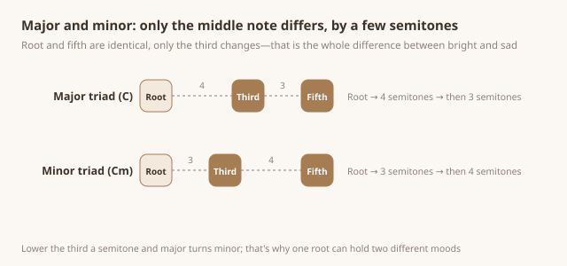
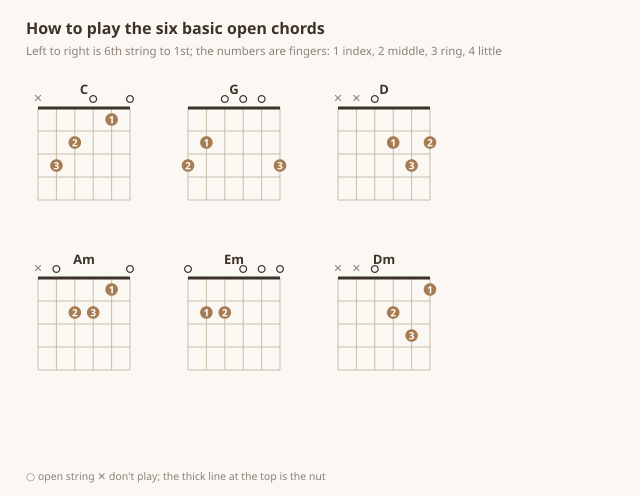
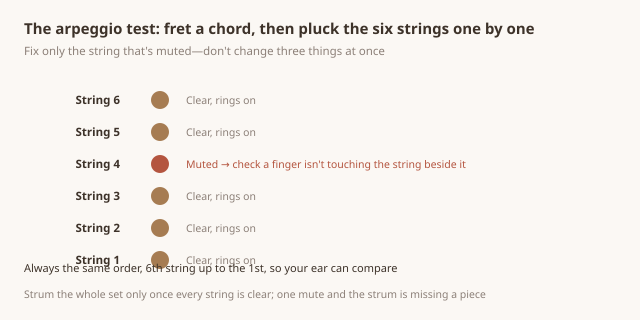
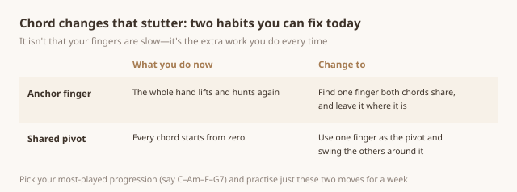
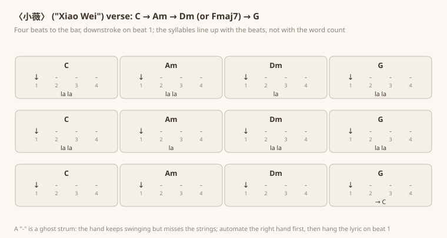
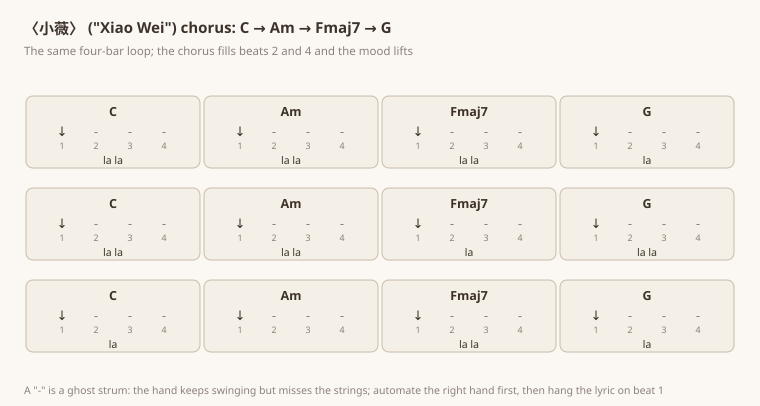
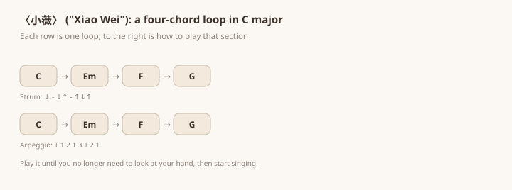

# Chapter 5: Your First Chords — Easy Fingerings That Dodge the Boss

> **What this chapter covers**
>
> 1. Understand what a chord is, and the difference you hear between a major triad (bright) and a minor triad (sad).
>
> 2. Learn the basic C major chords pop songs use most: **`C`, `Am`, `G`, `Em`, `Dm`**.
>
> 3. Take the beginner's shortcut around the pitfall: use the easy, good-sounding "low-effort `Fmaj7`" instead of the "full barre `F` chord" you can't make ring yet.
>
> 4. Learn the two core secrets of chord changes (**the anchor finger** and **the shared pivot**), and play the whole chord part of 〈小薇〉 ("Xiao Wei").

## 5-1 What is a chord? The colour of accompaniment, in plain words

If the single-note melody of the last chapter is one person singing alone, a chord is the piano and the string section behind them. In music theory, **any three or more notes of different pitch sounding together make a chord**.

If you are starting from zero at pop singing and playing, you don't need to memorise interval formulas. First, learn by ear what mood each chord carries:

| Chord type | How it is written | What it feels like | Common examples (the C major family) |
| ----- | ----- | ----- | ----- |
| **Major triad (Major)** | A single upper-case letter (e.g. `C`, `G`) | Bright, open, sunny, stable, hopeful. | **`C`**, **`F`**, **`G`** |
| **Minor triad (Minor)** | An upper-case letter plus a lower-case **`m`** (e.g. `Am`) | Gentle, emotional, faintly sad, fine, inward. | **`Dm`**, **`Em`**, **`Am`** |
| **Major seventh chord (Major 7)** | The letter followed by **`maj7`** (e.g. `Fmaj7`) | Dreamy, artsy, clean the way Japanese singer-songwriters are, richer and more romantic than a plain major triad. | **`Fmaj7`** (the beginner's rescue!) |

## 5-2 The universal key to pop songs: the core open chords in C major

Learn the six open chords below — open chords use open strings and sit within the first three frets, which is what makes them easy — and you can play more than half the ballads and folk songs in Mandopop.

Watch the **`○` (let it ring)** and **`✕` (don't play it)** marks above each chord. They decide whether your chord sounds clean:

In the diagrams, left to right is the 6th string down to the 1st. The numbers in the dots are fingers (1 index, 2 middle, 3 ring, 4 little). Above the strings, `○` means play it and `✕` means don't. Chord by chord, here are the fingerings and the strings to strum.

### 1. `C` (the bright starting point)

* **Fingering**: first finger, 2nd string, 1st fret; second finger, 4th string, 2nd fret; third finger, 5th string, 3rd fret.

* **Strum range**: from the **5th string** down to the 1st (skip the thickest string, the 6th, `✕`).

### 2. `Am` (the heart of a gentle ballad)

* **Fingering**: first finger, 2nd string, 1st fret; second finger, 4th string, 2nd fret; third finger, 3rd string, 2nd fret.

* **The big discovery**: see it? **The index finger (1) and middle finger (2) sit in exactly the same place for `C` and for `Am`.** To change, you move only the ring finger (3), from the 5th string, 3rd fret to the 3rd string, 2nd fret.

* **Strum range**: from the **5th string** down to the 1st (skip the 6th, `✕`).

### 3. `Fmaj7` (the beginner's rescue, no barre needed)

The traditional `F` chord makes the index finger lie across all six strings at once (a barre chord), and it stops most beginners. For now, use this "small F / Fmaj7" instead. Your fingers don't hurt, and the tone is softer than a barred F.

* **Fingering**: imagine picking up the ring and middle fingers of `C` and moving them down one whole string together. First finger, 2nd string, 1st fret; second finger, 3rd string, 2nd fret; third finger, 4th string, 3rd fret.

* **Strum range**: from the **4th string** down to the 1st (skip the 6th and 5th, `✕`).

### 4. `G` (wide, open tension)

* **Fingering**: second finger, 6th string, 3rd fret; first finger, 5th string, 2nd fret; third finger (or the little finger, 4) on the 1st string, 3rd fret.

* **Strum range**: **all six strings.** This is one of the few chords where every string rings, and the sound is full and resonant.

### 5. `Em` (the easiest two-finger chord on the guitar)

* **Fingering**: first finger, 5th string, 2nd fret; second finger, 4th string, 2nd fret. When you want the middle and ring fingers free for something else, fingers 2 and 3 work too. But **when you come to it from `G` in the next section, fingers 1 and 2 are smoothest** (the index finger never leaves the 5th string).

* **Strum range**: **all six strings.** Two fingers are enough to produce a deep minor resonance with a story in it.

### 6. `Dm` (the fine, sorrowful bridge)

* **Fingering**: first finger, 1st string, 1st fret; second finger, 3rd string, 2nd fret; third finger, 2nd string, 3rd fret.

* **Strum range**: from the **4th string** down to the 1st (skip the 6th and 5th, `✕`).

## 5-3 Checking one chord at a time: the arpeggio test

If you fret a chord and strum straight away, you often can't hear which string is badly fretted. Make this a habit: **whenever you learn a new chord, pluck the strings one at a time first.**

1. Fret `C` and keep the fingertips standing up straight.

2. Starting from the 5th string, pluck `5th string → 4th string → 3rd string → 2nd string → 1st string` in order. Every string should ring out clear as a bell.

3. **If one string comes out muffled and dead**:

   * **Case A (a finger is fretting that string)**: the finger isn't pressing hard enough, or it sits too far from the fret wire on its right. Move it closer to the fret wire and press a little harder.

   * **Case B (the string is open — for example the 3rd or 1st string of `C` won't ring)**: the **finger above it (middle or index) is lying too flat**, and the pad of that fingertip is touching the open string below. Push the left wrist slightly forward so the fingertips stand more vertically, and leave room for the string below to vibrate.

## 5-4 Two secrets for smooth chord changes

The beginner's most common question: "Every chord rings fine on its own, but the moment I change I have to stop and think for three seconds, and the beat falls apart." That is because on every change you lift all the fingers and start again from zero. Players who change quickly use the two devices below:

### The chord-change routes, and how each one saves effort

| Change | What saves the effort | Exactly what your fingers do |
| ----- | ----- | ----- |
| **`C` ⇄ `Am`** | **Two anchor fingers** | **The index finger (1) and middle finger (2) don't move at all — they stay stuck in place.** Only the ring finger (3) swings up and down between the 5th string, 3rd fret and the 3rd string, 2nd fret. |
| **`C` ⇄ `Fmaj7`** | **One anchor finger, two fingers sliding in parallel** | **The index finger (1) stays on the 2nd string, 1st fret.** The middle and ring fingers keep their diagonal relationship to each other and slide down one string together. |
| **`Am` ⇄ `Fmaj7`** | **Two anchor fingers** | **The index finger (1) and middle finger (2) don't move.** The ring finger (3) goes from the 3rd string, 2nd fret to the 4th string, 3rd fret. (Start with the three-finger Fmaj7, or move the middle finger down one fret and put the ring finger on the 4th string, 3rd fret.) |
| **`Fmaj7` ⇄ `G`** | **Land the bass root early** | As the fingers lift and head for `G`, send the **middle finger (2) onto the 6th string, 3rd fret first**, before anything else. The strum runs from the top string down, so the thickest root note is already fretted; the other fingers fill in during the strum, and the beat never breaks. |
| **`G` ⇄ `Em`** | **The index finger as pivot** | **The index finger (1) stays on the 5th string, 2nd fret — don't let it go.** Release the middle and ring fingers, then drop the middle finger (2) straight onto the 4th string, 2nd fret. You are now fretting Em with fingers 1 and 2, with almost no delay. |

## 5-5 Your first pop song on chords: 〈小薇〉 ("Xiao Wei")

Now string together the chords you just learned — `C`, `Am`, `Dm` (or `Fmaj7`), `G` — and play one of the most sung ballads in Mandopop: Huang Pin-yuan's 〈小薇〉 ("Xiao Wei").

The tempo is gentle (about `68 BPM`) and the whole song runs on a very regular four-chord progression. That makes it the best song there is for building muscle memory in the left hand. In this chapter, practise one thing only: **each chord gets 4 beats (one bar), and you strum down once on beat 1 (a whole note)**. That gives you a full four beats to make the next change calmly.

### The 〈小薇〉 ("Xiao Wei") progression, verse and chorus

> **Practice settings**: time signature `4/4` | tempo `68 BPM` | strum: one downstroke on beat 1 of each bar (`↓`), let the sound ring out for the full 4 beats, and use beats 3 and 4 to get ready for the next chord.

*Figure: the verse of 〈小薇〉 ("Xiao Wei"). Four beats to a bar, a downstroke on beat 1; the lyric lines up with the beat.*

*Figure: the chorus of 〈小薇〉 ("Xiao Wei"). The same four-bar loop, but beats 2 and 4 are strummed as well, and the feeling lifts.*

### 💪 Advanced challenge: the one-minute chord-change race

Before you put the guitar down each day, spend two minutes on this game. Set a 60-second timer on your phone and count how many times you can change cleanly between each pair below in one minute. A change counts only if you pluck it and hear no muted strings:

* **Pair one (beginner)**: `C` ⇄ `Am` (target: **35** or more in one minute)

* **Pair two (advanced)**: `Fmaj7` ⇄ `G` (target: **25** or more in one minute)

## 5-6 Chapter checklist

Congratulations — you have finished every lesson of part one, "A Confident Start". Before part two, where the right hand learns richer picking and strumming rhythms, check that you have reached these goals:

* \[ \] **Six chords from memory**: see the chord symbols `C`, `Am`, `Fmaj7`, `G`, `Em`, `Dm` and put your fingers in the right place within 2 seconds, without the fingering diagram.

* \[ \] **One-string-at-a-time test**: with each of the six chords fretted, every string you pluck rings clear and bright, with no badly muted strings.

* \[ \] **Anchor fingers in use**: changing between `C` and `Am`, the index and middle fingers never leave the strings.

* \[ \] **Your first chord accompaniment**: with the metronome at `68 BPM`, one strum per bar, play the verse and chorus progressions of 〈小薇〉 ("Xiao Wei") all the way through, steadily.

Next chapter — the start of part two — we free your right hand: how to pluck arpeggios as soft as running water, and fill your accompaniment with folk poetry.
