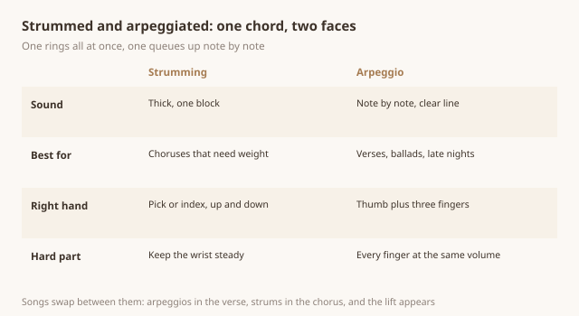
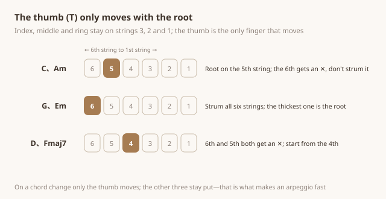
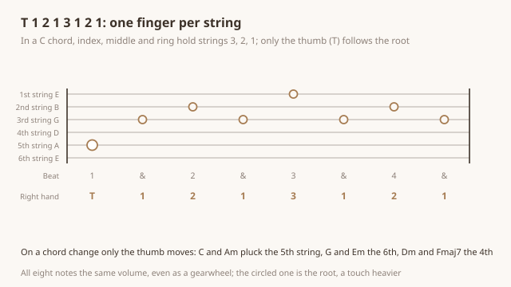
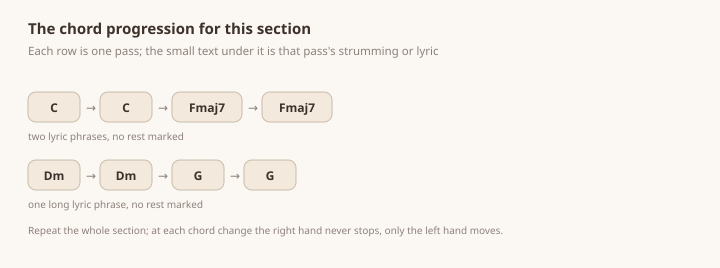

# Chapter 6: Right-Hand Picking — The Gentle Arpeggio

> **What this chapter covers**
> 1. Learn the right-hand finger labels (`T`, `1`, `2`, `3`) and which string each one owns.
> 2. Tell the **bass note** of each chord, and build a steady low end.
> 3. Get the pattern Chinese-language ballads use most under your fingers: **`T 1 2 1 3 1 2 1`**.
> 4. Play the arpeggio accompaniment to the verse of the folk classic 〈旅行的意義〉 ("The Meaning of Travel").

---

## 6-1 Freeing the right hand: meet the arpeggio

In chapter 5 you strummed all the strings at once to hear a chord's full harmony. Here you take the chord apart and pluck the notes one after another. The technique is called an **arpeggio** (also called **fingerpicking**). It sounds like a piano playing the bass in the left hand and broken chords in the right — gentle and fine — and it is the soul of late-night love songs and folk accompaniment.

### Right-hand finger labels and which string each one owns (folk guitar notation)

In Chinese-language guitar teaching, the plucking fingers are marked **`T, 1, 2, 3`** so they aren't confused with the left-hand finger numbers. Classical guitar notation uses `P, i, m, a`:

| Right-hand finger | Folk label | Classical label | Strings it plucks | How the pluck goes |
| :--- | :--- | :--- | :--- | :--- |
| **Thumb** | **`T`** (Thumb) | `P` | **6th, 5th and 4th strings** (the bass) | The side of the pad strokes lightly **downward**, and after the pluck the thumb comes to rest on the next string or pauses for a moment. |
| **Index finger** | **`1`** | `i` | **3rd string** (the middle register) | The tip joint stays slightly bent, and the finger hooks lightly **upward**, toward the palm. |
| **Middle finger** | **`2`** | `m` | **2nd string** (the upper-middle register) | Same as the index finger: hook it relaxed, and don't let the whole hand jump upward. |
| **Ring finger** | **`3`** | `a` | **1st string** (the top register) | It owns the thinnest string; focus the force a little so the top line stays clear. |

> **💡 The golden rule of hand position: "thumb in front, index, middle and ring behind"**
> Look at your right hand from the side: the thumb (`T`) reaches slightly toward the headstock, and the index finger (`1`) sits a little behind and to the right of it. That way, when the thumb strokes down and the index hooks up, the two fingers don't fight each other in mid-air.

---

## 6-2 Finding the bass note: which string the thumb (T) takes

In an arpeggio the index, middle and ring fingers always stay on the 3rd, 2nd and 1st strings. **The only finger that moves with the chord is the thumb (`T`).** The lowest note the thumb plays is the **bass**. When that bass happens to be the note the chord is named after (a C chord has C in the bass), it is also the **root**. A slash chord such as `G/B` asks you to put a different note in the bass; the root is still G.

### Where the bass sits, for the basic open chords

| Chord | Root note | String the thumb (`T`) plays | Memory trick (look at the leftmost dot in the chord diagram) |
| :--- | :--- | :--- | :--- |
| **`C`**, **`Am`** | `C` (Do) / `A` (La) | **5th string** | Both chords mark the 6th string `✕`; the thickest string they sound is the 5th. |
| **`G`**, **`Em`** | `G` (Sol) / `E` (Mi) | **6th string** | Both chords sound all six strings, so the thickest is the 6th. |
| **`Dm`**, **`Fmaj7`** | `D` (Re) / `F` (Fa) | **4th string** | Both chords mark the 6th and 5th strings `✕`; start on the 4th. |

---

## 6-3 The all-purpose ballad pattern: `T 1 2 1 3 1 2 1`

Once you have this eighth-note pattern, most 4/4 Chinese-language ballads will take it as it stands.

### How to practise it (open strings first, then chords)
1. **Left hand completely off the neck (open strings)**: set the metronome to **`65 BPM`**, keep the thumb on the 5th string, and loop `T - 1 - 2 - 1 - 3 - 1 - 2 - 1` until the four fingers turn like gears, with no beat faster or slower than the others.
2. **Add the chord loop**: fret `C` (T on the 5th string) → `Am` (T on the 5th string) → `Fmaj7` (T on the 4th string) → `G` (T on the 6th string), playing one full `T1213121` (4 beats) on each chord.

---

## 6-4 Arpeggios in practice: the verse of 〈旅行的意義〉 ("The Meaning of Travel")

Cheer Chen's 〈旅行的意義〉 ("The Meaning of Travel") is the model for folk fingerpicking accompaniment in Taiwan. The original is in E major (capo on the 4th fret, playing it with C shapes). Here we play it in C without a capo, in the open position, and listen for the gentle, water-like grain of the right hand.

> **Practice settings**: time signature `4/4` | tempo `72 BPM` | pattern: one `T 1 2 1 3 1 2 1` per bar

| Progression | Lyric |
| :--- | :--- |
| `C` → `C` → `Fmaj7` → `Fmaj7` | 12 syllables, paired into six two-syllable steps |
| `Dm` → `Dm` → `G` → `G` | 15 syllables, the last one held |

---

## 6-5 Chapter checklist

- [ ] **Bass-note instinct**: see `C`, `G` or `Dm` and the right thumb goes to the `5`, `6` or `4` string without thinking.
- [ ] **Even tone**: playing `T 1 2 1 3 1 2 1`, every note has the same volume, and the ring finger (`3`) on the 1st string doesn't hook too loud or too soft.
- [ ] **Smooth accompaniment**: with the metronome at `72 BPM`, play the verse chord loop of 〈旅行的意義〉 ("The Meaning of Travel") all the way through.
