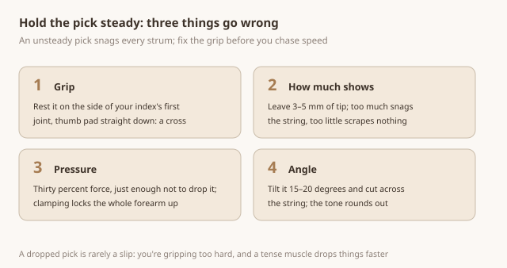
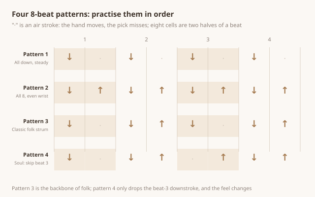
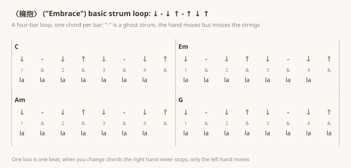

# Chapter 7: Right-Hand Strumming — Holding the Pick and Basic Rhythm

> **What this chapter covers**
> 1. Learn the correct, relaxed way to **hold the pick**, so that strumming stops catching and the pick stops flying out of your fingers.
> 2. Find the power in the wrist's natural **"shake off water"** swing, instead of swinging the whole arm up and down, stiff.
> 3. Practise pop music's four most basic **8 Beat strumming patterns** until they're automatic.
> 4. Play the basic strum loop for the opening section of Mayday's 〈擁抱〉 ("Embrace").

---

## 7.1 The art of holding the pick: three-tenths pressure and the "shake off water" trick

Many beginners pick up a pick and strum, and it sounds like someone dragging a plastic ruler hard across a wire fence. Two bars in, the pick has turned in their fingers or dropped through the soundhole. The problem is almost always the same two things: **gripping too hard**, and **driving the stroke from the elbow instead of the wrist**.

### Correct grip and angle, point by point

| What to check | The common beginner mistake | The fix |
| :--- | :--- | :--- |
| **Finger position** | Holding the pick between thumb, index and middle finger, the way you hold a pen. | Curl the index finger into a hook, sit the pick on the side of its first joint, and lay the thumb pad straight across it (**the two-finger cross**). |
| **How much tip shows** | Most of the tip sticking out, so the pick meets too much resistance and catches on the strings. | Let only about **`3–5 mm`** of the tip show; the rest stays wrapped between thumb and index finger. |
| **Grip pressure** | Squeezing as hard as possible, which locks up the whole forearm. | Hold at about **three-tenths of full strength**—just enough that the pick can't drop—so it can give a little, naturally, when it meets the strings. |
| **Angle of contact** | The flat of the pick dead square to the string (90 degrees, a straight-on collision). | Tilt the pick about **15–20 degrees** toward the headstock, so its edge slices across the string at an angle. The tone turns rounder and smoother straight away. |

> **💧 Feel the "shake off water" motion**
> Imagine you've just washed your hands and there's nothing to dry them on. How do you get the water off your fingers? You **let the wrist go loose and flick it up and down, light, like a fan**—you don't lift the whole arm up and down like a robot. Strumming a guitar is that same motion.

---

## 7.2 Four basic folk strum patterns (starting with 8 Beat)

In 4/4, split every beat into two eighth notes (`1 & 2 & 3 & 4 &`). Rhythm patterns built this way are all called **8 Beat**. The four below are the ladder every pop strummer climbs. Practise them in order, from the first to the fourth:

| Pattern | Strumming (downstroke `↓` / upstroke `↑`) | Count (brackets = ghost strum, the hand moves but misses the strings) | Sound and where it fits |
| :--- | :--- | :--- | :--- |
| **Pattern 1** | `↓` — `↓` — `↓` — `↓` — | **`1`** (and) **`2`** (and) **`3`** (and) **`4`** (and) | Steady and firm. Good for setting up an intro, or for a slow song with a settled mood. |
| **Pattern 2** | `↓` `↑` `↓` `↑` `↓` `↑` `↓` `↑` | **`1 & 2 & 3 & 4 &`** | Dense and unbroken. Trains the wrist to swing up and down evenly. |
| **Pattern 3** | `↓` — `↓` `↑` `↓` — `↓` `↑` | **`1`** (and) **`2 & 3`** (and) **`4 &`** | The classic beginner folk strum. Light, and it pushes forward. |
| **Pattern 4** | `↓` — `↓` `↑` — `↑` `↓` `↑` | **`1`** (and) **`2 &`** (3) **`& 4 &`** | **The famous "soul strum."** The ghost strum on beat 3 is what makes the syncopation. |

### Layering the sound: heavy low on the downstroke, light high on the upstroke
*   **Downstroke (`↓`)**: start from the chord's root string (the 6th, 5th or 4th) and sweep through to the 1st string. Full and thick, which is what marks the accent on the beat.
*   **Upstroke (`↑`)**: just brush lightly up through **the bottom three strings, the 1st, 2nd and 3rd**. Don't haul every upstroke all the way back to the 6th string—that makes the rhythm drag.

---

## 7.3 Putting it to work: the opening loop of Mayday's 〈擁抱〉 ("Embrace")

Mayday's 〈擁抱〉 ("Embrace") runs on four chords almost the whole way: `C - Em - Am - G`, looping without end at about `78 BPM`. It's one of the songs Chinese-language guitarists reach for most often to practise strumming feel. Start with **Pattern 3 above (`↓ - ↓↑ ↓ - ↓↑`)** and use it to bring the left hand's chord changes and the right hand's strum together:

---

## 7.4 Chapter checklist

- [ ] **The grip.** Only `3–5 mm` of the pick tip shows, the wrist stays loose while you strum, and there's no harsh plastic scraping sound.
- [ ] **Layering.** A downstroke comes out full, and an upstroke passes lightly over the three high strings.
- [ ] **Switching patterns.** With a metronome at `78 BPM`, you can carry the `↓ - ↓↑ ↓ - ↓↑` loop smoothly through all four chords of 〈擁抱〉.
