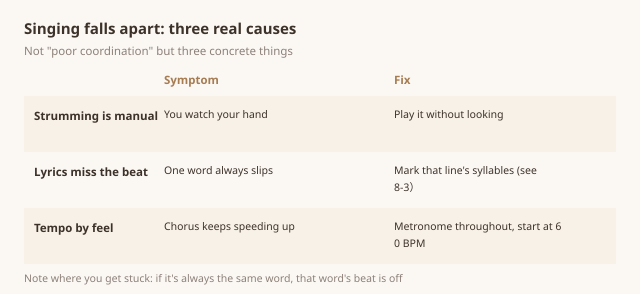
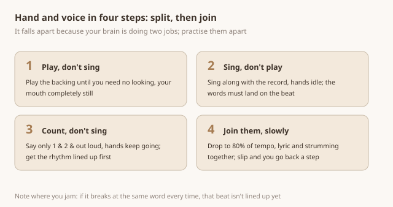
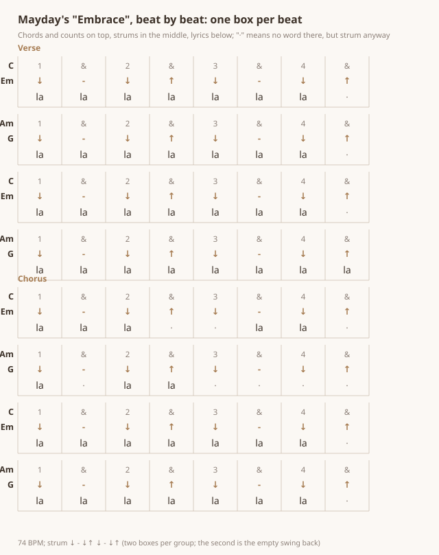

# Chapter 8: Singing and Playing — Why the Right Hand Crashes When You Open Your Mouth

> **What this chapter covers**
> 1. Understand why the right hand stops the moment you start singing, and stop doubting yourself.
> 2. Learn the **four-step hand-and-voice drill** this book works from, which splits the beat between hand and voice.
> 3. Learn to read **lyrics lined up against the strum arrows** on a sing-and-play chart—which syllable lands on which stroke.
> 4. Reach a real milestone: play and sing Mayday's 〈擁抱〉 ("Embrace") all the way through.

---

## 8.1 Why does the right hand crash the moment you start singing?

Almost every beginner runs into this. Strumming on its own is smooth. Singing on its own sounds fine. But sit down with the guitar, open your mouth and sing the first word, and the right hand locks up on the spot—or starts strumming wild, one stroke per syllable of the lyric.

It isn't that you have no sense of rhythm. It's that **your brain hasn't turned the right-hand strum into a reflex yet**. Ask it to run the left hand fretting, the right hand counting beats, and your memory of the lyric and the tune, all at the same time, and it runs out of memory and crashes. The fix isn't to keep grinding at it with everything at once. It's to take the layers apart, in order, so the right hand reaches autopilot first.

---

## 8.2 This book's four-step hand-and-voice drill

Work these four steps in order on any new song. Don't skip one. It usually takes about 15 minutes before the hand and the mouth stop fighting each other:

| Stage | What you do | Pass mark (before you move on) |
| :--- | :--- | :--- |
| **Step 1: put the right hand on autopilot** | Don't sing at all. Just cycle the chords with the `↓ - ↓↑ ↓ - ↓↑` pattern, and meanwhile try to **talk to someone in the room, or read the TV subtitles, while you strum**. | You can hold a conversation and the right hand keeps the pattern without a break. That means the muscle memory is there. |
| **Step 2: tap the beats only, and sing** | Put the pick down. Tap your thigh with your palm like a metronome (`1 2 3 4`), sing the lyric, and notice **which words land at the exact moment your palm hits**. | You can tap a steady four beats and get through a whole verse without rushing or dragging. |
| **Step 3: strip the strumming down and sing over it** | Pick the guitar up, but don't strum anything complicated yet. Use **one downstroke on beat 1 of each bar (`↓ - - -`)**, or **one stroke per beat (`↓ ↓ ↓ ↓`)**, and sing against that. | You can feel where each chord's beat-1 accent lines up with the lyric. That's the security of knowing the harmony and the voice are moving together. |
| **Step 4: put the two together with the full pattern** | Slow the tempo to 80% of the record (about `65 BPM`), add the full `↓ - ↓↑ ↓ - ↓↑` pattern and sing. Once it feels familiar, walk the tempo back up to where it was. | The hand and the voice run on separate tracks, the singing flows, and the strumming stays steady. |

---

## 8.3 Reading the alignment code: which word lands on which strum

Plenty of people teaching themselves get stuck on the chord-and-lyric charts they find online, because nobody tells them how many strums go under a chord symbol. The chart below lines every count (`1 & 2 & 3 & 4 &`) up vertically with the lyric. Watch the places marked **`(empty)`** in brackets: no word is sung there, but **the right hand absolutely does not stop**.

> **🎯 The one moment to watch: syncopated singing in the chorus**
> Look at the first bar of the chorus: syllable one on beat 1, syllable two on beat 2, syllable three on the off-beat `and` of beat 2. After that third syllable the voice drops out and holds through beats 3 and 4, but **the right hand still has to play `↓ - ↓↑` all the way through, steady**. Get past this moment—mouth stopped, hand still moving—and you've graduated.

---

## 8.4 Chapter checklist

- [ ] **The distraction test.** You can strum a steady `↓ - ↓↑ ↓ - ↓↑` while reciting your phone number out loud, or holding a conversation.
- [ ] **Singing over the simple version.** With one stroke per beat (`↓ ↓ ↓ ↓`) you can sing all the way through the verse and chorus of 〈擁抱〉.
- [ ] **The full thing.** You can play and sing 〈擁抱〉 with the complete pattern, and the right hand keeps steady time even through the long held note at the end of the line.
