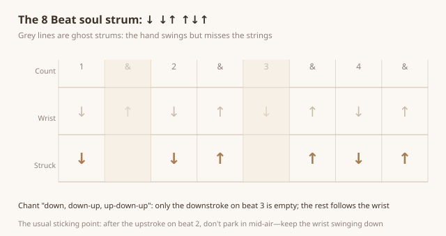
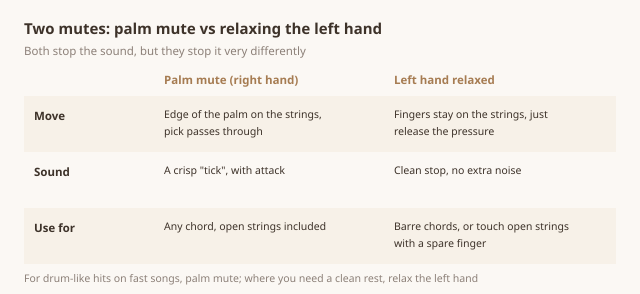
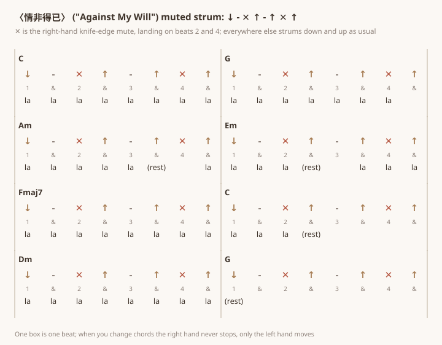

# Chapter 9: Making the Strum Groove — the Soul Strum and Muting

> **What this chapter covers**
> 1. Play the **8 Beat soul strum**, the most-used strum in pop music, until it's second nature.
> 2. Understand how the **ghost strum (the air strum)** makes the groove, and fix the upstroke on the `and` of beat 3 that always arrives early.
> 3. Learn two techniques that clean up an accompaniment: the **right-hand knife-edge mute (palm mute)** and the **left-hand release mute**.
> 4. Play the muted groove that accompanies 〈情非得已〉 ("Against My Will").

---

## 9.1 The groove at the heart of pop: the 8 Beat soul strum

If you could take only one strum with you anywhere, it would be **the soul strum**. The formula: **`↓ - ↓ ↑ - ↑ ↓ ↑`** (say it as `down, down-up, up-down-up`).

What makes it work is that **nothing is strummed on beat 3 itself**: the hand passes through empty air. Then on the off-beat of beat 3 (the `and`) it flicks upward, and that missing downstroke is what creates the syncopation—a groove that seems to jump forward and take a breath.

### Beating the beat-3 ghost strum in three minutes

A lot of beginners practising `down, down-up, up-down-up` finish the upstroke on beat 2 (`↑`) and then park the wrist in mid-air, waiting. The upstroke on the `and` of beat 3 (`↑`) never gets set up in time, and the pattern comes apart. **What to do instead**: after the upstroke on beat 2, keep the hand moving **down across the top of the soundhole on beat 3—about 2 cm above the strings, touching nothing**—and use the bounce at the bottom of that stroke to carry it straight into the upstroke on the `and`.

---

## 9.2 Air and spring in the accompaniment: muting

On an upbeat song like 〈情非得已〉, if the strings ring and buzz from the first bar to the last, the whole thing turns to mush and loses its bounce. That's where **muting** comes in—written `✕` or `•` on a chart. You stop the strings vibrating for an instant on purpose, and that cut is what makes the rhythm snap.

### The two mutes, side by side

| Type of mute | Which chords it works on | What the hand does | What you hear |
| :--- | :--- | :--- | :--- |
| **Right-hand knife-edge mute** | **Any chord**, open chords with ringing open strings included | On the beat you want muted, lay the outer edge of the right palm (the fleshy pad below the little finger) lightly across all six strings to stop them, and let the pick carry on down through the strings at the same moment. | A clean, dry percussive **"chick"**—the sound reads as rhythm, not as a chord. |
| **Left-hand release mute** | **Barre chords with no open strings** (or touch the open strings with a spare finger) | Strum the chord, then **let the left-hand fingers ease their pressure without leaving the string**, so the string lifts off the fret wire and settles back onto the pad of the fingertip. | The chord stops dead, clean (it does the job of a rest), with no extra percussive noise. |

---

## 9.3 Putting the mute to work: Harlem Yu's 〈情非得已〉 ("Against My Will")

〈情非得已〉 ("Against My Will") is a signature upbeat pop-rock song. Put a **right-hand knife-edge mute (`✕`) on beats 2 and 4**—copying the beats where a drum kit's snare drum would hit—and the whole song suddenly has a band behind it.

> **Practice settings**: time signature `4/4` | tempo `88 BPM` | strum: `↓ - ✕ ↑ - ↑ ✕ ↑` (a `✕` is a right-hand knife-edge muted downstroke)

---

## 9.4 Chapter checklist

- [ ] **The ghost strum habit.** Playing the soul strum (`↓ - ↓↑ - ↑↓↑`), the hand swings through beat 3 without breaking time.
- [ ] **A clean mute.** The right-hand knife-edge mute gives a dry "chick", with no strings left ringing underneath.
- [ ] **The real thing.** With a metronome at `88 BPM`, you can play the muted soul strum through the verse of 〈情非得已〉.
