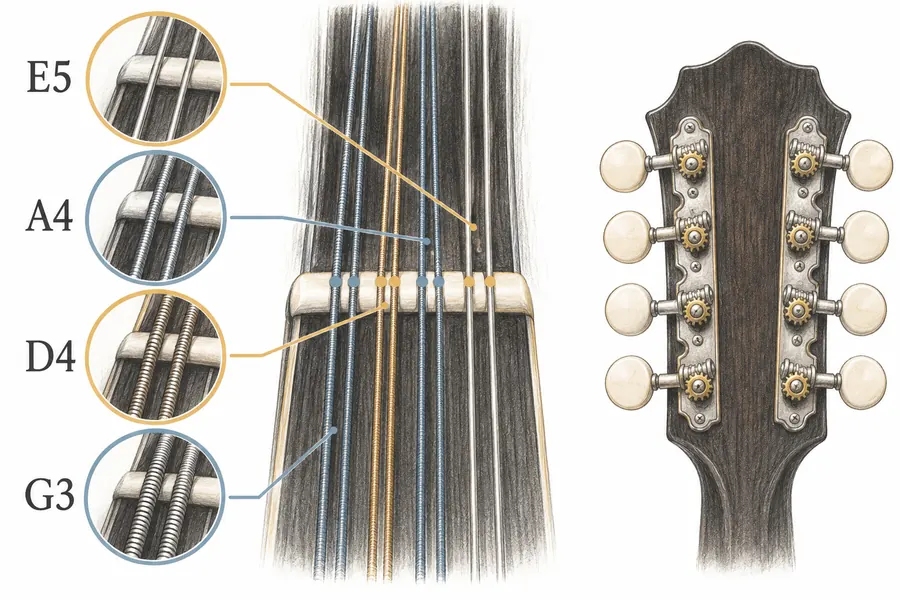
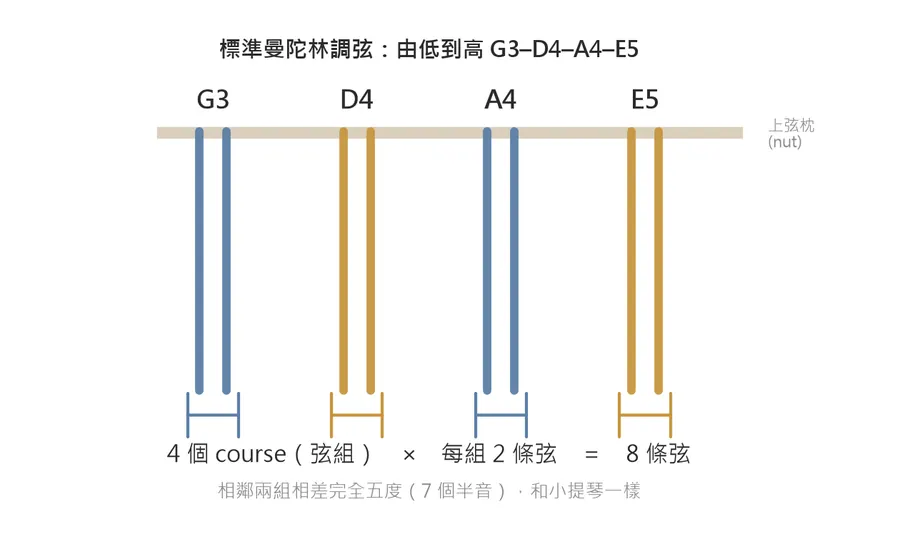
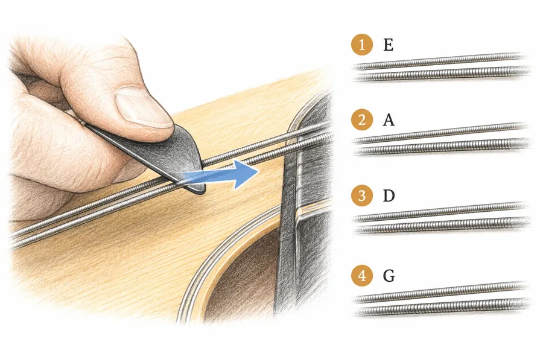
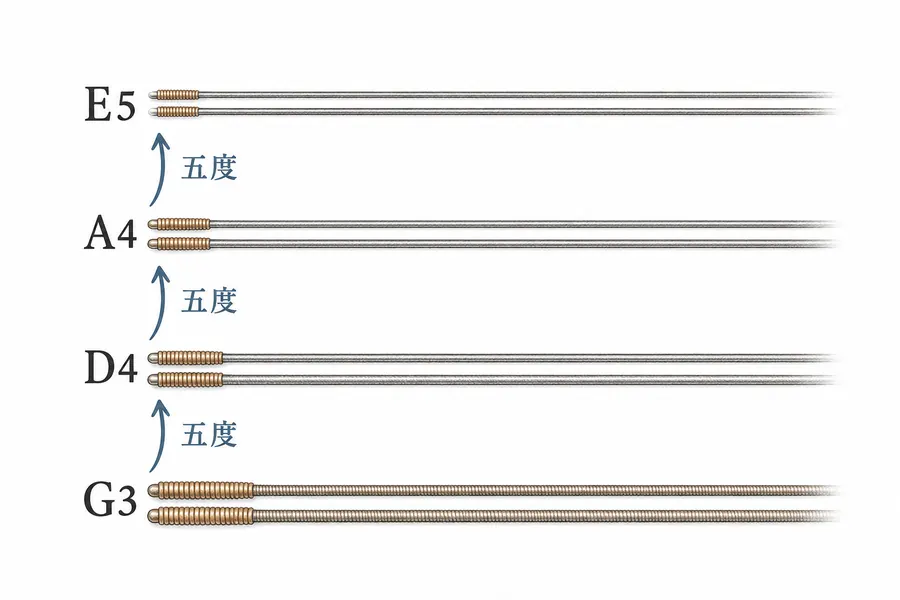
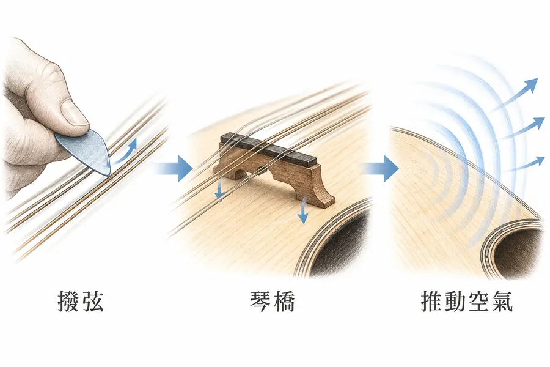
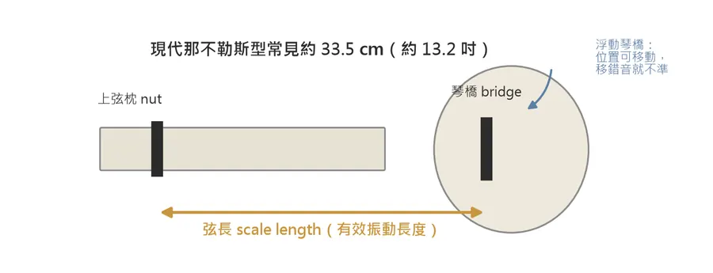
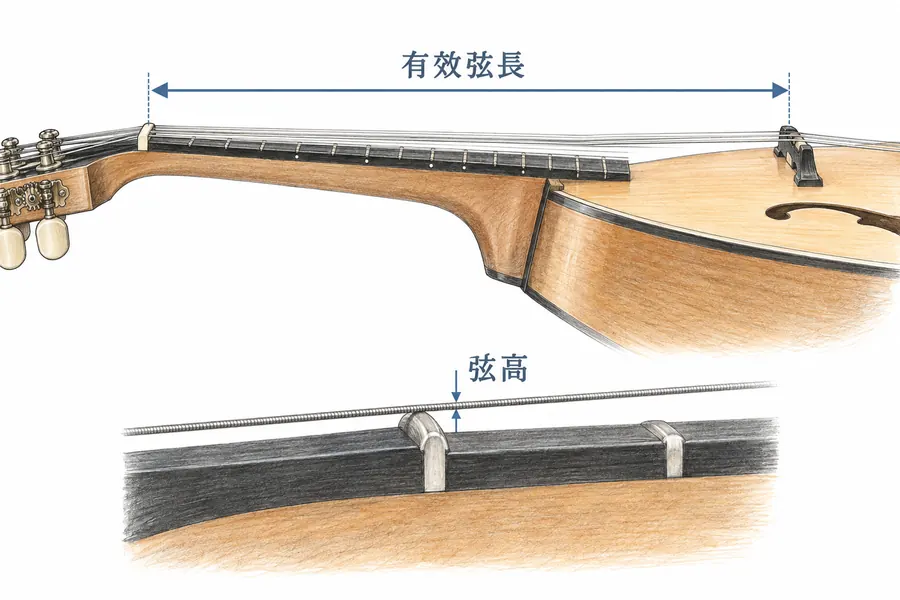
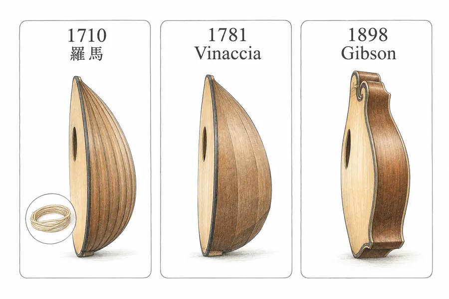
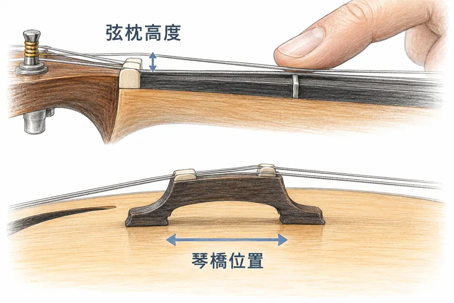

# Chapter 1: Getting to Know the Mandolin

*From courses and tuning to structure and feel: four ways into one instrument*

## What this chapter covers

- A mandolin has **eight strings**, but what the player actually faces is **four courses**, each usually a pair of strings at the same pitch.
- Standard tuning is **G3–D4–A4–E5**, with adjacent open strings a **perfect fifth** apart — the same as the violin's four open strings.
- **Intonation** is not solved by getting the tuner to read right. Move the floating bridge and the whole instrument's effective scale length moves with it.
- Sound travels along the path **string → bridge → soundboard → the body and the air inside it**. Wood alone does not decide the timbre.
- When choosing an instrument the order is "measure first, judge second, act last". Scale length, nut height, bridge reserve and fret condition affect whether you can learn well far more than appearance does.

> **How to read this book**
>
> This document is a more readable rewrite of the original *Complete Professional Knowledge of the Mandolin*.
> You do not have to read from the first page to the last — you can pick a route that suits your purpose.

*Figure: you can pick a route by purpose; you do not have to read from the first page to the last.*

## Build the right picture first

The mandolin is easy to misunderstand.

The body is not large, the fretboard has frets, and it is played with a plectrum, so it looks like a smaller guitar.

On the other hand, it is tuned G–D–A–E like a violin. So some people intuitively think of it as "a violin you can strum chords on".

Both descriptions catch part of the surface, and neither explains the real mandolin.

To read this instrument you have to look at four things at the same time:

1. How the **four double courses** work together.
2. How **fifth tuning** lays out the whole fretboard.
3. How the **plectrum** puts force into the strings.
4. How the **bridge and body** turn a tiny vibration into the sound we hear.

This chapter builds the basic concepts the whole book shares.

Once you know that "eight strings" is really four courses, the picture starts to change.

Once you know that scale length is not just a number on a spec sheet, it gets clearer still.

You will also know that the position of the floating bridge affects intonation. A lot of problems then suddenly connect.

For example: why the plectrum catches in the strings so easily; why chords in low positions run sharp; why one instrument is harder to press than another; why one body style has a more direct attack. These apparently unrelated phenomena all make sense once they are put into the same logic of structure and playing.

## A first look: the core data of a modern standard mandolin

| **Item** | **What is usual** |
|---|---|
| **Courses** | 4 courses; usually 2 strings each, 8 strings in total |
| **Tuning** | G3–D4–A4–E5 (low to high) |
| **Interval relationship** | a perfect fifth between adjacent courses |
| **Main sound production** | the plectrum plucks the strings; long lines are often carried with tremolo |
| **Common bridge** | a floating bridge, whose position affects intonation |
| **Common body styles** | bowlback, flatback, carved-top, solid/electric |

*Figure: a first look at the core data of a modern standard mandolin (schematic)*

## 1.1 The basic idea of four double courses

*Figure A: 8 strings = 4 courses. The two strings of a course sit very close together, and one plectrum stroke crosses a whole course.*

A modern standard mandolin usually has eight physical strings, but the player actually faces four courses.

Each course is mostly made of two strings tuned to the same pitch, set very close together.

This looks like nothing more than "one string becoming two", but it changes four things at once:

- the resistance the right hand feels.
- the time the plectrum needs to pass through a course.
- the way you tune.
- the quality of the attack.

> **Common misconception**
>
> A guitarist playing a mandolin for the first time often feels the plectrum "stuck in the strings", and assumes the plectrum is too thick or the hand is clumsy.
>
> **What is really happening**: the problem is usually in the movement. Where you used to pass through one string, you now have to pass cleanly through two strings set very close together in the same stroke. That is the movement control the double-course structure demands directly.

### Two strings at the same pitch: why does the sound get thicker?

Two strings at the same pitch also change the volume, the attack and the mixture of overtones at once.

Even when both strings are tuned to the same pitch on the tuner, a difference remains.

Their diameter, tension, age, the instant each is struck and the pressure of the fretting finger can never be identical at every moment.

These very small differences change the transient and the overtone structure, and give a double course a higher density of sound than a single string.

| **How far apart the two strings are** | **What it sounds like** |
|---|---|
| too far apart | obvious **beating**, which sounds like the instrument is out of tune |
| only a tiny difference | it blends into the "liveliness" that belongs to the mandolin, and the sound seems alive |

So the goal of professional tuning has not changed: still make the two strings as identical as possible, and keep chords and melody clear.

*Figure 1.1: the basic idea of four double courses (schematic)*

### The family has exceptions too

The notation document of the Classical Mandolin Society of America (CMSA) writes the standard mandolin as four double courses.

The document also states plainly that family instruments sometimes have a fifth course, or a special scordatura (altered tuning).〔F13〕

That is a reminder: when you identify a mandolin-family instrument, you cannot look only at "how many strings it has". Confirm three things together — how the courses are organised, how it is tuned, and how far the range reaches.

When we come to the Liuto Cantabile (a large tenor member of the family) or the ten-string Mandoloncello (mandolin cello) later, you will see the same principle extended into five double courses.〔F13〕

### From the movement's point of view: less room for error

A course also changes the tolerance for touching "the same note".

- If the plectrum grazes only one of the two strings, the timbre suddenly gets thinner.
- If the plectrum goes too deep into the strings, it easily meets extra resistance on the second string.

That is why right-hand training on the mandolin stresses two things very early: **a fixed amount of plectrum showing**, and **a consistent depth into the strings**. This is not a teacher being fussy; it is the movement control the double-course structure demands directly.

### Octave stringing: the exception explains the rule

A course can also be strung in octaves (octave stringing) and in other arrangements. CMSA specifically lists scordatura, and the octave stringing that can appear in the larger family members, as exceptions.〔F13〕

These exceptions actually help us understand the standard state.

The modern classical mandolin takes **unison courses** as its norm, because that keeps melody fingering, notation and the overall timbre most consistent.

Only when a composer or a folk tradition deliberately breaks that convention do new resonance and harmony effects appear.〔F13〕

### For a first-time buyer

If you are buying your first instrument, you can read 21.1 on use and budget first, then come back to this chapter to learn the four double courses.

If you want to build a sound in your ear first, pick an album from chapter 22 and start learning with a sound you like.

## 1.2 Fifth tuning and the fretboard

*Figure D: "an octave higher" simply means the frequency doubles. This is the basis of every pitch relationship in the book.*

A standard mandolin is tuned low to high G3–D4–A4–E5, with adjacent open strings a **perfect fifth** apart.

Those are the same pitches as the violin's four open strings. It gives the mandolin fretboard a high degree of regularity:

the same scale shape, arpeggio position and double-stop relationship can often be found again along the fretboard as the same kind of "geometric figure".

For a melody instrument, fifth tuning lets four courses cover a wide range. The price is that some chords have to span a greater distance in the left hand.

### The same tuning ≠ the same technique

Fifth tuning also explains why a lot of violin melodies can be moved to the mandolin directly. But "the same tuning" does not mean "the same technique".

| **Point of comparison** | **Violin** | **Mandolin** |
|---|---|---|
| Frets | none | fretted |
| Pitch control | finger position has to be controlled continuously | semitone positions are more fixed |
| Energy input | the bow can keep feeding energy into one note | the plectrum cuts the energy into short attacks |
| What they share | pitch and the fretboard map | pitch and the fretboard map |

The two share the pitch map; each has its own way of making sound.

When you really move a violin piece onto the mandolin, what most needs rearranging is usually **long notes, string crossings and the breathing of the phrase**. The note names can usually stay.

*Figure 1.2: fifth tuning and the fretboard (schematic)*

### The physical evidence from 1781

The Neapolitan mandolin made by Antonius Vinaccia in 1781 is very important physical evidence.

It has eight strings and four double courses, and the museum record states plainly that it uses the same pitch arrangement as the violin.〔F04〕

That **does not mean** it was the "first" mandolin tuned that way.

But it at least proves that by the late eighteenth century, the four-course fifth system we know today had already appeared in a mature Neapolitan body style.〔F04〕

### Two effects a beginner meets early

**Effect one: the left hand has to reach further.**

Within one position, a mandolin left hand often needs a wider lateral stretch than a guitar.

| **Instrument** | **Interval between adjacent strings** | **How chords are made** |
|---|---|---|
| Guitar | mostly fourths between the upper strings | many chords can be made within adjacent frets |
| Mandolin | fifths | catching root, third and fifth together means some closed chords have to span more frets |

That is why the classical, bluegrass and folk traditions developed different chord voicings. All of these shapes exist to meet the needs of fifth tuning.

**Effect two: melody and transposition are easy.**

The other way round, fifth tuning is very friendly to melody and to transposition.

If a fragment of a scale forms a stable fingering between one course and the next, moving it to another key often only needs the whole shape shifted.

For anyone reading a full score or transcribing violin melodies, that regularity is very valuable.

In practice, though, you still have to rework plectrum direction, long notes and the response of the double courses.

## 1.3 The path the sound travels

*Figure B: the path the sound travels. The plectrum supplies only a little energy; the body amplifies it all the way.*

The plectrum pushes the string away from its resting position and lets go, and the string begins to vibrate.

But if you let one thin string vibrate in the air on its own, the sound is very small, because the amount of air it can push is limited.

The mandolin's real efficiency comes from "sending the string's energy into a larger structure".

### How the energy travels

> **An analogy**: this is like pushing a door with your little finger. The door hardly moves. But go through the handle and the hinge, and the same force moves the whole door. The bridge is that door handle.

| **Order** | **What happens** |
|---|---|
| 1 | the plectrum pushes the string aside, then lets go |
| 2 | the string vibrates |
| 3 | the string passes the force through the **bridge** to the **soundboard** |
| 4 | the soundboard couples with **the air inside the body** |
| 5 | the other parts of the body join in |
| 6 | the vibration becomes **sound pressure** in the air, which is what we hear |

That is why the bridge is the central interface on the whole chain of sound production.

### The floating bridge: convenient, but it drifts

On a Neapolitan bowlback, the bridge is mostly a **floating bridge**, held against the soundboard by the tension of the strings.

It **can be moved**, which makes it convenient to correct the overall intonation.

But it also means that changing strings, a knock or careless cleaning can all shift the bridge.

> **Common misconception**: when an instrument "suddenly goes out of tune at the twelfth fret", most people's first reaction is "the frets were made badly".
>
> **What is really happening**: if the bridge has slid a few millimetres forward or back, the effective scale length of the whole instrument has already changed. That is more common than a problem with the frets.

*Figure 1.3: the path the sound travels (schematic)*

### How acoustics research sees this

Acoustic research goes further and shows that a mandolin's sound involves the strings, the bridge, the soundboard and the other parts vibrating **together**.

The soundboard, the bracing (the struts inside), the bowl and the back, the neck, the soundhole and the air in the cavity all take part in modes at different frequencies.

A 2022 study of traditional Italian mandolins used an impact hammer, an accelerometer and microphones inside and outside the instrument to measure bridge admittance and sound radiation.

The result showed that the instrument's response has to be treated as **one coupled system**: wood, soundhole and internal bracing have to be considered together.〔F08〕

### So do not blame everything on the wood

Once you understand this energy path, you can avoid putting every difference in sound down to the wood.

Suppose two instruments both have a spruce soundboard:

| | **Instrument A** | **Instrument B** |
|---|---|---|
| Soundboard | thicker | thinner |
| Bracing | heavier | lighter |
| Bridge | heavier | lighter |
| Likely result | attack, frequency response and dynamic ceiling all differ | attack, frequency response and dynamic ceiling all differ |

The role of the wood has to be understood inside the whole sound-producing system.

The 2022 study does exactly this: it measures the mechanical properties of the wood and the bridge admittance of the whole instrument, and compares structure and material together.〔F08〕

### In repair, this path is the order of checks

For repair work, the energy path also gives a very practical order of checks.

When an instrument suddenly develops a strange noise, check in this order:

1. Has a string come loose?
2. Does the bridge sit in contact with the top?
3. Is the tailpiece resonating?
4. Are the soundboard and the internal joints sound?

Work down from the result and narrow the cause step by step.

A lot of annoying buzzing actually comes from a very small hardware or contact problem.

## 1.4 Scale length, string height and the bridge

*Figure C: how scale length is measured — from the nut to the bridge. The bridge can move, and if it sits in the wrong place the intonation goes.*

When you choose your first mandolin, appearance easily takes all the attention.

An F-style's scroll, fancy inlay or dark grain is immediately obvious. But for "can I learn well on this", the following usually matter more:

- scale length
- neck geometry
- nut height
- bridge reserve
- fret condition

### Three key terms

| **Term** | **In plain words** | **What happens when it goes wrong** |
|---|---|---|
| **scale length** | the distance from the nut to the bridge | affects the feel and the choice of string gauge |
| **nut action** | the height of the string slots in the nut | too high makes the first and second frets hard to press, and fretted notes also run sharp |
| **bridge height** | how high the bridge holds the strings | too low may leave no room to correct the action |

At the same pitch and with similar string material, a change in scale length affects the feel and the choice of string gauge.

### How do you judge whether an instrument suits a beginner?

More direct than "does this wood look better", is to test it with your hands, in this order:

1. First tune the open strings.
2. Play fret by fret and check for obvious buzzing or dead notes.
3. Check whether the note at the twelfth fret and the harmonic roughly agree.
4. Look at whether the bridge stands upright, and whether there is still room to adjust the height.
5. Look for obvious twisting in the neck.

*Figure 1.4: scale length, string height and the bridge (schematic)*

### Historically there was never one single standard scale length

Historical collections are also a reminder that **there is no single standard scale length**:

| **Object** | **Effective vibrating length** |
|---|---|
| A nineteenth-century European mandolin in the Met collection | 32.0 cm |
| A modern Calace Neapolitan mandolin | 33.5 cm |

Both fall inside the mandolin's range.

But because one number is common, you cannot force every period and every school into the same specification.〔F14〕

### 33.5 cm applies only to bowlbacks

Here is an easy point to misunderstand: **33.5 cm is not the standard for every mandolin.**

| Body style | Common scale length |
|---|---|
| Neapolitan bowlback | about 33–34 cm |
| American carved-top (Gibson, Collings and others) | about 35.2–35.6 cm (13 7/8 in to 14 in) |
| Flatback | depends on the maker; mostly between the two |

All of these are called "mandolins", yet the American instrument's scale length is **about 2 cm longer** than the Italian bowlback's. That directly affects the left-hand stretches a chord needs, and it affects the string gauges too.

So when you see "mandolin scale length 33.5 cm", first ask: **which kind of mandolin is this?**

### Scale length alone cannot decide tension

Scale length on its own cannot decide tension either. Pitch and the string's linear density matter just as much.

Still, when you compare the same kind of string material at the same pitch, scale length is a very direct coordinate for the feel.

| **Model / source** | **Scale length** |
|---|---|
| Calace current standard mandolin | 33.5 cm |
| Suzuki 2017 catalogue, M-30 | 336 mm |

The two are very close. That shows **about 33.5–33.6 cm** is a range common to several modern traditional instruments.

But it still should not be written as "the one standard of every historical mandolin".〔F14〕〔F26〕

### One thing that especially confuses people with used instruments

With a used instrument, you especially have to separate "scale length" from "where the bridge happens to sit now".

If a floating bridge has been put in the wrong place by the previous owner, the effective scale length you measure will drift away from the design value.

Measure only from the nut to the bridge and use that number to identify the model, and you may mistake a **setup error** for a **manufacturing specification**.

So identifying a model is best done with three things together: fret position, official data, and the state of the bridge's compensation.

## 1.5 Three historical instruments compared

If you look only at names, all three of the instruments below can be written "mandolin" in Chinese:

- the Roman mandolino of about 1710
- the 1781 Vinaccia Neapolitan mandolin
- the 1898 Orville Gibson mandolin

But put the three objects side by side and you see at once that behind the name there are three different technical worlds.

### The Roman mandolino of about 1710

This instrument uses multiple courses of gut strings and a sickle-shaped pegbox.

The Met even records that its fretboard was once widened because a course was added.

This older kind of mandolino and the later eight-string metal-string Neapolitan system **cannot be treated as the same thing**.〔F03〕

### The 1781 Vinaccia Neapolitan mandolin

This one already shows the core features of the Neapolitan school:

- eight strings
- four double courses
- the same pitches as the violin
- a bowl-shaped back
- a bend in the soundboard near the bridge

All of these structural points are tied to the higher string tension and to the needs of plectrum sound production and projection.〔F04〕

*Figure 1.5: three historical instruments compared (schematic)*

### Orville Gibson, 1898

By 1898, American instrument making had redefined the problem once again.

The Met's object and the American patent both show that Gibson used:

- a carved top and a carved back
- a floating bridge
- a tailpiece
- an attempt to reduce traditional joins and internal bracing
- a neck even designed to communicate with the cavity of the body

In other words, the American carved-top is, more accurately, **another structural philosophy**.〔F10〕〔F11〕

### The three together

| **Object** | **Observable structure** | **What to read from it** |
|---|---|---|
| Roman mandolino, about 1710 | multiple gut courses, sickle-shaped pegbox | check the original courses against later alterations〔F03〕 |
| 1781 Vinaccia | four double courses, bowl back, bent soundboard | get to know the Neapolitan system〔F04〕 |
| 1898 Orville Gibson | carved top and back, floating bridge | compare American structure with the original patent〔F10〕〔F11〕 |

Put these three together and you build the most important reading habit in this book:

> When you see "mandolin", first confirm **how the period, region, courses, string material, soundboard and body** are put together.
>
> The name is only the entrance; structure is the evidence.

### Seen from the player's feel

The differences between the three objects can also be understood as "what the player feels".

| **Instrument** | **What its playing world is like** |
|---|---|
| early gut-course mandolino | the right hand and the world of tension are different from a metal eight-string instrument |
| Neapolitan instrument | a short, crisp attack, higher tension |
| American carved-top | another response and another dynamic range again |

Even playing the same melody, the best plectrum, the volume control and the strategy for long notes will not be identical.

A historical body style is not a classification label in a museum; it is **a technical condition that enters the feel and the phrasing**.

### What to watch for when reading old scores

When you read old scores, confirm the range and the original conditions of sound production at the same time.

The range may be the same, but the original instrument's sustain, resonance and number of courses can make the same accompaniment phrase come out at a completely different density.

The value of historical performance research is exactly this: restoring those physical conditions beyond the notes.〔F01〕

## 1.6 Cases: feel and instrument setup

### Case one: sharp in low positions, slightly high at the twelfth fret

Suppose a used mandolin is complete in appearance, has no large cracks, and its open strings tune up fine.

But chords in first position are always sharp, and the twelfth fret is a little high.

Deal with it only as "tuning" and the player may keep turning the pegs without ever getting a stable result.

A more reasonable order of diagnosis is:

| **Order** | **What to check** | **Why** |
|---|---|---|
| 1 | the nut | if the slots are too high, pressing in low positions stretches the string a little extra |
| 2 | the bridge position | if the overall scale has been shortened, the twelfth fret goes sharp along with everything else |

These two problems **can exist at the same time**.

So you cannot use "move the bridge" to compensate for "too high a nut action" — that only makes the other problem harder to find.

### Case two: the bridge is already cut low, and the action is still high

Another common situation: the bridge has already been cut very low, but the action is still high.

The real problem here may be the **neck angle** or **long-term deformation of the soundboard**.

Keep cutting the bridge and in the end you only:

- reduce the break angle (the angle at which the strings pass over the bridge)
- give up the reserve for adjustment

without dealing with the underlying geometry.

This case is also why structure has to be discussed in chapter one: **playing feel is never the effect of a single part.**

*Figure 1.6: cases — feel and instrument setup (schematic)*

### The same goes for an instrument that is "stiff and tiring"

The same way of diagnosing applies to an instrument that feels "stiff and tiring".

The player may blame the string gauge first, but any of the following can add to the load on the left hand:

- too high a nut
- too much neck relief
- too high a bridge
- too long a scale

The most effective approach is to establish a baseline first. What to record:

1. the current string gauge
2. the tuning of the open strings
3. the height at the first fret
4. the action at the twelfth fret
5. the relief
6. the bridge position

With these six numbers in hand, deal with one item at a time, and you will not be turning screws in the dark.

### Measure first, judge second, act last

So every later problem in this book with setup, wood or body style comes back to the same method:

1. First describe the **observable phenomenon**.
2. Then look for the likely **structural cause**.
3. Only then talk about **adjustment or preference**.

For a mandolin this is more reliable than memorising a set of "standard numbers".

> **Important warning**
>
> Where a neck reset, soundboard deformation or major bridge rework is involved, this book will later draw a clear line between what you can do yourself and what belongs to a professional repairer.
>
> With historical instruments especially: cutting away original material is often irreversible, and a short-term improvement in feel may cost you value and structure in the long term.

Chapter 1 establishes the habit of "measure first, judge second, act last". Every buying and repair chapter later reuses it.

## Self-study question bank

Study check: answer, check, review

Answer first, then look at the answers. When you get one wrong, go back to the relevant section of this chapter and read it again.

**1. How many courses does a standard mandolin usually have?**

- A. 2
- B. 4
- C. 6
- D. 8

**2. What is the usual tuning of a standard mandolin, low to high?**

- A. E–A–D–G
- B. G–D–A–E
- C. C–G–D–A
- D. G–C–E–A

**3. What can a change in the position of the floating bridge affect most directly?**

- A. the colour of the finish
- B. the effective scale length and the intonation
- C. the weight of the headstock
- D. the botanical name of the wood

**Answers: 1.B　2.B　3.B**

## Main sources checked for this chapter

Source check: find the original, check the conditions, keep a record

| **Number** | **Source and what it was used for** |
|---|---|
| 〔F01〕 | James Tyler & Paul Sparks, *The Early Mandolin*, Oxford University Press, 1992. Structure, repertoire and historical performance research on the early mandolino and the Neapolitan mandoline. |
| 〔F03〕 | The Metropolitan Museum of Art, *Mandolino, Rome, ca. 1710*, Met 2008.2a, b. A typical early Roman mandolino: six gut courses, sickle-shaped pegbox and traces of later alteration. |
| 〔F04〕 | The Metropolitan Museum of Art, *Mandolin, Antonius Vinaccia, Naples, 1781*, Met 89.4.2140. Object data: eight strings, four double courses, the violin's pitches, and the Neapolitan bent soundboard. |
| 〔F08〕 | Quintavalla et al., *The Acoustics of Traditional Italian Mandolins and Their Relation with Soundboard Wood Properties*, International Journal of Wood Culture 2, 2022. Acoustic comparison of a 1906 Neapolitan, a 1908 Milanese and a Roman-style modern Italian mandolin. |
| 〔F10〕 | United States Patent Office / Google Patents, *US598245A – Mandolin, Orville H. Gibson*, patented 1898-02-01. Gibson's original patent for the one-piece rim/neck/head, carved top and back, and hollow neck. |
| 〔F11〕 | The Metropolitan Museum of Art, *Mandolin, Orville Gibson, 1898*, Met 2015.643a–c. A surviving object consistent with the 1898 patent design. |
| 〔F13〕 | Robert A. Margo / Classical Mandolin Society of America, *Music Notation for Mandolin Family Instruments*, v3, 2019. Family tunings, notation, and regional naming differences for the mandola and octave mandolin. |
| 〔F14〕 | Liuteria Calace, *Mandolini – official specifications*, accessed 2026-10-06. Current mandolin specifications: 33.5 cm scale length, bowlback ribs, spruce soundboard. |
| 〔F26〕 | Suzuki Violin Manufacturing / Suzuki Music, *2017 string-instrument catalog*, 2017. Japanese family specifications and scale lengths for the M-30, M-100, MD-4, MD-10 and MC-836. |

Links:

- 〔F01〕https://academic.oup.com/book/49300
- 〔F03〕https://www.metmuseum.org/art/collection/search/505783
- 〔F04〕https://www.metmuseum.org/art/collection/search/504543
- 〔F08〕https://www.sciencedirect.com/org/science/article/pii/S2772318622000017
- 〔F10〕https://patents.google.com/patent/US598245A/en
- 〔F11〕https://www.metmuseum.org/art/collection/search/700485
- 〔F13〕https://classicalmandolinsociety.org/wp-content/uploads/Music_Notation_for_Mandolin_Family_Instruments_v3.pdf
- 〔F14〕https://www.calace.it/en/mandolini
- 〔F26〕https://www.suzuki-music.co.jp/app/uploads/2017catalog14.pdf

From reading the early instruments to the mandolin's journey around the world, then identifying the various mandolins by tuning, range and structure.

Reading route　Chapters 2 to 6
