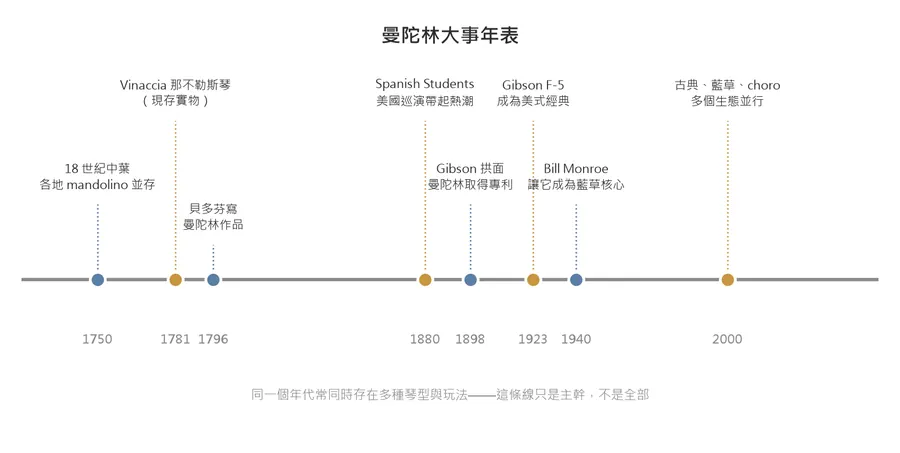
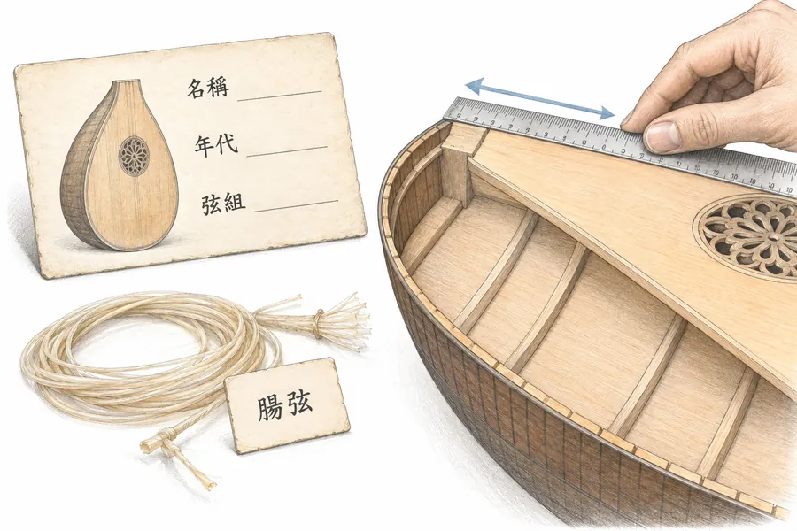
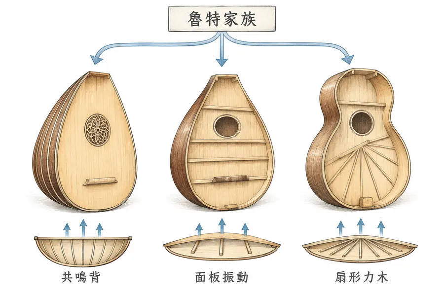
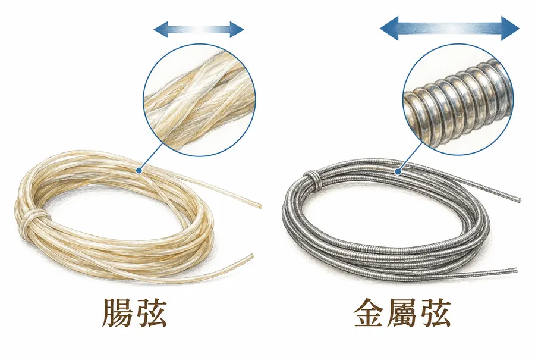
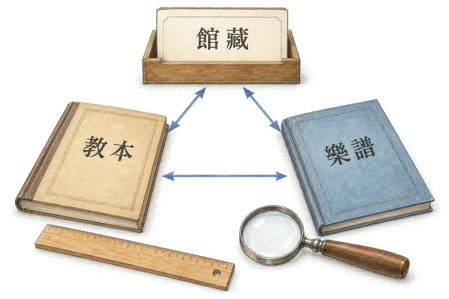
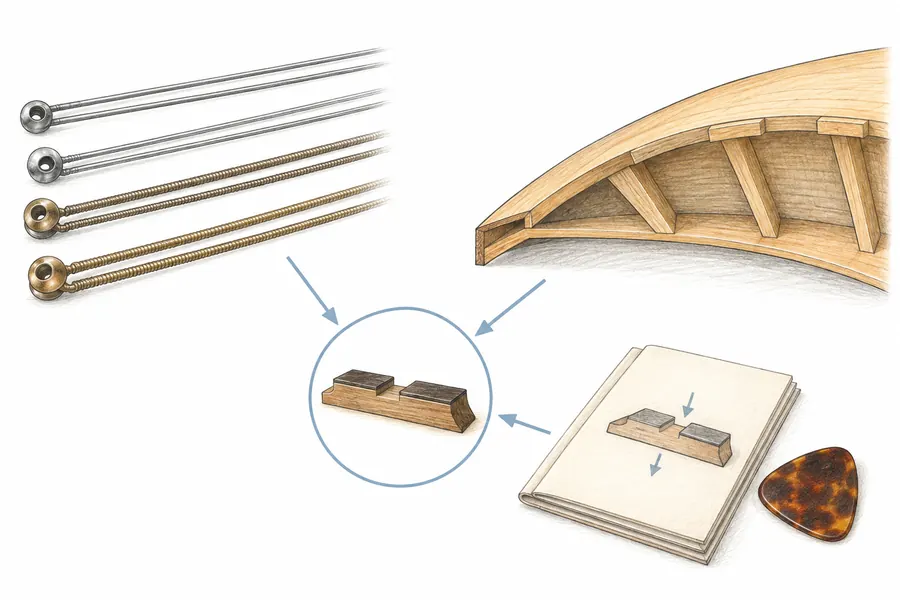

# Chapter 2: The Origins and Evolution of the Early Mandolin

*Before the modern mandolin: names, gut strings, courses and the historical evidence*

## What this chapter covers

- In the seventeenth and eighteenth centuries the names **mandola, mandolino and mandore** were not fixed the way a modern product catalogue fixes them. They varied by city, language and document.
- Instruments with the same name may have different numbers of courses; the same kind of structure may carry different names. **Look at the structure rather than the name.**
- The early mandolino usually used **gut strings**, a completely different set of conditions from the later all-metal Neapolitan instrument.
- Early Italian mandolin culture had **several systems existing at once** (Roman, Milanese, Genoese, Neapolitan). It was not a single line of evolution.
- "Who invented the mandolin" is usually not a good question. A more useful one is: **which structures started to appear at the same time, and when?**
- When historical sources conflict, this book **keeps the difference and explains the evidence**, rather than picking the one that looks neatest.

## A too-tidy evolutionary line is usually unreliable

The easiest place to go wrong with mandolin history is to find a tidy evolutionary line too quickly:

some medieval pear-shaped plucked instrument → mandore → mandolino → today's mandolin.

That story is perfect for drawing a pretty family tree. But it usually sacrifices the complexity of the real history.

In the seventeenth and eighteenth centuries, names like mandola, mandolino and mandore were not fixed the way a modern product catalogue fixes them.

- The same name could point to instruments with different numbers of courses.
- The same kind of structure could carry different names in different places.

So this chapter uses **objects, scores and written records** to describe how the early mandolin developed.

## Do not apply modern specifications to historical names: four objects at a glance

| **Case** | **Period / region** | **Courses / string material** | **Key feature** | **Source** |
|---|---|---|---|---|
| **Roman mandolino** | ca. 1710, Rome | currently 6 courses / gut | the summary and the technical entry record the single/double string detail differently; a course was once added | F03/F27 |
| **Genovese** | 18th century, Genoa | 6 pairs, gut | guitar-style peg block; an unusual tuning | F05 |
| **Milanese Presbler** | 1796, Milan | 6 pairs | made as a set with a mandola an octave lower | F06 |
| **Neapolitan Vinaccia** | 1781, Naples | 4 pairs / metal | G–D–A–E; a bent top | F04 |

*Figure: do not apply modern specifications to historical names — four objects at a glance (schematic)*

## 2.1 The historical specifications of the mandolino

*Figure E: a mandolin timeline. Several body styles usually existed at the same time, so this line is only the main trunk.*

In Italian today, mandolino can refer quite naturally to the modern mandolin.

But when you study the seventeenth and eighteenth centuries, the word **cannot simply be given** today's eight-string G–D–A–E definition.

*The Early Mandolin* treats the early mandolino and the Neapolitan mandoline in separate sections.

The reason is that the two differ clearly in string material, courses, tuning and playing method.〔F01〕

### A case where the museum's own record contradicts itself

The Met's Roman mandolino of about 1710 is a good case, and a reminder that a museum record has to be **read column by column**.

| **Different fields on the same page** | **What they say** |
|---|---|
| Summary field | calls it six double courses |
| Technical description | records **five double courses plus one high single string** |
| Technical description (continued) | notes that the fretboard was widened in the eighteenth century, taking the original five courses to the present six |

When fields do not quite agree like this, this book keeps both records, and then separates out what can be stated with certainty:

- the instrument **was altered** at some point.
- it currently has **six courses**.
- its specification is **not the same** as the modern eight-string G–D–A–E system.〔F03〕

*Figure 2.1: the historical specifications of the mandolino (schematic)*

### Another name: mandolino del vecchio tipo

Another Met publication calls this kind of small instrument — sickle-shaped pegbox, four to six gut courses — the **mandolino del vecchio tipo** (the mandolin of the old type).

The same source notes that they were often **plucked with the fingers**, rather than by the plectrum logic of the modern Neapolitan instrument.〔F27〕

This is a good reminder: see the three syllables "mandolino" and translate it straight as "eight-string mandolin", and you have rewritten the whole of early playing practice.

### Authoritative institutions also need collating

The conflicting record for this Roman mandolino also has a methodological point.

A museum web page may carry a summary and a technical entry written in different years by different authors.

A researcher cannot stop comparing just because the source is an authoritative institution.

A better approach is:

1. Record **which field** says what.
2. Go back to the photographs, the collection paper and later research when needed.

> An authoritative source lowers the chance of error, but it does not mean every field is beyond collation.

### So how should the reader judge?

The most practical way is to hold on to the **core that does not conflict**:

| **What can be established** | **Content** |
|---|---|
| Period | ca. 1710 |
| Type | Roman type |
| String material | gut strings |
| Pegbox | sickle-shaped pegbox |
| Alteration | changed from the original five courses to the present six |

As for whether the sixth course is now paired or single, the two statements in the museum record should be set side by side, with the part still **awaiting confirmation** clearly marked.

## 2.2 The lute family and instrument classification

In organology the mandolin is placed among the chordophones in the **lute** class, because it shares the common structure:

- it has a neck
- the strings run roughly parallel to the soundboard
- the sound is produced by plucking

This classification helps comparison.

But "belonging to the lute family" does not mean there must be a direct, continuous, one-directional line of descent between them.

From the Middle Ages into the early modern period, European plucked instruments borrowed body shapes, courses, pegboxes and tuning ideas from one another.

Names drifted too, across Italian, French and other languages.

### The oud did not turn directly into the mandolin

When Tyler and Sparks discuss origins, they do place the earlier small pear-shaped, round-backed plucked instruments in a larger setting.

That setting is the long exchange between Western Islamic culture, the oud and the European lute.

But that **does not mean** "the oud turned directly into the modern mandolin".

A more precise way to put it is:

> Without the structures and playing culture of plucked instruments that circulated around the Mediterranean from the Middle Ages onward, there would have been no technical soil for the later Italian mandola and mandolino.

Which concrete structures can actually be traced to the modern mandolin has to be judged from objects and documents closer to the seventeenth and eighteenth centuries.〔F01〕

*Figure 2.2: the lute family and instrument classification (schematic)*

### The cautious wording actually explains more

This wording looks more cautious, but it actually explains more.

It lets us admit that parallel developments existed in different regions, and it avoids the error of "pear-shaped and round-backed, therefore an ancestor of the mandolin".

For collectors this matters especially: **the value and identity of an old pear-shaped instrument cannot be decided by visual similarity.**

Another benefit of the broad lute classification is that it lets us compare **parts that do similar jobs**, without assuming direct descent.

| **What can be compared** | **What cannot be assumed** |
|---|---|
| bowlbacks all use a curved shell to gain rigidity, but the number of ribs, the material and the load on the soundboard can be completely different | that these instruments share one line of descent |
| a long or short neck changes the usable string length and the space for the left hand | that a long neck must have appeared earlier than a short one |

This classification is for comparing **structure and function**; kinship still has to be checked separately.

### So this book splits the question into layers

When we later meet "is this instrument an ancestor of the mandolin", the question will be split into four layers:

1. Is there continuous evidence for the **name**?
2. Is there continuous evidence for the **structure**?
3. Are the **tuning and playing method** close?
4. Can an object or document from an **intermediate period** be found?

Only when several layers support it is it appropriate to use stronger evolutionary language.〔F01〕

## 2.3 The difference between gut strings and metal strings

The early mandolino usually used gut strings.

Tyler and Sparks's practical notes for players and makers state that:

- the basic string material of the early mandolino was gut.
- the thickness changed with the course.
- even when **wound strings** began to appear in the second half of the seventeenth century, they were mainly used on the **bass courses**.〔F01〕

These material conditions mean that string tension, feel, attack and sustain were all different from the later all-metal Neapolitan mandolin.

### Changing the string material means changing the whole system

String material affects timbre, tension and structural load at the same time.

When the tension and the mass per unit length change, the maker has to rethink:

- the stiffness of the soundboard
- the pressure on the bridge
- the load on the neck
- the way the structure is braced

A 2024 study of a 1784 Joseph Filano Neapolitan mandolin treats it as an important example of the late Baroque transition.

This instrument already has a bent soundboard and an eight-string arrangement. The research team places it in the **transition from gut and mixed strings towards metal strings**.〔F07〕

*Figure 2.3: the difference between gut strings and metal strings (schematic)*

### Why tremolo became important

The move from gut to metal strings pulled structure and playing method along with it.

| **Level** | **What changed** |
|---|---|
| Structure | higher tension, and a structure that has to be stronger |
| Sound | the plectrum can produce a clearer attack |
| Technique | players gradually developed a method suited to a short, definite attack |
| Result | tremolo became an important tool for a singing long line |

The reason tremolo could later become an important tool for singing long lines is closely tied to these conditions of sound production.

### The old problems with gut: it fears damp and it is never even

Gut strings were also limited by temperature and humidity, and by how evenly they could be made.

That means their historical tuning stability cannot be compared directly with modern steel strings.

When players try to imagine early repertoire through the response of a modern steel-string instrument, they tend to **overestimate** two things:

- how sharp the attack was
- how consistent the sustain was

> This does not mean early music must have been "soft". It means the material conditions change which articulations are possible.〔F01〕

### The 1784 Filano: a case where the sources themselves have layers

The study of the 1784 Filano deserves particular attention, because different passages describe the present state of the strings and the historical context in different ways:

| **Different parts of the paper** | **What they say** |
|---|---|
| Instrument description | records **eight metal strings** |
| Research-aims passage | treats it as an important case of the **transition from mixed gut–metal towards metal strings** |

So this book **does not simplify it** into "by 1784 the steel-string revolution was complete". It treats it as **physical evidence from a transitional period**.〔F07〕

## 2.4 The Roman, Milanese and Genoese traditions

The most important thing to remember about early Italian mandolin culture is that **several systems existed at the same time**.

| **Tradition** | **Representative object** | **Courses** | **Features** |
|---|---|---|---|
| **Roman** | mandolino of about 1710 | multiple gut courses | sickle-shaped pegbox |
| **Milanese** | 1796 Presbler mandolin | six courses | made as a set with a mandola an octave lower |
| **Genoese** | 18th-century Nonnemacker instrument | six gut courses | tuned an octave above the modern guitar; uses a guitar-like peg block |

〔F03〕〔F05〕〔F06〕

*Figure 2.4: the Roman, Milanese and Genoese traditions (schematic)*

The point of these differences is that each has its own **logic of string count and tuning**.

Presbler's Milanese mandolin, for example, has six double courses, completely unlike the later four-course G–D–A–E Neapolitan system.

The mandola made to go with it sits an octave lower. That shows "family" thinking already existed in different regions very early; only the names and specifications were not necessarily the same as today's.〔F06〕

### What to watch for when discussing Vivaldi and Handel

Because of this, when you discuss Vivaldi, Handel or early mandolino repertoire, you cannot treat the modern Neapolitan instrument as the only historical instrument.

A modern instrument can of course play the arrangements.

But to study the **original playing method**, you have to consider the period of the work, the range it needs, and the mandolino types available at the time.

### The idea of a "family" already existed in the eighteenth century

Presbler's matched mandolin and mandola also reveal an idea that is often overlooked:

eighteenth-century makers already thought about family instruments in terms of "the same structural vocabulary, at different pitches".

That is not the same institution as the later, complete mandolin orchestra family.

But it shows that extending a treble instrument down an octave was **not an idea that suddenly appeared at the end of the nineteenth century**.〔F06〕

> **Common misconception**: because we say "mandola" today, people assume every historical bass relative can automatically be translated into the modern mandola in C.
>
> **What is really happening**: a similar name is only the first layer. What really decides whether the original sound can be reproduced is the **tuning, the courses and the range**.

## 2.5 Reading the evidence from historical instruments

Surviving objects are the most direct evidence, but they are not the only evidence.

An old instrument may have been altered, restrung, given a new bridge, even a new fretboard. Labels can be moved from one instrument to another.

So researchers compare the object against records such as:

- scores
- tutors
- advertisements
- images
- makers' labels
- records of dimensions

If a body of scores calls for a range below what a given tuning can play, that shows "the name looks right" is not enough.

### Scores are instrument history too

These details in a work all reveal the original course structure:

- how the chords are laid out
- the lowest note
- double stops
- which string crossings are possible
- scordatura (altered tuning)

The reason *The Early Mandolin* spends so much space on primary music sources is that repertoire can help reconstruct what an instrument could actually do.

Objects and musical sources therefore fill in each other's gaps.〔F01〕

*Figure 2.5: reading the evidence from historical instruments (schematic)*

### Images need even more care

Images need more care still.

A painter may change proportions for beauty. An instrument in a portrait may be symbolic rather than an exact record.

The most reliable method is to let **different kinds of evidence support one another**.

This method is used later for brand and model research too: objects, catalogues and official specifications checked against each other, none of them dispensable.

### Dimensions are important cross-evidence

If a label claims an instrument belongs to a particular type, but the following differ wildly from a known group of objects, be suspicious:

- the scale length
- the body proportions
- the number of courses

That does not necessarily mean forgery. It may also be:

- a regional variant
- a later alteration
- a wrong label

Researchers rank the possible explanations by how strong the evidence is, and mark what is still unconfirmed.

### Photos from the used market: useful, but not a spec sheet

In the same way, photos from the used market can be very valuable, because they may preserve rare labels and structures.

But a sales description is not suitable as a manufacturing specification.

The principle the model database in chapter 20 follows later is exactly this: assess **"the model exists", "the wood", "the period" and "the price"** separately for reliability.

That way every field has evidence behind it.

## 2.6 The conditions in which the modern mandolin formed

Look from the seventeenth century through to the eighteenth and you see that the modern Neapolitan mandolin did not appear suddenly on one particular day.

Before it, there already existed:

- the bowlback body
- the idea of courses
- gut strings
- various tunings
- a tradition of small plucked instruments

What the Neapolitan makers actually did was **recombine** some of these elements.

They gradually settled them into a new system: suited to higher tension, suited to the plectrum, using four courses in fifths.

### "Who invented the mandolin" is not a good question

So "who invented the mandolin" is usually not a good historical question.

More useful questions are:

1. Which **structures** started to appear **at the same time**, and when?
2. Which **workshops** left enough objects behind?
3. Which **playing methods** grew up alongside them?

When these conditions meet, we are in a better position to say that a body style is close to the later modern standard.

*Figure 2.6: the conditions in which the modern mandolin formed (schematic)*

### Why the Vinaccia family matters

When the next chapter moves into Naples, you will see that this is exactly why the Vinaccia family matters.

It matters **mainly because there are several objects to study**, which link the following elements into a verifiable line of development:

- four double courses
- a bent soundboard
- metal strings
- the local instrument-making culture

A legend about an "inventor" is not the main factor.〔F04〕〔F07〕

### Why different studies give different dates

Moving the focus from "the first one" to "when the system settled" also explains why different studies can give different dates.

| **The standard the researcher cares about** | **The date they may reach** |
|---|---|
| the earliest eight-string object as the boundary | earlier |
| metal strings and the bent soundboard appearing together as the boundary | middle |
| nineteenth-century tutors and market standardisation as the focus | later |

These answers do not necessarily contradict each other. They may simply be answering different definitions of "formed".

This book describes the development as **"gradually taking shape in the middle and later eighteenth century"**, so that the time range matches the evidence we have.

> Historical precision does not mean more decimal places.
>
> Precision means **matching the strength of the wording to the strength of the evidence**.〔F01〕〔F04〕〔F07〕

## Self-study question bank

Study check: answer, check, review

Answer first, then look at the answers. When you get one wrong, go back to the relevant section of this chapter and read it again.

**1. What is the safest way to study the early mandolino?**

- A. see a name and apply modern specifications
- B. look at period, region, courses and the object together
- C. look only at appearance
- D. look only at online shops

**2. One common string material on the early mandolino was?**

- A. nylon
- B. gut
- C. carbon fibre
- D. aluminium wire

**3. When historical sources conflict, what does this book recommend?**

- A. pick the one that looks neatest
- B. keep the differences and explain the evidence
- C. delete them all
- D. go with the most expensive one

**Answers: 1.B　2.B　3.B**

## Main sources checked for this chapter

Source check: find the original, check the conditions, keep a record

| **Number** | **Source and what it was used for** |
|---|---|
| 〔F01〕 | James Tyler & Paul Sparks, *The Early Mandolin*, Oxford University Press, 1992. Structure, repertoire and historical performance research on the early mandolino and the Neapolitan mandoline. |
| 〔F03〕 | The Metropolitan Museum of Art, *Mandolino, Rome, ca. 1710*, Met 2008.2a, b. A typical early Roman mandolino: six gut courses, sickle-shaped pegbox and traces of later alteration. |
| 〔F04〕 | The Metropolitan Museum of Art, *Mandolin, Antonius Vinaccia, Naples, 1781*, Met 89.4.2140. Object data: eight strings, four double courses, the violin's pitches, and the Neapolitan bent soundboard. |
| 〔F05〕 | The Metropolitan Museum of Art, *Mandola o mandolino alla Genovese, Christian Nonnemacker, 18th c.*, Met 89.4.1069. Six paired gut courses, a guitar-style pegbox, and a case of Genoese tuning. |
| 〔F06〕 | The Metropolitan Museum of Art, *Giuseppe Presbler Mandolin and Mandola, 1796/1797*, Met 1989.344.1–2. A Milanese six-course mandolin made as a set with a mandola an octave lower. |
| 〔F07〕 | Quintavalla et al., *Acoustical Survey and Finite Element Analyses of Late Baroque Mandolin*, International Journal of Wood Culture, 2024. The 1784 Joseph Filano Neapolitan mandolin: the mixed/metal string transition, the bend, materials and the acoustic survey. |
| 〔F27〕 | The Metropolitan Museum of Art, *Recent Acquisitions 2007–2008: Roman mandolino ca. 1710–20*, Met Bulletin 66(2). mandolino del vecchio tipo: small, sickle-shaped pegbox, four to six gut courses, plucked with the fingers. |

Links:

- 〔F01〕https://academic.oup.com/book/49300
- 〔F03〕https://www.metmuseum.org/art/collection/search/505783
- 〔F04〕https://www.metmuseum.org/art/collection/search/504543
- 〔F05〕https://www.metmuseum.org/art/collection/search/501651
- 〔F06〕https://blog.metmuseum.org/guitarheroes/mandola-1797/
- 〔F07〕https://www.sciencedirect.com/org/science/article/pii/S2772318624000018
- 〔F27〕https://resources.metmuseum.org/resources/metpublications/pdf/Recent_Acquisitions_A_Selection_2007_2008_The_Metropolitan_Museum_of_Art_Bulletin_v_66_no_2_Fall_2008.pdf
