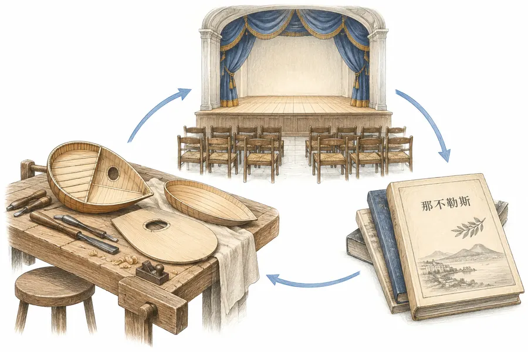
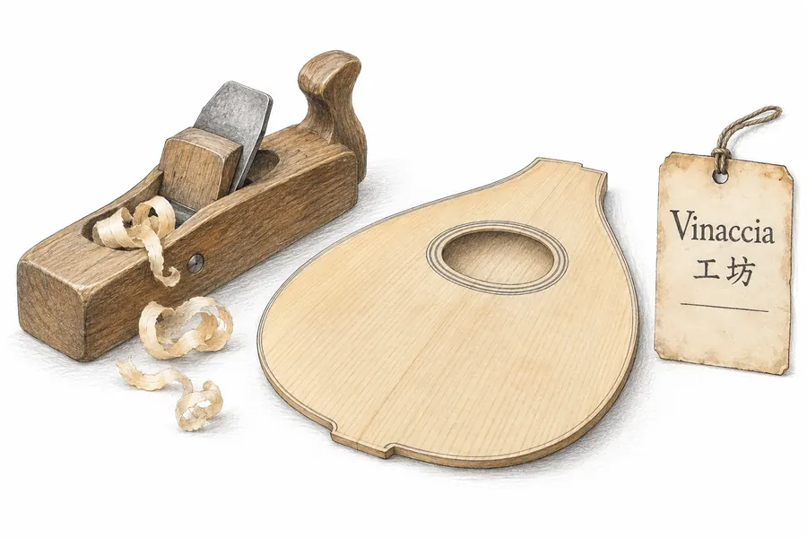
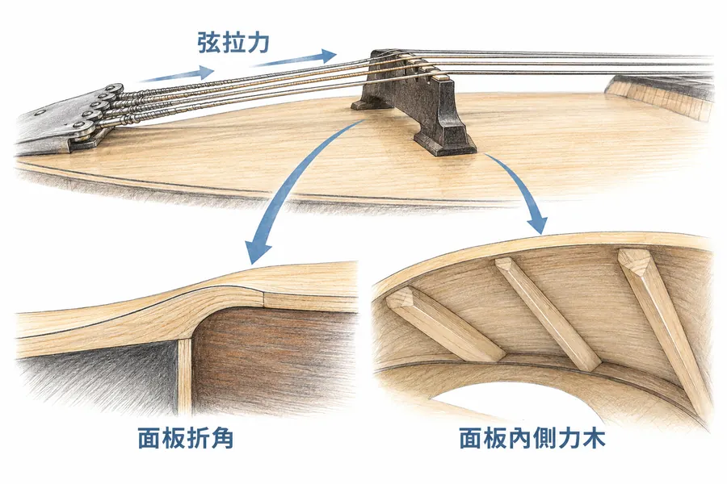
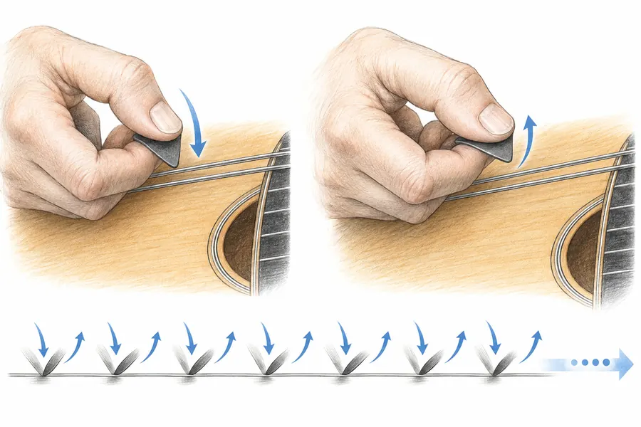
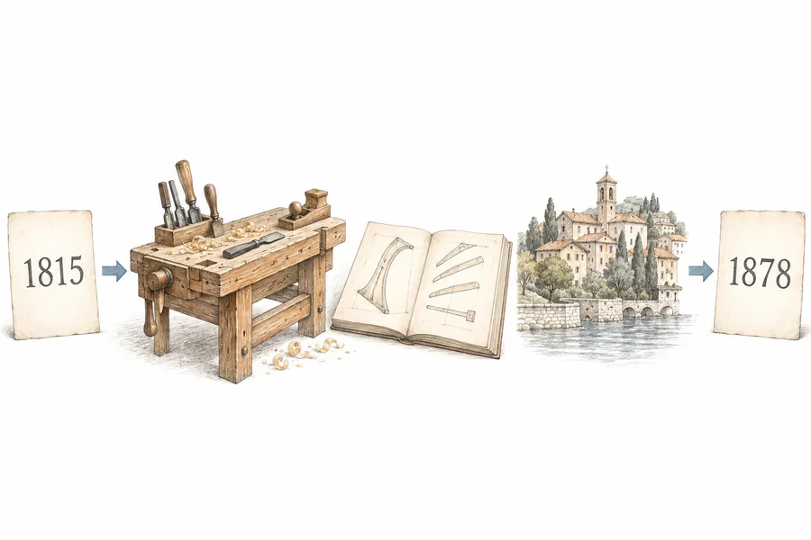
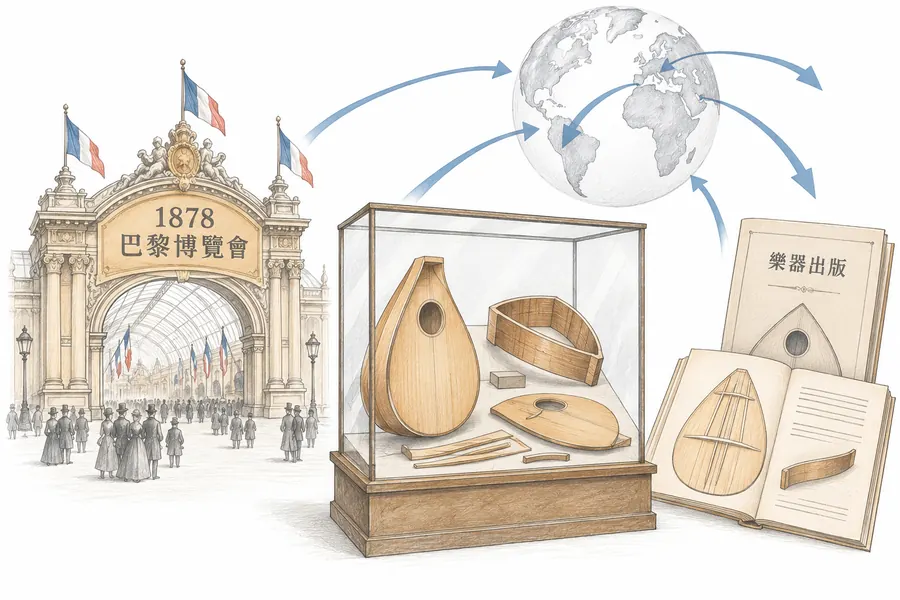
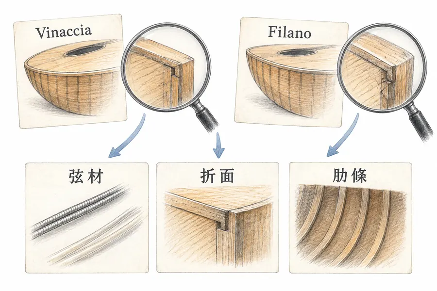

# Chapter 3: The Formation of the Neapolitan Mandolin

*Naples, the Vinaccia family, metal strings and the nineteenth-century mandolin*

## What this chapter covers

- Eighteenth-century Naples was a major European city and a musical centre, where opera, street music, domestic entertainment, teaching and instrument making all existed at once.
- For a body style to stay stable over time it needs **enough people making it, buying it, playing it and teaching it**, not only a good design.
- **The Vinaccia family being "important" does not mean a single invention.** The museum's wording is "probably designed by a member of the Vinaccia family".
- **Metal strings** brought a more direct attack and higher tension, and put the load into the soundboard. Makers therefore added bracing and formed a **bend** in the top near the bridge.
- **Tremolo** is not decorative showing off. It solves the physical limit of a plucked instrument: the energy starts decaying the moment the plectrum leaves the string.
- The period 1815–1878, which does not look like a golden age, may be exactly when the body style was really standardised.

## Why Naples?

Naples matters in mandolin history for more than the fact that one kind of instrument is named after the city.

Eighteenth-century Naples was a major European city and a musical centre. It had, at the same time:

- opera
- street music
- domestic entertainment
- teaching
- instrument making

Makers had a big enough market to keep refining instruments, and players had enough occasions to develop technique.

The Met's research notes that families such as the Vinaccia and the Fabricatore held a key position in local plucked-instrument making.

And by the end of the eighteenth century, Naples had become one of the most important string-instrument production centres on the Italian peninsula.〔F09〕

The question this chapter has to answer is: **why did this become the most influential body style in the world later on?**

The answer involves five things at once: string material, the load on the soundboard, the workshops, the city's entertainment culture, and the nineteenth-century publishing market.

Only by putting these factors together can you understand why eight strings, four double courses and tremolo ended up as most people's picture of "the mandolin".

## 3.1 City music and instrument-making culture

For a body style to stay stable over time, a good design is not enough.

It also needs enough people to **make it, buy it, play it and teach it**.

Eighteenth-century Naples had that ecology.

The Met's Guitar Heroes research places the city inside the larger history of instrument making.

The city already had a mature tradition of making violins and keyboard instruments. Families such as the Gagliano, the Vinaccia and the Fabricatore also accumulated craft across different string instruments.

By the end of the eighteenth century, Naples was already an important centre of string-instrument manufacture in Italy.〔F09〕

*Figure 3.1: city music and instrument-making culture (schematic)*

### From "a good design" to "a system"

This city environment let the instrument keep improving.

- Makers could adjust the soundboard, the bracing, the bridge and the bowl step by step, following what players needed.
- Players took the new, more projecting instruments into song accompaniment, domestic entertainment and the stage.

Only when a structure can be **repeated reliably in a workshop**, and is **supported by teaching and repertoire**, does it really become a "system".

### The workshops did not make mandolins only

The Neapolitan making ecology had another important feature: **the workshops did not serve a single instrument**.

The Met's material on families such as the Fabricatore shows that local makers were involved at the same time in improving and mass-producing guitars and other plucked instruments.

This cross-instrument craft environment lets technique in bridges, decoration, necks and string material flow from one to another.

So the mandolin's maturity should not be separated from the plucked-instrument industry of the whole city.〔F09〕

### Economic conditions are musical conditions

From an economic point of view, a body style that survives over time also means the workshops could:

- obtain materials repeatedly
- train workers
- find buyers

These conditions look like they are "outside music", but they actually decide whether a kind of instrument can move from a few fine pieces to a sustainable culture.

### The nineteenth-century canzone napoletana

The Neapolitan story has two sides, craft and musical culture.

The nineteenth-century **canzone napoletana** (Neapolitan song), domestic entertainment and the image of the city later reinforced the mandolin's cultural recognisability in return.

That made the instrument more than a technical solution: it also became a symbol of a local sound.

## 3.2 The Vinaccia family's contribution

The Vinaccia family holds a high place in the history of the Neapolitan mandolin.

The reason is that **there are several objects to study**, which give concrete form to the structural features of the middle and later eighteenth century.

### The 1781 Antonius Vinaccia mandolin

This instrument has:

| **Feature** | **Content** |
|---|---|
| Back | twenty-three narrow ribs |
| Soundboard | spruce |
| Strings | eight strings, four double courses |
| Soundboard | a bend near the bridge |

The Met describes these directly as **typical features of the Neapolitan school**.〔F04〕

*Figure 3.2: the Vinaccia family's contribution (schematic)*

### "Important" does not mean "a single invention"

But in history "important" does not mean "a single invention".

The Met's exhibition essay treats the Vinaccia family as the key workshop in the formation of the classic Neapolitan type, while also placing it inside the wider craft tradition of the city.

This is more reliable than "some Vinaccia invented the mandolin in some year", because we know:

- in the eighteenth century there were already several kinds of mandolino in different places.
- the Neapolitan system itself also went through changes in string material and bracing.〔F09〕

### Note that "probably"

The Met's Guitar Heroes essay uses **"probably designed by a member of the Vinaccia family"** to describe where the important Neapolitan design came from.

That **probably** matters.

It shows the museum is willing to acknowledge the Vinaccia family's central role, while refusing to push the available evidence into a definite single inventor.〔F04〕

> **Common misconception**: people assume the museum has "proved" that Vinaccia invented the modern mandolin.
>
> **What is really happening**: the word the museum uses is probably. That is deliberate.

### How should a professional book write this?

For a professional book, this wording is worth imitating.

| **Wording to avoid** | **Better wording** |
|---|---|
| Vinaccia invented the modern mandolin. | The objects the Vinaccia family left behind are the most important body of evidence for tracing the maturity of the Neapolitan type. |

The second carries more information, and is also harder to overturn when something new is discovered.

### The right way to study a making family

When you study a family of makers, it is best to describe their contribution through three things that can be confirmed:

1. **objects that can be confirmed**
2. **dates that can be confirmed**
3. **structures that can be confirmed**

That way, when new material appears, the details can be corrected and the conclusions updated item by item.

This is also the principle this book uses later when dealing with the history of Gibson, Calace and Suzuki.

## 3.3 Metal strings, the bent soundboard and bracing

Metal strings gave the mandolin a more direct attack and higher tension.

At the same time they put the load into the soundboard.

Studies from 2022 and 2024 both state that the development of the modern Neapolitan type is tied to rising string tension.

To carry that static force, makers did two things:

1. **They added bracing.**
2. They formed a **bend** in the top near the bridge, so that the loaded area gained a different geometric stiffness.〔F07〕〔F08〕

### The 1784 Joseph Filano: a very valuable transitional case

The research team carried out an in-situ acoustic and structural survey of this instrument at the **Museo degli Strumenti Musicali del Castello Sforzesco** in Milan.

The instrument's condition is:

| **Item** | **Content** |
|---|---|
| Strings | eight metal strings |
| Soundboard | spruce |
| Bend angle | about eight degrees |
| Bowl | made of maple ribs |

It is **not** "the finished version of the modern instrument".

But it shows clearly that late eighteenth-century Neapolitan making was already moving towards a high-tension system.〔F07〕

*Figure 3.3: metal strings, the bent soundboard and bracing (schematic)*

### "Tradition" is not static copying

More importantly, the research shows that mandolin soundboards after the nineteenth century gained **an extra brace**, to cope with higher string tension.

This detail lets us understand that "tradition" is not static copying.

It may still look like a bowl back and a round soundhole, **while the internal bracing has already changed with the material and the demands of playing**.〔F08〕

### What else does high tension change?

Besides adding load to the soundboard, high tension changes two more things:

- the contact at the bridge
- the long-term stability the neck needs

When comparing old instruments, look at **the bend, the string material and the internal bracing** together.

The same external features, combined with different string material, bracing and top thickness, can mean very different real loads.

The value of acoustic and structural research is exactly this: putting visual features back into the **mechanical system**.

### A key warning for conservation and repair

For conservation and repair this is especially critical.

> Put modern strings of higher tension than the historical design on an old instrument, and you may get more volume in the short term, while adding load to the **soundboard, bridge and neck** in the long term.

Whether a particular set of strings can be used should be decided by **the condition of the instrument and its design together**, confirming that the string tension fits what that instrument can carry.

## 3.4 Tremolo and singing melody

A plucked instrument has a physical limit:

**the energy starts decaying the moment the plectrum leaves the string.**

A player cannot, like a violinist, keep feeding energy into one note with a bow.

When the mandolin is asked to play a singing melody, that limit becomes a musical problem.

The core function of tremolo is to use **regular repeated attacks** so that the ear integrates a series of impulses into a more continuous line of sound.

> **An analogy**: it is like the cinema. Frame after static frame, projected fast enough and steadily enough, and the eye reads it as continuous movement. Tremolo does the same thing for the ear.

### Good tremolo and bad tremolo

A mature tremolo joins each attack into a melody that is **even and has direction**.

| **Situation** | **What it sounds like** |
|---|---|
| accents, spacing and plectrum angle too obvious | the sound turns into a dense machine gun |
| even speed, dynamics with direction | the listener clearly hears a continuous melodic line |

This also explains why classical mandolin teaching puts tremolo together with **phrase, crescendo and string crossing**.

Speed practice and musical expression should be taught together from the start.

*Figure 3.4: tremolo and singing melody (schematic)*

### Method books mark the systematising of technique

Professional method books of the late nineteenth and early twentieth centuries, such as the methods of **Carlo Munier** and **Raffaele Calace**, show that mandolin technique had changed.

It moved from simply "being able to play pieces" into an age of **systematic training**.

These books come much later than the eighteenth century, yet they reflect the same thing.

Once the Neapolitan type had matured, the language of playing was organised into a school that could be taught.

### Two levels: repetition rate and phrase shape

Good tremolo also involves two levels, "repetition rate" and "phrase shape".

| **Problem** | **Result** |
|---|---|
| repetition rate too slow | the listener clearly hears one note after another |
| too fast, but each stroke uneven in force | the grain starts to shake |
| a moderate rate, even force | the repeated movement drops into the background, and crescendo, diminuendo and the direction of the phrase come forward |

### So do not grade it only by "how many strokes per minute"

For that reason, teaching should not measure tremolo by "how many strokes per minute" alone.

A better order of practice is:

1. First keep it perfectly even at a **slow speed**.
2. Then vary the dynamics at a **fixed density within the beat**.
3. Finally **put it into a melody**.

This is developed further in the chapter on right-hand technique.

Understand its function here in the history chapter first, and you will not mistake tremolo for **decorative showing off**.

## 3.5 The years 1815 to 1878

The mandolin's popularity has risen and fallen several times.

Sparks's study of 1815–1878 points out that:

- the early mandoline and mandolino declined for a time as **concert instruments**.
- during this period the instrument was barely known to the general public outside Italy.
- but **inside** Italy, the body style and the use of the modern mandolin were still forming.〔F02〕

*Figure 3.5: the years 1815 to 1878 (schematic)*

### The period that "does not look like a golden age" matters

This period matters instead.

It shows us that **standardisation often happens in a relatively local market.**

Makers and players could slowly settle the following inside a local tradition:

- the courses
- the bridge
- the soundboard
- the repertoire
- the teaching

By the time the instrument came back onto the international stage in the second half of the nineteenth century, it was **far more unified** than the eighteenth-century mandolino world of coexisting types.

### A low point and a high degree of standardisation can happen at once

The "low point" of 1815–1878 is also a reminder not to write instrument history as a popularity chart.

Sparks describes the decline of the mandoline and mandolino as concert instruments on one hand; on the other, he titles the same period **Italy and the Creation of the Modern Mandolin**.

In other words: **while visibility on the stage was falling, internal standardisation of the body style may have been happening.**〔F02〕

This is not rare in instrument history: **public fashion and technical maturity do not necessarily move in step.**

Workshops, method books and local communities can keep accumulating while the international market is not looking.

Then a new exhibition, a tour or an emigration network appears, and a mature product is suddenly "discovered" by the outside world.

### What this means for identifying used instruments

The modern Neapolitan mandolin developed continuously on the foundation of eighteenth-century workshops such as the Vinaccia's.

It is the result, within one continuous tradition, of absorbing **higher tension, bracing, the fretboard and the demands of playing**.

This matters for identifying used instruments too:

> Two instruments both called Neapolitan, a hundred years apart, can still differ considerably inside and in their dimensions.

## 3.6 The Paris exhibition and the international boom

Sparks treats the **1878 Paris exhibition** as an important point at which the mandolin came back into international view.

Italian players succeeded in attracting a French audience during the exhibition.

After that, **circoli mandolinisti** (mandolin societies), teaching and soloist activity gradually grew.

At the same time, playing on the Spanish **bandurria** also influenced both repertoire and the public imagination.〔F18〕

*Figure 3.6: the Paris exhibition and the international boom (schematic)*

### "Seen again" was not the same as in the eighteenth century

"Being seen again" and the eighteenth-century circulation in courts and salons were two different things.

By the second half of the nineteenth century there were more mature forms of:

- music publishing
- civic societies
- industrial production
- international touring networks

An instrument could be copied quickly through method books, clubs and the commercial market.

This laid the conditions for the **global virtuoso era of 1892–1918**.

### The golden age was not "suddenly everyone liked it"

So the so-called golden age of the mandolin should not be understood as "suddenly many people liked it".

It was the result of **making, playing, publishing and community organising expanding at the same time**.

The next chapter looks at the worldwide spread, and you will see more clearly how each region turned this Italian system into its own culture.〔F19〕

### The exhibition put different plucked traditions side by side

The Paris exhibition also mattered because it let different plucked traditions be compared in one place.

Sparks specifically mentions the influence of Spanish bandurria players on the repertoire.

That shows the mandolin's renewed popularity was the result of **different plucked instruments imitating and competing with one another** in international exhibitions and city entertainment.〔F18〕

### The role of method books changed too

When a large number of amateurs start learning an instrument, the role of the method book changes too.

| **Learner** | **How they solve problems of technique** |
|---|---|
| the professional virtuoso | through apprenticeship and detail passed on by word of mouth |
| large numbers of beginners | needing standardised fingering, notation and studies |

The growth of mandolin educational publishing at the end of the nineteenth century and the growth of societies are two sides of the same market phenomenon.

## 3.7 Case: comparing the structure of the Vinaccia and the Filano

The 1781 Vinaccia and the 1784 Filano are close in date, yet each is presented through a different kind of evidence:

| **Instrument** | **Main kind of evidence** | **What it lets you see** |
|---|---|---|
| 1781 Vinaccia | museum collection description | heavy decoration, 23 ribs, eight strings in four courses, the Neapolitan bend |
| 1784 Filano | modern acoustic survey | material identification, cracks in the soundboard, acoustic measurement, finite element analysis |

The second shows us **how** a late Baroque mandolin actually vibrates.〔F04〕〔F07〕

*Figure 3.7: case — comparing the structure of the Vinaccia and the Filano (schematic)*

### "Similar in form" does not mean "completely identical"

The most valuable thing about putting the two together is that it prevents treating "similar in form" as "completely identical".

Different workshops in the same period can differ in rib count, materials and detail.

Even among Neapolitan instruments, you should not infer that every one used the same wood or the same bracing.

> A collection tells us **what an individual is**; research helps us understand **how the system works**.

### This is also the checking principle of the whole book in miniature

| **The evidence you have** | **How certainly you can write** |
|---|---|
| appearance in photos only | describe appearance only |
| maker's or museum data | only then state materials and dimensions with more certainty |
| acoustic research | discuss how structure affects vibration |

### A collection photo is not a conclusion

These two objects also help us understand that "a collection photo is not a conclusion".

| **Kind of evidence** | **What it shows** | **What it cannot show** |
|---|---|---|
| a photo | outward form, decoration, some materials | top thickness, local stiffness, modes |
| a finite element model | helps explain vibration | has to rest on reliable geometry and material parameters |

Each kind of evidence has its blind spot; only together do they have strength.〔F07〕

### A case study is really a demonstration of method

So a case study, beyond telling a story about a famous instrument, also demonstrates a research procedure:

1. First a **survey of documents and dimensions**.
2. Then **measurement of materials and acoustics**.
3. Only then a **model or a replica**.

The same method scales down to a collector's daily work: **confirm the object first, then discuss inferences**.

## Self-study question bank

Study check: answer, check, review

Answer first, then look at the answers. When you get one wrong, go back to the relevant section of this chapter and read it again.

**1. The important features of the Neapolitan mandolin include?**

- A. four double courses and metal strings
- B. six single strings
- C. no frets
- D. a fixed bridge

**2. What problem is tremolo on the mandolin usually used to solve?**

- A. string changes are too slow
- B. the sustain of a single pluck is limited
- C. the headstock is too heavy
- D. the soundhole is too small

**3. The importance of the Vinaccia family comes mainly from?**

- A. legend alone
- B. objects that can be studied, and the making context
- C. making guitars only
- D. inventing the electric pickup

**Answers: 1.A　2.B　3.B**

## Main sources checked for this chapter

Source check: find the original, check the conditions, keep a record

| **Number** | **Source and what it was used for** |
|---|---|
| 〔F02〕 | Paul Sparks, *The Classical Mandolin*, Oxford University Press, 2005. Mandolin history from 1815 to the modern period; 1878, 1892–1918, the interwar years and the postwar development. |
| 〔F04〕 | The Metropolitan Museum of Art, *Mandolin, Antonius Vinaccia, Naples, 1781*, Met 89.4.2140. Object data: eight strings, four double courses, the violin's pitches, and the Neapolitan bent soundboard. |
| 〔F07〕 | Quintavalla et al., *Acoustical Survey and Finite Element Analyses of Late Baroque Mandolin*, International Journal of Wood Culture, 2024. The 1784 Joseph Filano Neapolitan mandolin: the mixed/metal string transition, the bend, materials and the acoustic survey. |
| 〔F08〕 | Quintavalla et al., *The Acoustics of Traditional Italian Mandolins and Their Relation with Soundboard Wood Properties*, International Journal of Wood Culture 2, 2022. Acoustic comparison of a 1906 Neapolitan, a 1908 Milanese and a Roman-style modern Italian mandolin. |
| 〔F09〕 | The Metropolitan Museum of Art, *From Naples to New York*, Guitar Heroes exhibition essay. The Neapolitan making environment, American immigration, the Spanish Students and the American mandolin craze. |
| 〔F18〕 | Paul Sparks, *1878–1892, The Classical Mandolin*, Oxford University Press, 2005. The 1878 Paris exhibition, the Italian circoli mandolinisti and the renewed popularity. |
| 〔F19〕 | Paul Sparks, *1892–1918, The Classical Mandolin*, Oxford University Press, 2005. The virtuoso era and popular spread in Europe, the United States, Japan and South America. |

Links:

- 〔F02〕https://academic.oup.com/book/10241
- 〔F04〕https://www.metmuseum.org/art/collection/search/504543
- 〔F07〕https://www.sciencedirect.com/org/science/article/pii/S2772318624000018
- 〔F08〕https://www.sciencedirect.com/org/science/article/pii/S2772318622000017
- 〔F09〕https://blog.metmuseum.org/guitarheroes/from-naples-to-new-york-mobile/
- 〔F18〕https://academic.oup.com/book/10241/chapter-abstract/157932074
- 〔F19〕https://academic.oup.com/book/10241/chapter-abstract/157933927
