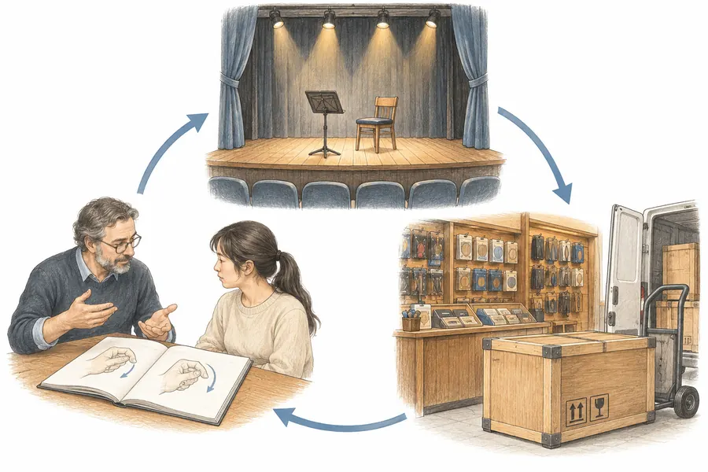
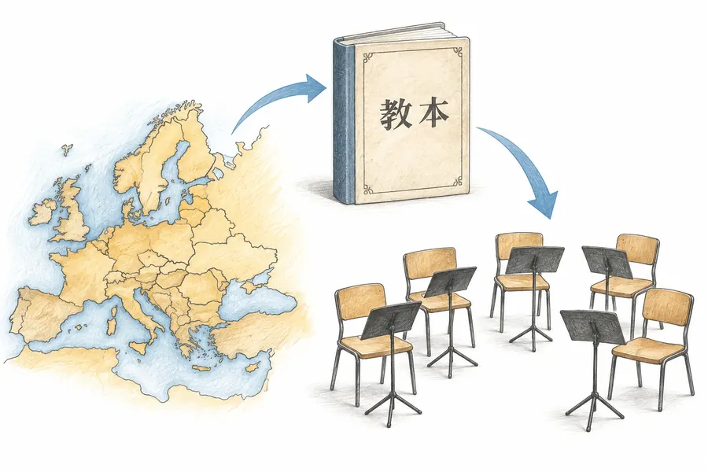
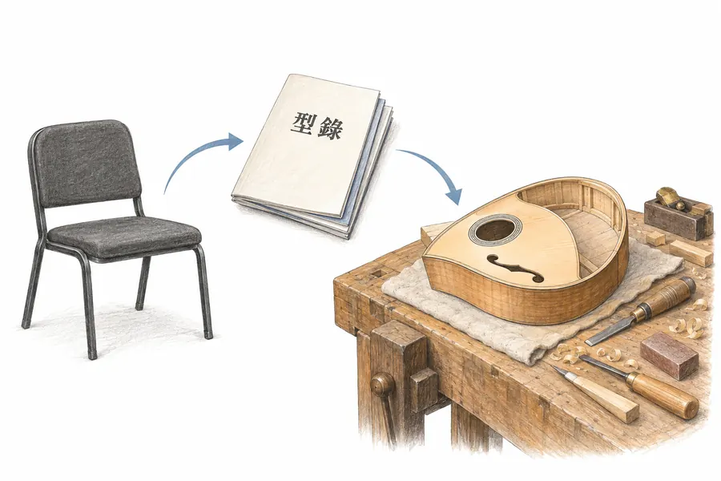
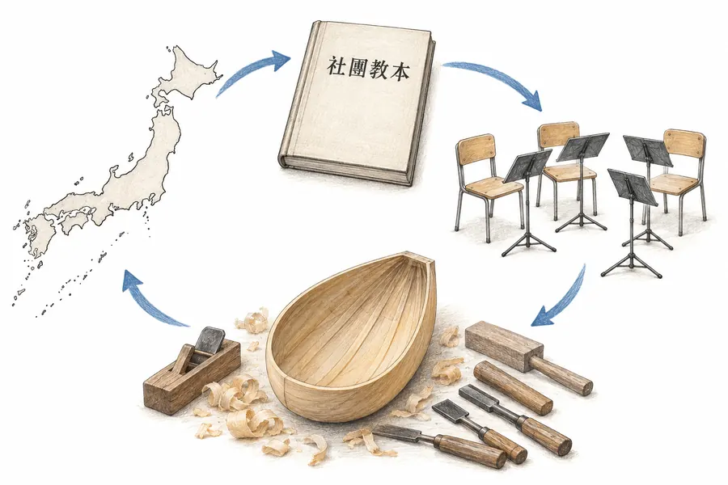
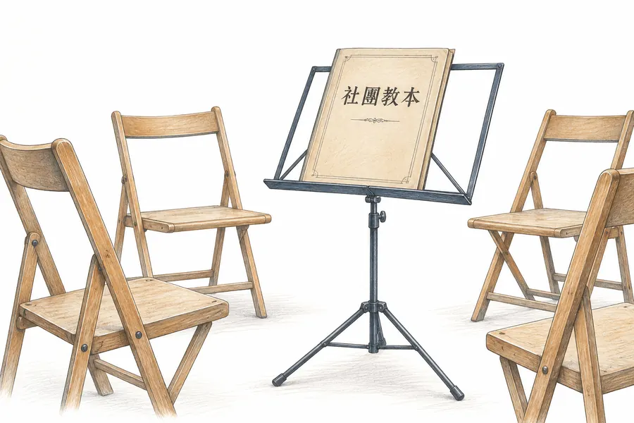
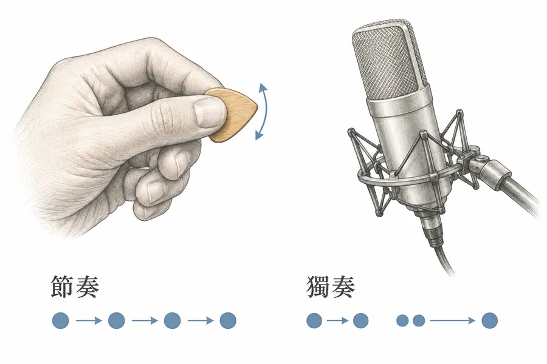
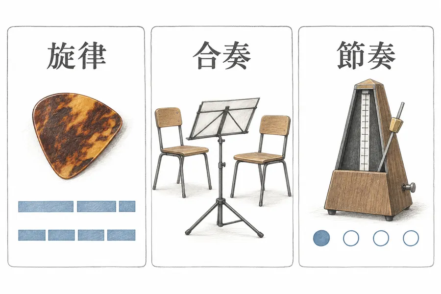

# Chapter 4: The Mandolin Spreads Around the World

*Global movement: virtuoso culture, societies, migration, industry and revival*

## What this chapter covers

- From the end of the nineteenth century, mandolin history is no longer only Italian instrument making. Through **exhibitions, touring, migration, schools, clubs and the instrument industry** it went out into the world.
- International popularity needs three conditions at once: **you can see it, you can learn it, you can buy it.**
- The 1880 American tour of the "Spanish Students" was in fact played on the bandurria, but the public called it a mandolin. **A commercial name sometimes shapes an impression faster than an organological classification.**
- Wherever the mandolin arrived, it was given a different job. When the job changes, **the technique and the equipment change with it**.
- Japan turned the mandolin into **a lasting institution of school clubs and orchestras**; the United States gave it a new life inside bluegrass.
- There is no single "most authentic mandolin". Every mature tradition is answering a different question.

## From Italian making history to global cultural history

From the end of the nineteenth century, mandolin history is no longer only the history of Italian instrument making.

Through exhibitions, touring, migration, schools, clubs and the instrument industry it reached Europe, the United States, Japan and South America.

Everywhere it arrived, it was given a different job:

- some regions treated it as part of a **classical ensemble family**.
- some regions turned it into a **rhythm instrument**.
- some places developed **university societies** and large mandolin orchestras.

The point of these differences is **localisation** after globalisation.

Sparks's *The Classical Mandolin* treats 1878–1892, 1892–1918 and 1918–1945 as separate stages, precisely because the mandolin's global expansion **was not a single wave**.

| **Period** | **What happened** |
|---|---|
| 1878 | the Paris exhibition provided visibility |
| the 1890s to before the First World War | an international boom formed |
| between the two wars | new styles in Germany and Austria, workers' organisations, institutionalisation in various countries |

〔F18〕〔F19〕〔F20〕

## 4.1 The conditions for crossing borders

International popularity needs **playing, teaching, publishing and manufacturing** to support it together.

For an instrument to move from "an exotic novelty" to "a mass activity", at least three conditions are needed:

| **Condition** | **How it is met** |
|---|---|
| **you can see it** | audiences first see it at an exhibition or on tour |
| **you can learn it** | method books, teachers and scores let people learn |
| **you can buy it** | factories, importers and dealer networks let people buy |

The mandolin of the late nineteenth century happened to have all three at once.

*Figure 4.1: the conditions for crossing borders (schematic)*

### From "an Italian instrument" to "everyone's instrument"

The 1878 Paris exhibition provided the first strong wave of visibility.

After that, **circoli** (societies) and clubs across Europe turned individual interest into community activity.

The research on 1892–1918 shows a great deal of playing in Britain, France, Belgium, Germany and Austria, the United States, Japan and South America.

In many places the groups were led by Europeans, but the members were already **local people**.

That means the mandolin quickly moved from "an Italian instrument" to a musical tool local societies could absorb.〔F19〕

### Why student societies mattered so much

This mechanism also explains why student societies were so important.

| **The mandolin's advantage** | **Why it suits a society** |
|---|---|
| cheaper than large string instruments | students can afford one |
| an easier entry than bowed instruments | a tidy ensemble sound within a short time |

That suits schools, clubs and amateur communities especially well.

When a society needs a complete range, the demand for the mandola (the alto mandolin), the mandocello (the bass mandolin) and the bass members of the family rises with it.

### "You can buy it" also involves price levels

When demand widened from a few aristocrats or virtuosos to students and amateur societies, the market naturally needed instruments at different levels:

| **Level** | **What the product looks like** |
|---|---|
| high end | heavily decorated handmade instruments |
| middle and low | more standardised models that can be supplied in quantity |

This is exactly the background against which **American factories** and the **Japanese mass-production system** could grow quickly.

### One more easily overlooked condition: portability

A mandolin is easier to carry onto a train, a ship or a touring stage than a piano, a harp or a large bass instrument.

Emigrants could carry it into a new city too.

> The size of an instrument is not purely a design question. It directly affects **the speed at which a culture travels**.

## 4.2 Britain and Europe

Early research underestimated mandolin activity in eighteenth-century Britain.

Sparks's 2018 study found more evidence of performances and teaching in London, Bath and Edinburgh.

It shows that after 1750 international players such as Gervasio, Leoné and Merchi were active in theatres, concerts and even entertainment venues.〔F17〕

In other words, Britain more accurately had **an earlier wave of circulation, more upper-class and more professional**.

### The difference at the end of the nineteenth century: scale and institutions

The difference at the end of the nineteenth century lies in **scale and institutions**.

European mandolin culture in 1892–1918 did not rest on virtuosos alone. It had:

- societies
- publishers
- factories
- orchestras

France, Belgium, Germany and Austria each formed their own teaching and ensemble traditions, and gradually developed **technical preferences** different from the Italian tremolo aesthetic.〔F19〕

*Figure 4.2: Britain and Europe (schematic)*

### So "arrival" is best not given as a single year

So when discussing "arrival", it is best to avoid a single year.

Most countries probably had isolated instruments and performances long before. What is really worth periodising is: **when did a lasting social network begin to form?**

The same idea applies to Japan and the United States.

### The difference between two waves of globalisation

The eighteenth-century British case shows us the difference between "the first wave of globalisation" and the end of the nineteenth century:

| | **First wave (eighteenth century)** | **Second wave (late nineteenth century)** |
|---|---|---|
| Mainly carried by | touring virtuosi, upper-class city entertainment, professional teaching | printing, clubs, manufacturing and emigrant communities amplifying together |
| Scale | limited | far larger |

The same country can go through **completely different kinds** of mandolin circulation in different centuries.〔F17〕

> **Common misconception**: find the earliest document mentioning the mandolin in some country, and you think you have found "the starting point of that country's mandolin history".
>
> **What is really happening**: "the earliest appearance" and "the formation of a lasting tradition" are two different questions.
>
> What really shapes today's playing culture is usually **the second**.

## 4.3 The American mandolin craze

The Met's account of American history is very dramatic.

In 1880 a group of **Spanish Students** toured the United States.

What they actually played was the **bandurria**, but the public and the press often misnamed it a mandolin.

Italian musicians quickly used the enthusiasm, formed similar groups with **real mandolins** and toured, pushing the market further up.

The point of this "misidentification" is that **a commercial name sometimes shapes a public impression faster than an organological classification**.〔F09〕

*Figure 4.3: the American mandolin craze (schematic)*

### Immigrants brought the craft into city manufacturing

Between 1880 and 1920 the United States imported large numbers of Italian mandolins, and also drew makers from southern Italy to New York.

**Angelo Mannello** is a typical example.

A 1900 instrument in the Met shows that he established a production of heavily decorated bowlback mandolins in New York.

The museum records that his factory employed as many as **seventy-five** makers and decorators in the early twentieth century.〔F21〕

Mannello's factory records also give "immigrant culture" a concrete industrial scale.

When a factory can employ dozens of makers and decorators, the **consistency, division of labour and method of sale** of its products differ from a one-person workshop.

So the American mandolin craze did not only create orchestras; it also created **jobs and a supply chain**.〔F21〕

### The other road: Gibson's redesign

At the same time, America itself began to ask "why does a mandolin have to be a bowlback".

Orville Gibson's 1898 patent and surviving instruments represent another road:

- a carved top
- a tailpiece
- a floating bridge
- a one-piece structure
- a hollow neck

So the American market had two forces at once:

| **Road** | **Content** |
|---|---|
| transplant | the bowlback of the Neapolitan tradition |
| redesign | Gibson's carved-top |

Only later did the A-style, the F-style and the link with bluegrass grow out of them.〔F10〕〔F11〕

> **Note**: which one later became linked to a particular musical style was the result of **a choice made by the market, the players and the brands together**.
>
> It was not a technical contest with a foregone winner.

## 4.4 Teaching, societies and instrument making in Japan

Japanese mandolin history is likewise not well summarised by a single "year of arrival".

The historical material of the Japan Mandolin Union shows that in 1994 it held a commemorative event for **"本邦渡来100年"** (*honpō torai hyakunen*, one hundred years since the mandolin reached Japan).

That reflects the Japanese mandolin world's long habit of treating **around 1894** as a symbolic starting point.

On the other hand, it was the teaching, societies and domestic manufacture of the early twentieth century that really put the instrument into stable development.〔F23〕

*Figure 4.4: teaching, societies and instrument making in Japan (schematic)*

### The manufacturing side: the evidence is clear

The official chronology of Suzuki Violin records that it **began making and selling mandolins in 1906**.

That means Japan was, very early on, not only importing instruments but building a **domestic supply**.

The product line later included not only the standard mandolin but the mandola and the mandocello.

The 2017 catalogue still lists the M-30, M-100, MD-4, MD-10 and MC-836, showing the demand Japanese ensemble culture had for **the complete family**.〔F25〕〔F26〕

### Society culture: turning an instrument into a long-term educational institution

| **Organisation / event** | **Date** | **Significance** |
|---|---|---|
| the founding of the Meiji University Mandolin Club | 1923 | it has kept active since, through regular concerts |
| the founding of the Japan Mandolin Union | 1968 | it institutionalised solo competitions, document collecting, study groups and international exchange |

〔F22〕〔F24〕

Japan's distinctive feature is therefore not only that it "likes bowlback mandolins very much", but that it **built ensemble playing and school societies into a culture lasting a century**.

### Supply and repertoire reinforce each other

The Japanese case also shows that "the complete family" and "the large ensemble" reinforce each other.

> When schools and community groups play orchestra repertoire over the long term, makers have a reason to supply the different ranges.
>
> And the other way round, being able to buy a mandola or a mandocello reliably lets arrangers dare to write fuller parts.

This is a loop in which supply and repertoire reinforce each other.〔F22〕〔F26〕

### How to read the number 1894

At the same time, 1894 as the symbolic starting point of "one hundred years since the mandolin reached Japan" should be understood as **a commemorative frame used by the Japanese mandolin world itself**.

Earlier records of related instruments can still be studied separately.

> A historical anniversary and the earliest physical evidence are different kinds of claim. This book states them separately.〔F23〕

## 4.5 Between the two world wars

After the First World War, the aura of the late nineteenth century's "international fashionable instrument" began to fade.

But that does not mean the mandolin disappeared.

Sparks's study of 1918–1945 shows that:

- new playing styles appeared in Germany and Austria.
- the mandolin was also taken up by workers' and socialist organisations.
- groups such as the DMGB and the DAMB (the source gives only the abbreviations, without expanding the full names) made the plucked-string orchestra part of **collective cultural activity**.〔F20〕

*Figure 4.5: between the two world wars (schematic)*

### One instrument, four identities

France went towards a different kind of institutionalisation: the **Conservatoire National** in Paris at one time had a mandolin class.

Italy's political environment had a different effect again.

In other words, the same instrument in different countries could be at the same time:

| **Identity** | **Example** |
|---|---|
| workers' ensemble | the DMGB and DAMB in Germany and Austria |
| professional education | the French national conservatoire |
| domestic entertainment | families and amateur communities in many countries |
| national culture | bound up with a local image |

This is also the complexity that global history most deserves to keep.

### The low point set up the postwar split

Over the long term, this low point set up the postwar split:

| **Region** | **Postwar direction** |
|---|---|
| Germany, Japan and elsewhere | the classical mandolin orchestra continued to develop |
| the United States | the mandolin found a new life in string bands and bluegrass |

The point is not that "the instrument disappeared", but that **the original mass enthusiasm split into several more specialised ecologies**.〔F12〕

### Why workers' organisations are worth noticing

The workers' organisations of the interwar years in Germany and Austria are especially worth noticing, because they turned the mandolin from "fashionable leisure" into **a tool of group identity**.

The existence of the DMGB and DAMB shows that an orchestra could carry:

- education
- social contact
- class culture

and not only concerts.

This social function often keeps an instrument **alive across generations** more effectively than any single star player.〔F20〕

### Two kinds of legitimisation, the same direction

In the same period, the mandolin class at the French Conservatoire National was another kind of **legitimisation**: the instrument entered the framework of professional education.

The two look like opposite directions — one a workers' body, one a state conservatoire.

In fact they both show the same thing: **the mandolin could now be absorbed by institutions, instead of depending on short-term fashion**.〔F20〕

## 4.6 The change in postwar American music

When the Smithsonian catalogued Walter Carter's *The Mandolin in America*, it summarised American history in five stages:

1. golden age
2. decline
3. bluegrass roots
4. Monroe
5. modern revival

This division is very revealing: the mandolin did not disappear when the mass enthusiasm of the 1920s faded. It **changed job**.〔F12〕

*Figure 4.6: the change in postwar American music (schematic)*

### Bluegrass changed the mandolin's "identity"

In bluegrass the mandolin's main identity is no longer the long classical tremolo.

The language Bill Monroe built stresses:

- a strong **chop** (a short, hard, syncopated chord)
- clear syncopation
- a penetrating solo

Inside the band the instrument plays two roles at once:

| **Role** | **How it is done** |
|---|---|
| rhythm | filling the backbeat like a snare drum |
| lead | competing for the melody with the fiddle and the banjo |

This change of role fed back into American preferences for the F-style, for f-holes and for setup.

### After the 1980s: the boundaries opened again

The revival after the 1980s opened the boundaries again.

Carter's history covers:

- jazz
- klezmer
- Irish
- choro (the Brazilian instrumental style)
- the classical connection
- the various branches of bluegrass

> **Common misconception**: talking about "the American mandolin" today, people assume it means Monroe style.
>
> **What is really happening**: that is an oversimplification too. The real feature is that the American market has long allowed **different designs and styles to exist side by side**.〔F12〕

### How bluegrass worked back on the equipment

Bluegrass's effect on equipment is especially visible.

When a player has to find a clear rhythmic place among banjo, fiddle, guitar and voices, these conditions become important:

- a fast attack
- strong midrange
- chords that can be stopped immediately

These needs have a different priority from the long classical tremolo.

So the same mandolin ends up with different preferences in **setup, plectrum and right-hand damping**.

### Modern crossover: the boundaries loosen once more

Modern crossover loosens these boundaries again.

The same player may:

- play Bach on a carved-top
- play Celtic music on an octave mandolin
- and then go through a pickup into effects units

The point is that the twenty-first-century market lets players **recombine traditions freely**.〔F12〕

## 4.7 Comparing the patterns of spread

The most effective way to understand the mandolin worldwide is to ask one question:

> **Where does each place put the mandolin in its music?**

| **Region / tradition** | **The mandolin's job** |
|---|---|
| the Neapolitan tradition in Italy | a singing melody, bowlback craft |
| the large plucked orchestras of Germany, Austria and Japan | one member of a complete family of parts |
| American bluegrass | the double role of rhythm and solo |
| university societies | a tool for group music education |

*Figure 4.7: comparing the patterns of spread (schematic)*

### When the job changes, the technique and the equipment change

| **Need** | **Ability / specification that becomes important** |
|---|---|
| a long melody | tremolo and control of sustain |
| a backbeat | chop and quick damping |
| an alto voice in the orchestra | the mandola's tuning, notation and scale length |
| large numbers of students | reliable mass production and repairability, more practical than lavish hand decoration |

### So this book will not crown "the most authentic mandolin"

This also explains why this book will not pick out "the most authentic kind of mandolin".

Every mature tradition in history is answering a different question.

The work of a professional comparison is, above all, **to state the question clearly first**.

### Which fields should be compared?

If you put different regions into one table, the fields to compare should be:

| **Field** | **Why it matters** |
|---|---|
| the main social setting | decides what task the instrument is given |
| the typical line-up | solo, society or orchestra |
| the common body style | bowlback, carved-top, flatback and so on |
| the core right-hand language | tremolo, chop, damping and so on |
| the way it is taught | apprenticeship, school society or conservatoire |

And these have to be compared **together with the period**.

Only then do the finer differences show up.

Japan and Germany, for example, both value the orchestra, yet have different organisational histories. The United States and Italy both value the solo, yet formed different preferences in accompaniment and body.

### This also guards against cultural stereotypes

This way of comparing also guards against cultural stereotypes.

> Not all Italian playing uses only tremolo, and not all Americans play only bluegrass.

A regional tradition is the **starting point** for understanding a context, not a **label** that limits an individual player.

## Self-study question bank

Study check: answer, check, review

Answer first, then look at the answers. When you get one wrong, go back to the relevant section of this chapter and read it again.

**1. One important background to the American mandolin craze at the end of the nineteenth century was?**

- A. the Spanish Students' tour and the misnaming in the press
- B. the invention of the electric guitar
- C. recording streams
- D. the arrival of the jazz drum kit

**2. What usually happens to an instrument when it reaches another country?**

- A. it keeps its original use exactly
- B. it is given a new role according to the local music
- C. it loses all tradition
- D. it becomes the same size everywhere

**3. One important setting for Japanese mandolin culture is?**

- A. university societies and orchestras
- B. street playing only
- C. the opera house only
- D. the church only

**Answers: 1.A　2.B　3.A**

## Main sources checked for this chapter

Source check: find the original, check the conditions, keep a record

| **Number** | **Source and what it was used for** |
|---|---|
| 〔F09〕 | The Metropolitan Museum of Art, *From Naples to New York*, Guitar Heroes exhibition essay. The Neapolitan making environment, American immigration, the Spanish Students and the American mandolin craze. |
| 〔F10〕 | United States Patent Office / Google Patents, *US598245A – Mandolin, Orville H. Gibson*, patented 1898-02-01. Gibson's original patent for the one-piece rim/neck/head, carved top and back, and hollow neck. |
| 〔F11〕 | The Metropolitan Museum of Art, *Mandolin, Orville Gibson, 1898*, Met 2015.643a–c. A surviving object consistent with the 1898 patent design. |
| 〔F12〕 | Smithsonian Libraries and Archives, Walter Carter, *The Mandolin in America*, 2017 catalog record. The American mandolin craze, the decline, bluegrass and the modern revival. |
| 〔F17〕 | Paul Sparks, *The mandolin in Britain, 1750–1800*, Early Music 46(1), 2018. New research on eighteenth-century British mandolin playing, teaching and social culture. |
| 〔F18〕 | Paul Sparks, *1878–1892, The Classical Mandolin*, Oxford University Press, 2005. The 1878 Paris exhibition, the Italian circoli mandolinisti and the renewed popularity. |
| 〔F19〕 | Paul Sparks, *1892–1918, The Classical Mandolin*, Oxford University Press, 2005. The virtuoso era and popular spread in Europe, the United States, Japan and South America. |
| 〔F20〕 | Paul Sparks, *1918–1945, The Classical Mandolin*, Oxford University Press, 2005. New playing styles in Germany and Austria, workers' organisations, French education and interwar change. |
| 〔F21〕 | The Metropolitan Museum of Art, *Mandolin, Angelo Mannello, New York, 1900*, Met 1972.111.2a,b. Italian immigrants building a bowlback mandolin factory in New York, and the case of American mass production. |
| 〔F22〕 | Japan Mandolin Union, *Japan Mandolin Union official site*, accessed 2026-10-06. The 1968 founding and the Japanese institutional development of research, competitions and international exchange. |
| 〔F23〕 | Japan Mandolin Union, Kansai Branch, *About the Japan Mandolin Union / history*, historical page. Organisational history including the 1994 "one hundred years since the mandolin reached Japan" commemorative events. |
| 〔F24〕 | Meiji University Mandolin Club Shikon-kai, *The history of the Meiji University Mandolin Club*, accessed 2026-10-06. The 1923 founding and the case of Japanese university mandolin culture. |
| 〔F25〕 | Suzuki Violin Manufacturing, *Chronology*, accessed 2026-10-06. Japanese manufacturing records, including the start of mandolin manufacture and sales in 1906. |
| 〔F26〕 | Suzuki Violin Manufacturing / Suzuki Music, *2017 string-instrument catalog*, 2017. Japanese family specifications and scale lengths for the M-30, M-100, MD-4, MD-10 and MC-836. |

Links:

- 〔F09〕https://blog.metmuseum.org/guitarheroes/from-naples-to-new-york-mobile/
- 〔F10〕https://patents.google.com/patent/US598245A/en
- 〔F11〕https://www.metmuseum.org/art/collection/search/700485
- 〔F12〕https://www.si.edu/object/mandolin-america-full-story-orchestras-bluegrass-modern-revival-walter-carter:siris_sil_1091895
- 〔F17〕https://academic.oup.com/em/article-abstract/46/1/55/4907922
- 〔F18〕https://academic.oup.com/book/10241/chapter-abstract/157932074
- 〔F19〕https://academic.oup.com/book/10241/chapter-abstract/157933927
- 〔F20〕https://academic.oup.com/book/10241/chapter-abstract/157939527
- 〔F21〕https://www.metmuseum.org/art/collection/search/504480
- 〔F22〕https://www.japanmandolinunion.com/
- 〔F23〕https://jmu.xii.jp/kansai/renmei.htm
- 〔F24〕https://www.mumc-ob.jp/history/
- 〔F25〕https://www.suzukiviolin.co.jp/about/factory/
- 〔F26〕https://www.suzuki-music.co.jp/app/uploads/2017catalog14.pdf

---
