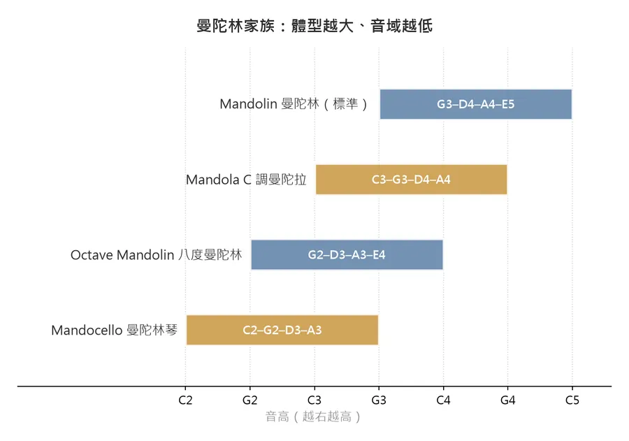
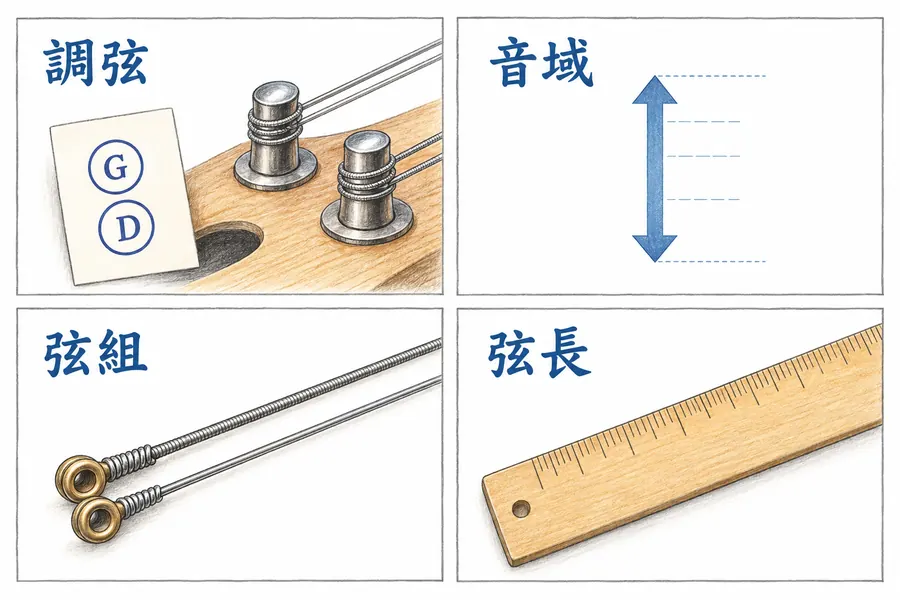
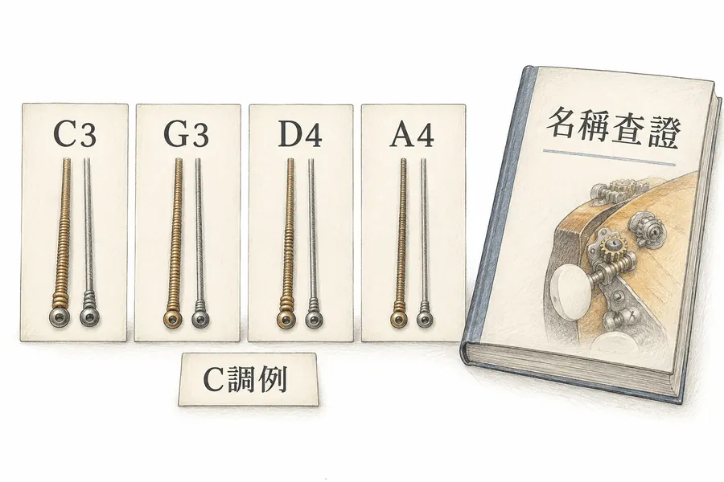
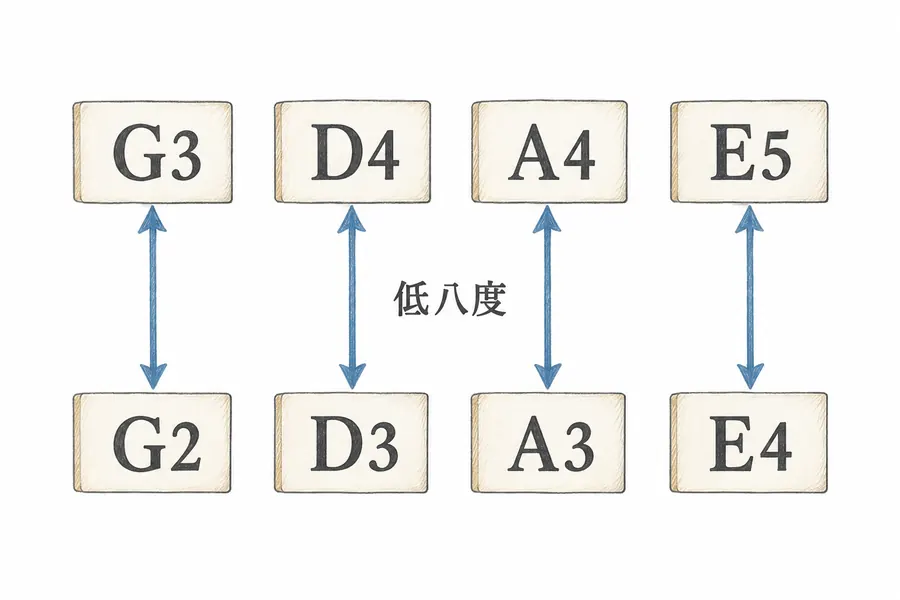
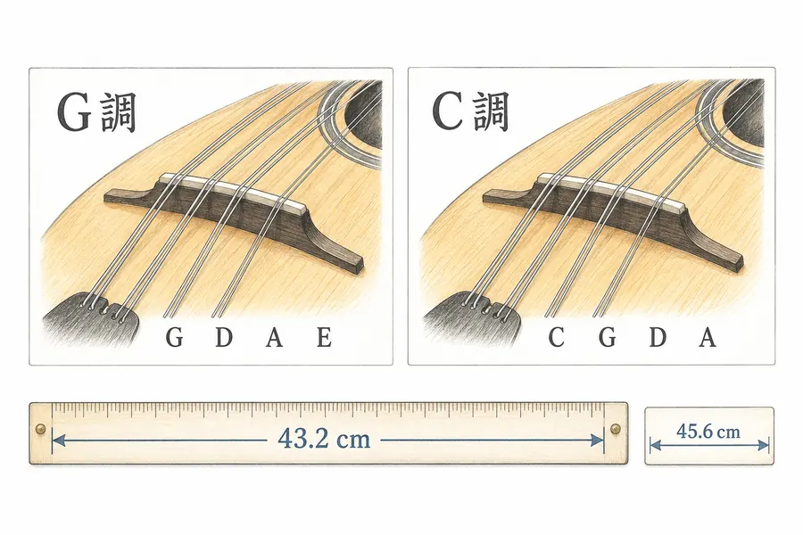
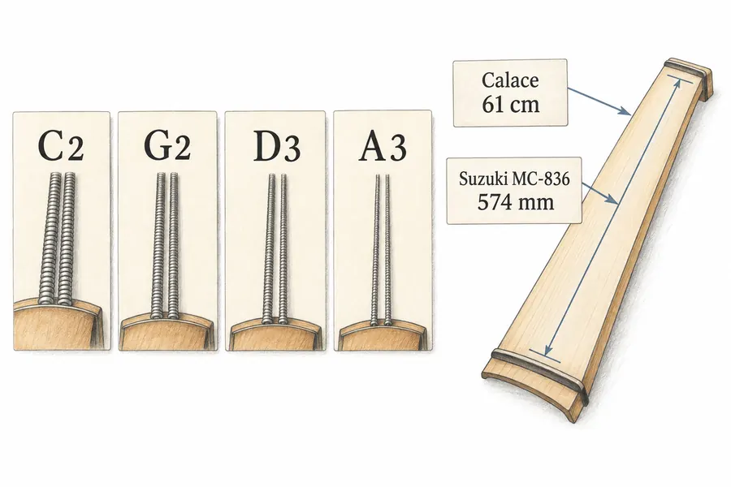
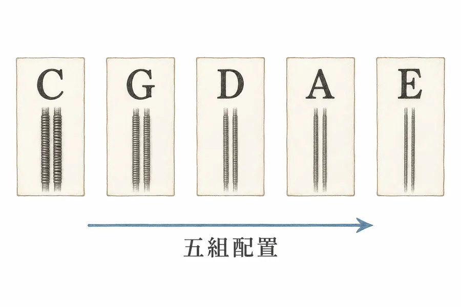
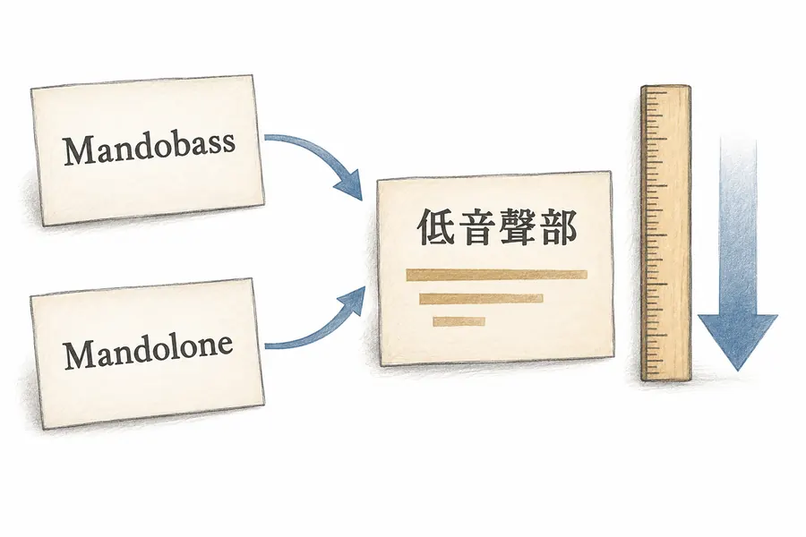
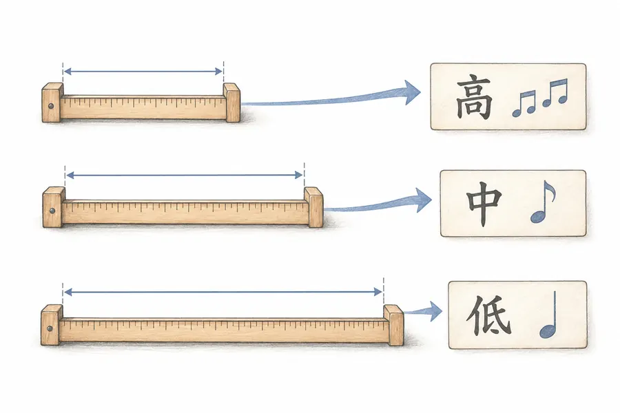
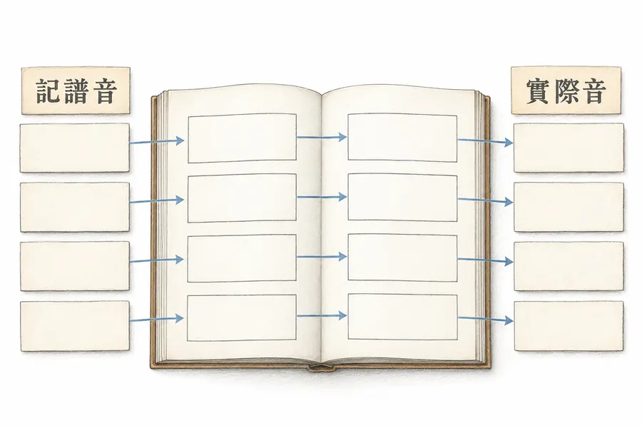

# Chapter 5: The Mandolin Family and Its Ranges

*The family from soprano to bass: tuning, range, courses and scale length*

## Key points

- The mandolin family, running from high to low, is roughly **mandolin, mandola, mandocello, mandobass**.
- To work out which member of the family an instrument is, go in this order: **tuning → range → number of courses → scale length**. The name comes last.
- The word **mandola** usually means the C-tuned instrument (C3–G3–D4–A4) in the United States and Canada, and can mean the G-tuned instrument an octave down elsewhere. One word, two instruments.
- The same tuning does not mean the same size. **Scale length** decides how an instrument feels in the hand far more than body size does.
- The lower you go in the family, the longer the scale length usually gets; but a rare old instrument is not a superior one.

---

When instruments spread from soprano down through alto and baritone to bass, the most natural thing is to line them up the way the violin family does: mandolin, mandola, mandocello, mandobass.

The mandolin family is a good deal messier than that.

The same name can point to different **tunings** in different countries. Turned around: the same G–D–A–E an octave down can be called an octave mandolin, a mandola in G or a tenor mandola.

An analogy: in a village where three different men are all called Old Wang, remembering only those two syllables guarantees you knock on the wrong door.

So this chapter puts the name in second place. First, establish four facts:

1. **Open-string tuning** (what note each of the four courses is tuned to)
2. **Actual range** (which notes it can produce, lowest to highest)
3. **Number of courses** (how many pairs of strings)
4. **Scale length** (the vibrating length of the string)

Then look at what role it plays in an ensemble. Only then hang the national names on top.

This chapter has two complementary sets of evidence. The first is the notation guide of **CMSA**, the Classical Mandolin Society of America, which sets out regional naming and notation. The second is the current catalogue of **Calace**, the Italian workshop, which shows that one mandola body can be offered in both G tuning and C tuning.〔F13〕〔F15〕

## Classify by tuning first, not by name

*Figure F: the mandolin family. The bigger the instrument, the lower it sounds; the horizontal axis is pitch, and further right is higher.*

Start with this summary table. The order of its columns is the reading order this chapter recommends.

*Figure: classification starts with the tuning, not the name (schematic).*

| **Family / common name** | **Tuning (low→high)** | **Typical role** | **Naming risk** | **Evidence** |
|---|---|---|---|---|
| **Mandolin** | G3–D4–A4–E5 | soprano / lead | relatively stable | F13／F14 |
| **C mandola** | C3–G3–D4–A4 | alto | also called tenor／contralto／alto mandola | F13／F15 |
| **Octave / G mandola** | G2–D3–A3–E4 | low alto | names overlap across regions | F13／F15 |
| **Mandocello** | C2–G2–D3–A3 | low tenor | also called mandoloncello | F13／F16 |
| **Liuto／10-string** | C2–G2–D3–A3–E4 | adds a fifth course | product name overlaps family name | F16 |

A small trick for reading this table: **read the middle column first**. Note names do not lie; names do.

Also note that the number after a note name marks the octave. G3 is an octave above G2; the larger the number, the higher the note.

## 5.1 The names and tunings of the mandola

In the United States and Canada, **mandola** usually means the four-course instrument tuned C3–G3–D4–A4.

Its tuning is exactly that of the **viola**. So calling it "the viola of the mandolin family" when you are explaining it to a beginner is not wrong.

But CMSA points out specifically that in other parts of the world **the same tuning** may be called a tenor mandola, an alto or contralto mandola, or a mandola in C.

More awkward still: in other traditions the word "mandola" itself can also mean the octave-down G–D–A–E type.〔F13〕

This is where regional translation goes wrong most easily.

If a page writes only "mandola", with no tuning attached, the reader will very likely assume the whole world means the same instrument. It does not.

The professional way to write it is to spell it out the first time it appears:

- **C mandola (C3–G3–D4–A4)**
- or **G mandola / octave type (G2–D3–A3–E4)**

Let the pitch come before the name.

*Figure 5.1: the name and tuning of the mandola (schematic).*

### One word, two ranges: the table that settles it

This is the most important table in the chapter. Once you have read it, the three syllables of "mandola" will not fool you again.

| **What you see written** | **Where it most often appears** | **Which tuning it means** |
|---|---|---|
| **Mandola** | the classical scene in the US and Canada | C3–G3–D4–A4 (four courses, like a viola) |
| **Tenor mandola／Alto mandola／Contralto mandola／Mandola in C** | regions outside the US and Canada | the same C3–G3–D4–A4 |
| **Octave mandolin** | the folk／Celtic market in Britain and the US | G2–D3–A3–E4 (an octave down) |
| **Mandola in G／G mandola** | Italy and some European traditions | the same G2–D3–A3–E4 |
| **Mandola (other traditional usages)** | literature from other regions | may mean the octave-down G–D–A–E type |

Here is an even simpler version:

| **The context** | **What "mandola" may mean** |
|---|---|
| Material from the US or Canadian classical scene | C tuning, C3–G3–D4–A4 |
| Italy or parts of Europe, or anything marked "in G" | G tuning, G2–D3–A3–E4 |

> **Common misconception**
> **"The mandola is the viola of the mandolin family, and that holds everywhere in the world."**
> In the United States and Canada the mandola **usually** means C tuning. But usually is not always, and the usage does not necessarily hold in other regions. The viola comparison also covers only **tuning and range**; it does not stretch to timbre.

In other words: **"mandola" on its own carries no information at all.** It has to come with a tuning.

### "Like a viola" applies to the tuning only

Functionally, the C mandola does often fill the alto and inner parts.

But its timbre, the plucked **attack** (the character of the note at the instant the plectrum goes through the string) and its **sustain** (how long the note holds), are quite different from a viola's.

So when you orchestrate, you cannot copy a viola part across unchanged. The parts have to be laid out again around a plucked instrument's attack and sustain.

A mandolin orchestra has three more things to consider:

1. **Double-course attack**: two strings are struck at once, so the attack is thicker and denser than a single string's.
2. **Tremolo density**: if every inner part is tremolo, the texture smears into one blur.
3. **Masking by the guitar**: the alto register is easily covered by the guitar.

> **Common misconception**
> **"The mandola sounds like a viola."**
> The viola comparison is best kept to tuning and range.
> The mandola's plectrum attack is very clear; the overtones of a double course in the alto register, and the way it **damps** the strings (stops them vibrating), are also unlike a bowed instrument.
> Copy a whole viola part across and the long notes and inner parts will probably have to be re-scored as **tremolo** or as chords.

There is one more layer: the same C3–G3–D4–A4 system may be written with different **clefs** and different notational conventions in different regions.

CMSA sets out two practices side by side, **universal notation** (written at sounding pitch) and **transposed notation** (written a fixed interval away from sounding pitch). Which shows exactly this: the same tuning does not mean the world reads the page the same way.〔F13〕

## 5.2 The octave mandolin and the G mandola

G2–D3–A3–E4, an octave below the standard mandolin, is one of the most common low-alto systems today.

In the British and American **folk／Celtic** market it is usually called an **octave mandolin**.

In Italy and some European traditions the same range may be called a **mandola in G**.

CMSA lists "rest of the world mandola／octave mandolin" as a separate entry, precisely because this naming split has become part of everyday practice.〔F13〕

The choir is a useful comparison here. A choir has soprano, alto, tenor and bass. The mandolin family does the same job, building a staircase of ranges out of plucked instruments.

### The same tuning does not mean the same size

Different makers can choose different **scale lengths** (the vibrating length that decides how far apart the stopping points fall). It is a trade-off between two things:

| **Scale length** | **What you gain** | **What it costs** |
|---|---|---|
| **Longer** | the strings still feel tight at a low pitch | a wider stretch for the left hand, so fast position changes take more effort |
| **Shorter** | easy to press, quick to move around the neck | the strings may be too slack, and need a heavier or differently built set |

*Figure 5.2: the octave mandolin and the G mandola (schematic).*

Think of a rubber band: the longer you stretch the same band, the tighter you have to pull it to reach the same note. Strings behave the same way.

So when you compare octave mandolins, overall body length matters less than scale length.

A bigger body increases the **cavity volume** (the air space inside the body), but what really decides the **stopping distances** is the vibrating scale length.

That is why a family specification table always gives scale length as its own column.

### Behind the naming split there is usually a difference in use

In the Celtic and folk world the octave mandolin often uses **single notes**, a **drone** (a held bass note, like the note that never stops on a bagpipe) and **open-string resonance**.

That is not quite the situation of the G mandola in a classical ensemble.

Even with the same tuning, body depth, scale length and string gauge may be chosen to give a different feel in the hand.

So before you buy, ask yourself one question: **what am I going to do with this G2?**

| **What you want to do** | **The direction that suits it better** |
|---|---|
| Fast melody matters most | a shorter scale, which is more comfortable to press |
| You need a clear low end and a taut feel | a longer scale may suit better |

That question is far more useful than a brand name. It is the starting point for any comparison.

## 5.3 The naming and specifications of the Calace mandola

The current Calace Mandola 24, 26, 13 and 15 all list a scale length of **43.2 cm**, with **45.6 cm** available as an option.

The same model can be set up in G tuning or in C tuning:

| **Set-up** | **As the maker lists it (high→low)** | **In this book's order (low→high)** |
|---|---|---|
| **G tuning** | E–A–D–G | G–D–A–E |
| **C tuning** | A–D–G–C | C–G–D–A |

〔F15〕

This example matters a great deal.

Because it proves that "mandola" is not the name of a single tuning even **inside one working Italian workshop**.

So when you assess a second-hand Calace, check three things: **model, date and actual tuning**. Better still, confirm the actual scale length, the string gauges, and what the seller currently has it tuned to.

*Figure 5.3: the naming and specifications of the Calace mandola (schematic).*

### More ribs does not mean a higher grade

Calace also offers different **ribs** (the staves that build the bowl) and different fingerboard grades: for example 25 rosewood ribs, or, at concert level, 33 maple **fluted ribs** (staves with a groove cut down each one).

These are **differences in making** within one range of the family.

They should not be turned into a general rule that "more ribs always means a higher grade". They represent one particular brand's product options.〔F15〕

> **Common misconception**
> **"The more ribs in the bowl, the better the instrument."**
> The rib count has to be read together with the curvature, the width of each stave, the craft and the design series. Twenty-five or thirty-three are Calace's own options, not a worldwide grading table.

### The direction of the list is another trap

Calace's official pages list the tuning from **high to low**: E–A–D–G／A–D–G–C.

This book uses **low to high** throughout: G–D–A–E／C–G–D–A.

When you read maker's material, always establish the direction of the list first. Otherwise the same set of note names is easily misread as a different tuning.〔F15〕

That is also why a database needs a field for the **order convention**.

If one brand lists high to low and another low to high, and whoever compiles the table just copies the strings across, the reader is shown information that looks contradictory.

For a standardised display you may re-order it, but the original source has to be kept so it can be checked.

## 5.4 The mandocello and the mandoloncello

The **mandocello**, or **mandoloncello**, usually has four courses tuned C2–G2–D3–A3.

That pitch matches the **cello**'s arrangement in fifths.

It takes the mandolin family into a genuine low tenor range. In an ensemble it can therefore carry a low melody, counterpoint, or a solid harmonic floor.

CMSA's treatment of mandocello notation also shows that different works may meet different clefs and different transposition habits.〔F13〕

### The largest instrument's most direct problem: tension

The lower the pitch, the heavier a string has to be to stay manageable at a short scale length.

Stretching the scale length, though, adds to the distances the left hand has to travel.

So the mandocello's design shows one compromise more plainly than a standard mandolin does: **ergonomics against low-frequency efficiency**.

It is a little like choosing shoes. The thicker the sole, the more shock it absorbs, and the less your foot can feel the ground.

*Figure 5.4: the mandocello and the mandoloncello (schematic).*

Calace's current Mandoloncello is **eight strings, 61 cm scale**, with four courses C–G–D–A.

The ten-string version adds a high E on top of that, giving five courses C–G–D–A–E.

Which also shows that "mandoloncello" and the "liuto／ten-string extended type" can overlap. When classifying, settle the territory by **course count and tuning**, not by the name alone.〔F16〕

### Both hands get heavier

The left hand's load on a mandocello does not come only from the **fret spacing**.

Heavy strings and the resistance of the course add to it. If a large instrument still uses double courses, pressing a note means bringing two strings down onto the fret cleanly at the same time.

The right hand also has to drive the plectrum through a heavier course.

So although the technique belongs to the same family, you cannot simply scale up the small movements of a standard mandolin.

| **Two modern examples** | **Scale length** | **How to read that number** |
|---|---|---|
| **Calace Mandoloncello** | 61 cm | one working Italian workshop's solution |
| **Suzuki MC-836** | 574 mm (= 57.4 cm) | another instance, with a shorter scale |

The two should not be ranked by length alone; compare them together with the body, the stringing and the intended use.〔F16〕〔F26〕

## 5.5 The five double courses of the liuto cantabile

**Liuto cantabile** is the name most likely to lead a Chinese reader astray.

The **liuto** here does not mean it is the same thing as the **Renaissance lute**, an earlier plucked instrument.

In the Calace tradition it is a **five-course** plucked instrument closely related to the mandoloncello, usually tuned C–G–D–A–E.

The added high E lets a large body keep its low range and still reach higher melodic positions.〔F16〕

An analogy: a four-course instrument is a four-storey building, and a fifth course is a rooftop extension. The foundations (the bass) are unchanged, but there is more usable space.

### What does one extra course change?

| **Aspect** | **What changes** |
|---|---|
| **Range** | it extends, with a high E added |
| **Fingering** | more choices; melodies need fewer position changes |
| **Damping** | more important, and harder |
| **Right hand** | a wider span to cross |
| **Chords** | the **voicing** gains a new top voice |
| **Structure** | bridge, nut and headstock all have to take ten strings, and total tension rises |

That is why a family database has to give the **course count, the string count and the tuning** together. Leave one of the three out and the description stops being clear.

*Figure 5.5: the five double courses of the liuto cantabile (schematic).*

### A fifth course changes the harmonic thinking

Four courses are already enough to form a large number of four-note chords.

But the fifth course widens the span between bass and treble. Some **chord melody** playing (the melody carried on the top of the chord) can keep the melody on the high E while holding the low C／G foundation.

That is an example of structure directly widening what can be arranged.

An extra course also makes **muting** more important.

A course you are not using can produce a **sympathetic ring** (another set of strings vibrating along with the one you played). On a large resonant body the effect is more obvious.

The player has to control the residual ringing with both hands together. That extra work rarely appears on a plain specification sheet.

> **Common misconception**
> **"The liuto cantabile is standard in every mandolin orchestra."**
> In an arrangement it can bridge the mandocello's bass and the mandolin's treble, but it is **not** a standard member of every orchestra. Whether it is used depends on the region, the repertoire and the orchestra's tradition.

## 5.6 The mandobass and the mandolone

When large mandolin orchestras at the end of the nineteenth century and the start of the twentieth went after a complete range, a bass branch of the family was entirely reasonable.

The reason was consistency of timbre: if the treble, middle and bass parts are all built on a similar plucked attack, the whole orchestra has one tonal outline.

CMSA's document still lists the **mando-bass** today, which shows the family role was not invented by later writers.〔F13〕

But a large plucked bass faces very concrete costs:

- a large body that is hard to transport
- expensive strings and hardware
- the **double bass**, the guitar, and later amplified systems can all supply the low end more conveniently

As orchestra line-ups changed, the demand for a dedicated mandobass naturally shrank.

*Figure 5.6: the mandobass and the mandolone (schematic).*

### Rare does not mean failed

A historical model being rare does not mean the design failed.

They served a once very active **orchestra ecology**. When you collect or research them, ask first: how was an orchestra of that period made up?

Understand the bass family's purpose from the line-up of its own time.

The mandobass's history is also a reminder that whether a family instrument survives depends on the **alternatives**.

When the double bass already had trained players and a repertoire, adding a dedicated bass mandolin meant proving it was worth the cost.

It had to make a strong enough case on tonal consistency or on portability.

Different eras answer that question differently.

> **Common misconception**
> **"Bass instruments in the family are rare on the collector's market, so they rank higher musically."**
> Rarity can come from low output, a specialised use, storage difficulty or falling demand.
> Valuation looks at maker, originality, provenance and condition separately. Rarity and musical value are two different things.

## 5.7 Scale length and the division of labour in the family

Line up a few real numbers and the direction is clear:

| **Instrument** | **Scale length** | **Source** |
|---|---|---|
| **Calace mandolin** | 33.5 cm | 〔F14〕 |
| **Calace mandola** | 43.2 cm (45.6 cm optional) | 〔F15〕 |
| **Calace mandoloncello** | 61 cm | 〔F16〕 |

From 33.5 cm to 61 cm you can see the scale length step up as the family reaches downwards.

The point of doing it this way is to keep a lower pitch responsive, and under enough tension, at a reasonable string gauge.〔F14〕〔F15〕〔F16〕

### Tension, scale length, frequency, linear density

A string's tension is **coupled** to three things:

| **Variable** | **In plain words** |
|---|---|
| **Scale length** | the length of string that actually vibrates |
| **Frequency** | the note you are tuning to |
| **Linear density** | the mass per unit length of the string, which depends on its thickness and material |

Nobody expects the player to run the formula every day, but understanding the relation is useful when you compare one member of the family with another.

| **If the scale length is…** | **What happens** |
|---|---|
| **too short (a bass instrument)** | the string has to be thicker, which can raise its **stiffness** (how rigid the string itself is) and add inharmonic overtones |
| **too long** | the left hand may not manage fast position changes comfortably |

*Figure 5.7: the usual division of parts across the family; actual pitch depends on tuning and stringing (schematic).*

### The Suzuki example from Japan

The 2017 catalogue from Suzuki (Suzuki Violin Manufacturing, Japan) offers another very direct set of family numbers:

| **Model** | **Vibrating string length** |
|---|---|
| **M-30** | 336 mm (= 33.6 cm) |
| **MD-4** | 426 mm (= 42.6 cm) |
| **MC-836** | 574 mm (= 57.4 cm) |

Brand, body material and structure are all different, and the numbers still point the same way: as the family's range drops, the scale length grows.〔F26〕

Set Suzuki's numbers beside Calace's and you see the shared direction: **the lower you go in the family, the longer the scale length usually is**.

But the two brands' step sizes are not identical.

That is exactly why a cross-brand comparison should begin by establishing scale length, tuning and range.

The letters MD and MC mean something only inside one brand.〔F14〕〔F15〕〔F16〕〔F26〕

### Scale length also changes where the plectrum sits

For the player, a change in scale length also shifts the sense of where the plectrum meets the strings while the instrument is held.

The longer the string, the further the bridge sits from the right hand, and the arm and wrist may land in a different place.

Large family members usually call for the **strap** and the sitting position to be re-set, so that the way you hold the instrument matches its size and weight.

## 5.8 Written pitch and sounding pitch

Part of the confusion around instrument names comes from **notation habits**.

Some family members are written **at sounding pitch** (the note on the page is the note you hear).

Some historical or regional sources use **transposed notation** (the written note sits a fixed interval away from the sounding note), so that players can keep the same fingerings.

The CMSA document sets out the clefs and transpositions a mandolin, mandola, octave mandolin, mandocello, liuto cantabile and mando-bass may meet. It is a very important reference for working players.〔F13〕

An analogy: transposed notation is the same map at a different scale. Your finger positions stay convenient, but you have to remember to convert the real distances.

*Figure 5.8: written pitch and sounding pitch (schematic).*

### When arranging, check three things at once

1. **Written pitch**: what is on the page
2. **Sounding pitch**: what actually comes out
3. **Playing range**: where the instrument's limit lies

Two instruments may share sounding notes and still cut through an ensemble differently, because their attack, scale length and resonance differ.

In real orchestration you meet these situations:

| **Situation** | **What happens** |
|---|---|
| first and second mandolin on top of each other | a very dense attack |
| the mandola's alto register | may be masked by the guitar and by low-mandolin tremolo |
| mandocello | has to choose between singing the melody and holding the bass |

A genuinely complete family table should therefore not stop at "name in Chinese／name in English".

It should give at least: **tuning, courses, scale, sounding range, usual clef, orchestral function**.

That is why the model database in Chapter 20 uses many fields, so that family and structure are established together.

### What transposed notation costs

Transposed notation usually exists so that players can keep familiar fingerings.

The cost is that whoever reads the full score has to know the sounding pitch.

An arranger who judges range from the written notes alone may put the mandola in an unfavourable **register**.

That is why a professional score marks the tuning clearly beside the instrument's name.〔F13〕

Classifying the family is therefore a **making question, a playing question and a notation question at once**.

Start from any one side alone and the picture distorts:

| **Who you are** | **What you look at first** |
|---|---|
| maker | scale length |
| player | how it feels in the hand |
| arranger | range |
| collector | the label |

A complete data table has to join these viewpoints together.

## Self-study question bank

*Study check: answer, mark, review*

Answer for yourself first, then look at the answers. When you get one wrong, go back to the relevant section of the chapter and read it again.

**1. When you are identifying a mandola-type instrument, the most important information is?**

- A. The colour of the varnish
- B. Tuning, range, scale length and intended use
- C. The size of the brand logo
- D. The colour of the case

**2. The usual G-tuned system of the octave mandolin, compared with a standard mandolin, is?**

- A. An octave higher
- B. An octave lower
- C. Exactly the same pitch
- D. It has no fixed pitch

**3. One of the usual features of the liuto cantabile is?**

- A. Five courses
- B. A single string only
- C. No fretboard
- D. It is played with a bow

**Answers: 1.B　2.B　3.A**

## Main sources checked for this chapter

*Sources checked: find the original, check the conditions, keep a record*

**〔F13〕Robert A. Margo / Classical Mandolin Society of America, Music Notation for Mandolin Family Instruments, v3, 2019.** Family tunings, notation, and the regional naming differences around the mandola and the octave mandolin.

> https://classicalmandolinsociety.org/wp-content/uploads/Music_Notation_for_Mandolin_Family_Instruments_v3.pdf

**〔F14〕Liuteria Calace, Mandolini – official specifications, accessed 2026-10-06.** Current mandolin specifications including the 33.5 cm scale, bowlback ribs and spruce soundboard.

> https://www.calace.it/en/mandolini

**〔F15〕Liuteria Calace, Mandole – official specifications, accessed 2026-10-06.** The 43.2 cm and 45.6 cm scale lengths, and G-tuned and C-tuned mandolas offered side by side.

> https://calace.it/en/mandole

**〔F16〕Liuteria Calace, Mandoloncelli & Liuti – official specifications, accessed 2026-10-06.** The 61 cm eight-string Mandoloncello, and the ten-string C–G–D–A–E extended type.

> https://calace.it/en-mandoloncelli-liuti

**〔F26〕Suzuki Violin Manufacturing / Suzuki Music, 2017 string-instrument catalog, 2017.** Japanese family specifications and scale lengths for the M-30, M-100, MD-4, MD-10 and MC-836.

> https://www.suzuki-music.co.jp/app/uploads/2017catalog14.pdf
