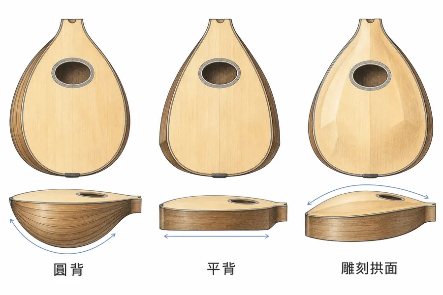
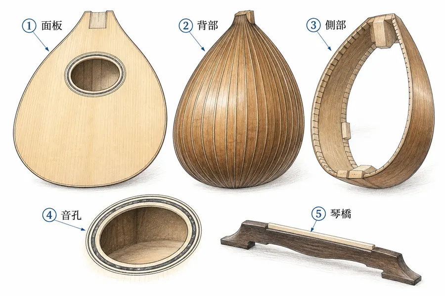
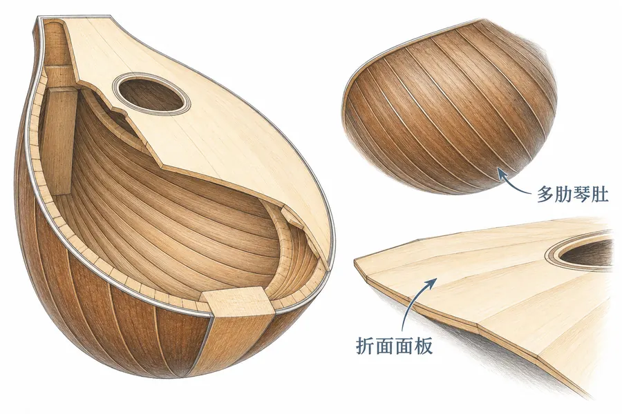
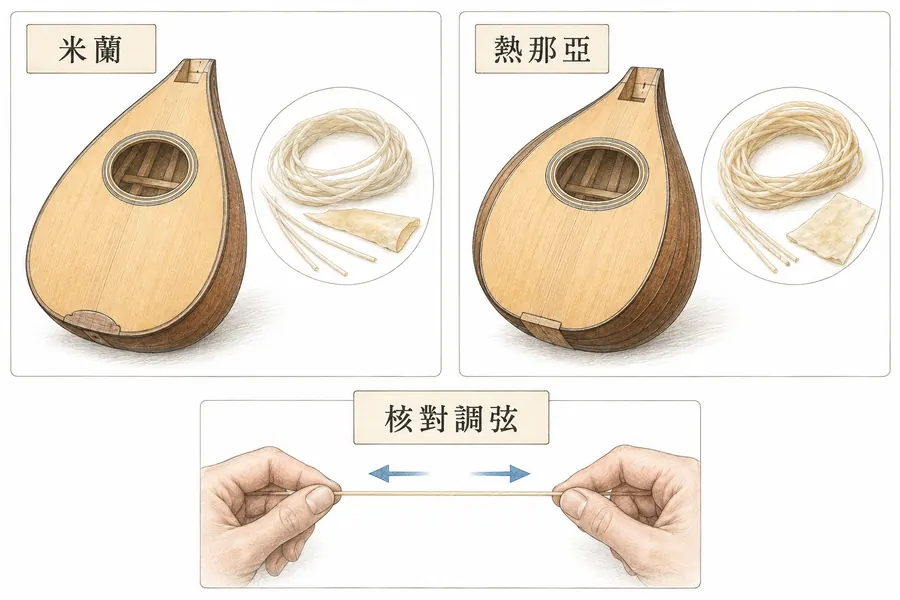
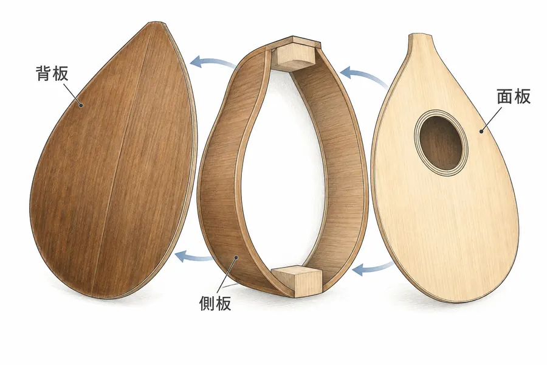
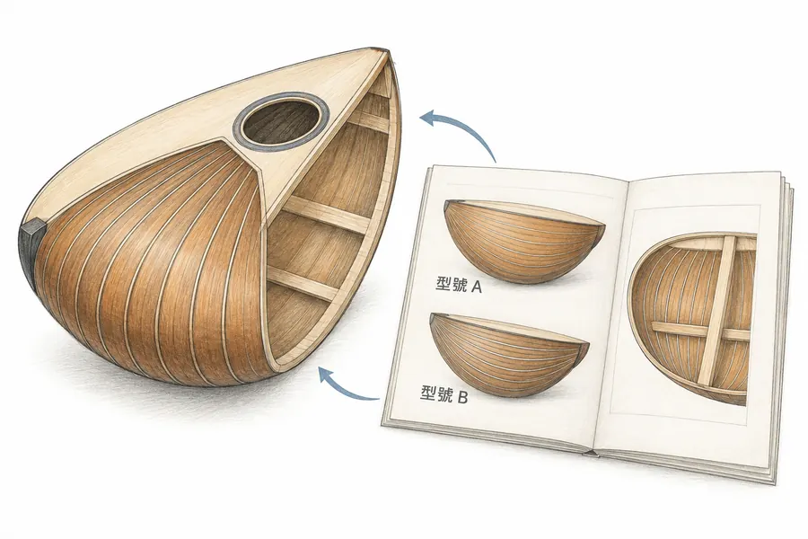
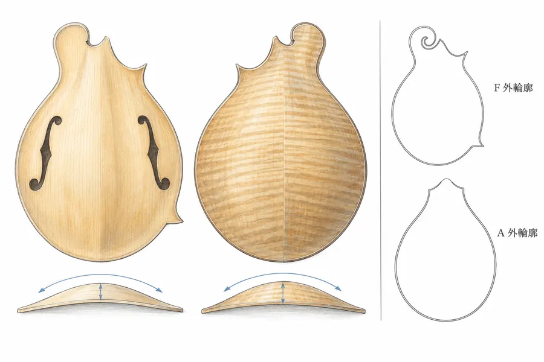
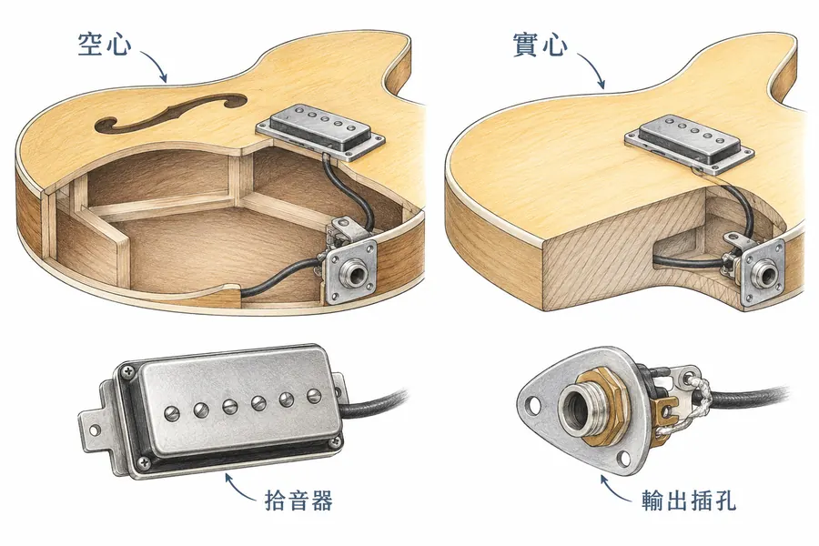
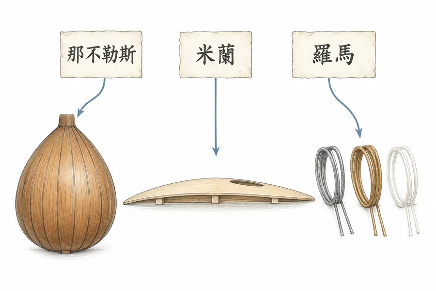

# Chapter 6: Regional Instrument Forms and Their Structural Features

*Bowlback, flatback and carved top: reading structure instead of style labels*

## Key points

- **Family** answers "which range, which tuning"; **form** answers "what structure produces that range". They are two different questions.
- Judging a form means looking at five things: **top, back, sides, soundholes, bridge**. The front outline is only the first step.
- "Bowlback = classical", "F-style = bluegrass", "flatback = folk" are historical impressions, not structural descriptions.
- The word **Roman** is the one most easily **used across periods**, so it **always needs a date**.
- A-style／F-style is a **classification of outline**, not a beginner／advanced grading table.

---

Two instruments can share the same G–D–A–E tuning and differ completely in body section, the load on the top, soundholes, bridge and internal bracing.

That is why family and form have to be discussed separately:

| **Question** | **Which concept answers it** |
|---|---|
| Which range does this instrument belong to? What is it tuned to? | **family** |
| What structure produces that range? | **form／style** |

An analogy: family is "is this a saloon car or a truck"; form is "how its engine is built". The same kind of vehicle can have several different engine designs.

The commonest mistake is writing form as a **style label**:

- bowlback = classical
- F-style = bluegrass
- flatback = folk

Those links **do have a historical basis**, but they cannot replace a description of the structure.

This chapter looks first at how the body carries the load of the strings and how the top works, and only then at how musical cultures in different places came to choose these designs.

## Comparing forms and structures

*Figure: comparing forms and structures (schematic).*

| **Form** | **Back／body** | **Top** | **Usual stringing** | **What to study** |
|---|---|---|---|---|
| **Neapolitan bowlback** | deep bowl of many ribs | bent top + ladder bracing | 8 strings／4 courses | high tension and a stiff bowl |
| **Early Roman mandolino** | small roundback | early lute type | gut, many courses | cannot be equated with the modern Roman style |
| **Milanese／Genovese** | roundback | depends on the school | usually 6 gut courses | different tuning and naming |
| **American carved-top** | carved back + sides | carved spruce top | 8 strings, GDAE | the line descending from Gibson's patent |
| **Japanese family** | mostly bowlback; the bass may be flat | depends on the model | a complete family | ensemble demand and mass production |

A few of these terms need explaining first:

- **ribs**: the long narrow staves joined into the bowl of the back.
- **bowlback**: a back built out into a bowl.
- **flatback**: a back that is flat.
- **bracing**: the supporting strips of wood glued to the inside of the top.
- **ladder bracing**: bracing laid across the top like the rungs of a ladder.
- **carved**: shaped to a curve out of a solid block, not bent from a thin sheet.
- **gut**: strings made from animal gut, the material used before steel.

## 6.1 The five things to compare in a form

Reading a mandolin's form, the front outline is really only the first step.

At least five questions actually carry structural meaning:

| **#** | **The question** | **Possible answers** |
|---|---|---|
| 1 | Is the top flat, bent, or carved into an arch? | flat／cant／carved |
| 2 | Is the back a deep bowl of many ribs, a flatback, or a carved back? | bowlback／flatback／carved |
| 3 | Are the sides separate side ribs, or part of the bowl shell? | separate／integral |
| 4 | Are the soundholes round, oval, **f-holes**, or side ports? | round／oval／f-hole／side port |
| 5 | Is the bridge floating or fixed? | floating／fixed |

Record these five things clearly and even a modern **hybrid** can be described by the structure you can confirm first, and only then discussed in terms of which school it resembles.

The other way round, if you write only A-style, F-style, Roman, Neapolitan, the reader easily assumes every one of those names stands for a completely fixed specification worldwide.

*Figure 6.1: the five things to compare in a form (schematic).*

### What the 2022 study did

The 2022 acoustic study of Italian mandolins chose three instruments to compare:

- a 1906 Naples instrument
- a 1908 Milan instrument
- an early twentieth-century Roman-style instrument

These three were chosen precisely because the schools' geometry and bracing differ.

The study did not turn the differences into "which one sounds better". What it measured was **bridge admittance**, **sound radiation** and **modal shapes**.

That is what a professional comparison of forms should look like.〔F08〕

### One more dimension that is often ignored

Add one more dimension: the **neck／body joint** and the **neck projection** (how far the neck stands out from the body).

Two instruments with similar front outlines will differ in **how reachable the high positions are** and in **bridge height** if their neck projections differ.

American carved-top instruments later put particular emphasis on neck projection, while some bowlback traditions kept geometry that sits closer to the body.

So form, in the end, is a set of **geometric relationships**, not a **silhouette**.

For a research catalogue, three views — front, side and the internal bracing — carry far more information than one handsome front photograph.

## 6.2 The Neapolitan bowlback

The most striking feature of the Neapolitan style is the **bowlback**.

Many narrow ribs are built up over a mould into a deep bowl. The curvature itself produces a high **geometric stiffness** (rigidity that comes from the shape).

Acoustic research also shows that the **back modes** of a bowl shell usually sit much higher than those of the top.

So it does not form the pronounced **live back** coupling that some guitars do (a back that joins actively in the vibration).

In other words, the Neapolitan instrument's main moving acoustic surface is concentrated in the **soundboard**.〔F08〕

### The bend in the top is the other core feature

The **bend** (or **cant**) in the top near the bridge is another core feature.

It does two things at once:

1. It changes the **geometry** of the angle at which the string load enters the top.
2. It adds local **stiffness**.

Together with lateral ladder bracing it produces a modal ordering quite unlike a **flat-top guitar**'s.

The 2022 study points out that this bracing gives the modern Italian bowlback low-frequency **signature modes** that look closer to those of lute-family instruments.〔F08〕

*Figure 6.2: the Neapolitan bowlback (schematic).*

An analogy: a bent top is like a sheet of paper with a crease folded into it. The same sheet, once creased, is **much stiffer** and does not sag. That strength comes from the shape, not from thickness.

### It is a whole structural answer

So the bowlback should not be described only as "having more of an Italian flavour".

It is **a complete structural answer to a high-tension eight-string system**:

- a stiff bowl
- a bent top
- bracing
- a floating bridge
- a tailpiece

These five work together. Change one and the others usually have to move with it.

The rigidity of the deep bowl also explains why a bowlback cannot be understood with a flatback guitar's instincts.

A guitar's back often couples clearly with the top in the low range.

In the traditional Italian bowlbacks measured, though, the high curvature and stiff structure keep the back's low-frequency movement relatively small.

That does **not** mean "the back makes no sound at all"; its **role** in the overall modes is different.〔F08〕

> **Common misconception**
> **"A bowlback's back is rigid, so the back takes no part in making the sound."**
> It is not that the back makes no sound; its role in the overall modes is different from a guitar's. Relatively little low-frequency movement is not the same as none.

For the maker, this structure puts the emphasis back on the soundboard: **top thickness**, the bend, the bracing and **bridge coupling**.

For the player, it shows up as a fast attack and a clearly defined front edge to the note.

The actual result still depends on **that individual instrument**; the average of a study group is not a guarantee for any single instrument's timbre.

## 6.3 The early Roman instrument and the modern Roman one

The word "Roman" is the one most easily used across periods without noticing.

### Two entirely different "Romans"

| **Name** | **Date** | **What it is** |
|---|---|---|
| **Roman mandolino** | about 1710 (a Met object) | the earlier **mandolino del vecchio tipo**: multiple gut courses, a sickle-shaped head, a smaller body |
| **Roman style** | nineteenth and twentieth centuries | a modern eight-string form, one member of the modern Italian mandolin group |

The Roman mandolino of about 1710 in the Metropolitan Museum in New York (the Met) is the first row of that table.〔F03〕〔F27〕

By the nineteenth and twentieth centuries, the modern Italian mandolin world had produced an **eight-string form** called the Roman style.

The anonymous Roman-style mandolin in the 2022 study already belongs to the modern mandolin architecture, and could be compared with the 1906 Naples and 1908 Milan instruments on bridge admittance.

It is **not the same specification** as the early Roman mandolino of 1710.〔F08〕

*Figure 6.3: the early Roman instrument and the modern Roman one (schematic).*

It is like the word "phone": a 1995 phone and a 2025 phone are both phones, and nobody thinks they are the same object.

So this book **adds a date** whenever "Roman" appears. Where there is no date, it at least gives the course count, the string material and the tuning.

This example shows very well why a regional name cannot stand in for a technical specification.

### A note for collectors

The Roman case is also a reminder for collectors: when you read a label, ask **who used that name, and when**.

An eighteenth-century regional mandolino and a twentieth-century modern Roman-style may both be listed on an auction page as simply "Roman mandolin".

Without a date, the search results themselves mix the two together.

This book's database therefore puts **region／style** and **family／tuning** in two separate columns:

| **Field** | **What it records** | **Example** |
|---|---|---|
| region／style | the form and the regional description | Roman |
| family／tuning | the tuning description | G–D–A–E |

Keeping the two apart is what stops a historical coincidence of names from being taken for one specification.

## 6.4 The Milanese and Genoese styles

### Milanese: Presbler, 1796

The 1796 **Milanese-style mandolin** by Presbler has **six pairs of strings**, and its back is built from **seventeen rosewood ribs**.

Its matched mandola sounds an octave lower.

The set shows that at the end of the eighteenth century, when the Neapolitan four-course instrument was already well developed, Milan kept a **six-course tradition** of its own.〔F06〕

### Genoese: Nonnemacker

The Nonnemacker instrument in the **Genoese** style also has six pairs of **gut strings**.

The museum record shows rather different features, though:

- the tuning follows an **interval structure** similar to the modern guitar's
- the whole instrument sits **an octave higher**
- the head takes the form of a **guitar-like peg block**

Those features set it apart from the Roman old type, from the Milanese and from the Neapolitan.〔F05〕

*Figure 6.4: the Milanese and Genoese styles (schematic).*

### Three lines of summary

| **School** | **String count** | **What is most distinctive** |
|---|---|---|
| **Milanese** | six pairs | seventeen rosewood ribs; a matched mandola an octave lower |
| **Genoese** | six pairs of gut | guitar-like tuning, an octave higher overall, a guitar-style head |
| **Neapolitan** | four courses (eight strings) | what became the mainstream, and the basis of the modern mandolin |

> **Common misconception**
> **"When a Milanese or Genoese instrument turns up, you can put modern G–D–A–E fingering on it straight away."**
> These are six-course systems, tuned differently from the modern mandolin. Before playing one, find the instrument itself or a document and confirm the tuning.

For the player, the most practical conclusion is that sentence above.

For the researcher, the thing to avoid is writing the other Italian traditions off as side branches just because the Neapolitan system dominates today.

### Six courses change more than the notes

A six-course system also changes **the slot layout on the bridge and the nut**.

The more courses there are, the closer the strings must sit within the same fingerboard width, or the neck has to get wider.

That is why the Met's Roman mandolino having had **its fingerboard widened later** is worth noticing.

A structural alteration can often be read backwards from the ergonomic need that caused it.〔F03〕

Presbler's **matched pair** also shows that one visual vocabulary can extend across different ranges.

With instruments like these, looking at the mandolin and the mandola together makes it easier to see how the maker planned proportions and tuning than looking at either one alone.〔F06〕

## 6.5 Flatbacks in Germany and central Europe

The **flatback** tradition in Germany and central Europe is usually tied to **Zupforchester** culture (the German word for a plucked-string orchestra).

A flat, shallower body offers different conditions for making and for holding the instrument, and it extends more easily to the mandola and the bass members of the family.

But to say only that "a flatback sounds softer" is an oversimplification.

Timbre still depends on the top, the bracing, the scale length, the strings and the design as a whole.

### The more historically interesting question is the social use

Sparks's study of 1918–1945 points out that between the two world wars Germany and Austria developed new playing styles, and that the mandolin orchestra became connected with **workers' cultural organisations**.

When large groups need family instruments that are stable, available in quantity and easy to write for, **institutional demand** shapes the form.〔F20〕

*Figure 6.5: flatbacks in Germany and central Europe (schematic).*

So form is not a maker unilaterally "inventing a sound".

Education, clubs and societies, price, transport and playing position all work back on the question of which structure suits long-term use.

The logic is similar to the complete mandolin／mandola／mandocello production line that Japan later built.

An analogy: it is like a school buying instruments. A school does not pick the most unusual one; it picks the model that can be repaired, that can be bought twenty at a time, and that tunes to roughly the same pitch across the batch.

> **Common misconception**
> **"Flatbacks are cheaper to make and quieter."**
> One real difference is that the logic of making and storing a flatback is not the same as a deep bowl's. But that does not mean it is necessarily cheaper or quieter. A high-end hand-made flatback can be very complex. The real differences still come back to the top, the bracing, the scale length and the craft as a whole.

The interwar years in Germany and Austria show "institutions choose forms" even more clearly.

Large numbers of **ensembles** needed instruments that were predictable, repairable and available as a matched set across the parts, so instrument design naturally came to value **consistency**.

That need is not the same as a **solo luthier**'s goal of pushing a single instrument's individuality as far as it will go.〔F20〕

## 6.6 Japanese bowlbacks

Japanese instrument making entered the mandolin market early.

Suzuki's official chronology records that it began making and selling mandolins in **1906**.

Later catalogues list this line-up:

| **Model** | **Structure** | **Range** |
|---|---|---|
| **M-30** | bowlback, built from many staves | standard mandolin |
| **M-100** | bowlback, built from many staves | standard mandolin |
| **MD-4／MD-10** | the MD-4 continues the family's bowlback vocabulary | extends to the mandola |
| **MC-836** | rosewood flat body | mandocello |

That is itself an instance of **different ranges taking different back structures**.〔F25〕〔F26〕

The standard mandolin and mandola keep the multi-stave bowlback, which is compatible with the Italian-derived tradition of the Japanese classical mandolin orchestra.

The bass mandocello takes a flat body, which **may** offer a more practical compromise on size, weight and low-frequency efficiency.

The reason should not be stated with too much certainty: a catalogue can prove **structure and material**, but a catalogue alone cannot establish a maker's whole **design motive**.

*Figure 6.6: Japanese bowlbacks (schematic).*

The real character of Japanese forms therefore includes, besides a photograph of the outside, **a whole family in mass production plus university and amateur ensemble playing**.

When a musical culture needs first and second mandolins, a mandola, a mandocello and a guitar over the long term, the trade naturally develops a complete system of specifications.

The 2017 Suzuki catalogue shows a very concrete division of labour: the M-30's body is a multi-stave maple bowlback, the MD-4 still continues the family's bowlback vocabulary, and the MC-836 uses a rosewood flat body.

These models show that **one manufacturer will use different structures for different ranges**.〔F26〕

> **Common misconception**
> **"Suzuki is a bowlback brand."**
> Writing "brand = form" is risky. Suzuki, Calace, Gibson and others all span several structures and several periods. The unit that can actually be compared is **a specific model from a specific year**.

## 6.7 The American carved-top instrument

**Orville Gibson**'s 1898 patent is about changing the thinking behind making at the root.

He criticised traditional instruments for being built from too many bent, joined and glued pieces.

What he proposed was this:

- the **rim**, **neck** and **head** carved as one out of **a single block of wood**
- the top and the back each carved from solid wood as well
- even a **hollow neck** open into the cavity of the body

〔F10〕

The 1898 instrument in the Met matches the patent:

- a carved spruce top
- a carved walnut back
- a floating bridge
- a tailpiece
- a large oval soundhole
- the teardrop outline later called **Model A**

Those features are where the American **archtop mandolin** starts.〔F11〕

*Figure 6.7: the American carved-top instrument (schematic).*

### A-style and F-style are not a grading table

The later Gibson **F-style** and the **Loar period** went on to develop:

- the **scroll** (the spiral ornament on the body)
- **f-holes**
- a longer **neck projection**

But the most important sentence for understanding this history is this one:

**A-style and F-style are first of all a classification of outline within the American carved-top family, not a beginner／advanced grading that applies anywhere.**

A high-grade modern A-style can perfectly well surpass a great many F-styles in material and craft.

> **Common misconception**
> **"An F-style has a scroll, so it outranks an A-style."**
> A and F are classifications of outline. A scroll and an ornament do not indicate a grade of quality. A high-grade modern A-style surpassing a great many F-styles in material and craft is entirely possible.

### Read the patent from the manufacturing point of view

Gibson's patent is also worth reading from the manufacturing point of view.

He argued for reducing the traditional method built out of bent thin boards and quantities of glued joints, and put forward the structural ideal of **carved solid pieces**.

That is an **acoustic claim** and a **manufacturing philosophy** at the same time.

The text of a patent represents the problem the inventor set out to solve; it does not mean every Gibson instrument that followed was built exactly to the original scheme.〔F10〕

So when you study a brand's history, keep three levels apart:

| **Level** | **What it is** | **Evidence** |
|---|---|---|
| 1. patent concept | the idea in the patent | the 1898 patent document〔F10〕 |
| 2. production instrument | the instrument actually built | the 1898 object in the Met〔F11〕 |
| 3. later evolution | the F-style and Loar period | models of the 1910s and 1920s |

Keeping the three apart stops the 1898 patent from being read as a specification sheet for the **F-5** of the 1920s.

## 6.8 Hybrid structures and the electric mandolin

A mandolin today can be:

- **flat-top**
- **carved-top**
- **solid-body**

It may also have **side ports**, a **magnetic pickup**, a **piezo** pickup, or some other hybrid arrangement.

With instruments like these, forcing them into "Italian" or "American" is not necessarily helpful.

### A more reliable way to record them: describe in layers

Record these layers in order, and only then say where the historical style comes from:

1. string count and courses
2. tuning
3. scale length
4. top／back structure
5. bridge
6. soundholes
7. pickup

A solid-body **electric mandolin**, for example, may still use G–D–A–E tuning in fifths, but its sound no longer depends on acoustic radiation from a soundboard.

At that point the traditional bowlback／flatback acoustic classification is no longer the point.

*Figure 6.8: hybrid structures and the electric mandolin (schematic).*

This is also the thinking a database needs: **record the structure you can verify first, and add the style name afterwards.**

As long as that principle holds, a new hybrid in the future does not require yet another invented "family".

### Amplification changes the standing of the soundbox

Amplification turns the soundbox from **essential** into **optional**.

| **Pickup type** | **How it gets the signal** |
|---|---|
| **magnetic pickup** | it senses mainly the vibration of metal strings |
| **piezo** | it takes the vibration signal from the bridge or from the structure |

A solid body can therefore cut the acoustic radiation of the body a long way down.

The criteria then shift to:

- **pickup balance** (whether all the strings are picked up evenly)
- **resistance to feedback**
- **compatibility with effects**
- **stage monitoring**

Judge the whole system against the job it does on stage.

### It is still a mandolin

An electric mandolin can still keep the mandolin's **identity**: tuning in fifths, a short scale, plectrum idiom and the usual range can all carry over.

Which shows once again that **family classification** and **body form** are two different layers of question.

## 6.9 Case study: comparing a Neapolitan, a Milanese and a Roman instrument

The 2022 study chose three historical mandolins of the "modern" type:

| **Instrument** | **Year** | **Maker／place** |
|---|---|---|
| 1 | 1906 | E. De Cristofaro (Naples) |
| 2 | 1908 | A. Monzino (Milan) |
| 3 | early twentieth century | Roman style (maker anonymous) |

The team also added a modern experimental instrument of its own making.

The study used an **impact hammer**, an **accelerometer** and microphones inside and outside the body to measure bridge admittance and sound radiation.〔F08〕

*Figure 6.9: case study, comparing a Neapolitan, a Milanese and a Roman instrument (schematic).*

### What matters most in the results

What matters most is that **the different instruments still share some characteristic behaviour of the modern Italian mandolin**:

- in the low range, modes related to the **air and the soundboard** can be identified
- the modes grow denser as the frequency rises
- the bowl, being highly curved, is very stiff, so the back does not join in low-frequency coupling as strongly as a guitar's does

The value of this case for an ordinary reader is that it pulls "differences of form" back from **impressionistic language** into **questions that can be measured**.

When someone says an instrument is "more open", "brighter" or "straighter", the next step is to check:

- do they mean the **attack**?
- do they mean the **SPL** (sound pressure level)?
- do they mean a resonance in a particular frequency band?
- or do they mean a difference in the player, or in the chords being played?

A professional comparison starts here.

### Why bring in instruments

The other value of acoustic research like this is that it offers a **repeatable** way to compare.

- the impact hammer gives the instrument a **controlled input**
- the accelerometer records **structural motion**
- the microphone records **sound radiation**

The researcher can then keep a variable like "the player's hand is heavier today" comparatively low.〔F08〕

Laboratory measurement cannot fully replace playing, of course.

The **musical response** also includes nonlinear behaviour, different picking positions and the player's control.

The most sensible attitude is:

| **Layer** | **What fills it in** |
|---|---|
| the objective layer | measurement, to describe the structure |
| the subjective layer | blind listening and actually playing |

Read the measurements and the listening together.

## Self-study question bank

*Study check: answer, mark, review*

Answer for yourself first, then look at the answers. When you get one wrong, go back to the relevant section of the chapter and read it again.

**1. What does the "bowl" of a bowl-back mainly refer to?**

- A. The headstock
- B. The bowl-shaped back of the body
- C. The bridge
- D. The plectrum

**2. What does Orville Gibson's carved-top system represent?**

- A. Flattening a bowlback
- B. A separate structural approach, carved into an arch
- C. A change of ornament only
- D. Doing away with the bridge

**3. When comparing different forms, what else should you look at besides the outside?**

- A. The top, the back, the soundholes and the bridge
- B. Only the price
- C. Only the year
- D. Only the colour

**Answers: 1.B　2.B　3.A**

## Main sources checked for this chapter

*Sources checked: find the original, check the conditions, keep a record*

**〔F03〕The Metropolitan Museum of Art, Mandolino, Rome, ca. 1710, Met 2008.2a, b.** A typical early Roman mandolino: six gut courses, a sickle-shaped head and traces of historical alteration.

> https://www.metmuseum.org/art/collection/search/505783

**〔F05〕The Metropolitan Museum of Art, Mandola o mandolino alla Genovese, Christian Nonnemacker, 18th c., Met 89.4.1069.** Six paired gut courses, a guitar-style head and a Genoese tuning case.

> https://www.metmuseum.org/art/collection/search/501651

**〔F06〕The Metropolitan Museum of Art, Giuseppe Presbler Mandolin and Mandola, 1796/1797, Met 1989.344.1–2.** A matched Milanese six-course mandolin and its octave-lower mandola.

> https://blog.metmuseum.org/guitarheroes/mandola-1797/

**〔F08〕Quintavalla et al., The Acoustics of Traditional Italian Mandolins and Their Relation with Soundboard Wood Properties, International Journal of Wood Culture 2, 2022.** An acoustic comparison of the 1906 Naples, 1908 Milan and Roman-style modern Italian mandolins.

> https://www.sciencedirect.com/org/science/article/pii/S2772318622000017

**〔F10〕United States Patent Office / Google Patents, US598245A – Mandolin, Orville H. Gibson, patented 1898-02-01.** The original patent for Orville Gibson's one-piece rim／neck／head, carved top and back, and hollow neck.

> https://patents.google.com/patent/US598245A/en

**〔F11〕The Metropolitan Museum of Art, Mandolin, Orville Gibson, 1898, Met 2015.643a–c.** A surviving instrument consistent with the 1898 patent design.

> https://www.metmuseum.org/art/collection/search/700485

**〔F20〕Paul Sparks, 1918–1945, The Classical Mandolin, Oxford University Press, 2005.** New playing styles in Germany and Austria, workers' organisations, French education and interwar change.

> https://academic.oup.com/book/10241/chapter-abstract/157939527

**〔F25〕Suzuki Violin Manufacturing, chronology, accessed 2026-10-06.** Historical material on Japanese manufacture, including the start of mandolin production in 1906.

> https://www.suzukiviolin.co.jp/about/factory/

**〔F26〕Suzuki Violin Manufacturing / Suzuki Music, 2017 string-instrument catalog, 2017.** Japanese family specifications and scale lengths for the M-30, M-100, MD-4, MD-10 and MC-836.

> https://www.suzuki-music.co.jp/app/uploads/2017catalog14.pdf

**〔F27〕The Metropolitan Museum of Art, Recent Acquisitions 2007–2008: Roman mandolino ca. 1710–20, Met Bulletin 66(2).** The mandolino del vecchio tipo: small, with a sickle-shaped head, four to six gut courses, plucked with the fingers.

> https://resources.metmuseum.org/resources/metpublications/pdf/Recent_Acquisitions_A_Selection_2007_2008_The_Metropolitan_Museum_of_Art_Bulletin_v_66_no_2_Fall_2008.pdf

---

Follow the path of load and sound through the parts, and understand how material, craft and playing set-up relate to one another.

**Reading range**　Chapters 7 to 11

---
