# Chapter 7: Construction and the Function of Each Part

*One path of load and vibration: what each part carries, and what moves when it changes*

## Key points

- A mandolin is not a catalogue of parts. It is **one continuous path for load and vibration**: tuning peg → nut → fretboard → bridge → tailpiece.
- **Change one part and other things move with it.** A nut that is too high, for example, is not only hard to press; it also makes notes in low positions run sharp.
- Frets do not **guarantee correct pitch by themselves**. The **stretch** of the string when it is stopped, and the **compensation** at the bridge, both affect the actual intonation.
- The top has to be **light** and **strong** at the same time. That is the central contradiction in the design of every stringed instrument's top.
- Historically there is **no single standard construction** for a mandolin. The Vinaccia of 1781 and the Gibson of 1898 are two mature structural philosophies.

---

Take a mandolin apart into headstock, neck, fretboard, top, bridge and body, and it looks like you are compiling a parts catalogue.

But understanding an instrument's construction is not a matter of **memorising the names of the parts**. The key is **how those parts form one continuous path for load and vibration**.

### What does that path look like?

Imagine the string as a rope pulled tight, running along this route:

| **Order** | **Part** | **What it does** |
|---|---|---|
| 1 | **tuning peg** | it pulls the string tight |
| 2 | **nut** | the string's first bearing point, which fixes where the open string starts |
| 3 | **fingerboard／fret** | it lets the left hand stop the string at different pitches |
| 4 | **bridge** | it passes the string's vibration into the top |
| 5 | **tailpiece** | it anchors the other end of the string |

Any change of a few **millimetres** along this path can affect how the instrument feels, its intonation, its attack, and even how long the structure lasts.

An analogy: it is like a bicycle brake cable. If any section along the middle sticks slightly, the lever feels different under your hand.

### There is no "standard anatomy" in mandolin history

| **Instrument** | **Year** | **Structural features** |
|---|---|---|
| **Vinaccia Neapolitan mandolin** | 1781 | deep bowl back, bent spruce soundboard, eight strings, **wooden pegs** |
| **Orville Gibson American instrument** | 1898 | carved spruce top, walnut used extensively for back and sides, floating bridge, tailpiece, hollow neck |

Putting these two side by side shows why the mandolin has so many schools far better than memorising a "standard construction".〔S701〕〔S702〕

This chapter runs along three stages: **load → playing geometry → transfer of vibration**.

Every part answers three questions:

1. **What load does it carry?**
2. **How does it affect the player?**
3. **How is it linked to the other parts?**

Then the later chapters on acoustics, making and **setup** (the adjustment of the instrument) can go deeper along the same structural logic.

## 7.1 String tension and the path of load

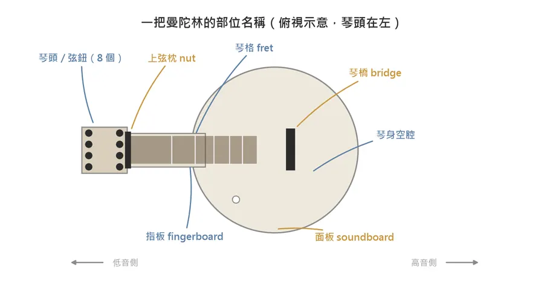

*Figure G: parts of a mandolin (seen from above, headstock to the left).*

Once tuned, the mandolin's eight strings pull on the instrument continuously.

The force runs through headstock, neck, body, bridge and tailpiece to form a **closed mechanical circuit**.

| **Part** | **What it carries** |
|---|---|
| **the neck** | it has to resist bending forward |
| **the top** | it has to take the compression and shear the bridge feeds into it |
| **the tailpiece and its fixing** | it takes the pull of the strings at the other end |

The first job of structural design is to make sure that under reasonable tension the instrument **does not slowly lose its geometry**.

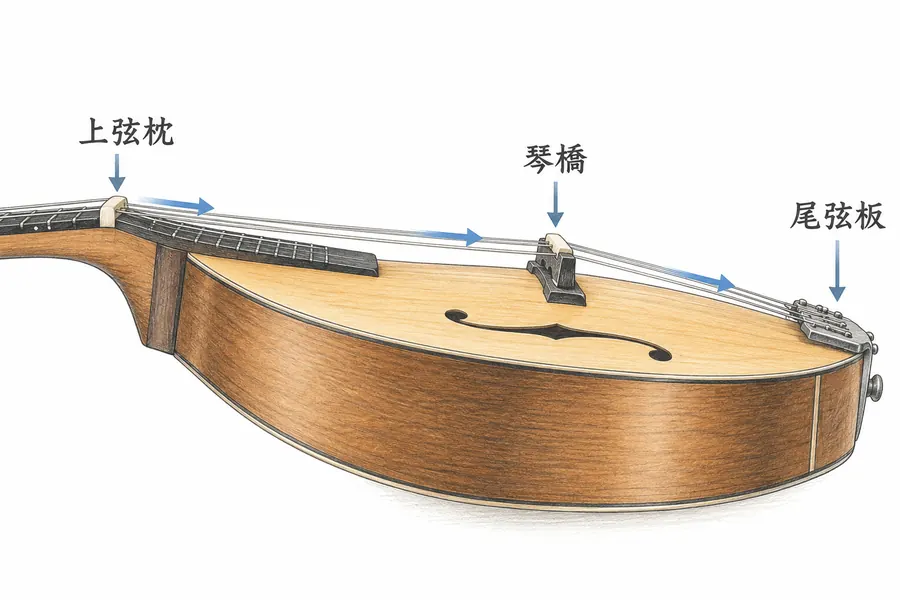

*Figure 7.1: string tension and the path of load (schematic).*

### Why no part can be looked at on its own

Suppose the bridge gets taller. What happens?

1. The **action** (the height of the strings above the fretboard) may rise.
2. The **break angle** where the strings pass over the bridge also changes.
3. And with the break angle, the **share of the load** the bridge puts into the top changes too.

Take another example: a nut that is too high.

On the surface it only means the left hand has to press harder. In fact it also puts **extra stretch** on the string when you stop it in first position, so the pitch goes sharp.

Reading a structure professionally always means asking **what else moves when you change one thing**.

> **Common misconception**
> **"A nut that is too high only makes the instrument harder to press."**
> It stretches the string further than it should be when you stop a note in a low position, so the pitch goes sharp. That is geometry, not your ear.

### With older instruments this matters even more

Especially with a used instrument.

The bridge may not be the original, the fretboard may have been re-done, and the neck angle may have changed over years of tension and humidity.

Recognising the names of the parts is not enough to judge the condition.

What you have to watch is **whether their positions relative to one another are still within a reasonable range**.

That is the skill the case study at the end of this chapter practises again and again.

## 7.2 The headstock and the tuning mechanism

Early mandolins usually used **wooden pegs** of the violin type.

The 1781 Vinaccia instrument shows eight **fiddle-style pegs** inserted from behind the headstock.

This mechanism has **no gear reduction**; tuning depends on the **friction** between the peg and the wall of its hole.

The feel and the stability are entirely different from a modern machine head.

As metal strings, higher tension and more frequent ensemble playing became normal, **geared machine heads** offered finer adjustment and lowered the barrier to tuning every day.〔S701〕

### Three common arrangements

| **Type** | **Common on** | **Character** |
|---|---|---|
| wooden friction pegs | early mandolins | no gear reduction; friction does the work |
| grouped machine heads (concealed or side-mounted) | modern bowlbacks such as Calace | fine adjustment, more stable |
| four pairs of tuners along both sides of the head | American A／F-style | a different layout |

These differences are not only cosmetic.

The **direction the string takes** from the nut towards its tuner affects the sideways friction of the string in the **nut slot**.

The **headstock angle** affects the **downward force** at the nut.

With a poor design or rough workmanship, tuning easily develops an irritating **sticky-slip behaviour**: half a turn with no response, then a sudden jump past the note.

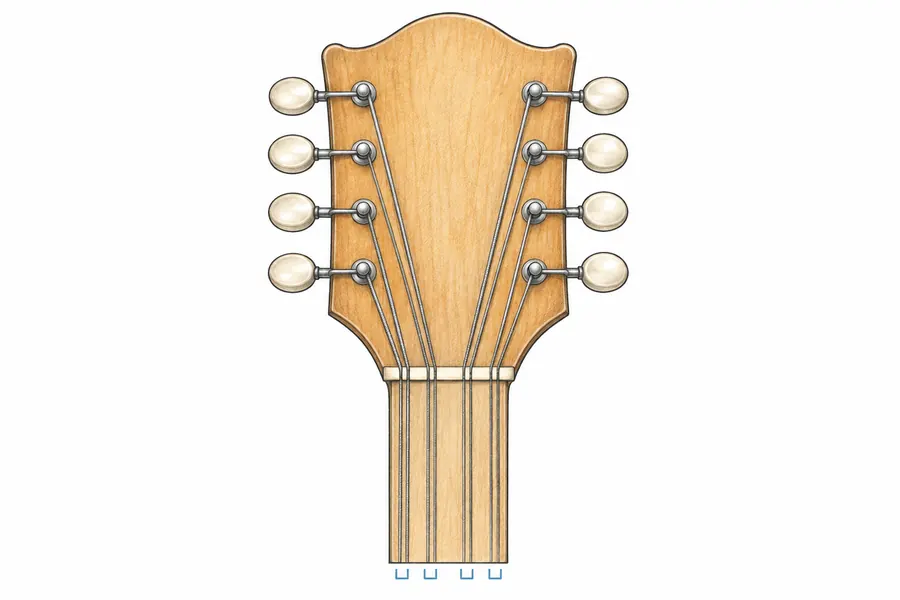

*Figure 7.2: the headstock and the tuning mechanism (schematic).*

### If tuning is unstable, do not reach for new tuners yet

When tuning is unstable, most people's first reaction is to fit expensive machine heads.

The real problem may be the nut.

If a slot does not match the string's diameter, or the bottom of the slot is rough, or the string's path makes a sharp turn, the string **sticks** at the nut.

Then even a machine head with no backlash at all can behave unstably.

When diagnosing, tell three different sources apart:

| **Symptom** | **Likely source** |
|---|---|
| a little turn with no response, then a jump past the note | **gear backlash** |
| the tuner turns loosely and will not hold | not enough friction in the peg |
| the tuner responds, but the string catches somewhere | **nut binding** |

Work through it symptom by symptom instead of replacing everything at once.

## 7.3 The nut and the feel in low positions

The **nut** is usually tiny, and it decides four things at once:

1. where the open string starts
2. the action
3. the height of the slot
4. the path the string takes into the headstock

On a fretted instrument the consequence of **slots that are too high** is particularly obvious.

Stopping the string at the first or second fret means pulling it down further. Besides feeling harder, the string is **stretched beyond what it should be**, so notes in low positions go sharp.

That sharpness is caused by **geometry**.

### Slots that are too low are just as bad

Slots that are too low cause another set of problems: the open string may hit the first fret and produce a **buzz**.

If only **one course** is misbehaving, you have to narrow the cause further:

- the depth of the slot?
- the angle of the slot?
- the string diameter?
- the fret height?

An ideal slot gives the string **a clear bearing point on the fretboard side of the nut**, and then lets it fall away smoothly towards the headstock.

If the bearing point is vague, the **effective speaking length** of the open string becomes unstable.

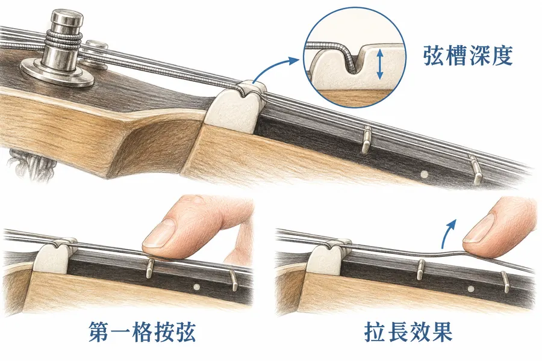

*Figure 7.3: the nut and the feel in low positions (schematic).*

An analogy: the nut is the starting line on a running track. If the line is blurred, every lap covers a different distance.

### A double-course instrument has one more problem

If the two strings of one course sit at uneven spacing or in slots of different depth:

- the **resistance** felt by the right hand differs between them.
- the **feel of stopping** the string differs for the left hand too.

On a standard mandolin, the eight slots are more accurately described as **four sets of geometry that have to work in pairs**.

That is why moving to a set of noticeably different **gauge** is not always just a matter of putting them on.

If the difference between string diameter and slot width is too large, the setup may have to be adjusted with it.

## 7.4 Neck angle and the fretboard

The neck is where the left hand holds the instrument. Structurally, though, it is more like **a beam connecting string tension to the body**.

Its thickness, material, section and joint all affect **stiffness**.

More critical still is the **neck angle**: the geometry of the fretboard plane relative to the body and the bridge.

If the **neck angle** closes year by year, the player may find the action rising with no room left to lower the bridge.

The root of the problem then lies in **the whole geometry**, not in the bridge.

### Necks differ widely between traditions

Orville Gibson's 1898 design even treated the sides of the body, the neck and the headstock as **structures that could be carved as one piece**, and left the inside of the neck hollow and open into the cavity of the body.

The 1898 instrument kept in the Met has exactly these features.

This is **not** the method every Gibson mandolin follows today. But it makes the point well: the neck is not simply a handle, and it can be brought into the acoustic and structural design as a whole.〔S702〕〔S703〕

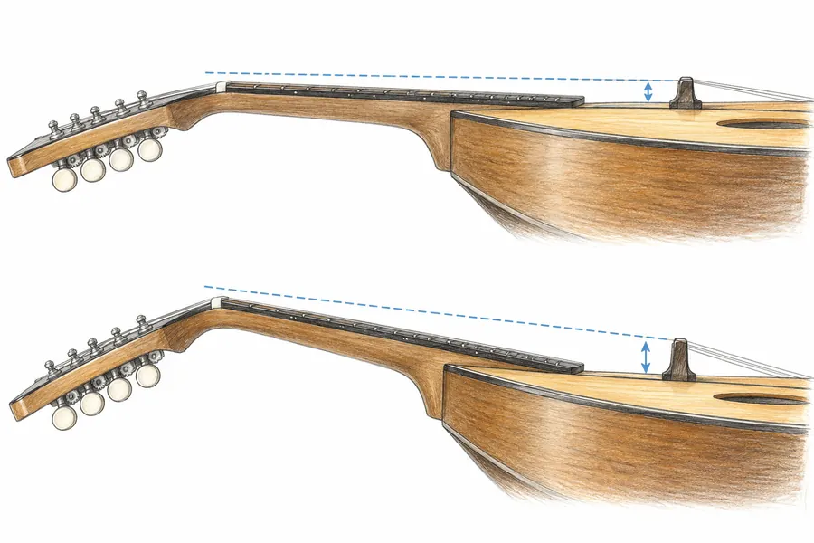

*Figure 7.4: neck angle and the fretboard (schematic).*

### The fretboard and the number of frets

The fretboard provides the **reference surface** the frets are installed on.

The material has to be **wear-resistant** and **reasonably stable in dimension**, and it has to take repeated stopping and repeated **fretwork** (work on the frets).

The change in fret count reads as a timeline:

| **Instrument** | **Year** | **Frets** |
|---|---|---|
| **Vinaccia** | 1781 | 13 **metal** frets |
| **Orville Gibson** | 1898 | 18 frets |
| **standard Calace models** | present day | 24 frets |
| **the Calace concert series** | present day | up to 29 frets |

A higher fret count does not only mean a higher top note.

It also reflects the expansion of **repertoire**, of position technique and of what the stage demands.〔S701〕〔S702〕〔S711〕

## 7.5 Frets and control of pitch

Frets cut the continuous fretboard into **discrete semitone positions**, so a stopped pitch is easier to repeat.

On a fast plucked instrument like the mandolin, this takes a great deal of the intonation load off the melody, and makes chords and **double stops** easier to keep steady.

But frets do **not guarantee correct pitch by themselves**.

The actual intonation is decided by four factors together:

| **Factor** | **Effect** |
|---|---|
| fret position | it sets the theoretical pitch |
| the point of contact on the **fret crown** | where the string actually touches |
| the **stretch** of the string when it is stopped | tension rises and the pitch goes up |
| **compensation** at the bridge | it corrects intonation overall, and course by course |

### A real string is not an ideal string

The theoretical positions of **twelve-tone equal temperament** (the tuning that divides the octave into twelve equal semitones) can be calculated exactly.

But a real string is not an ideal string with no stiffness.

In particular:

- a thick **wound string** (a core with wire wrapped round it)
- higher action
- a stronger stopping force

All of these can make a stopped note come out **slightly sharp** of its theoretical position.

That is why a floating bridge usually needs **compensation, whole or per course**.

It is also why placing the bridge at exactly twice the twelfth-fret distance is only a **starting position**, never a **final setting**.

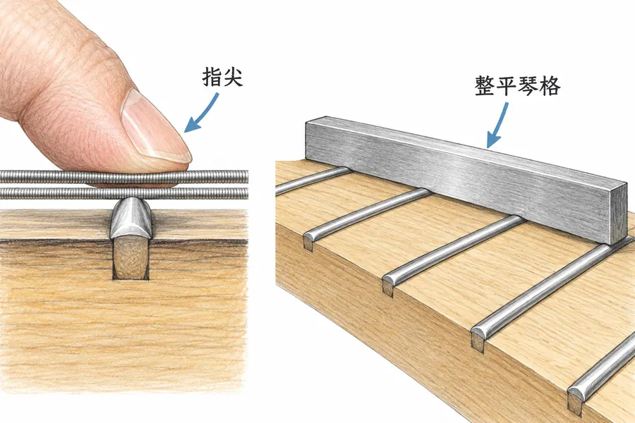

*Figure 7.5: frets and control of pitch (schematic).*

### Fret wear

Fret wear also changes the **effective contact point**.

Once notches are worn into some frets, the string may reach the next fret more easily.

Lowering one high fret on its own, meanwhile, can damage the overall **fret plane**.

Professional **fretwork** is about establishing **one continuous plane** that is compatible with the **neck relief** (the slight forward bow of the neck) and the target action, so that every fret agrees with the string's path as a whole.

> **Common misconception**
> **"If one fret buzzes, just file that fret down."**
> Filing a single fret can damage the overall fret plane. The professional approach is to establish one continuous plane compatible with the neck relief and the target action.

## 7.6 The top: vibration and load

The **soundboard**, or top, plays two roles that look contradictory:

| **Role** | **Requirement** |
|---|---|
| making sound | **light** enough to be driven easily by the bridge |
| carrying load | **stable** enough to take long-term string load and bridge load without losing its geometry |

This pull between **light and strong** is at the heart of every stringed instrument's top design.

The Italian bowlback tradition uses a great deal of **spruce**, and Calace still works that way today.

The 2022 acoustic study of Italian mandolins also treated the mechanical properties of the **soundboard wood** as a key variable.〔S705〕〔S711〕

An analogy: the top is the surface of a trampoline. It has to be soft enough to bounce off, and tough enough not to be stamped through.

### The Neapolitan bend

A major feature of the Neapolitan top is the **bend, or cant**, near the bridge.

The Met's description of the 1781 Vinaccia and the Guitar Heroes essay both identify this bend as an **important structural feature** of the Neapolitan school, connected with **added structural strength**.

It stops the top from being a plain flat plate and makes it a **bent system that carries geometric stiffness**.〔S701〕〔S722〕

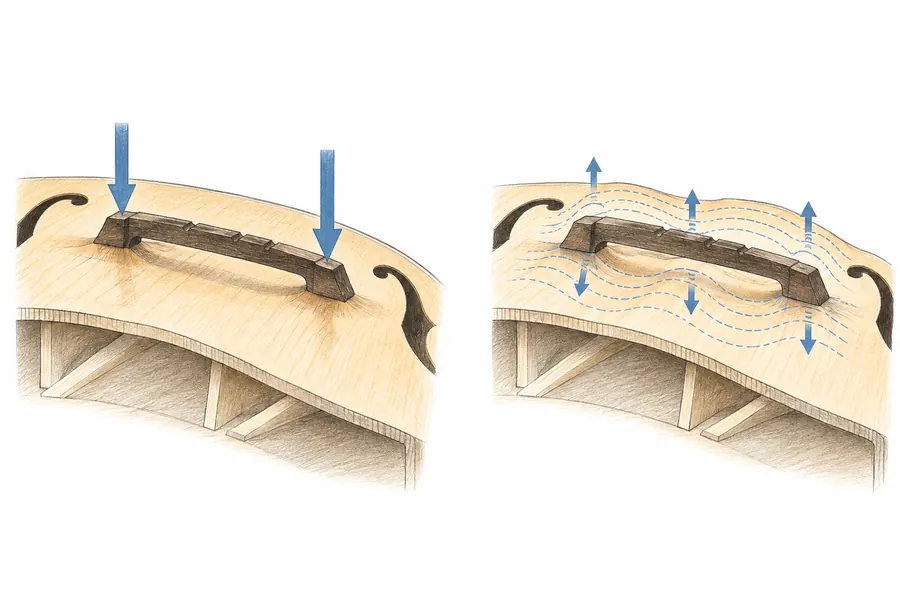

*Figure 7.6: the top, vibration and load (schematic).*

### The American carved-top takes another route

The American carved-top goes a different way.

Orville Gibson **carved the spruce top into an arch**, so that **thickness and arching together provide the stiffness**.

This design resembles the violin family in appearance and in the way it thinks about load.

But it **cannot simply be described as** "a violin top made smaller".

How it actually works still depends on **bridge position, bracing, soundholes and overall dimensions**.〔S702〕〔S720〕

> **Common misconception**
> **"Gibson's archtop mandolin is a violin top made smaller."**
> The appearance and the thinking about load are similar, but the two cannot simply be equated. How it actually works still depends on bridge position, bracing, soundholes and overall dimensions.

## 7.7 Bracing and internal support

The position and dimensions of the **bracing** change the top's **local stiffness** and its **vibration modes**.

Bracing is not simply "a strip of wood to stop the top sinking", and it is not "the lighter the better" either.

| **State of the bracing** | **Consequence** |
|---|---|
| too weak | it may not carry the load over the long term |
| too heavy | it adds local mass and stiffness and shifts some modes |

The real work of design is a balance between **structural safety** and **efficiency of vibration**.

### Different forms follow different bracing logic

Orville Gibson's early patent explicitly **criticised** the excessive internal braces, bridges and splices in the instruments of his time.

He argued for a more unified **carved construction** that reduced those parts.

The Met's description of the 1898 instrument also notes that it has **no traditional internal brace or strut**.

The Gibson system later developed different bracing, which shows that "few braces" was a **whole philosophy belonging to one design period**.

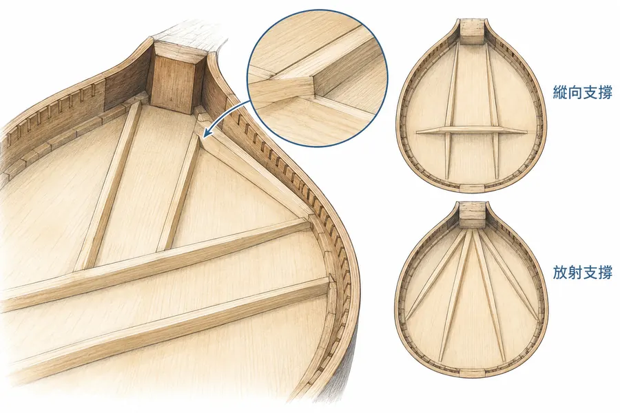

*Figure 7.7: bracing and internal support (schematic).*

So "Gibson did not use bracing" cannot be made into a general rule. Different periods and different models did different things.〔S703〕〔S720〕

### A note for repair work

In repair work, **bracing that has come unglued** is often harder to notice than a visible crack.

The symptoms may be:

- a buzz on particular notes
- a patch of the top vibrating oddly
- a tap test that sounds different from the rest of the top

Looking only at the outside, the problem is easily blamed on the bridge or the strings.

Which is a reminder that half of a mandolin's **anatomy is hidden inside the cavity you cannot see**.

## 7.8 The bowl, the back and the sides

### Bowlback: many ribs joined into a bowl

A bowlback mandolin's body is made of many narrow **ribs** joined into a bowl.

The 1781 Vinaccia's back is built from **23** narrow staves, with **tortoiseshell and ivory** separators between them.

Which shows that a high-grade instrument of that period served **acoustic, structural and decorative** purposes at once.

Modern Calace offers 25, 31 and 33 ribs, and even **41 ribs** on a mandoloncello. The material is usually **rosewood** or **maple**.

The rib count should be read together with **curvature, the width of each stave, the craft and the design series**.〔S701〕〔S711〕〔S713〕

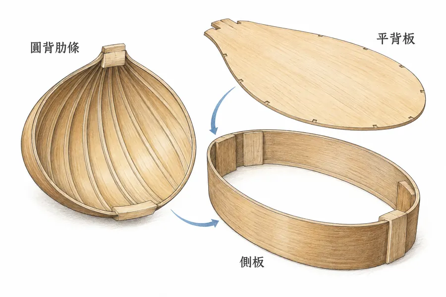

*Figure 7.8: the bowl, the back and the sides (schematic).*

### Flatback or carved back: an entirely different logic

The 1898 Gibson's back is **a single piece of walnut carved to a convex curve**, and the sides and hollow neck are made in a highly unified way.

The body therefore does not need many narrow ribs to make a deep bowl.

It also changes **the internal volume, the load in the plates and the manufacturing process**.〔S702〕

### Does the back make sound or not?

The question is usually reduced to two positions:

- some say the back only reflects.
- others say the back matters as much as the top.

In fact acoustic measurement shows that **the whole body takes part in the modes**.

How much the back and sides move, and at which frequencies, **varies with the design**.

The more accurate statement is:

> The back is **not irrelevant**, but its contribution **cannot be described apart from the structure as a whole**.

〔S704〕〔S705〕

> **Common misconception**
> **"The back just reflects the sound back out; it plays no part in making it."**
> The measurements show that the whole body takes part in the modes. The more accurate statement is that the back is not irrelevant, but its contribution cannot be described apart from the structure as a whole.

## 7.9 Soundholes and air resonance

A soundhole **couples** the air inside the body to the air outside, and it also changes the **effective area** and the **local stiffness** of the top.

So it is an **acoustic opening** and a **cut in the structure** at the same time.

Round holes, oval holes, **f-holes** and modern **side ports** each change something, and in every case the terms are set by the whole body and its **air modes**.

### The usual soundholes of each form

| **Form** | **Usual soundholes** |
|---|---|
| Neapolitan bowlback | a single round or oval soundhole in the centre |
| the early Gibson A／F series | mostly oval holes |
| the later F-5 line | f-holes, which became a strong visual symbol in bluegrass |

The problem is that soundhole shape usually changes together with **body size, bracing and bridge location**.

So a **single-cause comparison** such as "f-holes are always brighter" or "oval holes are always warmer" will not hold.〔S719〕〔S720〕

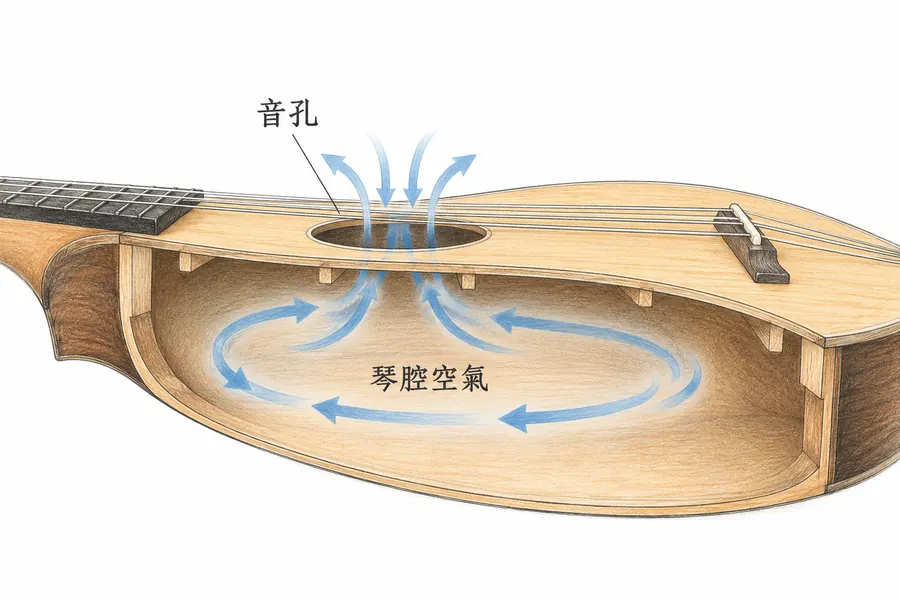

*Figure 7.9: soundholes and air resonance (schematic).*

The most useful questions when studying soundholes are:

1. **Which** air and top modes does it change?
2. How do **position and area** match the volume of the body?

Chapter 8 takes these questions on in the language of acoustic measurement.

## 7.10 The bridge, the tailpiece and the break angle

A **floating bridge** holds its position through the downward pressure of the strings.

It does two things:

1. It sets the **string height** and the **speaking length**.
2. It transfers the **force of the vibrating strings** into the top.

### Volume is not a knob

A taller bridge and a lower tailpiece do **not necessarily** mean "louder".

Because all of the following change at the same time:

- the **break angle**
- the **downward force**
- the **mass of the bridge**
- the **contact area**
- the **load on the top**

Treating one geometric parameter as a volume knob is a common and dangerous simplification.

> **Common misconception**
> **"Raise the bridge a little and the sound gets bigger."**
> The break angle, the downward force, the mass of the bridge, the contact area and the load on the top all change together. Volume is not one knob.

### The feet of the bridge have to fit

The feet of the bridge have to make **proper contact** with the top.

If only the two ends or one small patch touch, energy transfer is uneven, and under long-term load it can leave **a local indentation**.

On a carved-top mandolin the curve is more pronounced, so **fitting the bridge** to the top matters even more.

A "high-grade" bridge that has not been refitted to the curvature of the top is **not necessarily** better than the one that was on it.

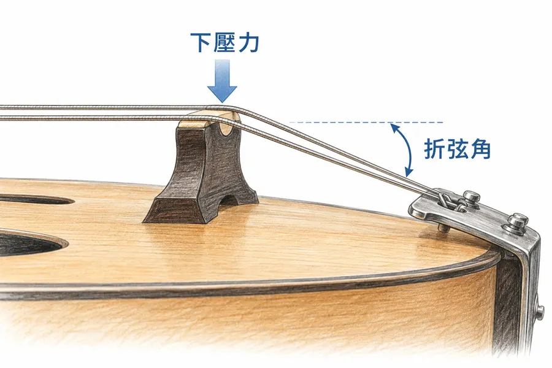

*Figure 7.10: the bridge, the tailpiece and the break angle (schematic).*

### The tailpiece

The tailpiece's job is to **anchor the ends of the strings** and to set **the geometry of the string behind the bridge**.

Its own mass, stiffness and fixing can also produce **mechanical resonance or noise**.

When diagnosing a mysterious buzz, besides the frets and the bridge it is worth checking:

- the **cover** of the tailpiece
- **string ends touching** one another
- a **loose screw**
- the **string hooks**

## 7.11 Case study: three structural systems

Put the 1781 Vinaccia, the 1898 Orville Gibson and a modern Calace in one table and you see that under the name "mandolin" there are **at least two mature structural philosophies**.

The Vinaccia is built from a deep bowl of ribs, a bent spruce top, wooden pegs and a short fretboard.

The Gibson is built from a carved spruce top, a carved walnut back, a floating bridge and tailpiece, and a hollow neck.

The modern Calace stays inside the Neapolitan bowlback line while adding precision machine heads, a 24／29-fret board and different rib arrangements.〔S701〕〔S702〕〔S711〕

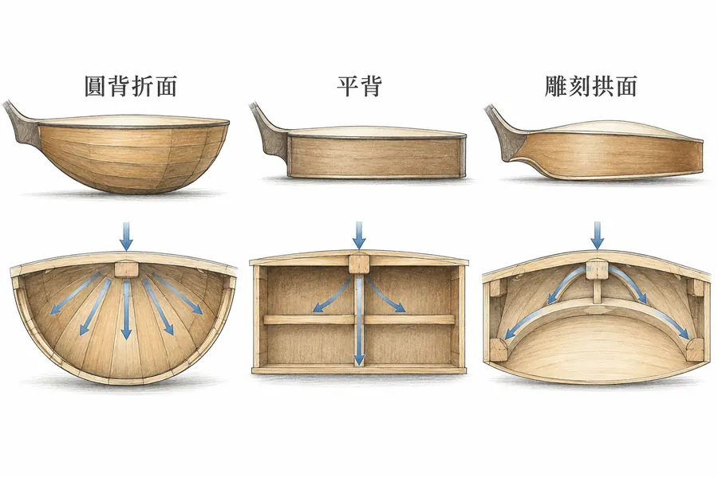

*Figure 7.11: case study, three structural systems (schematic).*

### Table 7-1: three structural systems compared on real instruments

| **Case** | **Body／back** | **Top** | **Tuning／fretboard** | **How to read it** |
|---|---|---|---|---|
| **Vinaccia 1781** | 23 ribs, bowlback | spruce; bent near the bridge | wooden pegs; 13 frets | a mature Neapolitan |
| **Orville Gibson 1898** | carved walnut back; unified sides／neck | carved spruce | a mechanical system; 18 frets | the early American carved body |
| **modern Calace** | 25–33 ribs; rosewood／maple | fine spruce | machine heads; 24／29 frets | a modern concert bowlback |

*Figure: Table 7-1, three structural systems compared on real instruments (schematic).*

The three, in summary:

- **Vinaccia 1781**: 23 bowlback ribs, 13 frets, wooden pegs.
- **Orville Gibson 1898**: carved spruce top, carved walnut back, 18 frets, floating bridge and tailpiece.
- **modern Calace**: 33.5 cm scale, 24 or 29 frets, 25–33 ribs.

All three are called mandolin, and they represent **different structural philosophies**.

### Read the structure, not the outline

Classify by appearance alone and they easily become "the round ones" and "the flat ones".

Read the structure and you see them giving different answers to **the same set of questions**:

| **The shared question** | **How each answers it** |
|---|---|
| How is string load carried? | three different schemes |
| How is stiffness given to the top? | a bend／an arch／bracing |
| How does the player reach high positions? | the neck geometry differs |
| How is it tuned? | wooden pegs vs. machine heads |
| How is it repaired? | access to the structure differs |

This kind of comparison tells you more about how making evolved than memorising a run of brand dates.

### Turn it round: use structural thinking to diagnose

In practice the same thinking can be turned round to diagnose problems:

| **Symptom** | **What to check first** |
|---|---|
| the action is high | the **neck angle** and the **top geometry** |
| notes in low positions run sharp | the **nut slots** |
| a buzz on particular notes up the neck | the **fret plane** and the **relief** |
| the sound has suddenly gone thin | besides changing the strings, check **bridge position** and **contact under the feet** |

This is where the names of structures finally become **tools**.

> **Common misconception**
> **"The bridge is already as low as it will go and the action is still high, so plane the bridge thinner."**
> More likely the neck angle has closed, the top has deformed, or the whole geometry has drifted. Establish the **root cause** first; do not rush to plane the bridge.

## Self-study question bank

*Study check: answer, mark, review*

Answer for yourself first, then look at the answers. When you get one wrong, go back to the relevant section of the chapter and read it again.

**1. A nut that is too high commonly results in?**

- A. Low positions harder to press, and possibly sharp
- B. A definitely louder instrument
- C. A shorter fretboard
- D. The tailpiece coming off

**2. What is the bridge's important job in the chain that makes sound?**

- A. Holding the strap
- B. Passing the string's energy into the body
- C. Ornamenting the top
- D. Reducing all the overtones

**3. The neck angle mainly relates to?**

- A. How the varnish dries
- B. The geometry between fretboard and bridge
- C. The brand name
- D. The colour of the string material

**Answers: 1.A　2.B　3.B**

## Main sources checked for this chapter

*Sources checked: find the original, check the conditions, keep a record*

**【S701】The Metropolitan Museum of Art: Mandolin, Antonius Vinaccia, Naples, 1781 (Met 89.4.2140).** Object data for the Neapolitan bowlback: 23 ribs in the bowl, bent top, eight strings in four courses, 13 frets.

> https://www.metmuseum.org/art/collection/search/504543

**【S702】The Metropolitan Museum of Art: Mandolin, Orville Gibson, 1898 (Met 2015.643a–c).** Object data: carved spruce top, carved walnut back, floating bridge, tailpiece, 18 frets, hollow neck.

> https://www.metmuseum.org/art/collection/search/700485

**【S703】United States Patent Office / Google Patents: US598245A – Mandolin, Orville H. Gibson (patented 1898-02-01).** The original patent for Gibson's one-piece rim／neck／head, carved top and back, and the reduction of traditional internal support.

> https://patents.google.com/patent/US598245A/en

**【S704】David Cohen & Thomas D. Rossing: The acoustics of mandolins (Acoustical Science and Technology 24(1), 2003).** Normal modes, frequency response and TV holography on four mandolins and one mandola.

> https://www.jstage.jst.go.jp/article/ast/24/1/24_1_1/\_article/-char/en

**【S705】Quintavalla et al.: The Acoustics of Traditional Italian Mandolins and Their Relation with Soundboard Wood Properties (International Journal of Wood Culture 2, 2022).** Bridge admittance, sound radiation, modes and soundboard wood in historical and modern Italian mandolins.

> https://www.sciencedirect.com/org/science/article/pii/S2772318622000017

**【S711】Liuteria Calace: Mandolini – official specifications (accessed 2026-10-06).** Current specifications: 33.5 cm scale, 24／29 frets, 25／31／33 ribs, spruce top, rosewood／maple body.

> https://www.calace.it/en/mandolini

**【S713】Liuteria Calace: Mandoloncelli & Liuti – official specifications (accessed 2026-10-06).** 61 cm scale, 8／10 strings, 25／41 ribs, and different body sizes and material arrangements.

> https://calace.it/en-mandoloncelli-liuti

**【S719】The Metropolitan Museum of Art: Gibson F-2, F-4, A-4 and H-2／H-4 instruments (1916–1919 collection records).** Carved construction, fret counts, neck and fretboard materials and floating bridges across the early Gibson A／F／H series.

> https://www.metmuseum.org/art/collection/search/506859

**【S720】The Metropolitan Museum of Art: Archtop Guitars and Mandolins (Met Heilbrunn Timeline essay).** Orville Gibson's carved archtop system and its influence on American instrument making.

> https://www.metmuseum.org/essays/archtop-guitars-and-mandolins

**【S722】The Metropolitan Museum of Art: Mandolin, 1781 – Guitar Heroes (exhibition essay).** How the Neapolitan bend adds structural strength, plus the four double courses, violin-type tuning and the use of the plectrum.

> https://blog.metmuseum.org/guitarheroes/mandolin-1781/
