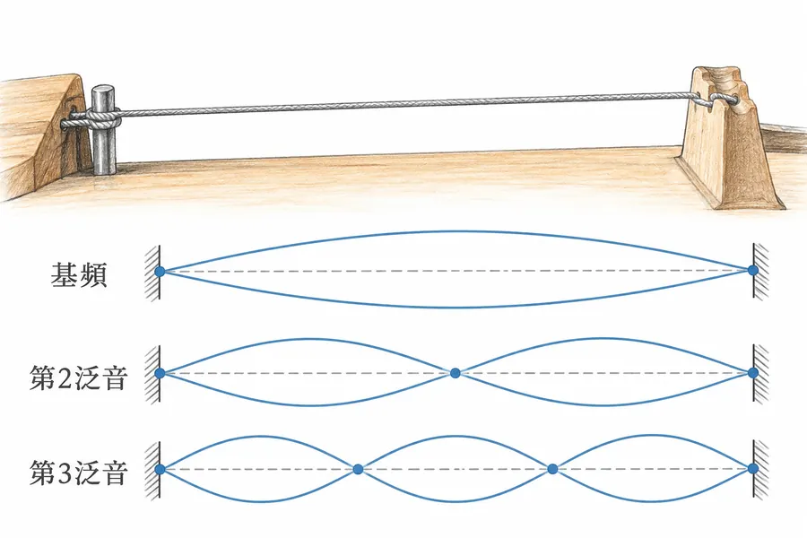
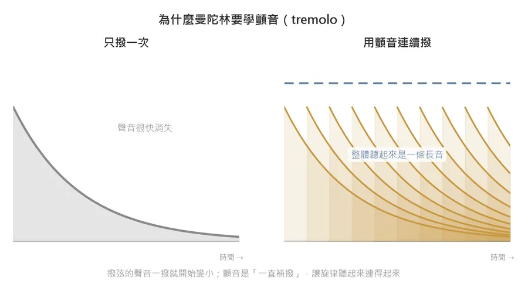
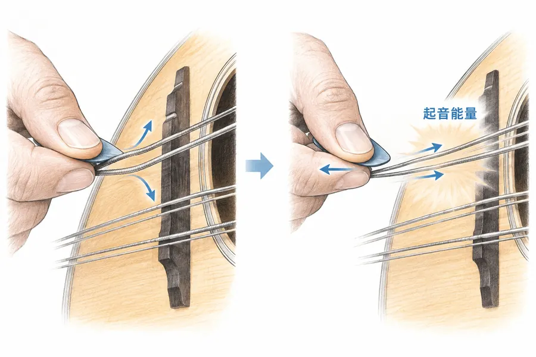
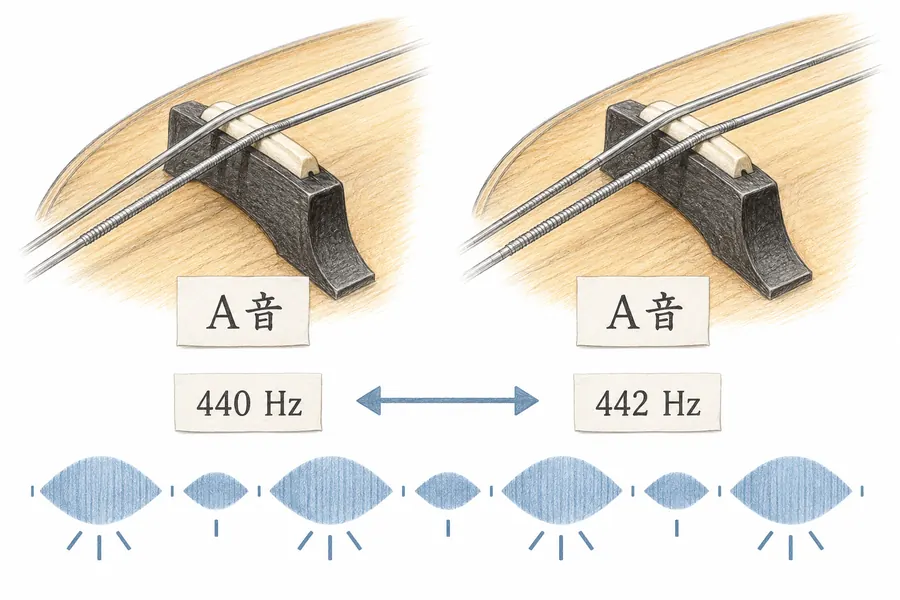
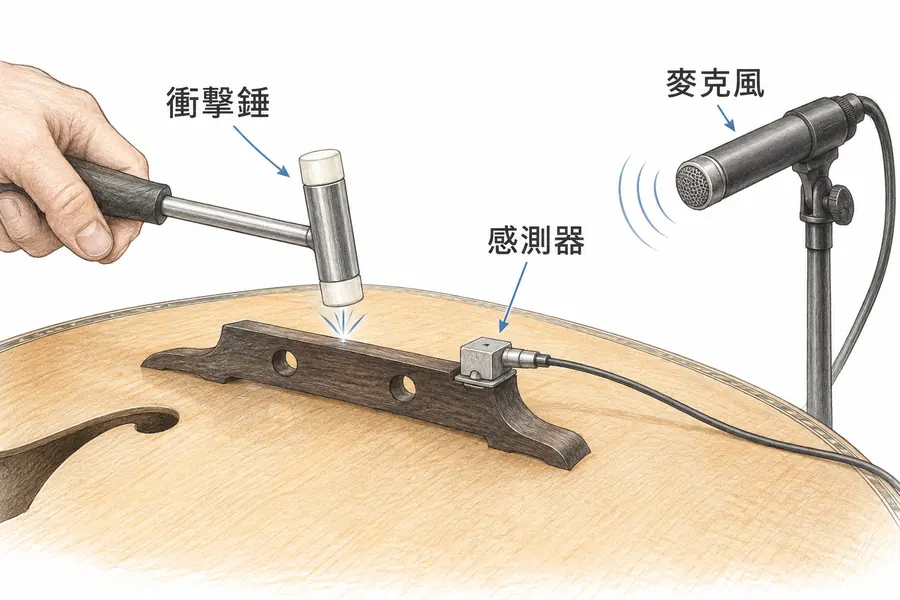
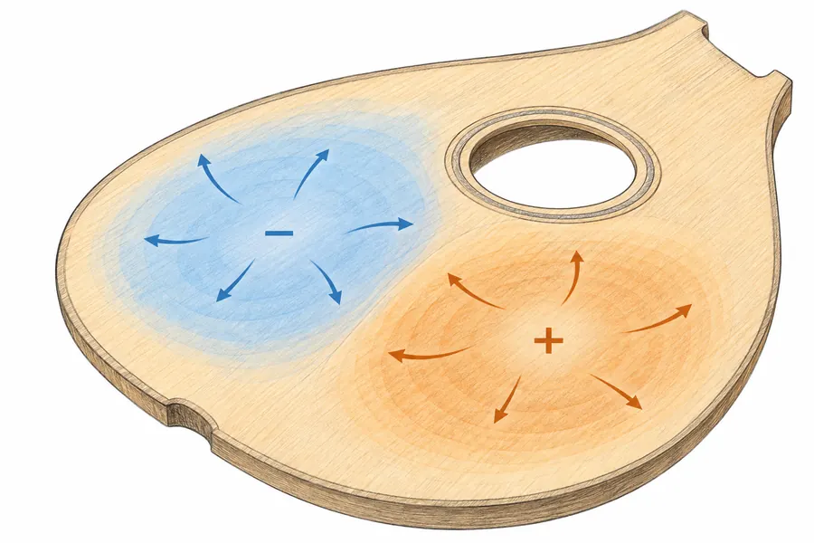
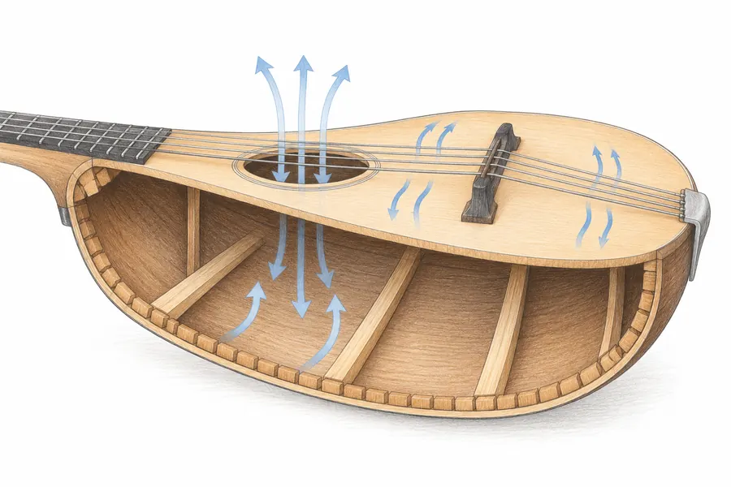
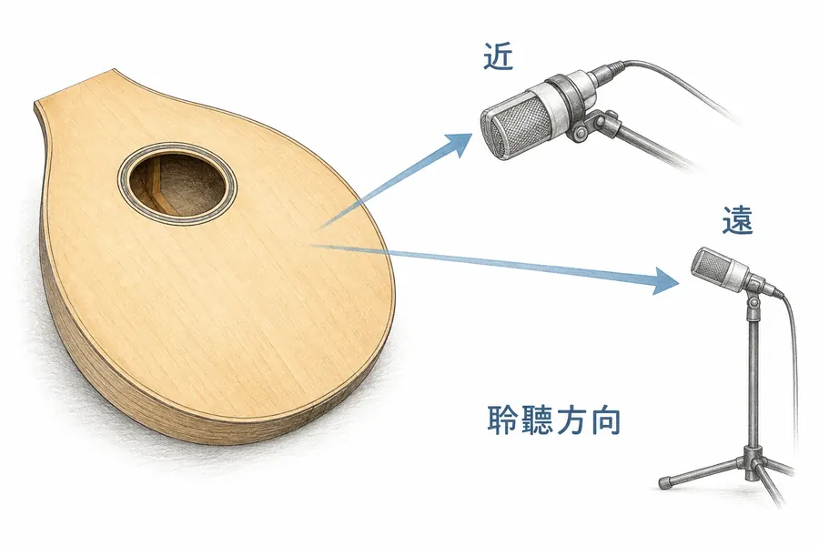
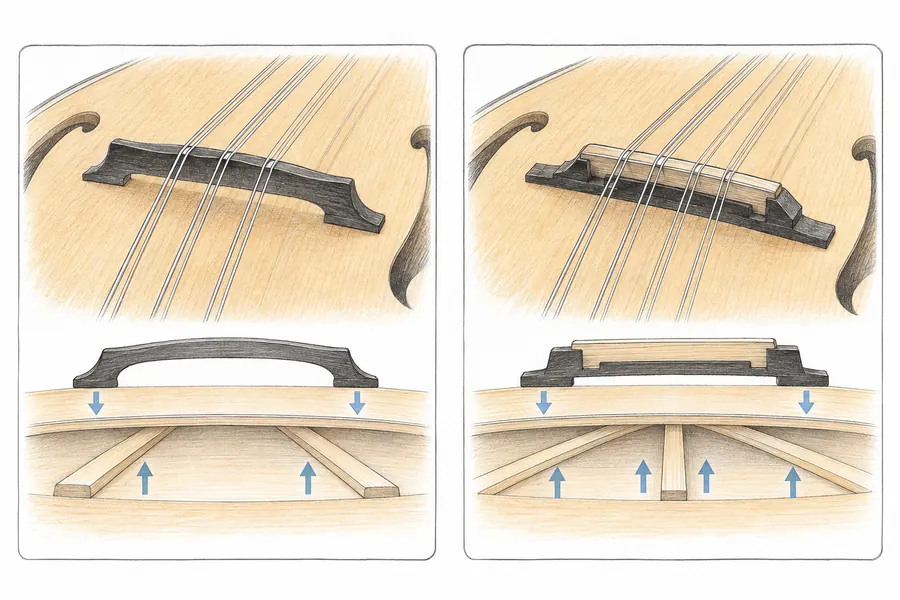
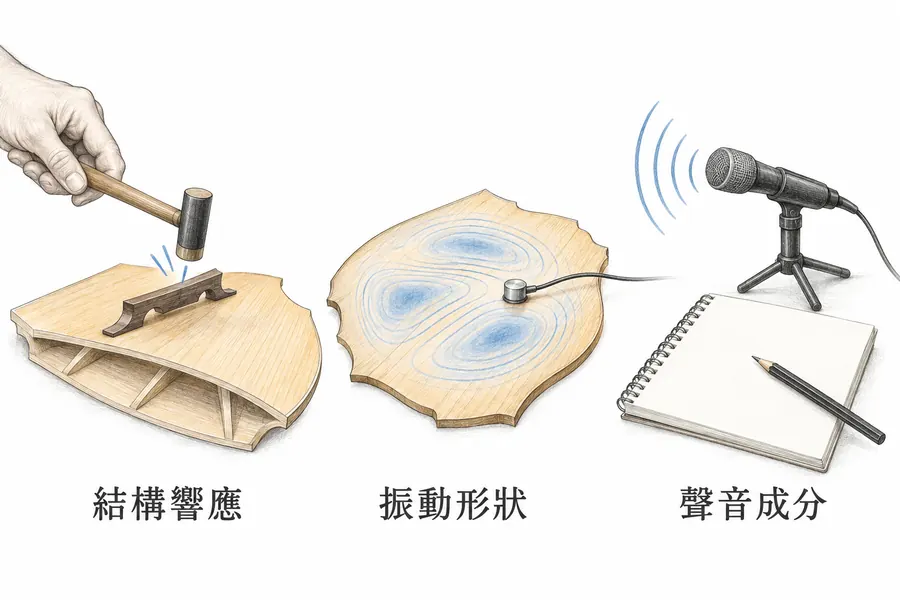

# Chapter 8: Principles of Sound Production and Acoustic Character

*Attack, modes and bridge admittance: what measurements can and cannot tell you*

## Key points

- Sound starts at the instant the plectrum leaves the string, and is shaped at once by **the strings, the bridge, the top, the body, the soundholes, the air inside and the way it is played**.
- **The same specification can give different sounds**, because the wood, the thickness, the bracing, the contact and the playing conditions all vary.
- **Bridge admittance** describes how easily a structure can be driven. It is **not** the same thing as volume.
- "Bright" and "warm" are useful words to talk with, but they are **not a single physical quantity**.
- Acoustic data can describe a difference. It will **not tell you by itself which instrument is better**.

---

"This one is brighter", "that one is fuller", "this wood projects better" — these are the commonest sentences in the instrument world.

But adjectives like these easily turn a complex system into a single cause.

The mandolin's sound starts at **the instant the plectrum leaves the string**, and from there it is shaped by all of these at once:

1. the strings
2. the bridge
3. the top
4. the body
5. the soundholes
6. the air inside
7. the way it is played

Without taking that physical chain apart first, any discussion of timbre slides easily towards **impressions** and **brand mythology**.

### Three terms to get clear first

| **Term** | **In plain words** |
|---|---|
| **vibration mode** | which parts **move together**, and at which frequencies? |
| **bridge admittance** | once a force is applied, **how do the bridge and the top respond**? |
| **sound radiation** | how does structural vibration **become audible sound**? |

### Three groups of research that matter

Mandolin acoustics is not as large a literature as violin or guitar acoustics, but there are already several important results:

| **Year** | **Researchers** | **What they did** |
|---|---|---|
| **2003** | Cohen and Rossing | used **electronic TV holography** to study the vibration modes of four mandolins and one mandola |
| **2022** | Quintavalla and colleagues | measured bridge admittance, sound radiation and soundboard wood properties on Neapolitan, Milanese, Roman and modern Italian mandolins |
| **2024** | the same line of research | took a 1784 late-Baroque mandolin by Joseph Filano and made on-site museum measurements plus finite element analysis |

These studies let us discuss the mandolin with **experimental data**, not only with what the ear is said to hear.〔S704〕〔S705〕〔S706〕

The aim of this chapter is to give you a grip on **what each kind of data can answer**:

- What can a frequency response tell us?
- What does bridge admittance measure?
- Why is a mode not a single resonance point?
- Why can two instruments that look almost identical still differ noticeably?

## 8.1 The vibration of the string

The **fundamental** of an ideal string (the lowest note it makes) can be understood from a simple relation:

| **If…** | **the pitch…** |
|---|---|
| the string is **shorter** | goes up |
| the **tension** is greater | goes up |
| the **mass** per unit length is greater | goes down |

The string maker D'Addario's technical reference on tension calculates it from three variables: **unit weight**, **scale length** and **frequency**.

In essence that is the same string relation in its **engineering form**.〔S715〕〔S721〕

An analogy: a string is a skipping rope. The shorter the rope, the faster it turns; the tighter you pull it, the faster it turns; the thicker the rope, the harder it is to turn fast.

### A concrete piece of arithmetic

What the formula means in practice is very direct.

Suppose you take an identical string, tuned to exactly the same note, and change only the scale length from **33.5 cm** to **43.2 cm**.

In theory the tension rises with **the square of the scale length**, to roughly **1.66 times** what it was.

Of course a real mandola uses a different **gauge**, a different **winding** (how the wire is wrapped) and different pitches.

So nobody actually pulls a standard mandolin's strings up to that tension.

The example is only there to make one point: **scale length is part of the tension system.**

*Figure 8.1: the vibration of the string (schematic).*

### A string is not an ideal string

A string is not an ideal flexible string.

All of the following push the real overtones away from ideal whole-number ratios:

- the metal **core**
- the winding
- **stiffness at the ends**
- the **contact** of the stopped finger
- the **picking position**

That is one source of **string inharmonicity**.

On an instrument of short strings, high pitch and double courses, these details affect the **attack** and the **sense of being in tune**.

There is no need to measure the physics of every string to laboratory standard. **Understanding the trend** explains most setup behaviour well enough.

## 8.2 Attack and the input of energy

*Figure H: why tremolo has to be learned. A plucked note fades the moment it sounds, and tremolo keeps topping it up.*

A bowed instrument can keep feeding energy in with the bow for the whole length of a long note.

The mandolin is different: **the plectrum pulls the string aside and then lets it go.**

The energy goes in over a very short time. The sound therefore has a clear attack and then enters **decay**.

That mechanism is the basis of the mandolin's **note-by-note grain**.

It is also the **physical reason** tremolo became a core technique of the repertoire:

> The player uses a continuous stream of fast strokes to organise a run of decaying short notes into what the ear hears as **one sustained line**.

An analogy: it is like building animation out of still frames. Each frame disappears, but played fast they look like continuous movement.

*Figure 8.2: attack and the input of energy (schematic).*

### The attack is not just the sound of the plectrum

The real attack is not only the sound of the plectrum touching the string.

All of these change the string's initial **displacement shape** and its **high-frequency content**:

- the **material** of the plectrum
- its **thickness**
- its **tip**
- its **angle**
- the **picking position**

| **Where you pick** | **The usual effect** |
|---|---|
| close to the **bridge** | the share of high frequency usually rises |
| close to the **fretboard** | relatively softer |

The actual result still depends on **how the body responds**.

Chapters 13 and 14 discuss this from the hand's side. Here, treat it as an **input signal**:

> On one instrument, change how the input is made and **the spectrum has already changed**.

### So comparing two instruments is hard

When you compare two instruments without controlling **plectrum, position, force and recording distance**, what looks like a comparison of spectra is easily **a comparison of players**.

That is why formal acoustic studies use an **impact hammer** or some other repeatable excitation: to take the human variable out as far as possible.〔S705〕

## 8.3 Unison courses and beating

The two strings of a course are meant to be tuned in unison.

They are **never perfectly synchronised at every instant**.

Small differences can come from:

- the **diameter** of the string
- **ageing**
- the **pressure** of the stopping finger
- **which string the plectrum reaches first**
- the conditions at the **bridge end**

Two very close frequencies produce **beating**.

| **The gap between the two strings** | **What you hear** |
|---|---|
| very small | the sound seems to **breathe** slightly |
| too large | it clearly sounds **out of tune** |

*Figure 8.3: unison courses and beating (schematic).*

### Do not leave a wide beat on purpose

In professional tuning you **should not** leave a wide beat deliberately, in order to "create a **chorus** effect".

The mandolin's natural liveliness on a double course already comes from the two strings' **imperfect synchronisation** and their **different transients**.

If the basic pitches differ too much, chords and tremolo lose clarity instead.

It shows up especially in recording: **a close microphone magnifies the difference between the two strings more than a listener in the room does.**

> **Common misconception**
> **"Detune the two strings of a course a little on purpose and the sound gets richer."**
> The liveliness of a double course comes from natural, imperfect synchronisation. A wide beat left deliberately makes chords and tremolo lose clarity. It is especially obvious in recordings.

### The plectrum makes the excitation more complicated

A double course also complicates the right hand's excitation.

The plectrum usually **meets one string first and passes through the second**.

The thicker the plectrum and the deeper it goes in, the clearer the **time gap** between the two contacts may be.

Which is why "a different plectrum on the same instrument sounds like a different instrument" is **not purely psychological**.

How large the effect is, though, still has to be read together with **how the whole body responds**.

## 8.4 Bridge admittance and the response of the structure

**Bridge admittance** can be understood by intuition first:

> apply a given force at the bridge, and how much **velocity or displacement** does the bridge produce in response?

| **admittance** | **it means** |
|---|---|
| **high** | the bridge and top are **easier to drive** at that frequency |
| **low** | comparatively **harder** to drive |

It describes **the way the structure accepts energy**.

Volume also requires looking at **how efficiently sound is radiated**.

An analogy: admittance is how easily the door pushes open. An easy door does not guarantee a busy room behind it.

### What the 2022 study did

The 2022 study of Italian mandolins used an **impact hammer** to excite the bridge, measured bridge admittance and **sound pressure**, and compared three historical Italian instruments with a modern research instrument.

The advantage of the method is that it lets two things be **observed separately**:

1. whether the structure moved
2. how much sound it radiated once it did

The two are related, and **not the same**.

> A lot of structural movement does **not** mean all the energy is converted usefully into sound in the far field.〔S705〕

*Figure 8.4: bridge admittance and the response of the structure (schematic).*

### What it means in practice

The **mass** of the bridge, the **contact under its feet**, the **stiffness of the top** and the **bracing** can all change admittance.

Which is why planing a bridge thinner, hollowing it out, or switching to an ultra-light material needs two things assessed at once:

1. the **frequency response**
2. **structural safety**

Some frequencies may become more responsive, and others may change too.

Structural safety and **the room left for adjusting intonation** are affected together as well.

## 8.5 The vibration modes of the body

A real top takes on **a different vibration shape** at each frequency; each of these is called a **mode**.

- some regions move **in the same direction**.
- some move **in opposite directions**.
- between them there may be **nodal lines**, running through the areas of very small movement.

As the frequency rises, the modes usually become more complex.

So "this top's resonance frequency", if it means **a single number**, is usually an oversimplification.

An analogy: modes are the different patterns of folds you get when you shake out a cloth. Different frequency, different pattern.

*Figure 8.5: the vibration modes of the body (schematic).*

### What Cohen and Rossing found

Cohen and Rossing used **TV holography** to look at four mandolins and one mandola.

They found that:

- the lowest **(0,0)**-type modes can appear as a **doublet** or a **triplet**.
- **modal frequencies** and **frequency response curves** are clearly related.

They also point out that sound radiation is fairly broad from **0 to 5 kHz**, with a **rolloff** starting around **2.5 kHz** and above.

That does **not** mean every mandolin will produce the same set of numbers. It shows that the body's response can be formed by several structural modes working together.〔S704〕

### What this knowledge is good for

| **Who you are** | **What modal analysis gives you** |
|---|---|
| **maker** | an understanding of how the whole set of modes shifts when thickness, arching, bracing or material stiffness changes |
| **player** | knowing that "one note is unusually loud" need not be a string problem |

For the player, knowing this much is enough: it stops "one note is unusually loud" being blamed on the strings alone.

It may be the string, the body, or **the coupling of the two**.

## 8.6 The resonance of the air inside the body

The air inside the body takes part in the vibration too.

As the top and the back vibrate, changes in **the volume inside the cavity** push the air.

The soundhole lets air pass between inside and outside, and forms a **low-frequency resonance**.

The often-quoted **Helmholtz resonance** is the first step towards understanding this kind of behaviour.

But on a real instrument the top and the back are **not rigid containers**, so the air mode couples with **the modes of the wooden plates**.

An analogy: Helmholtz resonance is the low note you get by blowing across the mouth of an empty bottle. But a real instrument is not a glass bottle; its "bottle" vibrates along with the air.

*Figure 8.6: the resonance of the air inside the body (schematic).*

### Why the shape of the soundhole on its own is not enough

Changing **the area or position of the soundhole**, or **the volume of the body**, can move some of the air-related resonances.

But the result is also affected by **the stiffness of the top and the back**.

That is why the shape of the hole on its own — f-hole or round hole — is a poor predictor of whether the sound will be bright or warm.

**The shape is only one part of the acoustic conditions.**

### Where the microphone stands changes the "sound" you hear

The 2022 study included microphones both inside and outside the body, so that the **air cavity response** could be separated from **what is radiated outwards**.

That design is a reminder: **depending on where the microphone stands, the "sound of the instrument" you capture is different.**

In a recording, a microphone pointed straight at the soundhole easily exaggerates particular cavity frequencies.

That need not match **what a listener a metre away** hears as the whole sound.〔S705〕

## 8.7 Spectrum and sound radiation

A **spectrum** breaks a sound into its frequency components, and shows:

- the **fundamental**
- the **overtones**
- certain **resonance peaks**

But a spectrum that ignores **time** loses the **attack** and the **decay**.

A large part of what makes a mandolin recognisable is its **short, sharp transients**.

So a long-term average spectrum can wash out the most important information about the plectrum.

### What "bright" and "warm" actually are

| **The word** | **Usually connected with** | **But it is not** |
|---|---|---|
| **bright** | more high-frequency energy, a clear attack | a fixed threshold |
| **warm** | smoother high frequencies, stronger low-mid, or a softer attack | a fixed threshold |

These words are very useful in musical conversation.

As long as **they are not passed off as a single physical quantity**.

This book treats words for what you hear as **descriptions of a result**, and never equates them directly with a wood or a soundhole shape.

*Figure 8.7: spectrum and sound radiation (schematic).*

### Sound is directional

Sound radiation is also **directional**.

High frequencies have shorter wavelengths, so **phase differences** can appear between different parts of the instrument.

The result: listeners standing in different directions hear **a different frequency balance**.

So on stage and in recording, the microphone position is **a choice of overall balance**.

> **Common misconception**
> **"This instrument sounds like this; it will sound the same wherever you stand."**
> Sound radiation is directional. High frequencies have short wavelengths, phase differences appear between different regions, and the frequency balance you hear changes with where you stand. That is also why microphone position matters.

## 8.8 Wood and the response of the whole instrument

Acoustic research does establish that **the density and elastic properties of the soundboard wood affect the plate's modes and its frequency response**.

The 2022 study measured the mechanical properties of **Norway spruce** samples directly, then linked them to soundboard behaviour with a **finite element model**.

That supports the claim that a wood's physical properties matter.

It does **not** support the claim that knowing the species name is enough to predict a whole instrument.〔S705〕

### There is variation inside one species too

| **Variable** | **What it means** |
|---|---|
| **density** | pieces of the same wood differ in density |
| **annual rings** | growth rates differ |
| **the ratio of earlywood to latewood** | the proportion of spring and summer wood to autumn and winter wood |
| **direction** | the direction of the grain |

Once it is a top, it is also affected by **the thickness distribution, the arching and the bracing**.

In other words, **the species is only one layer of the information**.

The parameters that really mean something are the combination of **this particular piece of wood**, **this particular geometry** and **this particular instrument**.

*Figure 8.8: wood and the response of the whole instrument (schematic).*

> **Common misconception**
> **"It has a spruce top, so the sound is bound to be bright."**
> Within one species the density, the annual rings, the ratio of earlywood to latewood and the grain direction all vary. Once the wood is a top, thickness, arching and bracing act on it as well. The species is only one layer of the information.

So the next chapter, on wood, keeps **material properties** and **traditional descriptions of tone** on two separate lines.

| **Line** | **Its nature** |
|---|---|
| material properties | measurable |
| traditional descriptions of tone | valuable, but the language of experience |

Neither can pass itself off as the other.

## 8.9 The study of the 1784 Filano instrument

The 2024 study chose a Neapolitan mandolin of 1784 by **Joseph Filano**.

Working in the museum with portable equipment, it made four sets of measurements:

1. **sound spectrum**
2. **admittance**
3. **mobility**
4. **mode shape survey**

These were supported by **finite element analysis**.

One aim was to give **historical copies** a more complete acoustic baseline.

The instrument also belongs to the period of transition to **mixed gut and metal strings**, which makes it an important case for understanding **the late Baroque mandolin**.〔S706〕

*Figure 8.9: the study of the 1784 Filano instrument (schematic).*

### An important caution about "copies"

The researchers point out specifically that even a copy using **the same species, the same dimensions and similar methods** can differ acoustically because of **differences in the mechanical properties** of the wood itself.

That matters for every idea of a faithful copy:

> **The same look and the same species do not mean the same dynamic response.**

A genuinely rigorous historical copy records **both the material and the acoustics** of the original.

### And, turned round, a caution for collectors

That is also a reminder for collectors: two mass-produced instruments of the same model differing **does not necessarily** mean one of them was badly made.

The reasons include:

- wood is a **natural material**
- the **gluing**
- the **thickness**
- the **contact of the bridge**
- **ageing**

All of these carry manufacturing tolerances.

A model number can describe **a design envelope**; it cannot flatten every individual instrument into one sound.

> **Common misconception**
> **"If two instruments of the same model sound different, one of them must be faulty."**
> Wood is a natural material, and the gluing, the thickness, the bridge contact and the ageing all carry manufacturing tolerances. A model number describes a design envelope; it is not a promise of one uniform sound.

## 8.10 Case study: sound differences between close specifications

Take two instruments with a spruce top, a maple back, the same scale length, the same strings and similar weight. Their sound can still differ a great deal.

Check these questions in order:

| **#** | **What to check** |
|---|---|
| 1 | Are the **thickness** and **arching** of the top the same? |
| 2 | Do the **bracing** dimensions and positions match? |
| 3 | What about the **mass of the bridge** and the **contact under its feet**? |
| 4 | Are the **density** and **stiffness** of the two pieces of spruce close? |
| 5 | Are the **age of the strings** and the **plectrum** the same? |

Any one of these can change **the modes** and **the transients**.

*Figure 8.10: case study, sound differences between close specifications (schematic).*

### How to make a fair comparison

For a reasonably fair comparison, first make these five things the same:

1. the strings
2. the tuning
3. the plectrum
4. the playing position
5. the recording geometry

Then compare four things:

- **attack**
- **sustain**
- **frequency balance**
- **dynamic response**

Use **repeated recordings**, and check whether the difference **reproduces reliably**.

If you want to measure further, use something like **a fixed excitation** or **re-amping** (sending a recorded signal back through the system) to reduce the human variable.

### The one line that matters most

One important line has to be kept at the end:

> **Acoustic data can describe a difference; it will not tell you by itself which instrument is better.**

| **A characteristic** | **A possible advantage** | **A possible disadvantage** |
|---|---|---|
| a lot of high frequency | clearer in an ensemble | may feel hard in close solo listening |
| a long decay | suits a singing melody | may blur in fast rhythm |

**Any judgement of quality has to put the musical purpose back in.**

### Table 8-1: what the usual acoustic measurements can and cannot answer

| **Measurement** | **What it tells us** | **What it does not tell us directly** |
|---|---|---|
| **Frequency response** | how strongly it responds to input at different frequencies | the one answer to "does it sound good" |
| **Bridge admittance** | how easily the structure moves when force is applied at the bridge | the whole of the far-field loudness |
| **Modal analysis** | the shape of the vibration at different frequencies | which wood is "best" |
| **Spectrum** | which frequency components the sound contains | the full attack and decay, and musical expression |

*Figure: Table 8-1, what the usual acoustic measurements can and cannot answer (schematic).*

> **The formula is not the answer**
> The fundamental of a string can be written as **f = (1/2L)√(T/μ)**.
> It explains the trend across **scale length, tension and linear density**, but a real string also has **stiffness, a winding, ends, and the stretch of being stopped**.
> So setup cannot rely on the formula alone.
> Here L is the scale length, T the tension and μ the linear density.

> **A note on the sources**
> Cohen & Rossing's study is mainly of modes in **American mandolins and mandolas**.
> The Quintavalla team adds **Italian bowlbacks and historical instruments**.
> The two study different objects, and **neither set of numbers should be taken as the "standard frequencies" of all mandolins**.

## Self-study question bank

*Study check: answer, mark, review*

Answer for yourself first, then look at the answers. When you get one wrong, go back to the relevant section of the chapter and read it again.

**1. Bridge admittance can be understood simply as?**

- A. How strongly the bridge responds to an applied force
- B. The price of the bridge
- C. The moisture content of the wood
- D. The gear ratio of the tuners

**2. Tremolo is closely connected with which acoustic property?**

- A. A plucked note gradually decays
- B. The size of the case
- C. The colour of the fretboard
- D. The history of the brand

**3. A mandolin's resonance comes from?**

- A. The top alone
- B. The body, the air and several structures acting together
- C. The strings alone
- D. The soundhole alone

**Answers: 1.A　2.A　3.B**

## Main sources checked for this chapter

*Sources checked: find the original, check the conditions, keep a record*

**【S704】David Cohen & Thomas D. Rossing: The acoustics of mandolins (Acoustical Science and Technology 24(1), 2003).** Normal modes, frequency response and TV holography on four mandolins and one mandola.

> https://www.jstage.jst.go.jp/article/ast/24/1/24_1_1/\_article/-char/en

**【S705】Quintavalla et al.: The Acoustics of Traditional Italian Mandolins and Their Relation with Soundboard Wood Properties (International Journal of Wood Culture 2, 2022).** Bridge admittance, sound radiation, modes and soundboard wood in historical and modern Italian mandolins.

> https://www.sciencedirect.com/org/science/article/pii/S2772318622000017

**【S706】Quintavalla et al.: Acoustical Survey and Finite Element Analyses of Late Baroque Mandolin (International Journal of Wood Culture 4(1), 2024).** Acoustic measurement, finite element analysis and copy research on the 1784 Joseph Filano mandolin.

> https://www.sciencedirect.com/org/science/article/pii/S2772318624000018

**【S715】D'Addario: A Complete Technical Reference for Fretted Instrument String Tensions (technical guide).** The relation and formula between string tension, unit weight, scale length and frequency.

> https://www.daddario.com/globalassets/pdfs/accessories/tension_chart_13934.pdf

**【S721】D'Addario: What Is Guitar String Tension? (current resource).** How the three variables unit weight, scale length and frequency bear on tension.

> https://www.daddario.com/blogs/guitar/all-about-string-tension
