# Chapter 9: Tonewood and Materials

*Tonewood and Materials: Mechanics, Moisture, Tradition and Regulation*

## Key points of this chapter

- Wood has **three directions**, and each direction has its own hardness and its own amount of movement.
- Wood **takes up or gives off water** with the humidity of the air, and a thin-plated instrument deforms because of it.
- **Density, stiffness and damping** have to be read together; comparing only one of them tells you nothing.
- **A species name cannot decide the sound**: two boards of the same species can still differ a great deal.
- "AAA grade" is mostly a maker's own grading; "rosewood" is a trade name, not a single species.

---

Wood is the most easily mythologised topic in instrument making.

Walk into an instrument shop and you will see a row of short labels: "spruce is bright", "rosewood is warm", "maple projects".

Those adjectives are not completely groundless. They come out of long experience.

But if you treat them as laws of nature, you will miss the information that really matters.

The information that matters falls into two kinds. The first is the condition of the wood itself: density, elasticity, damping, fibre direction, moisture content. The second is the choices people make: plate thickness, arching, and **how the maker uses this particular piece of wood**.

The properties of wood change from one piece to the next, and they also change with direction.

The *Wood Handbook* of the United States Department of Agriculture (USDA) treats wood as "a natural engineering material with pronounced directionality".

Within one species, one tree differs from another; within one board, one direction differs from another. 〔S707〕

For instruments this variation is a challenge, and it is also the room a maker has to **adjust the plate**.

This chapter looks at materials in three layers:

1. **The physical and mechanical properties that can be measured.**
2. **The material choices common in historical making traditions.**
3. **The language of timbre that players use.**

Put those in the reverse order and you slide from "I think this one feels warm" all the way to "this species is warm by nature".

## 9.1 Directionality and moisture uptake in wood

The cells and fibres of wood run roughly along the direction of the trunk.

So the stiffness and the dimensional change are different in three directions:

| Chinese | English | Direction |
|---|---|---|
| 縱向 | longitudinal | along the trunk, along the fibres |
| 徑向 | radial | from the heart of the tree outwards |
| 弦向 | tangential | along the growth rings, at right angles to the radial direction |

These three directions behaving differently is called **anisotropy**.

For instruments the meaning is direct.

The soundboard wants to keep enough stiffness along the direction of the strings, and to have suitable elasticity across them.

The **ribs** of a bowlback have to be bent to a curvature and then stay dimensionally stable over the long term. 〔S707〕

Wood is also **hygroscopic**.

It exchanges moisture with the relative humidity and temperature of the air around it.

The USDA data make one point. Below the **fiber saturation point**, any change in moisture content makes wood shrink or swell. And the amount of change is different in each direction. 〔S708〕

For an instrument built from thin plates, that small dimensional change is enough to cause trouble.

It can produce: a deformed top, open seams, **fret ends** standing proud, a changed **action**.

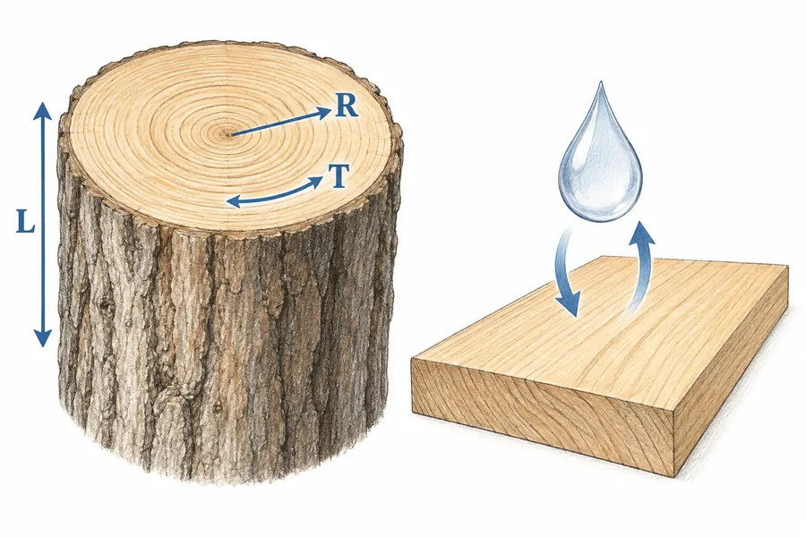

*Figure 9.1: Directionality and moisture uptake in wood (schematic).*

> **Common misconception: "old wood has stopped moving."**
> Not so. As long as it is still wood, it responds to the humidity around it.
> What does improve is something else. After thorough drying, release of internal stress and long cycles of dimensional change, some materials **may be more predictable**.
> But "more predictable" is not the same as "immune to humidity".

| **Key point and application** | **Content** |
|----|----|
| Core concept | The cells and fibres of wood run roughly along the trunk, so stiffness and dimensional change differ in the longitudinal, radial and tangential directions. |
| Relations and conditions | Wood is also hygroscopic: it exchanges moisture with the relative humidity and temperature of the air around it. |
| Where it is applied | Reading information about wood and materials. |

## 9.2 Density, stiffness and damping

These three terms get mixed up all the time, but each one governs its own thing.

| Term | Plain-language explanation | What to watch when making |
|---|---|---|
| **Density** | how much mass the same volume holds | a heavy plate at a given thickness needs more energy to get moving |
| **Modulus of elasticity** | how far the material resists elastic deformation | makers care most about stiffness "along the fibre direction" |
| **Damping** | how quickly vibration energy turns into heat and is eaten by internal friction | low damping is not automatically good |

Low density does not mean the wood is necessarily better.

If the stiffness is low as well, the soundboard may have to be made thicker in order to carry the structural load.

So what matters is not a single number but **how density and stiffness combine**.

The modulus of elasticity affects how a plate bends over a long span.

Put that idea into one plain sentence: "**how much stiffness for the same weight**". That is **specific stiffness**.

This is one of the important reasons spruce has long been the mainstream soundboard material.

In 2022 a mandolin study measured the mechanical properties of Norway spruce directly and put them into a **finite element model**. 〔S705〕

Damping governs something else: how quickly vibration energy is used up.

Low damping is not automatically better.

If one particular resonance rings on too long, it can actually make the instrument unbalanced.

What making really wants is this: an overall **frequency response** and **time response** that suit the musical job.

So the material properties have to be balanced according to the use.

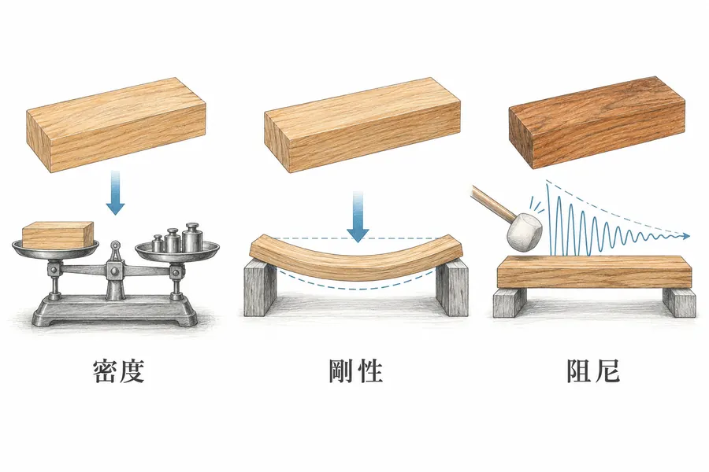

*Figure 9.2: Density, stiffness and damping (schematic).*

| **Key point and application** | **Content** |
|----|----|
| Core concept | Density tells us how much mass a unit of volume holds. |
| Relations and conditions | The modulus of elasticity describes how far a material resists elastic deformation. |
| Where it is applied | Reading information about wood and materials. |

## 9.3 The three ways to saw wood

When a log is sawn into boards, the rings sit at different angles to the face of the board, and that produces different cuts.

| Cut | Chinese | Growth rings seen on the board face |
|---|---|---|
| quarter-sawn | 徑切 | usually straighter ring lines |
| rift-sawn | 裂切 | between the other two |
| flat-sawn | 弦切 | the arch-shaped figure is more obvious |

A quarter-sawn board arranges the radial and tangential directions in a way that is better for dimensional stability.

That is why soundboard and neck stock is so often taken from quarter-sawn boards.

Quarter-sawn boards are valued for soundboards and necks, and the reason is dimensional stability.

But "quarter-sawn = high grade, flat-sawn = low grade" is still too simple.

Some maple backs deliberately use a different cut direction in order to get a particular **figure**.

The ribs of a bowlback are narrow anyway, so what they need from making is completely different from a large soundboard.

So the question to ask is: **what dimensional stability, what bendability and what visual effect does this part need?**

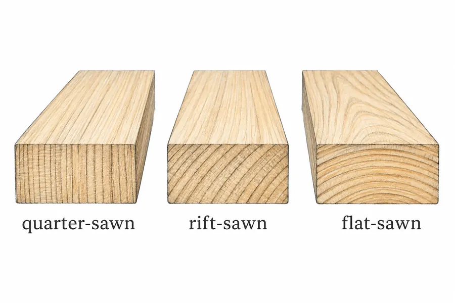

*Figure 9.3: The three ways to saw wood (schematic).*

The USDA data show that wood's dimensional change in the tangential direction is usually larger than in the radial direction.

That is why the cut affects long-term deformation.

When makers choose boards they are usually balancing four conditions: usable grain direction, weight, stiffness, appearance. Then they choose the cut according to the wood and the design. 〔S707〕〔S708〕

| **Key point and application** | **Content** |
|----|----|
| Core concept | When a log is sawn into boards, the rings sit at different angles to the face, which gives quarter-sawn, rift-sawn and flat-sawn orientations. |
| Relations and conditions | But "quarter-sawn = high grade, flat-sawn = low grade" is still too simple. |
| Where it is applied | Reading information about wood and materials. |

## 9.4 Spruce and the soundboard

The soundboards of the Italian mandolin tradition use European / Norway spruce (*Picea abies*) in quantity. Another way of putting it is fine-grained spruce in the broad sense.

A 2022 study points out that one reason European making has long preferred spruce is its combination of "low density + good mechanical properties".

Calace's current bowlback mandolins at every level also keep using fine-grained / extra fine-grained spruce. 〔S705〕〔S711〕

Between spruces there really are differences in average properties and in supply:

| Name | Chinese | Notes |
|---|---|---|
| Sitka spruce | 西特卡雲杉 | a common North American species |
| Engelmann spruce | 恩格曼雲杉 | a common North American species |
| Red / Adirondack spruce | 紅雲杉／阿迪朗達克雲杉 | a common North American species |
| European spruce | 歐洲雲杉 | the traditional European choice |

The data do show average property and supply differences between them.

But **a species name cannot replace choosing an individual board**.

Two boards both labelled European spruce can differ in density, ring width, fibre runout, local defects and stiffness.

So makers usually assess weight, tap response, how the board bends, and the actual thickness together, one board at a time.

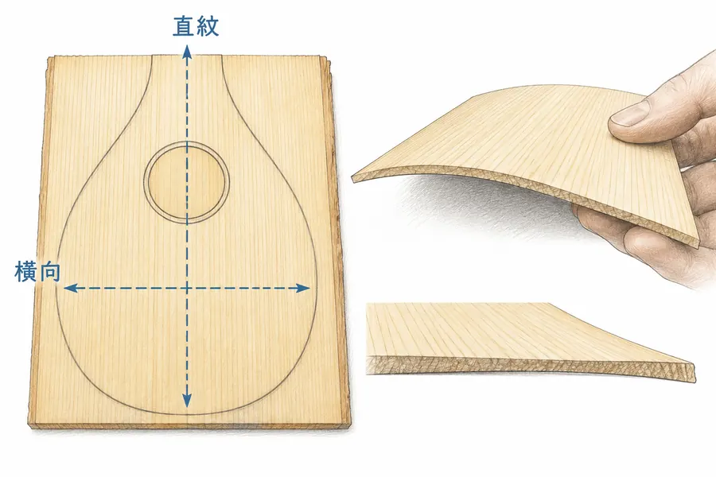

*Figure 9.4: Spruce and the soundboard (schematic).*

> **Common misconception: "the tighter the grain, the better."**
> This is not a general rule.
> Very even, straight grain really does help predictability and the visual tradition.
> But ring width is only one variable among many.
> Ranking sound by grain tightness alone ignores the **proportion of latewood** and the mechanical properties of the whole plate.

| **Key point and application** | **Content** |
|----|----|
| Core concept | Italian mandolin soundboards use European / Norway spruce (*Picea abies*), or fine-grained spruce in the broad sense, in quantity. |
| Relations and conditions | Sitka, Engelmann, red/Adirondack and European spruce really do differ in average properties and supply, but a species name cannot replace choosing an individual board. |
| Where it is applied | Reading information about wood and materials. |

## 9.5 Maple and the body

Maple has far more uses in the mandolin family than "a single back wood".

The M-30 in Suzuki's 2017 catalogue uses a maple **15-piece body**.

The M-100 is a maple **27-piece body**, with a maple neck.

Calace's concert models also come with a maple body of 31 or 33 ribs.

These examples show that maple can be used in completely different structures: narrow ribs, necks, even carved backs. 〔S714〕〔S711〕

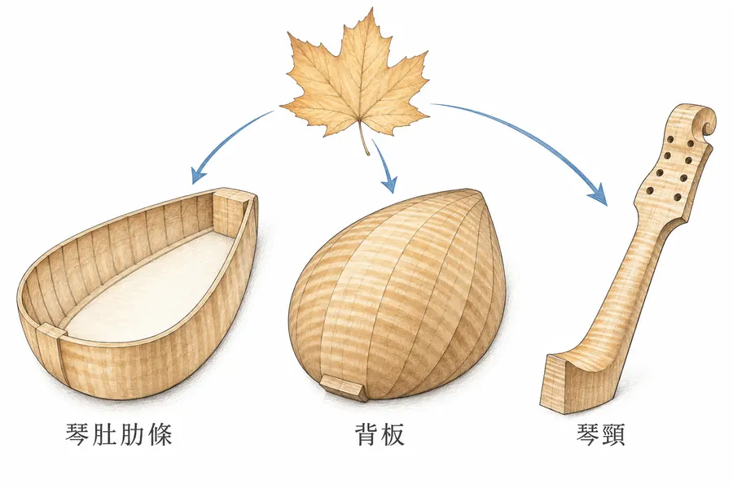

*Figure 9.5: Maple and the body (schematic).*

The American **carved-top** tradition later commonly used "spruce top with maple back and sides".

But Orville Gibson's 1898 instrument actually used a **carved walnut back**, with walnut sides and neck throughout.

> **Common misconception: "spruce plus maple has been the mandolin's standard combination since ancient times."**
> Not so. That was a brand convention that formed later.
> Reading that later convention back into "the one material combination at the moment of invention" misreads the history. 〔S702〕

**Flame, quilt and birdseye** figures are visual effects created by the growth direction of the wood fibres.

They **do not equal an acoustic grade**.

Maple with a very strong figure can be harder to work, and its fibre direction is more complicated.

The market often ties beautiful figure to higher-level models.

But that reflects **selection, working hours and aesthetic value** more than anything else, and it should not be converted directly into "certainly louder".

| **Key point and application** | **Content** |
|----|----|
| Core concept | Maple has wider uses in the mandolin family than a single "back wood". |
| Relations and conditions | The American carved-top tradition later commonly used a spruce top with maple back and sides, but Orville Gibson's 1898 instrument actually used a carved walnut back with walnut sides and neck throughout. |
| Where it is applied | Reading information about wood and materials. |

## 9.6 Rosewood: species and uses

Rosewood is a **trade name** that covers many kinds of wood.

Different species of **Dalbergia** differ greatly in density, colour, smell and workability.

| Brand / model | How rosewood is used |
|---|---|
| Traditional bowlback mandolins | rosewood ribs are common |
| Calace (many current models) | listed as an extra rosewood body |
| Suzuki MC-836 (2017 catalogue) | listed as a rosewood flat body |

〔S711〕〔S714〕

Because "rosewood" is a familiar word that marketing likes to use, the second-hand market easily writes any dark wood down as rosewood.

> **Common misconception: "it looks dark in the photo, so it is rosewood."**
> Without a factory catalogue, a maker's records or a reliable wood identification, a photograph alone can hardly confirm the **species**.
> That is why the database in chapter 20 separates "the product page says rosewood" and "the botanical species is confirmed" into two different levels of confidence.

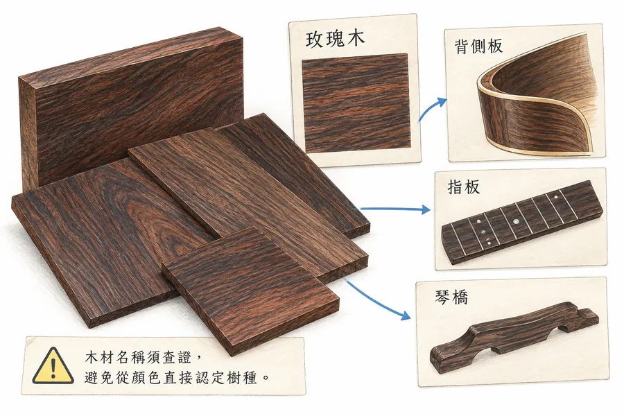

*Figure 9.6: Rosewood: species and uses (schematic).*

Research on rosewood also has to confirm three things: **the species, the origin documents, the cross-border rules**.

At its 18th meeting (CoP18), the Conference of the Parties to the **Convention on International Trade in Endangered Species (CITES)** amended **Annotation #15**.

That amendment brought **finished musical instruments**, **finished parts** and **accessories** inside the exemption.

But **Brazilian rosewood (Dalbergia nigra)** is on **Appendix I**, and the same logic does not apply to it.

Individual countries' import and export rules may also demand extra documents.

For antique instruments and cross-border trade, reading the rules rests on two things: **the rules in force now** and **the actual species**. You have to confirm whether that species and that object meet the exemption. 〔S709〕〔S710〕

| **Key point and application** | **Content** |
|----|----|
| Core concept | Rosewood is a trade name covering many kinds of wood. |
| Relations and conditions | Because "rosewood" is a familiar word that marketing likes to use, the second-hand market also easily writes any dark wood down as rosewood. |
| Where it is applied | Reading information about wood and materials. |

## 9.7 Ebony, mahogany and other materials

**Ebony** is dense and wear-resistant, so it is common on **fingerboards** and **bridges**.

The 1898 Gibson instrument used an ebony fingerboard and bridge.

Modern high-end Calace models also often use **Gabon ebony** fingerboards.

The first reason for choosing material for these parts is usually **wear resistance, dimensional stability and workability**. Only after that do you assess its acoustic role in that position. 〔S702〕〔S711〕

**Mahogany** is common for necks.

The 2017 specifications of the Suzuki M-30, MD-4 and MC-836 all list mahogany necks.

A neck needs enough stiffness, relatively low weight and good workability.

These engineering conditions are more direct than saying "mahogany is warmer than maple". 〔S714〕

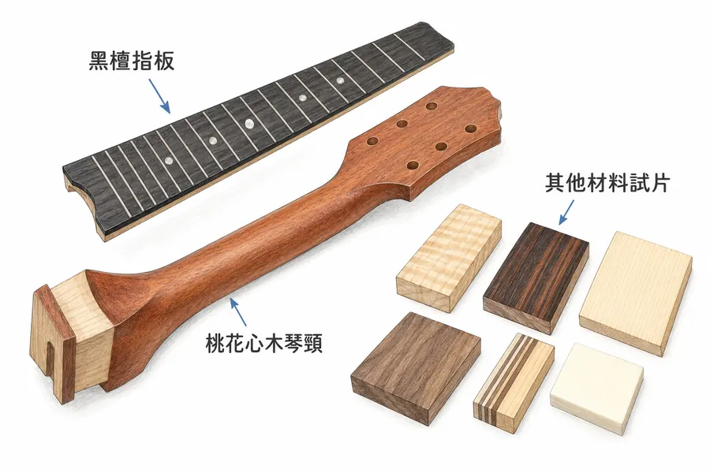

*Figure 9.7: Ebony, mahogany and other materials (schematic).*

**Walnut** plays a very large part in Orville Gibson's 1898 instrument: the back, the sides, the neck and the head structure all use walnut heavily.

**Cherry**, **pear** and other **fruitwoods** also appear in historical European making.

These materials remind us of one thing:

The point of a mandolin was never one particular species; it is **a material system**. That system is shaped by three things: regional supply, craft tradition and design purpose. 〔S702〕

| **Key point and application** | **Content** |
|----|----|
| Core concept | Ebony is dense and wear-resistant, so it is common on fingerboards and bridges. |
| Relations and conditions | Mahogany is common for necks. |
| Where it is applied | Reading information about wood and materials. |

## 9.8 Drying and moisture content

Freshly felled wood has a high moisture content and is not fit for making a precision instrument straight away.

Drying has three purposes:

1. To make it lighter.
2. To bring the wood close to the **equilibrium moisture state** of the environment where it will be used.
3. To lower the risk of later dimensional change and internal stress.

**Air drying**, **kiln drying** and long-term **seasoning** can be different processes.

But all of them end up facing the same thing: **wood takes up or gives off moisture again with its surroundings**. 〔S723〕

USDA points out that below the fiber saturation point wood shrinks or swells as moisture content changes, and that the change in the tangential direction differs from the radial.

An instrument soundboard is very thin, and gluing bonds parts of different orientation together.

So a humidity change does not just make the whole instrument "bigger or smaller"; it also creates **internal stress**. 〔S708〕

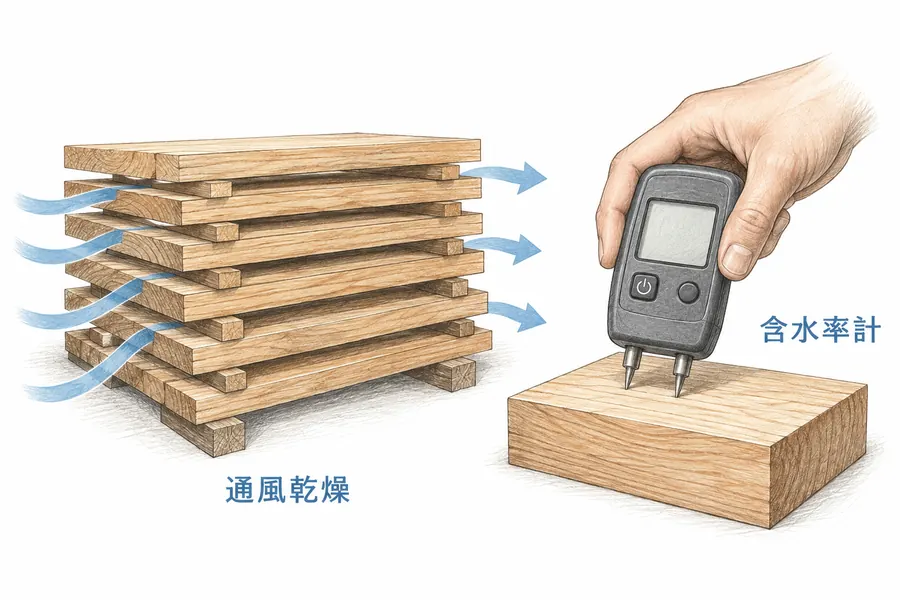

*Figure 9.8: Drying and moisture content (schematic).*

This also explains why the following problems appear:

| Environment | Common problems |
|---|---|
| Dry regions | top crack, open seam, fret sprout |
| High humidity | the action rises, the top bellies up, the neck condition changes |

The point of care is this: **avoid long periods outside a reasonable environment, and avoid violent changes**.

Chapter 21 turns these risks into everyday practice.

| **Key point and application** | **Content** |
|----|----|
| Core concept | Freshly cut wood has a high moisture content and is not fit for making a precision instrument straight away. |
| Relations and conditions | USDA points out that below the fiber saturation point wood shrinks or swells as moisture content changes, and that the change in the tangential direction differs from the radial. |
| Where it is applied | Reading information about wood and materials. |

## 9.9 Reading materials and timbre

Wood does affect sound, and this can be measured.

Because density, stiffness and damping affect the plate's **modes**.

But "a given species necessarily produces a given timbre" is saying too much.

The 2022 study connected **soundboard wood properties** directly with finite element results, showing that material parameters matter.

But it showed at the same time that the overall design and the geometry of the plate cannot be left out. 〔S705〕

A more precise statement goes like this:

> Under the same or similar geometry, a difference in the material's mechanical properties changes structural vibration.
> But in a real instrument, geometry, thickness, **bracing**, the bridge and making tolerances are all changing at the same time.

That sentence is longer, and much more reliable than "spruce = bright".

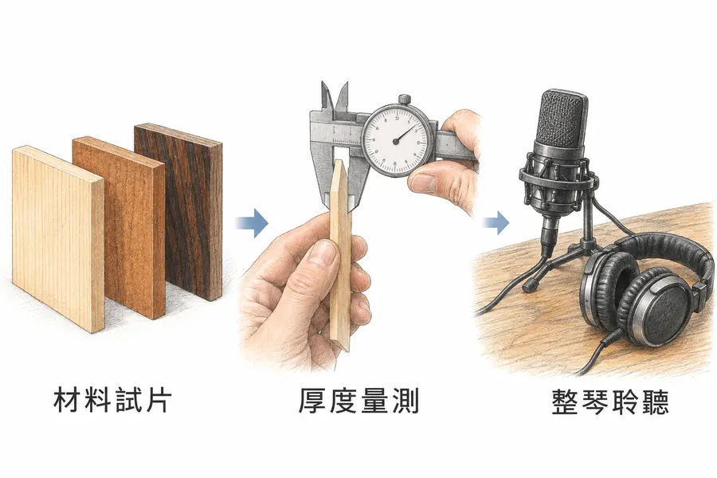

*Figure 9.9: Reading materials and timbre (schematic).*

A maker's working vocabulary still has value.

When a maker has used a particular wood for years, his experience of how it works, what thickness it wants and how it responds can be very accurate.

But that experience should be labelled **craft knowledge**, and it should state clearly the materials and designs it applies to.

| **Key point and application** | **Content** |
|----|----|
| Core concept | Wood affects sound because density, stiffness and damping affect the plate's modes, and this can be measured. |
| Relations and conditions | A more precise statement is: "under the same or similar geometry, a difference in the material's mechanical properties changes structural vibration." |
| Where it is applied | Reading information about wood and materials. |

## 9.10 Case study: material choices in three brands

The Suzuki 2017 catalogue provides a set of production data that is very good for teaching:

| Model | Top | Body | Neck | Fingerboard / bridge |
|---|---|---|---|---|
| **M-30** | spruce | maple, 15-piece | mahogany | rosewood / ebony |
| **M-100** | — | maple, 27-piece | maple | ebony |

Think only in "species timbre" and it is easy to say straight out: "the M-100 sounds such and such because it has a maple neck."

But the rib structure, the production grade and other details are changing at the same time.

So it cannot be put down to one factor. 〔S714〕

*Figure 9.10: the source records for the three case studies; the wood specifications are in the body text of this section (schematic).*

Changes across Calace's current range are more complex: rosewood with 25 ribs, maple with 31 or 33 ribs, 24 and 29 frets, different heads and decoration — several dimensions changing at once.

Material choice is tied to the product line.

So what a buyer should compare is: **the whole design that material and structure make together**. 〔S711〕

Orville Gibson's 1898 instrument breaks the later stereotype even more directly: **a carved spruce top with a walnut back, sides and neck**.

The configuration that later became common was spruce with maple.

That instrument still carried great design influence in history, which shows that a classic structure does not have to depend on the material slogans we know today. 〔S702〕

| **Key point and application** | **Content** |
|----|----|
| Core concept | The Suzuki 2017 catalogue provides production data that is very good for teaching: the M-30 has a spruce top, a maple 15-piece body, a mahogany neck, and a rosewood/ebony fingerboard and bridge. |
| Relations and conditions | Think only in "species timbre" and it is easy to say the M-100 sounds as it does because of its maple neck. |
| Where it is applied | Reading information about wood and materials. |

## 9.11 Case study: reading commercial wood grades

Wood grades such as "AAA", "master grade" and "select" are usually about **the brand's or the supplier's own grading**.

They may cover growth rings, colour, defects, figure and how rare the supply is.

But one brand's AAA cannot be compared directly with another's.

> **Common misconception: "AAA is a wood standard recognised worldwide."**
> It is not. If the product page does not say what the grading rules are, the reader should treat it as **a commercial description**, not as proof of mechanical performance.

**Flamed maple** mainly describes figure.

A beautiful flame really does have aesthetic and market value.

But you cannot judge that board's **modulus of elasticity** or **damping** from a photograph.

For a player, the more direct assessment than "wood grade" is still the whole instrument:

- Is the response even?
- Are the intonation and the **setup** stable?
- Does the dynamic range suit the use?

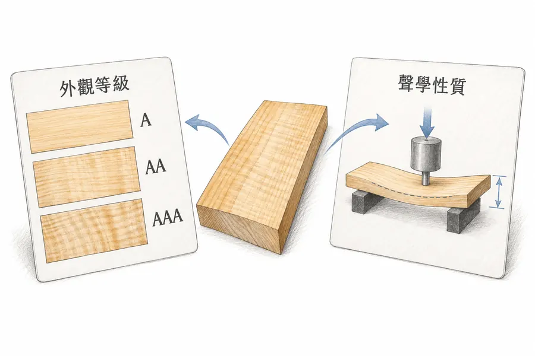

*Figure 9.11: Case study: reading commercial wood grades (schematic).*

The occasions that really need material evidence are usually these:

- appraising an antique instrument
- CITES cross-border movement
- matching material for a repair
- research

In those cases you should rely on documents, microscopic features, professional identification, or at least historical specifications from several sources. All of these raise the reliability of species identification.

## Table 9-1 | Common materials: look at the function first, then talk about timbre

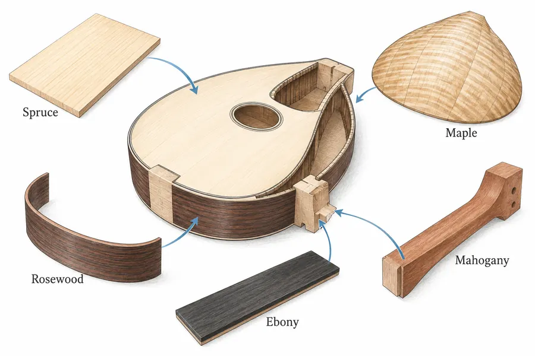

| **Material** | **Usual part** | **Function to look at first** | **Oversimplification to avoid** |
|----|----|----|----|
| **Spruce** | soundboard | low mass / stiffness combination | "always bright" |
| **Maple** | ribs, back, neck | stiffness, workability, appearance | figure = acoustic grade |
| **Rosewood** | bowl ribs, fingerboard | density, wear resistance, decoration | every dark wood is rosewood |
| **Ebony** | fingerboard, bridge | wear resistance, dimensional stability | if it is black it must be ebony |
| **Mahogany** | neck, body parts | balance of weight and workability | "always warm" |

*Table 9-1: Common materials — look at the function first, then talk about timbre (schematic).*

| **【Scientific evidence】 Wood's density, elasticity and moisture content really do affect the structure; but the species name alone cannot uniquely predict the finished instrument's timbre.** |
|----|

| **【Regulatory reminder】 finished musical instruments have a specific exemption under CITES Annotation #15, but Brazilian rosewood (Dalbergia nigra) is on Appendix I; before crossing a border, confirm against the rules in force at the time, the species and the documents.** |
|----|

## Self-study question bank

*Figure: Learning check — answer, check, review*

Answer the questions yourself first, then look at the answers. When you get one wrong, go back to the relevant section of this chapter and read it again.

**1. If wood is denser, is the sound necessarily better?**

- A. Always

- B. Not necessarily; the design and the thickness also matter

- C. True only for old instruments

- D. True only for new instruments

**2. Quarter-sawn refers to?**

- A. A way of sawing wood

- B. A way of tuning

- C. A way of holding the pick

- D. A chord inversion

**3. How should an AAA wood grade usually be read?**

- A. As a worldwide standard

- B. Mostly as the brand's or the supplier's own grading

- C. As proof of a particular species

- D. As proof of hand-making

**Answers: 1.B 2.A 3.B**

## Main sources checked for this chapter

*Figure: Sources checked — find the original, check the conditions, keep a record*

**【S705】Quintavalla et al.: The Acoustics of Traditional Italian Mandolins and Their Relation with Soundboard Wood Properties (International Journal of Wood Culture 2, 2022).** A study of bridge admittance, sound radiation, modes and soundboard wood in historical and modern Italian mandolins.

https://www.sciencedirect.com/org/science/article/pii/S2772318622000017

**【S707】USDA Forest Products Laboratory: Wood Handbook—Wood as an Engineering Material (FPL-GTR-282, revised 2021).** The basis of wood structure, physical properties, mechanical properties, drying, gluing and materials engineering.

https://research.fs.usda.gov/fpl/wood-handbook

**【S708】Glass & Zelinka, USDA Forest Products Laboratory: Moisture relations and physical properties of wood (Wood Handbook Chapter 4, 2021).** Official technical data on moisture uptake, equilibrium moisture content, shrinkage and swelling, and dimensional stability.

https://research.fs.usda.gov/treesearch/62243

**【S709】CITES: CoP18 Proposal 52 / Annotation #15 amendment (2019).** The exemption clauses for finished musical instruments and the like in Annotation #15 for Dalbergia spp.; Brazilian rosewood is separately on Appendix I.

https://cites.org/sites/default/files/eng/cop/18/doc/E-CoP18-105-01-A2.pdf

**【S710】CITES Secretariat: Study / notification on Annotation #15 and musical instruments (2025).** Background to the follow-up study on the exemption for finished musical instruments, parts and accessories, and on trade in Dalbergia.

https://cites.org/sites/default/files/notifications/E-Notif-2025-030.pdf

**【S711】Liuteria Calace: Mandolini – official specifications (accessed 2026-10-06).** Current specifications including a 33.5 cm scale length, 24/29 frets, 25/31/33 ribs, spruce top and rosewood/maple body.

https://www.calace.it/en/mandolini

**【S714】Suzuki Music / Suzuki Violin: 2017 String Instrument Catalog (2017).** Scale length, woods and specifications of the M-30, M-100, MD-4, MD-10 and MC-836.

https://www.suzuki-music.co.jp/app/uploads/2017catalog14.pdf

**【S723】USDA Forest Products Laboratory: Drying and control of moisture content and dimensional changes (technical report / Wood Handbook).** Drying, equilibrium moisture content and the control of dimensional change.

https://research.fs.usda.gov/treesearch/37419

---
