# Chapter 10: Mandolin Making

*Mandolin Making: Design, Construction, Assembly and Final Setup*

## Key points of this chapter

- The order of making is: **fix the geometry and the use first → choose the wood → body → neck and fingerboard → frets → decoration and finish → setup after stringing**.
- The three ways of building a body (bowlback, carved, flat-back) answer the same set of mechanical questions in different ways.
- **More ribs in the body does not mean a higher grade**, because the material, the curvature and the dimensions are changing as well.
- **The setup after stringing (final setup) is part of making**, not after-sales service.
- A historical copy can rebuild the type and the materials, but **a copy is still a new individual**.

---

Making begins with the use, the dimensions and the structural plan, and only then moves into machining and assembly.

Before the first cut is made, a mandolin already has a series of decisions behind it:

- **scale length**
- body volume
- top geometry
- bridge position
- string tension
- target range
- neck angle
- playing use

Different traditions look different because they answer **the same set of mechanical and acoustic questions with different structures**.

The three main traditions cannot be explained by one single set of steps:

| Tradition | Chinese | How the shape is formed |
|---|---|---|
| Neapolitan bowlback | 圓背琴 | ribs joined one at a time on a mold |
| Gibson carved-body | 雕刻琴體 | arching and thickness distribution carved out of a thick board |
| modern flat-back / folk mandolin | 平背琴 | closer to the side-and-back assembly of the guitar family |

The best way to understand the craft is to focus on **which geometric and physical condition each step is controlling**.

This chapter walks through the order: design, choosing wood, body, neck, frets, decoration, finish and final setup.

At the same time it uses the research copy of the 1784 Filano instrument and the 1898 Gibson patent as two contrasting case studies.

## 10.1 Design goals and dimension planning

**Scale length** is one of the first parameters that has to be fixed.

Because it moves four things: **fret spacing, neck length, bridge position, string tension**.

Current specifications are commonly these:

| Brand / model | Scale length |
|---|---|
| Calace mandolin | 33.5 cm |
| Calace mandola | 43.2 cm |
| Calace mandoloncello (mandocello) | 61 cm |
| Suzuki M-30 | 336 mm |
| Suzuki MD-4 | 426 mm |
| Suzuki MC-836 | 574 mm |

〔S711〕〔S712〕〔S713〕〔S714〕

The point behind these numbers is this: **different members of the family make different compromises between playing feel and range**.

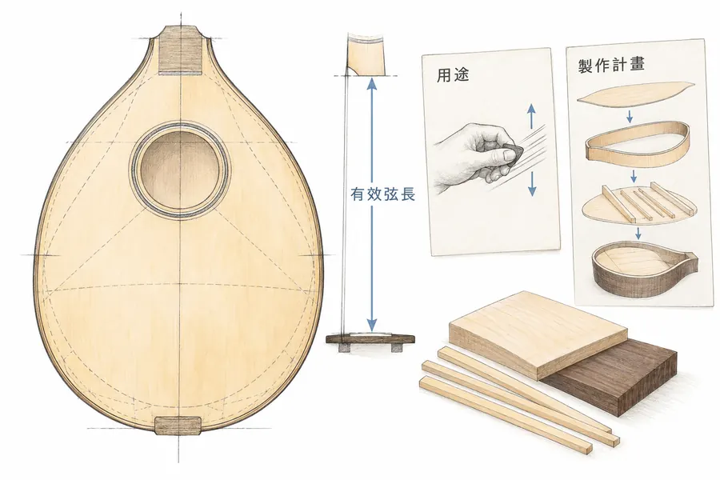

*Figure 10.1: Design goals and dimension planning (schematic).*

Next, the shape of the body and the system that carries the load have to be decided.

| Body type | What decides the volume and the structure |
|---|---|
| bowlback | the depth of the bowl, the curvature of the ribs, the bent soundboard |
| carved-top | arching and thickness distribution |
| flat-top | relies more on bracing |

When comparing designs you have to confirm the outline, the plate thickness and the internal support **together**.

Besides the outline dimensions, a professional making drawing also includes this key information:

- neck angle
- bridge height target
- fingerboard plane
- soundhole
- bracing
- top thickness

These dimensions depend on one another.

If a later stage has to make a large correction through **setup**, that usually means **the geometry at the earlier stage was already off**.

| **Key point and application** | **Content** |
|----|----|
| Core concept | Scale length is one of the first parameters that has to be fixed, because it moves fret spacing, neck length, bridge position and string tension. |
| Relations and conditions | In the Suzuki 2017 catalogue, the M-30 is 336 mm, the MD-4 is 426 mm and the MC-836 is 574 mm. |
| Where it is applied | Understanding the making process and the structure. |

## 10.2 Choosing the wood and rough machining

When the material arrives in the workshop, the maker first assesses what each board is good for.

He looks at these things:

- whether the fibres are straight
- whether there is **runout**
- what the density and the weight are
- how stiff it feels when bent
- where the defects are
- the usable dimensions

With a natural material, the design values usually have to be adjusted against the actual board.

That is why hand making cannot be completely the same as copying by **computer numerical control (CNC)**. 〔S707〕

Moisture content matters just as much.

The wood should first come close to a reasonable equilibrium with the workshop and with the environment it will be used in. If it has not, and the box is closed up at a precision thickness, the later shrinkage can cause three things:

- the seams change
- the arching changes
- the neck geometry changes

The point of drying is **to bring the material into a predictable state**. 〔S708〕〔S723〕

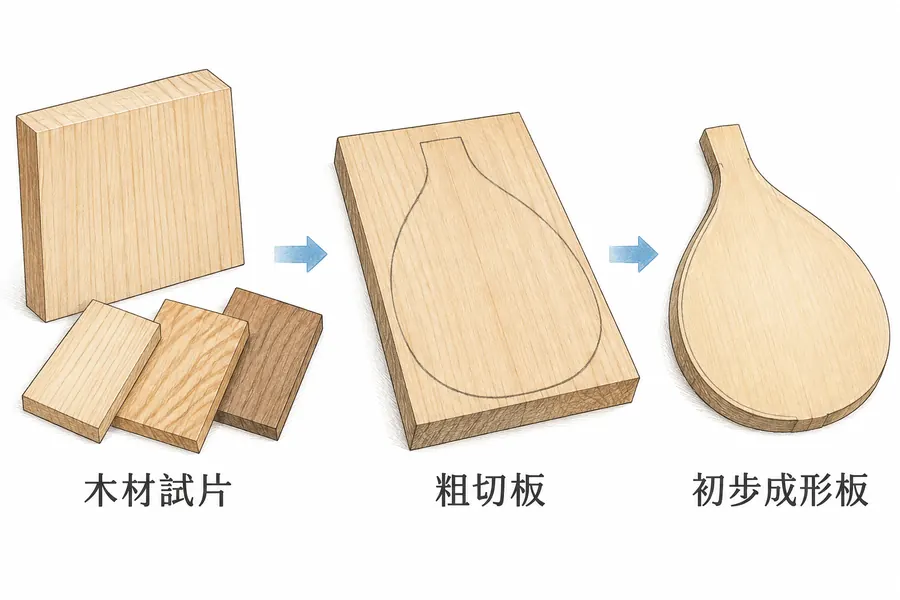

*Figure 10.2: Choosing the wood and rough machining (schematic).*

Rough machining leaves **allowance**.

Tops, backs and neck blanks are never taken to final dimension from the start.

Because the gluing, carving and trimming that follow still need **reference surfaces**.

> **Common misconception: "the errors in making come mainly from shaky hands."**
> They do not. Many errors come down to **badly set references**.
> So establishing the centerline, the mold reference and the neck axis is the basic skill of the whole process.

| **Key point and application** | **Content** |
|----|----|
| Core concept | When the material arrives in the workshop, the maker first assesses what each board is suited to. |
| Relations and conditions | Moisture content matters just as much. |
| Where it is applied | Understanding the making process and the structure. |

## 10.3 Making the bowlback body

Bowlback making usually depends on a **mold**.

The maker first establishes the outline of the body, then bends the narrow ribs to the required curvature, fitting and gluing them one by one.

Each rib is narrow, and the error in a single one does not look like much.

But after twenty-odd of them it can push the centerline off, or make the bowl asymmetric from left to right.

So every seam has to control **angle and fit**.

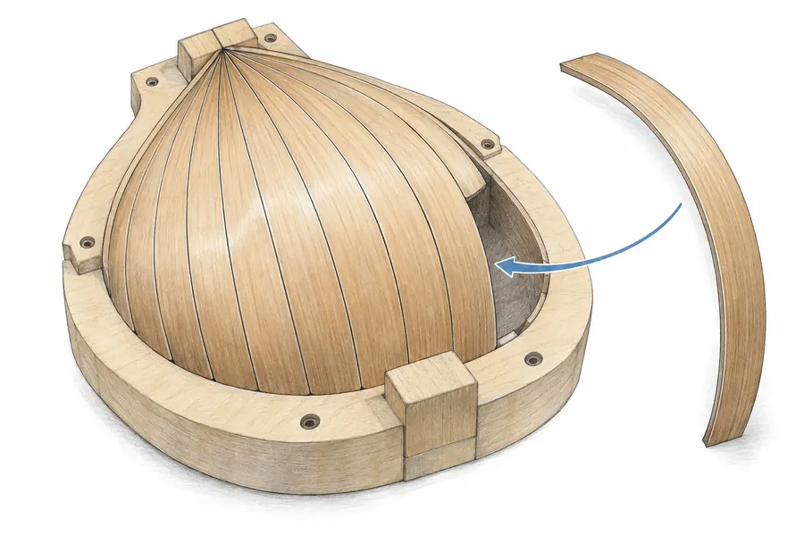

*Figure 10.3: Making the bowlback body (schematic).*

Historical instruments show a wide spread in rib count:

| Instrument | Number of ribs |
|---|---|
| Vinaccia 1781 | 23 narrow strips |
| Calace, common today | 25, 31, 33 |
| Calace mandoloncello | up to 41 |

〔S701〕〔S711〕〔S713〕

The more ribs there are, the narrower each one usually is, and the finer the curvature can be made.

But the working hours and the number of seams go up with it.

> **Common misconception: "more ribs means a higher grade."**
> Rib count cannot be taken directly as the product grade.
> Because smooth ribs versus fluted ribs, the material and the overall dimensions all change together.

The inside of the bowl also needs work in several places:

- rib joints
- end blocks
- neck joint
- the edge where the top joins

These places decide **long-term structural stability**.

If the joining aims only at an invisible outside while the contact inside is poor, it can come unglued later under humidity cycles and string tension.

| **Key point and application** | **Content** |
|----|----|
| Core concept | Bowlback making usually depends on a mold. |
| Relations and conditions | Historical instruments show a wide spread in rib count. |
| Where it is applied | Understanding the making process and the structure. |

## 10.4 The Neapolitan bent soundboard

The Neapolitan soundboard is not completely flat.

Near the bridge there is a **bend (cant)**, which makes the lower half of the top a folded plane.

The Metropolitan Museum of Art (Met) has a description of the Vinaccia 1781. It points out that this is a typical feature of the **Neapolitan school**. The practice **adds structural strength**. 〔S701〕〔S722〕

Making this kind of soundboard means controlling four things at the same time:

- the wood fibres
- the position of the bend
- the thickness
- the boundary where it joins the bowl

If the bend line is in the wrong place, the bridge may not land on the geometric point it was designed for.

If the top is too weak at the bend, long-term pressure can deform it again.

The point of this section is **bringing the soundboard geometry into the structural design**.

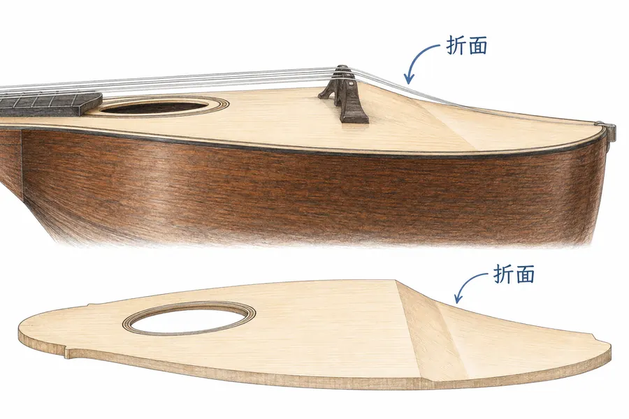

*Figure 10.4: The Neapolitan bent soundboard (schematic).*

The 1784 Filano research instrument sits exactly in the historical transition **from gut strings to metal strings**.

It keeps a bent soundboard and **mixed gut–metal strings**.

Before making the copy, the research team took acoustic measurements.

This shows that research into historical methods no longer stops at dimensions and appearance; it records **the dynamic behaviour of the original instrument** as well. 〔S706〕

| **Key point and application** | **Content** |
|----|----|
| Core concept | The Neapolitan soundboard is not completely flat. |
| Relations and conditions | Making this kind of top means controlling the wood fibres, the position of the bend, the thickness and the boundary where it joins the bowl at the same time. |
| Where it is applied | Understanding the making process and the structure. |

## 10.5 Carved arching and thickness control

One of Orville Gibson's core innovations in 1898 was to carve the top and the back out of thicker wood into a **convex arch**.

His patent criticises the structure of the time explicitly: "too much bending, joining, veneering and internal support".

He argued for a more integrated carved approach.

The 1898 instrument kept at the Met shows:

- a spruce carved top
- a walnut carved back
- integrated sides, neck and head

〔S702〕〔S703〕

**Carving** does not only decide the outside curve.

The maker has to control the outer arch, the inner hollow and the **thickness graduation** in each area.

The thickness in these areas together decides stiffness and modes:

- the centre of the plate
- the edges
- the bridge area
- around the soundhole

That is why two carved tops that look exactly the same on the outside can still respond differently.

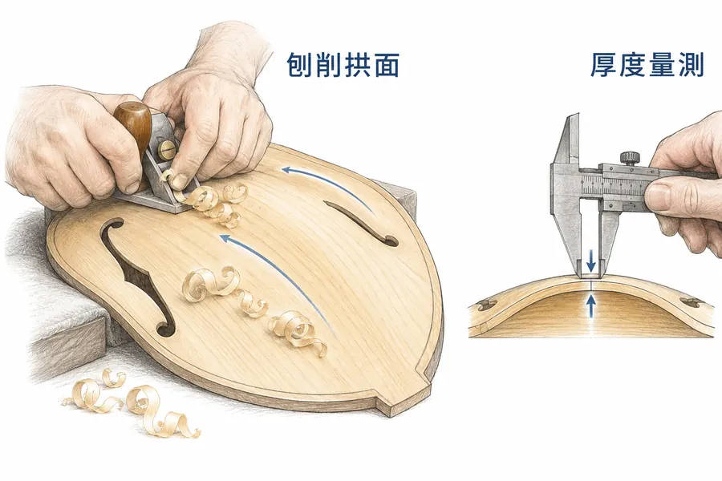

*Figure 10.5: Carved arching and thickness control (schematic).*

The Gibson system that came later did not carry Orville's original "no bracing" idea on unchanged.

Instead it formed a more developed design: bracing, **f-holes**, the bridge position and so on.

> **Common misconception: "once an invention is finished it never changes again."**
> The history of instrument making is rarely like that.
> What is more common: every generation readjusts on top of the original framework. 〔S719〕〔S720〕

| **Key point and application** | **Content** |
|----|----|
| Core concept | One of Orville Gibson's core innovations in 1898 was carving the top and the back out of thicker wood into a convex arch. |
| Relations and conditions | Carving does not only decide the outside curve. |
| Where it is applied | Understanding the making process and the structure. |

## 10.6 Flat backs and flat bodies

Making a flat-back type usually needs:

1. bending the side ribs
2. fitting the blocks and linings
3. gluing the top and the back to form the box

The outline looks simpler than a bowlback, but **side bending, rim geometry and the precision of the bracing are just as critical**.

For a folk mandolin, or for certain mandocellos, this structure also has practical advantages in making, in sitting down to play, and in storage.

The Suzuki 2017 MC-836 is an example of a mandocello with a rosewood flat body.

It is different from the multi-piece round bodies of the same brand's M-30 and MD-4.

This shows one thing. The same company, on the large low instruments of the family, may also choose a different body because of size and playing needs. 〔S714〕

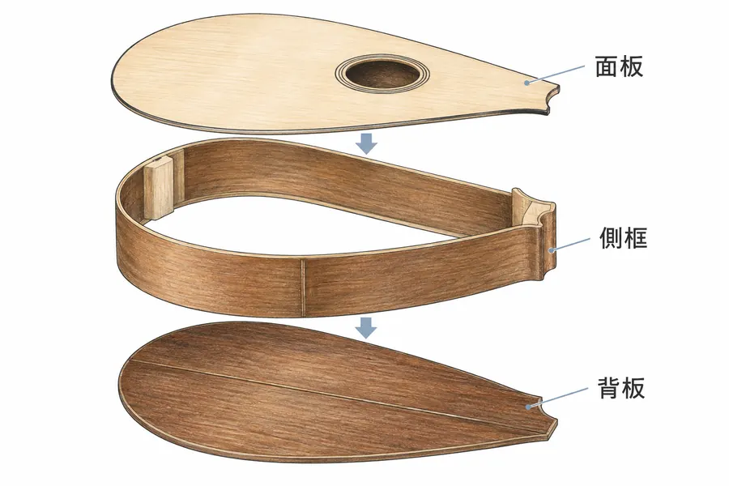

*Figure 10.6: Flat backs and flat bodies (schematic).*

> **Common misconception: "a flat back is the cheap simplified version."**
> That is not a reliable way to classify.
> There are cheap mass-produced flat backs, but there are also high-end hand-made flat-top instruments.
> **A structural form describes a way of working; it does not equal a level of quality.**

| **Key point and application** | **Content** |
|----|----|
| Core concept | Flat-back making usually needs the side ribs bent, the blocks and linings fitted, and then the top and back glued on to form the box. |
| Relations and conditions | The Suzuki 2017 MC-836 is a mandocello with a rosewood flat body, unlike the brand's M-30 and MD-4 with their multi-piece round bodies. |
| Where it is applied | Understanding the making process and the structure. |

## 10.7 Bracing and soundboard support

**Bracing** adds local stiffness, and it adds mass.

This is a trade-off:

| Approach | Short-term result | Long-term risk |
|---|---|---|
| thick, heavy bracing | usually safer | some areas of the top may be hard to drive |
| over-thinning | the sound may be lively in the short term | the geometry is lost over time |

What is really difficult is this: **putting structural life and acoustic goals into the design at the same time**.

Makers often adjust bracing through these methods:

- experience
- how the plate bends
- thickness
- weight
- even the **modal / tap response**

But these methods **are not a single formula**.

Acoustic research can supply **bridge admittance** and modal data.

But it still cannot replace a judgement made about each piece of wood and the actual work. 〔S705〕

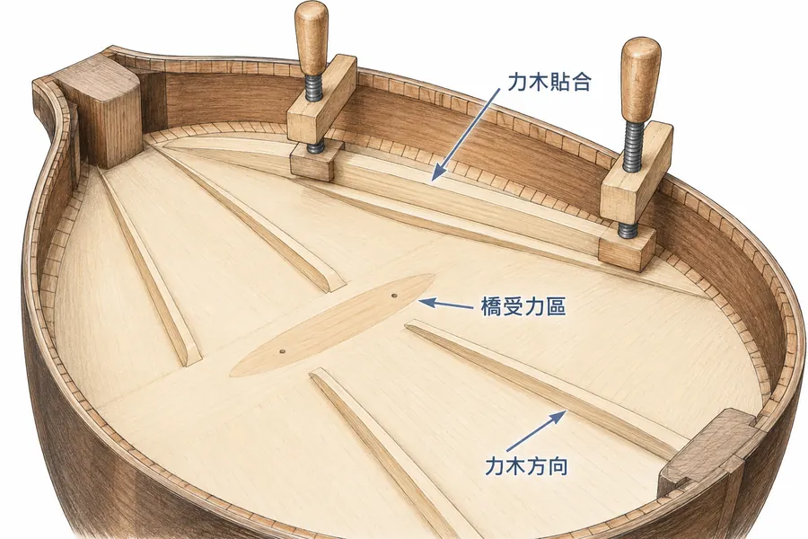

*Figure 10.7: Bracing and soundboard support (schematic).*

> **Common misconception: "when repairing, you just glue in an extra strip of wood to strengthen it."**
> No. A new brace changes the modes, and it can **lock the humidity deformation into the wrong geometry**.
> Historical instrument restoration especially needs **minimal intervention** and **reversibility**.

| **Key point and application** | **Content** |
|----|----|
| Core concept | Bracing adds local stiffness, and it adds mass. |
| Relations and conditions | Makers often adjust bracing through experience, how the plate bends, thickness, weight, even modal/tap response, but these methods are not a single formula. |
| Where it is applied | Understanding the making process and the structure. |

## 10.8 The neck joint and the fingerboard

Where the neck meets the body, three things have to be controlled:

1. the left-right **centerline**
2. the **neck angle**
3. the rotation of the **fingerboard plane**

If any one of them is off, these problems can appear:

- the bridge is forced off centre
- the action is uneven from left to right
- there is not enough range for adjusting the action

Get these right and they are almost invisible; get them wrong and they follow the instrument for its whole life.

Different historical types make the **neck joint** in different ways:

| Type | Method of joining |
|---|---|
| Orville Gibson's original design | integrates the sides, neck and head height |
| bowlback | often joins the neck block to the bowl ribs |
| modern mass production | may use a more standardised joint |

〔S703〕

Understanding these differences matters for repairing used instruments.

Because **the method of a neck reset cannot be carried over from one structure to another**.

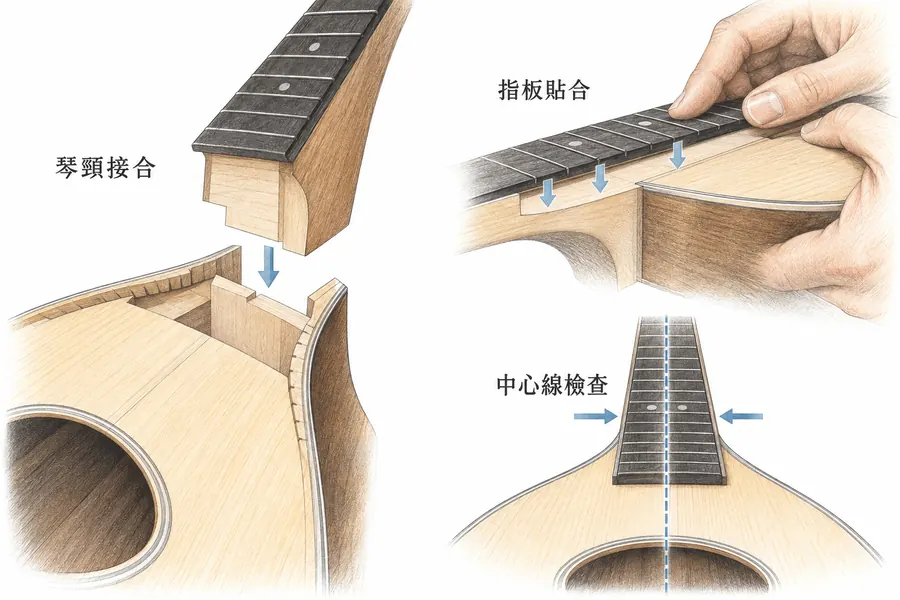

*Figure 10.8: The neck joint and the fingerboard (schematic).*

Before the fingerboard is glued on, the **scale reference** and the **fret slot** positions also have to be considered.

The longer the fingerboard extension, the more high positions you get.

But its coverage of the top, and the support it gives, may also increase.

The 29 frets of Calace's concert models represent playing needs completely different from the 13 frets of the early Vinaccia. 〔S701〕〔S711〕

| **Key point and application** | **Content** |
|----|----|
| Core concept | The neck joint has to control three things: the left-right centerline, the neck angle, and the rotation of the fingerboard plane. |
| Relations and conditions | Different historical types make the neck joint in different ways. |
| Where it is applied | Understanding the making process and the structure. |

## 10.9 Fret installation and levelling

Under **twelve-tone equal temperament**, fret positions shorten the scale length by a fixed ratio.

Cut a slot in the wrong place, even by a small error, and it can build up into an audible deviation in the high positions.

After installation two things have to be confirmed:

- the fret is fully **seated**
- the **crown** height is consistent

Otherwise you get **buzz** and **dead spots**.

The goal of **fret leveling** is to establish one consistent, usable plane under the intended **neck relief** and string path.

After that the crowns have to be reshaped so the string leaves the fret on **a very narrow contact line**.

If the crown is filed too flat, the actual sounding point becomes vague and the **intonation** suffers.

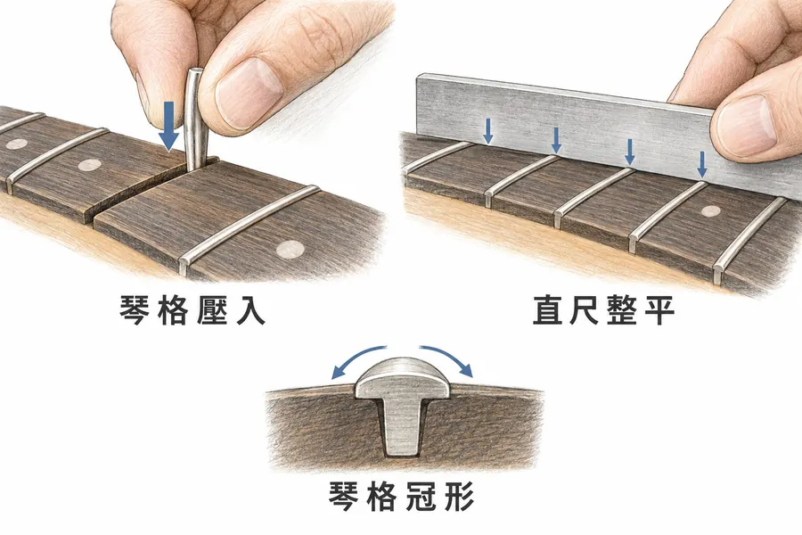

*Figure 10.9: Fret installation and levelling (schematic).*

The difference in fret count between historical tutors and modern instruments also reminds us of one thing:

**The number of frets, and the quality of making, also affect what repertoire can be played.**

Munier's 1891 tutor describes the mandolin neck and fingerboard of its time and the first-position system.

Modern concert mandolins push the demand for the high positions much further. 〔S717〕〔S711〕

| **Key point and application** | **Content** |
|----|----|
| Core concept | Under twelve-tone equal temperament, fret positions shorten the scale length by a fixed ratio. |
| Relations and conditions | The goal of fret leveling is to establish one consistent, usable plane under the intended neck relief and string path. |
| Where it is applied | Understanding the making process and the structure. |

## 10.10 Inlay, decoration and pickguard

**Binding** and **purfling** are often treated as decoration.

But they also **protect the edges of the plates, cover the seams and form a visual reference**.

The traditional bowlback **pickguard (scudo)** is there to stop the pick and the hand rubbing directly against the soft spruce top.

The mother-of-pearl, tortoiseshell and metal inlay of the Vinaccia 1781 is very elaborate.

This proves that the decoration of high-class historical instruments also carries **social status and craft value**. 〔S701〕

But decoration is not "completely without effect on the sound".

Heavy **inlay**, a large pickguard or excess glue all change local mass and stiffness.

The effect may be very small, or on a thin top large enough to measure.

Professional making brings decoration into the structure and **assesses the weight and the position of the decoration in advance**.

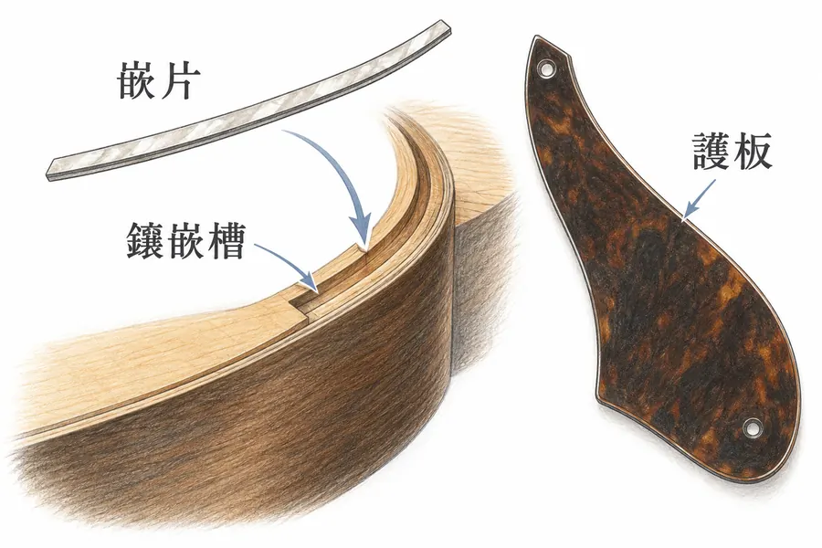

*Figure 10.10: Inlay, decoration and pickguard (schematic).*

Modern conservation also has to consider material ethics and regulation.

Using **ivory**, **tortoiseshell** and the like in history does not mean the original materials should be copied today.

Modern repair and reproduction often use substitute materials, and record them clearly in the documentation.

| **Key point and application** | **Content** |
|----|----|
| Core concept | Binding and purfling are often treated as decoration, but they also protect the edges of the plates, cover the seams and form a visual reference. |
| Relations and conditions | But decoration is not "completely without effect on the sound". |
| Where it is applied | Understanding the making process and the structure. |

## 10.11 Finish and surface protection

Finish has four direct functions:

- protect the surface
- control dirt
- control the rate of moisture exchange
- provide the look and the feel

The common finishes each differ in how they are applied, how they are repaired and how durable they are:

| Finish | Chinese | Notes |
|---|---|---|
| shellac / French polish | 蟲膠／法式拋光 | application and repair characteristics differ |
| nitrocellulose lacquer | 硝化纖維素漆 | application and repair characteristics differ |
| the various modern varnishes | 現代清漆 | application and repair characteristics differ |

Reducing finish to "thin is loud, thick is muffled" is not sufficient.

Because **formulation, curing, thickness and substrate** all change the result.

On a thin soundboard the coating really does add mass and change surface damping.

So in theory it affects vibration.

But on a finished instrument this effect is **mixed together** with the top thickness, the bracing, the bridge, the strings and other factors, and it is hard to predict from a brand name.

The most reliable principle is still: **the right amount, evenly applied, matched to the design**.

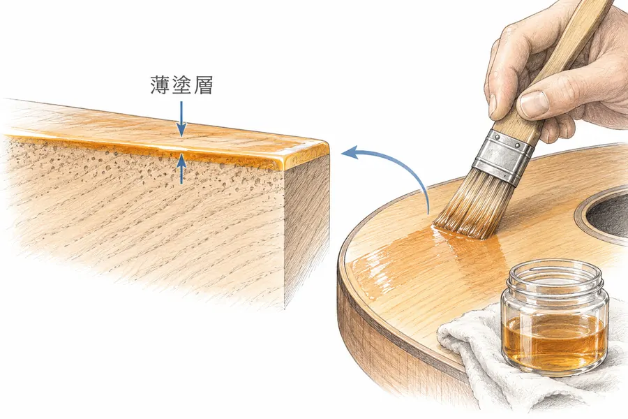

*Figure 10.11: Finish and surface protection (schematic).*

**Refinishing** an old instrument is another question.

Sanding off the original finish can remove wood, edges and historical information at the same time.

Too thick a new coat also changes the appearance and the material.

When judging collector value, **confirm first how original the instrument is and what repairs are recorded**, and only then assess the look of the finish.

| **Key point and application** | **Content** |
|----|----|
| Core concept | The direct functions of finish are to protect the surface, control dirt, control the rate of moisture exchange, and provide the look and the feel. |
| Relations and conditions | On a thin soundboard the coating really does add mass and change surface damping, so in theory it affects vibration. |
| Where it is applied | Understanding the making process and the structure. |

## 10.12 Final setup and adjustment

Once a newly finished instrument is strung up, string tension puts the whole geometry back under load.

The maker needs to check these items:

- neck relief
- nut slots
- bridge height
- bridge location
- intonation
- fret buzz

**These steps are part of making.**

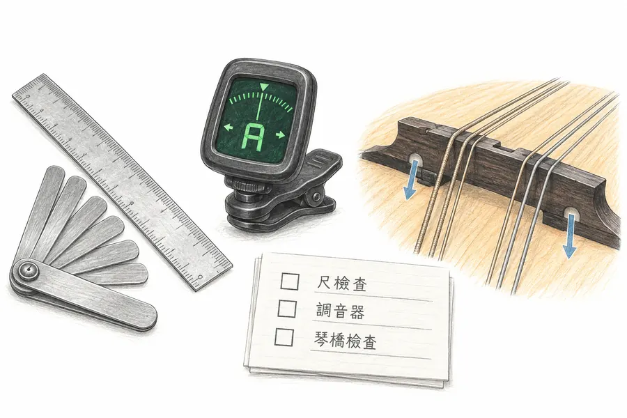

*Figure 10.12: Final setup and adjustment (schematic).*

A **floating bridge** especially has to be positioned under real string tension.

The sequence is:

1. Establish the initial position from the scale length.
2. Then compensate by the twelfth-fret method and others.
3. At the same time confirm that the bridge feet fit the top completely.

If the bridge has to be skewed to an extreme angle before it is barely in tune, you should go back and check these:

- the nut
- the fret scale
- the string gauge
- the overall geometry

Find the real source of the intonation error.

Truly mature **final QC** also plays the instrument at different dynamics.

Because some problems only show up in actual playing:

| What to check | What to listen for |
|---|---|
| bass course | does it buzz |
| tremolo | are the two strings in step |
| chord | is the low position sharp |
| after tuning | do the tuners or the mechanism slip back |

| **Key point and application** | **Content** |
|----|----|
| Core concept | Once a newly finished instrument is strung up, string tension puts the whole geometry back under load. |
| Relations and conditions | A floating bridge especially has to be positioned under real string tension. |
| Where it is applied | Understanding the making process and the structure. |

## 10.13 Case study: copying the Filano historical instrument

The research copy of the 1784 Filano is a very good case study in the science of instrument making.

The researchers' sequence was:

1. First take **non-destructive acoustic measurements** of the original.
2. Then build a **finite element model**.

Because they knew: **copying the dimensions and the species is not enough to guarantee the same sound**.

The mechanical properties of natural wood change.

Historical gluing, ageing and the tiny geometry of the original cannot be fully rebuilt either. 〔S706〕

The goal of a scientific copy can be set out clearly:

It **can** rebuild the type, the dimensions, the type of material and the observable craft, and treat the acoustic response as one of the calibration targets.

But **a copy is still a new individual**.

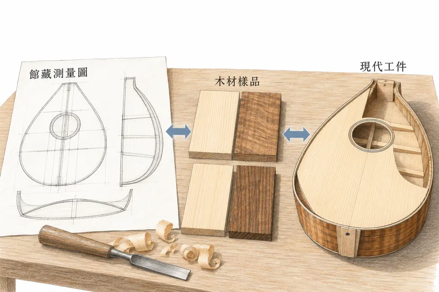

*Figure 10.13: Case study: copying the Filano historical instrument (schematic).*

It is the same for ordinary making.

The drawing is the starting point.

The real craft lies in **how to bring this particular board to the design goal**.

That is the part of hand making that copying to dimensions cannot replace.

## Table 10-1 | The three main body methods, each with a different focus

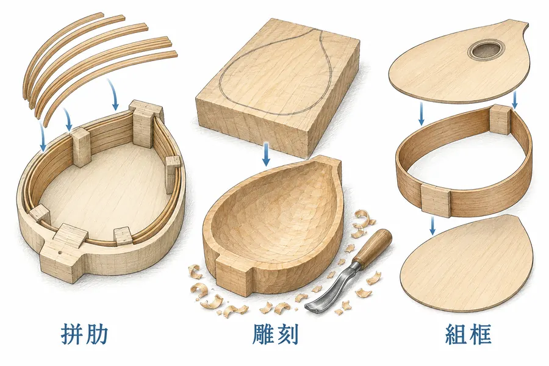

| **Type** | **Main way of forming** | **Most critical geometry** | **Typical risk** |
|----|----|----|----|
| **Bowl-back** | ribs joined one by one on a mold | symmetry of the bowl, the bend of the top, the neck axis | accumulated error at the seams, open seams |
| **Carved-top/back** | arching and graduation carved from a thick board | arching, thickness distribution, bridge plane | too thick or too thin, fitting of the bridge feet |
| **Flat-back/top** | sides bent, plus blocks and linings, plus the plates | rim plane, bracing, neck angle | sides deforming, unbalanced bracing |

*Table 10-1: The three main body methods, each with a different focus (schematic).*

| **【Craft principle】 The real order of making is: fix the geometry and the use → choose the wood → build the body structure → neck and fingerboard → fretwork → surface and decoration → final setup after stringing. "The woodwork is finished" does not mean the instrument is finished.** |
|----|

| **【Historical case】 Orville Gibson's original 1898 design stressed carved construction and fewer traditional internal parts; the 1784 Filano research shows how a modern historical copy brings acoustic measurement into the craft. A hundred and more years apart, both are answering "how do we make the structure work more effectively".** |
|----|

## Self-study question bank

*Figure: Learning check — answer, check, review*

Answer the questions yourself first, then look at the answers. When you get one wrong, go back to the relevant section of this chapter and read it again.

**1. Which of these is an important step in making a bowl-back?**

- A. Joining the ribs one by one on a mold

- B. Pressing it from a single piece of plastic

- C. Doing away with the soundboard

- D. Assembling it with screws only

**2. What is the main goal of fret leveling?**

- A. Making every fret look equally bright

- B. Establishing one consistent, usable plane for the strings

- C. Changing the angle of the headstock

- D. Adding weight to the body

**3. How should final setup be regarded?**

- A. As part of the making process

- B. As completely unrelated

- C. As the buyer's job only

- D. As something only old instruments need

**Answers: 1.A 2.B 3.A**

## Main sources checked for this chapter

*Figure: Sources checked — find the original, check the conditions, keep a record*

**【S701】The Metropolitan Museum of Art: Mandolin, Antonius Vinaccia, Naples, 1781 (Met 89.4.2140).** Object data: Neapolitan bowlback, 23 ribs in the bowl, bent soundboard, eight strings in four courses, 13 frets.

https://www.metmuseum.org/art/collection/search/504543

**【S702】The Metropolitan Museum of Art: Mandolin, Orville Gibson, 1898 (Met 2015.643a–c).** Object data: carved spruce top, carved walnut back, floating bridge, tailpiece, 18 frets, hollow neck.

https://www.metmuseum.org/art/collection/search/700485

**【S703】United States Patent Office / Google Patents: US598245A – Mandolin, Orville H. Gibson (patented 1898-02-01).** Gibson's original patent for an integrated rim/neck/head, a carved top and back, and fewer traditional internal supports.

https://patents.google.com/patent/US598245A/en

**【S705】Quintavalla et al.: The Acoustics of Traditional Italian Mandolins and Their Relation with Soundboard Wood Properties (International Journal of Wood Culture 2, 2022).** A study of bridge admittance, sound radiation, modes and soundboard wood in historical and modern Italian mandolins.

https://www.sciencedirect.com/org/science/article/pii/S2772318622000017

**【S706】Quintavalla et al.: Acoustical Survey and Finite Element Analyses of Late Baroque Mandolin (International Journal of Wood Culture 4(1), 2024).** Acoustic measurement, finite element analysis and a copy of the 1784 Joseph Filano mandolin.

https://www.sciencedirect.com/org/science/article/pii/S2772318624000018

**【S707】USDA Forest Products Laboratory: Wood Handbook—Wood as an Engineering Material (FPL-GTR-282, revised 2021).** The basis of wood structure, physical properties, mechanical properties, drying, gluing and materials engineering.

https://research.fs.usda.gov/fpl/wood-handbook

**【S708】Glass & Zelinka, USDA Forest Products Laboratory: Moisture relations and physical properties of wood (Wood Handbook Chapter 4, 2021).** Official technical data on moisture uptake, equilibrium moisture content, shrinkage and swelling, and dimensional stability.

https://research.fs.usda.gov/treesearch/62243

**【S711】Liuteria Calace: Mandolini – official specifications (accessed 2026-10-06).** Current specifications including a 33.5 cm scale length, 24/29 frets, 25/31/33 ribs, spruce top and rosewood/maple body.

https://www.calace.it/en/mandolini

**【S712】Liuteria Calace: Mandole – official specifications (accessed 2026-10-06).** A 43.2 cm scale (45.6 cm on some models), G- and C-tuned mandolas, 25/33 ribs and material choices.

https://calace.it/en/mandole

**【S713】Liuteria Calace: Mandoloncelli & Liuti – official specifications (accessed 2026-10-06).** A 61 cm scale, 8/10 strings, 25/41 ribs, different body sizes and material choices.

https://calace.it/en-mandoloncelli-liuti

**【S714】Suzuki Music / Suzuki Violin: 2017 String Instrument Catalog (2017).** Scale length, woods and specifications of the M-30, M-100, MD-4, MD-10 and MC-836.

https://www.suzuki-music.co.jp/app/uploads/2017catalog14.pdf

**【S719】The Metropolitan Museum of Art: Gibson F-2, F-4, A-4 and H-2/H-4 instruments (1916–1919 collection records).** Comparison of early Gibson A/F/H carved construction, fret count, neck and fingerboard materials and floating bridges.

https://www.metmuseum.org/art/collection/search/506859

**【S720】The Metropolitan Museum of Art: Archtop Guitars and Mandolins (Met Heilbrunn Timeline essay).** Orville Gibson's carved archtop system and its influence on American instrument making.

https://www.metmuseum.org/essays/archtop-guitars-and-mandolins

**【S722】The Metropolitan Museum of Art: Mandolin, 1781 – Guitar Heroes (exhibition essay).** Background on the Neapolitan bend that adds structural strength, the four double courses, violin-style tuning and the use of the pick.

https://blog.metmuseum.org/guitarheroes/mandolin-1781/

**【S723】USDA Forest Products Laboratory: Drying and control of moisture content and dimensional changes (technical report / Wood Handbook).** Drying, equilibrium moisture content and the control of dimensional change.

https://research.fs.usda.gov/treesearch/37419

---
