# Chapter 11: Strings, Tuning and Playing Setup

*Strings and Setup: Tension, Action, Relief, Bridge Position and Intonation*

## Key points of this chapter

- **Setup** is the process of bringing a wooden structure and one particular string set to a playable state. It is part of making.
- When the scale length grows, tension rises with the **square**: take 33.5 cm out to 43.2 cm and the theoretical tension is about 1.66 times as much.
- Changing strings can shift the bridge, so **intonation** must always be checked again afterwards.
- The order of diagnosis is: **confirm the symptom first → then find the source → and only then make the smallest adjustment**.
- The same word "buzz", when it happens on an open string, at one fret, or under hard playing, has completely different causes.

---

Many players do not face setup seriously for the first time until the instrument starts buzzing, the intonation drifts, or their hands start to hurt.

**Setup** is the process of bringing a wooden structure and a particular string set to a playable state.

The items it touches affect one another:

- string gauge
- scale length
- tension
- nut
- neck relief
- bridge height and position

Change any one of them and the others may have to find a new balance.

A mandolin also has one more layer of trouble that a single-strung instrument does not: the **course**.

The two strings of one course must have a consistent height, spacing and feel under the fingers.

And the bridge is usually **floating**, so changing strings or knocking the instrument can move it.

Across the family, scale length runs from the 33 cm class all the way to the 61 cm class.

So **you cannot simply scale up the string sets and setup logic of a standard mandolin unchanged** (setup is covered in chapter 11).

This chapter teaches you to diagnose step by step from "symptom" and "structure":

1. Confirm the symptom first.
2. Then judge the likely source.
3. Only then make the smallest adjustment.

That sequence is safer than memorising standard numbers.

## 11.1 String material, gauge and tension

As soon as strings are brought up to pitch they put **continuous tension** on the instrument.

Different **gauges**, **cores**, **windings** and materials change the **unit weight**.

So at the same scale length and the same pitch, they need different tensions. 〔S715〕

Changing strings is not only a change of "timbre". It can also change four things:

- neck relief
- the feel of the action
- the load on the bridge
- the pressure on the left hand

The standard mandolin's string set divides up like this:

| Course | Usual practice | Why |
|---|---|---|
| G / D course | wound strings | enough linear density is needed |
| A / E course | thinner steel strings will do | that much mass is not needed |

> **Common misconception: "the same G string marking and the same gauge means the same tension."**
> Not necessarily. Different brands use different winding ratios and core designs.
> So two sets marked with the same gauge can still differ slightly in actual unit weight and tension.
> If you want to compare precisely, look at the **tension data** and compare gauge and tension together.

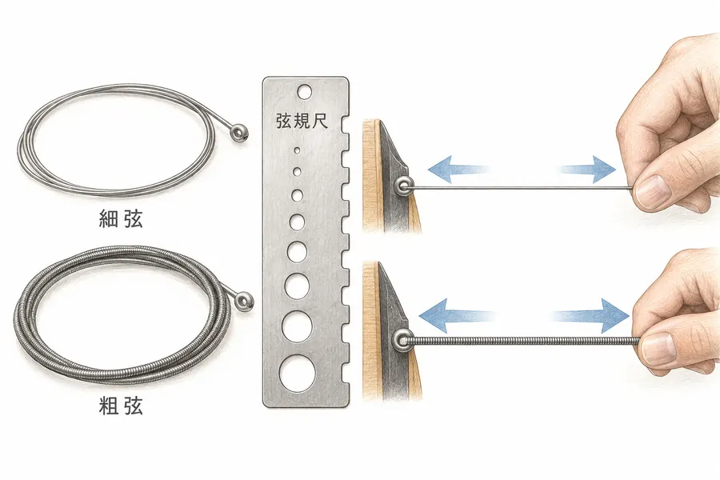

*Figure 11.1: String material, gauge and tension (schematic).*

Old instruments especially need care.

A historical instrument may have been built for lower tension, different materials, or a different **pitch standard**.

Putting modern heavy strings on it straight away is not necessarily safe.

If you are unsure of the structural condition, have it assessed first by a maker who knows that type.

| **Key point and application** | **Content** |
|----|----|
| Core concept | As soon as strings are brought up to pitch they put continuous tension on the instrument. |
| Relations and conditions | The G/D courses of a standard mandolin usually need wound strings to reach enough linear density, while the A/E courses can use thinner steel. |
| Where it is applied | Checking the feel, the intonation and the setup. |

When beginners buy strings, they should check four things first: **the body type, the scale length, the maker's recommended gauge, and the tension**.

The Shimamura guide points out that bowlback instruments and American-style instruments each have their own usual string specifications.

When choosing, go by **the instrument the strings are for and the maker's data**. 〔N01〕

There are two practical steps:

1. Photograph the old string packets and keep them, noting the brand, the model and the specifications of all four courses.
2. Ask the shop, "will this set suit my body type and scale length?"

That gets you a suitable product far more reliably than saying "I want mandolin strings".

For how to change strings, see 11.3 and 21.8.

## 11.2 The relation between scale length and tension

D'Addario's engineering formula shows one thing:

With **unit weight** and **frequency** held the same, **tension is proportional to the square of the scale length**.

So take a 33.5 cm mandolin scale out to 43.2 cm, with everything else unchanged, and the tension theoretically becomes about **1.66 times** as much.

At 61 cm it becomes **more than 3 times**.

Real mandolas and mandoloncello do not do that, of course.

They do three things at once: **lower the pitch, change the gauge, change the winding**.

The aim is to bring the tension back into a range that is both playable and structurally safe. 〔S715〕

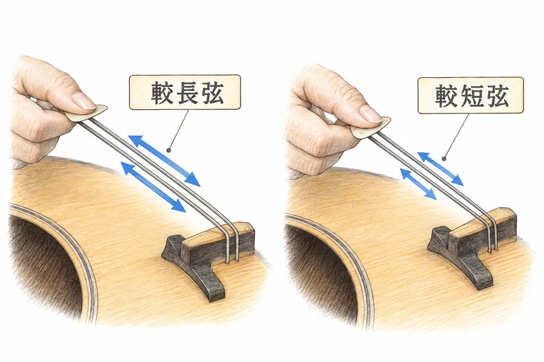

*Figure 11.2: The relation between scale length and tension (schematic).*

Calace's current range provides a clear family comparison:

| Instrument | Calace scale length |
|---|---|
| mandolin | 33.5 cm |
| mandola | 43.2 cm (45.6 cm on some models) |
| mandoloncello (mandocello) | 61 cm |

The Suzuki 2017 numbers are:

| Model | Scale length |
|---|---|
| M-30 | 336 mm |
| MD-4 | 426 mm |
| MC-836 | 574 mm |

〔S711〕〔S712〕〔S713〕〔S714〕

Even the scale lengths of the large family members are not identical between the two firms.

So "mandolin-family strings" also have to match **the actual scale length and tuning**.

This also explains why a **capo**, a lowered tuning or an **alternative tuning** changes the feel.

Change the frequency and the tension changes with it, by the square relation.

When a player feels that "dropping a semitone suddenly made it very soft", that is not imagination.

| **Key point and application** | **Content** |
|----|----|
| Core concept | D'Addario's engineering formula shows that with unit weight and frequency held the same, tension is proportional to the square of the scale length. |
| Relations and conditions | Real mandolas and mandoloncello do lower the pitch, change the gauge and change the winding at the same time, to bring tension back into a range that is playable and structurally safe. |
| Where it is applied | Checking the feel, the intonation and the setup. |

## 11.3 Checks before and after changing strings

Most acoustic mandolins use a **floating bridge**.

Take all eight strings off at once and the bridge loses all string pressure.

It is very easy for it to shift while you are cleaning.

Once the strings are back on, even if the position looks about right, a difference of a few millimetres front to back can throw the intonation at fret 12 noticeably off.

So everyday string changes use one of two methods:

1. **Change one course at a time** (take off only one group).
2. Record the bridge position with a **low-tack method** before removing the strings.

But any mark can only be an **initial reference**.

In the end the intonation still has to be checked again.

The bridge may need a slight adjustment in a different season or with a different string set.

**A historical position cannot be treated as a sacred coordinate.**

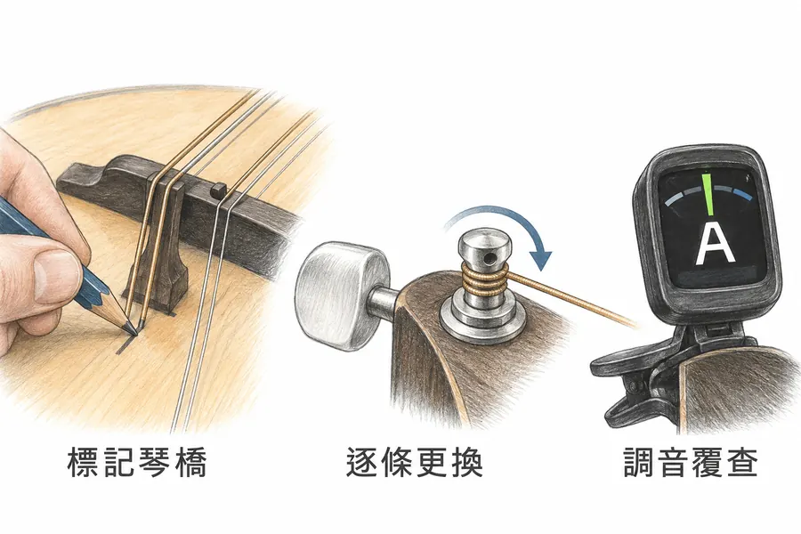

*Figure 11.3: Checks before and after changing strings (schematic).*

You also have to confirm that the bridge feet have not lifted as a result of the shift.

The feet of a bridge on a **carved top** are usually **fitted to one particular curvature**.

If the bridge is moved too far front or back, the soles of the feet and the curvature of the top may no longer fit completely.

| **Key point and application** | **Content** |
|----|----|
| Core concept | Most acoustic mandolins use a floating bridge. |
| Relations and conditions | So an everyday string change can be done one course at a time, or the bridge position recorded with a low-tack method before the strings come off. |
| Where it is applied | Checking the feel, the intonation and the setup. |

## 11.4 Nut slots

Here is a very practical diagnostic exercise.

**Situation**: the open strings are in tune, but the fretted notes at fret 1 and fret 2 are generally sharp.

**Check first**: the height of the **nut slot**.

**Reason**: the string sits too high above the fret, so pressing it down stretches it further.

This effect is proportionally largest in the low positions.

By fret 12 it may not be anything like as bad.

> **Common misconception: "if the low positions are sharp, move the bridge back."**
> That is usually not the best solution.
> Moving the bridge back can bring the average down across the whole fingerboard, but it **sacrifices the middle and high positions**.
> The real root cause may still be the nut.

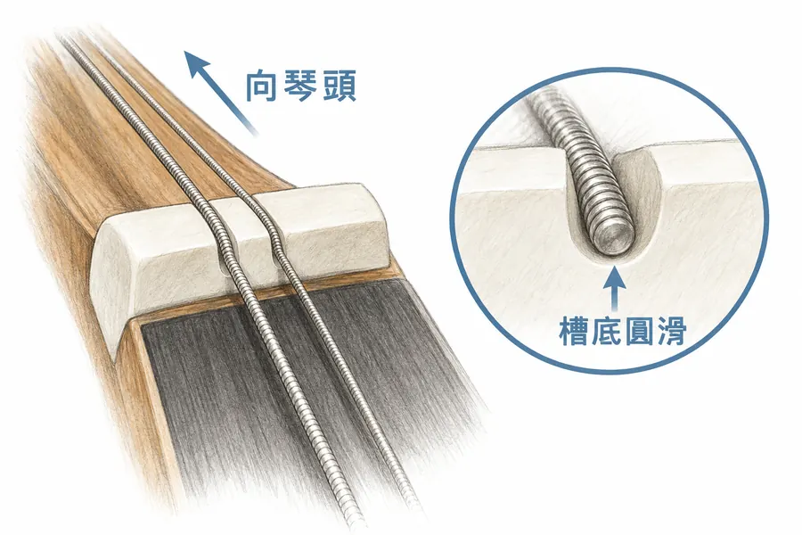

*Figure 11.4: Nut slots (schematic).*

The slot width also has to match the **string gauge**.

| Slot width | Consequence |
|---|---|
| too narrow | the string binds, and tuning jumps |
| too wide | **lateral rattle** may appear |

On a double course, the two slots are best kept **consistent in pairs**, in height and in spacing.

Otherwise the two strings of one course will feel different under the fingers.

| **Key point and application** | **Content** |
|----|----|
| Core concept | If the open strings are in tune but frets 1 and 2 are generally sharp, the first thing to check is the height of the nut slot. |
| Relations and conditions | This is also a good diagnostic example: if the low positions are sharp and fret 12 is roughly right, moving the bridge is usually not the best solution. |
| Where it is applied | Checking the feel, the intonation and the setup. |

## 11.5 String height and playing feel

**Action** means the height of the strings above the fingerboard and the frets.

A low action really does save the left hand effort.

But a vibrating string needs room.

The harder you play and the thicker the bass string, the more **clearance** is usually needed.

Squeeze the action down very low and it may be perfect when you play softly.

But the moment you move into **forte**, **chop** chords or a hard tremolo, it starts to buzz.

The action also cannot be settled by measuring one fret.

It is a **string path** formed by four things together:

- nut action
- neck relief
- bridge height
- fret plane

So when diagnosing, **compare the string height in each position** to understand the whole path.

| Symptom | Likely direction |
|---|---|
| high in the first position, high at fret 12 too | the whole string path is too high |
| normal in the first position, high only in the upper positions | the problem is concentrated in the rear section |

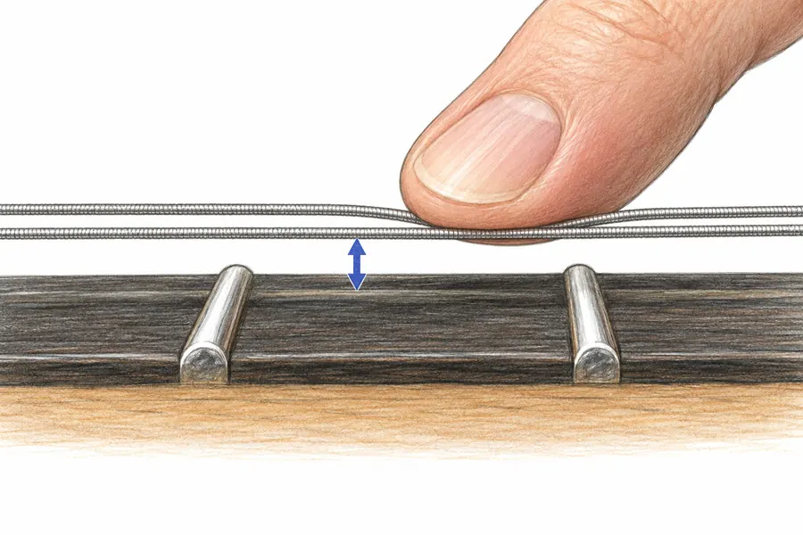

*Figure 11.5: String height and playing feel (schematic).*

Different styles also have different preferences:

| Style | Usual need |
|---|---|
| classical | an even tremolo and a delicate left hand |
| bluegrass | often more **attack** and chop chords |

The point of this section is: **"playing input" should also be part of the setup goal**.

| **Key point and application** | **Content** |
|----|----|
| Core concept | A low action really does save the left hand effort, but a vibrating string needs room to move. |
| Relations and conditions | The action also cannot be settled by measuring one fret. |
| Where it is applied | Checking the feel, the intonation and the setup. |

## 11.6 Neck relief

A vibrating string needs enough room to move.

A very slight **forward relief** left in the neck provides clearance in the low to middle positions.

A neck that is completely **back-bowed** buzzes easily in the first few frets.

But relief cannot be used to patch up every case of high action either.

| Problem | Effect of adjusting the relief |
|---|---|
| too much relief | makes the middle positions hard to press, and does not necessarily fix the upper ones |
| the neck angle itself is wrong | adjusting the relief only changes the curve temporarily |

On a historical bowlback with no **truss rod**, the judgement has to come from the condition of the neck as a whole.

The treatment has to be decided from the actual structure of that instrument.

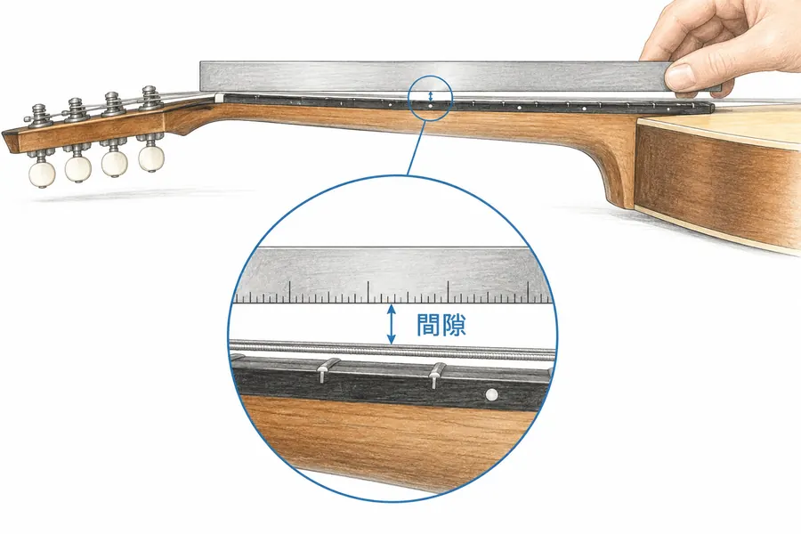

*Figure 11.6: Neck relief (schematic).*

There is a simple way to check relief: **use the string itself as a straight edge**.

Hold down one course at both ends, or at particular frets, and look at the clearance in the middle.

What matters is **comparing the trend**, and **whether the left and right sides agree**.

Then judge whether that gap suits the body type and the playing needs.

| **Key point and application** | **Content** |
|----|----|
| Core concept | A vibrating string needs enough room to move. |
| Relations and conditions | But relief cannot be used to patch up every case of high action. |
| Where it is applied | Checking the feel, the intonation and the setup. |

## 11.7 Positioning the floating bridge

In theory fret 12 should sit at **the midpoint of the vibrating scale length**.

So the distance from the nut to fret 12 is about half the scale length.

Extend the same distance to the bridge and you have the **initial position**.

But a real string is stretched when it is pressed.

So the bridge usually still needs **compensation**.

The working sequence is:

1. Put the bridge on a reasonable centerline.
2. Tune the open strings.
3. Compare the **harmonic at fret 12** with the **fretted note**.

Read the result like this:

| Result of the comparison | What is usually needed |
|---|---|
| the fretted note is sharp | that string needs a **longer** vibrating length |
| the fretted note is flat | the opposite direction |

But the four courses need different amounts of compensation.

So a **compensated saddle / bridge** puts the contact point slightly differently for each string.

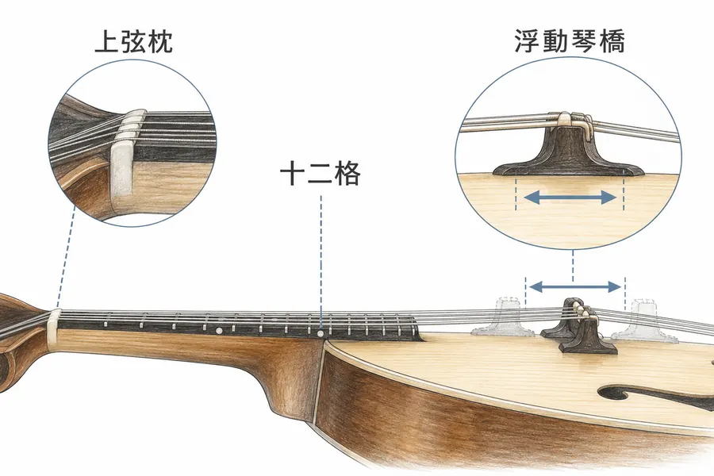

*Figure 11.7: Positioning the floating bridge (schematic).*

If the bridge has to be tilted to a very extreme angle before it is barely in tune, stop.

Go back and check these factors:

- scale length and fret position
- nut action
- string gauge
- fret wear
- whether the bridge has been put on **backwards**

The principles of setting up an instrument are two: **find the cause**, and **keep some adjustment in reserve**.

| **Key point and application** | **Content** |
|----|----|
| Core concept | In theory fret 12 sits at the midpoint of the vibrating scale length, so the distance from the nut to fret 12 is about half the scale. |
| Relations and conditions | The procedure is to put the bridge on a reasonable centerline, tune the open strings, then compare the harmonic at fret 12 with the fretted note. |
| Where it is applied | Checking the feel, the intonation and the setup. |

## 11.8 Compensating and checking intonation

Tuning the open strings only corrects **four open pitches**.

The moment you press a string, both the length and the tension change.

So intonation is also affected by these factors:

- action
- the force of the fingers
- fret positions
- compensation

That is the core of **intonation**:

**making the notes you actually play reasonable across the whole fingerboard.**

Fret 12 is the most used check point, because in theory it is exactly **an octave**.

But you should not look only at fret 12.

| Your main use | Where to check |
|---|---|
| low-position chords | frets 1–5 |
| high-position solo | fret 12 and above |

Perfect at every fret is almost impossible.

The goal of setup is to **spread the error to a degree the music can accept**.

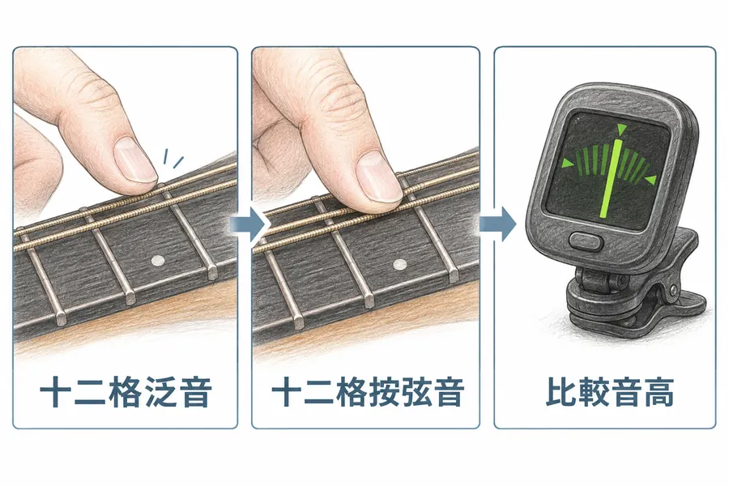

*Figure 11.8: Compensating and checking intonation (schematic).*

> **Common misconception: "press harder when you measure intonation and it will be more accurate."**
> The opposite. The force of the fingers affects the measurement too.
> If you measure intonation with more force than you normally play with, you push the note sharp.
> The bridge position you end up with may then be wrong for real playing.
> Use your **normal touch**, and **repeat the measurement several times**.

| **Key point and application** | **Content** |
|----|----|
| Core concept | Tuning the open strings only corrects four open pitches. |
| Relations and conditions | Fret 12 is the most used check point because in theory it is exactly an octave, but you should not look only at fret 12. |
| Where it is applied | Checking the feel, the intonation and the setup. |

## 11.9 Diagnosing buzz and other noises

**Buzz** has more sources than you would think.

It can come from **contact with a fret**, and it can also come from:

- the tailpiece
- a loose **tuner**
- the bridge saddle
- the pickguard
- the end of a string
- even a **loose brace** inside the body

The first step is to establish three things: **at which notes, at what dynamic, on which course** it appears.

Record the symptom first, then decide what to adjust.

| Symptom | Likely direction |
|---|---|
| only the open strings buzz | nut slots, the string ends or the hardware |
| buzzing from a certain fret onwards, all the way up | a high fret or the neck relief |
| all strings buzz together under hard playing | the action is too low |
| one particular note rings metallic on any string | hardware resonating |

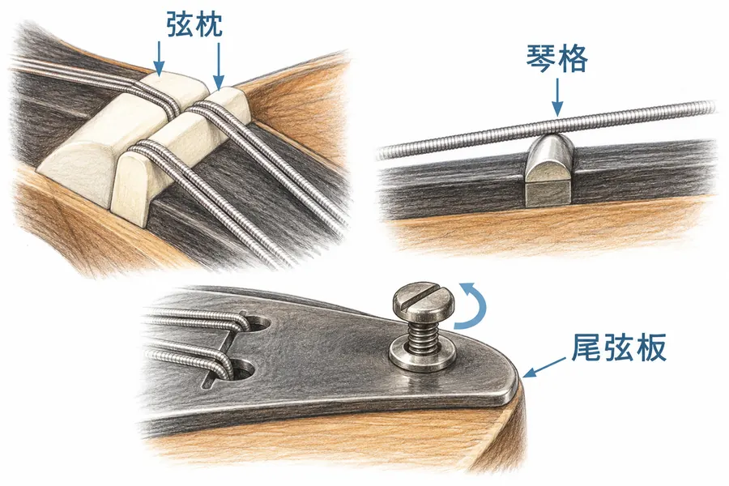

*Figure 11.9: Diagnosing buzz and other noises (schematic).*

A **symptom map** like this cuts down a great deal of "adjusting the wrong thing".

> **Common misconception: "if there is a noise, raise the bridge."**
> Raising the bridge may hide a fret problem.
> But it makes the whole instrument feel worse to play.
> In the same way, filing one fret lower may quieten it in the short term while damaging the overall levelness.

| **Key point and application** | **Content** |
|----|----|
| Core concept | Buzz can come from fret contact, and it can also come from the tailpiece, a loose tuner, the bridge saddle, the pickguard, the end of a string, even a loose brace inside the body. |
| Relations and conditions | If only the open strings buzz, the usual directions are the nut slots, the string ends or the hardware. |
| Where it is applied | Checking the feel, the intonation and the setup. |

## 11.10 Changing gauge and special tunings

Changing the gauge changes the whole balance.

| Change | Knock-on effect |
|---|---|
| heavier strings | total tension rises, which may increase neck relief and raise the action |
| lighter strings | the relief may shrink, and an instrument that did not buzz starts to |

Whether these changes are obvious depends on four things:

- the stiffness of the neck
- whether there is a truss rod
- the structure of the body
- the setup it already had

**Alternative tunings** work the same way.

Tuning the whole instrument down a semitone lowers the tension.

Some **scordatura** tunings change only one or two courses, which makes the load on the four groups of strings **asymmetrical**.

If historical repertoire calls for a special tuning, confirm two things first: **whether the string set and the body are suited to it**.

Then choose a set that matches the target pitch and tension.

The notation guide of the **Classical Mandolin Society of America (CMSA)** also notes that scordatura exceptions exist across the mandolin family. 〔S716〕

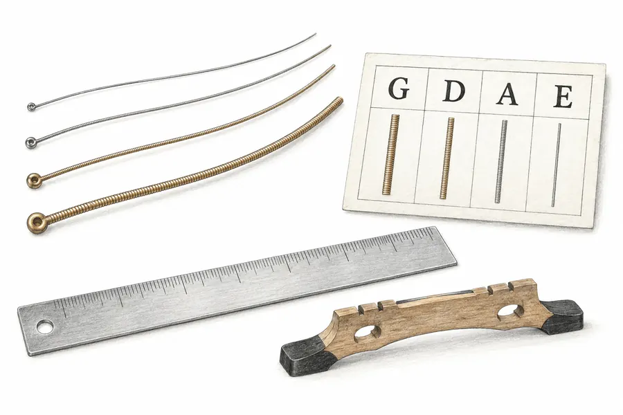

*Figure 11.10: Changing gauge and special tunings (schematic).*

The large family members must certainly not be mixed up.

Calace's mandola comes in both **G-tuned and C-tuned** versions, with a 43.2 cm scale.

Those two tunings need **their own string sets**.

You cannot decide safely what strings to fit just by looking at the shape of the instrument. 〔S712〕

| **Key point and application** | **Content** |
|----|----|
| Core concept | Heavier strings may raise the total tension, increasing neck relief and raising the action. |
| Relations and conditions | Alternative tunings work the same way. |
| Where it is applied | Checking the feel, the intonation and the setup. |

## 11.11 Case study: handling three setup problems

| Case | Symptom | Check first | Do not do first |
|---|---|---|---|
| One | the open strings are in tune, the first few frets are generally sharp, fret 12 is acceptable | the nut height, then the finger force | move the bridge first |
| Two | fret 12 is sharp on every string, the low positions slightly sharp as well, and the bridge has been taken off at some point | reset the bridge position, then check the nut | — |
| Three | the action is high and the bridge is already as low as it goes | the neck angle, deformation of the top, the fret plane | keep shaving the bridge |

In case three, the structural problem has to be confirmed before the repair method is decided.

There are two more cases:

| Case | Symptom | Likely direction |
|---|---|---|
| Four | only the open E course buzzes; the buzz disappears once you fret the first fret | the nut slot for the E strings is too low, or there is a problem at the open-string end point |
| Five | it buzzes only under hard playing and is completely normal when played softly | the action does not match the playing input; not necessarily a making fault |

In case four, note this: only if **all** the open strings buzz do you need to consider the nut as a whole or the hardware.

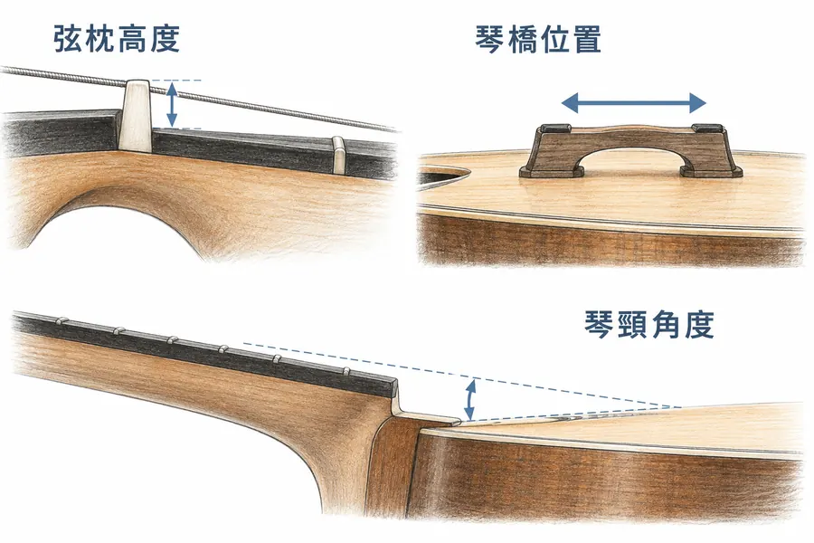

*Figure 11.11: Case study: handling three setup problems (schematic).*

The common principle across these cases is: **where the symptom is matters more than what the symptom is called.**

The same word, buzz, means different likely causes when it happens on an open string, at a single fret, across all the upper positions, or on one particular pitch.

**Get the diagnosis right and the adjustment has a direction.**

## Table 11-1 | Symptom-led setup diagnosis

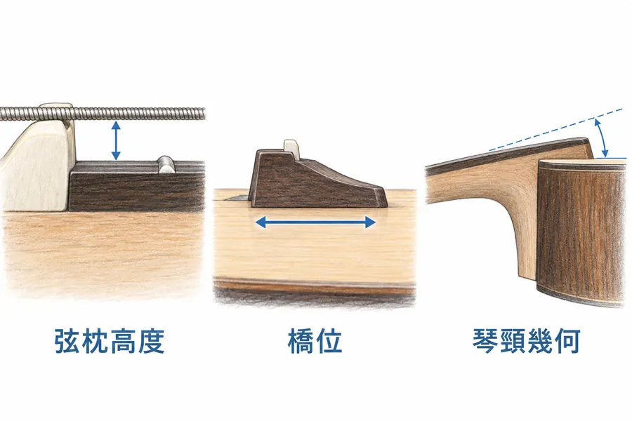

| **Symptom** | **Check first** | **What not to do first** |
|----|----|----|
| **the low positions are generally sharp** | the height of the nut slot, the finger force | move the bridge a long way first |
| **fret 12 is generally sharp** | bridge location, scale length, string gauge | file the frets |
| **the action is high and the bridge is already down** | neck angle, top geometry | keep shaving the bridge |
| **only the open strings buzz** | nut slots, the string ends or hardware | raise the action overall |
| **it buzzes only under hard playing** | the playing amplitude, the action, the relief | refret or level every fret |

*Table 11-1: Symptom-led setup diagnosis (schematic).*

| **【Tension point】 At the same unit weight and the same pitch, tension is proportional to the square of the scale length. Family instruments cannot simply take one string set and "use it scaled up".** |
|----|

| **【Safety line】 Nut slots, fret leveling, neck angle and straightening the neck of an old instrument can all be irreversible or high-risk. Without experience, you can do the measuring yourself; the cutting is better left to a maker.** |
|----|

## Self-study question bank

*Figure: Learning check — answer, check, review*

Answer the questions yourself first, then look at the answers. When you get one wrong, go back to the relevant section of this chapter and read it again.

**1. Action means?**

- A. The height of the strings above the fingerboard and frets

- B. The material of the strings

- C. The length of the body

- D. The thickness of the pick

**2. The open strings are in tune but the upper positions are generally sharp. What should you check first?**

- A. The bridge position and the intonation

- B. The case

- C. The strap

- D. The shape of the soundhole

**3. After changing to strings of a clearly different gauge?**

- A. The setup may need checking again

- B. No adjustment is ever needed

- C. Only the colour changes

- D. The bridge compensates by itself

**Answers: 1.A 2.A 3.A**

## Main sources checked for this chapter

*Figure: Sources checked — find the original, check the conditions, keep a record*

**【S711】Liuteria Calace: Mandolini – official specifications (accessed 2026-10-06).** Current specifications including a 33.5 cm scale length, 24/29 frets, 25/31/33 ribs, spruce top and rosewood/maple body.

https://www.calace.it/en/mandolini

**【S712】Liuteria Calace: Mandole – official specifications (accessed 2026-10-06).** A 43.2 cm scale (45.6 cm on some models), G- and C-tuned mandolas, 25/33 ribs and material choices.

https://calace.it/en/mandole

**【S713】Liuteria Calace: Mandoloncelli & Liuti – official specifications (accessed 2026-10-06).** A 61 cm scale, 8/10 strings, 25/41 ribs, different body sizes and material choices.

https://calace.it/en-mandoloncelli-liuti

**【S714】Suzuki Music / Suzuki Violin: 2017 String Instrument Catalog (2017).** Scale length, woods and specifications of the M-30, M-100, MD-4, MD-10 and MC-836.

https://www.suzuki-music.co.jp/app/uploads/2017catalog14.pdf

**【S715】D'Addario: A Complete Technical Reference for Fretted Instrument String Tensions (technical guide).** The relation and formulas between string tension, unit weight, scale length and frequency.

https://www.daddario.com/globalassets/pdfs/accessories/tension_chart_13934.pdf

**【S716】Robert A. Margo / Classical Mandolin Society of America: Music Notation for Mandolin Family Instruments (v3, 2019).** Standard tunings, clefs, sounding versus transposed notation, and regional differences in naming across the mandolin family.

https://classicalmandolinsociety.org/wp-content/uploads/Music_Notation_for_Mandolin_Family_Instruments_v3.pdf

**【S721】D'Addario: What Is Guitar String Tension? (current resource).** An explanation of how the three variables of unit weight, scale length and frequency affect tension.

https://www.daddario.com/blogs/guitar/all-about-string-tension

Starting from reading music and the fretboard, you practise the two hands, harmony and expression in order, and build a practice method you can keep up.

Reading range: Chapters 12 to 17

---
