# Chapter 12: Reading Music, Theory and the Fretboard

*Notation, Fretboard Logic, Positions, Scales and Transposition*

## Key points of this chapter

- Standard tuning is **G3–D4–A4–E5**, written in the **treble clef** at **sounding pitch**, the same as the violin's open strings.
- Tuning in fifths has one extremely useful rule: **fret 7 = the open string of the next course**.
- **Fret 12 = the octave of the open string**, and it sits at roughly half the vibrating scale length.
- **TAB** tells you "where to press", but not "what note this is, or what key".
- The same note often has several positions on the fretboard; **which one you choose is an arranging decision**, not a single right answer.

---

A mandolin has frets and is tuned in fifths, so finding notes looks easier than on a fretless string instrument.

But where many learners get stuck is not actually "I cannot find the note".

More precisely, it is **being unable to join the staff, the fretboard position, the position and the musical syntax into one map**.

These two ways of learning each have their own blind spot:

| Way of learning | Benefit | What is easily lost |
|---|---|---|
| TAB only | you can play a piece quickly | key, rhythm, voicing, and the ability to transpose |
| memorising staff note names only | you know what each note is called | you have to work out the finger position again every time you see a note |

Carlo Munier's nineteenth-century *Scuola del Mandolino* and Raffaele Calace's method both build the first position, then the later positions and the techniques, into **a system**.

This shows that professional mandolin education very early on learned **reading, position and musical expression together**. 〔S717〕〔S718〕

This chapter starts from the standard G–D–A–E fretboard.

The order is: establish note names and intervals first, then go on to positions, scales, key signatures, transposition and family notation.

The goal is this: **that you still know what the music is doing when there is no TAB.**

## 12.1 The staff and the four courses

Standard mandolin tuning is **G3–D4–A4–E5**.

It normally uses the **treble clef** and **sounding pitch**.

The CMSA (Classical Mandolin Society of America) family notation guide states this very clearly.

Because the open strings are the same as the violin's, many violin parts can be read at pitch directly, without transposing the whole passage. 〔S716〕

The most effective method at the start is to **treat the four open courses as anchors**, then fill in the first position with rising semitones.

The source gives this example:

| String | frets 0–2–4 |
|---|---|
| G string | G–A–B |
| D string | D–E–F♯ |

Gradually tie the notes that commonly appear on the page to finger positions.

This "starting from the strings" method is much faster than counting lines and spaces up from middle C every time.

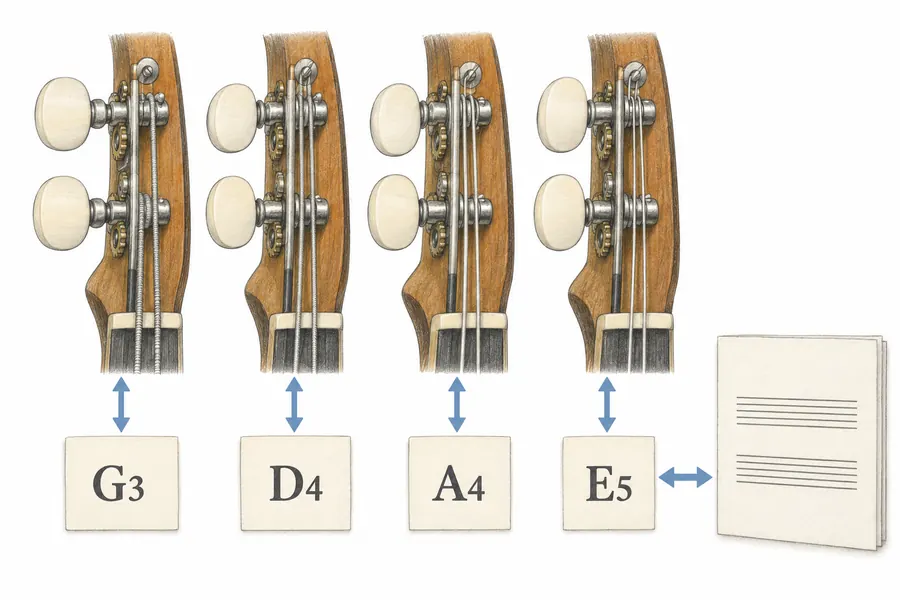

*Figure 12.1: the four double courses in a local position, and the note names of the open strings (schematic).*

Reading also means watching **rhythm** at the same time.

A mandolin's **attack** is very clear.

So a rhythmic mistake is easier to hear than on some long-sustaining instruments.

That is why, when sight-reading, **keep the beat first**.

Even dropping one or two ornaments for the moment is far more practical than "all the notes right and the beat collapsed".

| **Key point and application** | **Content** |
|----|----|
| Core concept | Standard mandolin tuning is G3–D4–A4–E5, usually written in the treble clef at sounding pitch. |
| Relations and conditions | The most effective method at the start is to treat the four open courses as anchors, then fill in the first position with rising semitones. |
| Where it is applied | Reading music and finding positions on the fretboard. |

## 12.2 Reading and using TAB

**TAB** tells you directly which string and which fret to press.

It is very effective for getting started quickly.

But it usually **does not volunteer** three things: the note names, the harmonic function, and the best alternative position.

If a TAB has only numbers and no complete rhythm, the reader may even have to guess the beat from a recording.

The same note often has several positions on a mandolin.

The source gives this example: a certain A can be the **open A** or the **7th fret of the D string**.

TAB picks one of them, and in doing so it decides **the timbre, the string crossings and the position choice** all at once.

The staff gives only the pitch, and the player keeps the room to interpret.

**What advanced playing most needs is exactly that ability to choose.**

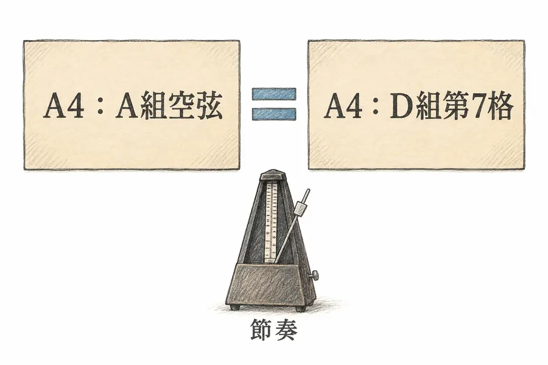

*Figure 12.2: Reading and using TAB (schematic).*

Each notation has its own strength:

| Notation | Strength |
|---|---|
| TAB | shows the fretboard position |
| staff | pitch and phrase information |

Used together, you read both kinds of information at once.

When learning a new piece you can work like this:

1. Use the TAB first to build the feel.
2. Then gradually cover the TAB and read the staff only.
3. In the end you should understand: what key this music is in, and where the harmony is going.

| **Key point and application** | **Content** |
|----|----|
| Core concept | TAB tells you directly which string and which fret to press, and it is very effective for getting started quickly. |
| Relations and conditions | The same note often has several positions on a mandolin. |
| Where it is applied | Reading music and finding positions on the fretboard. |

## 12.3 Twelve-tone equal temperament and fret spacing

**Twelve-tone equal temperament** is simply defined:

Raise the pitch by one **semitone** and multiply the frequency by **2^(1/12)**.

Scale length and frequency are approximately **inversely proportional**.

So the theoretical position of fret n from the nut is:

> **x = L × (1 − 2^(−n/12))**

where L is the vibrating scale length.

Fret 12 is exactly **L/2**.

Because an octave doubles the frequency, so the scale length halves.

Take a **335 mm** scale as an example:

| Fret | Theoretical distance from the nut |
|---|---|
| 1st fret | about 18.8 mm |
| 5th fret | about 84.0 mm |
| 7th fret | about 111.4 mm |
| 12th fret | exactly 167.5 mm (= L/2) |

The further towards the body you go, the shorter the remaining vibrating length.

So the distance between neighbouring frets naturally shrinks.

That is the geometry of equal temperament.

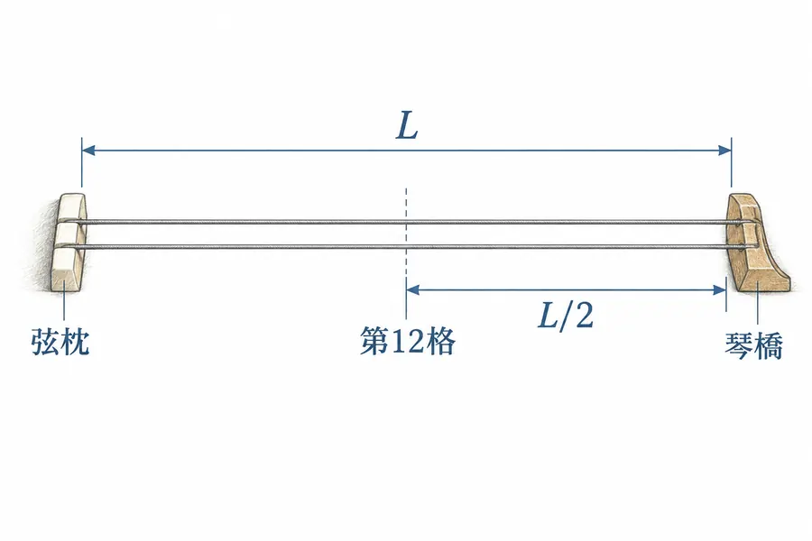

*Figure 12.3: the geometry of halving the ideal scale length, shown on a single course (schematic).*

But working out the correct fret positions is only half the job.

A real string is **stretched** when it is pressed, so bridge compensation still has to correct for it.

If the fret **crown** is too wide, or worn unevenly, the actual sounding point can also drift away from the theoretical line.

**Music theory and setup meet directly at this point.**

| **Key point and application** | **Content** |
|----|----|
| Core concept | In twelve-tone equal temperament, every semitone up multiplies the frequency by 2^(1/12). |
| Relations and conditions | On a 335 mm scale, fret 1 is about 18.8 mm from the nut, fret 5 about 84.0 mm, fret 7 about 111.4 mm, and fret 12 exactly 167.5 mm. |
| Where it is applied | Reading music and finding positions on the fretboard. |

## 12.4 Note names across the fretboard

The great advantage of tuning in fifths is **the stable geometric relation between neighbouring strings**.

| Relation | Content |
|---|---|
| D is the fifth above G | five scale degrees higher |
| A is the fifth above D | five scale degrees higher |
| E is the fifth above A | five scale degrees higher |

Find a note on the G course and its octave, its fifth and other notes of the same name can be found on the other courses through **fixed fret relationships**.

The most immediately useful rule is this:

> **"fret 7 = the next open course"**

| On this string | fret 7 is | which equals |
|---|---|---|
| G course | D | the open string of the next, D |
| D course | A | the open string of the next, A |
| A course | E | the open string of the next, E |

This rule is **the core of fast movement and of visualising across the strings**.

In the other direction, the fifth relation finds you the lower version.

Above the E course there is no next string, so the rule stops there.

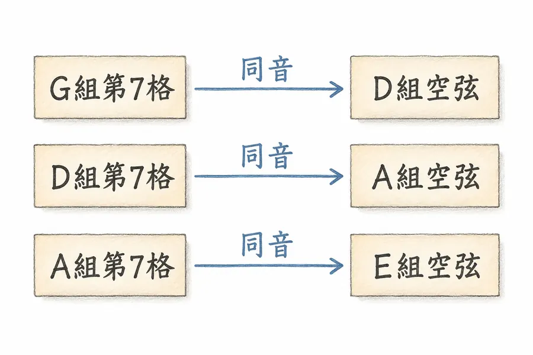

*Figure 12.4: Note names across the fretboard (schematic).*

Fretboard memory should **build landmarks first**:

- the open strings
- frets 5 and 7
- fret 12
- the scale positions of the common key signatures

Once these points become instinct, the remaining semitones can be worked out from **relative position**.

Step by step, they string the whole fretboard map together.

| **Key point and application** | **Content** |
|----|----|
| Core concept | The great advantage of tuning in fifths is the stable geometric relation between neighbouring strings. |
| Relations and conditions | For example, fret 7 of the G course is D, which is exactly the open D of the next string. |
| Where it is applied | Reading music and finding positions on the fretboard. |

## 12.5 Intervals and double stops

**An interval** describes the distance between two notes.

For the mandolin, four intervals matter particularly:

| Interval | Chinese | Why it matters |
|---|---|---|
| perfect fifth | 完全五度 | directly tied to the way the instrument is tuned |
| third | 三度 | decides the colour of **major or minor** |
| sixth | 六度 | a common shape for harmonising a melody |
| octave | 八度 | helps with shifting and with re-voicing the same melody |

Drawing an interval as a **fretboard shape** is more efficient than memorising note names.

Move a **major third shape** to another root and, as long as it does not cross a **tuning anomaly**, the geometry is still the same.

The exception meant here is the special case between B and G on the guitar.

**The mandolin has no such exception.**

This is exactly the advantage of tuning in fifths when it comes to "the system in every key".

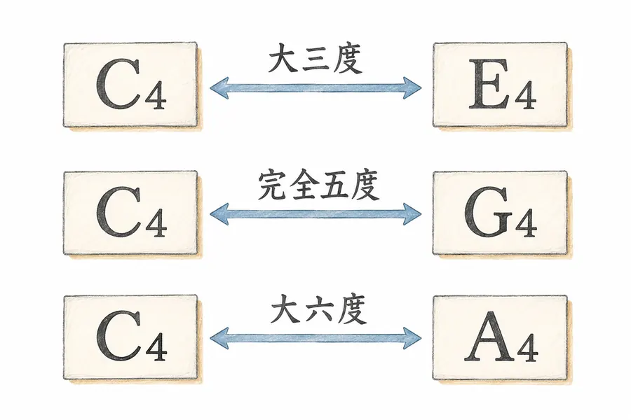

*Figure 12.5: Intervals and double stops (schematic).*

The order for learning **double stops** should be:

1. Understand the interval first.
2. Then practise different combinations along the scale.
3. Know first how thirds and sixths become major or minor along the scale.
4. Then understand **voice leading**.

After that you can work out any key yourself.

| **Key point and application** | **Content** |
|----|----|
| Core concept | An interval describes the distance between two notes. |
| Relations and conditions | Drawing an interval as a fretboard shape is more efficient than memorising note names. |
| Where it is applied | Reading music and finding positions on the fretboard. |

## 12.6 Scales and positions

The whole-and-half-step structure of the **major scale** is:

> **W–W–H–W–W–W–H** (whole–whole–half–whole–whole–whole–half)

This is **the common basis of key signatures, chords and melody**.

The other scales change particular degrees on that basis:

| Scale | Chinese |
|---|---|
| natural minor | 自然小調 |
| harmonic minor | 和聲小調 |
| melodic minor | 旋律小調 |
| modes | 調式 |

Practise scales chasing only speed and you lose their most important function:

**joining the ear, the hand and the structure of the key together.**

First-position scales are good for establishing the basic note names.

But advanced playing needs **movement across positions**.

Play the same G major three ways:

| Way | Character |
|---|---|
| open position (first position, using the open strings) | uses the open strings |
| closed position | no open strings |
| high position | higher up the neck |

The pitch is the same.

But **the timbre, the string crossings and the legato may be completely different**.

A player should know **why** they chose a particular fingering.

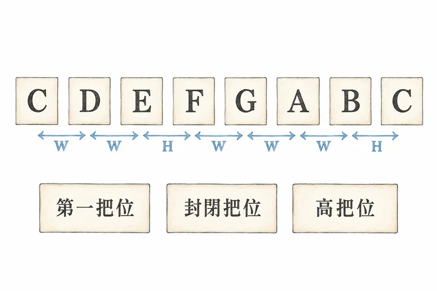

*Figure 12.6: Scales and positions (schematic).*

Munier's 1891 method emphasises in particular **mastering the first position first, then moving on to the other positions**.

This reflects that historical teaching also treated position as **a system**, not as scattered tricks.

Modern learning can be more flexible.

But "a stable basic map first, then expand" still holds. 〔S717〕

| **Key point and application** | **Content** |
|----|----|
| Core concept | The whole-and-half-step structure of the major scale, W–W–H–W–W–W–H, is the common basis of key signatures, chords and melody. |
| Relations and conditions | First-position scales are good for establishing the basic note names, but advanced playing needs movement across positions. |
| Where it is applied | Reading music and finding positions on the fretboard. |

## 12.7 Positions and shifting

**Position** is essentially **a frame of reference for the left hand on the fretboard**.

In the first position the index finger usually takes the notes around frets 1 and 2.

Move to a higher position and different fingers take over the notes on the same string.

The point of a **shift** is **deciding the next landing point in advance** and **the guide finger**.

The choice of position changes the timbre and the **phrasing**.

| Choice | Effect |
|---|---|
| using open strings | the attack is usually clear, and the sustain behaves differently from a fretted note |
| the same string in a higher position | the melodic timbre can be more consistent |
| a fast fiddle tune | open strings may be used to reduce shifts |

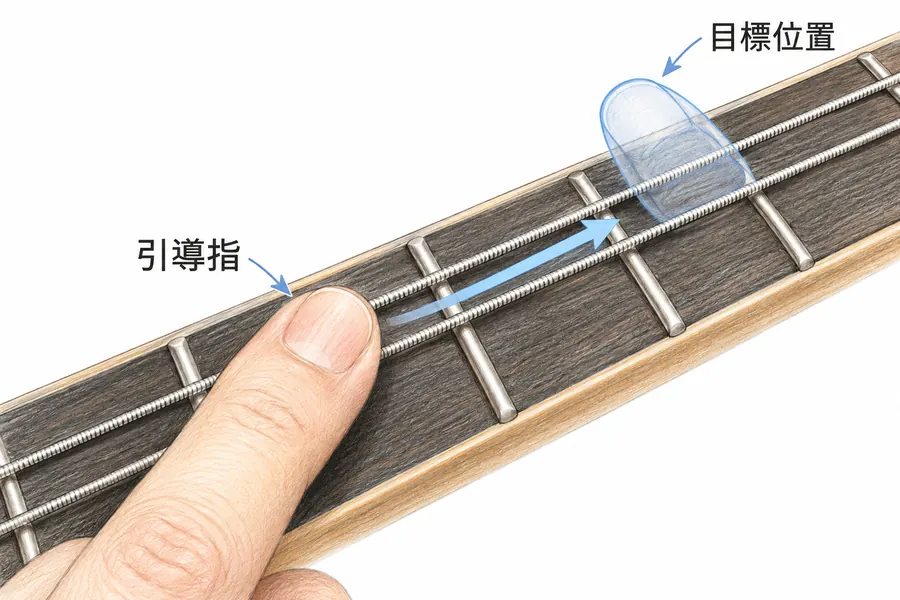

*Figure 12.7: Positions and shifting (schematic).*

High positions also have one physical fact: **the frets get closer together**.

So the fingers do not need to spread as far as they do in the first position.

Keep the wide stretch of the low positions and you are more likely to catch the neighbouring fret, or to tense up.

| **Key point and application** | **Content** |
|----|----|
| Core concept | Position is essentially a frame of reference for the left hand on the fretboard. |
| Relations and conditions | The choice of position changes the timbre and the phrasing. |
| Where it is applied | Reading music and finding positions on the fretboard. |

## 12.8 Key signatures and the circle of fifths

The **circle of fifths** helps directly with understanding mandolin tuning and keys.

G, D, A and E happen to lie along the fifth relation.

So **the standard open strings are themselves a stretch of the circle of fifths**.

For the mandolin, sharp keys therefore often come with natural **open-string resonance** and convenient fingering.

Understanding the circle of fifths makes transposing faster.

| Key | Sharps added | Running total |
|---|---|---|
| G major | — | — |
| D major | adds C♯ | 1 |
| A major | adds G♯ | 2 |
| E major | adds D♯ | 3 |

Rather than memorising seven notes for every key, remember this rule:

> **Every step of a fifth adds one sharp.**

The flat direction is understood the other way round.

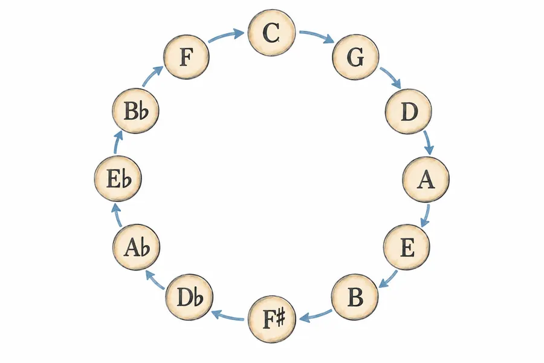

*Figure 12.8: Key signatures and the circle of fifths (schematic).*

This also explains why some styles prefer particular keys.

**Fiddle and bluegrass** repertoire often likes G, D, A and E.

That is not only cultural habit.

It is also because open strings and tuning in fifths are **very friendly** to those keys.

This is an example of **instrument structure and musical language shaping each other**.

| **Key point and application** | **Content** |
|----|----|
| Core concept | The circle of fifths helps directly with understanding mandolin tuning and keys. |
| Relations and conditions | Understanding the circle of fifths makes transposing faster. |
| Where it is applied | Reading music and finding positions on the fretboard. |

## 12.9 Notation for the family instruments

The CMSA guide points out that the **C-tuned mandola** in the United States and Canada is often handled with the **alto clef** or with a different transposition practice.

And what the rest of the world calls a **mandola / octave mandolin** may be tuned **G2–D3–A3–E4**.

The other members also have their own usual notation:

| Instrument | Chinese | Notation situation |
|---|---|---|
| mandocello | 曼陀琴 | has its own usual notation |
| Liuto Cantabile | 抒情魯特琴 | has its own usual notation |
| mando-bass | 曼陀貝斯 | has its own usual notation |

〔S716〕

That is why "it looks like the same clef" still means **you have to ask what the sounding pitch is first**.

For an arranger, the safest method is:

1. Establish the **sounding range** first.
2. Then decide the **notation convention**.

When a violin part is moved to a C-tuned mandola, the fingering has to be **reworked** around that instrument's open strings and fretboard.

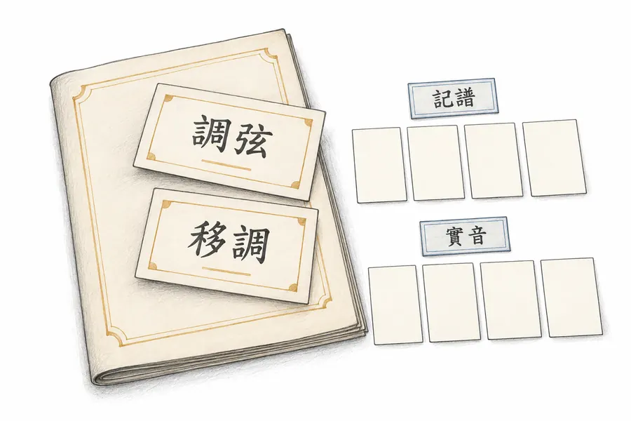

*Figure 12.9: Notation for the family instruments (schematic).*

International orchestras need particular care.

The tuning and the transposition should be marked clearly at the head of the score.

> **Common misconception: "writing the name of the instrument is enough."**
> It is not. **The word "mandola" varies a great deal from region to region.**
> Writing the instrument's name alone is not enough to avoid confusion in rehearsal.

| **Key point and application** | **Content** |
|----|----|
| Core concept | The CMSA guide points out that the C-tuned mandola in the United States and Canada is often handled with the alto clef or a different transposition practice. |
| Relations and conditions | For an arranger, the safest method is to establish the sounding range first, then decide the notation convention. |
| Where it is applied | Reading music and finding positions on the fretboard. |

## 12.10 Transcribing violin music

Because the standard tuning is the same, a mandolin can often read **the pitch of a violin part in treble clef** directly.

But in actual playing, three problems come up:

| What the violin writes | What the mandolin has to decide |
|---|---|
| a long **sostenuto** | whether to use tremolo, rearticulation, or let the note decay naturally |
| a **slur** that depends on the bow direction | the picking pattern cannot be translated literally |

On the other hand, the mandolin has frets and double courses.

Some fast passages can actually use **alternate picking** and open strings to get a clear **articulation**.

So the point of transcribing is: **re-orchestrating**.

The CMSA even points out that mandolin players may read the original violin part directly.

That means it is convenient **at the level of pitch**.

But **it does not mean the playing syntax is the same**. 〔S716〕

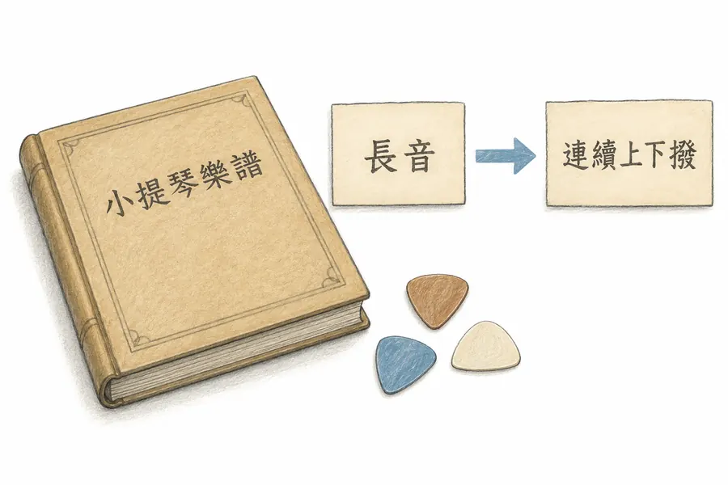

*Figure 12.10: Transcribing violin music (schematic).*

The best exercise is to take a stretch of violin melody and make two versions:

1. **First version**: read the pitch exactly as written.
2. **Second version**: rearrange the tremolo, the open strings, the shifts and the articulation.

Compare the two and you will see that "reading the notation" and "arranging it so it suits the mandolin" are **two different levels**.

| **Key point and application** | **Content** |
|----|----|
| Core concept | Because the standard tuning is the same, the mandolin can often read violin treble-clef pitch directly. |
| Relations and conditions | On the other hand, the mandolin has frets and double courses, and some fast passages can use alternate picking and open strings to get a clear articulation. |
| Where it is applied | Reading music and finding positions on the fretboard. |

## 12.11 Case study: fingering choices for one melody

Suppose the melody falls in **A4–E6**.

All three fingerings can play it, but the effect differs:

| Fingering | Approach | Effect |
|---|---|---|
| the first | use open A and E heavily | fewer shifts, a clear attack |
| the second | stay on the A course in a higher position | a more consistent timbre, easier legato |
| the third | shift into a closed position early in order to join a **double stop** | smoother joins |

**The pitch is completely identical, and the musical effect is not.**

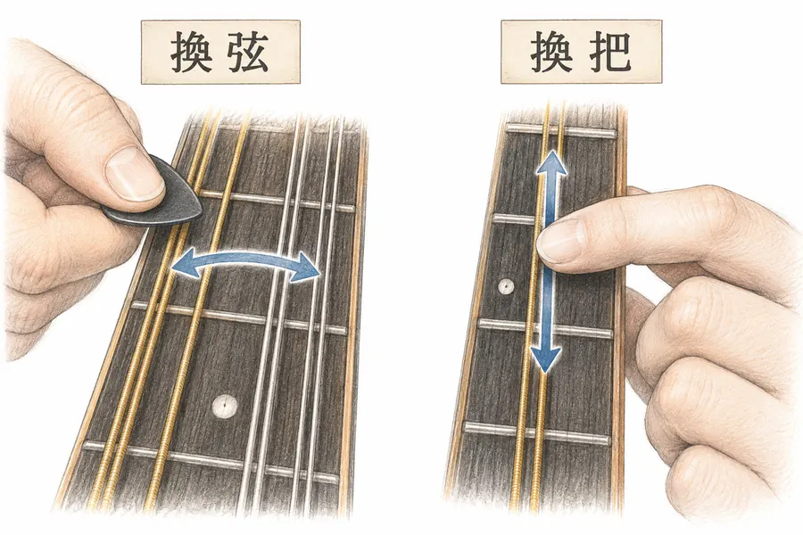

*Figure 12.11: Case study: fingering choices for one melody (schematic).*

This is exactly why the page **cannot write every answer down in advance**.

> **Common misconception: "TAB marks one fret, so that is the only correct way to play it."**
> Beginners often misunderstand it this way.
> But professional fingering is **an arranging decision**.
> You have to consider: the phrases before and after, the dynamics, the timbre, the string crossings, and the next chord.

In practice you can deliberately make three fingerings of the same 4–8 bars and compare the recordings.

The most important goal is to build **the ability to explain why you chose it**.

| **Key point and application** | **Content** |
|----|----|
| Core concept | Suppose the melody falls in A4–E6. |
| Relations and conditions | This is exactly why the page cannot write every answer down in advance. |
| Where it is applied | Reading music and finding positions on the fretboard. |

## 12.12 Case study: transposing a melody and the shapes

Suppose a melody is in G major and you want to move it to A major by adding two frets to every position. It looks simple.

But once you meet open strings, position boundaries and range, it soon stops being practical.

A steadier method is:

1. Understand the melody first as **scale degrees**, for example 1–2–3–5.
2. Then find the positions again in the new key.

This **functional thinking** suits chords as well.

| Original progression | In G | Moved to A |
|---|---|---|
| I–IV–V | G–C–D | A–D–E |

Memorising chord shapes only turns transposition into a mechanical shifting up the neck.

Understanding function connects directly to accompaniment and improvisation.

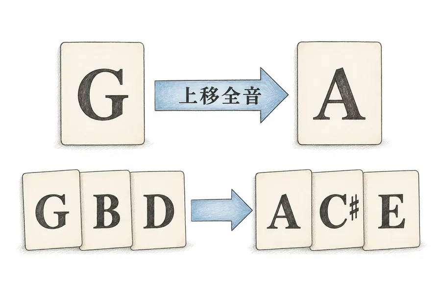

*Figure 12.12: Case study: transposing a melody and the shapes (schematic).*

Tuning in fifths makes **closed shapes** relatively consistent to move around.

So the two methods can be combined:

1. Use function first to find the target note.
2. Then use the movable geometry to land on the fretboard quickly.

That is "**the purpose of theory is to let the hand find the answer faster**".

## Table 12-1 | The core landmarks of fretboard memory

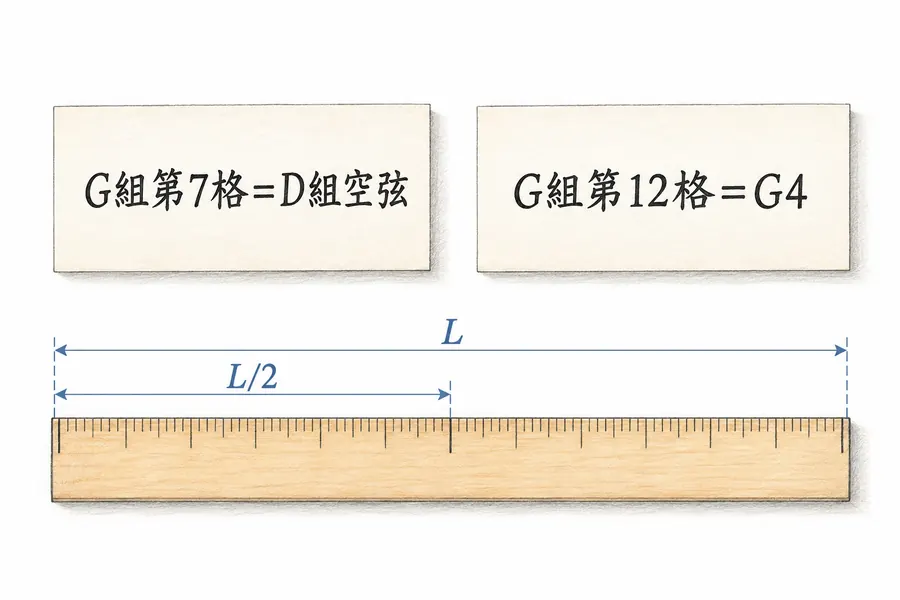

| **Position relation** | **Meaning** | **Practical use** |
|---------------------------------|----------------------|-------------------|
| **fret 7 = the next open course** (fret 7 = the next open string) | a perfect fifth relation | finding the same note quickly / changing strings |
| **fret 12 = the octave of the open string** | half the scale length | positions and intonation |
| **around frets 5 and 7** | the common natural notes and position markers | sight-reading and shifting |
| **closed shapes can be moved** | the geometry of tuning in fifths is consistent | transposition, chords, double stops |

*Table 12-1: The core landmarks of fretboard memory (schematic).*

| **【Fretboard formula】 The theoretical position of fret n from the nut is x = L × (1 − 2^(−n/12)). Fret 12 is always L/2; the real bridge still needs compensation.** |
|----|

| **【Historical teaching】 Munier's 1891 *Scuola del Mandolino* clearly treats the first position as the foundation before moving on to the other positions and techniques. This shows that the position system was not invented by modern textbooks; it was part of the mature education of the metal-strung Neapolitan mandolin.** |
|----|

## Self-study question bank

*Figure: Learning check — answer, check, review*

Answer the questions yourself first, then look at the answers. When you get one wrong, go back to the relevant section of this chapter and read it again.

**1. The tuning of a standard mandolin is mainly?**

- A. Consecutive fifths

- B. Consecutive fourths

- C. Consecutive thirds

- D. Any tuning at all

**2. One of TAB's main limitations is?**

- A. It cannot tell you the fretboard position

- B. It often cannot show the theory, the rhythm and the voicing completely

- C. It cannot write numbers

- D. It only suits the piano

**3. Fret 12 usually represents?**

- A. A point near the midpoint of the vibrating scale length

- B. The centre of the body

- C. Always the highest note

- D. The position of the tailpiece

**Answers: 1.A 2.B 3.A**

## Main sources checked for this chapter

*Figure: Sources checked — find the original, check the conditions, keep a record*

**【S716】Robert A. Margo / Classical Mandolin Society of America: Music Notation for Mandolin Family Instruments (v3, 2019).** Standard tunings, clefs, sounding versus transposed notation, and regional differences in naming across the mandolin family.

https://classicalmandolinsociety.org/wp-content/uploads/Music_Notation_for_Mandolin_Family_Instruments_v3.pdf

**【S717】Carlo Munier: Scuola del Mandolino (Firenze: Adolfo Lapini, 1891).** A complete late nineteenth-century mandolin tutor; historical playing evidence for the first position, posture, tremolo, advanced positions and ornamental technique.

https://imslp.org/wiki/Scuola_del_Mandolino_(Munier%2C_Carlo)

**【S718】Raffaele Calace: Metodo per mandolino, Opp.37–42 (Edizioni Calace, public-domain scans).** Six volumes of mandolin method; a reference for historical fingering, positions, technique and musical syntax.

https://imslp.org/wiki/Metodo_per_mandolino_(Calace%2C_Raffaele)

**【S715】D'Addario: A Complete Technical Reference for Fretted Instrument String Tensions (technical guide).** The relation and formulas between string tension, unit weight, scale length and frequency.

https://www.daddario.com/globalassets/pdfs/accessories/tension_chart_13934.pdf

---

Reading range: Chapters 12 to 17
