# Chapter 13: Posture, the Pick and the Foundations of the Right Hand

*Mandolin Posture, Pick Control and the Foundations of Right-Hand Technique*

## Key points

- The mandolin is small, but it is an instrument with **tight strings, two strings to cross on every stroke, and a pick that hits them again and again at speed**. If the instrument is not steady, the right hand spends extra force making up for it.
- To check your posture you look at three things only: can the movement be repeated, is the body relaxed, is the sound steady.
- With picks there is no such thing as "thick means professional, thin means beginner". What matters is whether the pick suits your hand, and what sound you want to make.
- Downstroke and upstroke have to **sound the same**. That is more fundamental than playing fast.
- Constant pain, numbness or weakness is not "the price you have to pay for training". Stop and check.

---

The mandolin does not look big, and that is why many people underestimate what "how you hold it" does.

The real point is that this is an instrument of **high tension**, with **double courses**, played by a pick that **strikes the strings again and again at speed**.
So the moment the body of the instrument is unsteady, the right hand compensates with extra force.
The moment the neck is supported by the left hand for long stretches, shifting slows down.
The moment the pick is gripped too tightly, tremolo and fast alternate picking stiffen as the speed rises.

From the end of the nineteenth century into the early twentieth, both Munier and Calace wrote method books.

Both of them put "posture, pick, basic tone production" at the very front of their teaching systems.〔S1301〕〔S1302〕

That says one thing: **the basics have never been the entry barrier; they are the shared foundation under every advanced technique.**

This chapter does not give you a "standard answer". It gives you the principles for judging.
Hand size, forearm length, instrument dimensions, strap and sitting habits are all different, so the position that suits you best will be different too.

Good posture meets three conditions:

1. The instrument is steady.
2. Both hands can move freely.
3. No joint is forced to hold the same angle for a long time.

One more thing: the size of the movement should be in proportion to what the sound needs. A quiet phrase does not need a big movement.

> **One important warning**
> Musculoskeletal discomfort from playing is not rare among musicians.
> A recent systematic review (a paper that analyses several studies together) points out that repetitive movement, intensive practice and poor ergonomics may raise the risk together.〔S1303〕
> Any persistent pain, numbness, weakness or loss of control should not be treated as "the price you have to pay for training".

---

## 13.1 A steady hold and free hands

When you play sitting down, the first goal is this: **the body of the instrument stays steady without the left hand carrying much of the support.**

Different instrument types have different problems to solve.

| Instrument type | Problem | Traditional solution |
|---|---|---|
| Round-back Neapolitan | the deep bowl-shaped back slides easily on the thigh | body, forearm and leg form a "multi-point support" |
| American A-style／F-style | the body is flatter, but if the angle sits too horizontal | the right hand may be forced to lift the shoulder or break the wrist |

So instead of asking "how many degrees should the headstock be raised", ask this question:

> **With the left hand completely relaxed, does the neck drop straight away?**

If it does, your left hand is in fact doing a second job as an instrument stand.

### Standing and the strap

Standing usually needs a strap.
The strap's job is not "to hang the instrument up". It is **to make the instrument sit as close as possible to where it sits when you are seated**.

If the instrument drops to hip height the moment you stand up, three things happen at once:

- The angle at which the right hand meets the strings changes.
- The position of the left thumb changes.
- Where your eyes look changes.

That amounts to changing to a different technique every time you perform.

A more reliable way is:

1. First find an effortless position while **seated**.
2. Then adjust the strap so that, standing, the instrument sits at about the same height.
3. Test it on a few passages of melody you know best.
4. Check that volume, speed and accuracy have not clearly dropped.

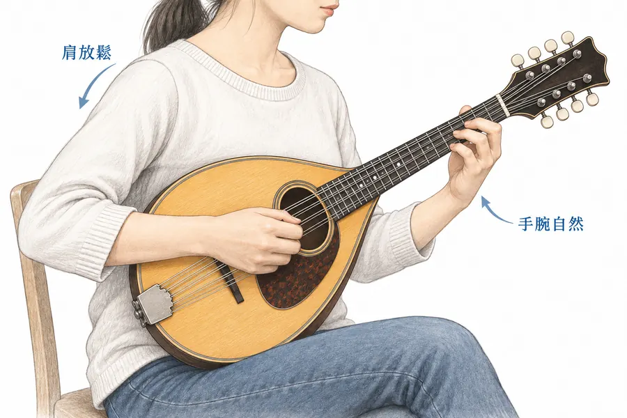

*Figure 13.1: a steady hold and free hands (schematic).*

### Assess the shoulders and neck at the same time

Posture is not only about the instrument. It is also about your shoulders.

| Situation | Possible consequence |
|---|---|
| The body sits too far to the right | the right shoulder easily rolls forward and inward |
| The headstock is raised too high | the left shoulder may stay shrugged the whole time |

These problems may not hurt within ten minutes, but after an hour of rehearsal they start to add up.

The point of good posture is to **allow small adjustments**, not to lock one angle in place:

- On long phrases, the instrument can turn slightly towards your body.
- When you shift, the left elbow changes position on its own.
- In loud playing, the forearm can join in a little.

Thinking of posture as "dynamic balance" is usually more practical than fixing one angle.

**Key point:** first make the instrument steady while the left hand stays relaxed.
**Practice focus:** build a steady hold and a steady pick stroke.

### Accessories that can help

For a round-back instrument, support can be helped with a **footstool** and a **non-slip pad**.
A music stand helps you keep your eyes to the front.

These accessories are also listed in Shimamura's beginner's guide.〔N01〕

When you try them, go in this order:

1. Relax both shoulders first.
2. Check that both hands can still move freely.
3. Only then adjust the height and the angle.

Whether an accessory suits you is decided by your own sitting position, not by the product description.

---

## 13.2 Supporting and relaxing the left hand

The core of this chapter is the right hand, but **whether the left hand is relaxed decides whether the right hand can be free.**

Many beginners clamp the neck tightly in the **web** between thumb and index finger, because it "feels safe".
The price is:

- The reach from index to little finger is limited.
- To shift, you have to release first and clamp again.

A more efficient way is to let the thumb play two roles: **a position reference** and **a source of reaction force**.
At the same time, keep the room the shift needs to move.

### Fretting does not need much force

As long as the string sits firmly against the **fret crown** (the top of the metal fret wire, the face closest to the instrument body), behind the target fret, the note comes out clear.

Extra force will not make the note "more in tune". It only:

- adds fatigue;
- and, by pressing the string down too deep, can push the pitch slightly sharp.

Here is how to practise it:

1. Start by deliberately using **obviously too much force**.
2. Keep picking while you slowly reduce the pressure of the left hand.
3. Reduce it until **fret buzz** just appears.
4. Then add a little back.

That is how you find the minimum necessary pressure between "you" and "this instrument".

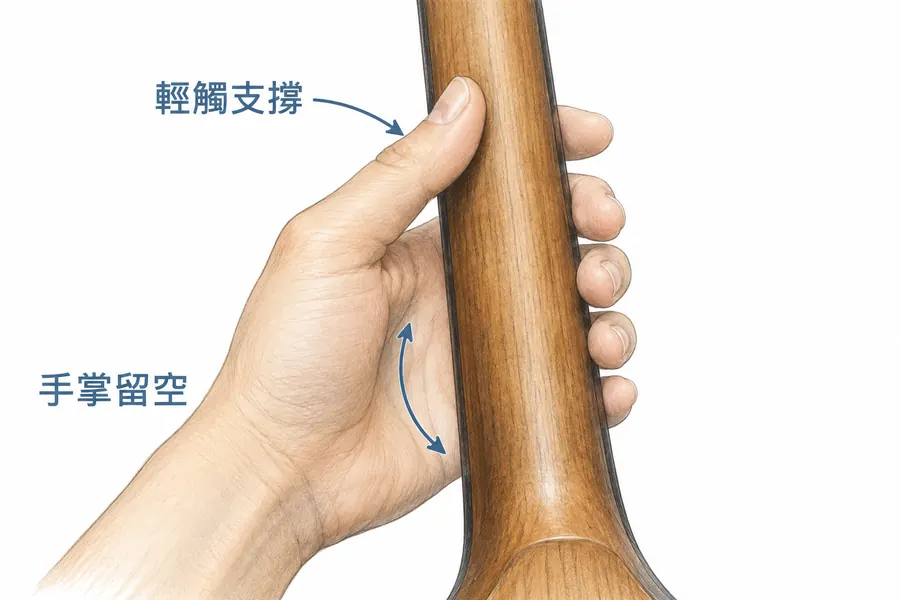

*Figure 13.2: supporting and relaxing the left hand (schematic).*

### Sometimes the hand is not weak; the instrument has a problem

All of the following change how much "necessary pressure" is:

- higher **action**;
- heavier string courses;
- worn frets.

If an instrument needs a lot of force before it stops buzzing, the cause may not be that "your hand is weak". It may be a **setup** problem.

> **Common misconception**
> **"If it does not sound clean, I am not pressing hard enough and my hand is not strong enough."**
> Not necessarily. Check action, string gauge and fret wear first, then talk about technique.

> **Order matters**
> Before technical training, rule out the structural obstacles in the instrument itself.
> Otherwise you will practise "compensating wrong movements" until they become habits.

**Key point:** relax the left hand and the right hand becomes free.
**Practice focus:** build a steady hold and a steady pick stroke.

---

## 13.3 Pick shape and material

### Thickness: thicker is not better

The thickness of the pick changes how much it **deforms** when it meets the string.

| Thickness | Advantage | Disadvantage |
|---|---|---|
| Very thin | bends easily; beginners may find it comfortable | at speed on double courses, the excessive bending makes contact time and rebound unstable |
| Thicker | little deformation, a clear outline | demands more precise control of angle and depth; the resistance is more obvious when it goes in deep |

> **Common misconception**
> **"Thick equals professional, thin equals beginner."**
> It does not hold. The real question is whether it fits your sound and the way your hand works.

### Shape and edge

- **A sharper point**: a clearly defined attack.
- **A round, blunt point**: contact lasts slightly longer, the sound is softer.
- **Whether the edge is polished**: this affects friction noise.

Large triangular picks are often popular with mandolin players, because there is a big area to hold and three corners to rotate through.
But that is not the only choice.

### How to compare picks fairly

This matters a lot, because most people compare them the wrong way.

1. Keep the same passage.
2. Keep the same picking position.
3. Keep the same volume.
4. Record it.

Do not change the pick and the right-hand angle at the same time. If you do, it is hard to know where the difference came from.

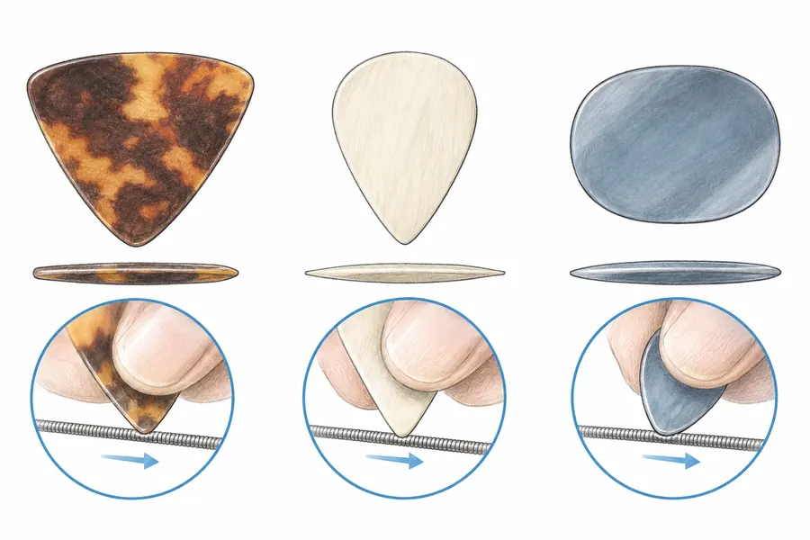

*Figure 13.3: pick shape and material (schematic).*

### Material: do not chase "miracle materials"

The historical methods remind us that pick materials once included natural materials that should no longer be used today, for conservation and legal reasons.

Common modern materials are:

- celluloid
- Delrin-type plastics
- acrylic
- various composite materials

For a learner, understanding **stiffness, surface friction and edge shape** first matters far more than chasing a "miracle material".

The sound is made **jointly** by the pick, the hand, the strings, the picking position and the body of the instrument.
It does not make sense to treat any single material as magic.

---

## 13.4 Holding the pick

### The basic grip

The usual approach: place the pick against **the side of the index finger**, then **cover it with the thumb**.

There are only three things you really need to watch:

1. How much of the pick is showing.
2. The pressure of thumb and index finger.
3. Whether the finger joints go stiff in order to hold it.

| How much is showing | What happens |
|---|---|
| Too much | the pick is a long lever and gets twisted easily by the strings |
| Too little | the fingers may hit the strings directly |

Most people end up with "just enough tip showing to pass through two strings".
But that should still be adjusted to the size of the pick and your own habits.

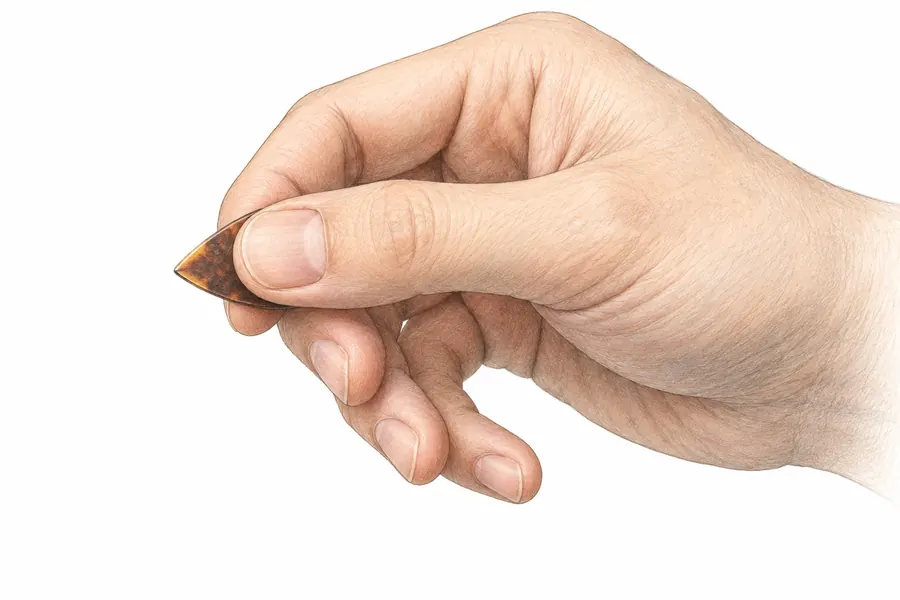

*Figure 13.4: holding the pick (schematic).*

### Grip pressure is not a fixed value

Slow, gentle playing can be looser. Loud playing and fast string crossing need a little more stability.

What you really have to avoid is this: **holding at maximum grip for a whole piece.**

A very simple test:

1. Play eight bars without stopping.
2. Stop immediately.
3. Check three things: has the end of the thumb gone white? Has the index finger been left with a clear groove? Is the forearm flexor tight?

If that happens every time, it usually means you have confused "not letting the pick fly away" with "gripping the pick hard".

### Pick angle

Pick angle comes in two kinds:

- **The slant on the plane**: how far the pick has rotated on the plane of the instrument's face.
- **The tilt in the vertical direction**: how far the pick is tilted relative to the string.

Letting the edge of the pick pass through the string at a slight angle often reduces the resistance of a head-on impact.
But when the angle is too large, friction and scraping noise increase.

The best way to train it is:

1. Start from **almost parallel**.
2. Change the angle in small steps.
3. Change only one small amount at a time, and record it.
4. Find the balance point between "sound" and "resistance".

**Key point:** the grip has to be adjustable at any moment, not fixed.
**Practice focus:** build a steady hold and a steady pick stroke.

---

## 13.5 Downstrokes and upstrokes

The real foundation of alternate picking is that the downstroke and the upstroke are close to each other.

Three things have to be close:

- volume
- sense of timing
- depth of contact

The problem many learners have is this: the downstroke is strong, while the upstroke is like "touching the string on the way back".

Once you reach fast eighth notes or sixteenth notes, two faults appear:

- the accent always lands in one direction;
- the rhythm starts to sway.

### Practice steps

1. First, on a **single course** (one pair of strings tuned to the same pitch), play continuous eighth notes at a very slow tempo.
2. On every stroke, deliberately let the pick **leave the course completely** before it comes back.
3. If the downstroke and the upstroke sound too different, adjust three things first: pick angle, wrist path, grip pressure.
4. Once the two sides are close, start raising the speed.
5. Finally, move the accent to different places: first try "the first of every four is heavy", then "the second of every four is heavy".

Step 5 is checking this: **can you freely control the accent in both directions?**

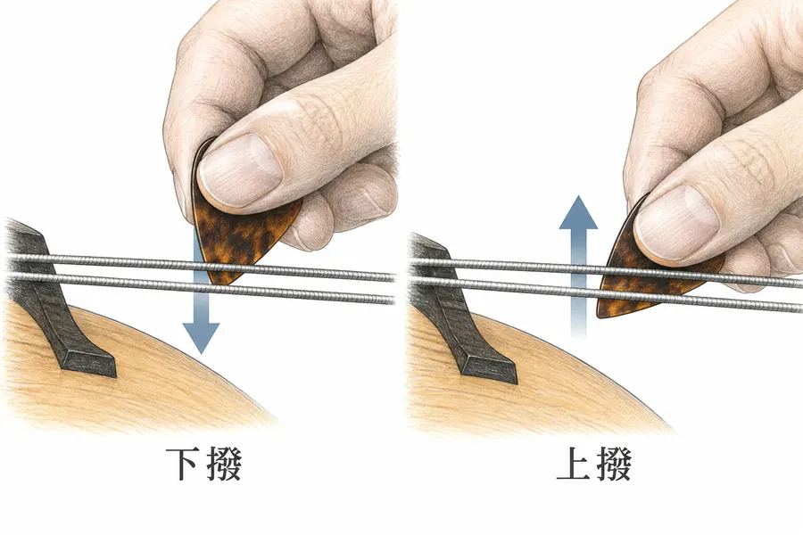

*Figure 13.5: downstrokes and upstrokes (schematic).*

### Notation in the historical methods

The right-hand signs in the historical methods do not match modern teaching symbols exactly.
But the core question is the same: **the pick movement has to be organised against the beat.**

Calace's and Munier's methods both treat tremolo, division and picking direction as a trainable "grammar".

Division means splitting one note into several strokes in a row.

Tying the movement to the beat and to the phrase is the heart of their thinking.〔S1301〕〔S1302〕

**Key point:** the two directions have to sound the same.
**Practice focus:** build a steady hold and a steady pick stroke.

---

## 13.6 Crossing a double course

A **course** on the mandolin is made of two strings tuned to the same pitch.

Ideally the pick travels a steady path and touches the two strings **one after the other**, and the two moments of attack merge into **one** attack within a very short time.

| Depth of entry | What happens |
|---|---|
| Too shallow | you may only hit the outer string |
| Too deep | the second string snags the pick |

That is why moving the feel of single-string guitar picking "unchanged" onto the mandolin often leaves the right hand feeling stuck.

### How to tell whether you went all the way through

1. Bring the tempo right down.
2. Record a single note.
3. Listen: does only one string sound now and then?

If only one string sounds now and then, the tone suddenly thins out.
If the two strings are slightly out of tune with each other, a missed string is even easier to hear.

> **This also reminds you of something**
> After fitting new strings, tune each **pair** precisely and separately.
> Otherwise you may mistake a "tuning problem" for a "right-hand problem".

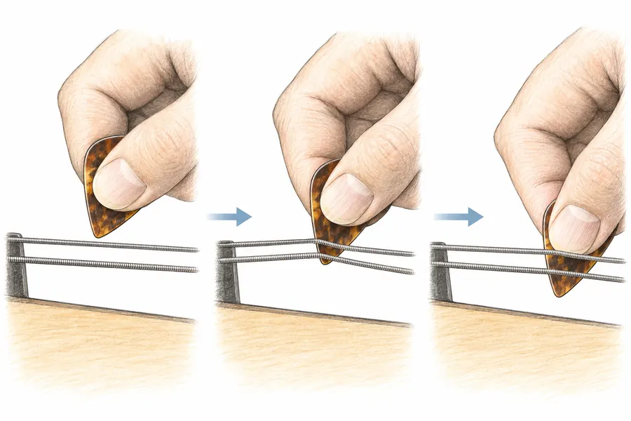

*Figure 13.6: crossing a double course (schematic).*

### Old strings change the feel too

If the two strings in a course are worn differently, their surface friction and elastic response may no longer match.

Replacing only the string that broke, and never the whole course, saves money, but it makes it hard for the right hand to build consistent feedback.

For players who care about steadiness, **changing strings in pairs** is usually more reasonable.

**Key point:** the pick should pass through both strings and make only one attack.
**Practice focus:** build a steady hold and a steady pick stroke.

---

## 13.7 Paths across the strings

The difficulty of string crossing is not just "moving from the D course to the A course".

It also includes this: **the direction in which you leave the previous course.**

That direction decides whether the next movement is **inside picking** or **outside picking**.

| Type | The feel |
|---|---|
| Inside picking | the pick "walks into" the space between two strings |
| Outside picking | the pick "goes around" the outside |

Neither is absolutely better, but they feel different.
Some phrases are very natural from one starting direction, and from the other one it is like climbing over a "wall" every time.

So in fast passages the **fingering and the picking have to be designed together**.

### The mistake beginners make most often

Beginners often try to get clear of the other strings with a **large vertical movement**, and the result is out of control as soon as the tempo rises.

A more efficient way is:

1. Keep the pick's travel to **just enough to leave the course**.
2. Then use a small forearm or wrist movement to line up on the next course.

### Practice steps

1. Take a three-course arpeggio and first break it down to **two strings**.
2. When that is steady, make it **three strings**.
3. After every mistake, work out first whether it was the **position** or the **direction** that went wrong.
4. Practise only that short fragment, for that mistake.

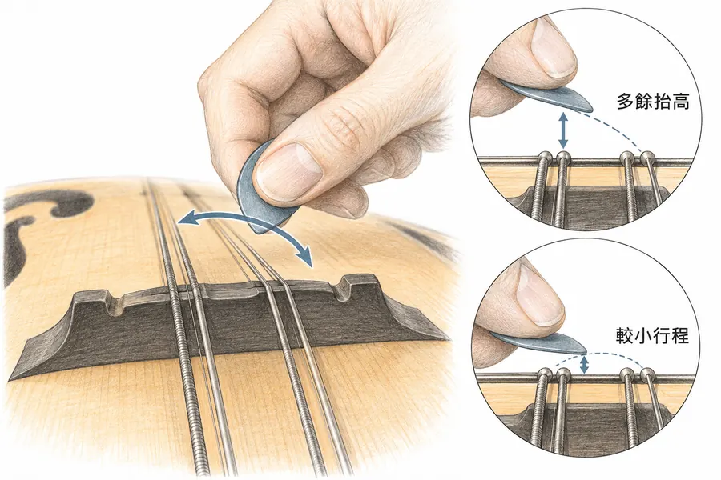

*Figure 13.7: paths across the strings (schematic).*

This connects to crosspicking in the next chapter.
The point of crosspicking is to make "crossing the strings" itself a regular rhythmic and part-writing design.

So get the basic crossing quiet and short first. Only then will advanced patterns avoid being built on compensating movements.

**Key point:** the direction you leave the previous course in decides how hard the next movement is.
**Practice focus:** build a steady hold and a steady pick stroke.

---

## 13.8 Picking position and tone

Same instrument, same string: change the picking position and the sound changes.

| Picking position | Character of the sound | The feel |
|---|---|---|
| Near the bridge | more high-frequency content, a clear attack | local displacement is smaller, it feels "hard" |
| Near the end of the fretboard | softer | the closer to the middle, the softer |

The reason is this: the picking position changes the **initial shape** of the string's vibration, so some overtones are strengthened and others weakened.

### So tone is not only "force or no force"

Tone production is not just a question of force. Position is a tool as well.

| What the phrase needs | Where the right hand moves |
|---|---|
| A more transparent, more penetrating outline | slightly towards the bridge |
| A soft cantabile quality | a little towards the fretboard |

But these changes have to be **small and controllable**. If the right-hand position drifts a long way, both string crossing and tremolo become unstable.

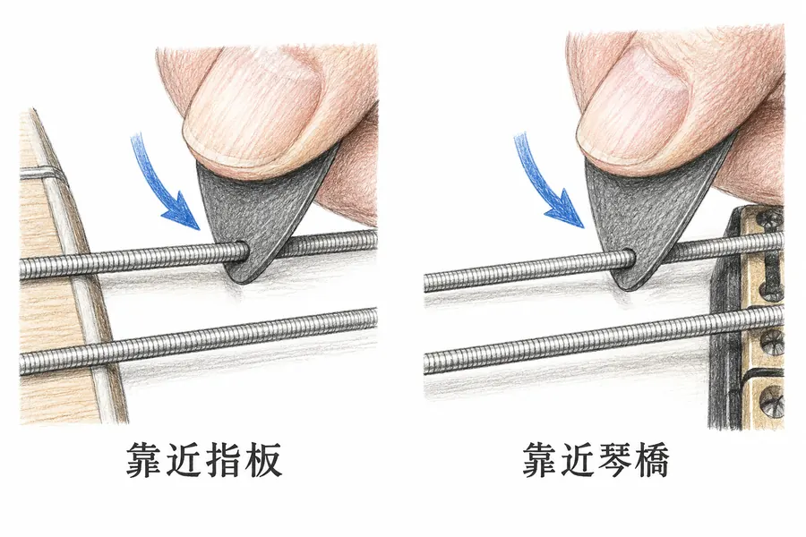

*Figure 13.8: the same double course at different picking positions (schematic).*

### Build your own "sound map"

In practice, choose three positions on the same **open A** course:

1. The usual zone behind the bridge.
2. Around the soundhole or f-holes.
3. Close to the fretboard.

Record them at **the same tempo** and **the same perceived volume**, then compare the attack and the sustain.

This will build your own sound map faster than reading equipment reviews.

**Key point:** position is the second knob on the tone control.
**Practice focus:** build a steady hold and a steady pick stroke.

---

## 13.9 Case study: tension as the tempo goes up

Suppose you have a run of eighth notes, G–A–B–C:

| Tempo | Situation |
|---|---|
| 80 BPM | very clean |
| 120 BPM | starting to tighten |
| 140 BPM | out of control |

The most common mistake is to read "a tempo problem" as "my hand is not fast enough", and then keep pushing from 120 to 140.

In fact the real limit may be:

- too much of the pick showing;
- going in too deep on every stroke;
- the upstroke being shorter than the downstroke, so the two directions become uneven as the tempo rises.

### Diagnosis can work backwards

1. At **140 BPM, play a burst of only four notes in one beat** and see whether you can do it relaxed for a short time.
2. If you can, the nerves and the movement speed are not entirely lacking. The problem is **endurance**, or the path adding up.
3. Then, at **100 BPM, deliberately halve the depth of entry** and see whether the tone is still acceptable.
4. If the movement suddenly becomes easy, the real limit is this: **you are doing too much work on every stroke.**

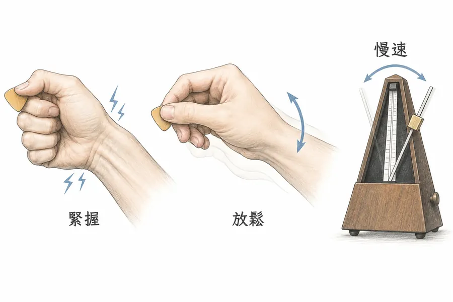

*Figure 13.9: case study, tension as the tempo goes up (schematic).*

This case shows that the goal of the basics is to build **a system you can diagnose**.

When playing fails, you can point to "which variable went out of control", and only then can you fix it effectively.

**Key point:** when the tempo sticks, find which variable went out of control first.
**Practice focus:** build a steady hold and a steady pick stroke.

---

## 13.10 Practice load and the body's signals

Musculoskeletal discomfort is quite common among musicians. The wrist, the hand, the shoulders and the neck can all be affected.

Systematic reviews point out that intensive repetitive activity, posture, individual physical condition and other factors often act **together**.
And because of differences in study quality and between individuals, "one universal prevention method" does not exist.〔S1303〕

This means the book cannot claim that any one posture is a medical guarantee.
But it can set out a few conservative principles:

1. Increase the load gradually.
2. Rest at regular intervals.
3. Do not push through obvious pain.
4. When you change technique suddenly, reduce the practice load.

### When to stop

If any of the following appears, stop reading the problem as "normal soreness":

- persistent pain
- numbness
- tingling
- obvious weakness
- swelling of a joint
- a sudden drop in motor control

Professional medical assessment matters especially because **tendon overuse, nerve compression, joint problems and local muscle fatigue** are all handled differently.

The literature also stresses that assessing musicians requires understanding the actual playing movements, not just looking at general upper-limb pain.〔S1304〕

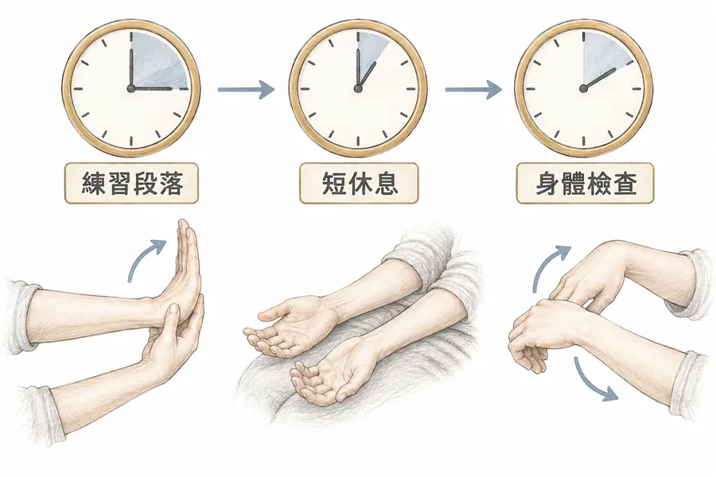

*Figure 13.10: practice load and the body's signals (schematic).*

### The three things worth noting every day

For daily training, the most useful record is not "how many hours I practised". It is:

- Which movement starts to tighten, and at what minute?
- What change of pick or posture made it better?
- When the tempo goes up, which part tires first?

That data turns a vague impression of the body into **practice information you can adjust**.

---

## Table 13-1 | Basic right-hand variables and how to diagnose them

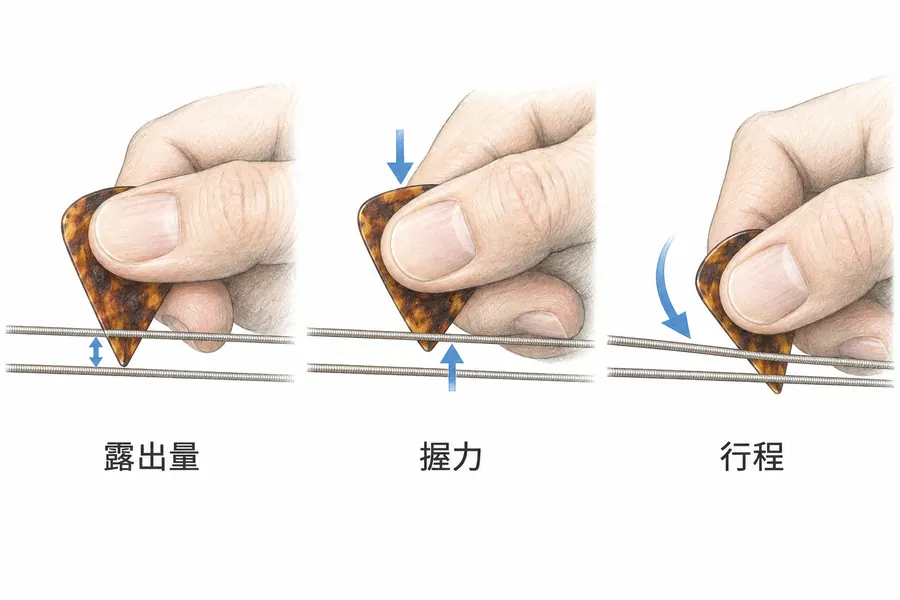

| **Variable** | **What too much of it looks like** | **What too little of it looks like** | **How to test it first** |
|:---|:---|:---|:---|
| **Pick depth** | snagging, fatigue, speed limited | missing the second string, not enough volume | slow recording on a single course |
| **Grip pressure** | forearm and thumb tight, hard tone | the pick rotates or flies out | check the hand right after 8 bars |
| **Edge angle** | scraping noise, tone too thin | strong head-on resistance | change one small angle at a time and record |
| **Travel distance** | out of control at speed, slow crossing | may not leave the string completely | mirror or slow-motion video |
| **Instrument stability** | left hand clamping the neck, shoulder compensating | — | relax the left hand and see if the instrument is still steady |

*Figure: Table 13-1, basic right-hand variables and how to diagnose them (schematic).*

### Use this table as a lookup

Next time practice gets stuck, do not only ask "why can't I play this".
Find the symptom in the table above that fits best, then run the matching test.

Change one variable at a time, and you will know which change actually worked.

---

## Self-study question bank

Study check: answer, mark, review

Answer for yourself first, then look at the answers. When you get one wrong, go back to the relevant section of the chapter and read it again.

**1. One of the main purposes of a steady hold is?**

- A. To reduce the extra compensating movements of both hands

- B. To make the instrument look more upmarket

- C. To fix you to a single posture

- D. To raise the value of the case

**2. Gripping the pick too tightly often causes?**

- A. More stiffness at speed

- B. Better intonation automatically

- C. Shorter strings

- D. Lower frets

**3. When pain or numbness persists you should?**

- A. Push through it

- B. Reduce the load, assess your posture, and get professional help if needed

- C. Switch to a heavier instrument

- D. Just play faster

**Answers: 1.A　2.A　3.B**

---

## Main sources checked for this chapter

Sources checked: find the original, check the conditions, keep a record

**【S1301】Carlo Munier: Scuola del Mandolino / Metodo completo per la divisione.** The historical method of late nineteenth-century mandolin posture, pick and division training.

> https://imslp.org/wiki/Metodo_completo_per_la_divisione\_(Munier%2C_Carlo)

**【S1302】Raffaele Calace: Metodo per mandolino, Opp.37–42.** The source for classical right-hand technique, tremolo, positions and advanced technique.

> https://imslp.org/wiki/Metodo_per_mandolino\_(Calace%2C_Raffaele)

**【S1303】Cerda-Díaz et al.: Musculoskeletal disorders in musicians: an overview of systematic reviews (2026).** A systematic review of prevalence, risk factors and prevention evidence for musculoskeletal problems in musicians.

> https://pubmed.ncbi.nlm.nih.gov/41691705/

**【S1304】Yang, Fufa & Wolff: A musician-centered approach to management of performance-related upper musculoskeletal injuries (2021).** A musician-centred framework for assessing and managing performance-related upper-limb injuries.

> https://pubmed.ncbi.nlm.nih.gov/34158229/

---
