# Chapter 14: Tremolo, String Crossing and Rhythmic Technique

*Advanced Right-Hand Technique*

## Key points

- Advanced right-hand technique is not a pile of "moves". It is the same set of basic variables (direction, depth, path, accent, the end of the note) in different combinations.
- Tremolo is not "the faster the better". The listener still has to be able to hear the **pulse**.
- The point of crosspicking is **the relationship between the pattern and the time signature**, not memorising one fixed pattern.
- In the chop, the key is **the left hand letting go**, not the right hand pressing harder.
- Your top speed should be "I can repeat it successfully again and again", not "it worked once".

---

The advanced techniques of the right hand look like a lot of separate "moves":

- tremolo
- crosspicking
- arpeggio
- rake
- chop
- ghost stroke

But in fact they are all built on the same set of basic variables from Chapter 13:

- pick direction
- depth of entry
- path across the strings
- where the accent falls
- when the note ends

Treating techniques as a checklist easily leads to "a new set of movements for every move you learn".
Seeing them as different **sound tasks** is what lets you find out that one low-tension, short-path right hand can extend into a lot of grammar.

Tremolo above all.

It is often described as "fast alternating picking", but the late nineteenth-century mandolin methods already treated it as the centre of **cantabile playing, long lines and dynamic control**.

Calace's six-volume method and Munier's tutor point at the same thing.

Tremolo is one of the cores of classical mandolin identity.

More precisely, it is part of "why this instrument is this instrument".〔S1401〕〔S1402〕

---

## 14.1 The continuity of tremolo

Plucked instruments have a built-in limit: **after a single attack, the sound decays on its own.**

Tremolo works by **re-exciting** the string quickly and regularly, so that the listener hears many separate attacks as one continuing sound.

So "continuity" does not mean "the attack disappears".

What it really means is this: the **density** of the attacks, the **difference in loudness** between them and the **time between** them are controlled until they stop grabbing attention.

### The common mistake: chasing density only

Many people chase speed from the start. The hand gets faster and faster, and the music sounds like a machine gun.

Real tremolo needs a **pulse**:

- you still know where the main beat is;
- you still know where the phrase is going.

### Practice steps

1. Start with a clear four-part division: four strokes per beat.
2. Raise the speed gradually.
3. Once the speed is enough to create continuity, **make the accent on the main beat smaller**.
4. Avoid turning it into "one note sticking out every four".

Step 3 is the key. It is the turning point from "rhythm practice" to "tone and phrasing".

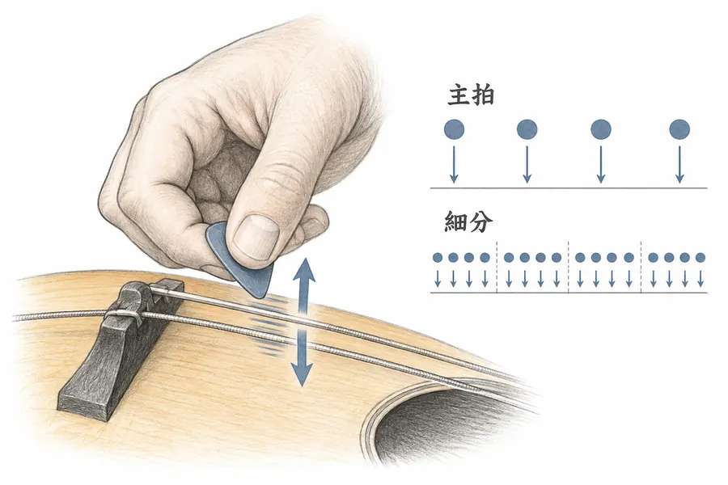

*Figure 14.1: the continuity of tremolo (schematic).*

### How to control dynamics

Dynamics can be controlled by three things together: **speed of contact, depth, density.**

A crescendo can do three things at once:

- increase the effective speed of the pick;
- go slightly deeper into the string;
- raise the density of the tremolo.

But if all three jump at once, the sound goes from soft to hard in an instant.

A more mature way to control it is this: **keep the density steady first, and make only small changes with the energy of the attack.**
Adjust the density only in very slow places where you need to avoid a grainy sound.

---

## 14.2 Tremolo on a single course

Tremolo on one course is the best way to check whether downstroke and upstroke are symmetrical.

Start with a clear subdivision (splitting one beat into equal parts):

- eighth notes
- sixteenth notes
- sextuplets

Let every attack fall inside a "box".

If a "two-strokes-together" wobble appears as soon as you speed up, it usually means one of two things:

- the return of one direction is shorter;
- one direction only touches one of the strings in the course.

> **Common misconception**
> **"Tremolo just means shaking as fast as you can."**
> No. Once it is so fast that the main beat cannot be heard, it has become a machine gun. Tremolo serves the melody; it does not replace it.

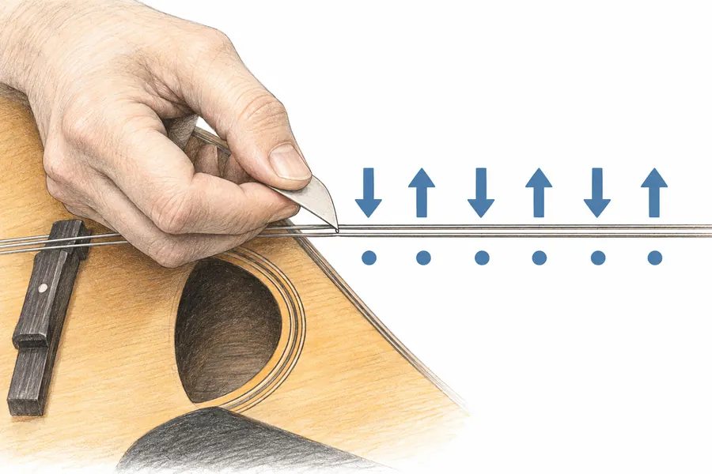

*Figure 14.2: tremolo on a single course (schematic).*

### The right hand's pivot needs to stay elastic

Some players like to rest the forearm on the edge of the instrument; others let the little finger or the base of the palm touch the soundboard lightly.
Different instrument types and different hand shapes have no single answer.

There are two criteria:

1. The pivot must not restrict the small swing of the wrist.
2. The pivot must not put extra pressure on a thin soundboard.

On a round-back instrument, the way the body is supported can even decide whether the right hand can find a steady reference point.

### Build the time up slowly

The length of practice should increase slowly:

1. First get 10 seconds of even sound.
2. Then 20 seconds.
3. Then 30 seconds.

That is far more effective than forcing two minutes from the start.

| Change in the second half | Possible cause |
|---|---|
| Volume gradually gets louder | after muscular fatigue, compensating with more force |
| Volume gets quieter | the grip has lost its steadiness |

The standard for endurance training is "even sound, relaxed movement", and only then do you lengthen the time.

**Key point:** tremolo on one course is the best tool for checking left-right symmetry.
**Practice focus:** practise advanced right-hand technique.

---

## 14.3 Tremolo across strings

When the melody moves from the A course to the E course, the tremolo has to move **without showing a gap**.

Many people speed up before the change, as if trying to "fill" the time of the move with more attacks.
The result is that the change of string becomes more obvious.

A better way is this: **place the move on a clear subdivision.**

For example: always change strings **after an upstroke**. When that is steady, practise the other direction.

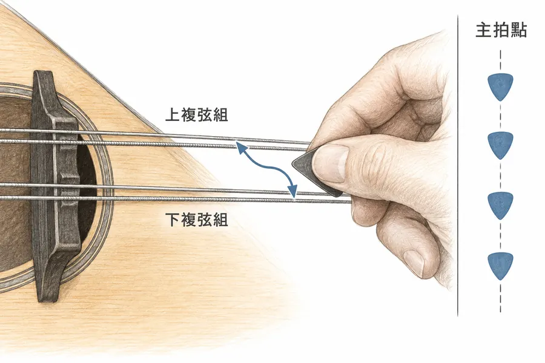

*Figure 14.3: tremolo across strings (schematic).*

### The phrase also affects the choice of fingering

| Approach | Advantage | Risk |
|---|---|---|
| Do it on the same course in a high position | tone and tremolo quality are more consistent | fingering in high positions may be too complicated |
| Cross the strings | the left hand is more natural | the continuity of the attack may suffer |

So there is no rule that "fewer string changes is always better".
What you compare is: **the continuity of the attack, the complexity for the left hand, the consistency of tone.**

### Practise the two hands separately

In real repertoire, changing strings often happens at the same time as shifting. The most effective way to rehearse is to separate them:

1. The right hand first, on open courses, with the same rhythm and the same string changes.
2. The left hand practises the shift on its own.
3. Only then put them together.

If you pile every variable on top of the others from the start, it is hard to know what caused the break.

**Key point:** speeding up before a string change only makes the change more obvious.
**Practice focus:** practise advanced right-hand technique.

---

## 14.4 Tremolo on double stops and chords

A double stop (two notes held at the same time) needs the pick to pass through two courses, so the right hand's travel is naturally bigger than for a single note.

The most common problems are:

- the lower course is loud and the higher course gets swallowed;
- or the other way round.

The cause may be the angle at which the pick enters, the slope of the instrument's face, or the wrist path leaning to one side.

### Practice steps

1. First sweep across the two courses again and again with **slow downstrokes**.
2. Check that both sound at a similar volume.
3. Then add the upstroke.

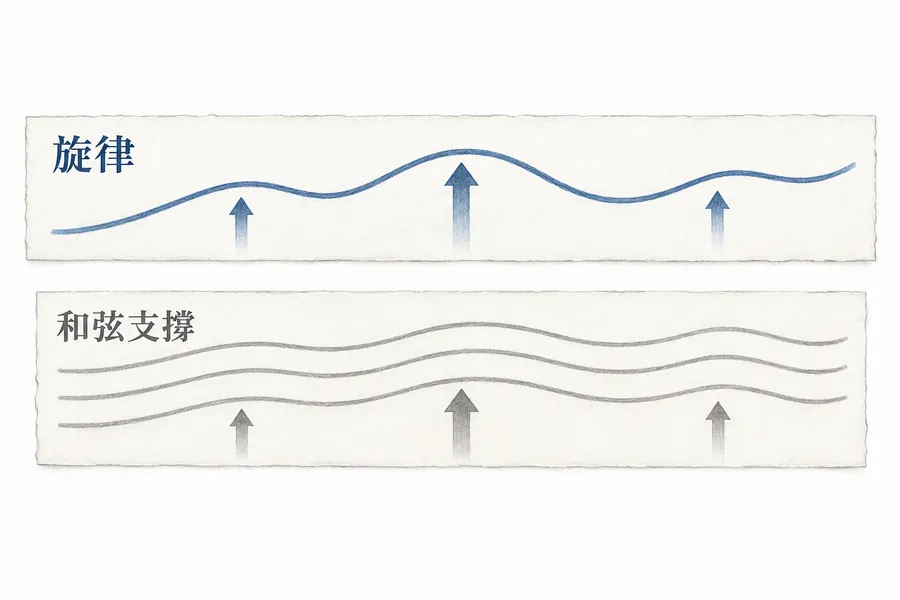

*Figure 14.4: tremolo on double stops and chords (schematic).*

### Chord tremolo has a longer travel

Chord tremolo is usually **not** suited to exactly the same speed as single-note tremolo.

Force the same density and the wrist tightens easily, while the sound becomes over-saturated.

The goals in practice are:

- the chord stays continuous and even;
- there is still room left for changes in loudness.

In classical works you can use a lower density and wider dynamic swings to keep the "breathing" of the harmony.

### The left hand gets dragged in as well

Double stops and chord tremolo are also a test of pressure management in the left hand.

When several courses are held at once, the palm tightens without your noticing. If the right hand is already tight, the two sides amplify each other.

In rehearsal, deliberately keep the chord shape in the left hand at **minimum pressure**, and check that the release can happen instantly at the end of the phrase.

**Key point:** the two courses have to be equally loud.
**Practice focus:** practise advanced right-hand technique.

---

## 14.5 Crosspicking

Crosspicking usually uses three courses to make a repeating pattern, creating a texture like a banjo roll while keeping the mandolin's attack.

The most important thing technically is **the relationship between the pattern and the time signature**.

For example: a three-note cycle placed in eighth notes in 4/4 keeps moving its accent.
If the player accents every third note out of habit, the whole passage comes off the beat.

### Count the main beats while you practise

- You can start with a **3+3+2** structure lined up against eight eighth notes.
- You can also let the three-note pattern cross the barline freely, as long as the main beat is still marked by **the melody note** or **the bass note**.

The musicality of crosspicking comes from "which note is the melody and which are the filling".
Melody notes and filling notes should sit on clearly different levels.

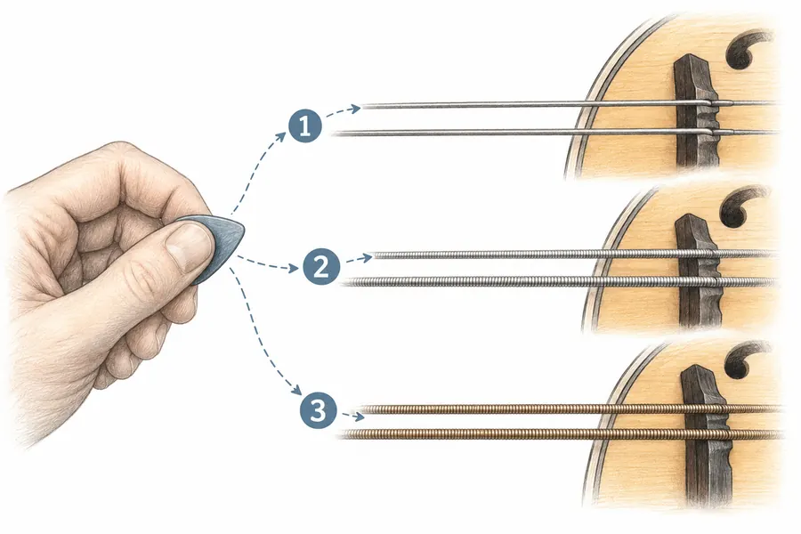

*Figure 14.5: crosspicking (schematic).*

### It is not the property of one fixed pattern

This technique matters in bluegrass and in the acoustic mandolin language that came after it.
But it is not the property of one fixed pattern.

Real players rewrite the path according to the chord, where the melody sits, and the pick direction.

Practice should be arranged like this:

1. Start with **two chords**.
2. Keep a fixed **top-note melody** first.
3. Then let the inner filling notes change.
4. Gradually understand its arranging function.

**Key point:** the pattern has to line up with the time signature.
**Practice focus:** practise advanced right-hand technique.

---

## 14.6 Arpeggios, sweeps and continuous picking

### Arpeggio

An arpeggio sounds the notes of a chord **in order**. It can be played with strict alternate picking, or with same-direction strokes running through several courses.

The second is close to a **sweep**. But if "sweep" is understood as "swinging the whole arm across", each note usually loses its own time.

The ideal is this: **the direction of the movement is continuous, but each note is still released clearly on its own.**

### Rake

A rake often has a more obvious gesture: the pick passes through several muted or stopped strings **in one movement**, landing on the target note.

Its point is to build **time tension** leading to the main note.

| Speed | Result |
|---|---|
| Too fast | nothing but noise |
| Too slow | it sounds like an ordinary arpeggio |

So adjust it to the musical context.

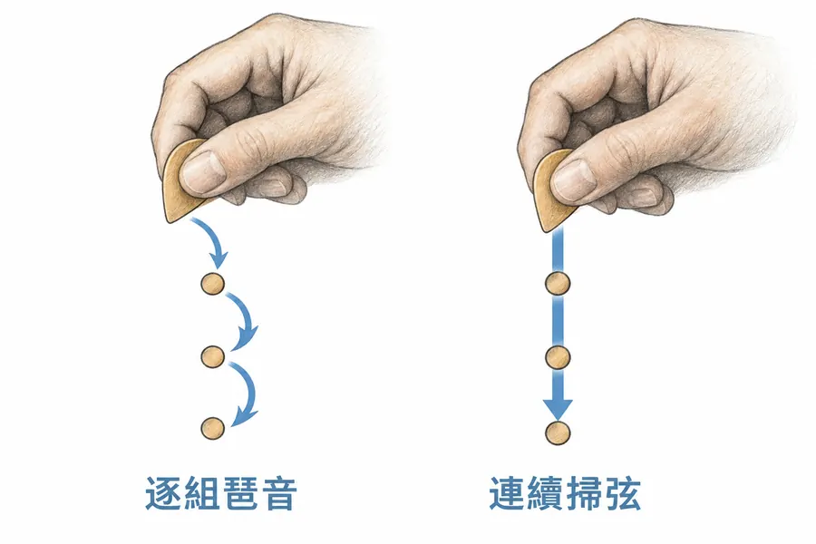

*Figure 14.6: arpeggios, sweeps and continuous picking (schematic).*

### The name does not matter; the sound purpose does

The broken chords of classical mandolin, the fill in bluegrass and comping in jazz may all use similar physical movements.
But the accent and the note length are different.

Tying "the name of the technique" to "the purpose of the sound" is more practical than memorising "this is called a sweep, that is called a rake".

**Key point:** the direction can be continuous, but each note still has to be independent.
**Practice focus:** practise advanced right-hand technique.

---

## 14.7 The chop

The bluegrass mandolin chop is often compared to **the snare drum's backbeat**.

The comparison is useful, because it reminds us that the value of the chop lies in **where it sits in time** and in the **very short decay**, not in the chord itself.

### Background

Bill Monroe established the ensemble grammar of bluegrass.

He gave the mandolin two roles at once: **lead instrument** and **rhythmic filling**.

After Earl Scruggs joined the Blue Grass Boys in 1945, the classic five-piece line-up took shape.

That line-up made the rhythmic space between the instruments clear.〔S1403〕

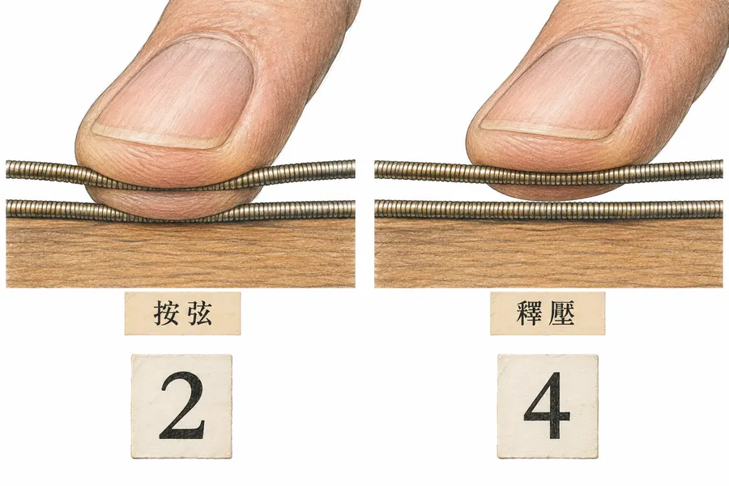

*Figure 14.7: the chop (schematic).*

### The technique is built on letting go

The chop usually uses a **closed voicing** (every note held down, with no open strings).

The method is this: after the right hand's downstroke, **the left hand releases its pressure at once**, so the chord leaves only a short attack behind.

> **Common misconception**
> **"A chop has to be hit very hard."**
> No. The shortness of the chop comes from the left hand letting go, not from brute force in the right hand.

> **This "letting go" matters more than "hitting down".**

If you only add force in the right hand and the left hand does not damp, you get a loud chord with a long sustain.
That chord then covers up the space for the guitar and the bass.

### Practice steps

1. With a metronome, **play only beats 2 and 4**.
2. Check that every stroke has exactly the same length.
3. Then add the I–IV–V chords.
4. Then **practise along with a recording**.

Step 4 matters: a real backbeat only means something against the groove of the bass, the guitar and the banjo.

A chop that sounds loud on its own in your room is not necessarily right in a band.

**Key point:** the left hand lets go, and only then is the right hand's sound "short".
**Practice focus:** practise advanced right-hand technique.

---

## 14.8 Ghost strokes and muted rhythm

The right hand can keep the subdivision going **without letting the string sound fully**.

These muted strokes are often used to:

- keep the groove;
- fill in syncopation (putting the accent off the beat);
- prepare the next accent.

Their value is that "**the time is there but the pitch drops into the background**", so they should not be played as loud as normal notes.

### Two ways to do it

| Approach | How |
|---|---|
| The left hand touches the string lightly | makes a dead note |
| The right hand reduces its depth of entry | the string does not sound fully |

What matters is this: do not let the muted stroke become a source of tension.

If you freeze the left hand completely in order to damp, the normal notes afterwards will not have time to recover.

In practice, split a two-bar pattern into two layers, "voiced" and "muted", and then gradually change the proportion.

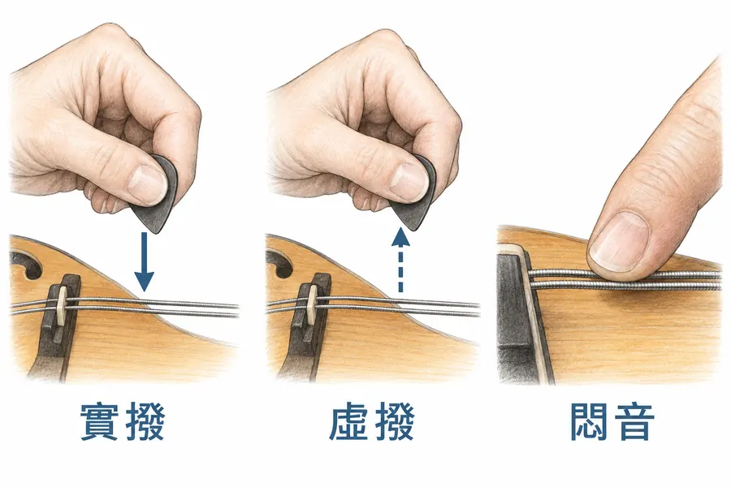

*Figure 14.8: ghost strokes and muted rhythm (schematic).*

### How to notate it

There is no single standard for this notation across styles. The common ones are:

- the x notehead
- brackets
- a verbal note

The arranger should explain it in the legend of the full score.

In a mandolin orchestra especially, "x" may also be read as a special percussive effect or something else, so it needs to be written clearly.

**Key point:** muted notes need clear timing too; only the pitch drops into the background.
**Practice focus:** practise advanced right-hand technique.

---

## 14.9 Speed training

### Define "usable speed" first

If a passage succeeds twice out of ten at 160 BPM, then 160 is not your usable speed.

A more practical definition: **you can keep the rhythm, the tone and the coordination of the two hands going for several repeats in a row, while staying reasonably relaxed.**

That definition turns practice from "challenging the limit" into "widening the controllable zone".

### Two effective methods

| Method | How | Benefit |
|---|---|---|
| Burst practice | play only 4–8 notes at the target speed, then rest; lengthen gradually | lets the nervous system feel the fast movement without slipping into fatigue compensation too early |
| Rhythm variation | turn four sixteenth notes into long-short-long-short, then short-long-short-long | exposes the weak points in different finger changes |

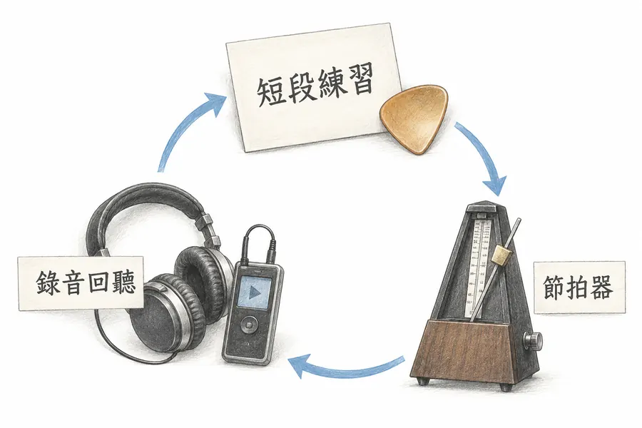

*Figure 14.9: speed training (schematic).*

### Slow practice has value too

If these problems are still there at a very slow tempo:

- the pick's path is too large
- the left hand lifts too early
- the accent is in the wrong place

then at high speed they will only be magnified.

The point of slow practice is to **keep the same path** and watch the details with more attention. It is not to make the movements smaller and more casual.

**Key point:** usable speed means you can repeat it successfully.
**Practice focus:** practise advanced right-hand technique.

---

## 14.10 Case study: evenness and expression in tremolo

Suppose a player can manage eight strokes per beat, which is already a high speed, and yet the recording still has an obvious "da-da-da" grain to it.

### Three checks

1. **Check the volume difference**: is the downstroke much louder than the upstroke?
2. **Check the depth of entry**: does every stroke go in as deep as a loud single note?
3. **Check the phrasing**: does it mechanically re-accent every four strokes, forcing the listener to hear the subdivision?

### The order to fix it

1. First **slow the tremolo down** until you can clearly hear every stroke.
2. Build symmetry with **the smallest possible attack**.
3. Then, at the same density, make long crescendos and diminuendos.
4. When the dynamics can change smoothly, the hand is no longer holding the speed with a fixed pattern of force.
5. Finally go back to the phrase, and place the accents according to where the phrase goes.

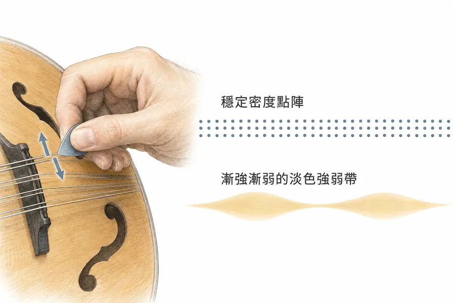

*Figure 14.10: case study, evenness and expression in tremolo (schematic).*

This case shows that the advanced stage of tremolo is when you can make the listener **forget** that the right hand is going up and down, leaving only the breathing of the melody.

---

## Table 14-1 | Advanced right-hand techniques: their sound purpose and main failure modes

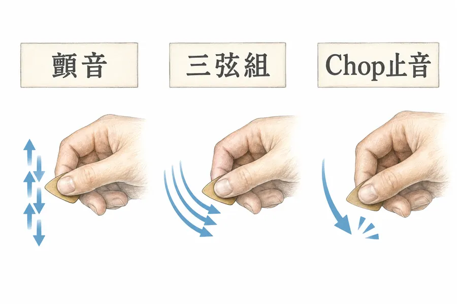

| **Technique** | **Main sound purpose** | **Core control** | **Common failure** |
|:---|:---|:---|:---|
| **Tremolo** | extending a long note, cantabile | down-up symmetry, density, phrase | chasing speed only, mechanical accents |
| **Crosspicking** | a cycle across several strings with an embedded melody | path across the strings, main beat, balance between parts | a fixed accent every three notes |
| **Arpeggio／Sweep** | broken chords | independent time for each note, continuous movement | turning into a single blur of sweeping |
| **Rake** | a gesture leading to the target note | the width in time, the final main note | too fast, and it becomes noise |
| **Chop** | the backbeat on beats 2 and 4, short decay | left hand releases plus right-hand attack | hitting with force only, sustain too long |

*Figure: the movement concept behind the right-hand techniques; the courses are arranged by phrase (schematic).*

### How to use it

This table works as a "symptom → cause" reference.

When one of the moves sounds wrong, ask first: **what sound purpose was it meant to achieve?** Then look at the "common failure" column and find the cell closest to your case.

---

## Self-study question bank

Study check: answer, mark, review

Answer for yourself first, then look at the answers. When you get one wrong, go back to the relevant section of the chapter and read it again.

**1. The advanced goal of tremolo is?**

- A. The faster the better

- B. To make the repeated picking serve the melody and the long line

- C. To use downstrokes only

- D. To keep one fixed volume

**2. What crosspicking focuses on includes?**

- A. The path across the strings and the design of the accents

- B. Using only the left hand

- C. Doing away with the beat

- D. Playing on one string only

**3. When the speed sticks, the most effective method is often?**

- A. Find the change that is limiting you

- B. Play the whole piece over and over

- C. Make the movements bigger

- D. Keep changing instruments

**Answers: 1.B　2.A　3.A**

---

## Main sources checked for this chapter

Sources checked: find the original, check the conditions, keep a record

**【S1401】Raffaele Calace: Metodo per mandolino, Opp.37–42.** The historical source for tremolo, right-hand control and classical technique.

> https://imslp.org/wiki/Metodo_per_mandolino\_(Calace%2C_Raffaele)

**【S1402】Carlo Munier: Metodo completo per la divisione.** Division, tremolo and advanced right-hand method.

> https://imslp.org/wiki/Metodo_completo_per_la_divisione\_(Munier%2C_Carlo)

**【S1403】Bluegrass Music Hall of Fame & Museum: Bill Monroe biography.** The history of Monroe, the Blue Grass Boys and the classic 1945 five-piece bluegrass line-up.

> https://www.bluegrasshall.org/inductees/bill-monroe/
