# Chapter 15: Fretting and Advanced Left-Hand Technique

*Advanced Left-Hand Technique*

## Key points

- Having frets does not mean "just press in the right box". The real music is decided by **pressure, where you press, when the note starts and ends, the path of the shift, and the coordination of the two hands**.
- The force fretting needs is usually far less than you think.
- In a shift, what matters is not the start and the end point, but **the moment you arrive**.
- On the mandolin, vibrato is more restrained than on the violin, and should not be treated as "the default ornament on every long note".
- A harmonic needs only a **light touch on the node**, not the string pressed down.

---

The mandolin has frets, and that often makes people think the left hand's job ends with "pressing in the right box".

In fact, frets only make the positions of the pitches **discrete** (turning them into a row of boxes). The real music is still decided by these things:

- pressure
- where you press
- when the note starts and ends
- the path of the shift
- the coordination of the two hands

Nineteenth-century tutors already put positions, extensions, ornaments and double stops into a complete training system.
That shows the mandolin's left hand went beyond "simple fretting in first position" very early on.〔S1501〕〔S1502〕

The core principle of this chapter is one sentence:

> **The less surplus force you use, the more room is left for speed and expression.**

Every technique should be built on the same foundation. These techniques include:

- hammer-on
- pull-off
- slide
- trill
- vibrato
- double stop
- harmonics

And that foundation is only three sentences:

- The wrist can breathe.
- The thumb is not locked.
- The fingers can release quickly.

---

## 15.1 Where you press, how hard, and when

### Position: close to the fret, but not on top of it

When you fret, the fingertip usually lands **behind the target fret, close to it**.

| Position | Result |
|---|---|
| Close to the fret | a smaller force is enough to make the string sit firmly |
| Too far from the fret | the stretch of string that can vibrate between two frets is longer, so buzzing comes more easily |

On a double **course**, **both strings have to be pressed down at once**.
So the angle of the finger has to be adjusted as well, so that you do not press only one of them.

### Timing: when the pressure arrives matters as much as how much

If the finger presses down **long before** the right hand picks, unnecessary tension builds up at speed.
Too late, and you get the open string or a stray noise.

Practice steps:

1. Use extremely slow eighth notes.
2. Complete the press **the instant before** each pick stroke.
3. When the note ends, release at once, down to the point of "still touching, but no longer pressing".

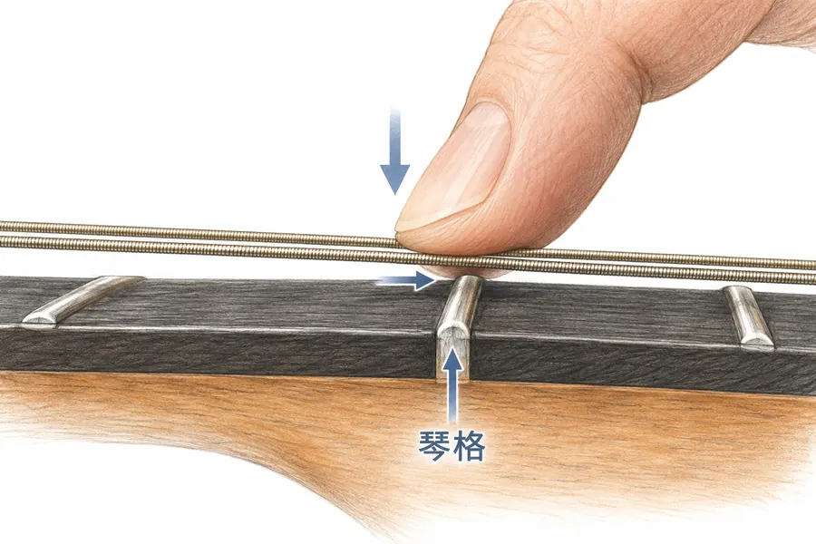

*Figure 15.1: where you press, how hard, and when (schematic).*

### Every instrument feels different

These factors change "how much pressure is needed":

- higher **action**
- heavier strings
- lower frets

So a teacher's "press lightly" on their own instrument is not necessarily the actual force on yours.

Technical judgements have to be read together with the **setup** diagnosis in Chapter 11.

**Key point:** close to the fret, precise timing, and you can use the least force.
**Practice focus:** plan the left-hand fingering and the shifts.

---

## 15.2 Finger assignment and preparing the phrase

### One finger per fret: only a starting point

Beginners often use the idea of "one finger per fret":

| Finger | Fret it covers |
|---|---|
| Index | fret 1 |
| Middle | fret 2 |
| Ring | fret 3 |
| Little | fret 4 |

For a standard scale this is a very good start.
But real repertoire changes the **finger assignment** because of semitones, positions, chords and tone requirements.

The heart of professional fingering is: **can the whole phrase stay continuous, and can unnecessary large jumps be avoided.**

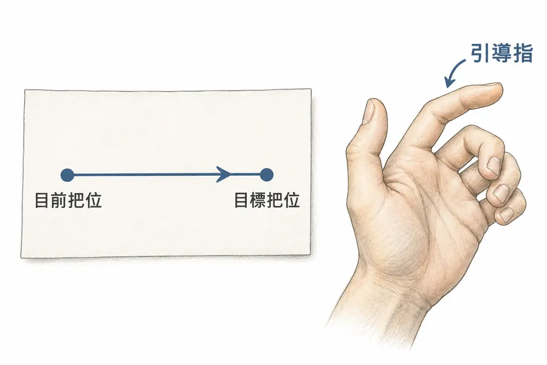

*Figure 15.2: finger assignment and preparing the phrase (schematic).*

### Finger retention

This is an important idea: if a note will be needed again shortly, and keeping it does not create tension, you can leave it held for the moment.

The benefits are:

- it helps with double stops;
- it helps with arpeggios;
- it helps with continuous scales.

But the opposite is also true: **all the fingers lying on the fretboard all the time limits speed too**.

What you really need is the judgement to decide which notes are worth keeping and which should be released early.

### Work backwards from the end of the phrase

The best fingering is often worked out **backwards from the end of the phrase**.

Find where the next high point, the next chord or the next string change is, then decide where to shift earlier.
That is far more reliable than "pressing whatever comes next" from the first note onwards.

**Key point:** fingering serves the whole phrase, not a single note.
**Practice focus:** plan the left-hand fingering and the shifts.

---

## 15.3 Shifting

The heart of a shift is **the moment you arrive**.

Many people look only at the start and the end, and ignore the fact that "the move in between also has a rhythm".

Suppose a melody has to jump from fret 3 to fret 10. The left hand has two options:

1. **Move at once** after the previous note ends.
2. Use a slide to make it an expressive gesture.

The two approaches affect the breathing of the phrase directly.

### The guide finger

A guide finger reduces "the uncertainty in space". The method is:

1. One finger releases its fretting pressure.
2. But it still **touches the string lightly**.
3. It slides along the string to the new position.
4. Then presses down again.

This is how you build **a sense of the path**.

At high speed the guide finger may keep only the very lightest contact, or even leave the string completely.
But the body should still know "which line to move along".

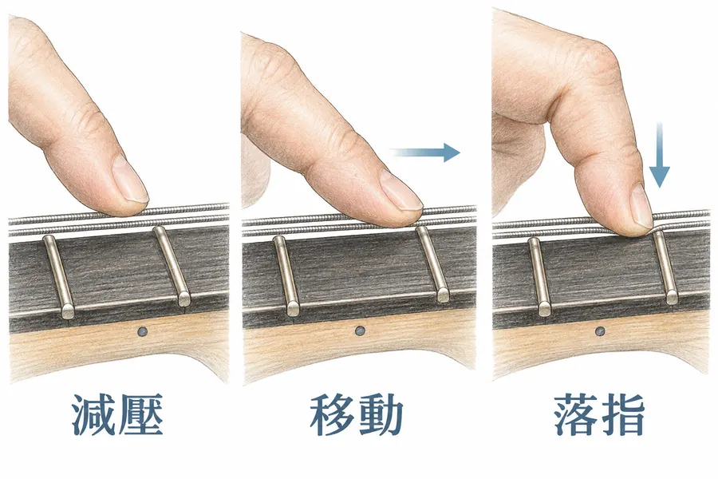

*Figure 15.3: shifting (schematic).*

### Put the move into the beats

In practice you can fix a metronome and place "the move itself" on a particular subdivision:

1. A long quarter note is held to the end of beat 3.
2. Complete the shift on beat 4.
3. Beat 1 lands on the new note.

When that is steady, shorten the time of the move.

That builds a repeatable movement more easily than "sliding back and forth ten times with no rhythm".

---

## 15.4 Finger extension

A standard mandolin has a short **scale length**, and in first position four fingers often cover a lot of notes.

But some keys and some chromatic passages need an **extension** forwards or backwards.

The principle of extension is: **move one finger locally, and keep the shape of the palm natural.**
Usually it means letting one finger reach beyond the current position while the other fingers keep their reference.

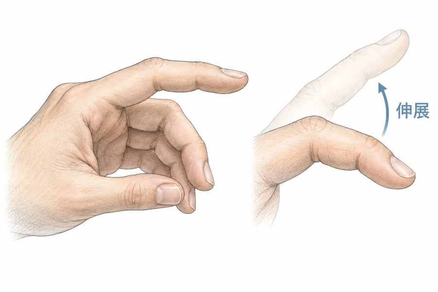

*Figure 15.4: finger extension (schematic).*

### Small hands can shift earlier

Players with small hands can **shift earlier** and use the shift to keep a natural hand shape.

That is also why "standard fingering" is only a starting point.
If shifting does not break the legato, trading a move for a more natural hand shape is often healthier.

### The cost of extension is much higher on the larger instruments

The larger instruments in the family have noticeably longer scale lengths, and the cost of extension rises noticeably too.

These instruments include:

- mandola
- octave mandolin
- mandocello

Moving the one-finger-per-fret and wide-stretch habits of the standard mandolin **straight over** can cause over-stretching.

When planning fingering, rethink the position and arrange the fingers according to the new instrument's scale length.

**Key point:** extension is a local movement, not pulling the whole palm open.
**Practice focus:** plan the left-hand fingering and the shifts.

---

## 15.5 Hammer-ons and pull-offs

### Hammer-on

The method is this: a left-hand finger **falls fast**, giving the string a new vibrating node while keeping enough energy.

When the sound is too weak, there are usually three causes:

- the landing point is too far from the fret;
- the finger travels too far;
- the previous note had too little energy to begin with.

An effective hammer-on relies on a **fast, short** finger movement, not on force.

### Pull-off

A pull-off is **not** lifting the finger straight up.

If you only move upwards off the string, the volume may be too low.
It usually needs a little **sideways release**, like plucking the string lightly.

But if the movement is too big, the pitch bends, or you hit another course.
On a double course you also have to make sure both strings are released evenly.

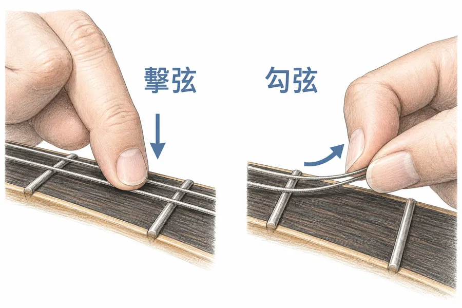

*Figure 15.5: hammer-ons and pull-offs (schematic).*

> **Common misconception**
> **"A hammer-on has to be pounded down hard."**
> No. What it needs is speed and a short distance. Force only makes the finger slower and tighter.

### Put them into the beat

In practice, put the hammer-on and pull-off into the beat.

For example: in four sixteenth notes, only **the first note** is attacked by the right hand; the other three are done by the left hand.

If the beat starts to drag, the left-hand ornaments have not yet really become "rhythmic language".

**Key point:** notes made by the left hand need rhythm too.
**Practice focus:** plan the left-hand fingering and the shifts.

---

## 15.6 Slides and glissando

A slide has two completely different uses:

| Use | Requirement |
|---|---|
| only in order to shift | it should be as quiet as possible |
| the pitches in between are deliberately heard | this is an expressive device |

If you do not distinguish the two, a player may leave a slide on **every** shift.
Over time that becomes an unnecessary stylistic marker.

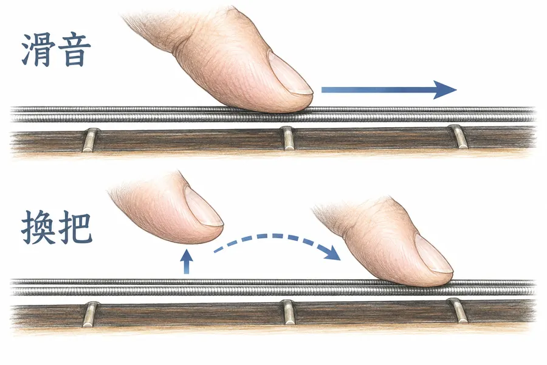

*Figure 15.6: slides and glissando (schematic).*

### Glissando on a fretted instrument

On a fretted instrument a glissando is the finger crossing a series of frets, and what you hear is a **stepwise** change.

The factors that change the effect are:

- speed
- pressure
- whether the right hand re-attacks

Portamento in the classical repertoire, the slide in folk music and the slide in blues styles may use similar physical movements.

But the grammar of the three is different.

### Double-stop slides are harder

In a double-stop slide you have to watch particularly that **the pressure and the distance of the two fingers are in step**.

If one finger arrives first, the new harmony is briefly out of place.

A slow recording is the best way to check.

**Key point:** decide first whether "this slide should be heard".
**Practice focus:** plan the left-hand fingering and the shifts.

---

## 15.7 Trills and grace notes

### Trill

A trill is the fast alternation of the main note and its neighbour.

The most common problem is this: it gets faster and faster after the attack, and in the end it cannot land back on the main note on time.

In practice you should **fix the number of repetitions first**:

1. 4 repetitions in one beat.
2. 6 repetitions in one beat.
3. 8 repetitions in one beat.

Only then gradually loosen it up.

That keeps the beat inside the trill, and keeps the ornament lined up with the main beat.

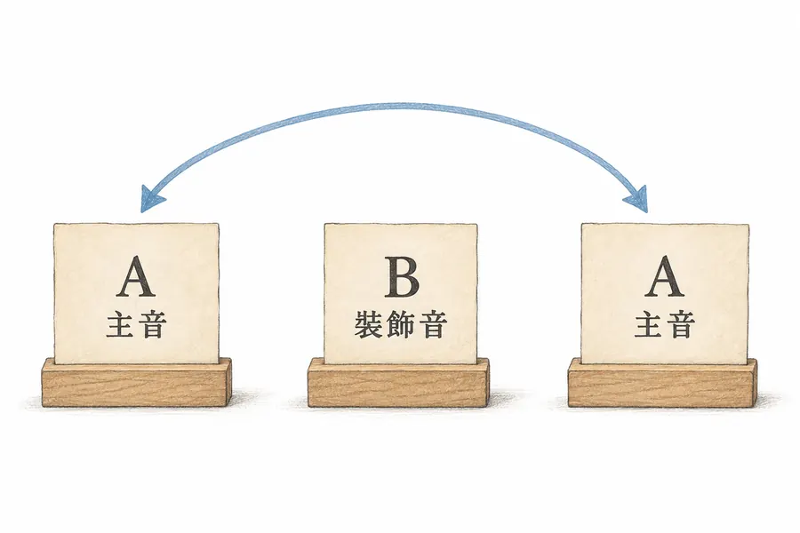

*Figure 15.7: trills and grace notes (schematic).*

### Grace note

The length of a grace note and where it lands in the beat vary with the style.

| Style | Convention |
|---|---|
| Classical ornaments | have their own rules of time |
| The Irish cut and other ornaments | another set again |
| The bluegrass slide-in | different again |

When reading a score, look at three things at once: **the period, the composer, and the editorial conventions of the edition.**

What a historical method offers is technical evidence **from one particular era**.
Its scope of application should be confirmed against the period and style of the repertoire.

A learner can treat the ornaments of Calace and Munier as important coordinates in the classical tradition.

Then compare them with the actual repertoire and actual recordings.〔S1501〕〔S1502〕

**Key point:** ornaments need the beat too.
**Practice focus:** plan the left-hand fingering and the shifts.

---

## 15.8 Vibrato

### Vibrato on the mandolin is not the same as on the violin

On a violin, shaking the finger along the length of the string **changes the effective length continuously**.

But on a fretted mandolin, the fret fixes the end point of the sounding string.
So the same movement does not produce the same amount of pitch modulation.

Vibrato on the mandolin usually relies on:

- tiny friction along the string;
- changes in pressure;
- a slight lateral bending.

The effect is far more **restrained** than on an unfretted string instrument.

> **Common misconception**
> **"Vibrato means shaking hard the way violinists do."**
> On the mandolin that cannot be done, and it should not be forced. Vibrato here is "a subtle change of tone and pitch".

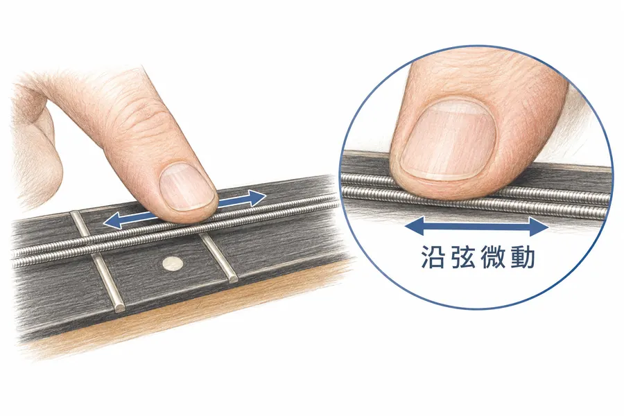

*Figure 15.8: vibrato (schematic).*

### Not every long note needs it

Because the effect is restrained, vibrato is not suited to being the default that "makes every long note prettier".

| Occasion | Suitability |
|---|---|
| Certain cantabile classical passages and slow songs | it can be used |
| Fast folk melodies | overuse does not fit |
| A bluegrass break | overuse does not fit |
| Historically informed playing | overuse does not fit |

**Decide whether the music needs it, then decide the movement.**

### Check it with a recording

In practice you can record a long note and compare three versions:

1. No vibrato at all.
2. Slow vibrato.
3. Fast vibrato.

| What you hear | Judgement |
|---|---|
| the pitch swings up and down a lot, like a guitar bend | the amount may be too large |
| no difference at all | the hand may only be waving without actually affecting the string |

**Key point:** vibrato on the mandolin is "subtle", not "wide".
**Practice focus:** plan the left-hand fingering and the shifts.

---

## 15.9 Double stops

A double stop is the basic way to combine harmony on the fretboard.

| Interval | Function |
|---|---|
| Third | shows major or minor directly |
| Sixth | often gives a more open sound |
| Octave | thickens a melody without changing its harmonic function |

The best way to learn double stops is to **harmonise along the scale** (adding another note to every note of the scale).

That ties "the relationship between intervals" to "the shape under the fingers".

### Why understand it rather than only memorise the shape

Take the G major scale and add a third above every note, and you get:

| Lower note | Third above | Kind of third |
|---|---|---|
| G | B | major third |
| A | C | minor third |
| B | D | minor third |

Major and minor thirds **change on their own according to the notes in the key**.

Once you understand the rule, you can work it out again for D, for A, or for any other key.
Memorising shapes alone makes you lose your direction when you change key.

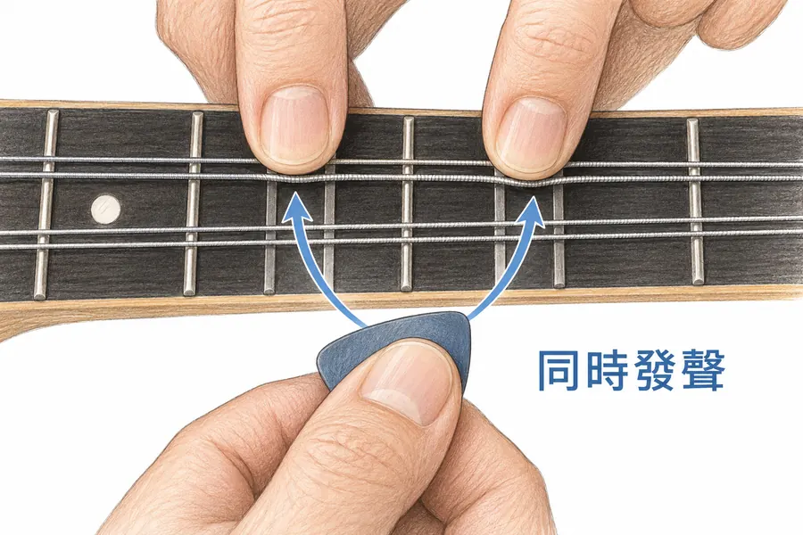

*Figure 15.9: double stops (schematic).*

### The right hand affects double stops too

The two courses have to be picked **together**.
And the left hand has to let all four actual strings sound cleanly.

If one string buzzes, the sound produces a strange beating, which is often mistaken for a **tuning** problem.

**Key point:** practising along the scale is more reliable than memorising shapes.
**Practice focus:** plan the left-hand fingering and the shifts.

---

## 15.10 Harmonics

### Natural harmonics

Natural harmonics form at the **points where the string divides into whole numbers** of equal parts.

| Position | Ratio of string length | Pitch produced |
|---|---|---|
| Around fret 12 | 1/2 | one octave higher |
| Around fret 7 | 1/3 | a twelfth higher |
| Around fret 5 | 1/4 | two octaves higher |

To play one, the finger **only touches the node lightly; it does not press the string down to the fret**.

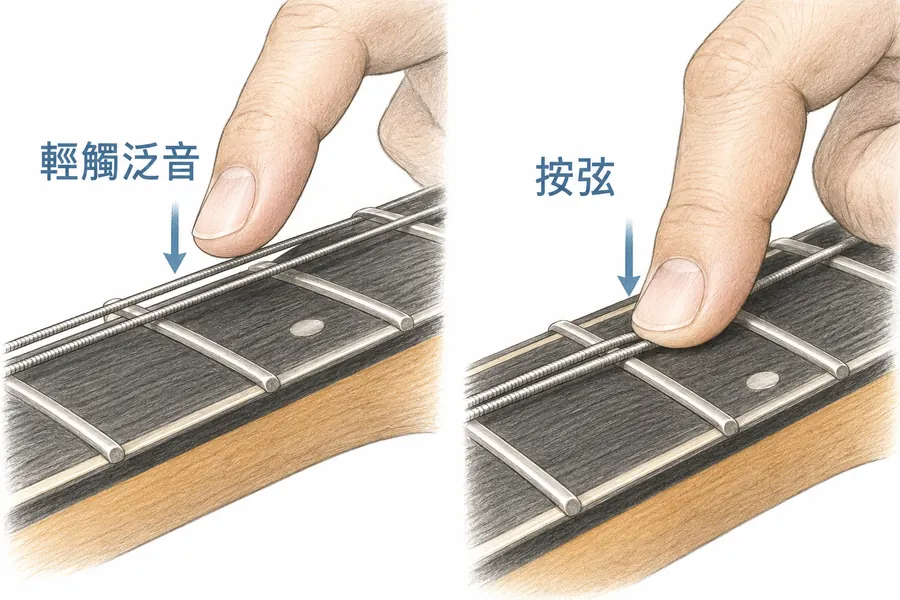

*Figure 15.10: harmonics (schematic).*

> **Common misconception**
> **"A harmonic means pressing the string down hard."**
> Exactly the opposite. Press it down and it becomes an ordinary note, not a harmonic.

### Harmonics on double courses are harder

A harmonic on a double course requires **both strings to be touched lightly near the node**.
So the contact surface and the angle of the finger have to be consistent.

### A quick check of the bridge position

Natural harmonics are also a quick way to check where the bridge sits.

The difference between the harmonic at fret 12 and the stopped note at fret 12 is one of the important references for the **intonation** diagnosis in Chapter 11.

### Artificial harmonics

An artificial harmonic needs **one hand to stop the note while the other establishes a new node and sounds it**.
On the mandolin the coordination is relatively hard.

It is a colouristic technique.
Until the basic natural harmonics and the sense of intonation are steady, it should not be chased.

**Key point:** touch lightly; do not press down.
**Practice focus:** plan the left-hand fingering and the shifts.

---

## 15.11 Coordination of the two hands

The most common problem at high speed is:

- the right hand has already picked the next note while the left hand has not arrived;
- or the left hand lifts too early and a brief open string sounds.

With the mandolin's clear attack, this kind of timing error is especially easy to hear.

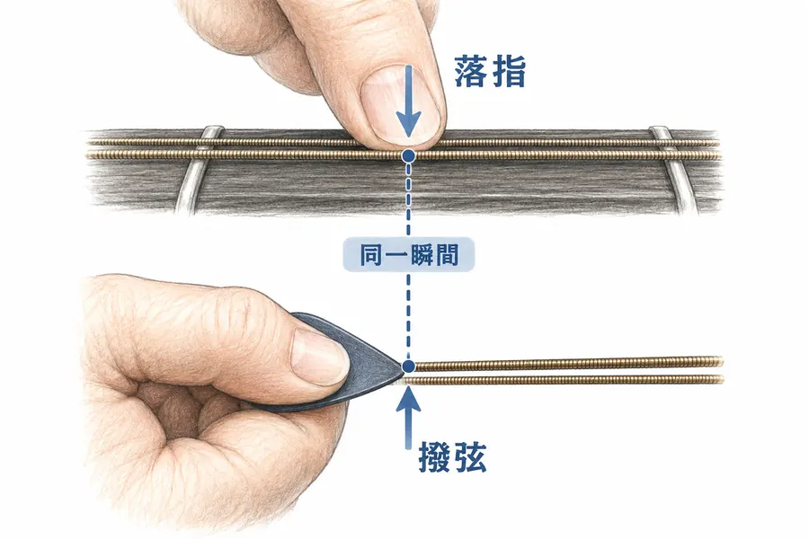

*Figure 15.11: coordination of the two hands (schematic).*

### The solution: magnify the "changeover"

1. Take two notes, E–F#, repeated, and practise only **the same instant** of "the right hand picks" and "the left hand lands".
2. Then practise **the release**: F# ends and the next note begins.

The moment a note ends decides the legato, the staccato and the clarity of the phrase.

### Play the recording back slowly

You can slow a recording down and listen for:

- tiny "gaps";
- open-string blips that should not be there.

In live playing these are usually very hard to notice by feel alone.

**Key point:** timing problems have to be magnified before you can see them.
**Practice focus:** plan the left-hand fingering and the shifts.

---

## 15.12 Case study: fingering a melody in high positions

Suppose a melody climbs from first position all the way up to E6. There are two ways to do it:

| Approach | What it does | Advantage | Disadvantage |
|---|---|---|---|
| A | save the jump to a high position until the end | fewer moves | puts the **biggest** shift at the most tense, fastest point |
| B | shift early, during the previous long note | uses the musical space to spread the difficulty | more moves |

A looks like "less moving", but in fact it concentrates the risk in the worst place.
B looks like "more moving", but in fact it spreads the risk into safe places.

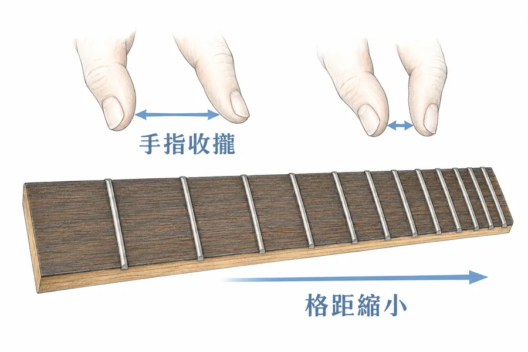

*Figure 15.12: case study, fingering a melody in high positions (schematic).*

### Compare fingerings on three things

1. Distance.
2. Preparation time.
3. Where you land.

What you are really comparing is: **how much preparation time does each shift get? Can a guide finger be used? Which finger has to work the moment the shift is done?**

Professional fingering often looks more complicated. In fact it puts the risk in safer places.

### How to practise it

Make two fingerings for the same passage, record both at **the same BPM**, and compare:

- the success rate
- the tone
- the continuity of the phrase

Choose the fingering on those three, and treat the fingering printed in the score as **a reference**, not a rule.

---

## Table 15-1 | Left-hand techniques and the checkpoints that matter most

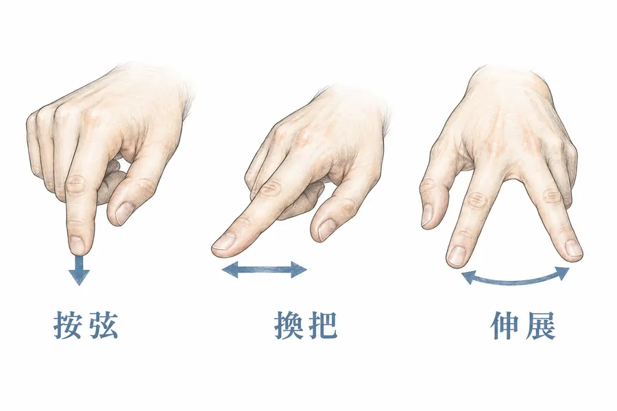

| **Technique** | **What is really being controlled** | **The commonest misconception** | **Focus in practice** |
|:---|:---|:---|:---|
| **Fretting** | minimum necessary pressure, just behind the fret | "the harder you press, the cleaner it is" | reduce the pressure until it buzzes, then add a little back |
| **Shift** | the moment of arrival and the path | looking only at the start and the end | put the move into the beats |
| **Hammer／Pull** | the left hand's notes still have rhythm | chasing volume only | fix the subdivision |
| **Vibrato** | a subtle change of pitch and colour | copying the violin's wide shake | record and compare the amount |
| **Double stop** | the interval between two parts, and all four strings sounding | memorising shapes only | harmonise along the scale |

*Figure: Table 15-1, left-hand techniques and the checkpoints that matter most (schematic).*

---

## Self-study question bank

Study check: answer, mark, review

Answer for yourself first, then look at the answers. When you get one wrong, go back to the relevant section of the chapter and read it again.

**1. One of the functions of the guide finger in a shift is?**

- A. To give a sense of the path of the move

- B. To increase string tension

- C. To lower the bridge

- D. To change the key

**2. When a hammer-on sounds too weak, what should you check first?**

- A. The landing point and the efficiency of the movement

- B. The material of the case

- C. The brand and the year

- D. The length of the strap

**3. Coordination problems at high speed usually come from?**

- A. The two hands not being aligned in when they sound the note

- B. The colour of the wood being different

- C. The case being too big

- D. The soundhole being too round

**Answers: 1.A　2.A　3.A**

---

## Main sources checked for this chapter

Sources checked: find the original, check the conditions, keep a record

**【S1501】Raffaele Calace: Metodo per mandolino, Opp.37–42.** The historical method for shifting, ornaments, double stops and left-hand technique.

> https://imslp.org/wiki/Metodo_per_mandolino\_(Calace%2C_Raffaele)

**【S1502】Carlo Munier: Scuola del Mandolino / Metodo completo per la divisione.** A historical source for positions, ornaments and technical training.

> https://imslp.org/wiki/Metodo_completo_per_la_divisione\_(Munier%2C_Carlo)

---
