# Chapter 16: Chords, Harmony and Accompaniment

*Harmony, Chords and Accompaniment on the Mandolin*

## Key points

- The mandolin has only four courses, so a chord can hold **at most four notes at once**. That forces you to think about which notes have to stay.
- One chord name can have many voicings, and they do not sound the same.
- The third decides whether the chord is major or minor in character; the seventh of a seventh chord often has a function and is usually kept first.
- Because there are only four courses, "what to leave out" becomes an arranging skill.
- Learning a hundred chord shapes is not the same as being able to accompany. What really decides the style is note length, rhythm, register and the space in the band.

---

The mandolin has only four courses, and that actually makes harmony very direct to learn.

Because a four-note chord can fill at most four courses at once.
So you **have to make choices**:

- Which notes must be kept?
- Which notes can be doubled?
- Do you need to play the root yourself?

These questions push "the chord chart" towards real arranging and orchestration thinking.

| Instrument | Number of parts | Result |
|---|---|---|
| Guitar | six strings, enough to stack a lot of notes | one note fewer is less easy to notice |
| Mandolin | four courses | **every note matters more** |

This chapter starts from intervals, voice leading, rhythmic function and stylistic use.

You will see that the same G major chord can be voiced many ways; and that the same D7 does not have to contain all four notes.

The bluegrass chop, classical broken chords, jazz comping and chord melody all use chords.
But the sound they actually need is completely different.

---

## 16.1 Triads

The four basic triads:

| Name | Made of | Difference from the major triad |
|---|---|---|
| **Major triad** | root + major third + perfect fifth | — |
| **Minor triad** | root + minor third + perfect fifth | the third is a semitone lower |
| **Diminished triad** | root + minor third + diminished fifth | has both a minor third and a diminished fifth |
| **Augmented triad** | root + major third + augmented fifth | the fifth is raised |

These four basic structures are the starting point for every voicing in practice.

When you see G7, Gmaj7, G6 or G9, the first thing to know is still the **G–B–D** skeleton.

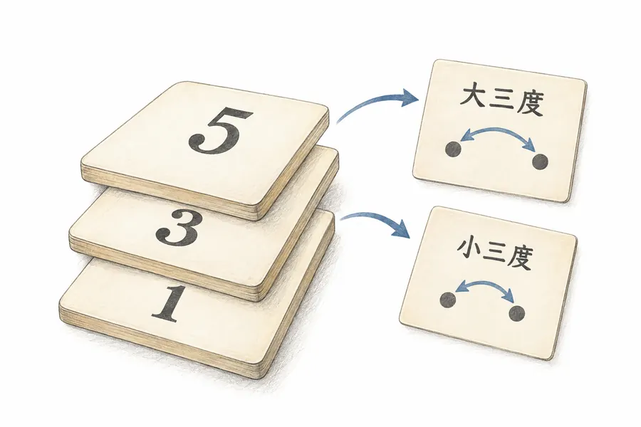

*Figure 16.1: triads (schematic).*

### Four courses means some note has to be doubled

On four courses a triad naturally doubles one of its notes.

| Voicing | Note doubled | Top part |
|---|---|---|
| G–B–D–G | the root | the root |
| G–D–G–B | the root | the major third |

Both have the same chord name, but they **sound different**.

That is what voicing means: **the set of chord tones is the same, and a different arrangement changes where the weight of the parts sits.**

### What should you leave out?

| Note | Can it go? | Why |
|---|---|---|
| Fifth | often the first candidate to drop | especially when it has not been altered |
| Root | sometimes can go | for example when playing with a bass player, the bass already provides the root clearly |
| Third | usually kept first | it decides the major or minor character |
| Seventh | usually kept first | in seventh chords it often has a function |

So when you play with a bass player, the mandolin can give its limited courses to the third, the seventh and the tension.

**Key point:** recognise the skeleton first, then talk about alterations.
**Practice focus:** understand chords and accompaniment.

---

## 16.2 Inversions and voice leading

### Three inversions

| Which note is the lowest part | Name |
|---|---|
| the root | root position |
| the third | first inversion |
| the fifth | second inversion |

The lowest note on the mandolin is limited by the layout of four courses.
In practice you cannot always present bass inversions as completely as a piano can.

But the idea of inversion is still very useful, because it tells you: **which way the parts inside this voicing are pointing.**

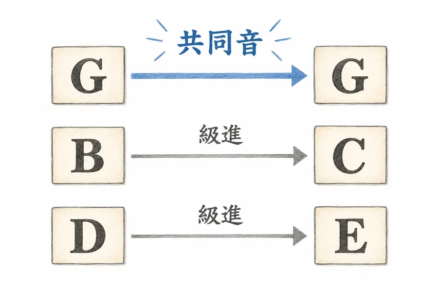

*Figure 16.2: inversions and voice leading (schematic).*

### Voice leading: let the hand move less

If G major is followed by C major, the whole hand does not have to jump to some shape far away.

You can do this:

1. **Keep** the common note, G.
2. Move B to C.
3. Move D to E.

This "smallest movement" is voice leading.

It makes the accompaniment sound like several melodic lines moving naturally, keeping the connection between the parts.

### Exercise: listen to the top part

Once the open G, C and D chords are familiar, practise voice leading with closed chords.

Pick three closed voicings and try to make **the top part** move like this:

- G–G–F#–G, or
- B–C–A–B

Once you start "listening to the top part", you will find that **accompaniment is itself a kind of melodic design.**

---

## 16.3 Seventh chords

Three common seventh chords:

| Name | Made of |
|---|---|
| **Dominant 7** | major triad + minor seventh |
| **Major 7** | major triad + major seventh |
| **Minor 7** | minor triad + minor seventh |

The difference between these chords is not only "colour". It changes **function** too.

### The tritone: where the tension comes from

In a dominant seventh chord, the third and the seventh form a **tritone**.
In traditional tonal harmony this is an important source of tension pushing towards the tonic.

Take D7 going to G:

| Note | Where it goes |
|---|---|
| the F# of D7 | usually moves **up** to G |
| the C of D7 | usually moves **down** to B |

These two resolutions, by semitone and by whole tone, let the ear hear the cadence better than "the root jumping from D to G" ever could.

So on a four-course mandolin, even with the fifth A left out, as long as F# and C are kept, the harmonic function is still very clear.

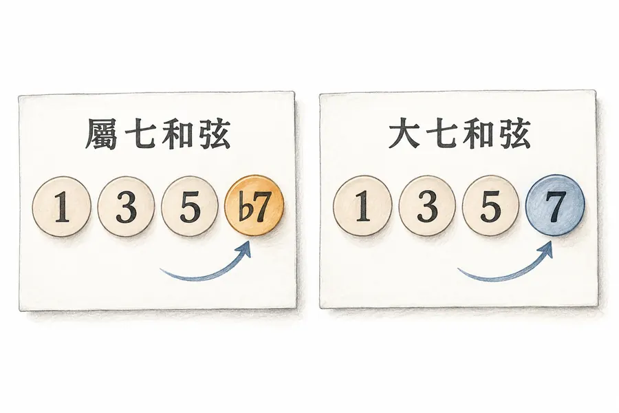

*Figure 16.3: seventh chords (schematic).*

### Half-diminished and diminished seventh

**m7b5** (the half-diminished seventh) and **diminished 7** are common in minor keys, or as chromatic passing harmony.

Because the intervals inside them are more symmetrical, their **movable shapes** are especially convenient.

But that also makes it easy to memorise the shape without knowing what it does.

> **Every time you learn a new diminished seventh shape, ask one question:**
> **"Which key is it in, and which chord does it resolve to?"**

**Key point:** keep the third and the seventh and the function is clear.
**Practice focus:** understand chords and accompaniment.

---

## 16.4 Sixth chords and extended chords

In theory a 13th chord can contain 1–3–5–b7–9–11–13, as many as seven different chord degrees.

A four-course mandolin cannot possibly sound them all.

Real jazz and pop voicings **deliberately leave out** the notes that matter less.

What they keep is two things:

- the **guide tones** that let you recognise the harmony;
- the tension notes that give it character.

### Example: G13

G13 can be played with just **B–F–E–A**:

| Note | Role |
|---|---|
| B | the third |
| F | the minor seventh |
| E | the thirteenth |
| A | the ninth |

Here there is **no root G and no fifth D**.

If the bass already provides G, the sound still holds up.
On the other hand, in an unaccompanied solo, leaving the root out completely may leave the listener with no direction.

So the voicing has to be decided by the **ensemble context**, and by checking how the bass and the other parts divide the work.

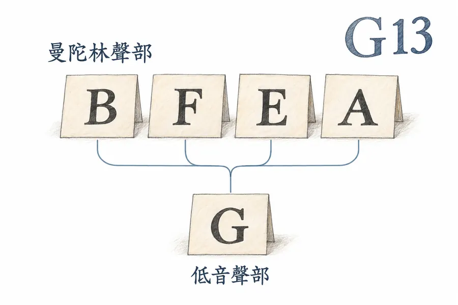

*Figure 16.4: sixth chords and extended chords (schematic).*

### The difference between add9 and sus2

| Chord | Notes | The third |
|---|---|---|
| Gadd9 | G–B–D–A | **keeps** the major third, B |
| Gsus2 | G–A–D | A **replaces** B, and the third disappears |

On paper the difference is small; in function and in sound it is not.

> **When you read a chord symbol, take the intervals apart first. That is more reliable than looking it up in a chord dictionary.**

**Key point:** four strings are simply not enough, so you have to know how to leave things out on purpose.
**Practice focus:** understand chords and accompaniment.

---

## 16.5 Open chords and drones

The open strings G–D–A–E are very friendly to the keys of G, D, A and E.

That is one of the structural reasons fiddle tunes, bluegrass and Celtic repertoire so often make use of **drones**.

Open strings do not only save effort. Their attack and sustain differ from stopped notes, which makes the tone more open.

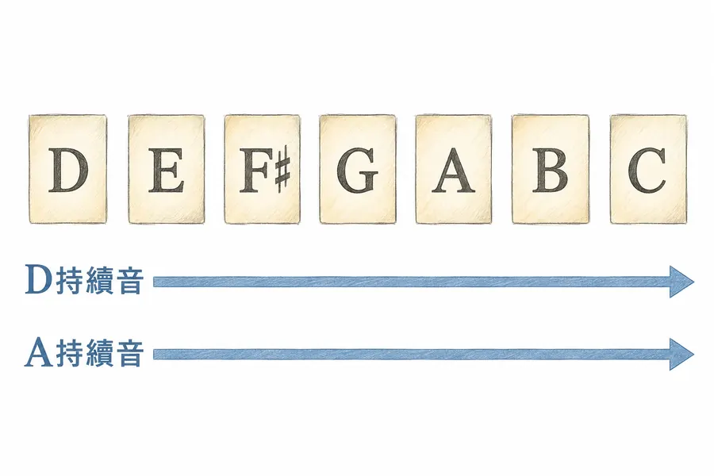

*Figure 16.5: open chords and drones (schematic).*

### But open chords tie you to a key

A lovely G chord that uses the open G and D **cannot be moved up as a whole** to Ab.

That is exactly the value of closed shapes.

A player should treat "open voicings" and "movable voicings" as **two sets of tools**, and choose between them according to tone and key.

### A drone can establish a tonal centre too

A drone can also provide a tonal centre in modal music.

For example, over a melody in D Mixolydian, a sustained open D and A fits some folk grammars better than changing to a complete functional chord every bar.

> **This reminds us of something**
> Harmony does not have to mean "stacking chords on every beat".
> Sometimes one drone is enough to build the whole space.

> **Common misconception**
> **"The more chords, the fuller, the more professional the accompaniment."**
> Not necessarily. The mandolin has only four courses, and filling them up can end up fighting the guitar and the bass.

**Key point:** open strings sound good, but they cannot move.
**Practice focus:** understand chords and accompaniment.

---

## 16.6 Movable chord shapes

A **closed chord** means this: every note you need is produced by a stopped string, with no reliance on open strings.

The advantage is that the whole shape can **move along the fretboard**, which suits especially:

- quick key changes
- the chop
- jazz comping

And because every note is under the left hand's control, the release can be very tidy too.

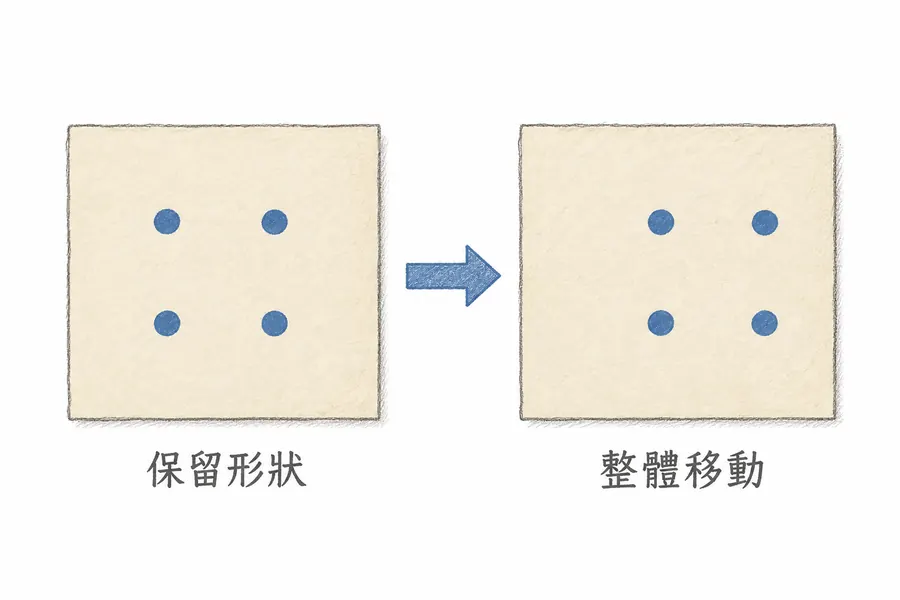

*Figure 16.6: the idea of a movable shape; the dots show relative positions (schematic).*

### But the price is the stretch

Closed shapes often demand a bigger stretch, especially in low positions.

If you chase only "the standard chop shape", a player with small hands may hold an unnatural span for a long time.

There are three alternatives:

1. Leave out the fifth.
2. Use a different inversion.
3. Move to a higher position.

**Function matters more than a fixed shape.**

### How to practise it

Pair "moving by semitones" with "the common harmonic progressions".

It is best done with the **circle of fifths**:

- G–C–F–Bb…
- or G–D–A–E…

That links the hand shapes to the actual movement of the harmony.

**Key point:** being movable is the biggest advantage; the stretch is the biggest cost.
**Practice focus:** understand chords and accompaniment.

---

## 16.7 Chord voicings for the chop

The bluegrass chop usually makes a short backbeat on **beats 2 and 4**.

At that moment the biggest demands on the voicing are:

1. the right hand's attack has to be focused;
2. the left hand has to be able to release at once;
3. the notes must not drag into the next beat.

That is why closed shapes suit it so well.

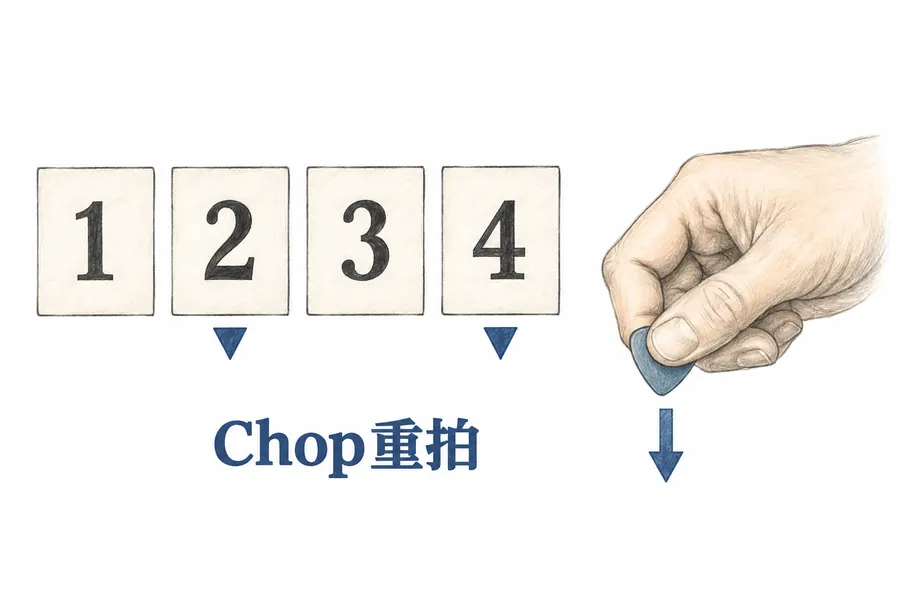

*Figure 16.7: chord voicings for the chop (schematic).*

### There is no single "Monroe chord"

A typical chop chord often leaves out doubled notes, so that all four courses have enough tension and the hand shape stays controllable.

Different players choose voicings according to the key, the position on the neck and their own hand shape.
**There is no one single "Monroe chord".**

Bill Monroe's central place in bluegrass history is the important background to the mandolin's lead and rhythm grammar.
But chop technique since then has developed many hand shapes and ways of placing it in time.〔S1601〕

### When you accompany together with a guitar

The mandolin does not need to fill every beat.

The value of the chop often appears **in the gaps between the guitar's strums**, forming a complement.

If both instruments play big chords on every beat, the spectrum and the rhythm both get crowded.

**Key point:** the chop should be staggered against the guitar, not piled on top of it.
**Practice focus:** understand chords and accompaniment.

---

## 16.8 Functional harmony

In a major key, the chords on each degree have a different function:

| Degree | Function | In plain words |
|---|---|---|
| I | tonic, giving a sense of stability | "at home" |
| ii／IV | predominant | "getting ready to leave home" |
| V／vii° | dominant, creating the tension that leads back to the tonic | "wanting to go home" |

This functional thinking can compress hundreds of chord progressions into a few directions:

> **Leave home → build tension → go home.**

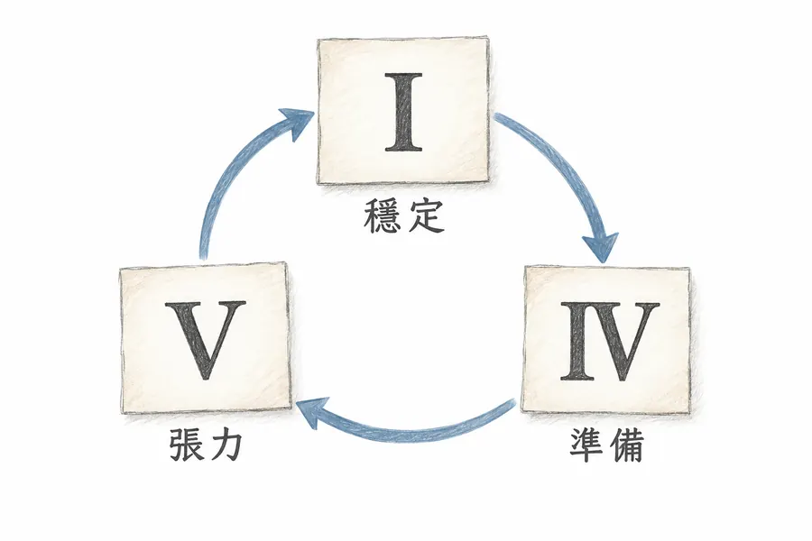

*Figure 16.8: functional harmony (schematic).*

### Example: I–vi–ii–V

It looks like four chords, but it can be understood as "the tonic area gradually moving towards the dominant".

When the mandolin accompanies, voice leading can connect the inner parts, so that neighbouring chords move by smaller amounts.

### Minor is more complicated

Minor is more complicated, because the harmonic minor scale often raises the seventh degree, creating the **leading tone** of the dominant.

So an E7 in A minor should not surprise you: **the G# is there to push towards A.**

Once you understand these interval relationships, a chord symbol can show you where the parts are going and what the function is.

**Key point:** a chord progression is a route map of "leaving home and coming back".
**Practice focus:** understand chords and accompaniment.

---

## 16.9 The twelve-bar blues

The most basic twelve-bar blues can be built from I7–IV7–V7.
But different regions and different eras have produced a great many variants.

For the mandolin, the value of learning the blues is not only the chords. It also includes:

- shuffle
- syncopation
- call-and-response
- blues scale phrasing

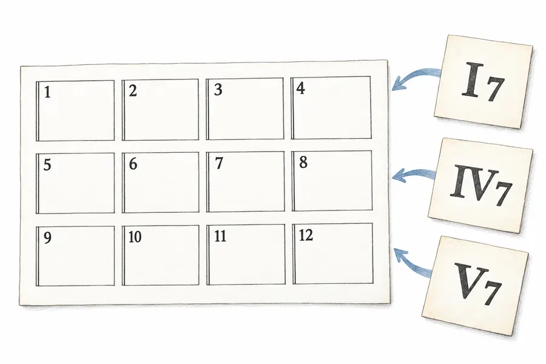

*Figure 16.9: the twelve-bar blues (schematic).*

| Role | What you can do |
|---|---|
| comping | short chords, double stops, small repeated riffs; it does not have to be a full chord on every beat |
| lead | you have to listen to the changes in the chords |

When playing lead, it is common to use the minor pentatonic over I7 to create blues tension.
But by the time you reach IV7 and V7, if you can mark the change with chord tones, the solo will have more direction.

> **An important principle of improvising**
> **A scale is material, not the answer to the harmony.**
> The third and the seventh of each chord give a clearer harmonic landmark.

**Key point:** the blues is not only chords; it is also rhythmic language.
**Practice focus:** understand chords and accompaniment.

---

## 16.10 Modal harmony

Modes such as Dorian and Mixolydian are very common in folk music.

Celtic and old-time music use them a great deal as well.

They have a clear tonal centre, but they are not quite the same as traditional major and minor functional harmony.

For example, D Mixolydian has **C natural**.
If you force A major (with its C#) in as the dominant, you change the modal colour.

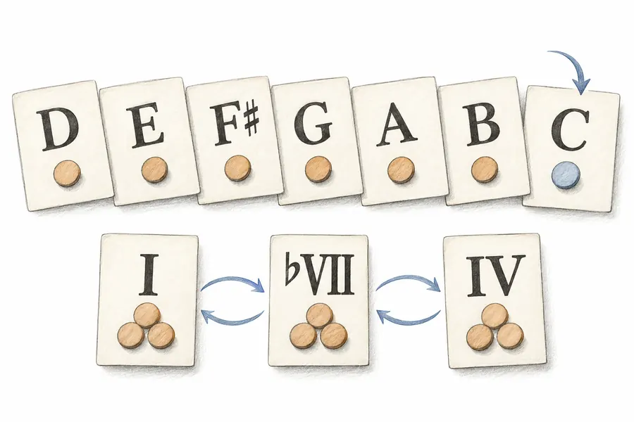

*Figure 16.10: the D Mixolydian scale and the harmonic material available (schematic).*

### Modal music usually uses simple material

This kind of music often relies on:

- a drone
- I–bVII
- I–IV

The mandolin's open strings suit this grammar particularly well.

The best way to understand a mode is to **take the major scale as the reference**, see which degree has been changed, and then hear how that change affects the chords available.

### The two grammars can be mixed, but do it on purpose

Functional harmony and modal harmony can be mixed, but it has to be **a deliberate choice**.

| Version | Approach |
|---|---|
| A pop crossover arrangement | may deliberately add a secondary dominant |
| A traditional version | may keep only two chords |

The difference between the two is a stylistic choice.

**Key point:** in modal music the point is "which note has been changed".
**Practice focus:** understand chords and accompaniment.

---

## 16.11 Chord melody

The heart of chord melody is this:

> **Keep the top note clearly carrying the melody, then use the remaining courses to choose the fewest, most effective harmony notes.**

If the lower parts move too much, the listener's attention turns to the chord changes and the melody gets buried.

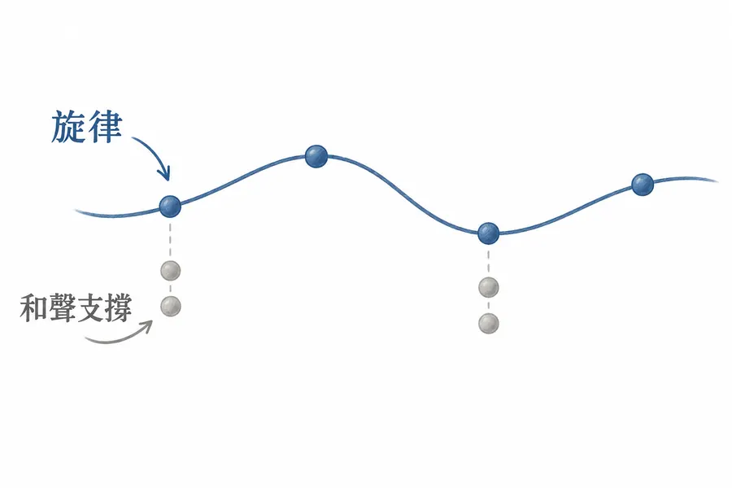

*Figure 16.11: chord melody (schematic).*

### How to do it

1. Work out the fingering for the melody **on its own** first.
2. Mark the chord tone on every strong beat.
3. Add one to three lower notes only where the harmony needs them.
4. Weak beats can stay as single notes.

This "sparse and dense" arrangement sounds more like the natural texture of a plucked instrument than block chords of four notes all the way through.

### Chord melody with tremolo

This adds another layer of question: **which parts need to continue, and which need only one attack?**

| Approach | Effect |
|---|---|
| tremolo on the melody only, the chord below once per beat | the melody is clear, the accompaniment has grain |
| tremolo on the whole chord | thick sound, but easily blurred |

Layering the right hand's texture gives more breathing than the same density all the way through.

**Key point:** the melody comes first; harmony supports it.
**Practice focus:** understand chords and accompaniment.

---

## 16.12 Case study: choosing an accompaniment for I, IV, V

Take G–C–D. The same progression can be played in four completely different ways.

| Approach | Method | Sounds like |
|---|---|---|
| 1 | open chords, strummed on every beat | a straightforward folk accompaniment |
| 2 | closed chop, only on beats 2 and 4 | bluegrass ensemble grammar |
| 3 | three-part voice leading, chord change every two beats | chamber comping |
| 4 | arpeggios plus a drone | a singer-songwriter or modal acoustic texture |

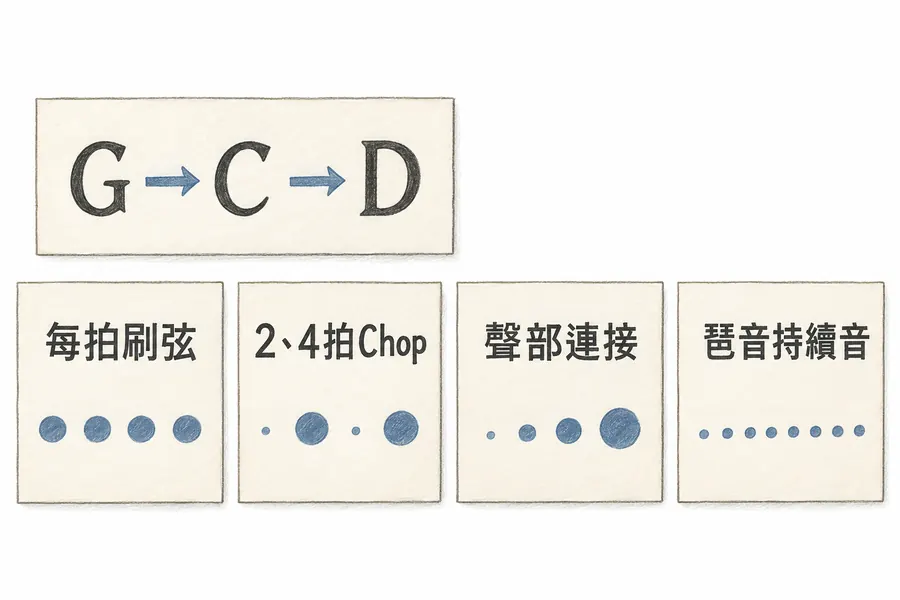

*Figure 16.12: case study, choosing an accompaniment for I, IV, V (schematic).*

### What really changes the style is this

The chord names are completely identical, but what really changes the style is:

- note length
- rhythm
- register
- the resonance of open strings
- the space in the band

> **That is why learning a hundred chord shapes is not the same as being able to accompany.**

> **Common misconception**
> **"Once I have memorised the chord chart, I can accompany."**
> Memorising shapes is only the first step. What really decides the style is note length, rhythm and the space in the band.

### How to practise it

Fix one progression and play four textures in a row, and **record all of them**.

If every version differs only in volume while the rhythmic grammar has not changed, you are still "changing chords" rather than "designing an accompaniment".

---

## Table 16-1 | Common chord formulas and the trade-offs on four courses

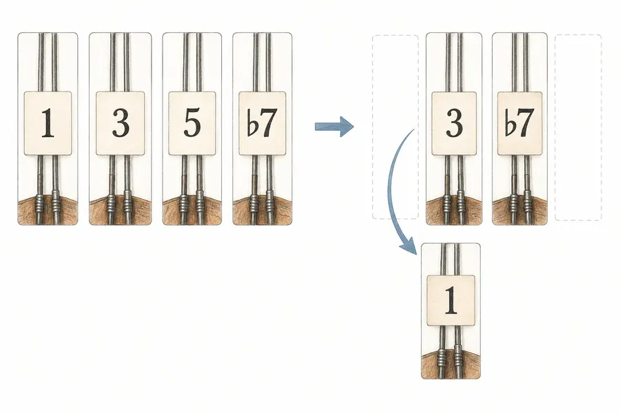

| **Chord** | **Interval formula** | **Most worth keeping** | **Commonly left out** |
|:---|:---|:---|:---|
| **Major** | 1–3–5 | 3 | a doubled 1 or 5 |
| **Minor** | 1–b3–5 | b3 | a doubled 1 or 5 |
| **Dominant 7** | 1–3–5–b7 | 3, b7 | 5; the 1 can go when there is a bass |
| **Maj7** | 1–3–5–7 | 3, 7 | 5 |
| **m7** | 1–b3–5–b7 | b3, b7 | 5 |
| **13** | 1–3–5–b7–9–11–13 | 3, b7, 13 (depending on context) | 5, 11, and even the root |

*Figure: Table 16-1, common chord formulas and the trade-offs on four courses (schematic).*

---

## Self-study question bank

Study check: answer, mark, review

Answer for yourself first, then look at the answers. When you get one wrong, go back to the relevant section of the chapter and read it again.

**1. The intervals a major triad is made of are?**

- A. 1–3–5

- B. 1–♭3–5

- C. 1–4–5

- D. 1–2–6

**2. What is an important practical use of inversions in accompaniment?**

- A. It makes the connection between chords smoother

- B. It makes the strings thicker

- C. It raises the bridge

- D. It changes the wood

**3. What matters most in chord melody?**

- A. Keeping the melody note clear, with the harmony supporting it

- B. Cramming the biggest chord onto every note

- C. Keeping only the bass

- D. Ignoring the melody completely

**Answers: 1.A　2.A　3.A**

---

## Main sources checked for this chapter

Sources checked: find the original, check the conditions, keep a record

**【S1601】Bluegrass Music Hall of Fame & Museum: Bill Monroe biography.** Background on the formation of bluegrass and the mandolin's ensemble role.

> https://www.bluegrasshall.org/inductees/bill-monroe/
