# Chapter 17: Musical Expression and Practice Methods

*Tone, Expression, Practice and Performance*

## Key points

- The biggest change in the advanced stage: **before you play, you already know what sound you want.**
- Measure practice in **problems and checks**, not in **time**.
- The point of slow practice is not "going slower". It is **taking the same path and buying more attention**.
- Sight-reading and memory both need **a map of the whole piece**; muscle memory alone is not enough.
- The most dangerous thing before a performance: suddenly doubling your practice, changing strings, changing picks or rewriting your fingering because you are anxious.

---

By the advanced stage the biggest change is this: **before you play, you already know what sound you want.**

The position of the right hand, the angle of the pick, the dynamics, articulation, tremolo density, left-hand fingering—these are all just tools.

Real professionalism comes from whether those tools can reliably serve **the phrase, the style and your role in the ensemble**.

The way you practise changes too.

| Stage | How you measure | Example |
|---|---|---|
| Beginner | measured in **time** | "I practised for an hour today" |
| Advanced | measured in **problems and checks** | "Bar 36 is unsteady on the string crossing at 132 BPM. I tested two picking patterns, and plan B came out clean five times in a row." |

The difference looks like nothing more than a note-taking habit.
But in practice it decides whether you can keep improving under a time limit.

---

## 17.1 Tone control

The same mandolin can sound bright and hard, or round and soft.

The most direct variable is pick position:

| Position | Result |
|---|---|
| Near the bridge | more high frequency, a clearer attack |
| Near the fingerboard | softer |

The edge angle of the pick, its speed and how deep it goes into the string also change the transient—the very first instant of the note.

These parameters **interact**. So when you compare sounds, record the instrument **and** the picking method together.

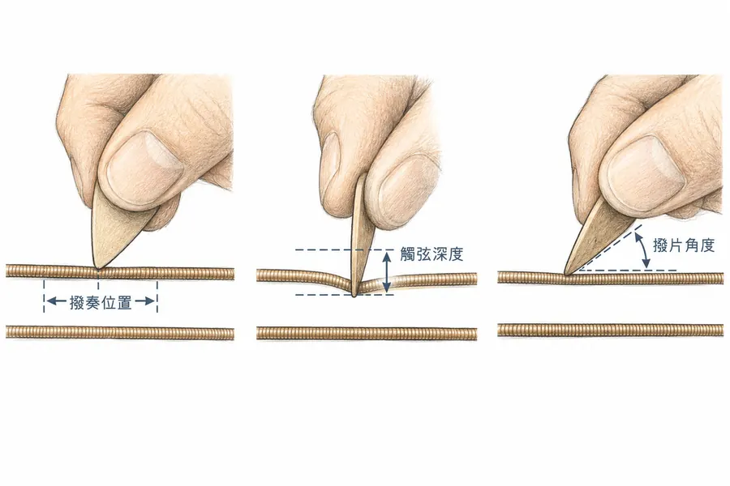

*Figure 17.1: tone control (schematic).*

### Build your own tone map

1. Take one open A.
2. Take the same stopped D.
3. Take the same passage of tremolo.
4. Record it at **three right-hand positions**.
5. Then change the pick angle and record each one again.

Those recordings tell you **how wide the usable tone range of this instrument really is**.

They also stop you from blaming every playing problem on the gear.

### Instrument type is a direction, not a conclusion

Different instrument types respond differently too.

Bluegrass players value the F-hole carved-top for its cut and its attack.
But inside one type, the materials, the bracing and the setup vary a great deal.

Oval-hole and roundback instruments are not automatically soft either.

> What the market says can give you a direction.
> In the end you still judge by **a specific instrument and a specific technique**.

**Key point:** tone can be measured and written down; it is not mysticism.
**Practice focus:** plan tone, expression and practice.

---

## 17.2 Dynamics

### Soft playing (piano) is not "cutting the force to a minimum"

If you simply reduce the pick's force to a minimum, you easily **lose the core of the attack** and the notes turn blurry.

Effective soft playing still needs a clean contact with the string.
You only adjust speed, depth and pick position down to a lower energy.

Loud playing (forte) works the other way: **raise the energy of the attack and stay relaxed at the same time.**

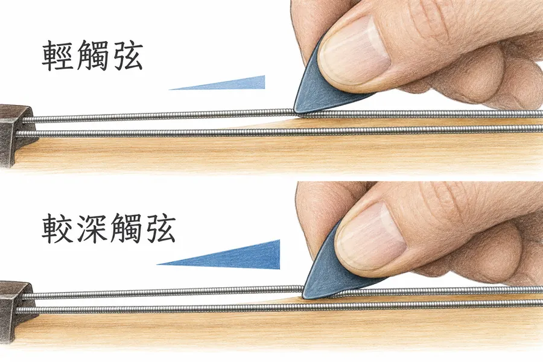

*Figure 17.2: dynamics (schematic).*

### A crescendo has three levers

1. Add a little energy to each attack.
2. Adjust the density of the tremolo.
3. Move the right hand slightly towards the bridge.

Real phrases usually **mix** these levers.

> **What happens if you only "press harder and harder"?**
> The last few notes usually turn hard, and the tempo speeds up along with them.

### How to check

1. Make a long crescendo over 8 or 16 beats.
2. Ask for a **continuous** rise in volume while the metronome stays at the same tempo.
3. Record it, then look at the waveform and listen: does the level suddenly jump a step partway through?

That is a very direct check on dynamic control.

**Key point:** even a quiet note needs a clear attack.
**Practice focus:** plan tone, expression and practice.

---

## 17.3 Articulation and note length

| Articulation | Requirement |
|---|---|
| **Legato** | no unnecessary gaps between attacks; the ends of the notes sit close to each other |
| **Staccato** | actively shorten the note; either release the left hand, damp with the right hand, or both together |
| **Tenuto** | keep the full value |
| **Accent** | change the energy of the attack and where the phrase's weight falls |

Because a mandolin's attack is so definite, a change of articulation is very exposed.

In a classical score these may all be eighth notes, but staccato, portato and tenuto should not be waved through with a vague "a bit shorter / a bit longer".

> **You should actually plan how much of the beat each note occupies.**

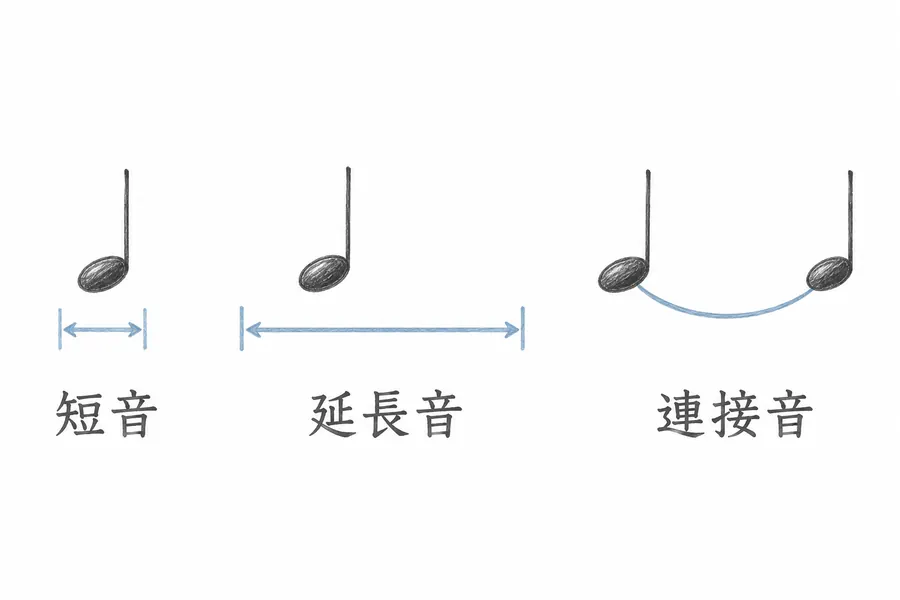

*Figure 17.3: articulation and note length (schematic).*

### Style decides articulation

In bluegrass or old-time music, articulation is usually decided by **style**.

| Context | Note-length requirement |
|---|---|
| Fiddle tune | needs drive, but making every note very short loses the flow |
| Chop | wants an extremely short decay |

**The feel of a style is often hidden in note length.** Ornaments, meanwhile, are added to fit the phrasing.

**Key point:** note length has to be designed, not left at "about right".
**Practice focus:** plan tone, expression and practice.

---

## 17.4 Phrasing and breathing

A melodic phrase usually has four stages:

1. the starting point
2. development
3. peak tension
4. release

If every bar uses the same volume, the same tremolo and the same attack, the phrase flattens into one even plane of information—everything the same means nothing is said.

**Sing the melody first, find which note matters most, then design the right hand and the fingering.**
That usually comes out more natural than deciding on a technique first.

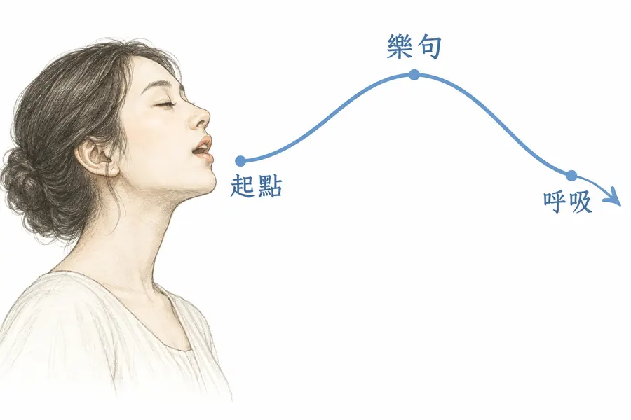

*Figure 17.4: phrasing and breathing (schematic).*

### A tremolo phrase needs breathing even more

A long line **does not** mean holding the same density from the first note to the last.

You can plan it like this:

| Position | What to do |
|---|---|
| Start of the phrase | more transparent |
| Approaching the peak | add a little energy |
| End of the phrase | let the attack relax slightly |

The aim in practice is a tremolo that shows a clear phrase, a direction and a breath.

### Fingering serves the phrase too

Play the same note on an open string and it sounds more separate.
Stay high up on the same course and it may sound more continuous.

When you choose a position, besides asking "which is easier", ask one more question:

> **"Does this phrase want a change of tone?"**

**Key point:** a phrase has a shape; it is not flat.
**Practice focus:** plan tone, expression and practice.

---

## 17.5 Rubato

Rubato means **flexibility of time in a local place**.

A classical slow movement often stretches slightly before an important note and pays it back afterwards.

But if you hold back the same way in every phrase, it turns into a **habit** instead of an expression.

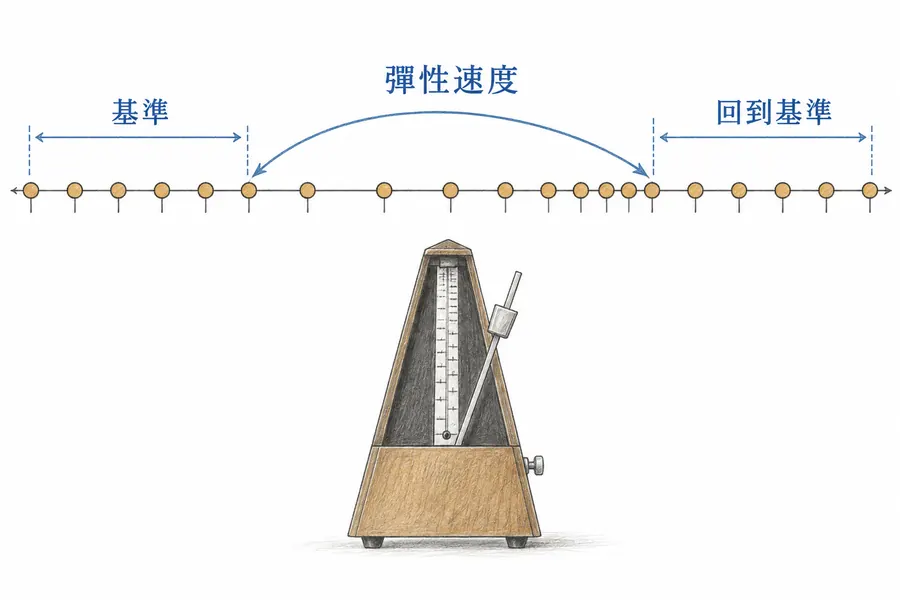

*Figure 17.5: rubato (schematic).*

### Practice steps

1. Start with the metronome, completely strict, and build a clear inner pulse.
2. Turn the metronome off and play a free version.
3. Turn it back on and check whether the total time of the whole phrase has run away.

That separates two cases:

| Case | What it means |
|---|---|
| Deliberate stretching | this is rubato |
| Slowing down because the technique is hard | this is a problem, not expression |

### Different styles allow different amounts

| Style | Flexibility |
|---|---|
| A bluegrass break | usually has to stay locked in the groove |
| A nineteenth-century Romantic solo | can take a good deal more |

> **What people call "musicality" has always meant "following the grammar".**

**Key point:** strict time first, then talk about flexibility.
**Practice focus:** plan tone, expression and practice.

---

## 17.6 Assessing your usable tempo

### Four conditions

A usable tempo should meet four things at once:

1. The rhythm is accurate.
2. The tone is acceptable.
3. The hands are together.
4. You can repeat it continuously.

If you only get it right once in a while, that BPM is not your ceiling.

The definition is conservative, but it is much closer to what a stage actually asks for.

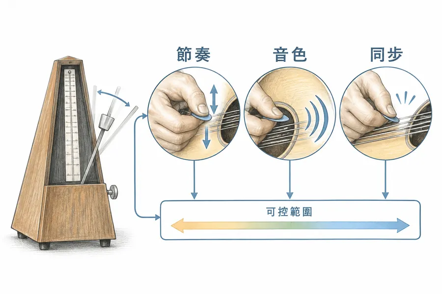

*Figure 17.6: assessing your usable tempo (schematic).*

### Two ways to raise the tempo

| Method | How |
|---|---|
| Increments | start at a speed you fully control and add 2–4 BPM each time; when a type of failure appears, step back and confirm |
| Bursts | play only a few notes at the target tempo, then gradually lengthen the burst |

Both methods preserve a relaxed movement better than "measure your maximum BPM every day".

### Watch the transitions

More precisely, many passages are limited by **the change between two particular fingers**, or by **one particular string crossing**.

Shrinking a whole bar down to 2–4 notes and repeating those is often more effective than running the whole passage.

**Key point:** a usable tempo is one you can repeat, not one you manage once.
**Practice focus:** plan tone, expression and practice.

---

## 17.7 Slow practice and checking the movement

### The most important rule of slow practice

> **When you practise slowly, keep the size of movement the original tempo needs.**

If the original tempo needs a small wrist motion, slow practice should keep the same path and only stretch out the time.

Otherwise you build a movement that only exists at slow speed, and you have to learn it again once the tempo comes up.

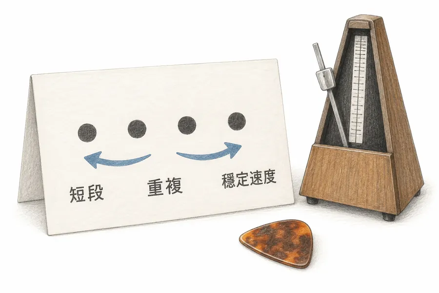

*Figure 17.7: slow practice and checking the movement (schematic).*

### What slow practice is best for checking

- Does the pick move the same distance from the string every time?
- Is the left hand lifting early?
- Is the shift on time?
- Does the music decide the accent, or does the convenience of the fingers?

> **Put your attention on one variable at a time.**
> Don't assess ten things at once.

> **Common misconception**
> **"Slow practice just means making the movements smaller and slowing them down."**
> Wrong. Slow practice keeps the path of the original tempo and only stretches out the time.

### You can also split the hands (silent practice)

Two ways to split it:

1. The left hand fingers the whole passage while the right hand only touches the strings (without really sounding them).
2. The right hand plays the original pattern on open strings.

Splitting like this pins a coordination problem to **one side**.

**Key point:** slow practice keeps the path; it does not shrink the movement.
**Practice focus:** plan tone, expression and practice.

---

## 17.8 Sight-reading and the beat

### Scan first, then start

When you sight-read, scan five things first:

1. key signature
2. meter
3. tempo
4. the highest and lowest notes
5. repeated patterns

If you stare only at the first note, every bar after it feels like a new event.

Building a map of the whole piece first cuts down the surprises a great deal.

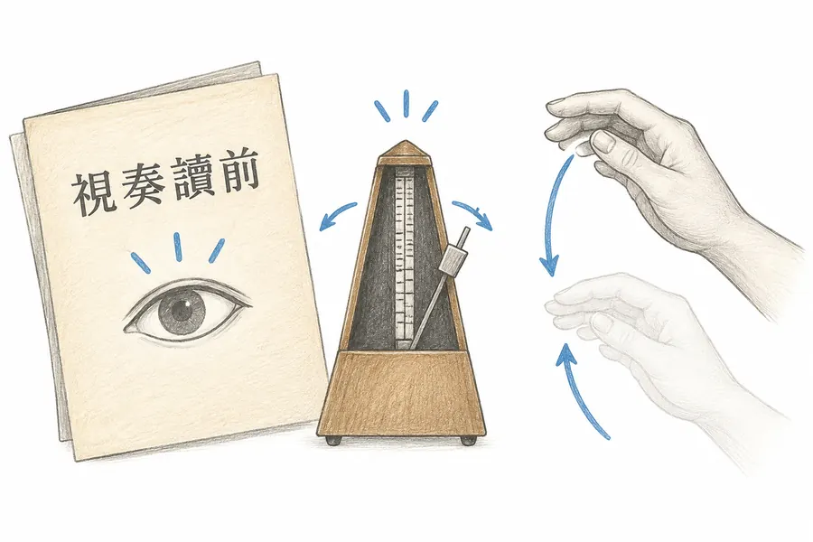

*Figure 17.8: sight-reading and the beat (schematic).*

### Don't stop for one wrong note

When you are actually playing, don't stop for a single wrong note.

In ensemble sight-reading the most important thing is **the continuity of time**.

> Dropping an ornament is usually more acceptable than the whole group losing the beat because you stopped.

> **Common misconception**
> **"Sight-reading means not missing a single note."**
> In an ensemble, continuous time matters far more than zero mistakes.

You can deliberately pick unfamiliar music below your level, 5–10 minutes a day, **one pass through, no going back**.
That is training the ability to keep moving forward.

### The family's notation may come in more than one form

Music for the mandolin family can also turn up in:

- the mandola's alto clef
- universal notation
- transposed treble clef

The notation guide of CMSA (the Classical Mandolin Society of America) shows that historical and regional systems are not uniform.

So advanced sight-reading also includes **recognising the conventions of the page first**. 〔S1701〕

**Key point:** read the map before you set off.
**Practice focus:** plan tone, expression and practice.

---

## 17.9 Memory and section cues

### Muscle memory alone is dangerous

A piece you know only through muscle memory falls apart completely the moment something goes wrong.

A more reliable kind of memorization uses five kinds of cue at once:

1. harmony
2. form
3. melody
4. landmarks on the fingerboard
5. what your ear expects to hear next

> **The test: you should be able to start from any rehearsal mark.**
> Every section has to be able to carry on by itself.

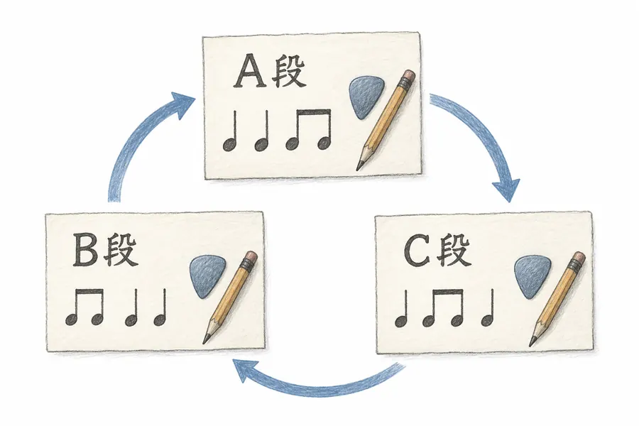

*Figure 17.9: memory and section cues (schematic).*

### Exercises you can do

- Divide the piece into **harmonic sections** and write down I–vi–ii–V or the main modulations.
- Close your eyes and say which course the first note of a given bar sits on.

This work looks like time away from playing. In fact it gives you more **ways back** under stage pressure.

That goes double for improvised music: remembering the chord form, the motif and the vocabulary of phrases is more useful than memorising a whole solo.

**Key point:** memory needs several cues, not just fingers.
**Practice focus:** plan tone, expression and practice.

---

## 17.10 Ear training

The metronome tells you the time. The tuner tells you the pitch.
But real music is still judged by **the ear**.

| Exercise | What the ear should listen for |
|---|---|
| Scales | sing the scale degree, listen for the leading tone |
| Tremolo | is the density smooth |
| Chords | is the top voice genuinely continuous |

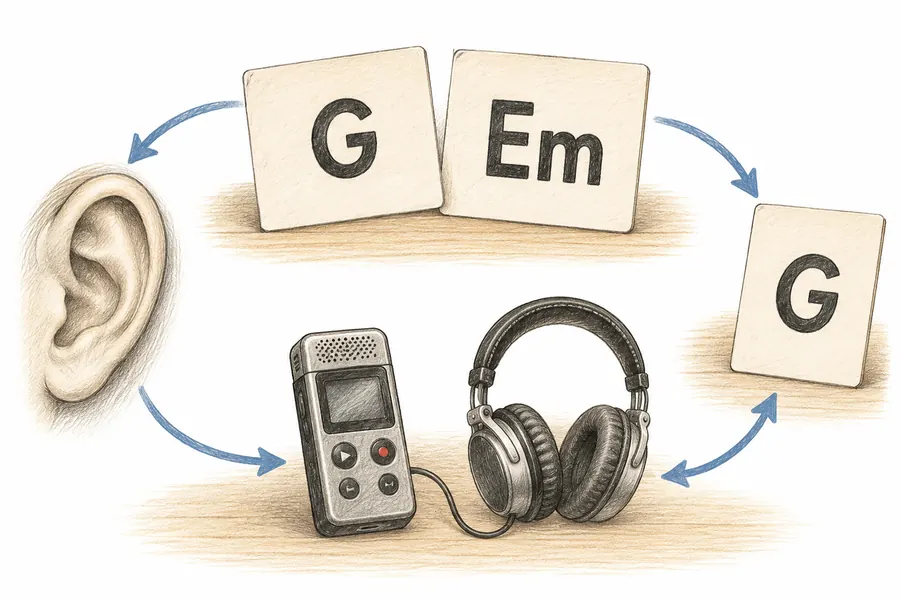

*Figure 17.10: ear training (schematic).*

### Recording is the most direct tool

While you play, your brain is handling touch, sight and movement at once, and it often **overestimates** how fluent you are.

A phone recording made close up is not a professional recording, but it is enough to hear:

- timing
- noise
- balance

### One step further: call-and-response practice

- Sing a phrase first, then find it on the mandolin.
- Or listen to a chord progression, then find the root and the third **without any music**.

That turns theory from something on the page into a response in the ear.

**Key point:** the metronome and the tuner are assistants; the ear is the judge.
**Practice focus:** plan tone, expression and practice.

---

## 17.11 The practice log

### A useful log needs at least six columns

1. piece / bars
2. the BPM you controlled today
3. the main problem
4. the strategy you used
5. how you checked that it worked
6. what to do next time

**Example:**

> "Bars 42–45, right-hand string crossing, five clean runs at 126 BPM. At 132 BPM the upstroke misses the string. Next time change the pick depth first."

That gives you far more to decide with than "I practised for 30 minutes".

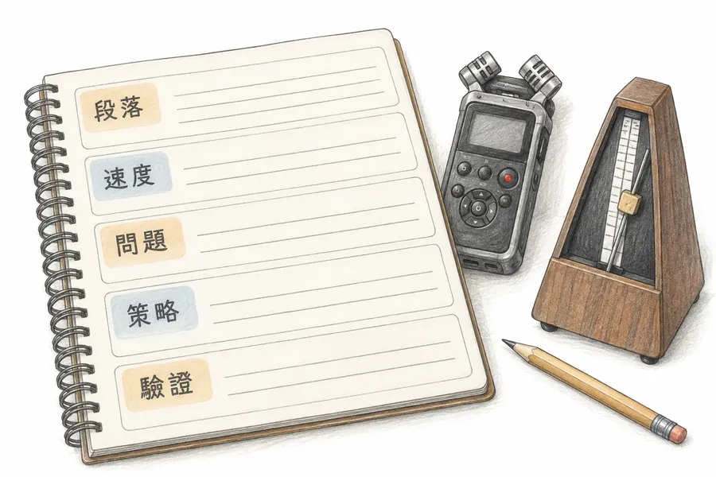

*Figure 17.11: the practice log (schematic).*

### Record your body too

If the same technique **makes your shoulder tighten after 25 minutes every time**, adjust your rest and your posture, and plan a change of movement early.

Musicians' musculoskeletal problems usually come from several factors together.
A systematic review also stresses playing load, ergonomics and other risk factors. 〔S1702〕

> The point of the log is to stop you **guessing the same problem again every day**.
> Two or three lines each time is enough.

**Key point:** record problem, method and result—not hours.
**Practice focus:** plan tone, expression and practice.

---

## 17.12 Preparing for the stage and the recording

### The most dangerous behaviour before a performance

It is suddenly doing these things out of anxiety:

- doubling your practice time
- changing to a new string gauge
- changing your pick
- rewriting your fingering completely

New movements need time to settle, and a dense load can also raise the risk of discomfort.

> **The last week should be about stability:**
> full runs, patching small problem passages, recovery.

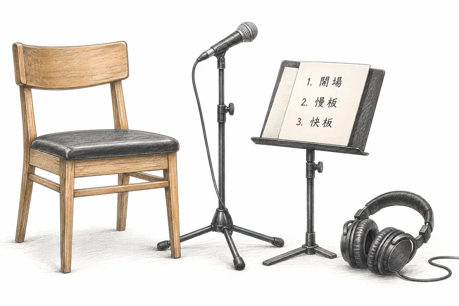

*Figure 17.12: preparing for the stage and the recording (schematic).*

### Gear and environment

| Item | What to do |
|---|---|
| New strings | leave them settle time |
| Floating bridge | check the bridge position when you change strings |
| The venue | humidity, temperature and the response of the pickup can all change |
| Soundcheck | actually test loud playing, the tremolo and the chop |

At the soundcheck you should **copy the volume and tone you will use in the performance**, not just test whether there is any sound at all.

### Error management needs rehearsing too

- Deliberately skip a bar in practice and carry on from the next phrase.
- Have a partner call rehearsal marks at random.

> **Real professionalism is this: after the mistake, the music keeps going.**

---

## Table 17-1 | The minimum a practice log has to keep

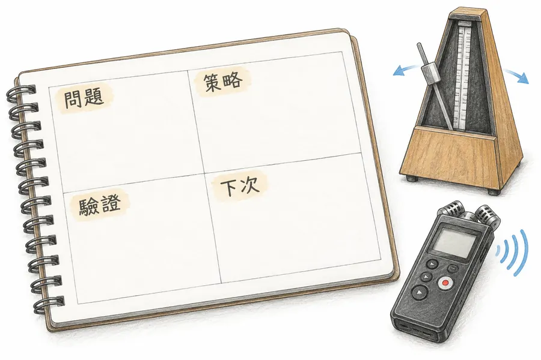

| **Piece / bars** | **BPM controlled** | **Type of failure** | **Strategy used** | **Pass criterion** |
|:---|:---|:---|:---|:---|
| **Bars 42–45** | 126 | upstroke misses the E course | less pick depth + the two-note change | five clean runs in a row |
| **Slow movement, bars 8–12** | 60 per beat | tremolo dynamics uneven | fix the density, change only the attack | a 16-beat crescendo with no jumps |
| **Chop G–C–D** | 112 per beat | the notes on beats 2 and 4 ring too long | shorten the time the left hand holds | the backbeat lines up with the recording |

*Figure: Table 17-1, what a practice log has to keep at minimum (schematic).*

---

## Self-study question bank

Study check: answer, mark, review

Answer for yourself first, then look at the answers. When you get one wrong, go back to the relevant section of the chapter and read it again.

**1. Rubato means?**

- A. controlled flexibility of time in a local place

- B. no beat at all

- C. only speeding up

- D. only slowing down

**2. The point of effective slow practice is?**

- A. keep the correct movement path and watch the details

- B. make the movement bigger and exaggerated

- C. only look at the speed number

- D. stop listening to the sound

**3. The most useful content in a practice log is?**

- A. the problem, the method and the result

- B. only how many hours you practised

- C. only the name of the tune

- D. only your mood

**Answers: 1.A　2.A　3.A**

---

## Main sources checked for this chapter

Sources checked: find the original, check the conditions, keep a record

**【S1701】Classical Mandolin Society of America: Music Notation for Mandolin Family Instruments.** The clef and transposition conventions you may meet when sight-reading for the family.

> https://classicalmandolinsociety.org/wp-content/uploads/Music_Notation_for_Mandolin_Family_Instruments_v3.pdf

**【S1702】Cerda-Díaz et al.: Musculoskeletal disorders in musicians (2026).** Combined evidence on playing load, ergonomics and other risk factors.

> https://pubmed.ncbi.nlm.nih.gov/41691705/

---

Put the techniques you have learned into the musical traditions of different places, practise hearing style, and practise arranging the parts of an ensemble.

Reading range: Chapters 18 to 18

---
