# Chapter 18: World Styles and Ensemble Playing

## Key points

- The mandolin is not an instrument that "belongs to one kind of music". The same instrument has completely different right-hand grammar and a different ensemble role in different traditions.
- To identify a style, look at four things: where the beat sits, how long the notes are held, how ornaments are added, and who does what in the ensemble.
- In bluegrass the mandolin has two jobs: lead and chop accompaniment. Knowing only one of them means you have learned half the language.
- The most common fault in a mandolin orchestra is every upper part playing tremolo at once, which packs the upper mids far too full.
- Real "cross-style" playing is not a matter of changing instruments. It is a matter of changing a whole sense of time and a whole vocabulary of ornaments.

## Opening: one instrument, many kinds of music

One of the most interesting things about the mandolin is that it has never belonged to just one kind of music.

It has turned up in a lot of places:

- chamber and concerto works in eighteenth-century Italy
- nineteenth-century salons and the mandolin orchestra
- the Neapolitan song
- the American mandolin craze
- the old-time string band
- bluegrass after Bill Monroe
- Irish dance tunes
- Brazilian choro
- jazz
- twenty-first-century singer-songwriters, film scores, and electric mandolin crossing over

All these traditions may call the instrument a "mandolin". But the right-hand grammar, the note length, where the accompaniment sits, the tone and the ensemble role are not the same.

So when you learn a style, take hold of four things together: the beat, the note length, the ornaments, and the division of labour in the ensemble.

The real questions are these:

- How does this tradition handle time?
- Between melody and accompaniment, which comes first?
- How much sustain does it need?
- Where do the accents fall?
- How much is improvised and how much is read?

This chapter puts technique back into its historical and ensemble setting. That way "style" does not stay a surface imitation.

## 18.1 Classical and Baroque repertoire

Many players today put the Vivaldi, Hummel and Beethoven works connected with the mandolin into the repertoire of the modern eight-string G–D–A–E instrument.

But the historical mandolin (mandolino) did not always look the way it does today.

Different cities and different periods used gut strings, different numbers of courses, and different tunings.

So the sentence "this piece was originally written for mandolin" needs one more question first: written for which kind of mandolin?

You cannot simply assume it is identical to the modern instrument.

A modern performance can of course use the standard mandolin. But the moment the instrumentation changes, the effect changes.

A gut-strung historical instrument has a different attack, a different sustain and a different response to dynamics from modern steel strings.

Some continuous arpeggios sound brighter on modern metal strings. Some long notes have to be reshaped with tremolo.

Responsible playing is mostly about knowing which kind of "translation" you have made.

By the nineteenth century, Italian players and teachers had established a clearer modern mandolin technique.

The method books of Munier and Calace systematised tremolo, positions, double stops and ornaments. 〔S1801〕〔S1802〕

A great deal of the core grammar of the classical mandolin today comes from there.

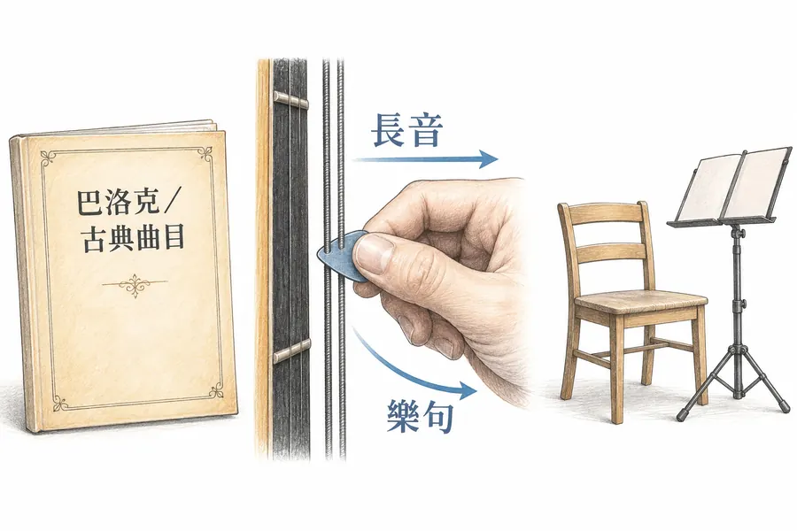

*Figure 18.1: classical and Baroque repertoire (schematic).*

> **Common misconception: if the score says "written for mandolin", a modern mandolin can play it exactly as written.**
> In fact historical mandolins had different numbers of strings, different tunings and different string materials. Put the same piece on a different instrument type and the volume, the sustain and the tone all change. That is not a mistake; it is arranging. The point is to know what you changed.

## 18.2 The Neapolitan song

The Neapolitan song is what most people associate with the mandolin. That cultural link settled into place gradually, through mass media from the late nineteenth century into the twentieth.

But the actual accompaniment is not just "tremolo the whole way through".

Between the melody instrument, the singer and the guitar accompaniment there is breathing.

The mandolin may take the interlude, a countermelody, arpeggios, or a decorative tremolo.

If you are accompanying a singer, the most important thing is this: do not fight the singer's consonant attack for the same spot.

The tremolo can enter a fraction late, letting the start of the word come out first, and let go at the end of the phrase.

Push the volume and the tone forward only in the interlude.

That awareness of backing off and moving forward is much closer to real song accompaniment than holding the same volume from beginning to end.

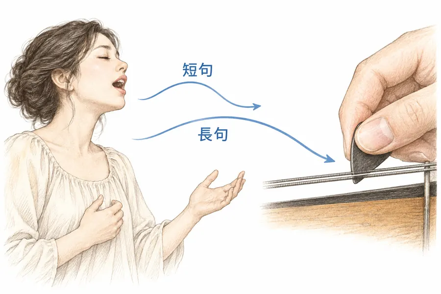

*Figure 18.2: the Neapolitan song (schematic).*

> **Common misconception: "the mandolin is a Neapolitan folk instrument."**
> That is an impression simplified by the tourist industry. Modern tourism often turns the mandolin into a stock symbol of Italy. It is genuinely important in Italian culture, but the roles it has carried through history are far wider than that single image. Professional writing has to avoid this kind of definition in reverse.

## 18.3 The American mandolin craze and the ensemble

The history of the American mandolin put together by the Library of Congress notes that the craze which began in the 1880s was closely tied to five things.

Those five things are: touring, commercial performance, instrument manufacturing, the publishing market, and school clubs.

By the 1890s, mandolin clubs and orchestras were appearing in large numbers all over the United States.

The "Banjo, Mandolin and Guitar" (BMG) culture linked professional players, teachers, manufacturers and amateur clubs into one complete industry. 〔S1803〕

This stretch of history matters, because it reminds us of one thing:

American mandolin did not jump straight from Italian immigrants to Bill Monroe.

Several decades before bluegrass appeared, the United States already had a large body of ensemble tutors, method books and family instruments of every kind.

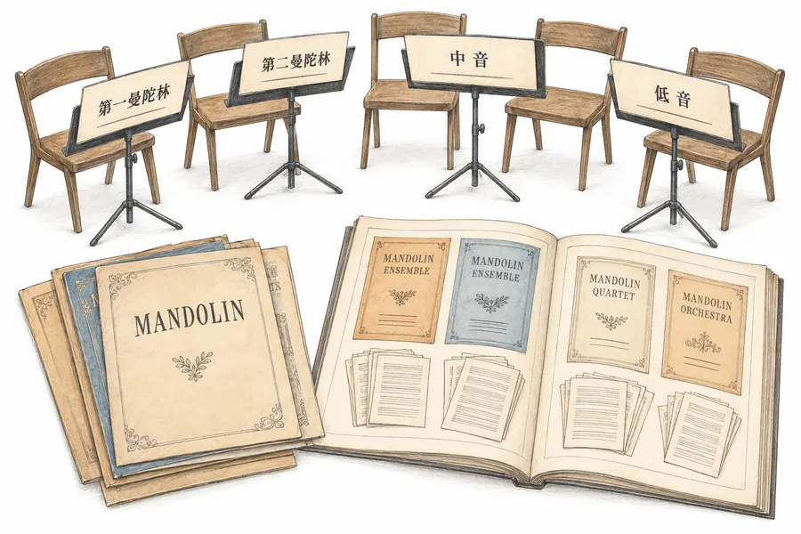

*Figure 18.3: the American mandolin craze and the ensemble (schematic).*

The 1915 *The Suffragettes: March* preserved by the Library of Congress even lists the full instrumentation of a mandolin orchestra.

It includes: several mandolins, mandola, mandoloncello, guitar, banjo and piano.

That is direct evidence of how far the orchestral movement had gone at the time. 〔S1804〕

This ensemble tradition also drove three things: large family instruments, universal notation, and growth in manufacturing.

Only with this background does it become clear that Gibson's later mandolas, mandoloncello and mando-bass were mainly a response to the orchestral market of the day.

## 18.4 Bluegrass

The Bluegrass Music Hall of Fame calls Bill Monroe the central founding figure of bluegrass.

He put the early string band, the blues, gospel, fiddle music and jazz back together in a new combination.

In 1945 Earl Scruggs joined the Blue Grass Boys.

After that, the five-piece line-up of mandolin, fiddle, banjo, guitar and bass became an important standard for the classic bluegrass sound. 〔S1805〕

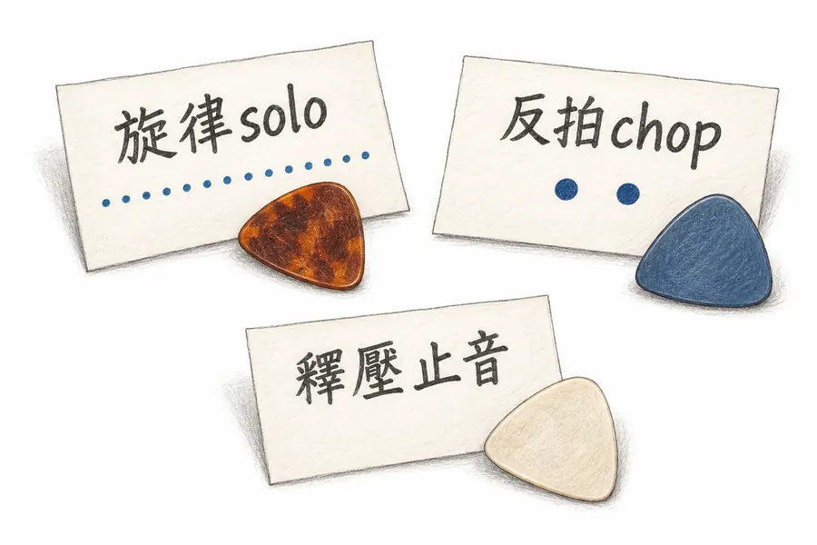

*Figure 18.4: bluegrass (schematic).*

In this ensemble the mandolin has two completely different jobs.

| Job | What to do | Technical focus |
|:---|:---|:---|
| Lead (lead break) | push the melody out in front | clear single-note attack, slides, double stops, bluesy inflection, fast alternate picking |
| Accompaniment (chop) | strike a short backbeat on beats 2 and 4 | short, dry and clean; never dragging |

If you can only lead and do not know how to leave space, or you can only chop and do not understand the phrase, you have only half the grammar.

> **Common misconception: the Monroe style equals all bluegrass mandolin.**
> It does not. Later players developed crosspicking, more complex harmony, jazz influences and new sounds. Sam Bush pushed newgrass forward; David Grisman combined bluegrass with jazz and other sources to build what is called "Dawg music". The Hall of Fame biography of Grisman also treats this crossover position as one of his important contributions. 〔S1806〕

## 18.5 Old-time

The old-time repertoire is usually tied to fiddle tunes, square dance, and a string-band culture of banjo plus guitar.

The mandolin may double the fiddle on the melody, or it may only supply rhythm.

Its grammar usually values an unbroken dance pulse more. Bluegrass, by contrast, usually sets the instruments up to solo in turn.

When you play a fiddle tune, open strings, drones and double stops all matter.

Play it too cleanly, with every note separated like a classical study, and you may lose the groove.

Some ornaments, and the accents that the bowing creates, need translating into a pick pattern. Let the picking movement produce the accents and the breathing of the original.

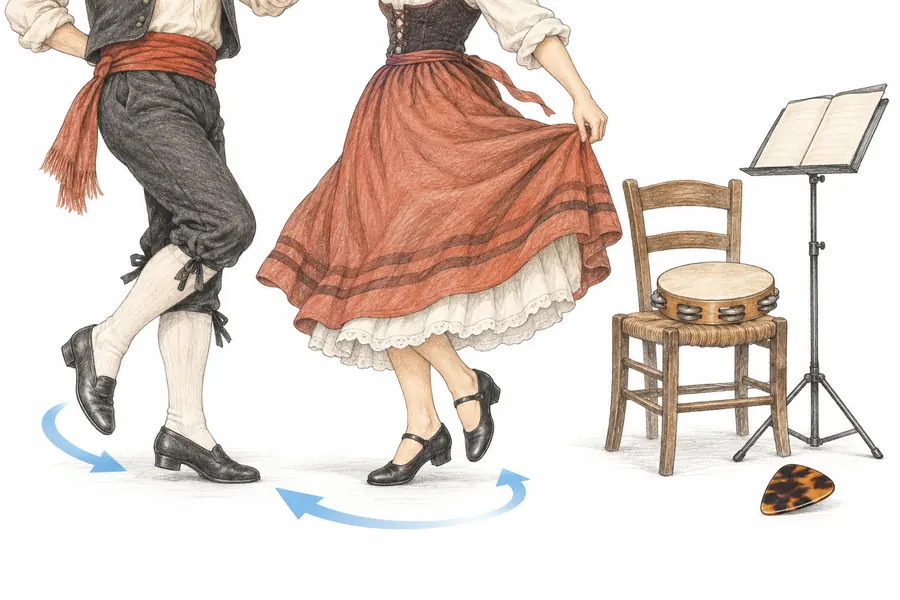

*Figure 18.5: old-time (schematic).*

The most effective way to learn old-time music is to play along with representative recordings, over and over.

Get the phrase length, the pickup notes and the accents first, then add the ornaments.

A score can only record the skeleton of pitch and rhythm. The real microtiming usually lives in the oral tradition and in recordings.

## 18.6 Irish traditional music

The holdings and publications of the Irish Traditional Music Archive (ITMA) show that the mandolin has become a visible instrument in contemporary Irish traditional music.

There is dedicated research discussing its role as well.

ITMA also holds recordings of reels, jigs and hornpipes by mandolin, Irish bouzouki and guitar players such as Brendan O'Regan. 〔S1807〕

In Irish dance tunes the mandolin usually plays a single-note melody.

What matters is the lift of a particular rhythm such as a reel or a jig.

The right hand has to watch the accent pattern and the timing of the ornaments.

Ornaments such as the triplet, the cut and the roll have to be redesigned around the picking movement. They cannot be copied mechanically from the flute or the fiddle.

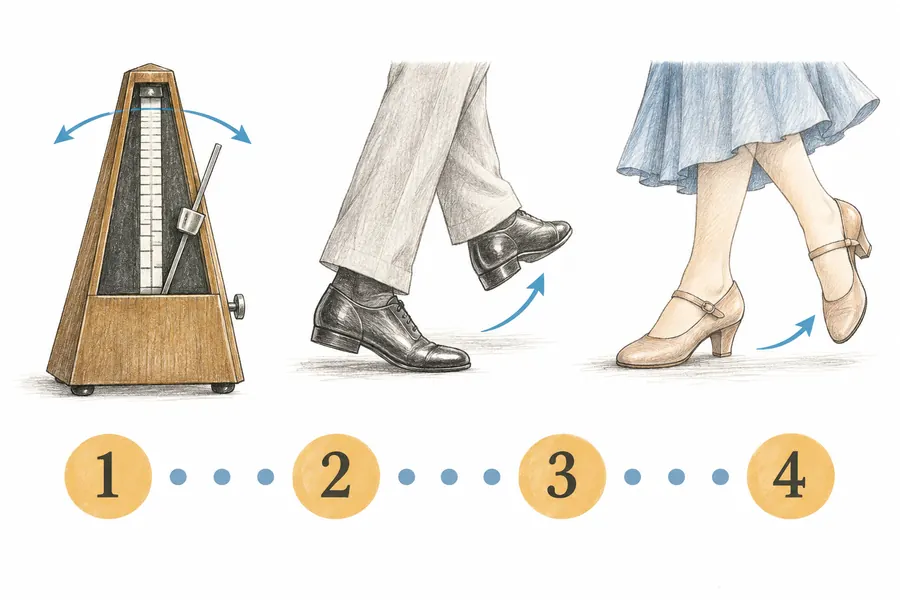

*Figure 18.6: Irish traditional music (schematic).*

The octave mandolin and the Irish bouzouki often appear in the same musical circle.

The names and the tunings of these instruments are easy to confuse.

The high attack of the standard mandolin suits carrying a melody.

The octave instruments are often better suited to accompaniment, or to melody in the low register.

When you arrange, look at the actual tuning and register before you decide which instrument takes which part.

## 18.7 Choro and the Brazilian bandolim

The Brazilian bandolim belongs to the same family as the mandolin, but it has developed a playing culture of its own.

Jacob do Bandolim is one of the most representative figures of the twentieth century.

The Instituto Moreira Salles (IMS) holds a large body of recordings and documents connected with Jacob, the Época de Ouro group and the composer Radamés Gnattali.

The IMS material on *Retratos* ("Portraits"), for instance, records that Jacob recorded the work in 1964, and shows how closely he worked with the composer and arranger. 〔S1808〕

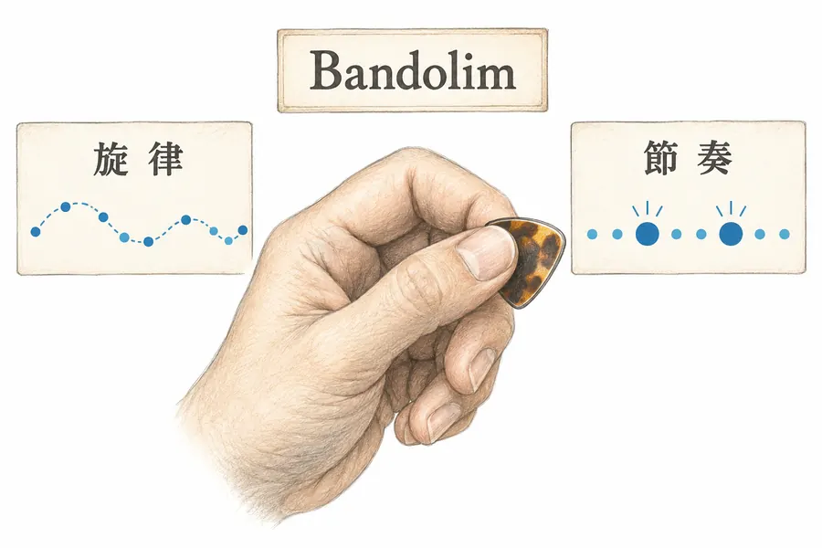

*Figure 18.7: choro and the Brazilian bandolim (schematic).*

Choro melodies often carry heavy syncopation, fast ornaments and a precise articulation, over a complex harmonic background.

> **Common misconception: the bandolim is just "the Brazilian tremolo mandolin".**
> It is not. Many passages rely on a clean single-note attack, finely worked phrasing, and a conversation with the guitar (violão), the cavaquinho and the pandeiro.

The rhythm and the harmonic flow of the accompanying group (the regional) are a foundation the solo melody cannot ignore.

In a 1964 letter Jacob even mentions that, for Gnattali's *Retratos*, he moved from "rehearsing all the time" to studying the work in more detail.

That reflects one thing: the bandolim repertoire crosses both oral choro and written chamber music. 〔S1809〕

## 18.8 Jazz swing and Dawg

The mandolin is not a mainstream instrument in jazz. So a player has to solve a few problems actively: which register to comp in, what to leave out of the chords, and how to handle sustain.

The limit of four courses actually helps a lean voicing.

The third, the seventh and the tensions can be stated clearly. Leave the bass and the root to other instruments.

Swing grammar needs an eighth-note feel; it is not just classical alternate picking played faster.

Accents, note length and where the phrase sits are what decide whether it swings.

Comping can use short chord stabs, voice-led three-note shapes, or an arpeggiated texture.

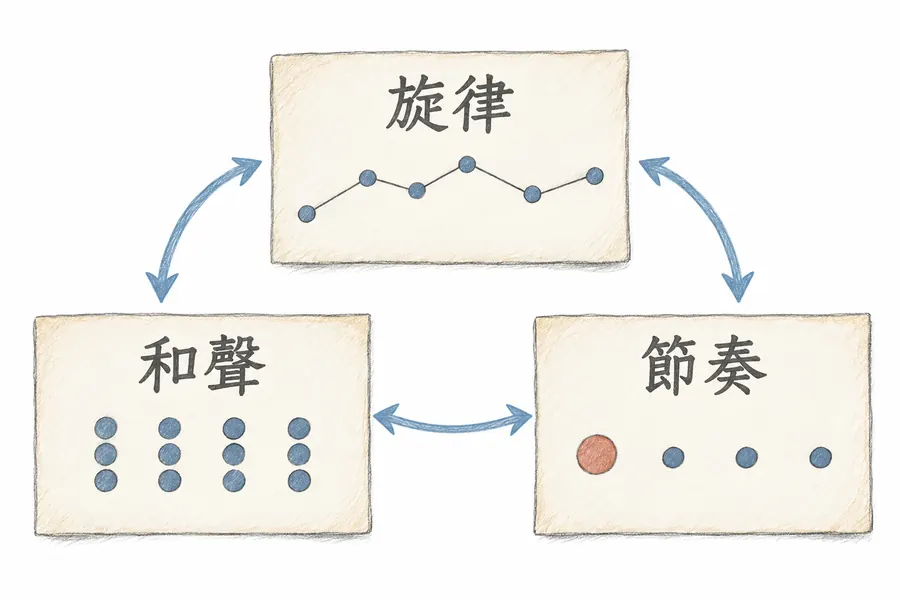

*Figure 18.8: jazz swing and Dawg (schematic).*

David Grisman's "Dawg music" is an important crossover case.

The Hall of Fame describes his style as influenced by bluegrass, jazz and several other sources, forming a language of its own.

This music reminds us that different traditions can combine and grow a new musical language. 〔S1806〕

## 18.9 Pop music and film and television scores

In modern production the mandolin does not always use the full traditional technique.

It may do only one of three things:

- arpeggiate open strings to add sparkle in the high frequencies
- use tremolo to create a nostalgic colour
- double an acoustic guitar, a string line or a synth ostinato

What matters here is how much arrangement space is left for it.

In a recording, the attack of two strings sounding at once easily occupies the 2–5 kHz band.

If that happens alongside an acoustic guitar, a bright piano and a busy hi-hat, the whole sound feels crowded.

An arrangement can make room in four places: register, note density, microphone placement, and EQ.

That way the mandolin and the other parts can all be heard clearly.

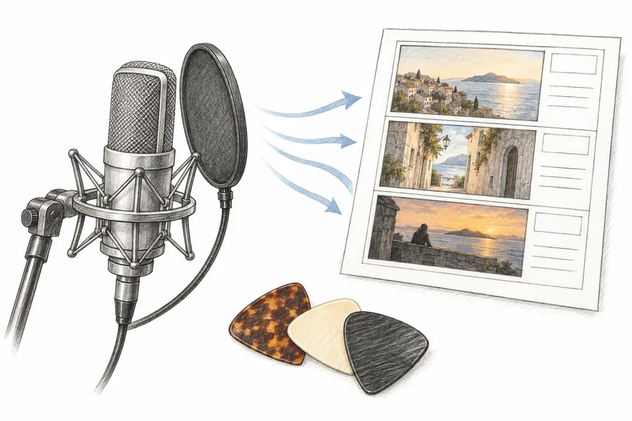

*Figure 18.9: pop music and film and television scores (schematic).*

The electric mandolin opens up another grammar entirely.

A solid body can use sustain, effects and overdrive, and can even be built with five strings to add a low C.

> **Common misconception: these sounds "do not really count as mandolin".**
> That is the wrong way to see it. They are part of this instrument family's continuing evolution, not a departure from it.

## 18.10 The instrumentation of the mandolin orchestra

A historical mandolin orchestra usually contained these parts: mandolin 1, mandolin 2, mandola, mandoloncello, guitar, bass.

Early American groups might add banjo and piano as well.

Both the Classical Mandolin Society of America (CMSA) and the Library of Congress material show one thing:

family instruments and the notation system are an important part of this orchestral tradition. 〔S1804〕〔S18010〕

The most common problem when arranging is that every upper part plays tremolo at once.

The result is an over-dense upper midrange that sounds like a fog.

A more effective approach is to divide the texture by role:

| Part | Role | Suggested treatment |
|:---|:---|:---|
| Mandolin 1 | main melody | continuous tremolo |
| Mandolin 2 | rhythmic inner part | single notes in a rhythm pattern |
| Mandola | support in the middle | longer notes |
| Mandoloncello | contrapuntal line | a counterline |
| Guitar / bass | establish the pulse | chords and bass notes |

Each part can choose tremolo, single notes or arpeggios according to its role, and the layers come out clear.

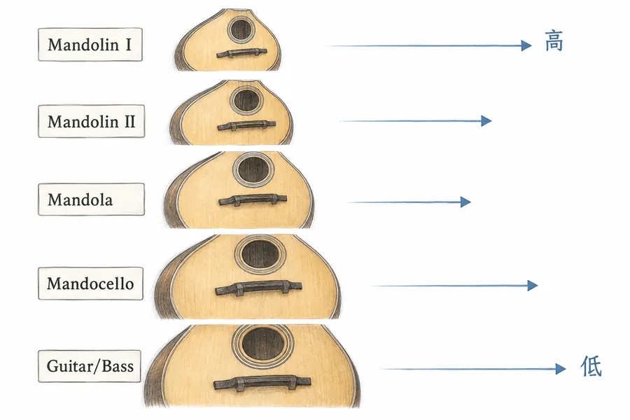

*Figure 18.10: the instrumentation of the mandolin orchestra (schematic).*

Watch overlapping registers carefully.

If mandolin 2 and the mandola both play dense harmony in the same register, the sound turns muddy.

Move one of them lower, or change it to a rhythm pattern, and the clarity usually improves a great deal.

## 18.11 Arranging string and piano works

Violin I usually maps directly onto the register of mandolin 1. But the sustain is different.

Mapping the viola onto a mandola in C means also dealing with the clef and notational conventions.

Mapping a cello line onto the mandoloncello means checking the scale length, the tuning and the available low notes.

The CMSA notation guide specifically warns that the historical notation for mandola and mandoloncello exists in several different systems. 〔S18010〕

If every long bowed pad is turned into tremolo, the arrangement sounds too thick.

You can turn an originally continuous inner part into arpeggios, a repeated pulse, or hand it to the guitar to sustain.

Save the tremolo for the lines that genuinely need to sing (cantabile).

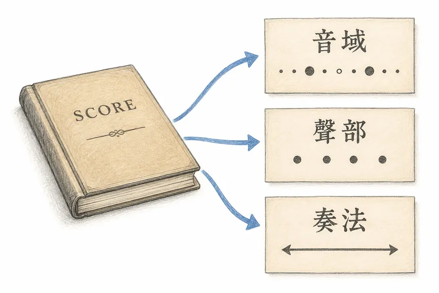

*Figure 18.11: arranging string and piano works (schematic).*

Piano arrangements are the opposite problem.

The original may have ten notes sounding at once. A mandolin orchestra has to find the harmonic function first, then decide which parts to keep.

Arranging means re-planning the register, the parts and the harmonic density.

## 18.12 Case study: the same reel played across styles

The same reel looks very different in three styles.

| Style | What it aims at | What it adds |
|:---|:---|:---|
| Classical | even articulation, clear phrasing | a little tremolo |
| Bluegrass | drive and soloistic tension | chop accompaniment, double stops, lead-style accents |
| Irish | dance lift | ornaments, an unbroken melody |

The pitches can be ninety percent the same and it still sounds completely different.

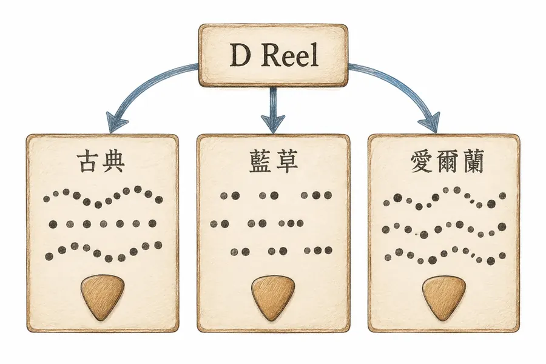

*Figure 18.12: how one melody can be reframed in different styles; the dotted line shows relative density (schematic).*

> **Common misconception: changing instrument equals changing style.**
> It does not. If the right-hand grammar stays the same—say you play everything on an F-style with a Monroe-style attack—only the tone has changed, not the style. Real cross-style playing means learning the time feel, the vocabulary of ornaments, the ensemble interaction, and the recording tradition.

The best way to learn is this: for each style, pick 3–5 representative players and recordings.

Imitate the phrases first, then analyse the technique.

That builds a real language better than starting from "ten Irish mandolin licks".

## Table 18-1 | The mandolin's role in different musical traditions

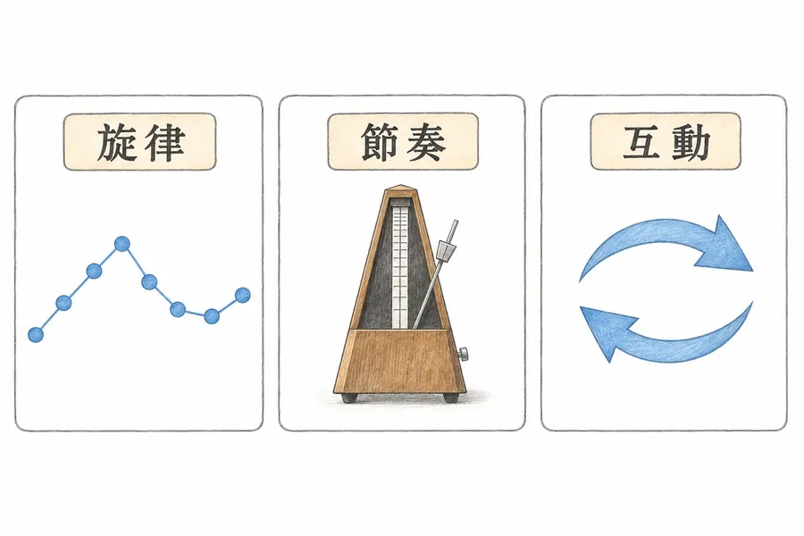

| Tradition | Typical role | Right-hand focus | Harmony / rhythm | Learning priority |
|:---|:---|:---|:---|:---|
| **Italian classical** | solo or chamber melody | tremolo, articulation | mostly from the score | historical instrument types + method books + recordings |
| **Bluegrass** | lead + backbeat | single notes, double stops, chop | 2/4 groove | the Monroe lineage + improvised jams |
| **Irish** | dance-tune melody | single notes, triplets and ornaments | reel / jig lift | lots of playing along with recordings |
| **Choro** | solo melody | precise articulation, ornaments | the regional's harmony and syncopation | Jacob and Época de Ouro recordings |
| **Jazz / Dawg** | improvisation + comping | swing, crosspicking | extended harmony | voice leading + vocabulary |

*Figure: Table 18-1, the mandolin's role in different musical traditions (schematic).*

## Self-study question bank

Study check: answer, mark, review

Answer for yourself first, then look at the answers. When you get one wrong, go back to the relevant section of the chapter and read it again.

**1. In bluegrass, the mandolin's usual rhythmic role is?**

- A. the chop backbeat
- B. a continuous long bow stroke
- C. bass notes only
- D. no accompaniment at all

**2. When playing Irish dance tunes, one important point is?**

- A. the rhythmic lift and the timing of the ornaments
- B. chasing the maximum volume
- C. turning everything into tremolo
- D. removing the accents

**3. When arranging for a mandolin orchestra, watch out for?**

- A. the registers and roles of the different family instruments
- B. every part playing the same thing
- C. only the size of the body
- D. using only one chord

**Answers: 1.A　2.A　3.A**

## Main sources checked for this chapter

Sources checked: find the original, check the conditions, keep a record

**【S1801】Carlo Munier: Scuola del Mandolino and other method books.** The nineteenth- and twentieth-century system of classical mandolin technique.

> https://imslp.org/wiki/Metodo_completo_per_la_divisione_(Munier%2C_Carlo)

**【S1802】Raffaele Calace: Metodo per mandolino, Opp.37–42.** Classical mandolin technique and the historical teaching system.

> https://imslp.org/wiki/Metodo_per_mandolino_(Calace%2C_Raffaele)

**【S1803】Library of Congress, NLS Music Notes: From Baroque to Bluegrass, a Globe-Trotting Instrument (2020).** The American mandolin craze, BMG culture and the prehistory of bluegrass.

> https://blogs.loc.gov/nls-music-notes/2020/08/from-baroque-to-bluegrass-a-globe-trotting-instrument/

**【S1804】Library of Congress: The Suffragettes: March (1915).** The actual instrumentation of a historical mandolin orchestra (three mandolins, mandola, mandoloncello, guitar, banjo, piano).

> https://www.loc.gov/item/2017562356/

**【S1805】Bluegrass Music Hall of Fame & Museum: Bill Monroe biography.** Bluegrass history, Monroe's influence and the classic 1945 line-up.

> https://www.bluegrasshall.org/inductees/bill-monroe/

**【S1806】Bluegrass Music Hall of Fame & Museum: David Grisman biography.** Dawg music, and the crossover background of bluegrass and jazz.

> https://www.bluegrasshall.org/inductees/david-grisman/

**【S1807】Irish Traditional Music Archive: Brendan O'Regan compositions / publications.** Verifiable holdings and research leads for the mandolin in contemporary Irish traditional music.

> https://www.itma.ie/saothar/brendan-oregan/

**【S1808】Instituto Moreira Salles / Rádio Batuta: Suíte Retratos, 3º movimento – Anacleto de Medeiros.** Jacob do Bandolim's 1964 *Retratos* recording and choro history.

> https://radiobatuta.ims.com.br/programas/equipe-ims-bia-paes-leme/suite-retratos-3-movimento-anacleto-de-medeiros

**【S1809】Instituto Moreira Salles: Jacob do Bandolim 1964 letter to Radamés Gnattali.** A first-hand letter on how Jacob studied and worked on *Retratos*.

> https://correio.ims.com.br/carta/valeu-ora-se-valeu/

**【S18010】Classical Mandolin Society of America: Music Notation for Mandolin Family Instruments.** The notation systems and regional differences for mandola, mandoloncello and the other family instruments.

> https://classicalmandolinsociety.org/wp-content/uploads/Music_Notation_for_Mandolin_Family_Instruments_v3.pdf

---

**Part F　Choosing an Instrument, Research and Daily Care**

Get to know luthiers and model data, weigh up structure and playing needs, and complete the choosing, record-keeping and care of an instrument.

Reading range: Chapters 19 to 21

---
