# Chapter 19: Luthiers, Brands and Classic Models

## Key points

- Brand history is the easiest kind of history to turn into myth. When a maker says "we were the first", that is an important lead, but it is the brand's own account, not a settled fact.
- To judge where an instrument came from, keep four kinds of evidence apart: the brand's own account, the original patent, the surviving object in a collection, and catalogues and later research.
- "The design appeared at a certain moment" and "a later style adopted it" are two different things and must not be muddled together.
- The instrument's type (A-style / F-style) and its grade and price are two different columns.
- Specifications circulating in the market are often wrong. Factory catalogues and measurements of the actual object are more reliable than a sales listing.

## Opening: why brand history so easily turns into myth

Brand history is the easiest kind of history to turn into myth.

A maker's own website will naturally stress "innovation", "legend" and "the first".

The second-hand market, meanwhile, copies model years, woods and places of manufacture from one listing to the next.

A genuinely reliable history of an instrument needs to look at these things separately: the brand's own account, the original patent, the surviving object in a collection, catalogues, and later research.

This chapter picks several key traditions and shows three things:

- how the design changed
- which claims can be confirmed directly
- which claims still need conditions attached

Chapter 20 goes further and breaks the brands down into a database of one row per model.

The question this chapter answers is bigger: why did these models appear at all? What market, what music and what manufacturing technology made them possible?

## Quick brand reference table

Look at the map first, then the detail.

| Brand / person | Country / region | Period | Best known for |
|:---|:---|:---|:---|
| Vinaccia family | Italy, Naples | eighteenth century | the early Neapolitan mandolin; the 1781 object in a collection |
| Fabricatore family | Italy, Naples | year not recorded in this book | a Neapolitan luthier family |
| Embergher | Italy, Rome | mentioned here in a late nineteenth-century context | the Roman school; different body proportions and concert instruments |
| Calace | Italy, Naples | officially traced to 1825, still working | a family workshop carried on; playing, composing, teaching and making in one house |
| Orville H. Gibson / Gibson | United States | 1898 patent; 1923 F-5 | carved top and back, f-holes, the F5 type |
| C. F. Martin | United States | the mandolin craze years | large numbers of mandolins, both bowlback and flatback |
| Washburn (Lyon & Healy) | United States | the mandolin craze years | mass production during the mandolin craze |
| Vega | United States | the mandolin craze years | mass production during the mandolin craze |
| Suzuki | Japan | checkable in the 2016 official catalogue | production instruments for school and university ensembles, including the middle and low family instruments |
| Collings | United States (treated here as American handmade) | present day | high-end handmade F-style instruments to precise specifications |
| Northfield | United States / China (divided manufacturing) | present day | the Big Mon's enlarged body; a cross-border manufacturing process |
| Eastman | origin not recorded in this book | present day | production solid-wood F-style instruments |

## 19.1 Vinaccia and the Neapolitan tradition

The Vinaccia family turns up again and again in stories about the mandolin's origins.

But a one-line claim such as "a certain Vinaccia invented the modern mandolin" needs careful handling.

The more reliable approach is to look at the objects that have survived.

The 1781 Antonio Vinaccia mandolin in the Metropolitan Museum of Art (the Met) has these features:

- eight metal strings
- four courses
- the same G–D–A–E tuning as the violin
- a deep bowlback
- a canted soundboard

These are all important features of what later became the "Neapolitan" type. 〔S1901〕

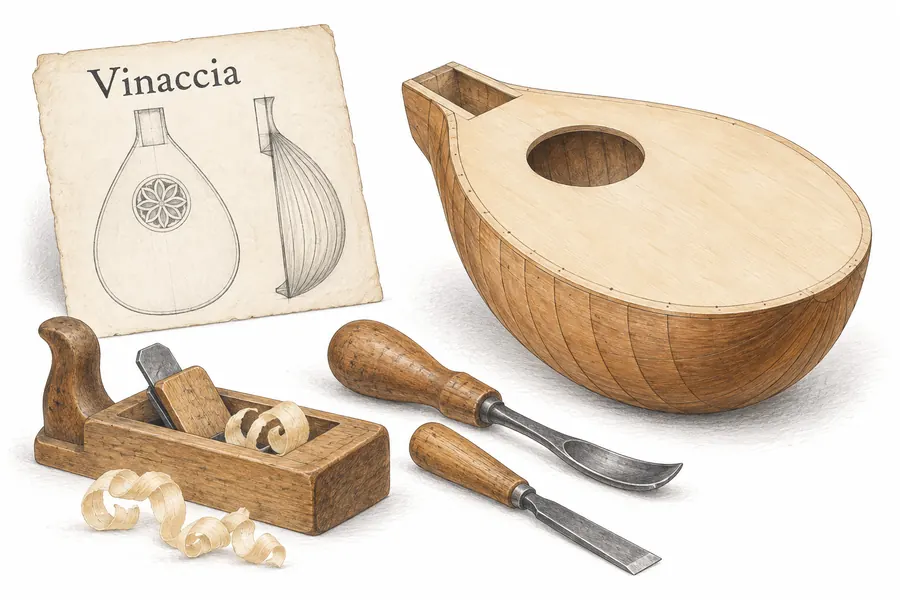

*Figure 19.1: Vinaccia and the Neapolitan tradition (schematic).*

Evidence of this kind tells us that by the late eighteenth century the core configuration later generations knew well had matured.

But "matured" does not mean "was suddenly created by one person on one day".

At the time there were still different mandolin systems in different parts of Italy.

So the more reasonable historical account is this:

the workshops of Naples gradually brought together metal strings, four courses, tuning in fifths and a particular body structure.

In the end it became one of the most influential systems of the nineteenth century.

> **Common misconception: some Vinaccia "invented" the modern mandolin in a particular year.**
> A one-line claim like that oversimplifies. The reliable statement is "gradually brought together and matured", not "a single person at a single moment".

When a collector reads a Vinaccia label, three more things need watching: the family contains several generations of makers, first names repeat, and later copies of the label exist.

Provenance, structural features, paper and lettering all matter more than a single label.

## 19.2 Fabricatore, Embergher and the Italian workshops

The Fabricatore family is another important name in Neapolitan instrument making.

Embergher, in Rome, developed different body proportions, structures and concert instruments.

The world of the Italian mandolin at the end of the nineteenth century was not a single line.

Naples, Rome and Milan each had their own workshops, players and market preferences.

Those differences show up in places like these:

- the number of bowl ribs
- the bend in the soundboard
- the headstock
- the fingerboard extension
- the scale length
- the ornament

If you study old instruments and file everything under a single heading of "Italian bowlback", you throw away the real regional information.

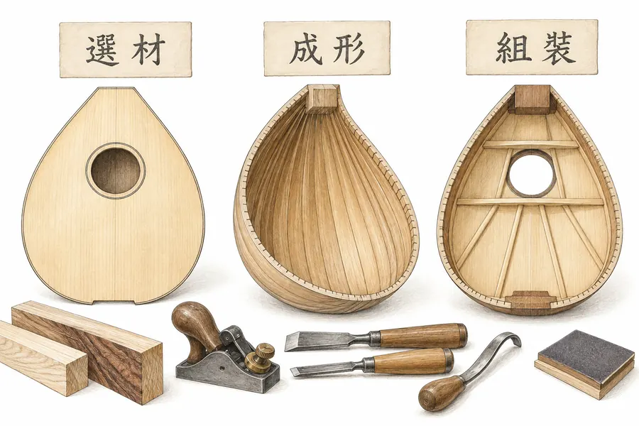

*Figure 19.2: Fabricatore, Embergher and the Italian workshops (schematic).*

For a modern player, the value of understanding several schools is this one thing: the bowlback tone has more than one fixed answer.

Different structures, dimensions and setup can produce considerable differences in attack, projection and sustain.

## 19.3 The Calace family and its products

Calace's own material traces the workshop back to 1825, and it still makes mandolin-family instruments in Naples today.

The current website lists specifications for several mandolins, mandolas, mandoloncello and liuto-type instruments straight away.

The specifications include scale length, number of ribs, woods and tuning.

That makes Calace an important case for studying how a historical tradition carries on into the present. 〔S1902〕

Current mandolin models 13, 15, 16Bis and Cl.A / B / C / D, for instance, mostly use a 33.5 cm scale length.

But they form different grades in rosewood or maple bodies, in the number of ribs, in the number of frets on the fingerboard, in the ornament and in the construction of the headstock.

The official material also shows that eight-string and ten-string mandoloncello exist side by side.

So a family name should be checked together with the maker's string count and tuning data; the name alone is not enough. 〔S1903〕

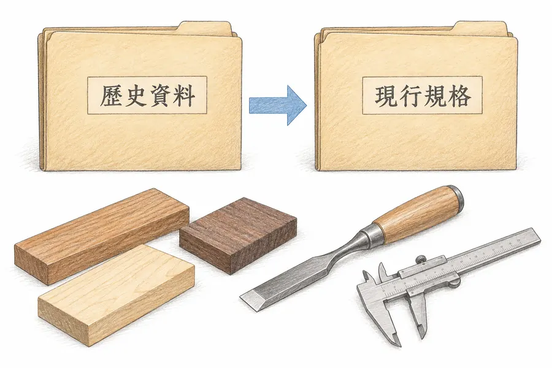

*Figure 19.3: looking up the historical and the current specifications separately (schematic).*

Raffaele Calace himself was a performer, a composer and a teacher at once.

His six-volume *Metodo per mandolino* left behind a great deal of evidence about technique.

The point of brand history here is this: repertoire, method books, playing practice and instrument making are four things that hold each other up. 〔S1904〕

## 19.4 Orville Gibson's design

Orville H. Gibson took out United States patent US598245A in 1898.

The patent states his reforming idea plainly: he criticised the instruments of the day for being built from too many bent, spliced, braced and glued parts.

So he proposed two directions: a carved top and back, and a body and neck built as whole structures.

This patent is one of the most reliable primary sources for understanding Gibson's early design. 〔S1905〕

The 1898 Orville Gibson mandolin in the Met turns the patent into a visible object:

- a spruce carved top
- a walnut carved back
- a floating bridge
- a tailpiece
- an oval soundhole
- the Neapolitan eight-string, four-course arrangement still kept

That shows the American carved body was, more precisely, a redesign of the acoustic structure rather than a styling exercise. 〔S1906〕

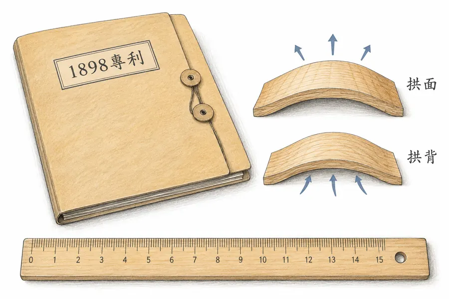

*Figure 19.4: Orville Gibson's design (schematic).*

The later A-style and F-style both rest on this line of carved tops and backs.

The scroll and the points are the conspicuous part.

But what really had a long-term effect was the carved plates, the bridge system, the geometry between neck and body, and the later development of bracing.

## 19.5 Lloyd Loar and the F5

Gibson's current official F-5 history page lists these as the key changes of the 1923 F-5:

- f-holes
- a longer neck
- a changed bridge position
- redesigned bracing
- a raised fingerboard extension

These designs did indeed have an enormous influence on the surviving Loar-signed F-5 instruments and on the bluegrass instruments that followed. 〔S1907〕

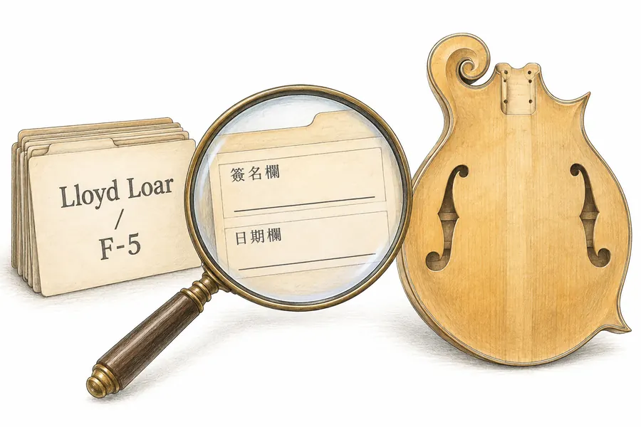

*Figure 19.5: Lloyd Loar and the F5 (schematic).*

> **Common misconception: "Loar invented the bluegrass sound."**
> That is hindsight. When the F-5 appeared, bluegrass was still more than twenty years away from taking shape. What really bound this instrument type tightly to bluegrass was the use made of it by players such as Bill Monroe, and the recording culture around them. Historical cause and effect has to be read in two stages: "the design appeared" and "a later style adopted it".

Gibson's current 1923 F-5 Master Model reissue also provides a materials benchmark:

- a red spruce top
- figured maple for the body, back and neck
- an ebony fingerboard and bridge

A modern reissue helps us understand which historical features the maker thinks are worth keeping.

But it cannot be used backwards to argue that "every original instrument of the 1920s was exactly the same". 〔S1907〕

## 19.6 Other brands of the American golden age

The mandolin craze brought an enormous market, and not only for Gibson.

C. F. Martin, Washburn (Lyon & Healy), Vega and others all made large numbers of mandolins, including bowlback, flatback and several levels of ornament.

Those brands reflect a market of "music at home, school clubs, mandolin orchestras", not simply the professional stage.

*Figure 19.6: other brands of the American golden age (schematic).*

When you study these instruments, catalogues matter more than later price guides.

One brand may change model codes, materials and places of manufacture over a few decades.

Look only at the headstock logo and you can easily get the period wrong.

Archives and research guides kept by companies such as Martin can supply serial numbers, catalogues and production records.

But even then you have to check model by model. 〔S1908〕

Collector value also has to be assessed on three things together: rarity, originality and condition.

Some mass-produced student models are historically interesting but do not fetch much on the market.

Some high-end models made for only a short time gain a great deal in value because they are rare, original and playable.

## 19.7 Suzuki and Japanese instrument making

Mandolin culture in Japan developed alongside university and school ensembles for a long time.

So the market needed not only standard mandolins but also mandolas, mandoloncello and other ensemble instruments.

Suzuki is one of the most important production brands in that world.

The 2016 official catalogue lets you confirm directly the materials, prices and dimensions of the M-30, M-60, M-80, M-100, the MD series and the MC-836, among others.

That is an important primary source for correcting wrong labels in the second-hand market. 〔S1909〕

The MC-836 is a typical case.

Second-hand listings have at times described it as a "large bowlback".

But the Suzuki official catalogue states plainly: a 574 mm vibration length, a spruce top, a rosewood flatback body, a mahogany neck and a rosewood fingerboard.

> **Common misconception: "this model exists" means "the specifications circulating online are correct".**
> Those are two things. A model existing does not mean those specifications are right.

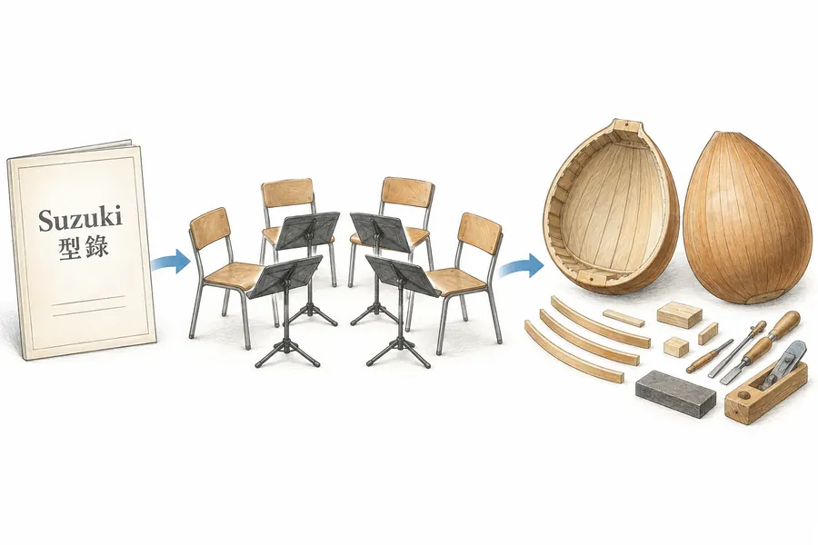

*Figure 19.7: Suzuki and Japanese instrument making (schematic).*

The Japanese second-hand market holds many old models that are no longer made.

So to judge a year you have to combine catalogue, label, headstock and logo, hardware, case and actual measured dimensions.

Do not assume the materials are the same just because the model numbers look close.

## 19.8 Modern American handmade instruments

High-end modern F-style instruments do not simply copy the 1920s.

Take the official specifications of the Collings MF5. It uses:

- Adirondack spruce
- Eastern flamed maple
- tone bars
- a 13 7/8 inch scale length
- a compound-radius ebony fingerboard

Its oval-hole version, the MF5 O, switches to an X-brace instead.

That shows one brand using the pairing of "soundhole shape plus bracing type" to separate different acoustic goals. 〔S1910〕〔S1911〕

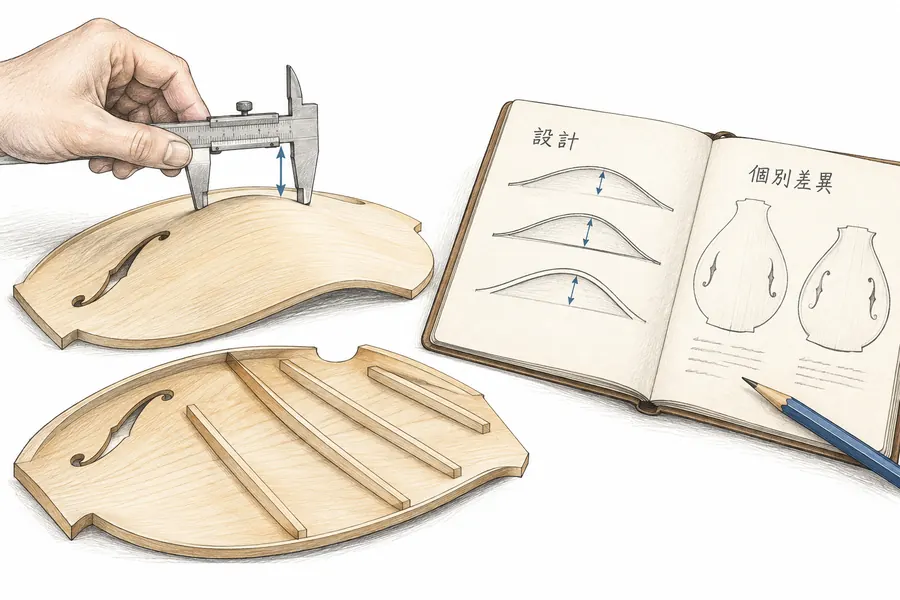

*Figure 19.8: modern American handmade instruments (schematic).*

Northfield's Big Mon widens the body slightly and adjusts the depth, hoping to add more response in the low mids.

The maker even states plainly that the widest point of the body is about 5 mm wider.

That is a good modern case. The traditional F5 outline can take small changes in proportion, so that the external shape and the material layout develop together. 〔S1912〕

The place of manufacture has become global as well.

Northfield states openly that different series may be selected and machined in Michigan.

They are then assembled and finished in Qingdao, Shandong, and come back to Michigan for final adjustment.

That reminds collectors that "the brand's nationality" does not automatically equal every place of manufacture. 〔S1913〕

## 19.9 Modern production instruments

Eastman's MD315 and MD515 are both F-style with f-holes, a solid spruce top, solid maple back and sides, and a 13 7/8 inch scale length.

The differences are in the finish, the ornament and the hardware.

The official specifications also list practical setup figures such as action, nut width and fingerboard radius.

Data like this is useful for comparing series within one brand, judging the looks and the actual specifications separately. 〔S1914〕〔S1915〕

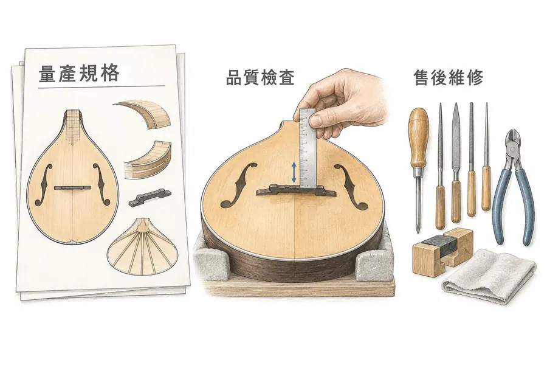

*Figure 19.9: modern production instruments (schematic).*

The higher-grade MD814/v uses Adirondack spruce, strongly figured maple and an antique varnish finish.

But an upgrade in materials still does not mean it "must sound better than a particular MD315".

The individual graduation, the setup and the player's preference all affect the result.

> **Common misconception: an F-style instrument with a scroll must be a higher grade.**
> This is one of the commonest misunderstandings in the market. In reality an A-style can be a top-level handmade instrument, and an F-style can be an entry-level one. Instrument type and product positioning are two different columns.

## 19.10 Reading the evidence in brand history

If a maker writes "we invented the modern mandolin", that is an important source of information, but it belongs to the brand's own account.

A stricter piece of writing will go and look for a patent, a catalogue from the same period, an object in a collection, or outside research.

Gibson's carved construction, for instance, can be cross-checked against the 1898 patent and the 1898 object in the Met.

So its historical position is fairly secure. 〔S1905〕〔S1906〕

On the other hand, if only a second-hand listing says "rare professional-grade model from the 1960s", with no catalogue and no serial number system, it should be marked "to be verified".

The more expensive the old instrument, the less a listing can be allowed to prove itself.

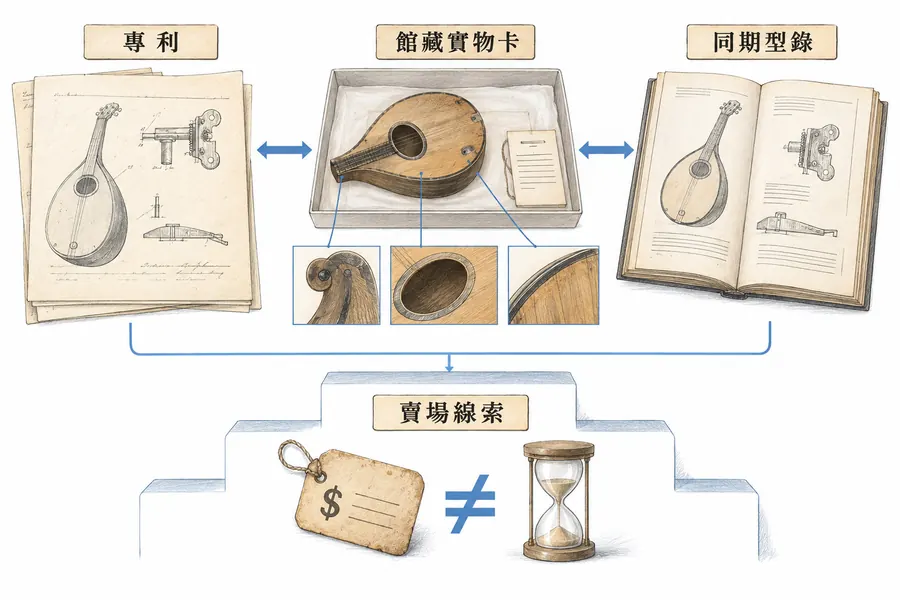

*Figure 19.10: reading the evidence in brand history (schematic).*

That is why Chapter 20 of this book rates "existence, period, wood, specifications and price" separately, and marks the reliability of each item of information on its own.

The method is a nuisance, but it prevents one thing: an officially confirmed model name quietly vouching for unconfirmed wood.

## 19.11 Case study: the design differences in F-style instruments

When you compare F-style instruments, look at three layers.

| Layer | Content |
|:---|:---|
| First layer: structure | soundhole, bracing, scale length, body dimensions, neck joint |
| Second layer: materials and finish | species of wood, grade, lacquer |
| Third layer: ornament and price | binding, finish detail, market positioning |

If you look only at the brand's prestige, or only at how pretty the figured maple is, you easily overlook the design that actually affects the feel and the acoustics.

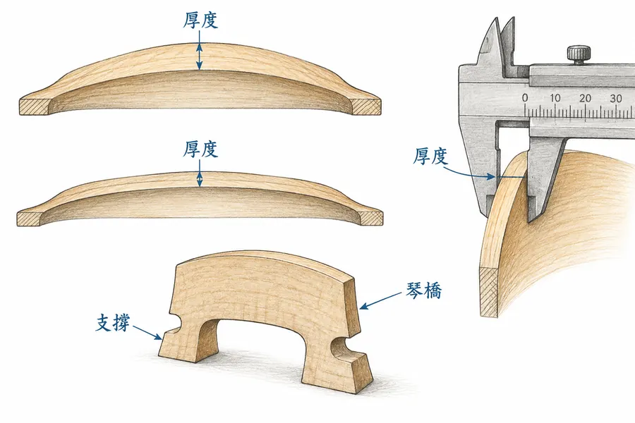

*Figure 19.11: case study, the design differences in F-style instruments (schematic).*

The differences in real cases look like this:

- part of the value of the Gibson 1923 reissue lies in historical reproduction.
- the Collings MF5 stresses contemporary precision manufacturing and particular tone bars.
- the Northfield Big Mon changes the proportions of the body.
- the Eastman MD315 / MD515 offers solid-wood F-style instruments at a much larger production scale.

They serve different markets, prices and ways of manufacturing.

No single verdict about "who is best" can stand in for actual use.

For a buyer, the best questions are these:

- What neck width do I want?
- What setup do I want?
- What response and volume do I want?
- What style do I play?
- How much upkeep can I afford?

Brand history supplies context, but it should not become a substitute for the buying decision.

## Table 19-1 | Key moments in instrument making, and the kind of evidence this book uses

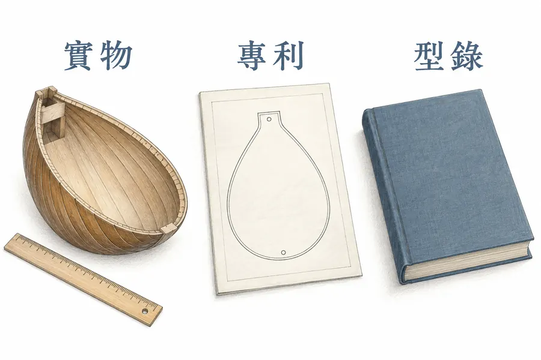

| Person / brand | Moment | What can be confirmed directly | Main evidence |
|:---|:---|:---|:---|
| **Vinaccia** | the 1781 object in the Met | eight strings in four courses, GDAE, bowlback, canted soundboard | the object in the collection |
| **Orville Gibson** | the 1898 patent + the object in the Met | the idea of carved construction and the structure of the object | patent + collection |
| **Gibson F-5** | 1920s / 1923 | f-holes, long neck, bracing and other official historical points | the maker's history + surviving instruments |
| **Calace** | 1825 to the present | current family specifications, continuity of the workshop | official specifications + method books |
| **Suzuki** | the 2016 catalogue | family model specifications and the prices of the time | the maker's catalogue |
| **Collings / Northfield / Eastman** | present day | current specifications, manufacturing process | official technical pages |

*Figure: Table 19-1, key moments in instrument making and the kind of evidence this book uses (schematic).*

## Self-study question bank

Study check: answer, mark, review

Answer for yourself first, then look at the answers. When you get one wrong, go back to the relevant section of the chapter and read it again.

**1. When researching brand history, the most reliable method is?**

- A. cross-check official material, collections, catalogues and the actual objects
- B. read only the brand's advertising
- C. read only sales listings
- D. read only forums

**2. The importance of Orville Gibson's 1898 patent lies in?**

- A. it proposed a new approach to carved construction
- B. it invented the electronic amplifier
- C. it removed the strings
- D. it made the instrument fretless

**3. Raffaele Calace's roles included?**

- A. instrument making, playing, composing and teaching
- B. distributor only
- C. collector only
- D. conductor only

**Answers: 1.A　2.A　3.A**

## Main sources checked for this chapter

Sources checked: find the original, check the conditions, keep a record

**【S1901】The Metropolitan Museum of Art: Antonius Vinaccia Mandolin, 1781.** The object with 23 ribs, eight strings in four courses, GDAE and the Neapolitan canted structure.

> https://www.metmuseum.org/art/collection/search/504543

**【S1902】Liuteria Calace: Official history / home.** The Calace workshop's official history, founding year and present address.

> https://www.calace.it/en/

**【S1903】Liuteria Calace: Current mandolins / mandoloncelli & liuti specifications.** Scale lengths, tunings, ribs, woods and string counts of the current models.

> https://www.calace.it/en/mandolini

**【S1904】Raffaele Calace: Metodo per mandolino, Opp.37–42.** First-hand method material for Calace as a composing and teaching tradition.

> https://imslp.org/wiki/Metodo_per_mandolino_(Calace%2C_Raffaele)

**【S1905】United States Patent Office / Orville H. Gibson: US598245A Mandolin patent (1898).** Orville Gibson's own patent for carved construction and body and neck design.

> https://patents.google.com/patent/US598245A/en

**【S1906】The Metropolitan Museum of Art: Orville Gibson Mandolin, 1898.** The object with a spruce carved top, walnut carved back, floating bridge and oval soundhole.

> https://www.metmuseum.org/art/collection/search/700485

**【S1907】Gibson: Gibson Mandolins / 1923 F-5 Master Model Reissue.** F-5 design history and current reissue specifications; the maker's own account and product data.

> https://www.gibson.com/pages/gibson-mandolins

**【S1908】C. F. Martin & Co.: Hutton's Guide to Martin Guitars: 1833–1969 (archival research guide).** Martin historical research resources; used here to illustrate the archival method.

> https://www.martinguitar.com/gear-accessories/apparel-merch/18B0033.html

**【S1909】Suzuki Music / Suzuki Violin Manufacturing: Suzuki Music 2016 Catalog – Mandolin / Mandola / Mandocello.** Official specifications and prices of the time for the M-30, M-60, M-80, M-100, the MD series and the MC-836.

> (The 2016 official catalogue used in the earlier verification for this book)

**【S1910】Collings Guitars: MF5 official specifications.** Current specifications including Adirondack spruce, Eastern flamed maple, tone bars and the 13 7/8 inch scale length.

> https://collingsguitars.com/mandolins/mf5/

**【S1911】Collings Guitars: MF5 O official specifications.** The oval soundhole, X-brace and current specifications.

> https://collingsguitars.com/mandolins/mf5-o/

**【S1912】Northfield Mandolins: Big Mon official page.** The maker's own statement of the roughly 5 mm increase in body width and its design purpose.

> https://www.northfieldinstruments.com/big-mon

**【S1913】Northfield Mandolins: How Northfield Works.** Materials, the division of manufacturing between Michigan and Qingdao, and final adjustment.

> https://www.northfieldinstruments.com/how-northfield-works

**【S1914】Eastman Guitars: MD315 official specifications.** Current specifications such as the F-style body, solid spruce and maple, scale length, fingerboard radius and action.

> https://www.eastmanguitars.com/md315

**【S1915】Eastman Guitars: MD515 official specifications.** The F-style body, solid spruce and maple, the finish and current specifications.

> https://www.eastmanguitars.com/md515/

---
