# Chapter 20: Model Specifications and Source Verification

*World Mandolin Family Model, Material and Specification Database*

## Key points

- "This model really exists" and "this instrument's wood is spruce" are two different questions, and they have to be checked separately.
- The order of checking is: does the model exist → what period → specifications → wood → price.
- Each column for the same model can carry a different reliability grade (A / B / C / D).
- A maker's website only vouches for "the one being made now". It does not automatically apply to an old instrument with the same name.
- If you cannot find it, write "no reliable data obtained". A blank is a research result, not laziness.

## 20.0 Why this chapter looks different

The chapters before this one were about principles. This one is about a research database that can be updated indefinitely.

Its method is to break each instrument into separate columns: model, family, structure, tuning, scale, wood, price, source. Every column has to be verifiable on its own.

The method comes out of a real problem. While putting together brands such as Suzuki and Calace, the author kept meeting the same situation.

The model name certainly exists, but the wood, the year or the price circulating online may be wrong. And instruments within one series cannot be inferred from each other.

So this chapter holds to "one clear model, one row". The M-30, M-60, M-80 and M-100 each have official data, so they become four rows.

If one model changed specifications across periods, it is split into separate rows too, as long as the period can be confirmed.

The blanks in the tables, the "no reliable data obtained" and the grade D marks are all part of the research result. They are not tables left unfinished.

## 20.1 Confirming the instrument family

Product names differ from region to region. What is called a Mandola often means, in the United States, a mid-range instrument tuned C–G–D–A; elsewhere it may mean an instrument tuned G–D–A–E an octave down.

The use of Mandocello, Mandoloncello and Liuto Cantabile also differs between Italian, Japanese and Anglo-American traditions.

The family notation guide of CMSA (the Classical Mandolin Society of America) records these differences explicitly. So this database does not classify by product name. It looks at four things first: tuning, sounding range, number of courses, and scale. 〔S2001〕

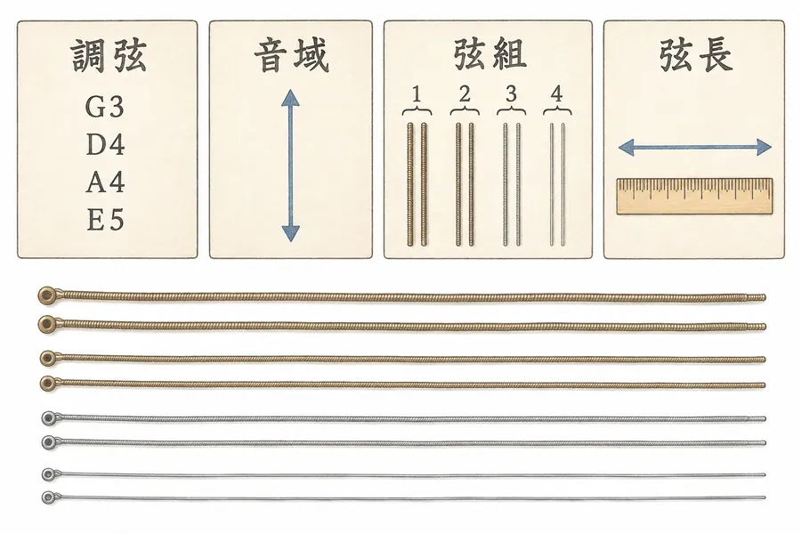

*Figure 20.1: the four coordinates the database uses to identify an instrument (schematic).*

Once the family is settled, "structure" has to be recorded separately. Bowlback, flatback, carved-top, F-style, A-style and flat-top should not be mixed in with the family name.

That way "Mandola" does not become a body shape, and F-style does not become a register family.

The principle is practical for searching too. Search the international market for "mandola" alone and instruments tuned in C and tuned in G will both come up. Confirm the actual tuning first, and you get back to the right group of data.

| Point and application | Content |
|----|----|
| Core idea | Product names differ by region. |
| Relations and conditions | The CMSA family notation guide records these differences explicitly, so this database does not classify by product name alone but looks first at tuning, sounding range, number of courses and scale. |
| Application | Looking up models, specifications and reliability. |

> **Common misconception: "Mandola is a body shape."**
> Wrong. Mandola refers to a register family; bowlback and flatback refer to structure.
> Keep the two apart, or you will muddle a whole system of classification.

## 20.2 Checking the model, the period and the specifications separately

Every row of the data table has to answer at least five separate questions about what is actually true.

1. Does this model number really exist?
2. What period was it made in?
3. Can the scale, tuning and number of courses be confirmed?
4. Can the wood of the top, back, sides, neck and fingerboard be confirmed?
5. Which kind of price is it? The list price at the time, a dealer price, today's price for a new instrument, an asking price, or a sold price?

So when this book marks reliability A / B / C / D, it does not grade a whole row at once.

The ideal case is "model A, period A, wood A, price A". "Model A, period B, wood D, price C" can also happen.

A row like the second one should not be written up as a specification table that looks complete but is half guesswork.

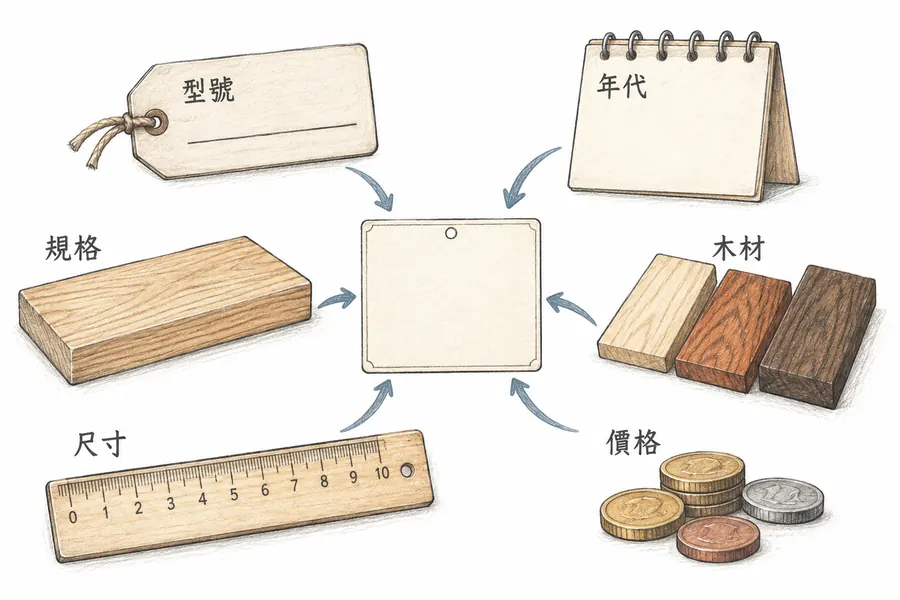

*Figure 20.2: checking the model, the period and the specifications separately (schematic).*

Official material is not a universal answer either.

A current website is good for confirming "the product being made now". But if a brand's history page says "the first in the world" or "revolutionary design", it still needs cross-checking against patents or collection records.

Conversely, a museum object is very good for confirming the materials and dimensions of **that one instrument**, but it does not necessarily represent the whole production period.

> **Common misconception: "one series must use the same materials".**
> Not necessarily. High and low grades within a series may change the number of body ribs, the species of wood, the number of frets and the construction of the headstock all at once.
> So check model by model.

## 20.3 Recording wood according to structure

Flatback and carved instruments can be divided into top, back and sides.

The back of a bowlback is built from many ribs (or staves), and forcing that into a "back / sides" column distorts it. That is why this database uses the idea of "body / ribs".

A column that does not apply structurally should say "not applicable". Only then can a reader tell "not applicable" apart from "data still to be found".

Write the wood name only as far as the source supports.

If the maker writes only rosewood, this book will not take it upon itself to turn that into Indian rosewood.

If the maker writes only spruce, this book will not assume this model is Adirondack spruce just because a higher grade in the same brand uses it.

A commercial name and a botanical species are not on the same level.

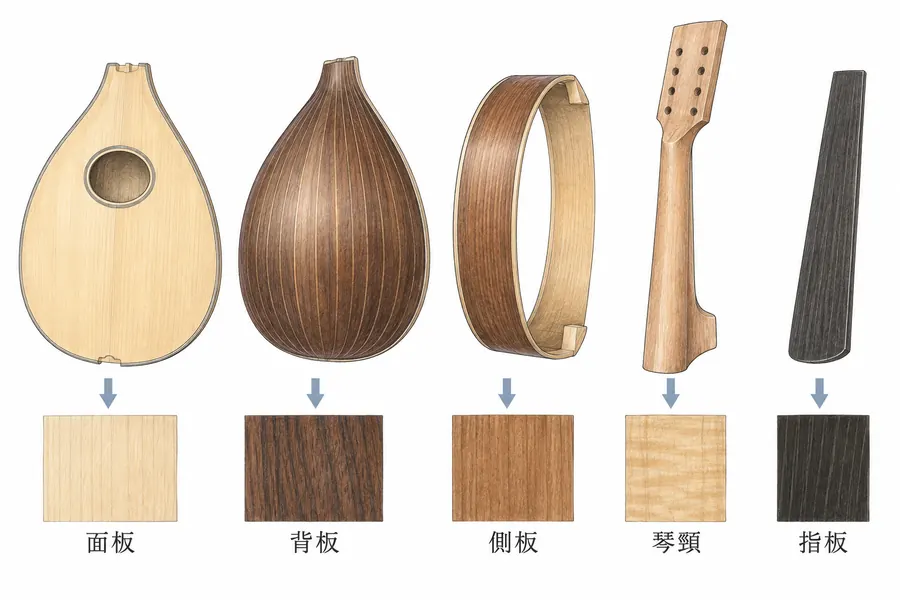

*Figure 20.3: recording wood according to structure (schematic).*

Terms such as figured, flamed and AAA are visual or commercial grades. They do not mean different species.

They can go in a "special workmanship / grade" column, but they cannot replace the actual species column.

| Point and application | Content |
|----|----|
| Core idea | Flatback and carved instruments divide into top, back and sides; the back of a bowlback is made of ribs. |
| Relations and conditions | Write the wood name only as far as the source supports. |
| Application | Looking up models, specifications and reliability. |

## 20.4 Scale length, overall length and body length

A second-hand listing often says "scale 67 cm". What was actually measured may be the nut to the tailpiece, or even the whole length of the instrument.

Scale length is defined as the effective vibrating length, usually from the nut to the bridge saddle.

If the floating bridge has moved, the number you measure also reflects a wrong setup. So prefer the maker's technical specifications.

If only the physical instrument is available to measure, record how you measured and the margin of error. The bridge of an old instrument may not be original and may have been moved; the present state cannot be taken directly as the original design.

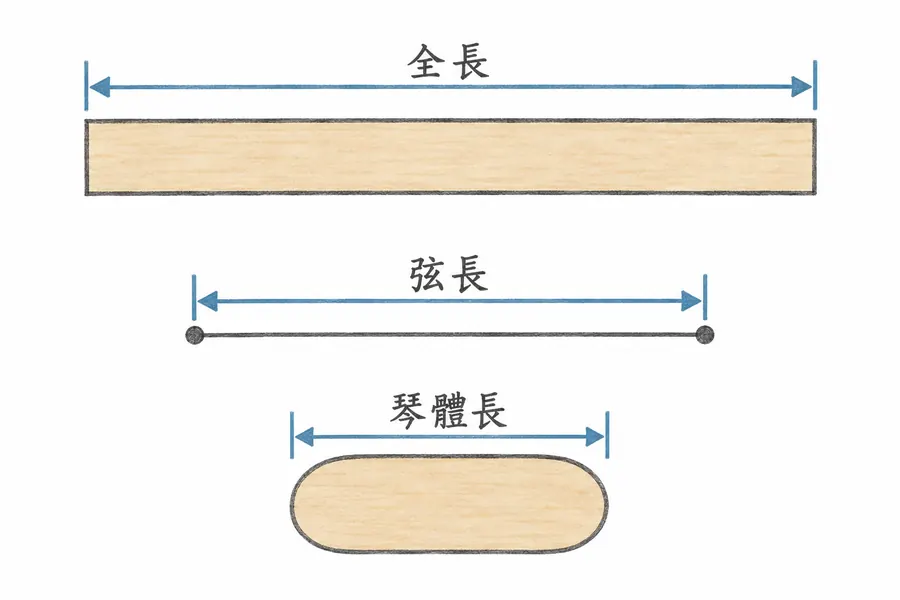

*Figure 20.4: scale length, overall length and body length (schematic).*

Family classification depends heavily on scale. The standard mandolin is commonly about 33–35 cm. The octave mandolin, mandola and mandocello get progressively longer.

But every tradition has its own range, and no single threshold can classify them automatically.

| Point and application | Content |
|----|----|
| Core idea | "Scale 67 cm" in a second-hand listing may have measured nut to tailpiece, or the whole instrument. |
| Relations and conditions | Family classification depends heavily on scale: the standard mandolin is commonly about 33–35 cm, and the other families get progressively longer. |
| Application | Looking up models, specifications and reliability. |

## 20.5 Price data and dates

"This instrument cost 20,000 back then"—without a year, a currency and a kind of price, it is almost impossible to compare.

The maker's list price, the street price, an auction hammer price, a second-hand asking price and a shop price after servicing are all different.

So this chapter treats price as data that changes over time.

Comparing across periods also has to allow for inflation, exchange rates, taxes and differences between regional distributors.

The official history page for the 1923 Gibson F-5 mentions that it sold for 250 US dollars at the time. That number matters in a historical account, but it cannot be compared with today's dollars to work out "how many times more expensive" without adjusting for purchasing power. 〔S2002〕

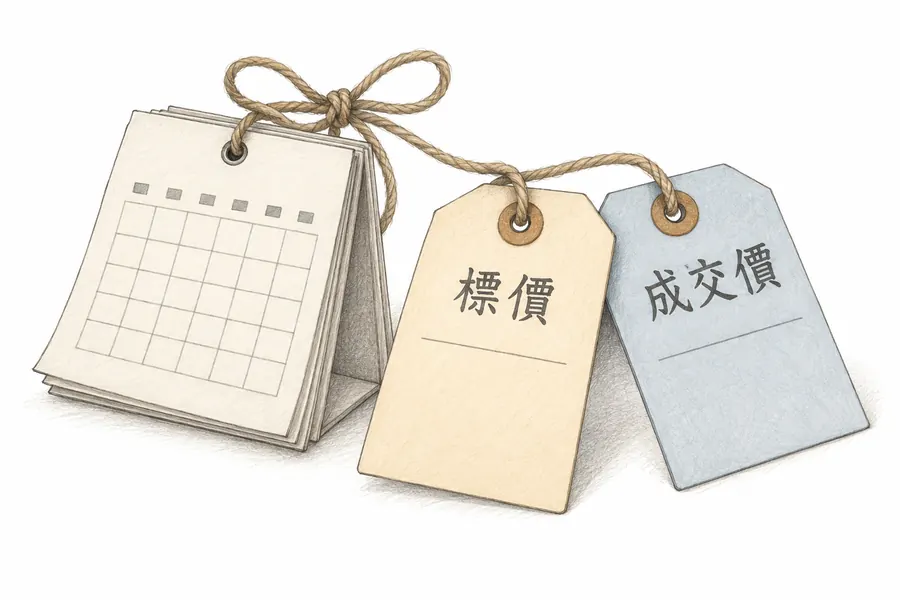

*Figure 20.5: price data and dates (schematic).*

With second-hand prices in particular, keep "listing" and "sold" apart.

An asking price only shows what the market hopes for; it does not prove a sale price. If there is no credible record of a sale, this book would rather give a range and a date than pretend to be precise.

> **Common misconception: "the seller's asking price is the market value of this instrument".**
> An asking price only shows the seller's expectation. What is actually worth referring to is the sold price, and the date and condition should be recorded with it.

| Point and application | Content |
|----|----|
| Core idea | A price without a year, a currency and a kind of price is almost impossible to compare. |
| Relations and conditions | Comparing across periods also involves inflation, exchange rates, taxes and differences between regional distributors. |
| Application | Looking up models, specifications and reliability. |

## 20.6 Official specification check, case one: Calace

The Calace website provides very complete columns, which makes it well suited to a database.

The current mandolin models 24 / 26, 13, 15, 16Bis and others list a 33.5 cm scale, the tuning, the number of ribs, the body material, the top and the fingerboard.

The Mandoloncello page lists a 61 cm scale, and both an eight-string four-course version and a ten-string five-course version exist. 〔S2003〕〔S2004〕

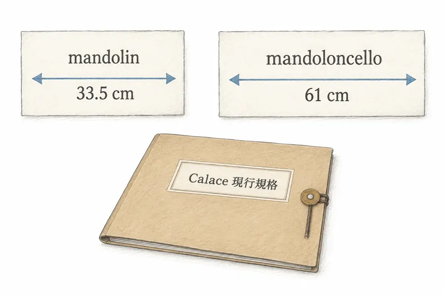

*Figure 20.6: official specification check, case one (schematic).*

This data gives grade A "current official specifications" directly. The date of access still has to be noted, because products may be revised in future.

Current data also cannot be applied automatically to historical models of the same name.

The Calace case shows something else as well: high and low grades within one brand do not necessarily differ only in ornament.

The number of body ribs, maple or rosewood, the number of frets and the construction of the headstock may all change together. So the database has to list columns model by model.

| Point and application | Content |
|----|----|
| Core idea | The Calace website provides detailed columns that suit a database very well. |
| Relations and conditions | The Mandoloncello page lists a 61 cm scale and has both an eight-string four-course and a ten-string five-course version. |
| Application | Looking up models, specifications and reliability. |

## 20.7 Official specification check, case two: Gibson, Collings, Eastman

The official page for Gibson's current 1923 F-5 Master Model Reissue provides very complete specifications.

It lists a red spruce top, a figured red maple body, back and neck, and an ebony fingerboard and bridge. The page also sets out the design history.

That is suitable for confirming "the reissue being made now", but the reissue's specifications cannot be treated as the general measured result for every 1923 original. 〔S2002〕

The official Collings MF5 page provides complete modern specifications: Adirondack spruce, Eastern flamed maple, tone bars, a 13 7/8 inch scale, a compound radius and so on.

The Eastman MD315 provides solid spruce, solid maple, a 13 7/8 inch scale, a 12 inch fingerboard radius and action height.

These two cases show that a modern official page can be extremely complete. 〔S2005〕〔S2006〕

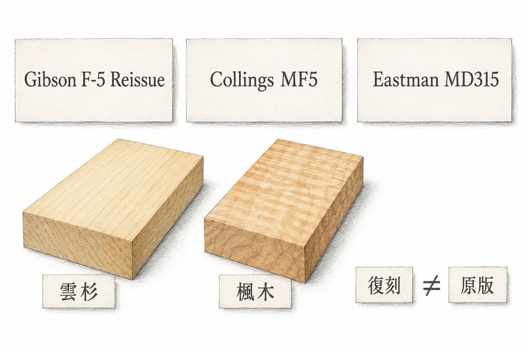

*Figure 20.7: official specification check, case two (schematic).*

But when comparing, avoid spec sheet racing.

More binding, more figure and a glossier finish do not automatically mean a better sound. The database's job is to preserve facts; judging good and bad is another matter.

> **Common misconception: "the more specification columns, the better the instrument".**
> No. A long spec sheet only means the data is complete.
> Whether the sound is good takes you back to the principles in Chapters 16 and 17, and to how the instrument feels when you play it yourself.

| Point and application | Content |
|----|----|
| Core idea | Gibson's current reissue page provides red spruce, figured red maple, ebony and other specifications, and sets out the design history. |
| Relations and conditions | The Collings MF5 provides Adirondack spruce, Eastern flamed maple, tone bars, a 13 7/8 inch scale and a compound radius. |
| Application | Looking up models, specifications and reliability. |

## 20.8 Official specification check, case three: Northfield

Northfield publishes not only model specifications but also part of its manufacturing process and material sourcing.

The official statement says that series such as the Big Mon may be selected and machined in Michigan, assembled and finished in Qingdao, Shandong, and then returned to Michigan for setup.

That means "where the brand is" and "where each step happens" can be two different places. 〔S2007〕

For a collector, this kind of data matters a great deal. Writing only "USA brand" cannot answer the question of where it was made.

By the same token, you should not ignore the cross-border division of design, material choice and final setup just because one step is completed in China.

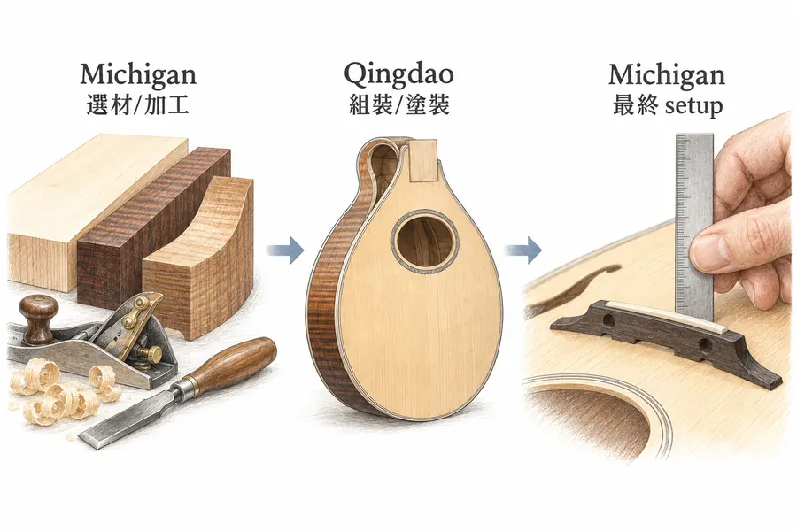

*Figure 20.8: official specification check, case three (schematic).*

If the database has a "country / place of manufacture" column, it should wherever possible be written as verifiable information in several parts, setting out the brand's location and the division of manufacturing separately.

| Point and application | Content |
|----|----|
| Core idea | Northfield publishes not only specifications but part of its manufacturing process and material sourcing. |
| Relations and conditions | For a collector, this "manufacturing in several places" information matters a great deal. |
| Application | Looking up models, specifications and reliability. |

## 20.9 Using the Suzuki catalogue

The Suzuki 2016 official catalogue lists several mandolin family models directly, including the M-30, M-60, M-80, M-100, MD-4 and MC-836.

One of the most important findings in the earlier verification was the MC-836.

The official data states plainly: a spruce top, a rosewood flatback body, a mahogany neck, a rosewood fingerboard, and a 574 mm vibration length.

That does not match the "large bowlback" description that some second-hand pages have copied for years. 〔S2008〕

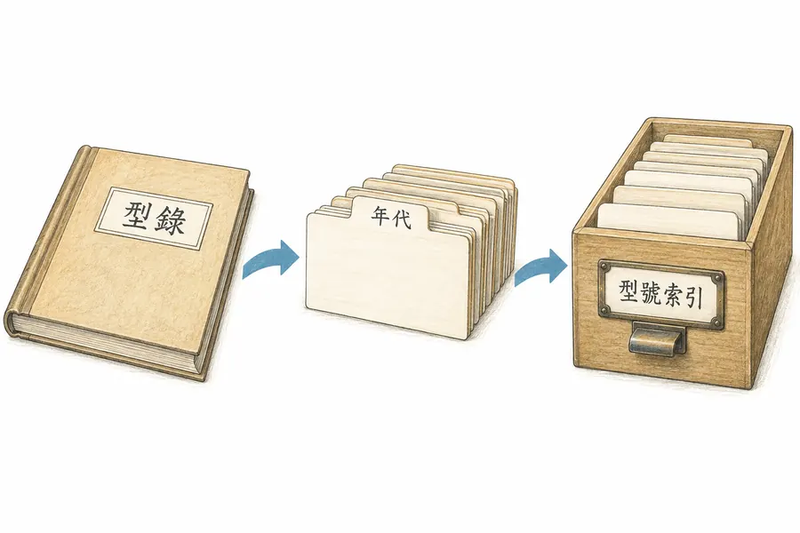

*Figure 20.9: using the Suzuki catalogue (schematic).*

Why does an error like this spread? Because listings cite each other. A new page looks like "cross-checked from several sources" when in fact they may all come from one unverified claim.

The number of sources is not the same as the independence of sources.

So when the database records a source, it should first preserve the file name, year and page of the original catalogue, and keep the original file, so that it can be checked again later.

> **Common misconception: "a lot of websites say this, so it must be right".**
> Ten websites saying the same sentence may just be ten copies of one source.
> What matters is whether those sources found it independently.

| Point and application | Content |
|----|----|
| Core idea | The Suzuki 2016 official catalogue lists family models including the M-30, M-60, M-80, M-100, MD-4 and MC-836. |
| Relations and conditions | The official data for the MC-836 is a spruce top, rosewood flatback, mahogany neck, rosewood fingerboard and a 574 mm vibration length, which does not match the "large bowlback" passed around on second-hand pages. |
| Application | Looking up models, specifications and reliability. |

## 20.10 Filtering and reading the database

Suppose you want a professional-grade mandolin with a 33–35 cm scale, a spruce top and a rosewood bowlback.

You can filter first by family, scale, top and body material, then go back to the sources and read the caveat on each row one by one. The database helps you locate the data; important judgements still need the original documents checked.

If you are buying an old instrument, use "does the model exist" and "period" first to rule out obvious mislabelling, then look at the condition of the actual instrument.

If you are researching the history of instrument making, you can trace trends through changes in materials and structure across periods within one brand.

*Figure 20.10: filtering and reading the database (schematic).*

The most important thing is to preserve "I don't know".

A genuinely professional database allows the unknown to exist, because a catalogue that turns up in future, or an actual instrument with provenance, may change the answer.

Filling in every blank makes errors harder to trace.

| Point and application | Content |
|----|----|
| Core idea | Filter first by family, scale, top and body material, then go back to the sources and read the caveat on each row. |
| Relations and conditions | When buying an old instrument, use the existence of the model and its period to rule out mislabelling, then look at the condition of the actual instrument. |
| Application | Looking up models, specifications and reliability. |

## 20.11 Verification grades and the scope of the evidence

| Grade | Evidence that may be used | How to use it |
|:---|:---|:---|
| **A** | the maker's catalogue from the same period, the official current technical page, a patent, an object in a museum collection, a reliable primary document | may be cited directly |
| **B** | several independent high-quality sources that agree with each other (professional research, trustworthy collector literature) | may be cited, but note that there is more than one source |
| **C** | supported by an actual instrument or a professional dealer, but without an original catalogue | list as provisional |
| **D** | only a general sales listing, a forum, a single claim with no provenance, or sources that contradict each other | a lead only |

Different columns in the same row can carry different grades.

"Model exists" being A does not mean "price" is A. Wood being A does not mean the period is A.

If table space is limited, you can record it in the "verification / source" column in shorthand, for example "exists A / wood B / price D".

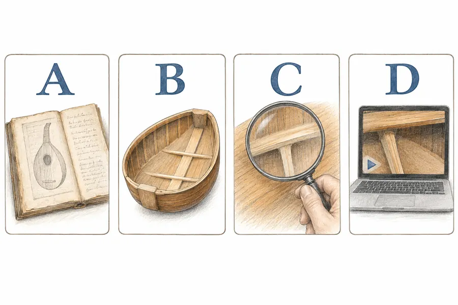

*Figure 20.11: verification grades and the scope of the evidence (schematic).*

The main table in this chapter carries over the 203 individual rows from the earlier "one model, one row" working file, and keeps the uncertainty in place rather than filling missing columns from the rest of the series.

If data is added later, it should be saved as a new version, keeping the record of every revision.

## Table 20-1 | How much this edition covers, and the family distribution

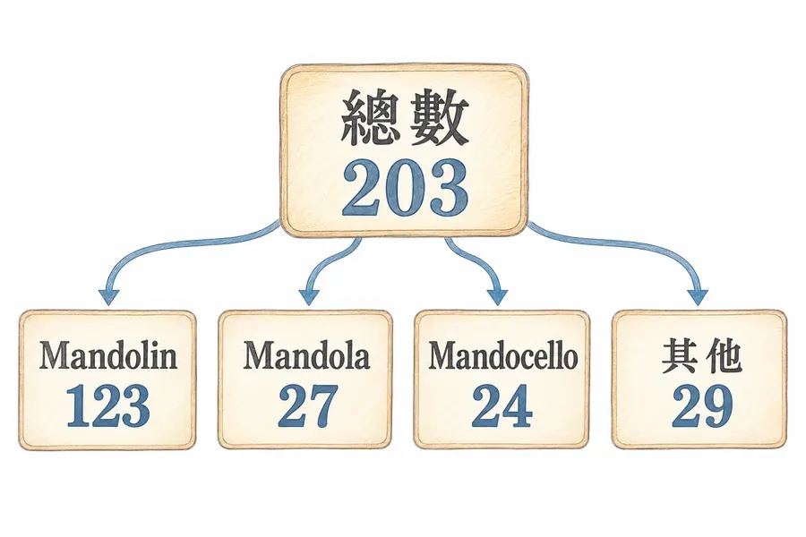

| Family / class | Individual rows |
|--------------------------------|----------------|
| Mandolin | 123 |
| Mandola | 27 |
| Mandola tenore / G mandola | 6 |
| Octave mandolin | 11 |
| Mandocello | 24 |
| Mandoloncello | 3 |
| Liuto / 10-string | 3 |
| Liuto | 4 |
| 10-string | 1 |
| Mandobass | 1 |
| Total | 203 |

*Figure: Table 20-1, how much this edition covers, and the family distribution (schematic).*

## 20.12 The main world model data table

The tables below carry over the 203 individual rows from the earlier verification version. The "no reliable data obtained" entries and the B / C / D grades are all kept exactly as they were.

This time only newly added official data is used as an anchor to correct the method; series similarity or a similar appearance is not used to fill in missing columns.

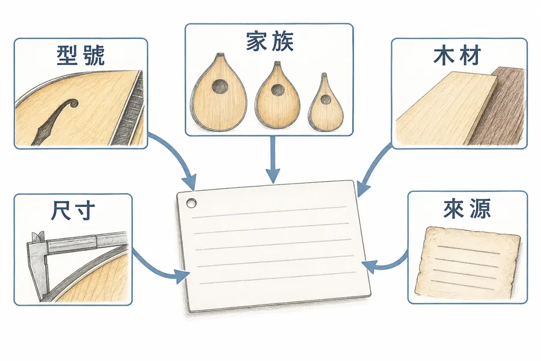

### 20.12.1 How to read these two tables

The original master table had 8 columns. For a beginner, looking at 8 columns at once only makes the head spin. So it is split into two here:

| Table | Who it is for | What it answers |
|:---|:---|:---|
| **Beginner quick lookup** | someone just starting to look for an instrument | Which models are there? How long are they? Roughly how much? |
| **Advanced verification** | someone about to order, compare prices or collect | What wood is it? How trustworthy is the data? |

The H, S, C, B and A in the price / positioning column are the grade codes used in the original manuscript. The manuscript does not fully define what each code means; all that can be seen is an order from low to high, with H often appearing alongside historical prices.

Above grade A there are further subdivisions, A-, A+, S- and S. All these codes are kept exactly as they were, so that you can look them up against the original book. When a code means nothing to you, just read the words after it.

"No reliable data obtained" is not a missing entry. It means the author looked and did not find a source that would stand up.

### 20.12.2 Mandolin (G–D–A–E, eight strings in four courses)

#### Nagoya Suzuki (Japan) | bowlback

**Beginner quick lookup**

| Model | Scale | Price / positioning | Reliability |
|:---|:---|:---|:---|
| **M-30** | 336 mm | C / H; 2016, ¥73,000 + tax | model A / specs A / price A |
| **M-60** | 336 mm | B / H; 2016, ¥84,000 + tax | A / A / A |
| **M-80** | 336 mm | A- / H; 2016, ¥95,000 + tax | A / A / A |
| **M-100** | 336 mm | A / H; 2016, ¥110,000 + tax | A / A / A |

These four come from the 2016 official catalogue and are the hardest set of data currently available.

**Advanced verification**

| Model | Top | Body / neck / fingerboard | Source |
|:---|:---|:---|:---|
| **M-30** | Spruce | Maple, 15 ribs (27-rib pattern) / mahogany neck; rosewood fingerboard | S12 |
| **M-60** | Spruce | Rosewood 15-rib bowlback / mahogany neck; rosewood fingerboard | S12 |
| **M-80** | Spruce | Maple 27-rib bowlback / maple neck; rosewood fingerboard; ebony bridge | S12 |
| **M-100** | Spruce | Master Hand; maple 27-rib bowlback / maple neck; ebony-class high-grade fingerboard and bridge | S12 |

Note the wording for the M-30: "15 ribs, in the 27-rib pattern". The number of ribs and the outward pattern are two different things and cannot be converted into each other.

#### Nagoya Suzuki (historical models) | bowlback

These models are the mainstay of the second-hand market, but almost every column is short of data. Only the part with leads is listed below.

**Beginner quick lookup**

| Model | Price / positioning | Reliability |
|:---|:---|:---|
| **M-20** | D / H; second-hand listings about ¥7,000–15,000 | C / wood D |
| **M-40** | C / H; about ¥6,000–16,000 | C / wood D |
| **M-50** | B- / H; about ¥4,500–17,000 | C / wood in conflict |
| **M-150** | A+ / S / H; historical price about ¥150,000–165,000, second-hand by condition | B |
| **No.201** | C / H; samples vary a lot | B / C |
| **No.203** | C / H; few samples | C |
| **No.206** | C / H; a serviced sample about ¥6,500 | C |
| **No.208** | C / H; few samples | C |
| **No.210** | C / H; few samples | C |
| **No.215 / M-215** | C+ / H; overseas listings about US$300–380 | B / C |
| **No.218 / M-218** | B / H; historical second-hand samples AUD 420–450 | B |
| **No.223 / 223-1** | C+ / H; samples vary a lot | B / C |
| **No.226** | C+ / H; historical samples about US$150–300 | B / C |
| **No.228** | B- / H; a big gap between the price as found and the price after servicing | B |
| **No.228S** | B- / H; few samples | B / C |
| **No.230** | C+ / H; historical samples about ¥8,000–13,000 | B / C |
| **M-210** | B / H; a serviced sample about ¥29,700 | B |
| **M-210-6** | B / H; few samples | B / C |
| **M-280** | B- / H; not enough samples | B / C |

**Advanced verification**

| Model | Top | Body / neck / fingerboard | Note |
|:---|:---|:---|:---|
| **M-20, M-40** | No reliable data | No reliable data | only "bowlback" can be confirmed |
| **M-50** | market descriptions conflict | traditional bowlback; the rest no reliable data | samples with a MASTERHAND label |
| **M-150** | Spruce (several sources) | maple bowlback (several sources) | the flagship of its day |
| **No.201** | Solid spruce (several sources) | a lead of 22 maple ribs | samples vary a lot |
| **No.203, No.210** | No reliable data | bowlback (confirmed from the actual instrument) | few samples |
| **No.206** | Spruce (market claim) | maple 27 ribs (market claim) | market level only |
| **No.208** | Spruce (auction description) | many-ribbed bowlback; species to be confirmed | auction level only |
| **No.215 / M-215** | Spruce | maple and mahogany descriptions conflict | conflict unresolved |
| **No.218 / M-218** | carved / solid spruce | rosewood many-ribbed bowlback | — |
| **No.223 / 223-1** | Solid spruce | maple bowlback | samples vary a lot |
| **No.226, No.228, No.228S** | Solid spruce (No.226 spruce) | maple bowlback | — |
| **No.230** | No reliable data | bowlback (confirmed from the actual instrument) | few samples |
| **M-210, M-210-6** | Spruce | maple 27 ribs | the M-210-6 derives from the M-210 |
| **M-280** | No reliable data | No reliable data | not enough samples |

What these models have in common: **the model name itself is common, but the specifications rest almost entirely on second-hand descriptions**. So the reliability mostly stops at C.

#### Kiso Suzuki (Japan | historical)

The whole range is bowlback and G–D–A–E. The price is always "second-hand by condition; no fixed price".

**Beginner quick lookup**

| Model | Positioning | Reliability |
|:---|:---|:---|
| **MR-150** | about 1960s–70s; B / H | B |
| **MR-200** | historical; B / H | B / C |
| **Model No.300** | historical; C / H | C |
| **No.4** | historical; D / C-H | C |
| **No.45** | historical; C / H | C |
| **M-50** | an actual instrument supervised by 石川捷二郎; B- / H | C |
| **Model N** | to be verified; D / H? | D |
| **MR-600** | a candidate high grade, to be verified | D |

**Advanced verification**

| Model | Top | Body | Note |
|:---|:---|:---|:---|
| **MR-150** | Solid spruce | 28 maple ribs | relatively complete data |
| **MR-200** | No reliable data | 25 ribs; species to be confirmed | the ribs can be counted, the species is unknown |
| **Model No.300, No.4** | No reliable data | bowlback (confirmed from the actual instrument) | — |
| **No.45, Model N, MR-600** | No reliable data | No reliable data | whether the Model N and MR-600 exist at all is still to be verified |

The question marks against the Model N and the MR-600 come from the original manuscript. They mean that even "does this model exist" is not settled yet.

#### Calace (Italy | currently in production)

The whole range is a Neapolitan bowlback, G–D–A–E, about a 33.5 cm scale, with a spruce top. The price is always "by model / custom order"; the current price has to be checked at the time.

**Beginner quick lookup**

| Model | Bowl ribs | Positioning | Reliability |
|:---|:---|:---|:---|
| **24** | 25 smooth ribs | B | A / A / current price must be checked |
| **26** | 25 smooth ribs | B+ | A / A / current price must be checked |
| **13** | 25 smooth ribs | A- | A / A / current price must be checked |
| **15** | 25 smooth ribs | A | A / A / current price must be checked |
| **16Bis** | 33 fluted ribs | A | A / A / current price must be checked |
| **Cl.B** | 31 ribs | A | A / A / current price must be checked |
| **Cl.C** | 33 ribs | A | A / A / current price must be checked |
| **Ripa** | 33 ribs | A+ | A / A / current price must be checked |

**Advanced verification**

| Model | Top | Body | Fingerboard |
|:---|:---|:---|:---|
| **24, 26** | Spruce | rosewood bowlback | Rosewood |
| **13, 15** | Spruce | rosewood bowlback | Ebony |
| **16Bis** | Spruce | rosewood bowlback | Ebony |
| **Cl.B** | Spruce | maple bowlback | Ebony |
| **Cl.C, Ripa** | Spruce | rosewood bowlback | Ebony |

Smooth ribs and fluted ribs are two different ways of finishing the body surface, not a difference in the number of ribs.

#### Orville Gibson (United States | 1898)

| Item | Content |
|:---|:---|
| Collection number | Met 1998.184 (1898 instrument, the actual object of 1898) |
| Structure | early carved A-type |
| Top | carved spruce |
| Back / sides | carved walnut back; walnut sides |
| Neck / headstock | walnut |
| Positioning | S / H; a collection piece, not a market price |
| Reliability | A / A (source S09) |

This is museum-object level data, suitable for confirming **that one instrument**, but it does not mean the whole production period of the model was the same.

#### Gibson (United States | historical) | American carved archtop

Eleven models across the A series and the F series. **Year-by-year specifications have to be checked individually**; the table below is the general rule for the series.

**Beginner quick lookup**

| Model | Positioning | Reliability |
|:---|:---|:---|
| **A** | C+ / H | model B |
| **A-1** | B- / H | model B |
| **A-2** | B / H | model B |
| **A-3** | B+ / H | model B |
| **A-4** | A- / H | model B |
| **A-5** | A / H | model B |
| **F** | B / H | model B |
| **F-2** | B+ / H | model B |
| **F-3** | A- / H | model B |
| **F-4** | A / H | model B |
| **F-5** | S / H | model B |

All these prices are "historical original price / collector price, by year and condition".

**Advanced verification**

| Column | Content |
|:---|:---|
| Scale | by year |
| Top | carved spruce (common across the series' history) |
| Back / sides | maple / birch, by period and model |
| Neck | mahogany / maple; fingerboard by model |

"Common across the series' history" is a cautious wording. It means "usually this", not "every single one".

#### Eastman (American brand / made in China) | A / F carved

**Beginner quick lookup**

| Model | Positioning | Reliability |
|:---|:---|:---|
| **MD305** | C | B |
| **MD315** | C+ | B |
| **MD505** | B- | B |
| **MD515** | B | B |
| **MD615** | B+ | B |
| **MD815** | A- | B |
| **MD915** | A | B |

The price for the range as a whole is roughly US$700–4,000+ (historical working file). The precise specifications of an individual model have to be looked up page by page on the official site.

**Advanced verification**

| Column | Content |
|:---|:---|
| Structure | A-style / F-style carved family |
| Top | solid spruce (mainstay of the range) |
| Body | solid maple (mainstay of the range) |
| Neck / fingerboard | maple neck; fingerboard by model |

#### Ibanez (Japanese brand / made in Asia) M510

| Item | Content |
|:---|:---|
| Structure | A-style |
| Scale | 350 mm |
| Top | Spruce |
| Back / sides | Sapele |
| Neck | Okoume |
| Fingerboard / bridge | Purpleheart |
| Positioning | D; currently about the US$200–300 class, by market |
| Reliability | A / A (source S34) |

#### Collings (United States | boutique) | handmade carved A / F family

Twelve models. Apart from the MF5 series, whose top is Adirondack spruce, the rest are "spruce, exactly by model".

**Beginner quick lookup**

| Model | Positioning | Reliability |
|:---|:---|:---|
| **MT, MT O** | A- / A | MF5 is A; other series B / A |
| **MT2, MT2 O** | A | as above |
| **MT2 V, MF Deluxe** | A+ | as above |
| **MF, MF O** | A | as above |
| **MF5, MF5 O** | A+ | as above |
| **MF5 V** | S- | as above |
| **MF5 Deluxe V** | S | as above |

The price is "boutique new instrument, several thousand US dollars and up".

**Advanced verification**

| Column | Content |
|:---|:---|
| Scale | 13 7/8 inch (MF5; the rest by model) |
| Top | Spruce (exactly by model); the MF5 series is Adirondack spruce |
| Body | Eastern flamed maple (MF5 official; the rest by model) |
| Fingerboard / neck | ebony fingerboard; maple neck family |

#### Northfield (United States / China collaboration) | carved top

**Beginner quick lookup**

| Model | Positioning | Reliability |
|:---|:---|:---|
| **Model M** | B+; about the US$3,000 class | A / B; exact wood model by model |
| **A5 Special** | A-; about the US$4,000 class | A / B |
| **F5S, F5E** | A; about the US$5,000 class | A / B |
| **Big Mon** | A+; about US$5,000+ | A / B |
| **Calhoun** | B+ / A-; by version | A / B |
| **Artist Series** | A+ / S-; about US$6,000–7,000+ | A / B |

**Advanced verification**

| Column | Content |
|:---|:---|
| Top | Spruce (the range) |
| Body | Maple (the range) |
| Neck / fingerboard | ebony fingerboard; mostly maple necks |

"A / B" means: the model and part of the specifications are grade A, but the exact wood has to be checked model by model and currently only reaches grade B.

#### Gold Tone (American brand | currently in production) | A / F family

**Beginner quick lookup**

| Model | Positioning | Reliability |
|:---|:---|:---|
| **GM-10** | D | model A; the material columns are range-level B |
| **GM-35** | D / C | as above |
| **GM-50+, GM-55** | C | as above |
| **GM-70+** | C+ | as above |
| **GM-80** | B- | as above |
| **Grandmaster Elite** | A- | as above |
| **Victorian** | A | as above |
| **Super Cremona** | A | as above |

Current prices according to the official site; check again when buying.

**Advanced verification**

| Column | Content |
|:---|:---|
| Top | several models in spruce; confirm model by model |
| Body | maple / mahogany by model |
| Fingerboard / bridge | rosewood / ebony by model |

This group is the typical case of "the models are certain, the materials only reach range level". Before buying, ask the shop to confirm the actual configuration of that model.

#### Kentucky / Saga (American brand / made in Asia) | bluegrass A / F

**Beginner quick lookup**

| Model | Positioning | Reliability |
|:---|:---|:---|
| **KM-150** | C | B |
| **KM-250** | C+ | B |
| **KM-270** | C+ / B- | B |
| **KM-500** | B- | B |
| **KM-650** | B | B |
| **KM-850** | A- | B |

The range is about US$500–3,000+ (working file); exact specifications by edition.

**Advanced verification**

| Column | Content |
|:---|:---|
| Top | solid carved spruce (the range) |
| Body | maple; figured maple at the high end |
| Neck / fingerboard | maple neck; fingerboard by model |

#### The Loar (American brand / made in Asia) | vintage Gibson-style archtop

**Beginner quick lookup**

| Model | Positioning | Reliability |
|:---|:---|:---|
| **LM-110** | D / C | A / B at range level |
| **LM-310F** | C | A / B at range level |
| **LM-520** | C+ | A / B at range level |
| **LM-590-MS** | B- | A / B at range level |
| **LM-600** | B | A / B at range level |
| **LM-700** | B+ | A / B at range level |

About US$400–1,500+ (working file).

**Advanced verification**

| Column | Content |
|:---|:---|
| Top | the mid and high models are mostly hand-carved solid spruce |
| Body | figured maple (mid and high models) |
| Neck / fingerboard | maple neck; fingerboard by model |

#### Weber (United States | boutique)

| Item | Content |
|:---|:---|
| Structure | American handmade family |
| Scale | 14 inch |
| Top | Spruce (range specification) |
| Body | mostly maple, by trim |
| Fingerboard | commonly ebony |
| Positioning | A / S; boutique custom order, second-hand by trim |
| Reliability | grade A for the range specification; the trim needs breaking down |

#### Trinity College / Saga (American brand / made in Asia) | Celtic flatback

| Model | Scale | Top | Body / neck | Positioning | Reliability |
|:---|:---|:---|:---|:---|:---|
| **TM-250** | by model | solid Sitka spruce | solid maple back and sides / mahogany neck | C; mid-price | A / B |
| **TM-250B** | by model | solid Sitka spruce | solid maple back and sides / mahogany neck | C; mid-price | A / B |

#### Ovation / Celebrity (American brand | historical / discontinued) | composite bowlback electro-acoustic

| Model | Top | Body / neck | Positioning | Reliability |
|:---|:---|:---|:---|:---|
| **MM68** | solid Sitka spruce (the MM68 / MC series working file) | Ovation composite bowlback / multi-piece neck; fingerboard by version | B / H; historical list price, second-hand by the state of the preamp | A / B |
| **MM68AX** | as above | as above | B / H | A / B |
| **MCS148** | as above | as above | C+ / H | A / B |
| **MAE148** | as above | as above | C / H | A / B |

#### Lyon & Healy (United States | about the 1910s) | archtop American mandolin

| Model | Top | Body | Positioning | Reliability |
|:---|:---|:---|:---|:---|
| **Style A** | Spruce (working file) | maple / others by model; high-grade vintage configuration | A- / H; collector market, by condition | B |
| **Style B** | Spruce (working file) | as above | A / H | B |
| **Style C** | Spruce (working file) | as above | A+ / S- / H | B |

The scale length for all three is "no reliable data obtained".

#### Embergher school (Italy | historical / reissue) | Roman bowlback

**Beginner quick lookup**

| Model | Positioning | Reliability |
|:---|:---|:---|
| **Tipo A, Tipo B** | A / S-H | B; deepening model by model |
| **Orchestra 1** | A / S-H | B; deepening model by model |
| **Orchestra 2** | A / S-H | B; deepening model by model |
| **Orchestra 3** | A / S-H | B; deepening model by model |
| **Orchestra 4** | A / S-H | B; deepening model by model |
| **5Bis** | A / S-H | B; deepening model by model |
| **Model 1, Model 7** | A / S-H | B; deepening model by model |

The price is "a wide gap between vintage and reissue".

**Advanced verification**

| Column | Content |
|:---|:---|
| Scale | per the actual instrument |
| Top | commonly spruce; check instrument by instrument |
| Body | many-ribbed Roman bowlback; species by year |
| Fingerboard | commonly ebony at the high end |

#### Lorenzo Lippi (Embergher model, Italy | currently handmade)

| Model | Top | Body | Positioning | Reliability |
|:---|:---|:---|:---|:---|
| **Model 1** | Spruce | maple / rosewood by order; high-grade handmade configuration | A / S; handmade to order | B / A instrument by instrument |
| **Model 5bis** | Spruce | as above | A / S | B / A instrument by instrument |
| **Model 7** | Spruce | as above | A / S | B / A instrument by instrument |

The scale length is always "by custom order".

#### Flatiron (United States | 1977–1990s) | flat-top / carved family

| Model | Top | Body | Positioning | Reliability |
|:---|:---|:---|:---|:---|
| **Model 2 Mandolin** | spruce by period | maple / koa / mahogany and so on by version | B / H; second-hand by Bozeman period or Gibson period | B |
| **Model 3 Mandolin** | spruce by period | as above | B+ / A- / H | B |

Scale length and neck specifications are both "by version". "Bozeman period / Gibson period" refers to the two phases of the factory's ownership, and the prices differ.

### 20.12.3 Mandola

The mandola comes in two tunings, and when buying **you must ask which**:

| Tuning | Description | Usual name |
|:---|:---|:---|
| **C–G–D–A** | a fifth below the mandolin | mandola |
| **G–D–A–E (an octave down)** | the same tuning as the mandolin, but an octave lower throughout | G mandola / tenor mandola |

The two may have the same scale length, but the range and the use are completely different. This is the living example of what 20.1 said about not classifying by product name.

#### Nagoya Suzuki (Japan) | bowlback mandola (C tuning)

**Beginner quick lookup**

| Model | Scale | Price / positioning | Reliability |
|:---|:---|:---|:---|
| **MD-4** | 426 mm | C+ / H; 2016, ¥84,000 + tax | A / A / A |
| **MD-6** | No reliable data | C / H; few market samples | C |
| **MD-8** | No reliable data | B+ / H; second-hand samples about ¥45,000–50,000 | B |
| **MD-10** | No reliable data | A / H; about ¥115,000 + tax around 2017, second-hand by condition | A / B |
| **MD-515** | No reliable data | C / H; a private second-hand sample about ¥15,000 | C |
| **MD-518 / No.518** | No reliable data | C / H; samples from Japan and Taiwan vary a lot | C |
| **MD-530** | No reliable data | C / H; few samples | C |

**Advanced verification**

| Model | Top | Body / neck / fingerboard |
|:---|:---|:---|
| **MD-4** | Spruce | maple 15-rib bowlback / mahogany neck; rosewood fingerboard; ebony bridge |
| **MD-6, MD-8, MD-10, MD-515, MD-518, MD-530** | No reliable data | bowlback (from the actual instrument or market data); the rest no reliable data |

The MD-10 belongs to the Master Hand series. Apart from the MD-4, which is supported by an official catalogue, the rest have only second-hand or physical leads.

#### Calace (Italy | currently in production) | C-tuned mandola

The whole range is bowlback, C–G–D–A, about a 43.2 cm scale, with a spruce top. The current price has to be checked at the time.

| Model | Body | Fingerboard | Positioning |
|:---|:---|:---|:---|
| **Mandola 24 in C** | rosewood, 25 ribs | mostly ebony at the high end | B |
| **Mandola 26 in C** | rosewood, 25 ribs | mostly ebony at the high end | B+ |
| **Mandola 13 in C** | rosewood, 25 ribs | mostly ebony at the high end | A- |
| **Mandola 15 in C** | rosewood, 25 ribs | mostly ebony at the high end | A |
| **Mandola Cl.A in C** | maple, 33 ribs | mostly ebony at the high end | S- |
| **Mandola Annamaria in C** | maple, 33 ribs | mostly ebony at the high end | S |

#### Calace (Italy | currently in production) | G-tuned mandola

The scale is always about 43.2 cm, the top is always spruce, and the tuning is always G–D–A–E an octave down. The current price has to be checked at the time.

| Model | Body | Positioning | Reliability |
|:---|:---|:---|:---|
| **Mandola 24 in G** | rosewood, 25 ribs | B | A / A / current price must be checked |
| **Mandola 26 in G** | rosewood, 25 ribs | B+ | A / A / current price must be checked |
| **Mandola 13 in G** | rosewood, 25 ribs | A- | A / A / current price must be checked |
| **Mandola 15 in G** | rosewood, 25 ribs | A | A / A / current price must be checked |
| **Mandola Cl.A in G** | maple, 33 ribs | S- | A / A / current price must be checked |
| **Mandola Annamaria in G** | maple, 33 ribs | S | A / A / current price must be checked |

#### Gibson (United States | historical) | H series carved mandola

| Model | Top | Body | Positioning | Reliability |
|:---|:---|:---|:---|:---|
| **H** | carved spruce | maple / birch by period | B / H; vintage market | model B; year-by-year specs instrument by instrument |
| **H-1** | carved spruce | as above | B / H | as above |
| **H-2** | carved spruce | as above | A- / H | as above |
| **H-4** | carved spruce | as above | A / H | as above |
| **H-5** | carved spruce | as above | S / H | as above |

The scale is always "by year"; the neck and fingerboard "by model".

#### Eastman (American brand / made in China) | 16 inch mandola

| Model | Scale | Top | Body / neck / fingerboard | Positioning | Reliability |
|:---|:---|:---|:---|:---|:---|
| **MDA315** | about a 16 inch body family | solid spruce | solid figured maple / maple neck; ebony fingerboard | B-; about the US$1,200–3,000 class | A / B |
| **MDA815** | about a 16 inch body family | solid spruce | as above | A-; about the US$1,200–3,000 class | A / B |

#### Other mandolas (currently in production)

| Brand | Model | Scale | Top | Body / neck / fingerboard | Positioning | Reliability |
|:---|:---|:---|:---|:---|:---|:---|
| **Northfield** | **Quickstep Mandola** | per the maker | Spruce | maple / high-grade handmade configuration | A-; official price about US$3,995 (at the time of the working file) | A / B |
| **Gold Tone** | **Mandola** | 17-1/16 inch | solid spruce (working file) | mahogany back and sides / mahogany neck; rosewood fingerboard | C; about US$949.99 on the official site at the time | A / B |
| **Weber** | **Mandola** | 17 inch | Spruce (range specification) | mostly maple, by trim; commonly an ebony fingerboard | A / S; boutique custom order | grade A for the range specification; the trim needs breaking down |

#### The Trinity College and Flatiron mandolas

| Brand | Model | Scale | Top | Body / neck | Positioning | Reliability |
|:---|:---|:---|:---|:---|:---|:---|
| **Trinity College** | **TM-275** | 16.9 inch flatback | solid Sitka spruce | solid maple back and sides / mahogany neck | C; mid-price | A / B |
| **Trinity College** | **TM-275B** | 16.9 inch flatback | solid Sitka spruce | as above | C; mid-price | A / B |
| **Flatiron** | **Model 2 Mandola** | by version | spruce by period | maple / koa / mahogany and so on by version | B / H; second-hand by Bozeman period or Gibson period | B |
| **Flatiron** | **Model 3 Mandola** | by version | spruce by period | as above | A- / H | B |

### 20.12.4 Octave mandolin (G–D–A–E an octave down)

| Brand | Model | Scale | Top | Body / neck / fingerboard | Positioning | Reliability |
|:---|:---|:---|:---|:---|:---|:---|
| **Eastman** | **MDO305** | about a 21 inch family | solid spruce | solid maple / maple neck; ebony fingerboard | B-; about US$900–1,200 | A / B |
| **Northfield** | **WaveLength AT3** | by model | by model | by model | A-; by model and by the time checked | A / B |
| **Northfield** | **Archtop AT2** | by model | by model | by model | A; by model and by the time checked | A / B |
| **Northfield** | **Flat Top Octave** | by model | by model | by model | B+; by model and by the time checked | A / B |
| **Northfield** | **EleOcto EL-1** | by model | by model | by model | B; by model and by the time checked | A / B |
| **Northfield** | **EleOcto EL-2** | by model | by model | by model | B+; by model and by the time checked | A / B |
| **Gold Tone** | **OM-800+** | 22.5 inch | arched solid spruce | mahogany back and sides / rosewood fingerboard; pickup fitted | C+ / B-; about US$1,099.99 on the official site at the time | A / B |
| **Weber** | **Octave Mandolin** | 20 inch / 22 inch | Spruce (range specification) | mostly maple, by trim; commonly an ebony fingerboard | A / S; boutique custom order | grade A for the range specification; the trim needs breaking down |
| **Trinity College** | **TM-325** | 20.2 inch | solid Sitka spruce | solid maple / mahogany neck | C; mid-price | A / B |
| **Trinity College** | **TM-325B** | 20.2 inch | solid Sitka spruce | as above | C; mid-price | A / B |
| **Flatiron** | **Model 3 Octave Mandolin** | by version | spruce by period | maple / koa / mahogany and so on by version | A- / H; second-hand by Bozeman period or Gibson period | B |

This Northfield group (AT2, AT3, EL-1, EL-2) has "by model" even for scale and top in the original manuscript. That is the state of the manuscript, not something dropped in the rewriting.

### 20.12.5 Mandocello (C–G–D–A)

#### Nagoya Suzuki (Japan)

| Model | Scale | Top | Body / neck / fingerboard | Positioning | Reliability |
|:---|:---|:---|:---|:---|:---|
| **MC-836** | 574 mm | Spruce | rosewood flatback body / mahogany neck; rosewood fingerboard; ebony bridge | A- / H; 2016, ¥80,000 + tax | A / A / A |
| **MC-815** | No reliable data | No reliable data | No reliable data | C / H; no reliable price established | C / D |
| **MC-835** | No reliable data | No reliable data | No reliable data | undecided / H | C / D |
| **MC-811** | No reliable data | No reliable data | No reliable data | undecided | C / D |
| **MC-812** | No reliable data | No reliable data | No reliable data | undecided | C / D |
| **MC-600 / No.600** | No reliable data | No reliable data | No reliable data | undecided | C / D |

The MC-836 is the one mentioned in 20.9. It is a **flatback**, not a large bowlback. For the MC-815 / 835 / 811 / 812 / 600 there is only the lead that they "may be mandocello".

#### Gibson (United States | historical) | K series carved mandocello

| Model | Top | Body | Positioning | Reliability |
|:---|:---|:---|:---|:---|
| **K** | carved spruce | carved maple / birch by period | B / H; expensive vintage | model B; specifications instrument by instrument |
| **K-1** | carved spruce | as above | B+ / H | as above |
| **K-2** | carved spruce | as above | A- / H | as above |
| **K-4** | carved spruce | as above | A / H | as above |
| **K-5** | carved spruce | as above | S / H | as above |

The neck is mahogany; the fingerboard is commonly ebony. The scale is always "by year".

#### Modern mandocello

| Brand | Model | Scale | Top | Body / neck / fingerboard | Positioning | Reliability |
|:---|:---|:---|:---|:---|:---|:---|
| **Eastman** | **MDC804** | 25 inch | solid spruce | solid heavily figured maple / maple neck; ebony fingerboard | A-; about US$2,500–4,000+ | A / B |
| **Eastman** | **MDC805** | 25 inch | solid spruce | as above | A; about US$2,500–4,000+ | A / B |
| **Gold Tone** | **Mandocello** | 25 inch | solid spruce | maple back and sides / rosewood fingerboard; pickup fitted | C+ / B-; about US$1,399.99 on the official site at the time | A / B |
| **Weber** | **Mandocello** | 24.75 inch | Spruce (range specification) | mostly maple, by trim; commonly an ebony fingerboard | A / S; boutique custom order | grade A for the range specification |
| **Ovation / Celebrity** | **MC68** | by model | solid Sitka spruce | Ovation composite bowlback / multi-piece neck | B / H; historical list price, second-hand by the state of the preamp | A / B |
| **Ovation / Celebrity** | **MC868** | by model | solid Sitka spruce | as above | B / H | A / B |
| **Lorenzo Lippi** | **Mandocello Model 1** | by custom order | Spruce | maple / rosewood by order; high-grade handmade configuration | A / S; handmade to order | A / B |
| **Lorenzo Lippi** | **Mandocello Model 5bis** | by custom order | Spruce | as above | A / S | A / B |
| **Musikalia** | **618 MB** | by model | Spruce | by model | B; European market, must be checked at the time | B |
| **Musikalia** | **618 MBs** | by model | Spruce | by model | B+ | B |
| **Musikalia** | **618 MN** | by model | Spruce | by model | B+ | B |
| **Musikalia** | **618 MP** | by model | Spruce | by model | A- | B |
| **Musikalia** | **618 MPs** | by model | Spruce | by model | A | B |

The Musikalia series is in the Embergher style. The repeated "by model" means the original manuscript did not obtain any finer data.

### 20.12.6 Mandoloncello (61 cm scale)

The Calace mandoloncello comes in an eight-string four-course and a ten-string five-course version. The tops are all spruce / fir. The prices are all "custom order price"; the current price has to be checked at the time.

**Eight strings in four courses (C–G–D–A)**

| Model | Body | Fingerboard | Positioning |
|:---|:---|:---|:---|
| **Mandoloncello 26 8-string** | rosewood, 25 ribs | Ebony | A- |
| **Mandoloncello Cl.B 8-string** | white maple, 41 ribs | Ebony | A |
| **Mandoloncello Cl.A 8-string** | white maple, 41 ribs | Ebony | S- |

**Ten strings in five courses (C–G–D–A–E)**

| Model | Body | Fingerboard | Positioning |
|:---|:---|:---|:---|
| **Mandoloncello 26 10-string** | rosewood, 25 ribs | Ebony | A+ |
| **Mandoloncello Cl.B 10-string** | white maple, 41 ribs | Ebony | A+ |
| **Mandoloncello Cl.A 10-string** | white maple, 41 ribs | Ebony | S |

"Eight-string / ten-string" is not just two extra strings. The number of courses becomes five, the range gains a fifth at the top, and the use is different too.

### 20.12.7 Liuto and the ten-string

| Brand | Model | Structure | Scale | Top | Body | Positioning | Reliability |
|:---|:---|:---|:---|:---|:---|:---|:---|
| **Lorenzo Lippi** | **Liuto Cantabile Model 5bis** | five courses, bowlback; C–G–D–A–E | by custom order | Spruce | Roman / Embergher bowlback; high-grade handmade configuration | A / S; handmade to order | A / B |
| **Musikalia** | **619 MB** | Liuto Cantabile; C–G–D–A–E | by model | Spruce | by model | B; European market, must be checked at the time | B |
| **Musikalia** | **619 MN** | as above | by model | Spruce | by model | B+ | B |
| **Musikalia** | **619 MP** | as above | by model | Spruce | by model | A- | B |
| **Gold Tone** | **F-10** | F-style ten-string; C–G–D–A–E | per the maker | solid spruce (working file) | per the maker's version / rosewood fingerboard | C; about US$839.99 on the official site at the time | model A / specifications B-A |

### 20.12.8 Mandobass

| Brand | Model | Period | Structure | Scale | Top | Body | Positioning | Reliability |
|:---|:---|:---|:---|:---|:---|:---|:---|:---|
| **Gibson** | **Style J Mandobass** | 1912–about 1930 | large upright mandobass; E–A–D–G common | large upright | Spruce | maple / mahogany neck; ebony fingerboard | S / H; museum / collector grade | A (Met / historical material) |

The tuning of the mandobass is given as "E–A–D–G common" because historical sources do not all write it the same way. The cautious wording of the manuscript is kept here.

### 20.12.9 If this is your first time checking a model, do these five steps

This section is the real point of the chapter. The tables above will go out of date; this procedure will not.

**Step 1: confirm the model really exists**

Look for the maker's catalogue or an official page first. If you cannot find one, record it as "to be verified" for now. Do not treat something as true just because a sales listing says it.

**Step 2: confirm the period**

One model name may span several decades. Ask "what year was this made" before you talk about specifications.

**Step 3: confirm the tuning and the scale**

This step decides which family it belongs to. Do not jump to a conclusion when you see "mandola"; ask first whether it is C tuning or G tuning.

**Step 4: confirm the wood, and keep "commercial name" and "species" apart**

If the maker writes "rosewood", record "rosewood". Do not upgrade it to "Indian rosewood" yourself.

**Step 5: confirm the nature and the date of the price**

Establish whether it is a list price, a shop price, an asking price or a sold price, and record the date you checked.

| Step | The question to ask | Common mistake |
|:---|:---|:---|
| 1 model | Is this number in the official material? | treating a listing title as official material |
| 2 period | Which year? Which batch? | applying current specifications to an old instrument |
| 3 tuning and scale | C tuning or G tuning? Measured from where to where? | treating "overall length" as "scale" |
| 4 wood | What does the maker's own text say? | treating "AAA" as a species |
| 5 price | Which kind of price? On what date? | treating an asking price as a sold price |

> **Common misconception: "found it means confirmed".**
> Finding it only gets you a lead.
> Real confirmation means knowing which grade that lead belongs to, and writing down the source and the date.

## 20.13 Series and models still to be confirmed

Some brands have not been fully entered yet. The following does not mean "these instruments do not exist"; it means "so far only the series level is confirmed".

| Brand | Country / period | Series | Current state | Verification |
|:---|:---|:---|:---|:---|
| **Vega** | United States / historical | mandobass series | it can be confirmed that they made bass family instruments, but the model numbers need to be completed from catalogues year by year | B / C |
| **Vega** | United States / historical | bowlback / cylinder-back / flatback mandolins | the model system is complicated; to be entered number by number | B / C |
| **Lyon & Healy / Washburn** | United States / historical | mandobass / bass mandolin | it can be confirmed that they had low family instruments; the specific models are to be catalogued | B / C |
| **Washburn** | United States / historical | bowlback mandolins | a great many Style / No. designations across periods; to be organised as a project | B / C |

*Figure 20.13: series and models still to be confirmed (schematic).*

Note that the "verification" column in this table is B / C throughout. That means even "this series exists" only reaches grade B, and "the specific model" only reaches grade C.

## Self-study question bank

Study check: answer, mark, review

Answer for yourself first, then look at the answers. When you get one wrong, go back to the relevant section of the chapter and read it again.

**1. Why does the model database grade the reliability of wood separately?**

- A. a model existing does not mean every material has been confirmed

- B. to make the tables longer

- C. wood is always the most important thing

- D. price cannot be recorded

**2. When you meet different models in the same series, you should?**

- A. verify each model separately

- B. infer one from another directly

- C. look only at the most expensive one

- D. record only the series name

**3. A second-hand asking price and a sold price should be?**

- A. recorded separately

- B. treated as the same

- C. keep only the higher one

- D. ignored altogether

**Answers: 1.A　2.A　3.A**

## Main sources checked for this chapter

Sources checked: find the original, check the conditions, keep a record

**【S2001】Classical Mandolin Society of America: Music Notation for Mandolin Family Instruments.** Regional differences in family names, tunings and notation.

> https://classicalmandolinsociety.org/wp-content/uploads/Music_Notation_for_Mandolin_Family_Instruments_v3.pdf

**【S2002】Gibson: 1923 F-5 Master Model Reissue / history.** Current reissue specifications and the official historical account of the 1923 F-5.

> https://www.gibson.com/pages/gibson-mandolins

**【S2003】Liuteria Calace: Official mandolin specifications.** The 33.5 cm scale, ribs, woods and tuning.

> https://www.calace.it/en/mandolini

**【S2004】Liuteria Calace: Mandoloncelli & Liuti specifications.** The 61 cm scale, the 8 / 10-string mandoloncello and so on.

> https://www.calace.it/mandoloncelli-liuti

**【S2005】Collings Guitars: MF5 official specifications.** Current F-style specifications.

> https://collingsguitars.com/mandolins/mf5/

**【S2006】Eastman Guitars: MD315 official specifications.** Current F-style specifications and setup figures.

> https://www.eastmanguitars.com/md315

**【S2007】Northfield Mandolins: How Northfield Works.** The cross-border flow of materials, machining, assembly and setup.

> https://www.northfieldinstruments.com/how-northfield-works

**【S2008】Suzuki Music / Suzuki Violin Manufacturing: Suzuki Music 2016 Catalog.** Official specifications for the MC-836 and other family models.

> (The 2016 official catalogue used in the earlier verification for this book)
