# Chapter 21: Choosing, Maintaining and Using the Instrument

*Buying, Evaluating, Preserving and Using the Mandolin*

## Key points

- The order for looking at an instrument: structure first, then function, then consumable parts, and only at the end appearance.
- A cheap instrument is not necessarily good value, and an expensive one does not guarantee good condition. What you really compare is the total cost.
- High action with the bridge already lowered as far as it goes is a warning sign, not a setup problem.
- The commonest preservation risk in Taiwan is being too wet, not too dry.
- There is only one standard for deciding "can I do this myself": if I get it wrong, can it be undone?

## 21.0 What this chapter is for

After reading this whole book you still come back to a very practical scene.

There is an instrument in front of you. You have to decide: is it right for me? Is the condition good? Is the price fair? How should I store it? Which problems can I deal with myself, and which absolutely have to go to a luthier?

Answering that means pulling together everything from the earlier chapters: structure, wood, setup, acoustics and model data.

This chapter is risk-driven: first decide whether something affects the structure and whether the instrument can be played, then look at parts that can be replaced, and only at the end look at ornament and collectibility.

That order matters. A beautiful grain, shiny shell inlay and a good story are all very attractive.

But they make you overlook what really counts: the neck angle, a deformed top, ribs coming unglued on a bowlback.

## 21.1 Use and what you need from an instrument

### First question: what are you going to do with it?

| What you want to play | Features to consider first |
|:---|:---|
| **Bluegrass jam** | F-style / A-style carved top, the response of f-holes, chop, projection |
| **Classical mandolin or mandolin orchestra** | the bowlback tradition, the response of the tremolo, the tone of a particular family |
| **Irish / folk** | a more direct single-note response |

Choosing starts from use, not from brand.

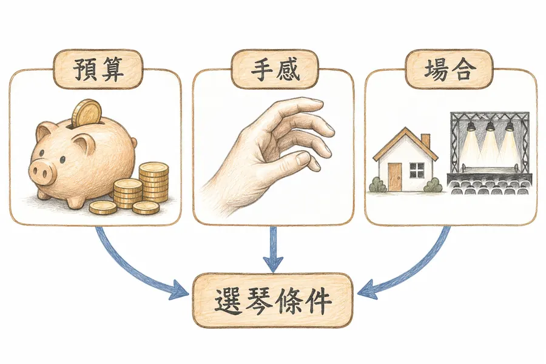

*Figure 21.1: use and what you need from an instrument (schematic).*

### Second question: how it feels

These decide directly how long you can play:

- nut width
- scale length
- fingerboard radius
- neck profile
- action

The official data shows that the Eastman MD315 uses a 13 7/8 inch scale, a 1 3/32 inch nut and a 12 inch fingerboard radius.

The Collings MF5 has a 13 7/8 inch scale, a 1 1/8 inch nut, and a compound radius.

These differences of a millimetre or two may affect how the instrument feels to you far more than whether the binding is lavish. 〔S2101〕〔S2102〕

### Third question: budget and brand

A beginner's instrument that is well set up is often easier to learn on than an expensive one with the action too high.

The real reason to upgrade should be response, tone, how the neck feels, dynamic range, or the needs of a particular style. Not "this one costs more".

| Point and application | Content |
|----|----|
| Core idea | Bluegrass ensembles value F / A carved tops, the response of f-holes, chop and projection; the classical world values the bowlback tradition and the response of the tremolo. |
| Relations and conditions | The second question is how it feels. |
| Application | Choosing, evaluating and caring for an instrument. |

### Before you go to the shop

With a first instrument, start from the musical activity you want to join.

If you want to join a club or an orchestra, ask the teacher what instrument type they use, what tuning, and which part you would take. If you want to join a bluegrass jam, take a melody and a rhythm you know with you when you try instruments.

The Shimamura guide is written mainly for readers of the bowlback mandolin and the mandola. Its reminders about accessories and after-sales service are well worth putting on your checklist too. 〔N01〕

Divide the budget into four items: the instrument itself, the case, basic accessories, and checking and setup.

If the shop offers a package, go through the contents and the dimensions item by item. Before buying, ask the shop to write down clearly: what adjustment will be done when the instrument is handed over, the warranty terms, and who to contact about strings and repairs.

The yen prices on the website are useful for understanding how products were graded at the time. Some of the comparison prices are marked May 2022, and the page also notes that SUZUKI production has finished, that Ena has been discontinued, and what stock remains.

All of that is what that dealer's page said at the time. For the actual price, availability and after-sales terms, get a quote from the shop you are buying from. 〔N01〕

## 21.2 Checking a new instrument

### Check the neck first

When you pick up a new instrument, look at the neck alignment first.

Sight from the tailpiece towards the headstock: do the strings run roughly down the middle of the fingerboard? Is the bridge crooked?

Then check: the fret ends, the nut slots, the smoothness of the tuners, how the bridge feet fit, and the action.

Even when the maker publishes clear specifications, transport, climate and the dealer's setup can all leave the actual state different.

### Then listen to every fret for noise

Try every fret, listening for fret buzz, especially frets 1–5, fret 12 and above, and the high E course.

| Symptom | Possible cause |
|:---|:---|
| noise on only one fret | one fret locally too high or too low |
| noise all over the low positions | a problem with the nut or with the neck relief |

**Do not reach straight for the truss rod.** Work out how the problem is distributed first, then decide what to do.

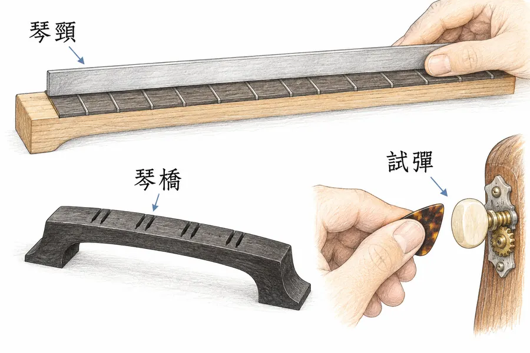

*Figure 21.2: a detail view of checking the neck and bridge (schematic).*

### Check the intonation last

Intonation should be checked after new strings have settled.

The harmonic at fret 12 against the fretted note gives a quick reference.

If the floating bridge is in the wrong place, the whole instrument will sit systematically sharp or flat.

These are all problems that can be fixed at low cost, and they should be kept separate from structural defects.

| Point and application | Content |
|----|----|
| Core idea | Look at neck alignment first: sight from the tailpiece to the headstock and see whether the strings run down the middle of the fingerboard and whether the bridge is crooked. |
| Relations and conditions | Check every fret for noise, especially frets 1–5, fret 12 and above, and the high E course. |
| Application | Choosing, evaluating and caring for an instrument. |

### A fixed procedure for the first try-out

Not sure where to start? Do it in this order:

1. Sit down comfortably and tune up.
2. Play each of the four open courses in turn.
3. Play frets 1 to 5.
4. Try a slow melody.
5. Play it once softly and once loudly.

Ask the teacher or the shop to demonstrate the same melody, then play it yourself.

Then note down three things: is it easy to press the strings? Does the pitch hold steady? Is the sound clear?

This is a try-out exercise designed for this book; take it to the shop and use it.

> **Common misconception: "the action is too high, just turn the truss rod".**
> The truss rod only deals with neck relief.
> If the problem is the neck angle or a deformed body, forcing the rod only makes things more complicated.

## 21.3 A first look at a used instrument

With an old instrument, look at three layers. The order cannot be reversed.

### First layer: overall structure (the first minute)

| What to look at | What it may mean |
|:---|:---|
| is the neck visibly twisted | a structural or storage problem |
| is the top sinking or bellying | a tension or humidity problem |
| are any bowlback ribs separating | glue ageing |
| the neck/body joint | a loose joint |
| has the bridge height been adjusted to an extreme | insufficient neck angle |
| does the fingerboard extension sit abnormally close to the top | body deformation |

### Second layer: cracks and open joints

A crack in the wood usually runs through the grain. Finish checking may stop at the finish.

Look with a light at a low angle, tap gently around the area, and you can find an open seam. But **do not twist the body hard to "test" it**.

On a bowlback, go along the ribs and spacers one by one, especially near the tailblock and the neck block.

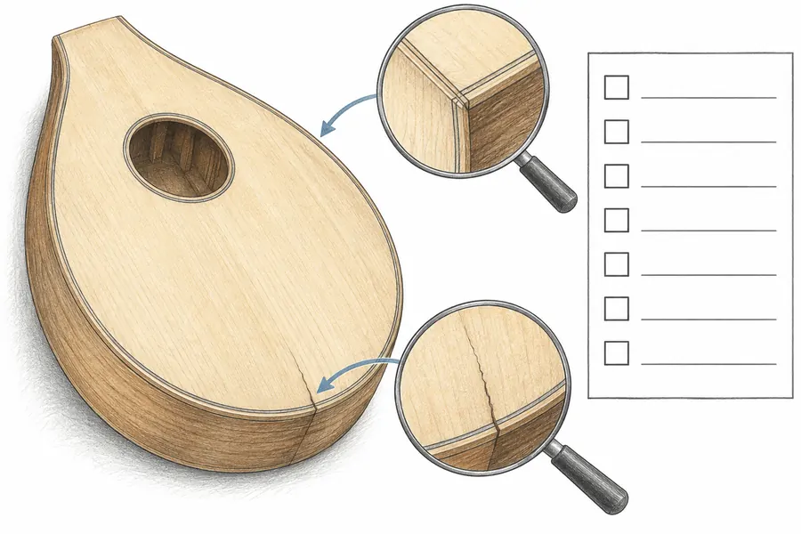

*Figure 21.3: a first look at a used instrument (schematic).*

### Third layer: the parts

Look at the frets, the nut, the tuners, the bridge, the tailpiece and the strings.

Most of these are consumables or repairable parts. They should be costed in, but they usually do not mean "structurally finished".

**Only at the end** look at scratches, finish wear and missing ornament.

> **Common misconception: "lots of scratches on the surface means this instrument is bad".**
> Scratches are the last thing you look at.
> An instrument with plenty of scratches but a sound structure may carry far less risk than a pretty one with a problem in the neck angle.

## 21.4 Neck angle and bridge height

A floating bridge gives a certain amount of height adjustment, but the range is limited.

**Case one: the action is high, yet the bridge has already come down to almost its lowest.**

This may mean the neck angle is insufficient, the geometry of the top has changed, or there is a problem with the plane of the fingerboard.

**Case two: the action is low, the bridge has already gone very high, and it still buzzes.**

There may be other structural factors here too.

To judge the neck angle, lay a straight edge along the frets and see roughly what height it lands at on the bridge.

There is no single millimetre formula; different instrument types differ. The point is this: **is there still a reasonable margin of adjustment left in the bridge?**

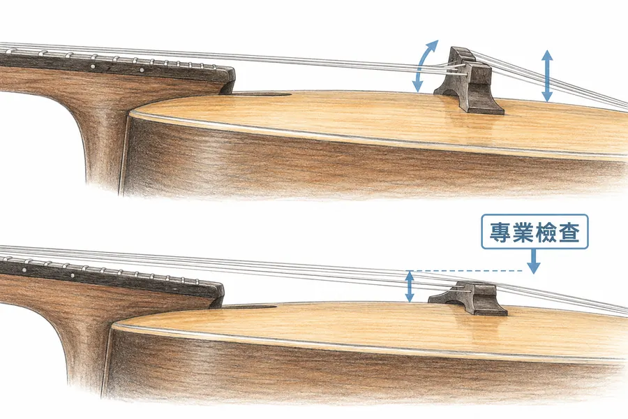

*Figure 21.4: neck angle and bridge height (schematic).*

A neck reset is high-risk work. Do not try it yourself because a video online made it look easy.

The glue, the joints, the finish and the ornament of an old instrument can all be damaged by taking the neck off. It should be assessed by a luthier who knows that instrument type.

| Point and application | Content |
|----|----|
| Core idea | A floating bridge has room for height adjustment, but the range is limited. |
| Relations and conditions | To judge the neck angle you can lay a straight edge along the frets and see what height it lands at on the bridge. |
| Application | Choosing, evaluating and caring for an instrument. |

## 21.5 Cracks, open joints and structural deformation

### Cracks come in sizes

A small drying crack, repaired early, may be nothing more than routine repair.

A long crack running through the bridge area, bracing coming away, or a top that has sunk is a great deal more complicated.

Ribs separating on a bowlback also vary: a short open seam and several ribs shifted over a large area take completely different hours of work.

Finish checking is not necessarily dangerous in itself, especially nitrocellulose lacquer on an old instrument. The real question is: **is the wood cracked too?**

Shining a phone torch at a low angle often shows whether the two sides of a crack sit at different heights. But before actually buying an expensive instrument, a professional should still inspect it.

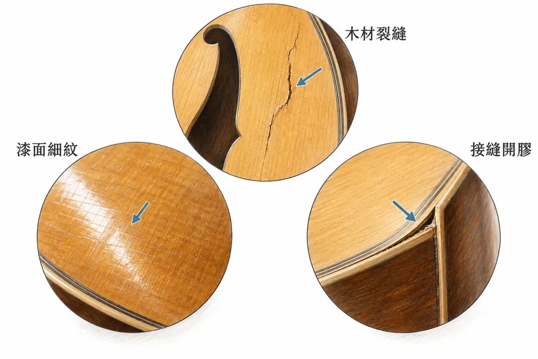

*Figure 21.5: cracks, open joints and structural deformation (schematic).*

### Signs of repair are not a bad thing

A hundred-year-old instrument that has never been repaired is actually rare.

Good repair can preserve both structure and playability. What really affects collector value is: the quality of the repair, whether there has been excessive alteration, how much original hardware survives, and the provenance.

| Point and application | Content |
|----|----|
| Core idea | A small drying crack repaired early may be routine repair. |
| Relations and conditions | Finish checking is not necessarily dangerous in itself, especially on old nitrocellulose. |
| Application | Choosing, evaluating and caring for an instrument. |

> **Common misconception: "it has been repaired, so it is worth nothing".**
> An old instrument with no repairs at all is actually uncommon.
> What you look at is whether the repair was done well, whether there has been excessive alteration, and how much original hardware is left.

## 21.6 Labels, serial numbers and authenticity

A label can be replaced or forged, and a genuine label can be stuck into the wrong instrument.

Authentication has to look at all of these leads at once:

| Category | Specific items |
|:---|:---|
| Structure | how it is built, the internal support |
| Materials | species of wood and period features |
| Dimensions | measured values for each part |
| Shape | headstock shape, binding and inlay |
| Hardware | tuners, bridge, tailpiece |
| Tool marks | the marks left by tools |
| Ageing | how the finish has aged |
| Provenance | where it came from |

For an expensive instrument by a well-known luthier, it is best to compare against collections and catalogues. **Do not draw a conclusion because a Google image looks similar.**

Serial number systems can also change across periods. Some brands kept complete records, others almost none.

Even when a serial number falls in a plausible range, it only proves that things look consistent. On its own it cannot prove that every part is original.

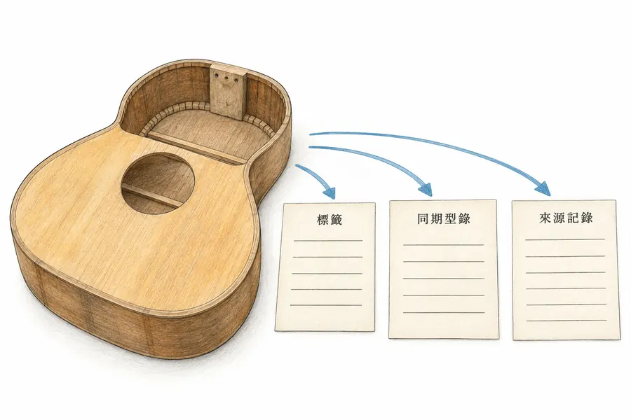

*Figure 21.6: labels, serial numbers and authenticity (schematic).*

When you buy, keep photographs of these: the label, the serial number, the front and back of the whole instrument, the headstock, the bridge, the tailpiece, the inside or the bowlback, and any repairs.

Keep the invoice and the seller's written statement as well. All of these may become part of the provenance later.

| Point and application | Content |
|----|----|
| Core idea | A label can be replaced or forged, and a genuine label can be stuck into the wrong instrument. |
| Relations and conditions | Serial number systems can also change across periods; some brands kept complete records and others almost none. |
| Application | Choosing, evaluating and caring for an instrument. |

## 21.7 Collector value and playing value

These two things are often muddled together, but they are not the same.

**Example one:** a rare old instrument in very original condition may not suit frequent performance, because the neck angle is poor and the structure is fragile.

**Example two:** an instrument with a replaced bridge and frets that has been professionally set up has slightly less collector appeal but plays extremely well.

A buyer should decide first: **which of the two axes do I care about?**

| What the collector market values | What a player values |
|:---|:---|
| the maker | response |
| rarity of the model | intonation |
| historical significance | how the neck feels |
| original finish and hardware | reliability |
| condition | dynamic range |
| provenance | volume and projection |

They overlap, but they are not synonyms.

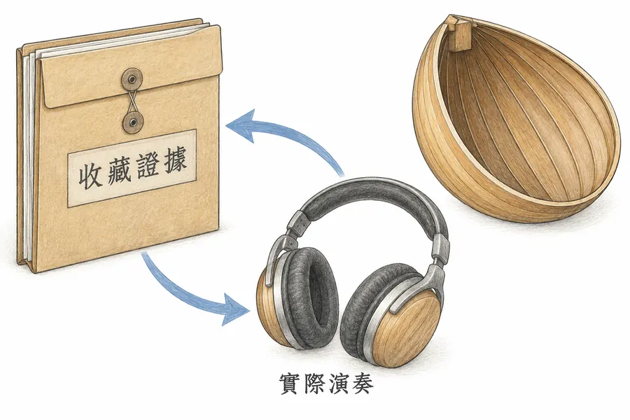

*Figure 21.7: collector value and playing value (schematic).*

### Age does not earn points by itself

A mass-produced student model may still be plentiful on the market even after a hundred years.

Conversely, some professional models made for only a short time carry more collector demand precisely because so few survive.

The database in Chapter 20 gives you the model background, but an actual valuation still needs sold prices from the period in question.

| Point and application | Content |
|----|----|
| Core idea | A rare old instrument in very original condition may not suit frequent performance because of the neck angle and a fragile structure. |
| Relations and conditions | The collector market values the maker, rarity, historical significance, original finish and hardware, condition and provenance. |
| Application | Choosing, evaluating and caring for an instrument. |

> **Common misconception: "the older it is, the more it is worth".**
> A student instrument from the 1920s may be cheaper than a professional instrument from the 1990s.
> Rarity and demand matter more than the year.

## 21.8 The floating bridge and changing strings

### The commonest mistake when changing strings

If you take all the strings off at once, the floating bridge loses the string tension holding it and shifts.

For someone used to setting up instruments that is not a disaster. But a beginner is better off **changing one course at a time**, so that the bridge stays roughly in place.

If you really do want to take every string off to clean the fingerboard, put down low-tack locating marks first, or measure the bridge position. Only then will the intonation stay put when you string it up again.

### A few points about changing strings

- Change the two strings of one course together where possible, then tune them one by one.
- New strings stretch when first fitted and need retuning several times.
- After changing to a different gauge or material, the tension changes, and you may need to check the action, the relief and the intonation again.

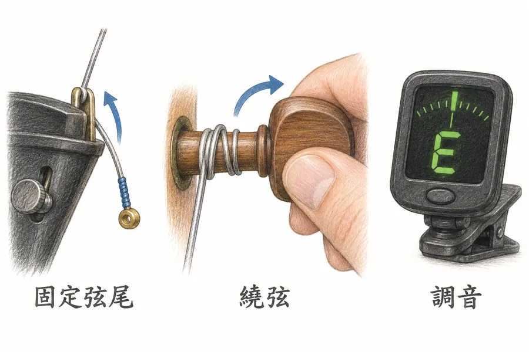

*Figure 21.8: the floating bridge and changing strings (schematic).*

Tailpieces have sharp edges, string holes and their own way of holding the string end, and every brand differs. Before changing strings, look at how the old strings run.

**Do not force a loop into the wrong slot.**

| Point and application | Content |
|----|----|
| Core idea | Take all the strings off at once and the floating bridge loses its fixing and moves. |
| Relations and conditions | The two strings of one course are best changed together and tuned one by one. |
| Application | Choosing, evaluating and caring for an instrument. |

> **Common misconception: "changing strings means taking all the old ones off, then fitting the new ones".**
> On an instrument with a floating bridge, that method lets the bridge position shift.
> Changing one course at a time is the safe way.

## 21.9 Cleaning and care

### Routine cleaning

The safest method: a soft dry cloth, to wipe off sweat and dust first.

On an old instrument, or one whose finish you are unsure of, do not use a polish containing silicone, a strong solvent or an abrasive.

Shellac, nitrocellulose lacquer and varnish all react differently to chemicals. Some old finishes may already have become brittle.

### Should the fingerboard be oiled?

It depends on the wood, how dry it is, and the formula of the product.

Unfinished fingerboards in ebony or rosewood can occasionally take a very small amount of a conditioner made for instruments.

But **excess oil does not "feed the wood"**. It may seep into the fret slots or collect dust.

A finished maple fingerboard is a different matter again.

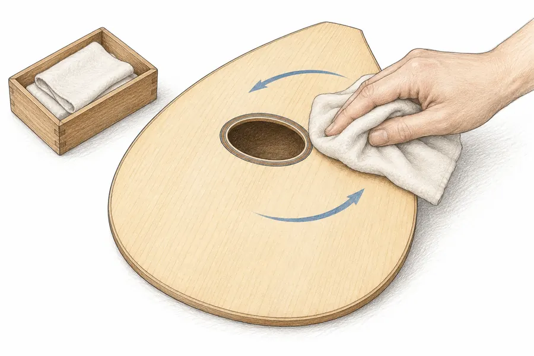

*Figure 21.9: cleaning and care (schematic).*

Oxidised metal hardware can be treated with a dry cloth first.

Heavy polishing on an expensive old instrument may directly reduce its natural patina and its collector value.

For a collectible, "shinier" is not necessarily better.

| Point and application | Content |
|----|----|
| Core idea | For routine cleaning, a soft dry cloth to take off sweat and dust first is the safest. |
| Relations and conditions | Whether to oil the fingerboard depends on the wood, how dry it is, and the formula of the product. |
| Application | Choosing, evaluating and caring for an instrument. |

### Build habits

Daily care starts with three things: wipe off sweat after playing, put the instrument back in a suitable case, and watch the environment.

The amount and frequency of cleaner, fingerboard oil and humidity products should be arranged according to the finish, the fingerboard material and the luthier's instructions.

A care record can note the date, the products used and where they were applied, which makes the next check easier.

## 21.10 Humidity and temperature

### Why humidity matters so much

Wood changes its moisture content with the relative humidity (RH) of its surroundings, which causes dimensional change, cracks, seams coming unglued, or a deformed top.

Common instrument-care advice mostly treats **40–55% RH** as a conservative range. But different materials, ways of building and historical condition all vary.

What really matters is not "some perfect number" but **avoiding long periods of extreme dryness, extreme damp, and rapid swings**.

The Library of Congress material on preserving paper also points in two directions.

Above 60% RH the risk of deformation and mould increases. Below about 30%, shrinkage can cause problems too.

Books are not instruments. But this still shows how sensitive organic materials are to extreme values and to fluctuation. 〔S2103〕

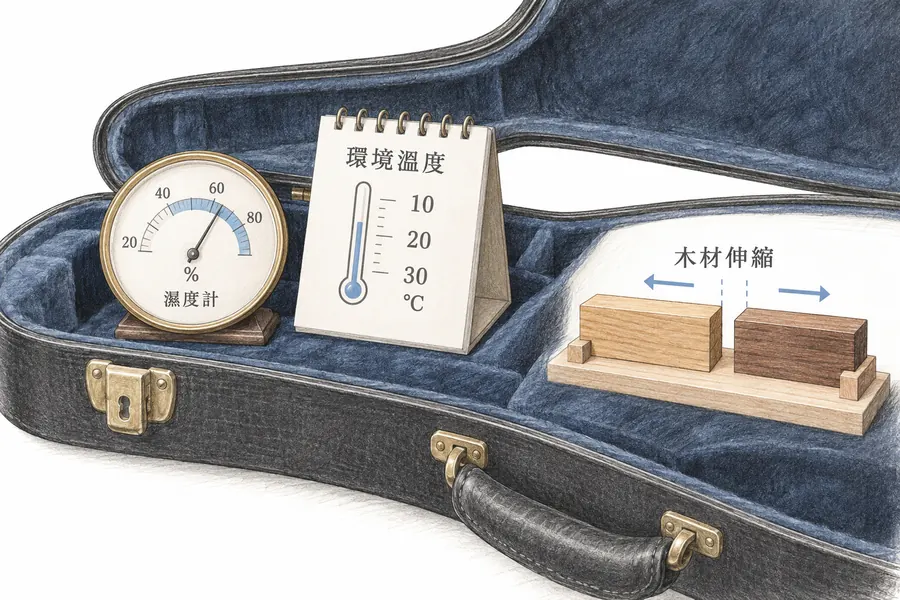

*Figure 21.10: humidity and temperature (schematic).*

### The real situation in Taiwan

The climate in Taiwan is often very humid. The real risk may in fact be holding 70–80% RH inside the case for long periods, which leads to mould and corroded metal.

Rather than "putting a packet of desiccant of unknown condition in the case", more reliable methods are:

- use a reliable hygrometer
- control the humidity of the room
- store the instrument in a suitable case

| Point and application | Content |
|----|----|
| Core idea | Wood changes its moisture content with relative humidity, causing dimensional change, cracks, open joints or a deformed top. |
| Relations and conditions | The Library of Congress guidance on preserving paper also stresses that above 60% RH raises the risk of deformation and mould, and that below about 30% shrinkage can cause problems. |
| Application | Choosing, evaluating and caring for an instrument. |

> **Common misconception: "Taiwan is so humid, the instrument can never crack".**
> Too much damp causes mould, corrodes metal and makes wood swell and deform.
> And moving an instrument from an air-conditioned room out of doors is itself a risk, because the change is so rapid.

## 21.11 Packing and transport

### What a case is for

The job of a hard case is to spread the impact and to stop the instrument moving inside it.

If the case is too big, the instrument rattles around inside, and no matter how hard the shell is it cannot prevent a second impact.

If the neck support is too high, or the headstock is pressed, that is a risk as well.

### Temperature difference

Air travel and winter shipping bring a temperature problem too.

A cold instrument should not be opened the moment it comes into a warm room. Letting the case warm up slowly reduces the risk of condensation and of a shock to the finish.

For international shipping, confirm the rules on controlled materials such as wood, ivory and tortoiseshell.

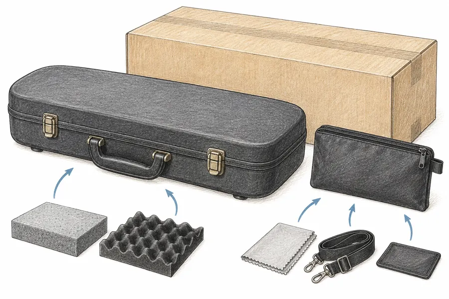

*Figure 21.11: packing and transport (schematic).*

CITES Annotation #15 exempts many finished instruments made of Dalbergia species (commonly grouped as rosewood).

But important exceptions remain, such as Brazilian rosewood, *Dalbergia nigra*. Species and the applicable conditions still have to be confirmed item by item. 〔S2104〕

### Shipping an expensive instrument

Before shipping, photograph and record the condition.

How far to slacken the strings depends on the instrument type and the way it is carried. Make sure the bridge, the neck and the headstock all have proper support.

Slackening the strings too far leaves the floating bridge and the tailpiece unstable; it is not necessarily safer.

| Point and application | Content |
|----|----|
| Core idea | The job of a hard case is to spread the impact and to stop the instrument moving inside it. |
| Relations and conditions | Air travel and winter shipping bring a temperature problem too. |
| Application | Choosing, evaluating and caring for an instrument. |

### How to choose a case

Put the instrument in and check:

- are the body and the neck held steady?
- does the lid close naturally without forcing?
- are the handle, the straps and the total weight right for commuting?

**Protection and a good fit are worth comparing more than the number of items in a package.**

## 21.12 When to go to a professional

| Risk level | Items |
|:---|:---|
| **High risk, leave it to a professional** | neck reset, repairing a serious crack, a deformed top, bracing or ribs unglued over a large area, heat treatment, fretboard planing, structural bridge work |
| **Low risk, you can do it yourself** | normal string changes, cleaning, basic tuning, and, once you understand the method, small checks of bridge position and intonation |

Even for the truss rod: if you do not know whether this instrument has one, which way to turn it, or what state the structure is in, you should not force it.

On old bowlbacks in particular there is very little room to work inside. Dismantling and repair may involve several ribs and historical gluing methods.

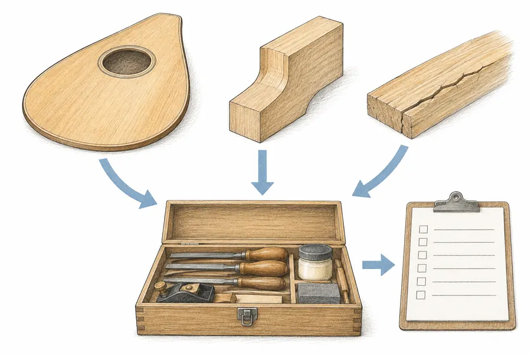

*Figure 21.12: when to go to a professional (schematic).*

There is only one standard for deciding to "fix it yourself": **can a failure be undone?**

If one wrong step could damage the wood, the finish or the originality, it is worth handing to a professional.

| Point and application | Content |
|----|----|
| Core idea | Neck resets, serious cracks, a deformed top, large areas of open glue, heat treatment, fretboard planing and structural bridge work are all high risk. |
| Relations and conditions | Low-risk jobs include changing strings, cleaning, basic tuning, and small intonation checks once you understand the method. |
| Application | Choosing, evaluating and caring for an instrument. |

## 21.13 Pickups and microphones

There are three ways to amplify the instrument, each with its own trade-offs.

| Type | Advantages | Disadvantages |
|:---|:---|:---|
| **Piezo / contact pickup** | easy to fit on the bridge or the top; relatively good resistance to feedback | an impedance mismatch makes the sound thin and sharp, so a preamp or DI with high input impedance is often needed |
| **Magnetic pickup** | the sound is more like an electric instrument, and the level is stable | needs ferromagnetic strings; picks up little of the body's resonance |
| **Internal / external microphone** | the most natural | most prone to feedback, and picks up stage noise easily |

A **hybrid system** mixes a piezo with a microphone and is a common compromise.

A loud bluegrass band on stage may lean towards piezo or magnetic. A quiet indoor stage or a recording can raise the proportion of microphone.

**Before choosing a pickup, define your situation.** That is far more effective than asking "which set is best".

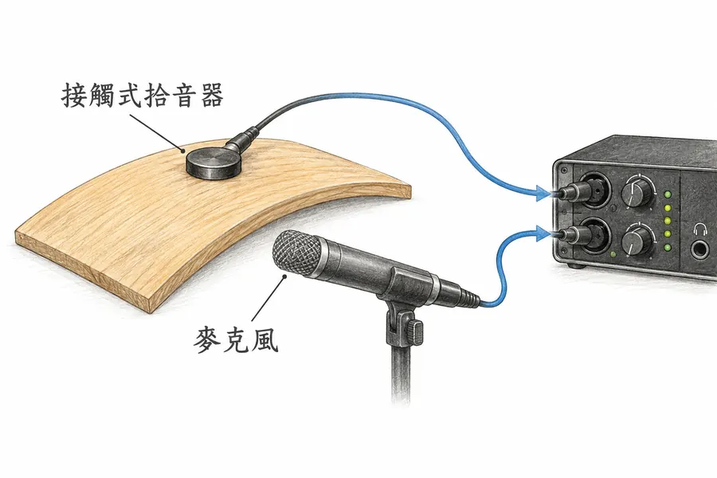

*Figure 21.13: the idea of a contact pickup versus a microphone (schematic).*

Fitting a pickup can also change the mass of the bridge or the load on the top.

On a collectible old instrument, **irreversible drilling needs very careful thought**.

| Point and application | Content |
|----|----|
| Core idea | A piezo pickup is easy to fit and resists feedback better, but an impedance mismatch makes the sound thin and sharp. |
| Relations and conditions | A magnetic pickup needs ferromagnetic strings, sounds more like an electric instrument, and picks up little of the body's resonance. |
| Application | Choosing, evaluating and caring for an instrument. |

## 21.14 The DI preamp and the stage soundcheck

### Why a preamp is needed

A piezo pickup plugged into an unsuitable low-impedance input may come out short of low end, with an over-hard attack.

A suitable preamp or DI (direct box) can provide impedance matching, gain, EQ, and a balanced output.

The order on stage is: **settle the gain staging first, then deal with EQ.**

Do not use extreme EQ to compensate for a pickup fitted in the wrong place.

### Dealing with feedback

Feedback usually happens when the resonance of the body or of the air is amplified again by the PA system.

| Solution | Explanation |
|:---|:---|
| change the position of the monitors | keep the instrument from facing the monitor |
| lower the stage volume | the most fundamental method |
| notch EQ | cut a particular frequency |
| change the balance of pickup and microphone | use less microphone |
| a soundhole cover or feedback suppressor | use when necessary |

Cutting the low end all the time can make the mandolin sound too thin.

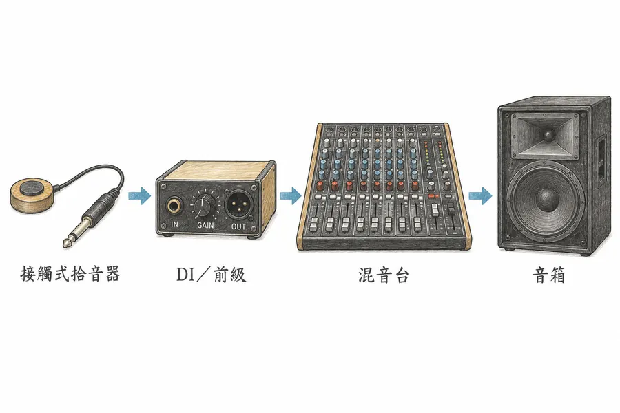

*Figure 21.14: the DI preamp and the stage soundcheck (schematic).*

A soundcheck should test three things: the strongest chop, the densest tremolo, and the highest position.

Only that confirms the volume and the spectrum "when you are actually playing". The peaks and the spectrum of a real performance are what expose the problems.

| Point and application | Content |
|----|----|
| Core idea | A piezo pickup plugged into an unsuitable low-impedance input may come out short of low end with an over-hard attack. |
| Relations and conditions | Feedback usually happens when the resonance of the body or of the air is amplified again by the PA. |
| Application | Choosing, evaluating and caring for an instrument. |

## 21.15 Recording and microphone placement

### Choosing a microphone

A condenser microphone can often capture the mandolin's transients and high-frequency detail.

A dynamic microphone can also give a more focused sound in some situations.

**Position matters more than the model.**

| Position | Usual result |
|:---|:---|
| straight at the soundhole | tends to be too heavy in the low end, boomy or boxy |
| around fret 12 | usually more balanced |
| where the bridge meets the body | usually more balanced |

But every instrument is different; go by actually listening.

### Distance and space

A close microphone reduces the effect of the room and adds detail. Pull it back a little and it integrates the radiation of the whole body.

Stereo recording can use techniques such as a spaced pair or XY / ORTF, but phase and the quality of the room become more important.

**If the room is poor, a single mono microphone in the right position is usually more reliable than complicated stereo.**

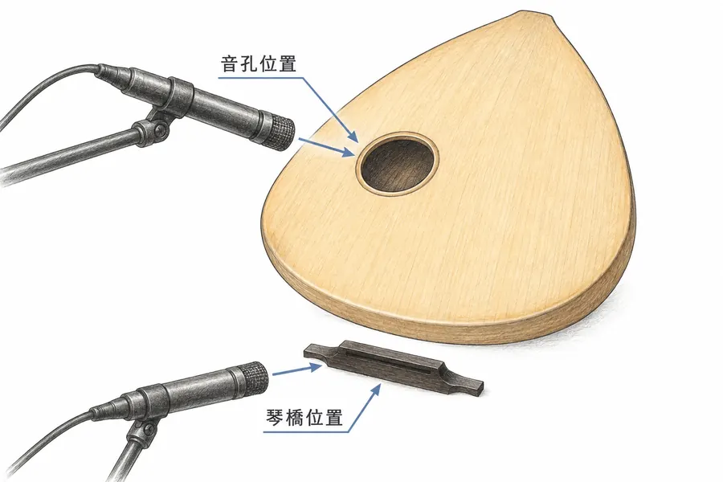

*Figure 21.15: the soundhole and the bridge located on the instrument; a real recording uses the whole instrument (schematic).*

### Should you fit new strings before recording?

Two things have to be weighed: the attack of new strings is too bright, and tuning stability.

Many people change strings a day or two in advance and let them settle. The exact timing depends on the type of string, how much you play and the sound you want.

| Point and application | Content |
|----|----|
| Core idea | A condenser microphone can often capture the mandolin's transients and high-frequency detail. |
| Relations and conditions | A close microphone reduces the effect of the room and adds detail. |
| Application | Choosing, evaluating and caring for an instrument. |

## 21.16 Case study: the total cost of a used instrument

### Case one: cheap, but very expensive

An old bowlback is offered at a low price. But its condition is:

- a problem with the neck angle
- five bowlback ribs unglued
- frets worn flat
- loose tuners
- a non-original bridge

Each of these can be repaired on its own. But the hours add up to several times the price of the instrument.

And the market value once it is repaired is not necessarily equal to your total cost.

### Case two: looks bad, is actually good

Another instrument has plenty of scratches on the outside. But its condition is:

- a stable neck and structure
- frets that can still be used
- a normal bridge and intonation

It needs only new strings and one setup.

It looks worse, but it is in fact the lower-risk player instrument.

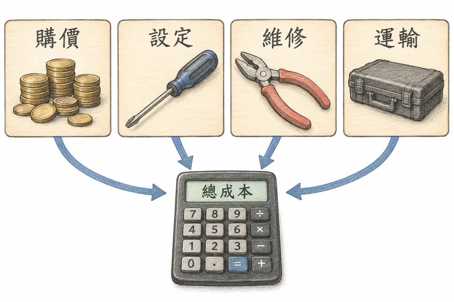

*Figure 21.16: case study, the total cost of a used instrument (schematic).*

### That is the order for assessing a used instrument

1. **structure**
2. **function**
3. **consumable parts**
4. **appearance**

Being cheap is not in itself a bargain, and being expensive is not a guarantee of condition.

| Point and application | Content |
|----|----|
| Core idea | A very cheap old bowlback with a neck-angle problem, five unglued ribs, worn frets, loose tuners and a non-original bridge may take several times its price in hours of work. |
| Relations and conditions | Another instrument, scratched but structurally stable, with usable frets and normal intonation, needs only strings and a setup, and is the lower-risk player instrument. |
| Application | Choosing, evaluating and caring for an instrument. |

## 21.17 Building an instrument file

Keep a file for every instrument. The items to record:

| Category | Content |
|:---|:---|
| Identity | brand, model, serial number / label |
| Transaction | date of purchase, price, where it came from |
| Images | photographs from every angle |
| Dimensions | scale length, nut width, body dimensions |
| Setup | strings, action, relief |
| Repairs | a record of every repair |
| Environment | humidity and storage conditions |

This data becomes very valuable after a few years. When you resell, insure or repair the instrument, it supplies a history.

Photograph before and after every major repair, and keep the invoices.

If the original bridge, tailpiece or tuners are replaced, **keep the old parts too, and label them**.

Collector value sometimes depends precisely on this unglamorous provenance.

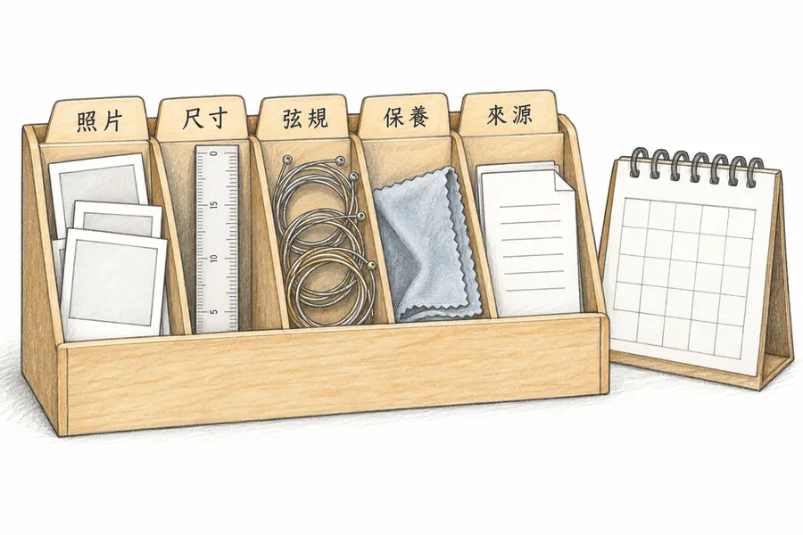

*Figure 21.17: building an instrument file (schematic).*

Real professional care is about keeping the instrument safe, stable and playable, while preserving a traceable history.

## Table 21-1 | Symptoms on a used instrument, their risk and the order of handling

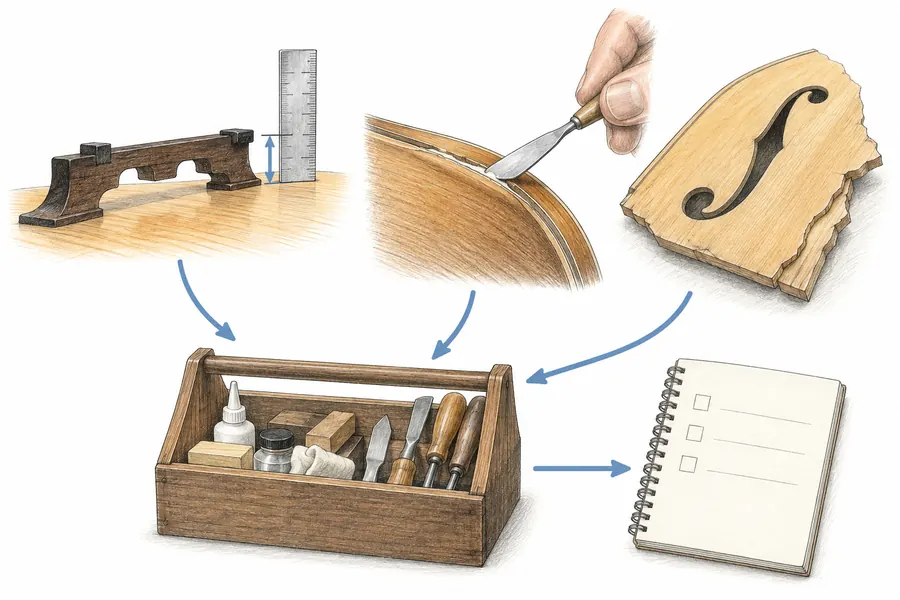

| Observation | Possible cause | Risk level | Next step |
|:---|:---|:---|:---|
| **the bridge is already at its lowest and the action is still high** | neck angle / body geometry | high | stop adjusting; ask a luthier to assess it |
| **several bowlback ribs unglued** | glue ageing / humidity / impact | high | avoid adding tension, and do not clamp it yourself |
| **buzz on a single fret** | one fret locally too high or too low | medium | locate it first, then work on the fret |
| **tuners stiff or with backlash** | worn gears / lubrication / looseness | low–medium | check the fixing and the structure first |
| **old strings, tuning unstable** | string stretch / wear | low | change the whole set and check the intonation again |
| **surface scratches but a stable structure** | normal signs of use | low | usually no repair needed unless it is a collector piece |

*Figure: Table 21-1, symptoms on a used instrument, risk and order of handling (schematic).*

## Self-study question bank

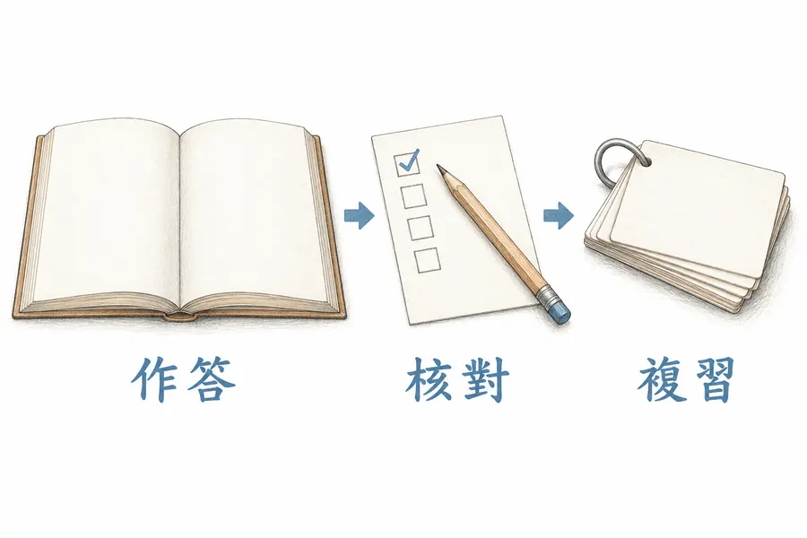

Study check: answer, mark, review

Answer for yourself first, then look at the answers. When you get one wrong, go back to the relevant section of the chapter and read it again.

**1. On a used instrument the action is high but the bridge is already low. What should you watch for?**

- A. the neck angle or the geometry of the body

- B. the colour of the case

- C. the material of the pick

- D. the size of the logo

**2. Which repair principle suits an expensive old instrument?**

- A. assess reversibility and originality first

- B. replace everything that can be replaced

- C. respray the finish first

- D. judge by appearance alone

**3. Preservation risks in Taiwan's humid climate include?**

- A. mould, corroded metal and wood deforming as it takes up moisture

- B. only being too dry

- C. only broken strings

- D. no effect at all

**Answers: 1.A　2.A　3.A**

## Main sources checked for this chapter

Sources checked: find the original, check the conditions, keep a record

**【S2101】Eastman Guitars: MD315 official specifications.** A case study of the parameters that affect how an instrument feels when choosing one: scale, nut width, fingerboard radius and action.

> https://www.eastmanguitars.com/md315

**【S2102】Collings Guitars: MF5 official specifications.** A case study for choosing: scale, nut width, compound radius.

> https://collingsguitars.com/mandolins/mf5/

**【S2103】Library of Congress: Preserving Your Books – relative humidity guidance (2026).** Conservative principles for preserving organic materials against high humidity, low humidity and rapid swings; not figures specific to instruments.

> https://guides.loc.gov/preserving-your-books

**【S2104】CITES: Annotation #15 / reports on Dalbergia musical-instrument exemptions.** The background to the exemption for finished instruments and to the controls on Dalbergia; exceptions such as *D. nigra* have to be confirmed individually.

> https://cites.org/eng/app/appendices.php

---

Turn the sound you like into a direction for learning.

Hear the melody and the rhythm first, then watch the tone and the way it is played, and finally take one small goal back into your practice.
