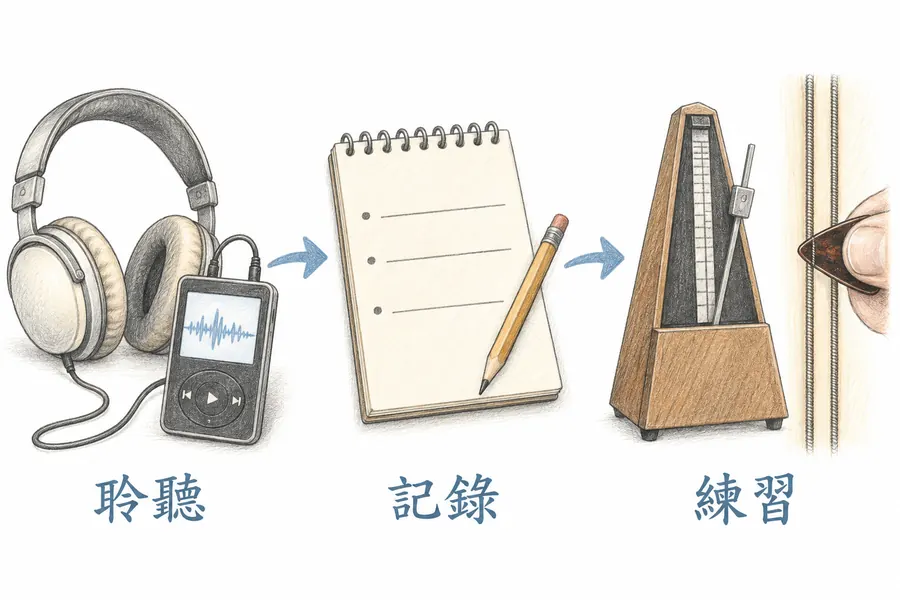
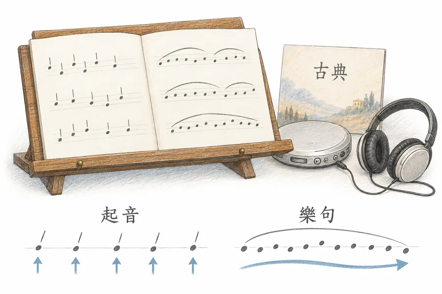
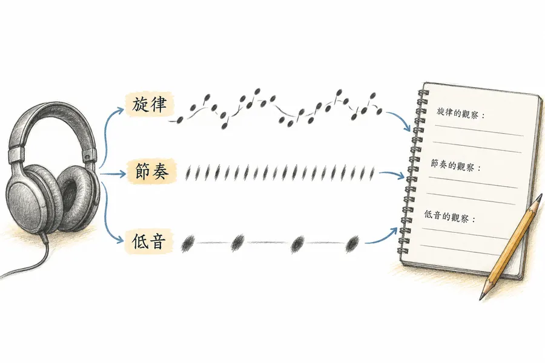

# Chapter 22: A Guided Listening Tour of Mandolin Albums

## Key points

- Listening to music can have a method too: three passes, one thing to concentrate on each time.
- Eight albums cover classical, bluegrass, Brazilian choro, duos and crossover.
- Every album comes with one listening task and one practice task.
- A recording is the sum of playing, microphone, space and mixing. It is not the same thing as the sound of your own instrument.
- Writing down what you heard in your own words is more useful than memorising the technical terms.

## 22.0 How to use this chapter

This chapter picks eight recordings to show you what the mandolin looks like in classical music, bluegrass, Brazilian choro, duos and crossover.

Each one has three parts: a way in, a question to watch for, and a short exercise.

Beginners can just pick one they like. Advanced readers can go on to compare different line-ups and different ways of playing.

The release information and track listings of the albums have been checked against the record companies and official material. The listening questions and exercises are teaching activities designed for this book.

You can follow the source links at the end of the chapter to the official listening pages, or search an authorised platform for "artist plus the full album name".

The track order, the regions where an album is available and how much of it you can hear may differ.

## 22.1 The three-pass listening method

### Three passes, three tasks

| Pass | What to pay attention to | One thing to write down |
|:---|:---|:---|
| **First pass** | the melody and the overall impression | the passage you like, and why |
| **Second pass** | the attack or the tone | one specific feature of the sound |
| **Third pass** | the beat and the phrasing | one place where it pauses or accents |

Listen to the whole piece the first time and only note the passages you like.

The second time, take 30 to 60 seconds and concentrate on one thing. For example, "is the start of every note clear".

The third time, tap the rhythm lightly along with the music and watch where the melody pauses and where it carries on.

One task per pass, and your attention stays easy to hold.

*Figure 22.1: listening, noting and practising.*

### How to take notes

Write down the title and the playback position, then describe the sound in everyday words: bright, soft, short, continuous.

**One important reminder:** the sound in a recording is the result of playing, microphone, space and mixing added together.

If you want to know what your own instrument sounds like, you still have to go and play it in person.

The relationship between tone and picking position can be practised alongside Chapter 17.

> **Common misconception: "the sound in the recording is the sound of this instrument"**
> A recording goes through the choice of microphone, its placement, the room, post-production and mixing.
> The same instrument can be recorded to sound completely different.

## 22.2 Classical works and solo parts

*Figure 22.2: listening to attack and phrasing.*

### Avi Avital / Vivaldi / 2015 / Deutsche Grammophon

This album was made by Avital with the Venice Baroque Orchestra, and contains Vivaldi's mandolin concerto along with arrangements of other concertos. 〔L01〕

Start with one movement of the Mandolin Concerto in C major, RV425. Watch the outline of the sound as the solo enters, then hear how the orchestra takes the theme back.

| Task | Content |
|:---|:---|
| **Listening** | find a passage where short notes come one after another, tap the rhythm, and note where the end of the phrase comes to rest |
| **Practice** | play four even short notes slowly on one open course, making each attack clear, then leave a breath at the end of the phrase |

The related technique is in Chapters 13, 14 and 17.

### Avi Avital / Art of the Mandolin / 2020 / Deutsche Grammophon

This album chooses works written for the mandolin in the first place. The instruments taking part include guitar, harp, harpsichord and theorbo, and an orchestra appears on some tracks. 〔L02〕

Start with one short piece and listen closely to how the mandolin and the accompaniment take turns to sound, then compare the line-up on another track.

| Task | Content |
|:---|:---|
| **Listening** | describe how the melody and the accompaniment divide the work in one passage, and note how the dynamics change |
| **Practice** | play a melody you know twice, once softly and once a little brighter, keeping steady time both times |

For the period of the works and the line-ups, you can go back to Chapter 18.

### Chris Thile / Bach Sonatas and Partitas Vol. 1 / Nonesuch (record label)

Thile plays Bach's unaccompanied violin works on the mandolin. The album contains the Sonata No. 1 in G minor, the Partita No. 1 in B minor and the Sonata No. 2 in A minor. 〔L03〕

Start with a slow movement and hear how a plucked instrument can make the direction of melody and harmony clear.

| Task | Content |
|:---|:---|
| **Listening** | mark with a gesture where you hear each sentence begin and end, and watch how the bass and the top alternate |
| **Practice** | sing a short phrase of a melody you know, then play it on the mandolin with the same direction; set the tempo to what you can manage |

The idea of several voices at once can be practised alongside Chapters 12 and 16.

## 22.3 Bluegrass and the rhythm of the string band

*Figure 22.3: following the melody, and listening to rhythm and bass.*

### The David Grisman Quintet / DGQ 20 / Acoustic Disc (record label)

DGQ 20 is a three-disc retrospective collection of the Grisman Quintet. 〔L04〕

On a first listen, pick a short piece from the official track list and watch how the mandolin's role shifts between melody, rhythm and answering the other players.

A collection offers a wider way in, and goes well with the styles discussed in Chapter 18.

| Task | Content |
|:---|:---|
| **Listening** | follow the melody and the bass separately through one stretch of music, and note where the roles change hands |
| **Practice** | play four bars of a melody you know slowly with the metronome, rest for four bars tapping only the rhythm, then come back to the melody |

This exercise trains a steady inner sense of the beat.

### Punch Brothers / Hell on Church Street (the album title, literally "a commotion on Church Street") / 2022 / Nonesuch

This album pays tribute to Tony Rice's *Church Street Blues*, with Chris Thile on mandolin and vocals. 〔L05〕

Start with *Church Street Blues*, follow the voice first, then watch how the mandolin arranges its space beside the voice.

*Cattle in the Cane* then makes a good next comparison for the instrumental ensemble.

| Task | Content |
|:---|:---|
| **Listening** | find a place where the voice rests and an instrument answers |
| **Practice** | sing one phrase, then answer with two or three notes, keeping the same tempo |

Connect the ideas of strumming rhythm, melody and leaving silence back to Chapters 14 and 16, and practise dividing the work in an ensemble.

## 22.4 The melodic line in Brazilian choro

*Figure 22.4: hearing the rhythm of the melody and the accompaniment separately.*

### Jacob do Bandolim / Mandolin Master of Brazil Vol. 1 / Acoustic Disc

This collection of historical recordings also circulates as *Original Classic Recordings Vol. I*, with the Acoustic Disc number ACD-3.

The official track list includes Assanhado, Vibracoes and Santa Morena. 〔L06〕

You can listen to the melody of Vibracoes first, then compare the more active line of Assanhado.

Brazil calls the mandolin the bandolim; that name can be understood alongside Chapters 5, 6 and 18.

| Task | Content |
|:---|:---|
| **Listening** | hum along with the melody and note where the ornaments fall; on the second pass, hear how the accompaniment supports the melody |
| **Practice** | split one long note of a melody you know into two short notes, keep the original beat, then go back to the long version and compare the expression |

Historical recordings help us get to know a way of playing.

When you listen, write down the shape of the melody, the accents and the arrangement of ornaments clearly. The sound quality is also affected by the recording equipment of the time and by later transfers.

## 22.5 Duos and crossover collaborations

*Figure 22.5: hearing the conversation between melody and bass.*

### Chris Thile and Edgar Meyer / Bass & Mandolin / 2014 / Nonesuch

This is a duo recording for mandolin and double bass.

Pick a short piece from the official track list and hear how the two registers fill each other in: which instrument carries the melody? Which one supplies the rhythm or the harmonic cues? 〔L07〕

| Task | Content |
|:---|:---|
| **Listening** | on the second pass follow only the double bass, and note the moments when it joins the melody |
| **Practice** | with a partner, each take one simple role and take turns playing melody and bass or chords; swap only one task at a time |

The idea of dividing the harmony can be practised alongside Chapter 16.

### Avi Avital and Omer Avital / Avital Meets Avital (the album title, literally "Avital meets Avital") / 2017 / Deutsche Grammophon

This crossover album is a collaboration between the mandolin player Avi Avital and the bass player and composer Omer Avital.

The players also include Yonathan Avishai and Itamar Doari. 〔L08〕

Start with one work from the official page and hear how the melody, the bass and the percussion talk to each other, then compare the tempo and the mood of another.

| Task | Content |
|:---|:---|
| **Listening** | note a rhythm pattern that makes you want to move, copy it by clapping first, then play it on one open course |
| **Practice** | play a two-bar phrase in steady time, then leave two bars of space |

Chapters 17 and 18 help you connect what you notice about tone with what you notice about style.

## 22.6 A four-week listening and practice plan

Twice a week, about 15 minutes each time.

The order is: listen first, then take notes, then do one short exercise.

Set the practice tempo to something you can manage steadily. After four weeks, go back and listen to the work from the first week, and see how much more detail you can hear.

| Week | What to choose | Listening and practice goal |
|:---|:---|:---|
| **Week 1** | Vivaldi or Art of the Mandolin | hear the attack and the ends of phrases clearly |
| **Week 2** | DGQ 20 or Hell on Church Street | stay with the beat and hear the roles change hands |
| **Week 3** | the Jacob do Bandolim collection | hum the melody and find the ornaments |
| **Week 4** | Bass & Mandolin or Avital Meets Avital | follow the bass and practise leaving space |

*Figure 22.6: taking what you hear back into practice.*

### How to fill in the record sheet

| Field | What to write |
|:---|:---|
| Album / track | the full name |
| Playback position | minutes and seconds |
| The feature I heard | in everyday words |
| The movement I want to practise | just one |
| How it compared next time | did it improve |

You can also use this sheet when trying instruments as in 21.1, to help you say in clear words what sound you like.

## Self-study question bank

Study check: answer, check and review

1\. What is the best thing to do on the second listening pass? A. analyse every detail at once B. pick one feature of the sound and concentrate on it C. compare only the volume

2\. Which two instruments form the main duo on Bass & Mandolin? A. mandolin and double bass B. mandolin and flute C. guitar and violin

3\. Jacob do Bandolim's recordings are a good way to get to know which kind of music? A. choro B. heavy metal C. electronic dance music

4\. When using recordings to help you choose an instrument, which approach is best? A. decide the price of an instrument directly from the album's volume B. note the sound you like, then go and play instruments in person C. look only at the instrument on the cover

5\. After listening, what is a good thing to do first when arranging practice? A. work through the whole album in one go B. imitate it at the fastest speed C. choose one short passage and a clear small goal

Answers and explanations　1.B, concentrating on one thing makes it easier to hear clearly; 2.A, the two registers are in conversation; 3.A, the official description says these recordings present Brazilian choro; 4.B, playing in person is how you check the actual feel; 5.C, a small goal makes it easy to observe and compare repeatedly.

## Main sources checked for this chapter

Source check: find the original, check the conditions and keep a record

〔N01〕Shimamura Musical Instruments, 初めてのマンドリン／マンドラの選び方 ("Choosing your first mandolin / mandola")　<https://store.shimamura.co.jp/ec/contents/ols/00mandolin/>　accessed 10 October 2026

〔L01〕Deutsche Grammophon Vivaldi　<https://www.deutschegrammophon.com/en/catalogue/products/avi-avital-vivaldi-5124>　accessed 10 October 2026

〔L02〕Deutsche Grammophon Art of the Mandolin　<https://www.deutschegrammophon.com/en/catalogue/products/art-of-the-mandolin-avi-avital-12069>　accessed 10 October 2026

〔L03〕Warner Music Japan Chris Thile Bach Vol. 1　<https://wmg.jp/chris-thile/discography/13829/>　accessed 10 October 2026

〔L04〕Acoustic Disc DGQ 20　<https://acousticdisc.com/product/the-david-grisman-quintet-dgq-20-download/>　accessed 10 October 2026

〔L05〕Nonesuch Hell on Church Street　<https://www.nonesuch.com/albums/hell-church-street>　accessed 10 October 2026

〔L06〕Acoustic Disc Jacob do Bandolim Vol. 1　<https://acousticdisc.com/product/jacob-do-bandolim-mandolin-master-of-brazil-vol-1-download/>　accessed 10 October 2026

〔L07〕Nonesuch Bass & Mandolin official introduction　<https://www.nonesuch.com/journal/edgar-meyer-chris-thile-discuss-new-album-bass-mandolin-2014-08-28>　accessed 10 October 2026

〔L08〕Deutsche Grammophon Avital Meets Avital　<https://www.deutschegrammophon.com/en/catalogue/products/avital-meets-avital-10335>　accessed 10 October 2026
