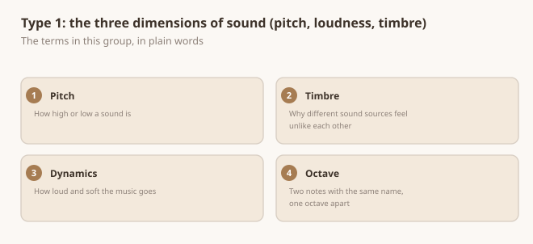
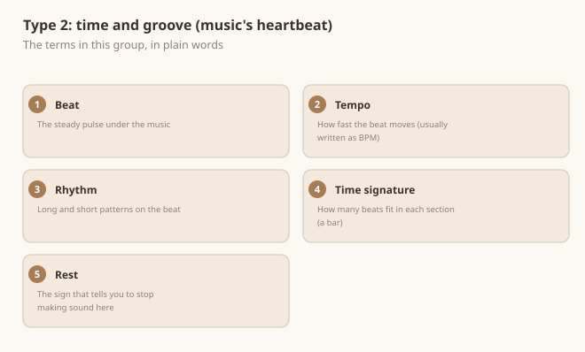
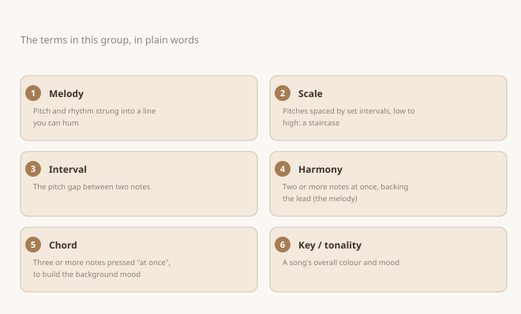

# Preface: The Basic Vocabulary

Before we formally enter the five stages of music theory, let's meet music's 15 basic terms.

Think of music as an amusement park under construction. You have to know the materials and the tools first, or you won't see what each later phase of the work is actually building. The words below will keep coming back in the lessons ahead. Read through them once to get an impression, and whenever one of them turns up at any stage later on, you can always come back here and look it up.

---

## 🎵 Category 1: The Three Dimensions of Sound (High or Low, Loud or Soft, Appearance)

### 1. Pitch — a sound's "floor level"

**In plain words:** where a sound sits, high or low.

**In everyday life:** Imagine sounds living in an apartment block: a bird's small, scattered chirp lives on "the upper floors" — that's a high note; the floor shaking as a big truck goes past lives "in the basement" — that's a low note. When you sing, as long as you step accurately onto the matching floor, you're in tune.

### 2. Timbre — a sound's "material and appearance"

**In plain words:** the essence of why different things that produce sound feel different when you hear them.

**In everyday life:** Sing the same "Do" and you can tell in one second whether that's a crisp acoustic guitar or a thick wooden wind instrument. It's like kettles: tap a plastic kettle and a metal kettle and the sound is just different. That "what it's made of" feeling is timbre.

### 3. Dynamics — the "volume key" for a sound's mood

**In plain words:** the changes between loud and soft in music.

**In everyday life:** It's just like the way we talk. Telling a secret, you lower your volume without meaning to and lean in close to the other person's ear; angry or worked up, you "shout". Dynamics in music is what controls whether the song is a tender whisper right now or hot-blooded and fired up.

### 4. Octave — a sound's "parallel universe"

**In plain words:** two notes with the same name, sitting exactly one lap apart in pitch.

**In everyday life:** The Do a father sings and the Do his small daughter sings sound like "the same note", yet the daughter's voice is clearly higher. It's like "Unit A on the 1st floor" and "Unit A on the 2nd floor" in the same building: exactly the same layout, only the floor is higher. That's an octave.

---

## ⏱️ Category 2: Time and Groove (the Heartbeat of Music)

### 5. Beat — a sound's "steady heartbeat"

**In plain words:** the regular, unchanging background pulse in music.

**In everyday life:** The beat is the steady reference pulse in music. Most of the time it doesn't speed up or slow down; it has to be as precise as the second hand of a clock. Whenever you nod along or tap your foot to a song, the point you're tapping is the beat.

### 6. Tempo — how fast the heartbeat runs

**In plain words:** how quickly the beat moves along (usually shown in BPM).

**In everyday life:** Lying on the beach in the sun, your heartbeat is slow — that's a "slow tempo"; sprinting a hundred metres on the track, your footsteps go "da-da-da-da" and turn very fast — that's a "fast tempo". Tempo decides whether the first impression the music gives you is relaxed or excited.

### 7. Rhythm — a sound's "game of long and short combinations"

**In plain words:** the changes of long and short that ride on top of the beat.

**In everyday life:** Imagine knocking on a door and knocking out "knock, knock, knock-knock-knock" — five knocks, some long, some short, with pauses in between. That alternation of long and short is rhythm. Rhythm makes music sound alive, so it doesn't come out stiff like a robot.

### 8. Time Signature — the "storage box" that holds time

**In plain words:** it rules how many beats fit inside each section (each bar).

**In everyday life:** Imagine buying eggs: there's a tray that holds 4 (four-beat time), and a tray that holds 6 (six-beat time). The time signature is the specification of that tray. Once it's decided, a song usually fills its notes into trays of the same size all the way through, and that's what keeps it sounding steady. A few songs change trays partway through (this is called a metre change) — that's a deliberate way of creating a feeling of change.

### 9. Rest — the "deep breath" in music

**In plain words:** a sign telling you that this spot must be quiet, with no sound coming out.

**In everyday life:** It's the "comma" or the "full stop" in the middle of speech. If someone rattles on and on without ever pausing for breath, the listener ends up feeling out of breath too. Music has places that stay quiet, and only then do the notes that do sound come across with strength. A rest is music's art of leaving blank space.

---

## 🏰 Category 3: Music's Building Work (Lines and Colours)

### 10. Melody — the lead character's "lines"

**In plain words:** pitch and rhythm strung together into a line you can hum.

**In everyday life:** This is the line in a song that leaves the deepest impression, the one you hum without noticing in the shower. Whether it's the chorus of a pop song or "Happy Birthday", the main line you can sing out on a single "la la la" is the melody.

### 11. Scale — a sound's "private staircase"

**In plain words:** pitches lined up low to high at fixed, regular distances, like the steps of a stair.

**In everyday life:** It's like climbing up to a slide: you have to take a fixed set of steps, one step at a time. Do-Re-Mi-Fa-Sol-La-Si is the staircase you meet most often, and most melodies are played running up and down it.

### 12. Interval — the "stride" between the steps

**In plain words:** the distance in pitch between two notes.

**In everyday life:** Walking, you can take one stair per step (Do up to Re, a very short distance) — that's a "small stride"; you can also, like a long jump, go from the first floor straight to the fifth (Do straight up to Sol) — that's a "big stride". An interval is measuring how far you just stepped.

### 13. Harmony — the lead's "strongest team of bridesmaids and groomsmen"

**In plain words:** two or more sounds added together, a design that sets off the lead (the melody).

**In everyday life:** If the melody is the lead singing centre stage, harmony is the backing-singer angels beside them going "ooooh" or "aaah". Heard on its own, harmony can feel a little dull, but put together with the lead it makes the whole picture much fuller and much better to listen to.

### 14. Chord — a sound's "three-dimensional building blocks"

**In plain words:** three or more notes pressed "at the same time", used to build the mood of the background.

**In everyday life:** If the melody is one flat line, chords are the three-dimensional blocks that prop it up. A major chord sounds like the sun coming out (bright, happy); a minor chord sounds like rain falling (gloomy, sad). Chords are music's built-in "mood filter".

### 15. Key / Tonality — music's "overall filter"

**In plain words:** the base line of colour and atmosphere for a whole song.

**In everyday life:** It's just like the filter you apply when you touch up photos on your phone! A "major key" is like putting on a high-contrast, high-saturation filter: it sounds sunny and positive. A "minor key" is like putting on a black-and-white, cool-toned filter: it sounds a little mysterious or sad. The melody and the chords of the whole song all work under the rules of that one big filter.

---

These 15 terms are the ABC of the musical world. Over the five stages that follow we'll go into each of these ideas one at a time, turning them from plain words into practical knowledge that lets you really read a score and really hear the music.

