# Stage 1: Sound, Timbre and Beat

Put the score down for a moment. This stage is about listening: hearing how high a sound is, what it is made of, and keeping a steady pulse with the music.

Two things you deal with every day and rarely think about: **where does sound come from?** and **what is that pulse that makes you want to tap your foot?**

Starting from vibration, we first see that pitch and timbre are two faces of the same thing. Then we look at how notes got their names, and finally step into music's frame of time to feel what beat and tempo do. This is not a course in memorising arithmetic. It is a chance to open your ears again.

## Chapter 1: Where Sound Comes From — Frequency and Pitch

Have you ever stopped to wonder what a bird call, a car horn, a singer's voice—even a melody you're only imagining—actually *is* in the physical world?

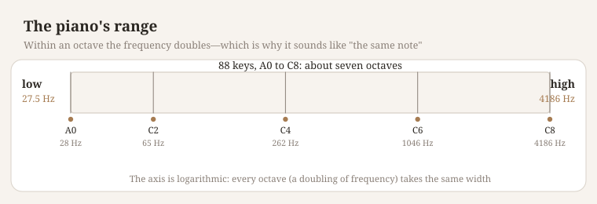

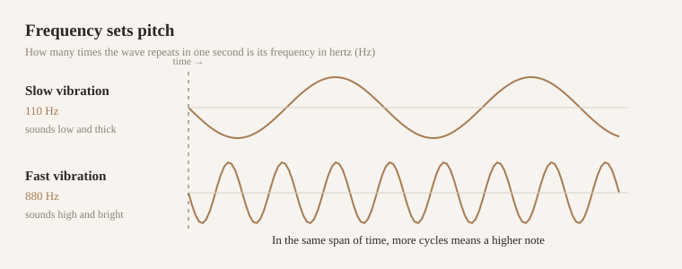

Why do some sounds feel low enough to vibrate in your chest (the sub-bass in a cinema), while others are sharp enough to make you wince (fingernails on a blackboard)? The secret is one very basic physical event: **vibration**.

### 1.1 The nature of sound: an invisible wave in the air

Physically, every sound—noise or music—is produced by **something vibrating**.

Think of dropping a stone into still water: rings spread outward. Sound travels in much the same way, except that air molecules push back and forth rather than rising and falling. Pluck a guitar string, hit a drum, or speak and set your vocal folds moving, and that vibration pushes the air around it. The molecules behave like people in a queue: each one nudges the next, then springs back. That nudge-and-spring is what carries the energy outward as an invisible wave—a sound wave. The wave crosses the air and finally reaches your eardrum. Your brain translates that movement into what you hear as sound.

**👂 A quick listening experiment.** Rest one hand lightly on your throat and hum a low, long "ahh—". Feel the buzz? Now try a high, thin "eee—" and feel again. The muscles tighten, and the rate of the buzz is completely different. That's the instrument you were born with: your vocal folds, creating pitch by vibrating.

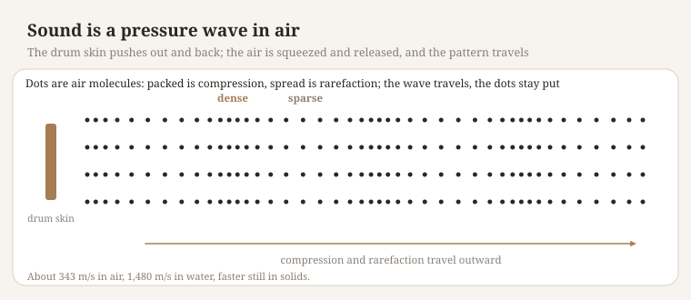

### 1.2 What decides high and low: frequency and hertz

If sound is vibration, the next question is: what decides whether it sounds high or low? The answer is **how fast it vibrates**.

Science calls that rate **frequency**, measured in **hertz (Hz)**—literally "cycles per second".

* Something vibrating 100 times a second has a frequency of 100 Hz.
* Something vibrating 1,000 times a second has a frequency of 1,000 Hz.

Hence the most reliable rule in music:

* **Faster vibration (higher frequency, larger Hz number)**: the sound is **higher**, sharper.
* **Slower vibration (lower frequency, smaller Hz number)**: the sound is **lower**, deeper.

Take a piano. Its leftmost key—the lowest—sets a string vibrating about 27.5 times a second (27.5 Hz). It's so low you barely hear it as a note; it sounds like a heavy engine idling nearby. The rightmost key is the opposite: a very short, very tight string vibrating 4,186 times a second.

### 1.3 The limits of the human ear

Every animal hears a different range. Ours is precise, but it has a hard boundary.

A healthy young human hears roughly **20 Hz to 20,000 Hz**.

* **Below 20 Hz** is *infrasound*. Elephants use it to communicate across long distances. We don't hear it, but at high enough intensity (an earthquake, a large explosion) the body and skin register the pressure.
* **Above 20,000 Hz** is *ultrasound*. That's the world of dogs, dolphins and bats. A dog whistle is the classic demonstration: you blow and hear nothing, while the dog's ears go up instantly.

Within that audible 20 Hz–20,000 Hz, musicians picked out a working subset. Most instruments sit between 27.5 Hz and 4,186 Hz—exactly what the piano covers.

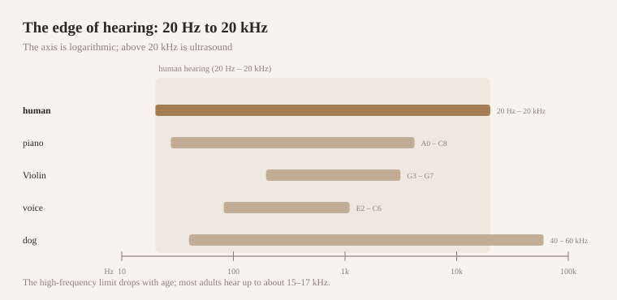

### 1.4 Why some instruments cut through (the equal-loudness secret)

An orchestra has cellos, horns, bass drums—and also flutes and violins. Have you noticed that even when everyone is playing at full volume, the flute or violin still cuts through the thick low end and reaches your ear?

Not because the flute is louder. Because **the ear is not equally sensitive to every frequency.**

The classic study here is the **equal-loudness curves** (Fletcher–Munson). Human hearing is most sensitive in a particular band, roughly **2,000–5,000 Hz**.

Why that band? Because it's where **a baby's cry** sits, and where the consonants of speech (s, t, k) carry their identity. Our ancestors needed to hear an infant or a warning through wind and water noise.

In music, that explains why sounds in this range are the easiest to hear and identify. Mixers treat this band carefully: too much 2,000–5,000 Hz and the mix is harsh and tiring; too little and it sounds muffled, like singing through a blanket.

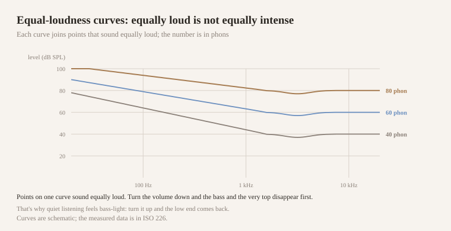

## Chapter 2: Why You Can Tell a Violin from a Flute on the Same Note — Timbre and the Harmonic Series

In the last chapter, we said that pitch is determined by how fast something vibrates. Now think about one thing: a violin and a flute play the A above middle C (A4, 440 Hz) at the same time. The two notes have exactly the same pitch, but why can you tell at once which is the violin and which is the flute?

The answer is not in the frequency. It is in “what else is inside” the frequency.

### **2.1 The third dimension beyond pitch and volume: timbre**

Sound has three basic properties: **pitch** (how fast it vibrates), **volume** (how large the vibration is), and **timbre**. We are already familiar with the first two, but timbre is hard to explain in one sentence—we usually can only describe it as “bright,” “dark,” “thick,” “thin,” “woody,” or “metallic.”

This weakness of adjectives comes from the fact that timbre is not a single number. It is a whole recipe: the strength of the harmonics, the speed of the attack, the place of resonance, and even a little noise all count. This chapter first covers the most important item—the harmonic series.

### **2.2 One string vibrates in many segments at once: the harmonic series**

Pluck a guitar string, and it looks like the whole string is moving up and down. But physically, the string is also vibrating in lengths of one-half, one-third, one-quarter, one-fifth, and so on. The whole string vibrating produces the **fundamental**. The parts vibrating produce a series of **harmonics** that are higher and weaker than the fundamental.

These frequencies are not random. They form a very clean sequence of whole numbers. **The frequency of the nth harmonic (partial) = fundamental frequency × n**—note that this uses harmonic numbering: the fundamental is the 1st harmonic, while the “1st overtone” means the one above the fundamental (that is, the 2nd harmonic). Both ways of speaking are used. When you read an “overtone number,” first check where it starts counting.

Take A4 (440 Hz) as an example: the 2nd harmonic is 880 Hz, the 3rd harmonic is 1320 Hz, the 4th harmonic is 1760 Hz, and so on upward. In terms of intervals: the 2nd harmonic to the fundamental is a **perfect octave** (2:1). Then, “compared with the previous harmonic,” the intervals are in order a perfect fifth (3:2), a perfect fourth (4:3), a major third (5:4), and a minor third (6:5).—Every comparison here is between adjacent harmonics, not each harmonic against the fundamental.

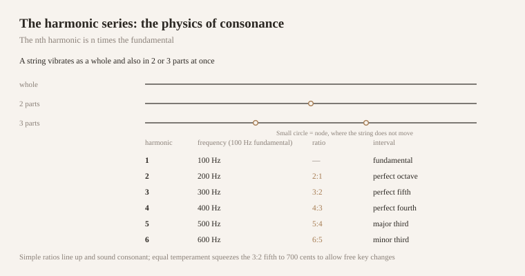

There is a side effect worth remembering: the 7th harmonic (7 times the frequency) is about thirty cents lower than the corresponding note on the piano (a minor seventh)—it is not out of tune; the harmonic series is simply not the same as twelve-tone equal temperament. We will come back to settle this in Stage 8.

### **2.3 The recipe of harmonics determines the instrument’s character**

For the same A4, the violin and the flute both have a fundamental of 440 Hz. The difference is **how loud the 2nd, 3rd, 4th, and 5th harmonics each are**.

- When the harmonics are concentrated in the first few (2, 3, 4), the sound is round and warm, close to a “pure” tone.
- When the higher harmonics are especially strong, the sound seems bright, sharp, and penetrating—this is also why brass sounds suddenly “brighten” when played harder, or when a singer pushes the voice to its limit. Conversely, adding a mute usually suppresses the high frequencies, so the sound becomes darker and duller.
- When a small band of frequencies is especially amplified by the body of the instrument or the tube, it forms a **formant**. In the human voice, it is the position of the formants that lets you tell “ah” from “ee,” even at the same pitch.

Besides the balance of harmonics, sound also has a “shape in time”—the **envelope**: how long the attack takes, how it decays, whether it sustains, and how long it rings after release. A piano starts decaying as soon as it is struck. Strings can be bowed continuously. The two may look very similar on a spectrum plot, but your ears will never confuse them.

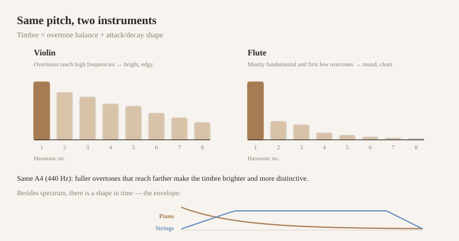

### **2.4 The harmonic series also quietly sets the scale**

The earliest “harmony” humans discovered is actually the harmonic series. The simpler the frequency ratio between two notes (2:1, 3:2, 4:3), the more their harmonics overlap, and the more blended they sound.

So the scale was not invented out of thin air: write down the harmonic series of a string, remove the octave (2:1) that is “the same pitch,” and the first new note that appears is a fifth (3:2). Stack fifths upward, and you get tuning by cycle of fifths—China’s sanfen sunyi method and ancient Greece’s Pythagorean tuning are actually doing the same thing. The twelve-tone equal temperament we use now takes another path: divide the octave directly into 12 equal parts, so every key can transpose freely. The cost is that, apart from the octave, every interval deviates a little from the natural ratios of the harmonic series (the major third is off by about 14 cents).

For now, just remember this order: **the harmonic series is given by physics; the scale is chosen by people.**

### **2.5 Try it now**

Find a quiet place and use headphones to listen to two versions of the same melody: one for solo piano, one for string ensemble. Ignore the melody. Pay attention only to “the material quality of the same note.” You will find that you have actually been doing this all along—you just did not have a name for it before.

## Chapter 3: Naming the Steps of Sound — Basic Notes and the Pitch System

In the last chapter we saw that between 20 Hz and 20,000 Hz there are countless possible frequencies. It's like an endless ruler with no markings on it, full of pitches that differ by the smallest amounts.

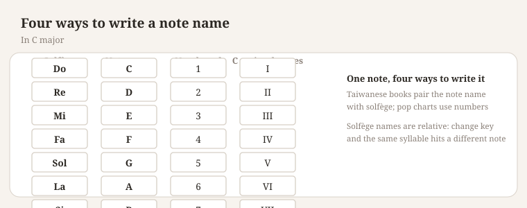

But if we want to play music together, we can't say to a guitarist: "Hey, play me a note that vibrates 440 times a second, then move to one that vibrates 523.25 times a second!" That's no fun, and it goes against every human instinct.

To solve the communication problem, our ancestors did something remarkable. Out of infinite frequency they chose pitches at specific distances and fixed them in place, like carving one step after another into a smooth slope. That is a **scale**. And once you have stairs, of course every step needs a name. Those are **note names**.

### 3.1 Letters and Solfège, One to One: the Basic Notes

In the Western system we took seven of the most basic notes, and those seven form the combination you know best. To make them easy to remember and easy to write, seven Latin letters name these seven basic notes:

**C, D, E, F, G, A, B**

Those letters may look unfamiliar, but if I give them their other names you could sing them in your sleep. In fixed-do solfège they match the names you learned in music class:

* **C** = do  
* **D** = re  
* **E** = mi  
* **F** = fa  
* **G** = sol  
* **A** = la  
* **B** = si (or ti)

So when you see a C on a piano score, the sound in your mouth is do. These seven basic notes are the foundation of all Western music theory. Countless symphonies, moving pop love songs and high-energy rock all begin with these seven notes.

### 3.2 Measuring the Gaps Between Steps: Whole Tones and Semitones

When you sing up C–D–E–F–G–A–B (do–re–mi–fa–sol–la–si), it feels like climbing stairs, one step at a time. A staircase of seven notes like this is called the **natural major scale**. Start it on C and you get the one everybody knows, the C major scale.

But this staircase has a design feature that stops most beginners cold: **the steps are not all the same height.**

The smallest unit music uses for the distance between two notes is the **semitone** (also called a half step). Two semitones make a **whole tone**.

Let's lay out the distance formula for the seven notes. Burn this pattern into your memory:

* C to D (do to re): **whole tone**  
* D to E (re to mi): **whole tone**  
* **E to F (mi to fa): semitone**  
* F to G (fa to sol): **whole tone**  
* G to A (sol to la): **whole tone**  
* A to B (la to si): **whole tone**  
* **B to C (si to do): semitone**

See the trick? Between mi and fa, and between si and do, the gap is short — only a semitone. Everywhere else the gap is the longer whole tone.

**🎹 The best visual aid there is: the piano keyboard.** Many people who only sing or play a wind instrument are vague about whole tones and semitones, because they never see the notes. Look at a piano keyboard and it is obvious at once.

On a piano the white keys are C–D–E–F–G–A–B. You'll notice that most white keys have a black key between them. That black key is a rest stop on the way. C (white) to D (white) crosses one black key, two steps (two semitones), so the interval is a whole tone. But look closely between **E (mi) and F (fa)**, and between **B (si) and C (do)**: **there is no black key.** The two white keys sit right against each other. No rest stop, one step, and that is a semitone.

Remember the pattern **whole, whole, semitone, whole, whole, whole, semitone** and you hold the core structure of the natural major scale — the backbone of both classical and pop music in the West.

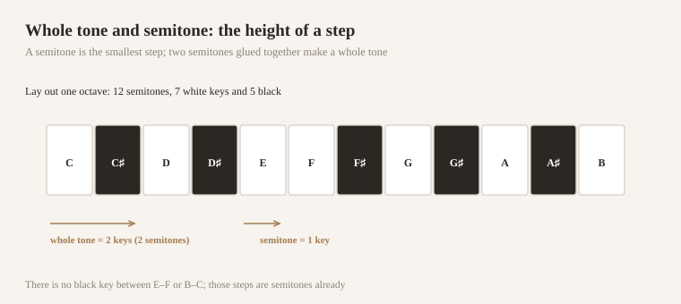

### 3.3 Scientific Pitch Notation: A Language the Whole World Shares

With C–D–E–F–G–A–B settled, a new problem turns up.

A man's do (C) and a woman's do (C) don't sound the same height, do they? On a piano, counting from the far left to the far right, there are eight C's. If I write just "C", how do you know whether I mean the low one or the high one?

To fix this, musicians and scientists invented **scientific pitch notation**. The method is clever: put a number after the note name. The number marks which octave the note belongs to.

* The C roughly in the middle of the piano is **C4**, because it is the fourth C counting from the left. This C4 is also called **middle C**, and it is the reference point for all music theory.  
* One octave up from C4, that higher do is **C5**.  
* One octave down from C4, that lower do is **C3**.

**Standard pitch: A4 = 440 Hz.** In scientific pitch notation one note outranks all the others: **A4, the la above middle C**. In 1939 an international conference of musicians and scientists agreed on one thing — so that every instrument in the world could tune to the same pitch, instead of you playing yours while I play mine, they fixed the frequency of A4 at **440 Hz**.

Since then, 440 Hz has been music's Greenwich Mean Time. Before an orchestra goes on stage, the oboist plays one long note for everyone to tune to, and that note is A4 = 440 Hz. But music is alive, and the standard has shifted constantly through history. In Bach's Baroque era the A was about 415 Hz, which sounds about a semitone below today's standard.

## Chapter 4: The Heartbeat of Music — What a Beat Is

In the first two chapters we explored sound's "space" — high and low. Now we move into music's other dimension: time.

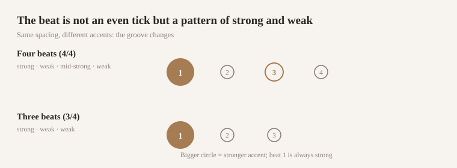

If music is a painting, pitch (melody and harmony) is the colour on it, and time (rhythm and beat) is the canvas. Without a canvas the paint has nowhere to sit; without time, music cannot exist. Every sound, even a single knock, takes up a stretch of time the moment it exists in space.

In this chapter we look at the smallest unit of musical time: the **beat**.

### 4.1 What Is a Beat? The Invisible Pulse of Music

You can think of the beat as music's heartbeat. Western music theory defines it as **a regular pulse that appears in music**.

Put on your headphones and play your favourite pop song. Your head starts nodding, your toe starts tapping the floor, your fingers start drumming on the table. Whatever you are tapping along to is that song's beat.

The beat is a strange physical and psychological thing. Often it isn't a sound any instrument plays; it's a steady force running behind the music. Like the heartbeat in your body, it needs no effort of yours to control — it simply goes thump, thump, thump. That regular pulse is the skeleton of musical time. It lets your brain predict when the next sound will arrive.

### 4.2 Beat vs Rhythm: Stop Mixing Them Up

In everyday speech many people use beat and rhythm as if they were the same word ("this song's rhythm is so fast!" — what they actually mean is tempo). In music theory the two mean completely different things.

One everyday analogy separates them: **walking and dancing**.

* **A beat is like your steady walking pace.** Left, right, left, right. Each footfall lands after the same interval. It is always regular, always continuing, a background pulse that never changes on a whim. However uneven the ground, your pace stays steady. That is the beat.  
* **Rhythm is what your body does on top of those steady steps, in patterns of different lengths.** Suppose you keep walking at a steady pace (the beat) but your upper body starts to change: two quick claps, then a pause, then a spin. Some of these moves are fast (many in a short time), some slow (drawn out long), some are silent rests. That actual combination of long and short sounds and movements, riding on the steady steps, is rhythm.

To sum up: the beat is an invisible frame, and rhythm is the real sound of different lengths placed inside it. A drummer's busy "boom, tss, boom-boom, tss" is rhythm. The audience waving glow sticks in perfect unison are catching the beat.

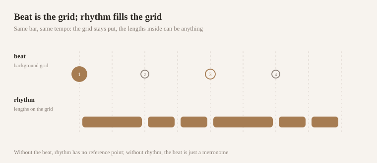

### 4.3 Why Music Makes You Move: Strong Beats and Weak Beats

If every beat had the same force (like a clock ticking: tick, tick, tick, tick), we'd find it mechanical and lifeless after a while.

Music is compelling because not all beats carry the same weight. Western music gives beats a light and a heavy side: **strong beats** and **weak beats**. That alternating pattern gives music its natural lilt and its forward drive.

**🎵 Feel the power of strong and weak: the four-beat cycle.** The most common pattern in modern pop is four beats — a group of four that repeats, the familiar 4/4. Inside those four beats the weight goes like this: **1 (strong) – 2 (weak) – 3 (medium strong) – 4 (weak)**

Try an experiment. Say "1, 2, 3, 4" out loud in an endless loop, and follow these instructions. On "1", slap the table hard (strong beat). On "3", tap the table lightly (medium strong beat). On "2" and "4", snap your fingers (weak beat).

Do you feel the groove appear, like the intro of a pop song? The hard "boom!" on beat one gives a feeling of certainty, of starting over. That is what alternating strong and weak beats does: it steers the listener's feelings, and it tells us where a phrase begins and where it ends.

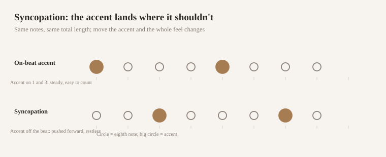

### 4.4 How Different Beat Groupings Feel

How beats group into strong and weak patterns decides a song's personality. Different numbers of beats per group feel completely different in the body:

1. **Two beats (strong–weak):** one cycle every two beats. This is the most basic beat humans have, because we have two legs. Marching or running, "left–right, left–right" is perfect duple time. Marches are usually in two (2/4) or four (4/4), which feels orderly, serious and full of drive.  
2. **Three beats (strong–weak–weak):** one cycle every three beats. Three has a strange, lopsided beauty. Because the accent only comes back every third beat (strong–weak–weak), it breaks the square marching feel of two and creates a sense of turning, swaying, almost floating. The waltz is built on three. Picture the dance floor: "oom-pah-pah, oom-pah-pah", all elegance.  
3. **Four beats (strong–weak–medium strong–weak):** as above, this is the ruler of modern pop, rock and R&B. It keeps the stability of two but is richer and roomier, giving the singer and the drummer space to fill in syncopation. It is the most popular beat framework in the world.

## Chapter 5: Tempo — Feeling the Flow of Time

Last chapter we built the frame of the beat and saw how strong and weak beats alternate. Now we bolt an engine onto that frame, to decide how fast it moves.

How fast the beat runs is what music calls **tempo**.

Tempo is the catalyst of musical mood. Take the same melody built from C–D–E–F–G. Play it very slowly and it can sound like a solemn chant; play it very fast and it turns at once into a circus entrance tune. Understanding how tempo works is the key to expressing musical feeling.

### 5.1 The Modern Standard: BPM (Beats Per Minute)

In modern music — pop, electronic and film scores — we measure tempo with a very precise mathematical unit, **BPM (beats per minute)**.

The calculation is simple: how many beats fall inside one minute (60 seconds).

* **BPM = 60**: exactly 60 beats a minute, so one beat every second. That is the speed of a clock's second hand. In music it counts as slow — lyrical, quiet.  
* **BPM = 120**: 120 beats a minute, two per second (one beat every half second). This is a classic, energetic tempo, common in dance pop and marches.  
* **BPM = 180**: three beats a second — very fast, aggressive or urgent. You hear it in punk rock and heavy metal.

**🏃‍♂️ BPM and your heartbeat.** Did you know that your emotional response to music has a lot to do with BPM and your own heart rate? A relaxed adult's heart beats about 60–80 times a minute, so a ballad around BPM 70 makes the body feel calm and at ease. Running at the gym, your heart may climb to 130–150, and if your headphones are playing a fast dance track at BPM 140 your body feels strong and your feet start landing on the rhythm by themselves. That is the science behind workout playlists choosing high-BPM songs.

### 5.2 The Romance of Classical Music: Italian Tempo Terms

BPM is very precise, but two or three hundred years ago the metronome either hadn't been invented or wasn't accurate enough. So how did a composer — Mozart, Beethoven — tell a performer how fast the piece should go?

They used words. Because Italy was the centre of European music through the Renaissance and Baroque, nearly all classical tempo terms are **Italian**. These terms don't just give you fast or slow; they also carry the mood and the expression the composer wants from you.

We have accurate metronomes now to give reference numbers, but these Italian words remain basic knowledge for anyone studying classical theory. Here are the most common ones, and the situation each one suggests:

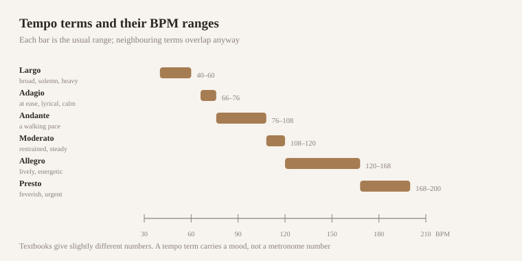

1. **Largo**  
   * **Reference tempo**: about 40–60 BPM.  
   * **What it feels like**: the Italian means "broad". This tempo is very, very slow; each beat seems far from the last. It usually expresses the solemn, the sacred, or something heavy and grief-stricken. Picture walking through a huge cathedral, every step deliberate.  
2. **Adagio**  
   * **Reference tempo**: about 66–76 BPM.  
   * **What it feels like**: the Italian means "at ease, unhurried". This is a slow tempo with a little more flow than largo. Many second movements of classical symphonies — the lyrical ones — are marked adagio. It suits melodies that are beautiful, romantic, peaceful, or touched with quiet sadness.  
3. **Andante**  
   * **Reference tempo**: about 76–108 BPM.  
   * **What it feels like**: the Italian means "walking". This is a very approachable tempo; as the word says, it moves like someone taking an easy stroll in a park. Not rushed, not heavy, with a smooth everyday feel.  
4. **Moderato**  
   * **Reference tempo**: about 108–120 BPM.  
   * **What it feels like**: the Italian means "moderate, restrained". This is the safe zone between slow and fast. If there is no strong emotion and you just want the music to move steadily, moderato is a good choice.  
5. **Allegro**  
   * **Reference tempo**: about 120–168 BPM.  
   * **What it feels like**: the Italian means "cheerful, lively". Once you reach allegro the energy of the music comes out fully. This tempo feels like jogging happily down the road, full of energy. Most first movements of classical concertos, and lively pop songs, sit in this range.  
6. **Presto**  
   * **Reference tempo**: about 168–200 BPM.  
   * **What it feels like**: this is already very fast — your fingers have to fly over the keys to keep up. Presto usually expresses extreme excitement, frenzy, or a tense chase in a story. And if it is a wilder prestissimo, you are truly testing the limits of human muscle.

### 5.3 Tempo Breathes; It Isn't a Machine

Now that you know BPM and the Italian terms, here is one last secret about tempo as we close this stage: **in real performance, tempo usually breathes.**

Electronic and pop music often keep exactly the same BPM from start to finish, because sequencing software locks it. But in classical music, jazz or unaccompanied singing, players speed up slightly (accelerando) or slow down (ritardando) with the rise and fall of the emotion.

It works like speech. When we are excited, our words come faster without our noticing; when we are sad, or want to stress a point, our words slow down. Tempo works the same way: it breathes along with the feeling of the piece.

**【Stage 1: Sound and Beat — Recap】**

Congratulations! You have finished the most important part of basic theory — and the part that needs the most feeling rather than memorising.

Let's look back at what you can do now:

1. You understand that sound is, physically, **frequency (Hz)**, and you know the limits of human hearing and its most sensitive band.  
2. You know music's seven basic letters **C–D–E–F–G–A–B**, and you understand the construction of the musical staircase, **whole tones and semitones**.  
3. You can tell a steady background **beat** from a changing **rhythm**, and you understand the different body movements that two, three and four beats produce.  
4. You can measure speed in **BPM**, and you have learned to feel, through Italian terms such as adagio and allegro, the soul that time gives to music.

With these foundations of hearing and feeling, your ears are ready for more advanced music. In the next stage we turn to the visual side and set out to crack the code of the five-line staff. This course, built from the ground up, is meant to give your music learning the most solid base. Enjoy the music.

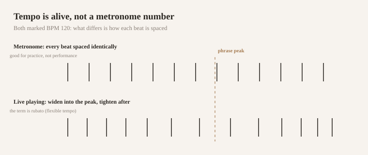
