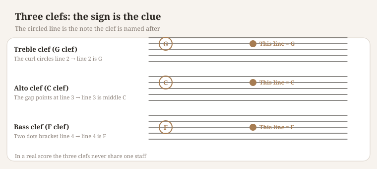
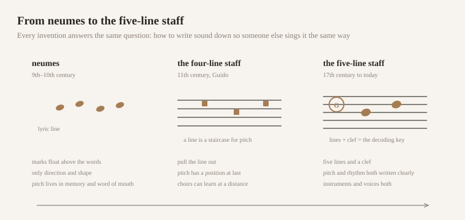
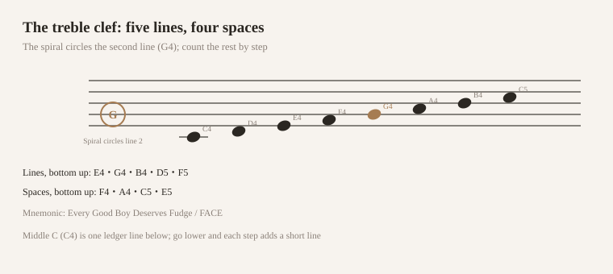
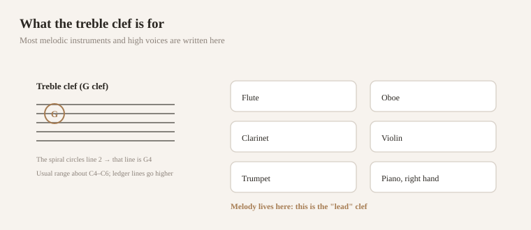
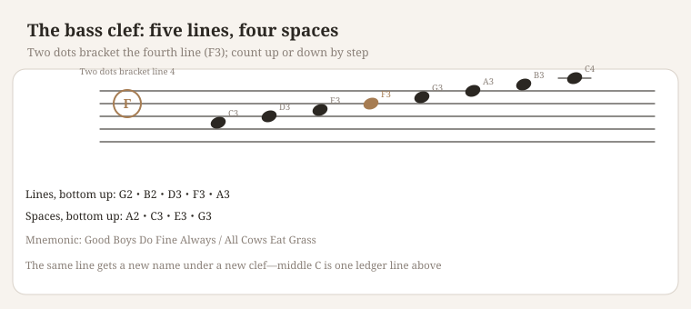
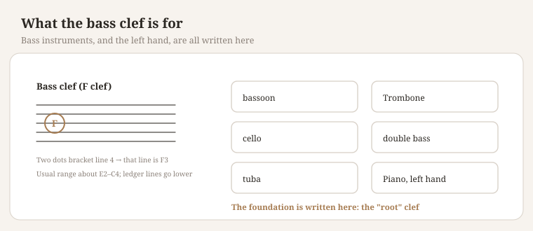
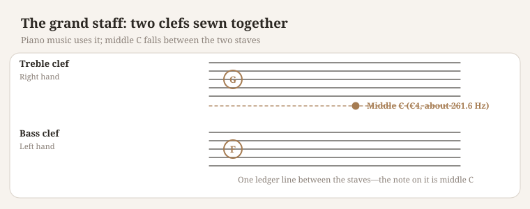
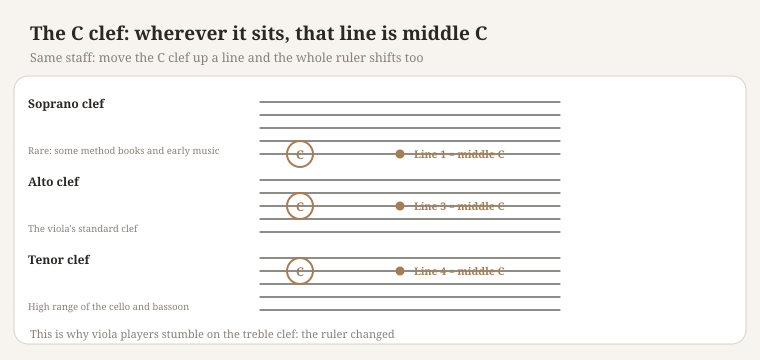
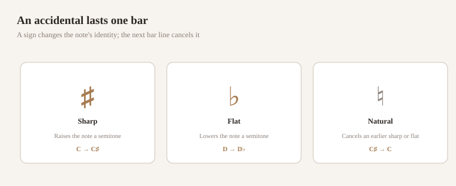
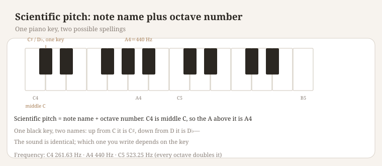

# Stage 2: Reading the Staff

Turning what your ears hear into those small black dots on five lines.

In Stage 1 we learned to feel pitch and pulse by ear. But the moment you want to keep a song, or hand it to someone else to play, you need a visual system everyone can read. Europe took about a thousand years to grow the one we use.

These five chapters unlock the staff's three keys one by one: the clef tells you which note a line is, accidentals tell you a note has been adjusted, and scientific pitch plus the standard tuning note let instruments around the world speak on the same reference. After these chapters, the staff stops being a cipher and becomes a map with coordinates.

One reminder: notation is only ever an approximation of sound. It cannot capture breath, timbre or a slight slide — but learn to read it first, and you will be in a position to notice what it leaves out.

## Chapter 6: Music's Visual Code — the Origin and Evolution of the Clef

Open any modern score and the first thing you see is those five parallel lines, and the ornate symbol drawn at the far left: the clef. To many beginners the staff looks like some kind of alien code. But in fact this system is what humans arrived at after more than a thousand years and countless rounds of revision—the most perfect design, the one that best matches how human eyes actually see.

### 6.1 The age of singing from memory, and the birth of neumes

Let's turn the clock back more than a thousand years, to medieval Europe. In the churches of the time, monks had to sing chant—Gregorian chant—every day. Back then there were **no scores at all**. Every melody was passed on by ear: an older monk sang a phrase, a younger monk sang it back, and then fixed it in his memory for good. Imagine memorising the melodies of several hundred chants. What an enormous job—and how easy to get one wrong.

Around the 9th century, someone finally had had enough. Monks began drawing simple dots, strokes and wavy lines above the words of the text. This was the earliest notation in Western music: **neumes**.

Neume symbols are very simple. They can only tell you the *direction* of a melody. A stroke going up means sing higher here; a wave going down means the note falls. **The fatal weakness of neumes**: they cannot show an exact pitch. They tell you the melody goes up or down, but up by one whole tone? Or up by a leap of five notes? Neumes cannot show that at all. So if you had never heard the song, you could not possibly sing it from neumes alone. They were at best a prompt card for waking up a memory.

### 6.2 A revolution: Guido d'Arezzo and the four-line staff

Then came the 11th century, and a genuine prodigy in music history: the Italian music theorist **Guido d'Arezzo**. To solve the problem of monks learning to sing too slowly, he invented something that changed the world: **drawing lines**.

Guido drew four parallel horizontal lines on parchment and set a rule: **a position on a line, and a "space" between two lines, each stand for one particular pitch.** The higher a note is drawn, the higher it sounds; the lower it is drawn, the lower it sounds.

What a piece of visual translation this was. Time runs left to right; pitch runs bottom to top. It is nothing less than the x-y graph of modern mathematics. Because of Guido's invention, the time it took monks to learn a new song fell from months to days. This was the prototype of the modern staff.

**💡 Why did it end up with five lines?** From Guido's four lines came six-line staves and even eight-line staves. But after several hundred years in which most of these were weeded out, why did modern music settle on five? Five lines give nine positions (five lines, four spaces), and with ledger lines above and below you can keep extending, enough to cover the working range of most instruments. Add more lines and the visual separation between positions starts to drop—reading takes more attention just to locate a note. Six-line staves still survive widely on instruments such as the guitar (though guitar TAB records which string and which fret, not pitch position; it is a different system). But the general-purpose staff stopped at five lines. That is the result of centuries of practical experience, not the answer from some psychology experiment.

### 6.3 Why do we need a clef? It is a decoding key

Good—we have five lines, and notes drawn high and low on them. But is that enough? Imagine a staff with a note drawn on the bottom line. Is that note do, or re, or sol?

The answer is: **you don't know.**

Unless someone first defines what pitch each of the five lines stands for, those lines are just ordinary horizontal lines, and the notes on them are a pile of meaningless black dots. The five lines are a locked box.

**The clef** is the key that opens it. The English word "clef" comes from the Latin "clavis", which means key. A clef is always drawn at the far left of the staff, at the start of every line of music. It has exactly one job: **to declare, with total authority, that one particular line of the staff is one particular note.**

Once the clef pins down what one line is, every other line and space can be worked out in C-D-E-F-G-A-B order, like climbing stairs, one step at a time. Without a clef, the staff means nothing.

Next we meet the three keys modern music uses most: the treble clef, the bass clef and the alto clef.

## Chapter 7: The Most Familiar View in Modern Music — the Treble Clef (G Clef)

Stop a person in the street at random and ask them to draw a symbol for "music". Nine out of ten will draw a curling, elegant spiral. That symbol is the one we all know: the **treble clef**.

### 7.1 The secret life of the G clef: it is really a letter

The treble clef looks like a piece of fine art. But did you know it is really a letter of the alphabet, stretched out of shape?

In early music, people simply wrote a letter on one line of the staff to tell the player what note that line was. The treble clef actually evolved from the letter G. That is why its formal name in music theory is the **G clef**.

From the Middle Ages into the Renaissance, monks copying scores made the letter G fancier and fancier for beauty's sake: first a flourish, then a lengthened tail, and finally a big loop in the middle. Several hundred years later, that G has become the ornate shape we see now.

### 7.2 The secret job of the spiral: locating G4

Since the treble clef comes from the letter G, its job naturally has to do with the note G.

Look closely at how the treble clef is drawn. Its core, the part your eye goes to, is **the spiral in the middle that looks like a snail shell**. That spiral wraps precisely around the second line up from the bottom of the staff.

That is this key's code: **it declares that the second line, the one inside my spiral, is named G.** (Specifically, the G above middle C, which we call G4.)

Once the second line is locked as G, the whole universe of the staff falls into place:

* If the second line is G, then one step up (the second space) is A.
* One more step up (the third line) is B.
* Going down one step from the second line (G) gives F, in the first space.
* One more step down (the first line) is E.

**👀 A beginner's trick: the lines and spaces of the treble clef** To read a score and understand it at a glance, English-speaking beginners use two classic mnemonics:

* **The notes on the lines (bottom to top, lines 1 to 5)**: E-G-B-D-F. Mnemonic: **E**very **G**ood **B**oy **D**eserves **F**udge.
* **The notes in the spaces (bottom to top, spaces 1 to 4)**: F-A-C-E. They happen to spell the English word **FACE**.

### 7.3 The territory of the treble clef: range and the instruments that use it

The treble clef covers roughly from middle C (C4) upward. When needed, ledger lines below the staff record lower notes, and above the staff it runs all the way into very high ranges. This matches the upper-middle frequencies the human ear identifies most easily.

Which instruments and voices use the treble clef? Almost anything with a bright, clear, sharper sound and a higher range is a treble-clef regular:

* **The string family**: the violin (the highest instrument in the string section).
* **The woodwind family**: flute, clarinet, oboe.
* **The brass family**: trumpet (a brass instrument with valves).
* **Voice**: soprano and mezzo-soprano.
* **Keyboard**: the **right hand** part of the piano.

**🎸 A special exception: the guitar (transposed notation)** Guitarists read from the treble clef too. But there is a small theoretical secret here: the guitar actually sounds much lower than a soprano or a violin. If guitar music were notated at its real pitch, the page would be full of ledger lines below the staff and very hard to read. To keep guitarists comfortable, the guitar's treble staff is a form of transposed notation: **what comes out of the instrument is a full octave lower than what the page says.** It shows how flexibly the notation system compromises in the name of human readability.

## Chapter 8: The Foundation of the Low Register — the Bass Clef (F Clef)

Now that you know the treble clef, you might ask: if it works so well, why not use the treble clef everywhere? Why invent other clefs just to torment students?

It comes down to a physical limit of the staff: the nightmare of ledger lines.

### 8.1 Why do we need another key?

A staff has only five lines. It holds about an octave and a little more comfortably. What happens if an instrument sounds low (a cello, say) and we insist on notating it in the treble clef?

The bottom line of the treble clef is E. To draw a really low note we would have to keep drawing short horizontal lines below the staff (these are ledger lines), five or six of them in a row. For a cellist, looking at that ladder of ledger lines, there is no way to tell in an instant which note it is. Your eyes would give out immediately.

To rescue players of low instruments, musicians brought out a second key, one made to unlock the low register. It is the **bass clef**.

### 8.2 Decoding the F clef: the bullseye between two dots

Like the treble clef, the bass clef evolved from a letter. Its ancestor is the **letter F**, which is why its formal name in music theory is the **F clef**.

Look carefully at what the bass clef looks like. It has a big curve (like an ear, or half a heart), and, most importantly, **two small dots** on its right.

Those two dots are the key to the code. One above the other, like a sandwich, **they pin the fourth line up from the bottom of the staff.**

The rule this key declares is: **the fourth line, the one held between my two dots, is named F.** (Specifically the lower F below middle C, F3.)

Now that we know the fourth line is the low F, we can start working it out again, like climbing stairs:

* The fourth line is F, so one step up (the fourth space) is G.
* One more step up (the fifth line) is A.
* Going down one step from the fourth line F (the third space) gives E.

**👀 A beginner's trick: the lines and spaces of the bass clef** Having just learned the treble clef, you look at the bass clef and your brain knots up easily, because the same positions now carry completely different note names. Here too there are classic mnemonics:

* **The notes on the lines (bottom to top, lines 1 to 5)**: G-B-D-F-A. Mnemonic: **G**ood **B**oys **D**o **F**ine **A**lways.
* **The notes in the spaces (bottom to top, spaces 1 to 4)**: A-C-E-G. Mnemonic: **A**ll **C**ows **E**at **G**rass.

### 8.3 The territory of the bass clef: the orchestra's firm foundation

The bass clef mostly covers middle C and everything below it, diving deep into the thick, low end of the sound world. In a symphony orchestra or a pop band, bass-clef instruments usually carry the foundation of the harmony, or provide a steady root for the rhythm.

Common instruments that use the bass clef include:

* **The string family**: cello, double bass (the lowest string instrument in the orchestra).
* **The woodwind family**: bassoon.
* **The brass family**: trombone, tuba.
* **Voice**: baritone and bass.
* **Modern popular instruments**: bass guitar.
* **Keyboard**: the **left hand** part of the piano.

## Chapter 9: The Flexible Midpoint — the Alto Clef (C Clef) and the Grand Staff

With the treble clef (G) holding the sky and the bass clef (F) holding the ground, the world of the staff looks complete. But there is a group of instruments stuck in the middle, neither high nor low, and they are in trouble.

### 9.1 Stuck in the middle: the viola's problem

In a symphony orchestra there is an instrument called the **viola**. Its timbre is warm and full, and its range sits right between the treble and the bass (roughly straddling middle C).

Which is awkward. If violists use the treble clef, then when they play low notes the space below the staff hangs full of ledger lines; if they switch to the bass clef, then when they play high notes the space above grows a full set of ledger lines. Whichever key they use, reading the score is painful.

For these mid-range instruments, musicians kept a third key with a long history: the **alto clef**.

### 9.2 The C clef that moves

The **C clef** evolved from the letter C, and it is a clef that can move: whichever line its point sits on, that line is middle C. The version that puts the point on the third line is the subject of this chapter, the **alto clef**.

Its shape is very particular; it looks like two mirrored Cs joined together. The part that matters most is **the pointed notch in the middle**.

The C clef's rule is: **the line my middle point sits on is middle C (C4).**

Most remarkable of all, **the C clef is a key that travels**. It slides up and down to point at a different line, depending on what the instrument needs:

1. **The alto clef**: when the centre of the C clef points at the third line of the staff (the middle one), it is called the alto clef. This is the viola's own reading tool. Put middle C in the centre and the viola's high and low notes spread evenly across the five lines; most of its working range lands inside the staff, and only the very top and the very bottom need a few ledger lines.
2. **The tenor clef**: when the C clef moves up so its centre points at the fourth line, it is called the tenor clef. Cellos, bassoons and trombones use it in place of the bass clef when they play their instrument's very highest passages—again, to avoid drawing too many ledger lines above the staff.

The beauty of the C clef is its flexibility. It is the clearest statement of the notation system's core principle: everything is done to make things easier on human eyes.

### 9.3 The pianist's view of the universe: the grand staff

Now we have the G clef and the F clef. What happens if we combine them? The result is the ultimate tool, built for keyboards and any instrument with a huge range: the **grand staff**.

A piano has 88 keys and spans more than seven octaves. No single staff could hold that. So composers put the treble clef (for the right hand) on top and the bass clef (for the left hand) below, then draw a big **brace** at the far left to tie the two staves together. That is the grand staff.

**👑 The invisible bridge: the secret of middle C** Look carefully at a grand staff and you will find a design as neat as arithmetic:

Below the treble staff and above the bass staff there seems to be a gap. But draw an invisible line right between them (the first ledger line below the treble staff, and at the same time the first ledger line above the bass staff), and **that line is exactly middle C.**

* The treble clef's E (first line), one step down is D (the space below the staff), one ledger line further down is middle C.
* The bass clef's A (fifth line), one step up is B (the space above the staff), one ledger line further up is also middle C.

So the treble staff and the bass staff are not two parallel universes. They are one continuous whole. Middle C is like an invisible bridge, stitching high and low perfectly together. When a pianist reads a grand staff, they are not reading two separate lines of music. They are reading one vast universe that pivots on middle C and extends without limit up and down.

## Chapter 10: Pinning Down Every Note — Accidentals, Scientific Pitch and the Standard Pitch

By now you can read every line and space on the staff, and you know where C-D-E-F-G-A-B live. But walk up to a piano and you run into a huge blind spot.

Every line and space on the staff corresponds to a **white key** on the piano. So how do we write those **black keys** that sit between the white ones? For that we have to bring in symbols that modify pitch: accidentals.

### 10.1 The magic that changes pitch: accidentals

To write on the staff those semitones that sit between the white keys (usually the black keys on a piano), musicians invented three very important symbols:

1. **Sharp (♯)**: it looks a lot like the hashtag from social media, except that its horizontal strokes tilt slightly upward. When this symbol appears to the left of a note, its job is to **raise that note by one semitone**. If a note was C (a white key), add ♯ on its left and it becomes C♯; on the piano you look to the right and press the black key nearest to C.
2. **Flat (♭)**: it looks like a lowercase English letter b with a round belly. When it appears to the left of a note, its job is to **lower that note by one semitone**. If a note was D (a white key), add ♭ on its left and it becomes D♭; on the piano you look to the left and press the black key nearest to D.
3. **Natural (♮)**: a little box with a short vertical stroke above and below. Its job is to **cancel the magic**. If a note has been sharped or flatted earlier, adding a natural immediately turns it back into a clean white key.

### 10.2 Why does one key need two names? (Enharmonic equivalence)

Here is a logic problem that regularly defeats beginners. Look at C and D on the piano. Between them sits one black key.

* If I start from C and go up a semitone, this black key is called **C♯**.
* If I start from D and go down a semitone, this black key is called **D♭**.

Hold on. C♯ and D♭ are **the same black key**, and they make **exactly the same sound**. Why give it two names? Isn't that just making trouble?

In music theory, this pattern—the same sound, but a different way of writing the name—is called **enharmonic equivalence**.

This is definitely not musicians making trouble. Think of it as grammar. In Chinese, 他 (he) and 她 (she) are pronounced identically; there is no difference to the ear. So why does written Chinese distinguish them? Because they stand for different gender identities, and they carry different meaning in the grammar of a sentence.

Music is a language too. In harmonic theory, a note plays a different role depending on which **key** it sits in. If a song belongs to the D♭ major family, then the note has to be written D♭ to belong to that family. Force it to be written C♯ instead, and although it sounds the same, to a musician who knows theory it looks like a spelling mistake: the grammar simply does not work.

So enharmonic equivalence exists to keep the harmony inside music logically rigorous. Bach's *The Well-Tempered Clavier* (1722) took this system to its peak. One thing needs to be said: what Bach used was well temperament, in which the twelve keys each had a slightly different colour, not the later equal temperament that divides the octave into twelve identical semitones. Either way, both let you move freely into any key at all, and enharmonic equivalence is the inevitable result of that system.

### 10.3 The modern scientific benchmark: scientific pitch notation and the international standard pitch

As music reached the modern era, synthesizers, recording engineering and acoustics software became common. Engineers and musicians found that saying "the A in the treble clef" was still too vague. We need a naming system as precise as coordinates, one that works across instruments.

That is where scientific pitch notation comes from. Its logic is blunt: **note name + octave number**.

* Take the C at the far left of the piano as the starting point: the lowest C is called C1 (below that there is even C0).
* Counting upward, the C at the very centre of the piano, the pivot of every staff, is the fourth one, so it is named **C4** (this is the middle C we keep talking about).
* The A above C4 is naturally called **A4**.

With this system, when a mixing engineer talks to a keyboard player, they only have to say "turn that C5 to G5 melody up a bit" and nobody gets the octave wrong.

**🌍 The world's shared frequency: A4 = 440 Hz**

In this precise coordinate system, one note is given a sacred status: **A4**.

In Stage 1 we learned that the essence of sound is frequency (Hz). For hundreds of years, musicians around the world had no agreement at all on how high "in tune" actually was. In France, A4 might be tuned to 435 Hz; in Germany, some regions and orchestras sat above 450 Hz. If a German oboist went to France to play with the local orchestra, they would find their instruments out of tune with each other—a disaster.

To end this international disaster, in 1939 the International Federation of the National Standardizing Associations (ISA, the forerunner of ISO) held a very important conference in London. Experts from many countries settled the matter and set modern music's ultimate standard: **the frequency of A4 was recommended as the standard for all, at 440 Hz.**

That is why, today, any tuner you buy shows "440" on its screen when you switch it on. It means that when you play A4, the string has to vibrate exactly 440 times a second. With this standard pitch, instrument makers, symphony orchestras and pop producers worldwide finally had a common reference to tune to. A piano built in New York and a violin built in Tokyo, both lined up at 440 Hz, can play together in perfect harmony.

**🔍 The mystery legend of 432 Hz** You may have read online that A4 = 432 Hz is the "universe's natural frequency", that listening to it heals body and mind, and that 440 Hz is some kind of conspiracy. In fact, from the standpoint of science and music history, this is just a modern urban legend. The number (440 or 432) is based on the second, and the second is a unit humans invented to measure time; the universe itself has no concept of one second. So 432 Hz is not more "natural" than 440 Hz. That said, because 432 Hz is lower, it does sound slightly warmer and softer than 440 Hz. If you like the calm 432 Hz gives you, by all means enjoy it when you listen on your own. But in professional orchestras and recording studios, we still follow that great and practical international standard: A4 = 440 Hz.
