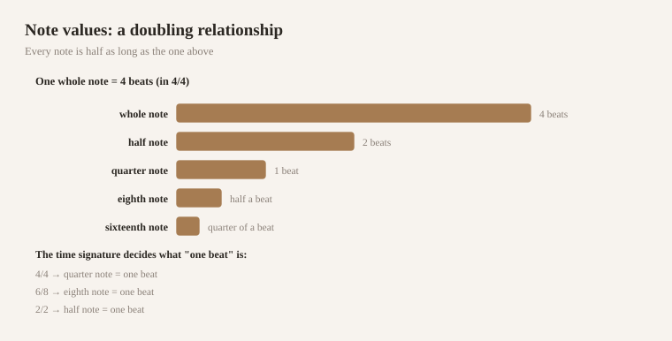
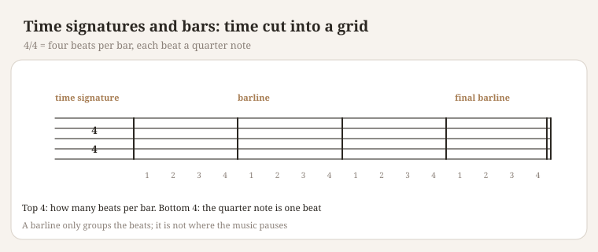
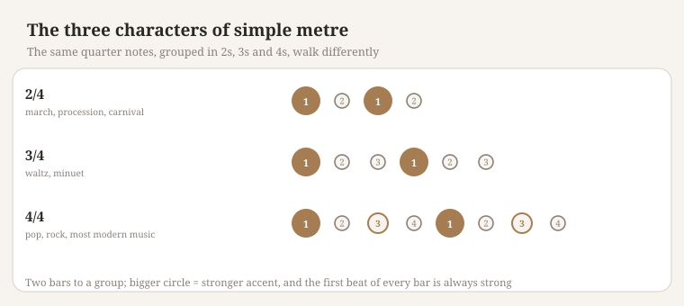
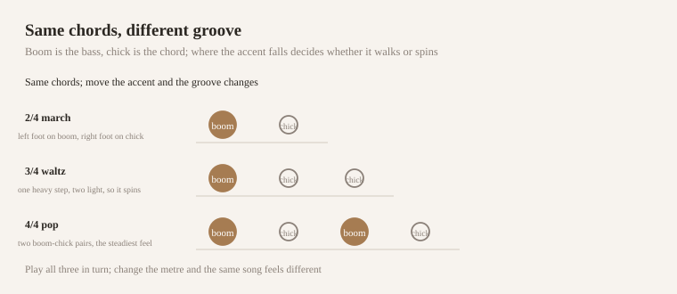
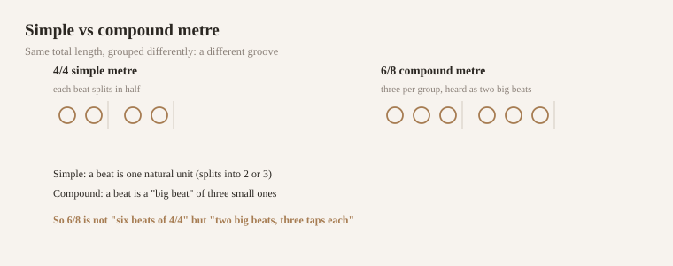
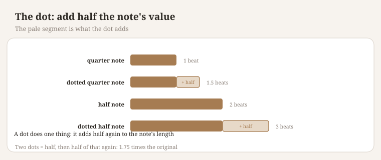
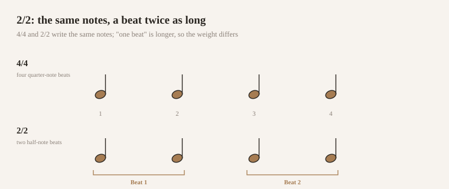
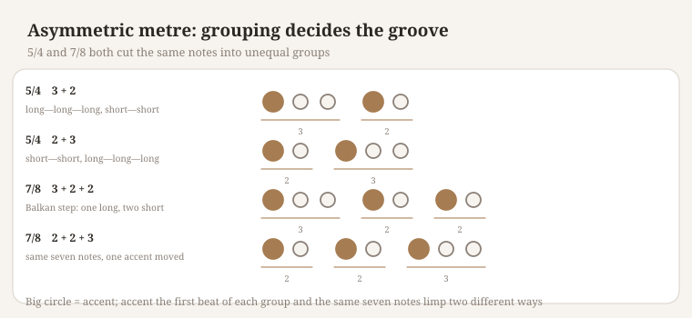

# Stage 3: How Long a Note Lasts

Learn to read time signatures, do the arithmetic, and know exactly how long each little black note has to be sung and how long it stays silent.

In the stages before this one, we learned to draw the high and low of sound onto the staff. But the reason music is called "the art of time" is that every sound has to move along the long river of time.

We need a perfect mathematical system to tell the performer: how long does this Do get held? How long does that Re rest? Where do you stamp your foot down hard? Where do you skip lightly past?

Over the next four chapters we crack the "time code" written on the staff. We start with the structure of the time signature, and travel all the way to the spin of a waltz, the groove of rock, and even the dangerous tension of asymmetric metre. Have your metronome ready — let's start cutting up time.

## Chapter 10: The Visual Skeleton of Rhythm — The Structure and Meaning of the Time Signature

When you are handed a brand-new score, your eyes work like a scanner, starting at the far left of the staff and sweeping right. You will see three very important symbols. They are the piece's "settings screen for the rules of the game", and the order they appear in is absolutely fixed in every score in the world. No compromise, ever.

### 10.1 The prime spot on the staff: where the time signature sits

The order of the three at the start of a score goes like this:

1. **Clef**: a treble clef or a bass clef, for example. It tells you "what these five lines stand for".
2. **Key signature**: that cluster of sharps (♯) or flats (♭). It tells you "what key this song is in, and which notes get raised or lowered by a semitone".
3. **Time signature**: the star that arrives last, looking like a fraction with the middle line missing (4/4 or 3/4, for example).

**The time signature always stands after the clef and the key signature.** Why that order? Picture it this way: the clef defines the "venue" (the absolute pitch of the staff); the key signature decides the "weather and surroundings" (the harmonic atmosphere of the song); and last, the time signature lays down the "pace and the rules for moving forward" inside that venue (how many beats each bar holds, which note counts as one beat). Once the venue and the conditions are set, time can officially start to flow.

### 10.2 The fence that cuts time up: what is a bar?

Before we unpack the time signature, we have to meet the tool the staff uses to cut up time: the **bar line**.

Look at a staff and you will find many vertical lines cutting a staff that could run on forever into one small block of equal length after another. Those vertical lines are bar lines, and the space fenced in between one line and the next is called a **bar**.

Why draw bar lines at all? Imagine reading a novel with no punctuation and no paragraph breaks: your eyes would be lost in a sea of words. Music is the same. If the staff were nothing but a dense crowd of notes, the performer would have no idea where they had got to, and an orchestra could not line its beats up. A bar line is like the milestone on a highway. It cuts the music into regular, digestible "parcels of time". Every bar holds a fixed amount of time.

### 10.3 Breaking the code: what the top and bottom numbers really mean

A time signature looks a lot like a fraction from maths, but forget the idea of a fraction at once. In a time signature the two numbers mean completely different things, and they are not there to be divided.

The formula of a time signature goes like this:

* **The top number** (where the numerator sits): how many beats there are inside each bar, in total.
* **The bottom number** (where the denominator sits): which note value we use as the basic unit of one beat.

This works a lot like counting money. Say your budget is "four ten-dollar coins a day".

* The "4" is the top number (quantity: four coins).
* The "ten-dollar coin" is the bottom number (unit: ten dollars).

In music, the "currency units" of time are notes of different lengths. The most common note units are:

* **1**: the whole note, a hollow oval.
* **2**: the half note, a hollow oval with a stem.
* **4**: the quarter note, a filled black notehead with a stem.
* **8**: the eighth note, a filled notehead with a stem and one little flag.
* **16**: the sixteenth note, a filled notehead with a stem and two little flags.

**🔍 The historical link between the numbers and the notes.** Why does a bottom number of 4 mean a quarter note? It comes from cutting up the biggest note of all, the whole note. The whole note is the watermelon of music. Cut the watermelon in half (1/2) and you get a half note. Cut it into four equal pieces (1/4) and you get a quarter note. Cut it into eight (1/8) and you get an eighth note. So the 2, 4, 8 and 16 at the bottom of a time signature really are the fraction of a whole note that this note occupies.

Let's use that logic to read a few of the most common time signatures:

* **4/4**: the bottom is 4 (a quarter note per beat), the top is 4 (four beats per bar). That means every bar of the song holds the length of four quarter notes.
* **3/4**: the bottom is 4 (a quarter note per beat), the top is 3 (three beats per bar). Every bar holds the length of three quarter notes.
* **6/8**: the bottom is 8 (the eighth note as the basic unit), the top is 6 (six eighth notes per bar). This one is compound time: in actual playing you bundle every three eighth notes into one big beat, so you count two big beats, not six beats. Every bar holds the length of six eighth notes.

That is the iron law of how time signatures work. With these rules in place, no matter how complex the melody or how fancy the syncopation, if you add up the length of every note in a bar, the total will come out exactly equal to the length the time signature lays down. That is the most rigorous mathematical beauty in the world of music.

## Chapter 11: A Regular, Even Stride — Simple Time and Its Common Uses

Now that we can read a time signature, we enter the first great family of metre: **simple time**.

In the history of human music, simple time is the most intuitive kind, the kind the brain absorbs most easily, and the kind used most often. From the nursery rhymes you sang as a child to the pop hits on the charts right now, more than 90% are built on the frame of simple time.

### 11.1 What is simple time? The absolute rule of dividing in two

The core test for whether a time signature is simple time is this: **can its one beat be cut naturally and evenly into two halves?**

In simple time, the beat we use as our unit is always an ordinary note with no dot (a quarter note, for example). And by the physical nature of music, a quarter note splits perfectly into two eighth notes; a half note splits perfectly into two quarter notes.

This property of one dividing into two, and two into four, is called **binary division**. It fits human physiology very neatly, because we have two legs and two hands, and when we walk the left and the right alternate. That is the most natural division in two there is. So music in simple time always sounds square and upright, with a clear stride and a steady sense of moving forward.

There are three common kinds of simple time: two-beat (2/4), three-beat (3/4) and four-beat (4/4). Let's take them one at a time and see what makes each of them tick.

### 11.2 2/4: the army march and the village revelry

**Structure decoded:** a quarter note per beat, two beats per bar. **Stress pattern:** **strong — weak** | **strong — weak**

2/4 is the most basic, least wordy metre in human music. Every two beats it starts a new cycle, and the accents are very dense (the first beat of every bar is the strong beat, so the strong beat comes round very fast).

**Musical situations and uses:** Because of its perfect left-right symmetry, 2/4 was born for walking. **2/4 is one of the most classic march time signatures**, and many army marching tunes use it. Picture a column on the march: "left foot (strong) — right foot (weak), left foot (strong) — right foot (weak)". The powerful first beat tells the soldiers when to plant the left foot hard on the ground, and that is what keeps the whole column marching as one. Beyond the army, plenty of cheerful, lively European folk dances — the polka, for instance — and energetic country music are very fond of 2/4 too. Its rhythm is tight, and it gives you a warm, uninhibited feeling, as if you wanted to jump up and spin on the spot.

### 11.3 3/4: the spinning skirt and the elegant loss of balance

3/4 is the only member of the common simple-time family whose cycle runs on an odd number of beats. That means if you try to stamp 3/4 with your feet, you will find that the accented foot is different each time (left-right-left, right-left-right). That break with left-right symmetry — that "loss of balance" — is exactly what makes 3/4 so attractive.

**Musical situations and uses:** Say 3/4 and the first word in everyone's head is certain to be **waltz**. In the European courts of the 19th century, the waltzes of Johann Strauss II swept through high society. The accent of 3/4 falls on the first beat, like a dancer pushing hard off the floor (strong), and the second and third beats after it (weak, weak) are the weightless state of a body gliding and turning in the air. That "boom — cha — cha" groove feels extremely elegant and romantic, like an endless spin. Outside classical music, a songwriter who wants a retro, romantic or fairy-tale atmosphere will deliberately choose 3/4 as well (some Disney princess themes, for instance).

### 11.4 4/4: the undisputed ruler of modern music

**Structure decoded:** a quarter note per beat, four beats per bar. **Stress pattern:** **strong — weak — secondary strong — weak** | **strong — weak — secondary strong — weak**

If you switch on a radio or open Spotify at random, nine and a half of the first ten songs you hear will be in 4/4. It is the undisputed king of modern music.

Why is 4/4 so popular? Because it is a perfect compromise. It has the steadiness of two-beat time (2/4), but because it stretches the cycle out to four beats it does not bombard you with strong beats the way a march does, and that gives the melody more room to breathe and develop. At the same time it places a "secondary strong beat" on beat three, so the music gets a small push in the middle of the bar and never feels boring.

**The hidden magic in pop music: the backbeat.** In classical music the accents of 4/4 are 1 and 3. But in modern pop, rock and R&B the most prominent accents have moved: from beats 1 and 3 to beats 2 and 4. Listen carefully to the drum kit in a pop song and you will hear the kick drum (the low "boom") usually on beats 1 and 3, while the snare (the crisp "crack") lands heavily on beats 2 and 4. This trick of moving the accent onto the weak beats (2 and 4) is called the **backbeat**. It changed the history of 4/4 completely. That backbeat groove is the soul of rock, the thing that makes you nod your head and clap along without meaning to.

**📜 Historical footnote: why is the 4/4 symbol sometimes written as a "C"?** Looking at scores you may find places where the time signature is not written as numbers but drawn as a capital letter "C". The shape of that C comes from the Middle Ages, but it is also genuinely called Common Time — the shape is history, the name came later out of habit, and the two do not contradict each other.

Go back to the Middle Ages. The church at the time held that the number 3 stood for the Christian Trinity (Father, Son and Holy Spirit), the holiest and most perfect number in the world. So triple time was called "Tempus perfectum", perfect time, and was notated with a **perfect circle (O)**. By contrast, duple or quadruple time, which was not triple, was considered "imperfect". Since it was imperfect, the circle lost a piece and became a **broken semicircle (C)**. As history went on, that broken semicircle stayed in use and became the symbol for modern 4/4. Musicians in the English-speaking world, wanting an easy explanation, then read it as Common Time.

## Chapter 12: Swaying, Flowing Groove — Compound Time Explained

Once we were used to the square, "one splits into two" feel of simple time, musicians began to feel it was too rigid. Could we stuff three little steps into one big beat? Make the music sound less like a robot walking and more like a boat gliding smoothly across water?

And so compound time was born. This is the place where a lot of people studying theory for the first time get stuck, but once you grasp the logic underneath, you will find that compound time is the most attractive, most flowing invention in all of music.

### 12.1 The soul of compound time: what is a dotted note?

Before we go into compound time, we have to meet a small symbol that can work magic on time: the **dot**.

On the staff you will sometimes see a small black dot following a note on its right. That dot's job is to **add half (50%) to the note's original length**.

It is a simple piece of arithmetic:

* An ordinary quarter note = the length of two eighth notes.
* Add a dot to it and it becomes a "dotted quarter note".
* Its length becomes: the original 2 plus the extra half (1) = **the length of three eighth notes**.

That is the core secret of compound time. In simple time, our one beat is an "ordinary note", cut into 2 equal parts. In compound time, our one beat is a "dotted note", cut into **3 equal parts**.

### 12.2 Taking apart the great 6/8 myth

Speaking of compound time, the most representative and the most easily misunderstood example is **6/8**.

By the formula we learned in Chapter 10, 6/8 literally means:

* The bottom is 8: an eighth note counts as one beat.
* The top is 6: six beats per bar.

So it sounds as if we should tap six even beats inside one bar (1, 2, 3, 4, 5, 6).

**Wrong! That is a huge trap.**

If you really count six even beats in your head while playing 6/8, the music will sound extremely heavy and clumsy. In fact, in the actual hearing and the actual body movement of 6/8, **it is two beats**.

How does that work? In 6/8 we bundle those six eighth notes into groups of three.

* The first three eighth notes fuse into one "dotted quarter note". That is one big beat.
* The last three eighth notes fuse into another "dotted quarter note". That is another big beat.

So the actual feel of 6/8 is this: **every bar has two big beats, and every big beat contains three little steps.**

**👂 A body-rhythm experiment: feel the flow of 6/8.** First plant two slow beats on the floor with your foot: "stamp — stamp". Then, as your foot goes down, say a triplet rhythm out loud: **foot down (strong)**, say "one"; **foot up (light)**, say "two, three".

Put together, it comes out like this: **"one**-two-three, **two**-two-three | **one**-two-three, **two**-two-three".

Do you feel something rising and falling like an ocean swell, or like someone swaying unsteadily after a couple of drinks? That is the magic of 6/8.

### 12.3 The final showdown: 3/4 vs. 6/8, what is the difference really?

This is bound to be on any music exam. Mathematically, 3/4 holds six eighth notes, and 6/8 holds six eighth notes too. Their bars are exactly the same total length, so what on earth is different?

The answer lies in how the accents are distributed and how the body moves:

1. **3/4 (simple time):**
   * Grouping: 2 + 2 + 2 (three quarter notes).
   * Accent placement: **strong** - weak - weak.
   * Feel: a three-step cycle, like a waltz, full of elegant spinning.
2. **6/8 (compound time):**
   * Grouping: 3 + 3 (two dotted quarter notes).
   * Accent placement: **strong** - weak - weak - **secondary strong** - weak - weak.
   * Feel: a two-step cycle, each step carrying a triplet sway. This suits the barcarolle, the Irish jig, or the big, swaying soft rock of modern pop (The Animals' "House of the Rising Sun" is standard 6/8).

Apart from 6/8, other compound time signatures are common too:

* **9/8**: three big beats per bar (3+3+3).
* **12/8**: four big beats per bar (3+3+3+3). This is extremely common in the blues, in early R&B and in gospel, and it gives a four-beat frame a thick, lazy swing.

## Chapter 13: Special Time Magic — Cut Time and Asymmetric Time Signatures

We have already studied the square simple time signatures (4/4, 2/4, 3/4), and the swaying compound ones (6/8, 12/8). Those two families cover the great majority of the world's music.

But the magic book of music still holds a few very special, even rather dangerous time signatures. When composers need an extremely tight tempo, or want to create a tension that makes you hold your breath, they bring these special weapons out. In this chapter we open up the secrets of cut time and of asymmetric time signatures.

### 13.1 Visual relief and a tight stride: cut time (2/2)

In classical music (especially fast orchestral movements) and in Broadway musicals you will often meet a time signature like this: **2/2**. Sometimes it is not written as numbers but drawn as a **"C" cut down the middle by a vertical line** (like a pill sliced in half). This symbol is called **alla breve**, or, in common speech, **cut time**.

**Structure decoded:** a half note per beat, two beats per bar. Mathematically, a bar holds two half notes, which add up to four quarter notes. Isn't that the same as 4/4? Then why invent 2/2 at all?

It is entirely a way of solving the crisis of reading and playing when the tempo gets too fast.

Imagine a piece in 4/4 that asks you to play like mad at BPM = 240. If the conductor really beat four beats on stage (1, 2, 3, 4), their hand would swing like a helicopter rotor and the players' eyes would go blurry. At the same time, if you have to count four beats a bar and deal with four sets of strong and weak, the music will sound too heavy and dragged out.

To make the music fly, the composer uses 2/2 (cut time). When a score is marked cut time, it is telling everyone: **"Take this 4/4 bar and treat it as sliced in half!"** We no longer treat the quarter note as one beat; we treat the longer **half note as one beat**.

That way, instead of counting "1-2-3-4" in your head every bar, you only count two big beats, "1 --- 2 ---". The conductor only has to swing the hand up and down twice, and the player's inner sense of rhythm becomes broader and smoother. 2/2 is common in fast marches and in rousing endings. It lets the music keep a tight, uncluttered drive even at very high speed.

### 13.2 Breaking symmetry, the dangerous tension: irregular time signatures

Up to now the top numbers we have met have been 2, 3, 4, 6, 9 and 12, and all of them group evenly. But what if we set the number of beats in a bar to a number that cannot be split into groups of equal length?

That is the territory of irregular time signatures (also called odd metres or mixed metres). The most famous representatives are **5/4** and **7/8**.

These are relatively rare in Western classical and pop music, but they have a fatal attraction. The human brain naturally likes symmetry and prediction: when we hear 4/4 we know that after "1, 2, 3, 4" the next "1" will arrive on time. An irregular time signature, though, is like a person who never quite walks steadily, always limping. It takes away the brain's ability to predict, and creates **a tension, a suspense and a drive that can never settle down**.

#### 🎸 5/4: the beauty of one missing beat

5/4 means five quarter notes per bar. Because 5 cannot be split evenly into two groups or three groups of equal length, we have to break it into unequal combinations: usually **3 + 2** or **2 + 3**.

**Classic case 1: the theme from "Mission: Impossible".** This is the most famous 5/4 melody in the world. To capture the nerve-jangling, step-by-step dread of a spy slipping into the enemy base, the Argentine composer Lalo Schifrin deliberately used 5/4. He splits the five beats into "3 beats + 2 beats" (some people hear 2 + 3; both groupings are common inside five). Try saying the rhythm yourself: "daa — daa — (these two notes are long, taking up the space of three beats)", "deng, deng (these two notes are short, taking up the space of two beats)". Together they make exactly five beats. That "long, long, short, short" cycle builds the suspense of a spy's heart skipping a beat, perfectly.

**Classic case 2: "Take Five", composed by Paul Desmond and performed by the Dave Brubeck Quartet.** This landmark of jazz history takes its name as a tribute to that 5/4 structure. Its piano accompaniment keeps up an extremely catchy groove that sounds like a steady stride that suddenly trips, lightly, once — full of the laziness and the experimentation that only jazz has.

#### 💃 7/8: the wild dance of the Balkans

7/8 means seven eighth notes per bar. Its groupings are more complicated: the common ones are **3 + 2 + 2**, **2 + 2 + 3** and **2 + 3 + 2**.

If 7/8 sounds strange to you, it is because we are used to Western symmetrical music. In the folk music of Eastern Europe, Greece, Turkey and the Balkans, 7/8 — and even 9/8 or 11/8 — is as natural as drinking water.

In those cultures, when people dance to 7/8 the steps run three, two, two (for example 3+2+2: the first step is held much longer, the next two come fast). That irregular groove carries a strong feeling of the earth and a wild vitality. In progressive rock, many bands (Tool, King Crimson) are very fond of 7/8 as well, using it to show off their playing and to give the listener an experience that keeps rolling forward and can never stop.

**Stage 3 recap: cutting up time**

Excellent. You have successfully crossed the "time dimension" of music theory — the one that tests mathematical logic and bodily coordination the most.

Let's quickly review the rhythm codes you cracked in this stage:

1. You learned the golden law at the start of a score, and you know that the time signature works like a currency budget: the top number sets the quantity, the bottom number sets the note unit.
2. You felt the square, "divide in two" character of **simple time**. You know the marching force of 2/4, the spinning elegance of the 3/4 waltz, and the steadiness and backbeat magic of 4/4, king of pop.
3. You cracked the dotted-note myth of **compound time**. You know that 6/8 is not six scattered beats but two big beats, each wrapped around a triplet groove, bringing a sway like an ocean swell.
4. Finally you explored the special magic of time: **cut time (2/2)**, which solves the ultra-fast problem, and mixed metres such as **5/4 and 7/8**, which use asymmetry to create the suspense and dangerous tension of a film score.

By now, when you look at a score you no longer see only still pitches. You can already hear, in your head, those notes dancing along the timeline in postures of different lengths, strong and weak woven together.

Ready for the next stage? With a complete map of "space (pitch)" and "time (beat)" in hand, we can finally look at how the magic on the page is actually produced by real-world instruments. Let's keep going.

### Time Signature at a Glance

| Time signature | Per bar | What one beat is | Type | Common settings |
|---|---|---|---|---|
| 2/4 | 2 beats | quarter note | simple time | marches, polka |
| 3/4 | 3 beats | quarter note | simple time | waltz, minuet |
| 4/4 | 4 beats | quarter note | simple time | pop, rock, jazz |
| 6/8 | 6 eighth notes | dotted quarter note (2 big beats) | compound time | barcarolle, Irish dance |
| 9/8 | 9 eighth notes | dotted quarter note (3 big beats) | compound time | compound dance music |
| 12/8 | 12 eighth notes | dotted quarter note (4 big beats) | compound time | slow blues |
| 2/2 | 2 beats | half note | simple time (cut time) | fast marches |
| 5/4 | 5 beats | quarter note | irregular time signature | "Take Five", film scores |
| 7/8 | 7 eighth notes | eighth note | irregular time signature | Balkan music, progressive rock |
