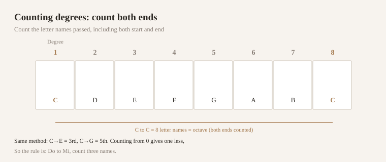
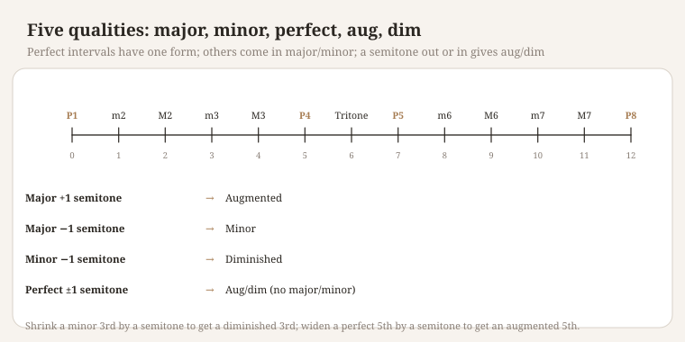
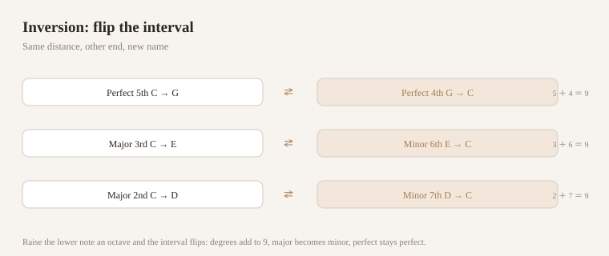
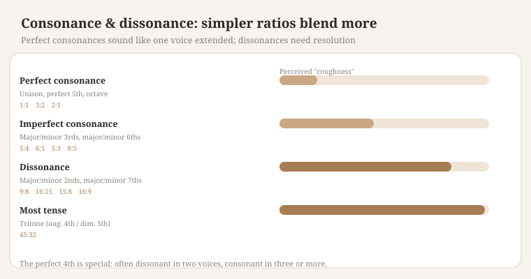

# Stage 4: The Distance Between Notes

We have pitch and we have time. Now a more basic question: how far apart are two notes?

"Distance" is the unit of all musical grammar. When you say a melody "leaps high" or a chord "sounds tight", you are talking about intervals. These three chapters ask three things: how the distance is measured (degrees), how its quality is described (major, minor, perfect, augmented, diminished), and why some distances sound comfortable while others grate.

Get these three chapters right and everything that follows — scales, chords, progressions — is just intervals stacked on intervals.

## Chapter 16: The Distance Between Notes — Degrees and Semitones

You can read pitch now, and you can count beats. The next question is: how far apart are C and G, really?

This question looks simple, but it has two answers — one is "count note names," the other is "count semitones." You need both, because they answer different questions.

### **16.1 Degrees: Count Both Ends**

The most intuitive way is to count "how many note names you pass through," and **you count both the starting point and the ending point**:

- C to C: only one note name → **unison (1st)**
- C to D: C, D, two → **2nd**
- C to E: C, D, E, three → **3rd**
- C to G: C, D, E, F, G, five → **5th**
- C to the next C: C, D, E, F, G, A, B, C, eight → **octave (8th)**

"Count both ends" is the step beginners most often skip. If you count "starting from 0" the way you measure length, C to E comes out as 2, but the correct answer is 3. Remember the rule: **Do to Mi, count three names**.

Degrees look only at **note names (letters)**, not at sharps and flats. C to E is a 3rd, C to E♭ is still a 3rd, and C to E♯ is still a 3rd. Accidentals change "how far apart" the notes are, but they do not change "what degree this is" — this rule will matter a lot in a moment.

### **16.2 Counting Semitones: The Distance You Actually Hear**

Degrees only tell you "how many note names you cross." They do not tell you the actual distance. That is because the gaps between white keys and black keys are not even: there is no black key between E and F, so they are only a semitone apart; between C and D sits C♯, so they are two semitones apart.

So we need a second way to count: **the number of semitones**. On a piano, every step to the right (black keys included) is one semitone.

| Interval | Semitones | Example |
|---|---|---|
| Unison (1st) | 0 | C → C |
| 2nd | 1 or 2 | C → D♭ (1), C → D (2) |
| 3rd | 3 or 4 | C → E♭ (3), C → E (4) |
| 4th | 5 or 6 | C → F (5), C → F♯ (6) |
| 5th | 6 or 7 | C → G♭ (6), C → G (7) |
| 6th | 8 or 9 | C → A♭ (8), C → A (9) |
| 7th | 10 or 11 | C → B♭ (10), C → B (11) |
| Octave (8th) | 12 | C → the next C |

You will notice that almost every degree has "two possible distances." This is not an exception; it is the norm — the next chapter deals with exactly this.

### **16.3 Why Two Ways of Counting?**

Because each one does a different job.

**Degrees** are "how it is written on the staff": a degree decides which line or space the note sits on. When a composer writes harmony, they must follow the logic of degrees, or the score will end up with strange enharmonic spellings (for example, writing a note that should be E♭ as D♯ — it sounds the same, but in music theory it means something else).

**Semitones** are "the distance your ear hears": they decide whether the interval sounds consonant or sharp, and whether it can be used as a melodic leap.

A common trap: **the same distance to the ear may be a different degree.** C to F♯ is an augmented 4th (6 semitones), and C to G♭ is a diminished 5th (also 6 semitones) — you play the same sound, but the spelling differs: one is written as a 4th, the other as a 5th. This kind of enharmonic spelling will come up again and again in harmonic analysis later.

### **16.4 Do It Now**

Sit at a piano (or any keyboard app), start from middle C, and press each white key in turn while saying two things:

1. What degree is this? (Count note names, both ends included.)
2. How many semitones apart? (Count keys, black keys included.)

For example, when you reach G, you say "5th, seven semitones." When you reach B, you say "7th, eleven semitones." Do this exercise for ten minutes, and everything later about scales and chords will be much easier.

## Chapter 17: Interval Quality — Major, Minor, Perfect, Augmented, Diminished

In the last chapter we found that the same size can have two distances. This chapter makes those “two” clear, and also adds the other two rare but important versions.

### **17.1 Quality is a modifier, size is a noun**

Music theory describes an interval with an “adjective + noun” structure: “major third,” “perfect fifth,” “diminished seventh.” The noun is the size (what you calculated in the last chapter); the adjective is the quality, which tells you which distance within that size it is.

There are five qualities in total: major, minor, perfect, augmented, diminished. They are not assigned at random—there is a rule for which size gets which adjective.

### **17.2 Perfect intervals: 1st, 4th, 5th, 8th**

The 1st, 4th, 5th, and 8th use only “perfect”; they do not use major or minor. The reason is practical: these four intervals correspond to the simplest integer ratios in the harmonic series (1:1, 4:3, 3:2, 2:1), and to the ear they have only “one version,” not a “slightly larger” and “slightly smaller” version.

- Perfect unison = the same note (0 semitones)
- Perfect fourth = 5 semitones (C → F)
- Perfect fifth = 7 semitones (C → G)
- Perfect octave = 12 semitones (C → the C an octave above)

A perfect interval has only one version, and it sounds “clean, open, stable.” Push a perfect interval outward by a semitone and it becomes augmented; pull it inward by a semitone and it becomes diminished. For example, C → F♯ is an augmented fourth (6 semitones), and C → G♭ is a diminished fifth (also 6 semitones)—these two are exactly the same sound, commonly called the tritone (because it equals three whole tones).

### **17.3 Major and minor: 2nd, 3rd, 6th, 7th**

The 2nd, 3rd, 6th, and 7th have two versions, “major” and “minor”: major is wider, minor is narrower, and they differ by one semitone.

- Major second = 2 semitones (C → D) / minor second = 1 semitone (C → D♭)
- Major third = 4 semitones (C → E) / minor third = 3 semitones (C → E♭)
- Major sixth = 9 semitones (C → A) / minor sixth = 8 semitones (C → A♭)
- Major seventh = 11 semitones (C → B) / minor seventh = 10 semitones (C → B♭)

The Chinese translation causes trouble with the words “major” and “minor”: they have nothing to do with “good or bad,” and they are not “loud or soft.” English Major/Minor originally just mean “larger/smaller”—a major third is one semitone wider than a minor third, that’s all. The idea that a major key sounds bright and a minor key sounds gloomy is a later cultural association, not the character of the interval itself.

### **17.4 Augmented and diminished: one more step outward or inward**

Change any interval:

- Augmented interval = raise the upper note by another semitone (or lower the lower note by a semitone); the distance gets wider
- Diminished interval = lower the upper note by another semitone (or raise the lower note by a semitone); the distance gets narrower

Condense the rules into two lines:

- Major/minor intervals: minor + 1 semitone → major; major + 1 semitone → augmented; major − 1 semitone → minor; minor − 1 semitone → diminished.
- Perfect intervals: perfect + 1 semitone → augmented; perfect − 1 semitone → diminished.

Note that perfect intervals have no major/minor, so pushing them either way gives augmented/diminished. Take C to E: a major third; pull it inward by a semitone and it becomes a minor third (C → E♭); pull it inward by another semitone and it becomes a diminished third (C → E♭♭, read as “double-flat E”)—although on the instrument it sounds equal to D, in notation it is still a “third.” You have already seen this “same sound, different spelling” phenomenon once in the chapter on accidentals.

### **17.5 The whole thing in one table**

| Semitones | Interval | Semitones | Interval |
|---|---|---|---|
| 0 | Perfect unison | 7 | Perfect fifth |
| 1 | Minor second | 8 | Minor sixth (or augmented fifth) |
| 2 | Major second | 9 | Major sixth |
| 3 | Minor third | 10 | Minor seventh |
| 4 | Major third (or diminished fourth) | 11 | Major seventh |
| 5 | Perfect fourth | 12 | Perfect octave |
| 6 | Augmented fourth / diminished fifth | | |

Read the left side of the table by semitone count and the right side by interval name. The “or” in parentheses is an enharmonic spelling: the same sound, two ways of writing it; which one you choose depends on what key it is in and which direction it resolves.

### **17.6 Do it now**

Starting from C, add quality to the “size and semitones” table from the last chapter: C to D is a major second, C to E♭ is a minor third, C to F is a perfect fourth, C to G is a perfect fifth, C to A is a major sixth, and C to B is a major seventh.

Then change the starting point and do it again from D. You will find that intervals on the white keys are not symmetrical—D to F is a minor third, and D to F♯ is a major third. This asymmetry is exactly the starting point for the next stage: “why do we need key signatures?”

## Chapter 18: Interval Inversion, Consonance, and Aural Recognition

You can now calculate degrees and judge quality. This chapter turns intervals over, puts them in your ear, and explains a problem that troubles many people: why do some intervals sound comfortable, while others make you want to escape?

### **18.1 Inversion: Move the Bottom Note to the Top**

Take the same interval. If you raise the lower note by an octave (or lower the upper note by an octave), the two notes swap roles. This is called **inversion**.

- Perfect fifth C → G: raise C by an octave and it becomes G → C, a perfect fourth.
- Major third C → E: after inversion it becomes E → C, a minor sixth.
- Major second C → D: after inversion it becomes D → C, a minor seventh.

### **18.2 Three Rules of Inversion**

1. **The degrees add up to 9.** Second ↔ seventh, third ↔ sixth, fourth ↔ fifth, first ↔ octave. Each degree counts both ends of the octave, so the sum comes out 1 higher.
2. **Major becomes minor; minor becomes major.** A major third inverts to a minor sixth; a minor seventh inverts to a major second.
3. **Perfect stays perfect; augmented becomes diminished, diminished becomes augmented.** A perfect fifth inverts to a perfect fourth; an augmented fourth inverts to a diminished fifth.

These three rules look like a memory test, but they are useful. When you see an odd interval spelling (say, a diminished fifth), you can immediately work backward: its inversion is an augmented fourth. The augmented fourth and the diminished fifth are both 6 semitones—the so-called **tritone**. One sound, two spellings. **The same sound with different names often just depends on which end you look from.**

### **18.3 Consonance and Dissonance**

Music is often described as “mathematics you can hear.” That saying is especially accurate for intervals: the simpler the frequency ratio between two notes, the more blended they sound.

- **Perfect consonance**: perfect unison, perfect fifth, perfect octave. The frequency ratios are 1:1, 3:2, and 2:1. Their cycles realign after a very short period, so they sound like an extension of the same sound.
- **Imperfect consonance**: major third, minor third, major sixth, minor sixth. The ratios are a little more complex (5:4, 6:5…). They have color and emotion, but they are still stable.
- **Dissonance**: major second, minor second, major seventh, minor seventh, and the tritone. The ratios are complex, their waveforms fight each other, and they sound tense, sharp, and in need of “resolution.”

One especially troublesome case: the **perfect fourth**. It is classified as a consonant interval (ratio 4:3). But in two-voice counterpoint, against the bass it sounds “suspended”—so counterpoint theory after the Renaissance treats it as a dissonance that needs resolution. Yet when it sits between two upper voices and does not directly face the bass, it is treated as consonant. So different textbooks put the perfect fourth in different categories. That is not because someone made a mistake; it really depends on context.

One more thing needs to be clear: **part of the sense of consonance is learned through culture**. Ears trained in Western music find a major third harmonious and a minor second harsh. But for listeners used to gamelan or Indian music, those “dissonant” intervals may be the familiar colors. Physics provides the basis of roughness; culture decides how you feel it.

### **18.4 Build Your Own Interval Database**

Judging intervals by calculation alone is too slow. When you really listen to music, your ear needs a “database.” There are two effective ways to build one: measure directly at the keyboard, or use a song whose melody you are sure of as an answer key. Start with the keyboard:

- **Major second**: C → D on the keyboard (with one black key between them).
- **Major third**: C → E (with three semitones between them).
- **Perfect fifth**: C → G. If you want to remember it with a song, the first and third notes of 〈小星星〉 (Twinkle, Twinkle, Little Star) are Do → Sol.
- **Perfect octave**: any note on the keyboard—jump to the next note with the same name to its right.

**Be careful with song examples because of version differences**: the same song may be sung differently in different regions and eras. In one version the first and third notes are a fifth; in another they may not be. So the more reliable order is: first build a “sense of distance” at the keyboard, then reinforce it with the song whose melody you are sure of.

You can expand this list without limit. Every time you find a song that begins with a certain interval, write it down. After you collect a dozen or so, you will know what an interval is the moment you hear it. This is called “relative pitch,” and it can be built entirely through practice.

### **18.5 Do It Now**

1. Take a melody you like and label its intervals one by one. (You can write it in numbered notation first, then convert.)
2. Find the widest leap in that melody. It usually falls on the phrase with the strongest emotion.
3. Invert that interval and sing it. You will find that the distance changes after inversion, and the emotion changes with it.
