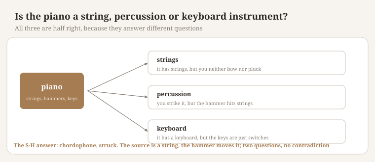
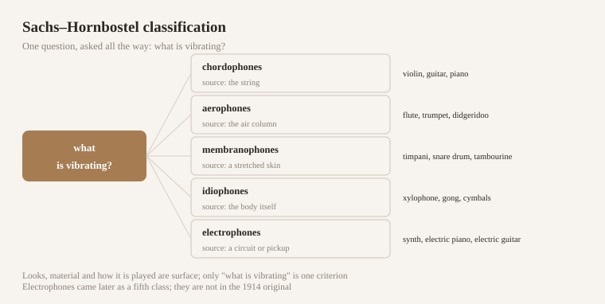
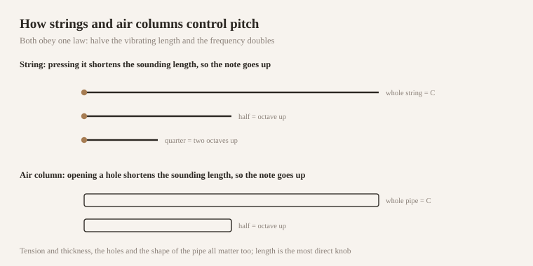
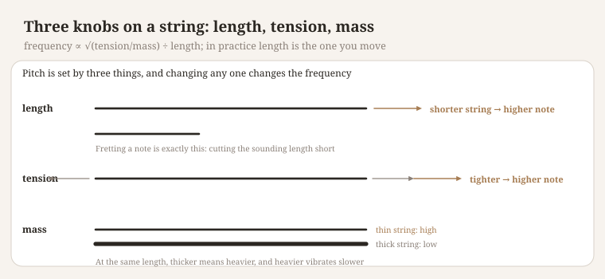
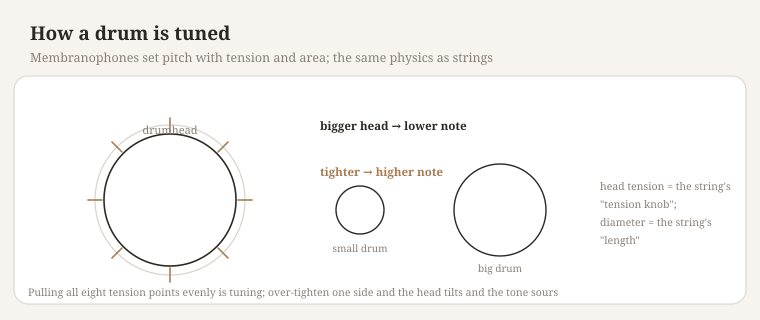
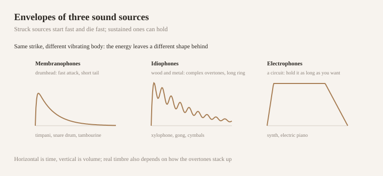
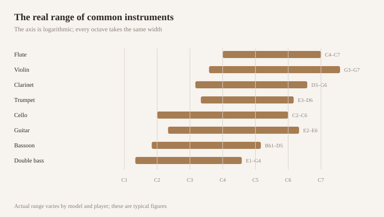
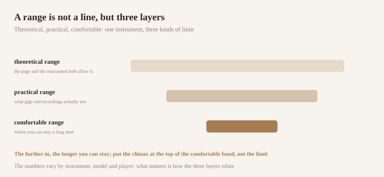

# Stage 4: How Instruments Make Sound

Get to know string, wind and percussion instruments, and find out why they make such different sounds.

In the three stages before this one, we learned how to *hear* pitch and beat, and how to *read* the five-line staff. But a score is ultimately just a design drawing on paper, like an architect's blueprint. Without bricks, reinforcing steel and cement, the house never gets built.

In the world of music, what turns those abstract mathematical symbols and time markings into a real sound that moves the air is **instruments and the human voice**.

When you draw a middle C (C4) on the staff, its *pitch (frequency)* is fixed: 261.6 Hz, measured on the 440 Hz reference. Play it on a piano, bow it on a violin, blow it on a flute, or play it on an electric guitar—the pitch is completely identical. Yet the *feel* of it, the timbre, is worlds apart. Why? Because every instrument produces sound by a completely different *physical means*, out of completely different *materials*.

Over the next four chapters we move properly into physical practice. We'll learn the scientific classification of instruments used around the world, and take apart the physical secrets of strings and wind. We'll explore percussion and the electronic synthesizer, and find out where the limits of each instrument's range and each voice's range lie. Bring your curiosity: we're about to turn music theory back into real sound.

## Chapter 14: The Scientific Classification of Instruments — The Sachs–Hornbostel System

If you stop someone in the street who has studied a little music and ask, "What kinds of instruments are there?" they will usually answer without hesitating: "Strings, woodwind, brass, percussion, and keyboards!"

Is that answer wrong? Not really. It's the classification Western orchestras have used for centuries. It's very intuitive, and it matches the seating plan you see at an orchestra concert.

**But the moment musicologists lifted their eyes to the whole world and tried to classify every instrument that has appeared in human history, this traditional Western system collapsed on the spot.**

### 14.1 The collapse of the traditional system, and "the piano's identity crisis"

The biggest problem with the traditional system is that its criteria are **wildly inconsistent**. Sometimes it looks at material (woodwind, brass), sometimes at the playing action (percussion, keyboard), sometimes at the vibrating body (strings). That muddle produces plenty of contradictions nobody can explain.

Here are a few classic "spot the flaw" examples:

1. **What kind of instrument is the piano, really?**
    * You press the keys with your fingers, so it's a keyboard instrument?
    * But inside, the keys are connected to little wooden hammers, and the hammers *strike* the strings, so it counts as percussion?
    * Yet what actually makes the sound is the two hundred or so *strings* in there, so it should be a string instrument?
2. **The flute is made of metal, so why is it a "woodwind"?**
    * Modern flutes are mostly made of silver, gold alloy or nickel silver—there is no wood in them at all. But because early flutes were made of wood, it has stayed in the woodwind group, which leaves a lot of beginners confused.
3. **The saxophone is made of brass, so why is it a "woodwind" too?**
    * It is gold and shiny all over, but because its mouthpiece carries a *reed* made of cane, it gets classified as woodwind. Logically it looks like a stretch.
4. **Where do you put the Australian Aboriginal didgeridoo?**
    * It is a huge eucalyptus trunk hollowed out by termites. It has no keys and no reed. You play it like a brass instrument (by vibrating your lips), but the material is pure wood. The traditional system simply has no slot for it.

### 14.2 The ultimate solution: the Sachs–Hornbostel system (S-H system)

To clear up this mess in the academic world, two ethnomusicologists—one German, one Austrian—stepped in. In 1914 **Curt Sachs and Erich Moritz von Hornbostel** proposed a classification that shook the world and is still treated as the standard by museums and ethnomusicologists everywhere. It is known as the **S-H system**.

These two scholars argued that appearance, material and playing technique (blowing, bowing, plucking, singing, striking) are all surface. Only one core physical question decides an instrument's essence: **"What substance is vibrating at the very origin of the sound?"**

By that single, strictly rational criterion they sorted the world's tens of thousands of instruments neatly into four big classes (and later, as technology developed, a fifth was added). The five classes are:

1. **Chordophones**: the sound originates in the vibration of one or more stretched strings.
2. **Aerophones**: the sound originates in the vibration of a column of air itself.
3. **Membranophones**: the sound originates in the vibration of a stretched membrane.
4. **Idiophones**: the sound originates in the vibration of the instrument's own hard material (a block of wood, a piece of metal), with no string and no membrane needed.
5. **Electrophones**: the sound is generated by an electronic circuit, or by a traditional vibrating body that is then picked up and amplified electronically. (The electric guitar is the second kind—what actually sounds is still the string; the circuit does the picking up and the amplifying.)

This system is like a sharp scalpel: it settles every dispute cleanly. What is a piano? What actually vibrates and sounds is a string, so it is a chordophone. What are the flute and the saxophone? What vibrates is the air inside a tube, so both are aerophones. And the didgeridoo? Also an aerophone. Everything becomes perfectly clear.

### 14.3 How does the way an instrument makes sound decide its "timbre"?

Why do we need a scientific classification in order to study theory? Because the vibrating body—what it is that vibrates—directly determines the instrument's timbre DNA.

In acoustics, timbre is decided by the sound's overtones **and by its** envelope (which includes the sound's attack, sustain and decay).

* **Vibrating strings (chordophones)**: bowed strings have a continuous, unbroken, overtone-rich and warm quality. Because a string's vibration can be fed energy continuously by the friction of the bow (violin), a string instrument's sound stretches on like a line without end.
* **Vibrating air (aerophones)**: a pure, penetrating quality with a sense of breath. An aerophone's timbre depends a great deal on the shape of the tube (cylindrical or conical) and on the way the air is set going.
* **Vibrating membranes and solids (membranophones and idiophones)**: usually an explosive attack. The energy at the moment of the strike is huge, and it falls away fast afterwards. The overtones of idiophones (xylophone, gong) are often very complex, sometimes even inharmonic, which gives them a strong rhythmic impact and a particular metallic or wooden sheen.

When great composers (Beethoven, Mahler, John Williams) write a symphony, they are like a painter squeezing colours onto a huge palette. They are precisely mixing the warmth of strings, the penetration of wind and the impact of skin and metal to create a listening experience that is endlessly varied and goes straight to the listener's soul.

### The five Sachs–Hornbostel classes

| Class | What vibrates | Examples |
|---|---|---|
| Idiophone | the body of the instrument itself | xylophone, gong, triangle, cymbals |
| Membranophone | a stretched membrane | timpani, snare drum, tambourine |
| Chordophone | a string | violin, guitar, piano, harp |
| Aerophone | a column of air | flute, clarinet, trumpet, pipe organ |
| Electrophone | a circuit (or electronic pickup) | synthesizer, electric piano, electric guitar (electro-acoustic) |

The fifth class, electrophones, was not in the 1914 original—Curt Sachs added it later. It is not in the 1914 version (sources give different years; some argue for the 1940s and some for the 1950s).

## Chapter 15: A Dialogue Between Strings and Tubes — Chordophones and Aerophones

Chordophones and aerophones are the two great instrument families capable of playing the most complex, the most delicate melodies in the world. Whether it's the weeping violin or the blazing trombone, how do they control pitch so precisely? Behind it lie physical laws so strict they can be written as mathematical formulas.

Let's go into the physical core of each family in turn.

### 15.1 Chordophones: the magic of length, tension and mass

Chordophones include the violin, the cello, the guitar, the harp, the pipa (a pear-shaped Chinese lute) and the guzheng (a Chinese zither whose bridges can be moved to retune it), and even the piano.

Imagine holding a rubber band, pulling it tight with both hands, and plucking it with a finger. The band vibrates fast and gives out a "bzzz". That is the chordophone in its most primitive state. When a string is plucked or rubbed, it vibrates hard at a particular frequency (Hz).

Three absolute physical variables decide what pitch (what frequency) that string produces. In physics they are called **Mersenne's laws**:

#### Variable one: the length of the string (Length)

* **The law**: with tension and mass unchanged, **the longer the string, the lower the frequency (the lower the note); the shorter the string, the higher the frequency (the higher the note)**. Length and frequency are inversely proportional.
* **In practice (the fretboards of the guitar and the violin family)**: while a guitarist or violinist plays, you see the fingers of the left hand pressing down on the neck (the fretboard) over and over. What does that pressing actually mean, physically? With no finger down (this is called an open string), the whole string vibrates from the headstock to the bridge. The length is at its longest, and you get the lowest note that string can make. Press a finger down in the middle of the string and you have, in effect, cut the string short: only the stretch between your finger and the bridge vibrates. The vibrating length has shrunk, so the note comes out higher. The closer the finger moves to the body (towards the bridge), the shorter the vibrating length, and the pitch climbs all the way up. This is the main way a string instrument changes pitch.

#### Variable two: the tension of the string (Tension)

* **The law**: with length and mass unchanged, **the tighter the string (the greater the tension), the higher the frequency; the slacker the string (the less the tension), the lower the frequency**. Frequency is proportional to the square root of the tension.
* **In practice (the tug of war at the tuning pegs)**: at the top (the headstock) of any string instrument there are mechanical devices that control how tight the strings are. They are called tuning pegs, or machine heads. Before an orchestra starts, you hear everyone buzzing away, tuning. Suppose a violinist finds that the A string has sagged a quarter tone—it has gone out of tune. He can't change the thickness of the string, and he can't change the length of the open string. His only option is to turn the peg tighter and increase the tension. As the tension rises, the pitch creeps up until it sits exactly on 440 Hz. That is why a guitar goes out of tune so easily when the strings are new: the tension of new strings is still settling, and it keeps slowly loosening.

#### Variable three: the mass and thickness of the string (Mass/Thickness)

* **The law**: with length and tension unchanged, **the heavier the mass per unit length of the string (the thicker it is), the lower the frequency; the lighter (the thinner), the higher the frequency**.
* **In practice (fat bass strings and hair-thin treble strings)**: look at a guitar or a cello. The string responsible for the lowest note (the guitar's sixth string) is as thick as a steel cable. The string responsible for the highest note (the guitar's first string) is as thin as fishing line. Why not make all six the same thickness and change pitch purely by adjusting tension? Because of the limits of physics. Pull a very thin string slack until it sounds extremely low and it ends up lying limp against the fretboard, unable to vibrate at all. Go the other way, tighten a very thick string until it sounds extremely high, and long before it reaches that note the string has snapped from the tension—it can even pull the neck off the instrument. To get around this, instrument makers wind copper or silver wire tightly around a steel core, turn after turn, when they make bass strings (this is called a wound string). That raises the string's mass a great deal without raising the tension much, so it can give out a full, deep low note, steady and slow.

**🪵 The soundbox's magic of amplification, and Stradivari's secret.** A string vibrating on its own in the air makes a very faint sound. Pluck an unplugged electric guitar and you'll hear how faint—like a mosquito. What lets a chordophone produce a big sound is the **bridge** and the **resonator body**. The string's tiny vibration is carried through a little upright slip of wood (the bridge) to the large wooden top. That wooden top (the face is usually spruce) acts like a giant loudspeaker. It is forced to vibrate along with the strings, and it pushes the air inside the body. The sound finally bursts out through the soundhole (the f-holes of a violin, the round hole of a guitar). The violins made three hundred years ago by the Italian master Antonio Stradivari still fetch astronomical prices today. His choice of wood for the soundbox, the carving of the arching and the varnish recipe reached a perfection of vibration transmission that science still cannot fully reproduce.

### 15.2 Aerophones: the magic of the air column

Aerophones include the flute, clarinet, saxophone, oboe, trumpet, trombone, and even the enormous pipe organ in a church. They make no sound with strings; the sound comes from the vibration of the **air column** inside a tube.

#### The three ways an aerophone sets the air going

Air does not vibrate by itself. Something has to disturb it—a starter. Aerophones are set going in three main ways:

1. **Edge-blown**: the flute, the pan pipes. The player blows a stream of air at a sharp edge. The stream is split by that edge and flips back and forth between the inside and the outside of the tube mouth (this is called an edge tone). That alternating pressure disturbs the air column and sets it vibrating. It is the same as blowing across the top of a drinking straw and getting a sound: the longer the tube, the lower the note.
2. **Reed-vibrated**:
    * **Clarinet and saxophone (single reed)**: a thin slip of cane (made from *Arundo donax*, a reed grass, not bamboo) is bound to the mouthpiece. As you blow, the airstream sets that reed vibrating violently at high frequency, and it drives the air in the tube.
    * **Oboe and bassoon (double reed)**: two reeds bound together. As you blow, the two reeds slap against each other. Double-reed instruments usually have a thick, nasal quality, and they carry extremely well.
3. **Lip-vibrated**: that is, all the brass (trumpet, French horn, trombone and the rest). There is no reed here; the starter is **the player's own lips**. The player presses the lips firmly together and forces the airstream out, so that the lips buzz in the metal mouthpiece.

#### Changing the length of the air column: why does a flute need so many keys?

Like a chordophone, an aerophone obeys the physical law of length: **the longer the tube (the air column), the lower the note; the shorter the tube, the higher the note.**

The trombone is the most perfect visual demonstration of this law. A trombone has no keys; it has a great U-shaped slide.

* When the player pushes the slide out, the whole brass tube gets longer, the air column inside gets longer, and the sound comes out as a low glissando.
* Pull the slide back in and the tube gets shorter, and the sound shoots up high.

So how do the flute and the saxophone change the length of the air column when they have no slide? The answer: **by drilling holes in the tube (tone holes)**. The air column inside a wind instrument is only measured as far as **the first open hole**.

* When the player presses every key and closes every hole on the flute, the air blown in has nowhere to escape and runs all the way to the far end of the tube. This is the longest air column, and it gives the flute's lowest note.
* When the player opens a key near the mouthpiece, opening one hole, the air escapes from that nearest hole. The working air column suddenly gets shorter, and the note gets higher. That is why woodwinds are always covered in complicated keywork: all of it exists to control precisely which hole opens and which stays closed, changing the length of the air column to play a scale.

**💡 The ultimate romance of physics: the secret of open and closed pipes.** Here is an acoustic secret to excite every lover of physics. Put a flute and a clarinet side by side. They are about the same length, roughly 60-odd centimetres. In theory, the same length should give roughly the same lowest note, right? **Wrong! The clarinet's lowest note is almost an octave below the flute's (a minor seventh).**

Why? It comes down to what acoustics calls boundary conditions.

* **The flute is an open pipe**: its mouthpiece has a big hole (where you blow), and the far end is open too; both ends are open to atmospheric pressure. In an open pipe, the wavelength of the sound wave the air sets up is roughly twice the length of the tube.
* **The clarinet is a closed pipe**: its far end is open, but at the mouthpiece the thick cane reed and the player's lips **close it completely** while playing. In acoustic physics, a tube closed at one end and open at the other forces the wavelength it generates to stretch to four times the length of the tube.

Double the wavelength and the frequency halves: the pitch drops a whole octave. That is why the clarinet family (especially the bass clarinet), though it doesn't look especially long, can produce a low register deep enough to be frightening. It is one of the pieces of magic that the creator and physics give to instruments.

## Chapter 16: Struck and Electric — Membranophones, Idiophones and Electrophones

Leaving the strings and tubes that carry melody, we come to a territory full of primal rhythm, metallic sheen and futuristic technology. These three classes change pitch in a completely different way: drums by the tension of a membrane, xylophones by the length of wooden bars, electronic instruments by circuitry.

### 16.1 Membranophones: the burst of tension and resonance

Membranophones, put simply, are what we call drums. The vibrating body is a thin membrane stretched tight over a round frame (animal skins—cowhide, goatskin—in the old days; nowadays mostly synthetic polymer skins such as Mylar, so that temperature and humidity don't affect them). When a stick or a hand strikes the surface, the membrane sets up an extremely complex two-dimensional wave.

#### Pitch control on a drum: the art of tension

The great majority of drums (the snare and bass drum of a kit, the Middle Eastern darbuka) are called instruments of indefinite pitch. The overtones the drumhead produces are so jumbled, and the frequency ratios between them so far from simple whole numbers, that the ear cannot hear a clear pitch. What you hear is a "bam" of a strike, and you cannot sing it as a Do or a Re.

But a drumhead still has high and low. The main physical variable a player can use to control the pitch of a head from moment to moment is tension.

* The tighter the head (more tension): the crisper, higher, more compact the sound.
* The slacker the head (less tension): the lower and duller the sound, with a fatter sustain.

Look closely at the rim of the drums in a kit and you will see a ring of metal **lugs** and screws. Before a show, the drummer takes a drum key and turns those screws, tightening or loosening the hoop to adjust the tension of the head.

**👑 The timpani: the king of membranophones, and it can play a melody.** In an orchestra one membranophone is the absolute exception: the timpani. A timpani has a huge hemispherical copper bowl, and the remarkable thing is that it is one of the few drums that can be tuned to a definite pitch (do-re-mi). At the bottom there is a mechanical pedal system. While playing, the player can press a pedal with the foot. Inside, the pedal is connected to an umbrella-shaped set of rods that instantly and evenly tighten the skin across the whole head. That lets a timpani pull a head sounding C up to a G within one second. In the symphonies of Beethoven or Mahler the timpani is not just keeping the rhythm—it is quite simply playing a bass line.

### 16.2 Idiophones: the oldest hard sounds

Idiophones are probably the oldest instruments in human history. When a prehistoric person picked up two stones and struck them together, or hit a hollow log with a stick, the idiophone was born. The defining feature of an idiophone: **it needs no string added and no membrane stretched; the vibrating body is the instrument's own solid material.**

What decides an idiophone's pitch is the **density, size, thickness and shape** of the material.

#### Xylophone and marimba

These are wooden idiophones with definite pitch. They consist of a row of bars of different lengths (rosewood, or synthetic material), laid out like a piano keyboard.

* **The rule**: the longer and heavier the bar, the more slowly it vibrates when struck, and the lower the note; the shorter and lighter the bar, the higher the note. To make the sound bigger and fuller, every bar of a modern marimba has a metal resonator tube hanging beneath it. The length of that tube has been calculated precisely to amplify that bar's particular frequency, turning a dry knock of wood into an extremely warm, rounded timbre.

#### Gongs and cymbals

These are metal idiophones of indefinite pitch. Metal has very low internal damping: after a strike the energy drains slowly, so the vibration can go on for a very long time (an extremely long sustain). When you strike a big Chinese gong or an orchestral cymbal hard, the metal surface sets up extremely chaotic, complex waves. Those thousands of inharmonic overtones tangle together and produce an ear-splitting explosion of sound like white noise. That is why, when a piece reaches its peak, the conductor always has the percussionist bring the cymbal down with everything they have: it is an emotional release that nothing else can replace.

### 16.3 Electrophones: modern magic that overturns the laws of physics

In the twentieth century humans gained command of electromagnetism and electronic technology. It was only in the 1940s that the S-H classification gained its fifth class: electrophones. The arrival of electrophones overturned the physical limits that had constrained instrument making for thousands of years. Wood rots, strings break, lungs have only so much capacity—in the world of electricity, none of that is a problem.

Electrophones divide into two revolutionary branches: **electro-acoustic instruments** and **pure electronic instruments**.

#### Branch one: electro-acoustic instruments

The most typical representatives are the **electric guitar** and the **electric bass**. Take a solid-body electric guitar and play it unplugged: you will find the sound is as faint as a mosquito. It has no big soundbox like an acoustic guitar to amplify it. Its magic comes from the blocks hidden under the strings, the ones with metal dots on them: the **pickups**.

* **The miracle of electromagnetism**: inside a pickup there is a magnet, and around the magnet are wound several thousand turns of copper wire thinner than a hair. That forms a magnetic field around the string.
* **Faraday's law of electromagnetic induction**: the strings of an electric guitar have to be metal containing iron. Pluck a string and the metal string vibrates back and forth in the magnetic field, cutting the lines of force. That induces a weak alternating current in the copper coil.
* That current carries information about the pitch (frequency) and the force of your playing. It travels along a cable to the amplifier, where it is magnified tens of thousands of times, drives the speaker cone, and bursts out as a deafening sound.

Because the sound turns into an **electrical signal** in the middle, we can do whatever we like with it. Guitarists step on the **effects pedals** on the floor to make the waveform distort (distortion—that's where rock gets its growl), or to delay it (delay—which gives you an echo). That creates wild timbres that could never exist in nature.

#### Branch two: pure electronic instruments

The representative is the **synthesizer**. A synthesizer is a true "creator instrument". Inside there is no string, no reed, no drumhead—no physical vibrating mechanism of any kind. Its sound is calculated out of thin air.

* **Oscillator (VCO)**: the heart of the synthesizer. It is a set of circuits that generates pure electronic waveforms out of nothing. You can choose a rounded **sine wave**, an airy, flute-like **triangle wave**, a **square wave** like the sound of an 8-bit game console, or a **sawtooth wave** as sharp as a string section.
* **Filter (VCF)**: after the synthesizer generates the raw waveform, it passes through a filter that shaves off the harshest high frequencies (a low-pass filter). The sound becomes warmer and duller, as if you had put a mask over it.
* **Envelope (ADSR)**: finally, by controlling the four parameters Attack, Decay, Sustain and Release, you can decide how the sound behaves. It can burst out and vanish at once like a percussion instrument, or come in slowly and never let up like a violin.

With that logic a synthesizer can not only imitate every traditional instrument in the world, it can invent new science-fiction sounds—a laser gun firing, a starship landing, a deep-sea monster roaring. Electrophones break the limits of matter and leave human imagination as the only boundary of timbre.

## Chapter 17: Exploring the Edges of Sound — Defining and Classifying Range

We have studied a lot of instruments, and in the end we have to face one harsh physical fact: **no instrument and no voice can do everything.**

A violin cannot produce the floor-shaking impact of a double bass, and a trombone cannot produce the bird-like lightness of a flute. A bass cannot sing the high, cloud-level notes of a soprano, and a soprano cannot produce the chest resonance of a bass.

Every instrument and every person has a territory of their own. That uncrossable acoustic border is called **range**.

### 17.1 The scientific definition and coordinates of range

Range means the whole distance from the lowest note an instrument or a voice can produce to the highest.

In music, to communicate precisely, we usually write range in the scientific pitch notation we learned in Stage 2. For example:

* **The violin's range**: roughly G3 (the G below middle C) to E7 (an extremely high E, and even higher). That spans almost four octaves.
* **The piano's range**: from A0 to C8, more than seven octaves. It has the widest range of any common instrument; it covers almost every other instrument's living space.

### 17.2 Three layers of range: theoretical, practical and comfortable

Range is not just a physical limit. In professional composition, orchestration and vocal teaching, we don't look at one absolute span. We divide range into three layers, like concentric circles, and this is crucial for composers and performers:

#### 1. Theoretical range — the limit in the laboratory

This is the extreme span an instrument can reach in the most perfect, most extreme conditions, or a singer in a state of extreme vocal production.

* **Instrument example**: however long a violin's fingerboard is, the extreme scream it can make when the player's finger is at the very bottom of the board and the bow is scraping at the edge of the bridge.
* **Voice example**: the whistle register as demonstrated by Mariah Carey.
* **Where it's useful**: this span exists only in the laboratory, in extremely avant-garde new music, or in showpieces written to display extreme technique. In ordinary music we almost never go to the edges of the theoretical range, because the sound quality there is hard to control and the failure rate is very high.

#### 2. Practical range — the safe zone on the battlefield

This is the span in which an instrument or a singer, in an actual ensemble performance, can be **reliably controlled, played in tune, and kept from sounding too strange or distorted**.

* **What it means in practice**: for a competent composer or arranger, 95% of the notes have to stay inside this span. Write an extremely high note for the trombone for a special effect. In theory it can be played, but in a live concert the player may crack it (players call it "splatting") because the lips are tired. That ruins the whole concert. Knowing the practical range is the safe baseline that makes sure the music can actually be performed.

#### 3. Tessitura — the soul of an instrument and a voice

The word comes from Italian *tessitura*, whose original sense is the weave or texture of a fabric. It means a narrower stretch inside the practical range—the richest part of it. In this stretch an instrument or a singer can produce its **fullest, most beautiful, best-resonating and least effortful** sound.

* **Tessitura in a voice (protecting your vocal folds)**: for a singer, tessitura is the key to whether a song is singable at all. A song's highest note may be very high, and the singer may be able to grit their teeth and hit it once (that is close to the edge of the theoretical range). But if the chorus keeps circling and hovering in that very high area—which means the song's tessitura is high, beyond the singer's comfortable range—the vocal folds soon tire, swell, and may even develop nodules. Pop singers, before recording or a concert, often ask the band to drop the key (transpose down). The point of dropping the key is to move the centre of gravity of the whole melody down into the singer's tessitura. That way the singer can sing with the fullest emotion in the most relaxed state, instead of fighting for their life on stage.
* **Tessitura in an instrument (showing character)**: every instrument has a different tessitura. The horn's tessitura is the middle register, where it can produce a velvety, warmly enveloping sound. Force a horn up to the very top and the sound becomes extremely tight and aggressive (which is sometimes a dramatic effect a composer wants on purpose). Giving a suitable melody to an instrument playing in its tessitura is the surest way to make an orchestra sound harmonious, moving and never harsh.

**[Stage 4: Physical Practice — Summary]**

What a journey through acoustics this has been. We have successfully turned the paper theory of the staff into real physical vibration.

Let's review the core knowledge you have gained from this stage:

1. You have learned the **Sachs–Hornbostel system (S-H system)**, and that the one criterion deciding how instruments are classified, and where their timbre soul comes from, is the vibration source (string, air, membrane, body, electricity).
2. You have taken apart the physics of **chordophones**, understanding how length, tension and mass decide pitch as if by magic, and how a soundbox amplifies.
3. You have explored the air-column secret of **aerophones**, learned the difference between edge tones, reeds and lip vibration, and worked out the physics of how the length of an open pipe and a closed pipe affects pitch.
4. You have walked into the world of percussion and technology. You have seen how **membranophones and idiophones** make primal rhythm out of tension and the density of materials. You have seen how **electrophones** (pickups and synthesizers) use electromagnetism to overturn tradition and create a boundless universe of timbre.
5. Finally, you understand the scientific boundary of **range**. You can tell the limit of the theoretical range from the safety of the practical range, and you know what **tessitura** means for protecting the voice and showing an instrument at its most beautiful.

By now you have the acoustic eye that sees through to what an instrument really is. Next time you hear a symphony or a pop-rock song, what rises in your mind will no longer be just the melody, but the pull of strings, the tremble of reeds, and the wild dance of electrons.

Carry this physical and acoustic understanding with you. We are about to enter the last stage, where all of this is put to use together. We explore the secrets of the human voice, and look down from a height at the whole orchestra and the music of the world.

