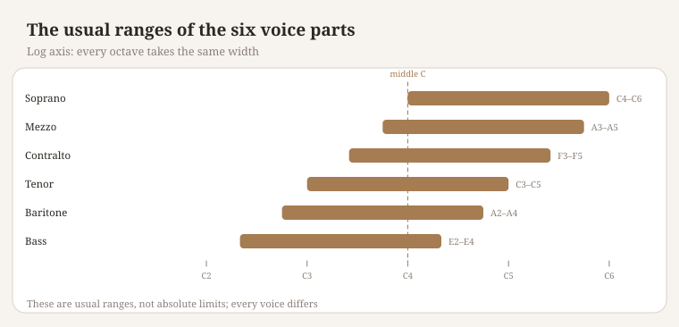
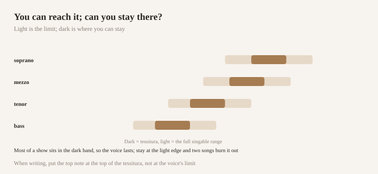
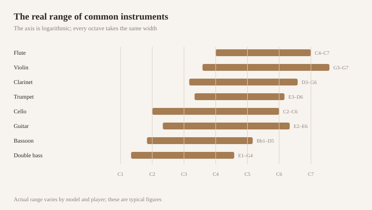
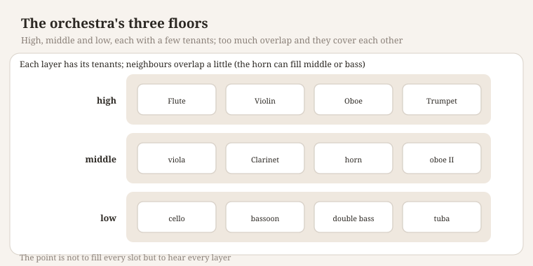
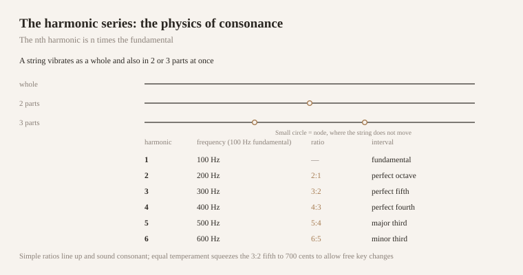
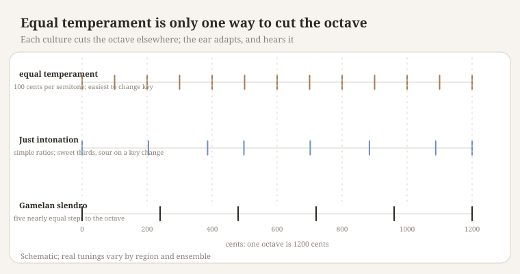

# Stage 5: Ensembles and World Music

Add up everything from the earlier stages. Watch how a symphony orchestra works, and listen to the unusual scales of other countries.

Over the past four stages we have been like a careful watchmaker, taking apart every tiny gear of music. But music has never been isolated data. When dozens of instruments sound at once, and when different cultures hold completely different definitions of harmony, music turns into a vast architecture and a kind of sociology.

In this stage we step back and look down on the whole musical universe from the wide angle of a conductor and a cultural anthropologist. We explore the workings of the human voice, take apart the laws of spectral balance in an orchestra, and finally cross the ocean to hear how India, Indonesia and the East built their own remarkable tunings from different scale mathematics and different tuning logic.

Ready? Let's turn all this theory of music into a superpower: the ability to hear the whole world.

## Chapter 18: The Secret of the Human Voice — Six Voice Parts and Natural Range

Before humans invented bows, reeds or electronic synthesizers, we already owned the most precise, most emotionally loaded and most singular instrument in the world: our own throat — **the human voice**.

In the Sachs–Hornbostel classification, the human voice is essentially a kind of aerophone. Air pushed out of the lungs passes through two extremely fine folds of muscle in the throat, the vocal folds. That sets them closing and vibrating fast, and produces the basic sound wave. The waves then resonate in the cavities of the throat, mouth and nose, and what comes out is the singing you hear. The "chest resonance" a singer feels is really vibration travelling through tissue to the chest wall; the audience's version of the sound contains almost none of it.

Unlike the piano or the violin, turned out to one uniform specification in a factory, no two people on earth have the same vocal fold length and thickness, throat space and skull shape. That gives every person an irreplaceable timbre, and it makes range the most exacting science in the vocal field.

### 18.1 The six voice parts of classical singing and their timbres

Over the centuries of Western classical music — choirs and grand opera above all — scholars divided the adult voice into six parts, three for women and three for men, with great care. The aim was that many singers performing at once could reach the most harmonious and richest spectral balance. The division rests on how high or low the natural range sits **and** on the weight of the timbre, dark or bright.

This is not merely a classification by pitch range. It is also the assigning of a soul in drama and in casting. In many musicals and character designs the voice part hints directly at personality. To portray a pivotal character called the Weaver Next Door (隔壁織音人), for instance, give him a warm baritone, generous and full of narrative, and the audience immediately builds a three-dimensional picture: a man who weaves sound, friendly and steady.

Here are the six voice parts in detail:

#### 👑 The female voices

**1. Soprano**

* **Theoretical and working range:** roughly from middle C (C4) all the way up to high C (C6), and in extreme cases to E6 or F6.
* **Timbre and subtypes:** the soprano is the highest of all human voice parts in pitch and in range. In an orchestra it is easy to pick out, because the singer's formant falls into a gap in the ensemble's spectrum. Even under a full orchestral assault the soprano cuts through the thick accompaniment like a blade and reaches the back row of the hall. That is why, in the great majority of classical operas and modern pop, soprano and tenor are the two parts most often cast as the lead, singing the main melody. Sopranos divide further into several types:
    * **Coloratura soprano:** an extremely light, agile voice, able to fire machine-gun leaps and ornaments in the very top range (the Queen of the Night in Mozart's *The Magic Flute*).
    * **Lyric soprano:** sweet, soft and poetic in timbre; often the innocent young girl or the tragic heroine.
    * **Dramatic soprano:** explosive, thick and full of metallic sheen, able to hold its own against a huge Wagner orchestra; often a Valkyrie or a queen full of hatred.

**2. Mezzo-soprano**

* **Theoretical and working range:** roughly A3 to A5.
* **Timbre:** a mezzo's vocal folds are usually a little heavier than a soprano's. Her timbre is warmer and fuller than a soprano's, with a velvet thickness. On the opera stage a mezzo rarely plays the innocent girl; she is usually given roles of strong personality and depth — the mature woman, the mother, the wicked witch, or the fatally attractive Gypsy girl (the most famous example is the title role of Bizet's *Carmen*). Curiously, because a mezzo's range covers that of a boy before his voice breaks, mezzos are also often cast against type as a handsome young man (the so-called trouser role).

**3. Alto / Contralto**

* **Theoretical and working range:** roughly F3 to F5, and it can even dive down to D3.
* **Timbre:** this is the rarest and most precious natural part among women's voices. A true contralto has a deeply low, wide sound with unusually strong chest resonance, carrying a solemn, earth-like maternal power, and even a mystery that blurs male and female.

#### 🎩 The male voices

**4. Tenor**

* **Theoretical and working range:** roughly C3 to C5.
* **Timbre:** the tenor is the highest part among natural male voices, pure falsetto aside. A fine tenor is the superhero of music: on the high notes, above all the famous high C, the sound is full of masculine explosive power and a brilliant metallic sheen. In traditional opera the tenor is always the hero who saves the world, the hot-blooded prince or the devoted lover. The Three Tenors — Pavarotti, Domingo and Carreras — are the great legends of the part in modern times.

**5. Baritone**

* **Theoretical and working range:** roughly A2 to A4.
* **Timbre:** the most widespread and most common natural part among men. A baritone's timbre is thick, warm, full of magnetism and a sense of story. In pop music, the great majority of male singers known for depth and storytelling have their best resonance in the baritone range. In classical opera the baritone is often the king, the father, the arch-villain, or the most loyal friend at the hero's side. Baritones are the key force that steadies the low-mid of the male section.

**6. Bass**

* **Theoretical and working range:** roughly E2 to E4; a basso profondo can even sing down to C2, a low frequency that makes the skin crawl.
* **Timbre:** the bass is the deep place of the human voice. The sound is massive and unfathomable, like a steady mountain or an old bronze bell. In a choir the bass supplies the firmest harmonic root; without the support of the basses the whole choir sounds as if gravity had been switched off, floating with no centre of weight.

### 18.2 Why tessitura matters absolutely for singing and for protecting the voice

Talent shows have pushed a dangerous myth about singing into the general public: many people believe that the higher you can belt, the better your technique. That runs completely against ergonomics and vocal science.

We met tessitura in Chapter 17. For protecting the human voice — an instrument made of flesh — this idea has a life-or-death influence.

Tessitura is the core stretch of a singer's whole usable range where the voice comes out fullest, most beautiful and most perfectly resonant, and where the throat muscles work least.

**The physical cost of forcing the high notes**

If a song's melody only now and then, for an instant, touches the very top of a singer's working range, that is acceptable dramatic tension. But if the chorus of a song keeps its melodic line tangled in a very high register outside the singer's comfortable range — which means the song's tessitura is extremely high — that is a disaster.

To hold that extreme high frequency, the throat muscles stay locked in extreme tension, and the vocal folds snap open and shut at a very high rate, striking each other. Stay in that state long enough and the capillaries in the folds burst, the tissue swells, nodules grow — calluses, in effect — and the irreplaceable instrument is destroyed for good. Many rock singers who were once hugely popular ended their careers hoarse, with no high notes left, because in their youth they ignored tessitura and overdrew on their vocal folds.

**Applying the knowledge to music technology and development**

Understanding why tessitura matters is required study not only for singers. It is core underlying logic for anyone developing music technology.

Take the planning of an interactive music system, for example an interactive pitch-matching game called Pitch Game. The developer has to write into the algorithm the dynamic tessitura ranges that correspond to different age groups (adults and children) and sexes. If the design blindly asks every untrained player to hit notes beyond their tessitura limit in order to score, it makes for a terrible experience and very easily leaves players with vocal fatigue and real damage partway through a level. Technology and game design have to rest on a deep understanding of the limits of human acoustics.

### The usual ranges of the six voice parts

| Voice part | Rough range | Notes |
|---|---|---|
| Soprano | C4–C6 | One of the most common leading parts in opera |
| Mezzo-soprano | A3–A5 | Often the secondary lead or the villain |
| Contralto | F3–F5 | The fewest singers; a thick timbre |
| Tenor | C3–C5 | The most common male lead in opera |
| Baritone | A2–A4 | Common in narrative, conversational roles |
| Bass | E2–E4 | The foundation low voice of a choir |

These are usual ranges, not absolute ones. The conditions of individual vocal folds vary a great deal.

## Chapter 19: The Orchestra's Spectrum of Timbres — Putting Instrument Ranges to Work

Now let's widen the view from a single human voice to a symphony orchestra holding eighty to a hundred musicians, or to a modern pop band with synthesizers and a drum kit.

When a hundred instruments sound at once on stage, why doesn't it sound like a deafening traffic accident? Why isn't the flute drowned outright by dozens of violins? The top secret behind this is the precise control composers, arrangers and mixing engineers keep over "frequency space" **and** over the range characteristics of each instrument.

### 19.1 An acoustic building woven from high, middle and low

A perfectly scored orchestra, or a carefully mixed modern track, is like a skyscraper with a rigorous structure. Instruments of different ranges build different floors, and every floor has an acoustic function nothing else can replace.

Using the band concepts of modern mixing engineering, we can take this acoustic building apart into four main floors:

One thing to be clear about first: "who is on which floor" here means where the **energy and overtones concentrate**, not the fundamental. The same instrument often straddles several floors at once — the flute's fundamental sits on the second and third floors, but its overtones run all the way up to the fourth.

**1. The ground floor, the foundation: sub and low (about 20 Hz - 250 Hz)**

* **Instruments:** double bass, the low strings of the cello, bassoon, tuba, timpani, the low register of the clarinet (the chalumeau); in pop, the electric bass and the kick drum, and the 808 sub-bass.
* **What they do:** they provide the music's centre of gravity, its driving groove, and the harmonic root. The vibration in this band is often not so much heard by the ears as felt by the listener's chest and skin. If the foundation is unstable and the low end is missing, the whole piece sounds thin, sharp and unsettling; but if there is too much low end, the music turns muddy and boomy and covers up every detail.

**2. The walls of the second floor: low-mid and mid (about 250 Hz - 2,000 Hz)**

* **Instruments:** viola, French horn, the middle register of the clarinet (the clarion), the upper-middle range of the cello and trombone; in pop, the acoustic guitar, the rhythm strumming of the electric guitar, and synth pads.
* **What they do:** this is the fleshiest, fullest part of the whole track. The viola and the French horn are often used as the "sonic glue" between sections — the viola bridges the strings and the woodwind, the horn bridges the woodwind and the brass. They fill the enormous gap between the very high and the very low and give the music a warm, wrapping thickness. Most of the notes inside the chords are woven here.

**3. The third floor, its decoration and its star: high-mid (about 2,000 Hz - 5,000 Hz)**

* **Instruments:** the violin in high positions; the overtones and brightness of the oboe, trumpet and flute in the band above; in pop, the lead vocal and the electric guitar solo.
* **What they do:** as we learned in Stage 1, the equal-loudness curves make this the frequency range the human ear is most sensitive to and focuses on most easily. So composers almost always place the main melody on this floor. Instruments in this band carry the job of drawing all of the listener's attention.

**4. The roof of the fourth floor: high and brilliance (about 5,000 Hz - 20,000 Hz)**

* **Instruments:** no instrument puts its fundamental here — what this floor collects is **overtones and reverb**: cymbals, triangle, glockenspiel, the upper overtones of the piccolo and of the flute's top register, plus the hi-hat of the drum kit and every kind of airy reverb.
* **What they do:** these instruments usually do not carry the main melody. Their job is to add metallic sheen, a breathing sense of air, and extreme penetration to the music. The piccolo is tiny, but its frequency is so high and it sits at the very top of the orchestral range, so even when a hundred players open up at full power and the brass all sound together, the audience still hears the piccolo clearly, a bright, penetrating thread up above the clouds.

### 19.2 The art of arranging: an instrument's "split personality" across its range

A great composer or arranger never looks only at an instrument's theoretical range. They know that every instrument shows a completely different timbre and character as it crosses from one register to another.

The clarinet is the classic example: an instrument with several personalities.

* In its very low register (the chalumeau) the sound is extremely deep and thick, with something dark, hollow and threatening, full of drama.
* But cross the break into the middle-high register (the clarion) and the sound turns bright, clear and sweetly singing in an instant.

If a composer does not understand this and, when arranging, sets the clarinet's low register to play the same climactic melody as a bright trumpet, the clarinet is not only drowned outright: the whole harmony turns strangely muddy. This is like project management, where a task originally sitting in column I gets pushed back into column J by a logic fix and the time differences all have to be recomputed. Force an instrument that belongs in the low register up into the high register while arranging and the acoustic logic of the whole spectrum goes haywire; the allocation and collision of every instrument's frequency has to be recalculated.

### 19.3 The ultimate application of range thinking to modern mixing and genre scoring

In modern digital music production, this control of spectrum and range has been developed to a scientific extreme. That is the art of mixing and of the equaliser, EQ.

Take the different genres of modern music: they hold completely different philosophies about how to lay out frequency space.

* **The spectrum philosophy of Mandopop:**  
  When producing Mandopop, the vocal is always the supreme, absolute star of the spectrum. The mixing engineer uses EQ to clear space in the high-mid (2 kHz - 5 kHz) with great care. If the guitar or piano collides with the singer's voice in that region (frequency masking), the engineer will cut the instrument's high-mid without a moment's hesitation and open a broad road for the singer's diction and emotion. The whole spectrum is designed to set off the clarity and intimacy of the voice.  
* **The spectrum philosophy of ambient music and post-rock:**  
  Produce ambient or post-rock, though, and the strategy reverses completely. In these genres the vocal may step back to the second line or vanish altogether, and its place as the star is taken by "a sense of space" and the "wall of sound". Electric guitars, through heavy distortion and delay and reverb, deliberately fill every part of the spectrum from the low-mid to the high. The engineer does not chase extreme clarity in any single instrument; instead EQ is used to make the frequencies of the various synths and guitars interweave and overlap, creating an enormous, immersive roar and a sense of floating with no edges.

Music production is, at heart, the precise placing of the paint of each range on a limited three-dimensional canvas: frequency, time and volume.

## Chapter 20: Overlapping Sounds and Cultural Diversity — Harmony and the World's Tunings

The course has reached its final peak.

Almost every rule we have discussed so far — twelve-tone equal temperament, which cuts the octave into 12 semitones, the major and minor scales, the frame of 4/4 — is a standard that Western music built up over the past few hundred years. Because of the forceful export of Western civilisation, these rules became the common grammar of pop music worldwide today.

But if you think the West's twelve-tone equal temperament is the truth about music, you are badly mistaken. The acoustic laws of physics are common to the whole universe, yet the world's different old cultures, facing those physical phenomena, made radically different philosophical readings and mathematical choices.

Let's start from the physical laws common to the universe, and finally fly out of the Western frame to hear the sounds of the world.

### 20.1 The universe's formula for harmony: the harmonic series

In music, why does pressing C and G together on a piano (a perfect fifth, in theory terms) sound so harmonious, calm and pleasing? And why does pressing C together with C sharp (a minor second) sound so harsh, so tense, that you want to run away at once?

This comes mainly from **physics and mathematical ratios**, though cultural experience also affects how consonant or dissonant we find a pair. The secret hides in a physical phenomenon called the harmonic series.

When you pluck a guitar string (suppose its fundamental frequency is 100 Hz; we call it the **fundamental**), what your eye sees is the whole string moving up and down. But physics tells us something startling: while the string vibrates as a whole, its half, its third, its quarter, its fifth … are all vibrating minutely at the same time.

These sounds, extremely faint and hidden behind the fundamental, produced by the vibration of integer divisions of the string, are what we call **overtones**, or harmonics. They form a perfect mathematical sequence that can be expressed in one simple physical formula: the frequency of the $n$th harmonic is exactly the fundamental frequency multiplied by $n$ (that is, $f_n = n \cdot f_1$).

This leads to the ultimate code for how humans feel consonance and dissonance — **whole-number frequency ratios**:

* **The perfect 2:1 (the octave):** the half of the string vibrates, at twice the fundamental (200 Hz). The ratio between the two notes is the extremely simple 2:1. The crests of the two waves line up with each other and the troughs line up with each other, so the sum is still a clean periodic wave, and the brain processes it without effort. The two sound almost as one, which is why an octave sounds like the same note.
* **The sacred 3:2 (the perfect fifth):** the third of the string vibrates, and its frequency is in a ratio of 3:2 to the step below. In music that is the relationship of C and G. Next to the octave this is the most harmonious and purest interval in the world, and the absolute foundation of all harmony, Eastern and Western.
* The close 4:3 (perfect fourth) and **5:4 (major third):** as the divisions get finer, the numbers in the frequency ratio grow larger, and the colour they produce becomes richer but also less stable.

**Why does a semitone grate? (acoustic roughness)**

When the frequency ratio of two notes is very complicated (15/16, say), their sound waves cannot overlap regularly as they add in the air. Crests and troughs collide and cancel each other, producing a fast buzzing "beating" effect. This physical interference of frequencies, carried to the basilar membrane of the human ear, produces a physical "acoustic roughness", and our brain translates it into tension, harshness and unease. This is the physical truth of a dissonant interval.

### 20.2 Beyond twelve-tone equal temperament: exploring the edges of the world's music

The mathematics of twelve-tone equal temperament was first worked out by Zhu Zaiyu in Ming-dynasty China in 1584; Europe adopted it gradually from the 17th century. To get out of a mathematical dead end — keyboard instruments going badly out of tune when transposing freely between keys — musicians and mathematicians took up twelve-tone equal temperament (12-TET). They ruthlessly used a logarithmic function to divide the physical frequency of one octave into 12 mathematically identical semitones.

This was a great compromise. It let Bach write the *Well-Tempered Clavier* (in well temperament, not strict twelve-tone equal temperament), and it made harmony extremely free. The price is that, apart from the octave, every interval on a piano (perfect fifths and major thirds included) is slightly out of tune in physical frequency. They are no longer perfect simple integer ratios.

But when we step outside Europe, the other great civilisations of the world did not need to transpose as often as the West, or to build huge symphony orchestras of several dozen players, so they chose to keep older and more complex tuning systems: some (India's shrutis, China's method of generating the scale by fifths) stay closer to the pure physical vibration of the harmonic series, while others (gamelan) developed a tuning aesthetic entirely independent of the harmonic series.

#### 🇮🇳 India's system of microtones: raga and shruti

Tell a master of Indian classical music that Westerners cut one octave into only 12 pieces, and he will find it crude, utterly lacking in expressive power.

In India's old musical system, the octave is divided finely into **22 microtones of unequal spacing**, and these tiny steps of pitch are called **shrutis**.

That means that in Indian music many pitches fall "in the cracks between the black and white keys" of a Western piano. Together with the melodic framework rule that is unique to India, the raga, their sitar, a long-necked plucked lute, can slide, through vibrato and glissando, into microtonal shifts of extraordinary delicacy and curve, even a mystical, meditative colour. To an Indian musician, landing exactly on one particular shruti is not only an auditory beauty but a spiritual discipline, a resonance with the frequencies of the gods. That is a height a Western keyboard instrument, imprisoned by equal temperament, can hardly reach.

#### 🇮🇩 Indonesia's gamelan: otherworldly metal and the wave of life

Indonesia's traditional court percussion ensemble, the gamelan, is made up mainly of large numbers of bronze gongs, metallophones and xylophones. Its tuning system is completely disconnected from the West's, and it uses two quite different scales:

* **Slendro:** an octave divided into roughly 5 equal notes, but each step a little wider than a Western whole tone.
* **Pelog:** a scale of 7 notes in unequal steps, containing very close semitones and enormous leaps.  
  The more startling cultural difference is this: in the world of gamelan, **the tuning of every set of instruments is unique.** The gamelan of this village and the gamelan of the next village can never be played together, because their pitch references are completely different.  
  Gamelan metallophones are also made in pairs, and the smith deliberately tunes one of the pair a few hertz above the other. When two players strike the pair together, because the frequencies are extremely close but not identical, regular physical interference arises in the air, a shimmering of the sound wave: "ngow—wow—ngow—wow". Indonesians call this wave-like feel produced by physical interference "Ombak" (the wave of life), and they hold that this shimmering sound gives inert metal a real spirit and vitality.

#### 🇨🇳 China and the minimal aesthetic of Eastern philosophy: the pentatonic scale

Traditional Chinese music, and much folk music across East Asia (Taiwanese folk songs and Japanese traditional music among them), makes the widest use of the **pentatonic scale**, derived from the pure physical principle of piling perfect fifths on top of one another (the sanfen sunyi method) from the harmonic series.

These five notes were given names steeped in the Eastern view of the cosmos: **gong, shang, jue, zhi and yu** (their relative pitches roughly correspond to Do, Re, Mi, Sol and La in the West).

Why did Eastern cultures favour these five notes alone? Because among the seven notes of the natural major scale, Fa and Si happen to form an extremely unstable tritone (augmented fourth). That is the only tritone friction in the seven-note scale, and it is the source of the drive Western music uses to create drama and push harmony towards resolution.

Eastern philosophy seeks the unity of heaven and humanity, and the harmony of the middle way. By removing Fa and Si outright, the pentatonic scale takes away the sharpest tritone friction of the seven-note scale and greatly lowers the degree of dissonance inside the system. So the pentatonic scale sounds extremely pure, wide and peaceful, with no aggression at all. This is also why, when you play "only the black keys" on a piano (the five black keys happen to form a perfect pentatonic structure), no matter how you shut your eyes and hit notes at random, these notes hardly ever fight each other (what it avoids is the minor second and the tritone, not every interval), and it always gives off a strong Eastern Zen, a beauty of emptiness.

**[The complete basic music theory series: closing words]**

What an astonishing journey this has been.

We started from the vibration of a single string and the flow of air in a single pipe, and along the way saw humanity's scientific analysis of the nature of sound. We learned to cut time into mathematical beats and cracked the visual code hidden on the staff. We walked through the orchestral spectrum, as grand as a building, and understood the flash of blades in modern digital mixing engineering; we also came to know the frailty and the greatness of the human voice, an instrument of flesh and blood.

In the end we took apart the universe's mathematical formula for the harmonic series, and crossed the barriers of the ocean to listen to the depth of Indian microtones, the shimmer of Indonesian metal, and the philosophy of the Eastern pentatonic.

Music was never only the black bean-sprouts written on paper.

It is the vibration of physics, the perfect ratios of mathematics, the trace of history unfolding, and the most beautiful language all of humanity, whatever the race, whatever the culture, uses to try to speak with nature, with the universe, and with each other's souls.

Congratulations: you have walked all 20 chapters of this course in music theory and the wide view. What you hold now is no longer a set of rules memorised for an exam, but a "musical ear" that can hear through physical frequency, read the markings of time, and embrace the diversity of the world's cultures with the broadest heart. Take this deep knowledge and this wide view, and go listen, go enjoy, go create the musical universe that belongs to you.

