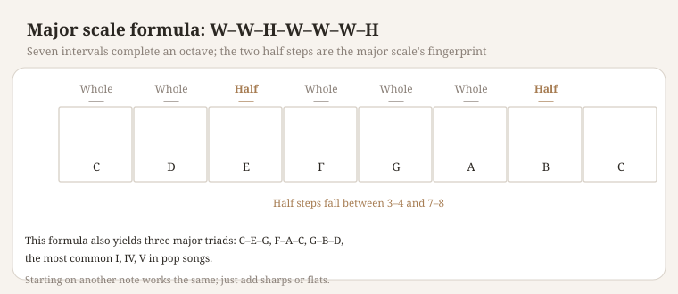
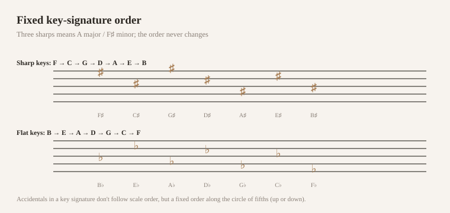
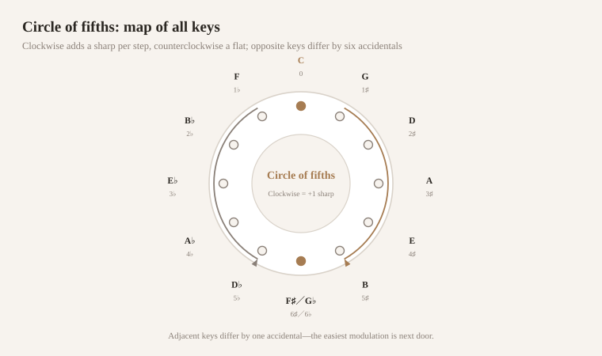
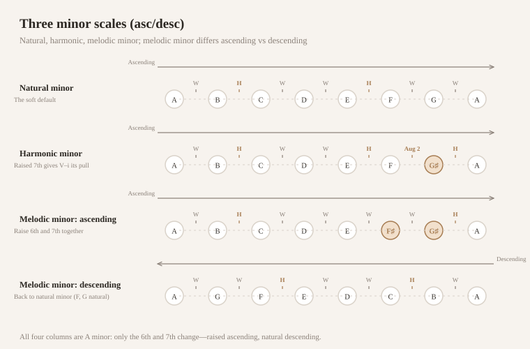
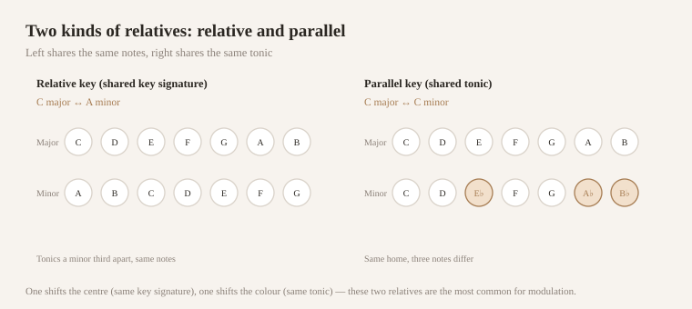
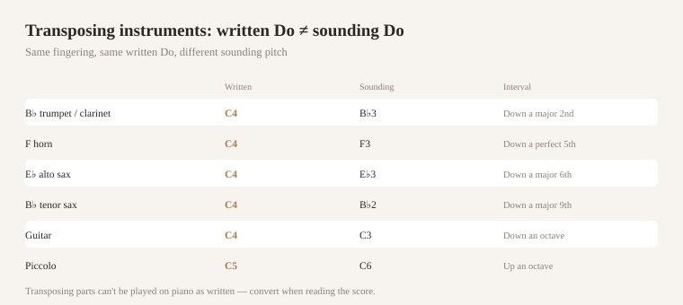
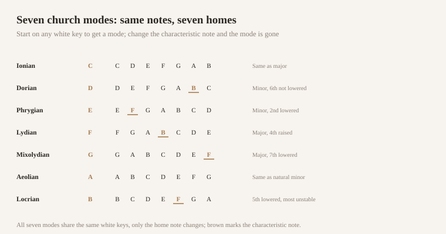
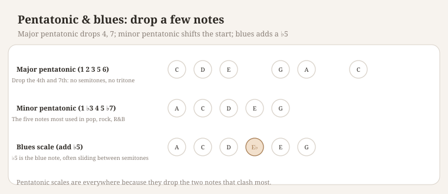

# Stage 5: Scales and Keys

Line intervals up and you get a scale. Pick one note as home and you get a key.

By now you know how many steps lie between any two notes. But music does not treat all twelve semitones as equals. Almost every tradition picks five, six or seven of them to form a family with a centre and a sense of stairs. That family is the scale, and the note you treat as home is the key.

The five chapters run: the major formula, key signatures and the circle of fifths, the three forms of minor, relative and parallel keys with transposition, and finally out of the Western seven-note scale into modes, the pentatonic scale and the blues. Some memorising starts here, but every item to memorise has a reason you can work out, so we will lean on understanding rather than recall.

## Chapter 19: The Recipe for a Major Scale — Whole Whole Half Whole Whole Whole Half

If intervals are letters, then scales are words. And the most common word in the world is called the major scale.

### **19.1 Seven gaps decide the character of an entire song**

Start on any note and follow the steps below, and you get a major scale:

**Whole — Whole — Half — Whole — Whole — Whole — Half**

Walk it once starting on C: C (whole) D (whole) E (half) F (whole) G (whole) A (whole) B (half) C. After seven gaps you land back on the note you started from, but an octave higher. This is the C major scale: C D E F G A B.

Notice where the "half" steps fall: **between the third and fourth notes (E–F), and between the seventh and eighth notes (B–C)**. These two semitones are the fingerprint of major — as long as they land in the right places, you can start on any note and still get a major scale; put them in the wrong places and it stops sounding major.

What if you don't start on C? Move the same recipe onto D and walk it once: D (whole) E (whole) F♯ (half) G (whole) A (whole) B (whole) C♯ (half) D. You'll find that to keep "whole whole half whole whole whole half," you have to raise F and C — that's the problem the next chapter, "key signature," deals with.

### **19.2 Why do the semitones fall in exactly these two places?**

Because these two semitone positions make the major scale automatically grow three "stable tripods": in C major, the three groups C–E–G, F–A–C, and G–B–D all happen to be major triads. That's exactly how the three chords pop songs use most — I, IV, and V — come into being.

Historically the scale came first and harmony theory came later; but looking at it the other way is also interesting: **this order of intervals happens to make the three most important tripods all hold at once**. This is the foundation of all Western harmony, and the later stages on chords and harmony will keep coming back here.

### **19.3 Every note has a name**

The seven notes in a scale each have a job title. Take C major as an example:

| Degree | Note | Name | Meaning |
|---|---|---|---|
| 1 | C | Tonic | Home. A melody resting here feels most settled |
| 2 | D | Supertonic | One step above the tonic, often used as a passing note |
| 3 | E | Mediant | Sits between the tonic and the dominant, decides major or minor colour |
| 4 | F | Subdominant | A fifth below the tonic (a fourth above), provides the push to "leave" |
| 5 | G | Dominant | The second most important note, the strongest source of tension |
| 6 | A | Submediant | The doorway to minor, the tonic of the relative minor |
| 7 | B | Leading Tone | Only a semitone from the tonic, strongly wants to "go home" |

The most important relationship here is between the **tonic** and the **leading tone**: the leading tone sits only a semitone from the tonic, and it almost "pulls" you back to the tonic. This semitone's pull is the main engine of the authentic cadence (V → I) — not every cadence relies on it, though; the plagal cadence (IV → I) doesn't need the leading tone at all.

### **19.4 Major doesn't mean "happy" — it means "having this structure"**

Textbooks often say major sounds cheerful and minor sounds sad. As a first impression that's fine; as a definition it's wrong. Major is just a set of interval steps. It can write a sad song (a lot of mourning music is in major), and minor can be written fiercely.

What really decides the emotion is how the melody moves, how the chords are arranged, how fast the tempo is, how thick the arrangement is. The mode just gives you a starting point.

### **19.5 Do it now**

You already know the major scale starting on C. Now try starting on G and work out the eight notes of G major yourself (hint: you'll need one sharp). Once you've done that, start on F and work it out again (this time you'll need one flat).

If you can work out these two, you're already inventing key signatures.

## Chapter 20: Key Signatures and the Circle of Fifths — Changing Keys Without Accidentals

In the previous chapter, we found that building a major scale from D requires raising F and C. If you had to draw a sharp every time one appeared, the score would get messy. So people came up with a labor-saving solution: **write all the sharps or flats a piece needs once, right after the clef.**

That is the key signature.

### **20.1 Key Signature: The “Rules for This Piece” at the Start**

A key signature is written between the clef and the time signature. It is a string of sharps or flats. It means: **every note marked by it in the piece is automatically sharped (or flatted), unless a natural sign cancels it.**

For example, the key signature of G major is one sharp (F♯). Once it is written at the beginning, every note written on F is automatically F♯; you do not have to draw it each time. This not only saves ink but also makes the key obvious at a glance—when a player sees two sharps, they know “this is D major or B minor” without reading the whole piece first.

### **20.2 The Order in Which Sharps and Flats Appear**

The sharps and flats in a key signature are not arranged randomly; they follow a fixed order:

- **Sharps**: F → C → G → D → A → E → B
- **Flats**: B → E → A → D → G → C → F (exactly the reverse of the sharp order)

Each time you add a sharp, you raise the seventh degree (leading tone) of the new key by a semitone—it is also exactly the fourth degree of the previous key raised by a semitone (F in C major becomes F♯ in G major). So the order of sharps (starting from F: F→C→G→D→A→E→B) is actually the path upward along the circle of fifths. You can remember the sharps with the English sentence “Father Charles Goes Down And Ends Battle”; read it backward for the order of flats.

### **20.3 The Circle of Fifths: A Map of All Keys**

Arrange the keys in “up a fifth” order into a circle, and you get the **Circle of Fifths**:

C → G → D → A → E → B → F♯ (=G♭) → D♭ → A♭ → E♭ → B♭ → F → back to C.

From C clockwise to F♯ (=G♭), each step adds one sharp; from C counterclockwise to G♭, each step adds one flat. The two sides meet at “six signs”—F♯ and G♭ are two spellings of the same sound, and after that the number of signs starts to decrease. This diagram is important because it shows three things at once:

1. **Number of accidentals in the key signature**: the farther from C, the more signs.
2. **How closely keys are related**: adjacent keys differ by only one sharp or flat, so modulation is smoothest (you’ll use this when we discuss modulation in the next stage).
3. **Chord relationships**: I, IV, and V in the same key are “three adjacent cells” on the circle.

### **20.4 Two Quick Tricks to Identify a Key**

When you get a score, how do you know what key it is in? Two rules of thumb:

- **Sharp keys**: look at the last sharp, go up a semitone from it, and that is the major tonic. For example, with three sharps (F♯, C♯, G♯), the last is G♯; a semitone up is A → A major.
- **Flat keys**: look at the second-to-last flat; that is the major tonic. For example, with three flats (B♭, E♭, A♭), the second-to-last is E♭ → E♭ major.

When there is only one flat, there is no “second-to-last” to use—when you see a single B♭, just memorize it as F major. Once you have these two tricks, you’ll read scores much faster.

| Key signature | Major key | Relative minor |
|---|---|---|
| None | C | A minor |
| 1♯ | G | E minor |
| 2♯ | D | B minor |
| 3♯ | A | F♯ minor |
| 4♯ | E | C♯ minor |
| 5♯ | B | G♯ minor |
| 6♯ | F♯ | D♯ minor |
| 7♯ | C♯ | A♯ minor |
| 1♭ | F | D minor |
| 2♭ | B♭ | G minor |
| 3♭ | E♭ | C minor |
| 4♭ | A♭ | F minor |
| 5♭ | D♭ | B♭ minor |
| 6♭ | G♭ | E♭ minor |
| 7♭ | C♭ | A♭ minor |

### **20.5 Same Set of Notes, Two Names**

Going further up: six sharps is F♯ major; six flats is G♭ major. They use the same set of piano keys and sound exactly the same; only one is written all in sharps and the other all in flats. This “same key, two spellings” situation is called an **enharmonic key**. The traditional key-signature system uses at most 7 sharps (C♯ major) or 7 flats (C♭ major). These two keys do exist (Bach’s Well-Tempered Clavier includes a C♯ major), but in practice, to keep the score readable, people often use the enharmonic key instead—C♯ major is often written as D♭ major (5 flats), and C♭ major is often written as B major (5 sharps).

### **20.6 Now Do It**

1. On the circle of fifths, find A major and E♭ major, and write their key signatures (how many sharps or flats each has, and which notes they are).
2. Find a song in numbered notation that you know, look at its key signature, and work backward to check: which note is Do in this song?
3. Write the same melody in G major and in D major, and count how much the key signatures differ—this is the start of transposition in the next chapter.

## Chapter 21: The Three Faces of Minor — Natural, Harmonic, Melodic

Major has only one formula; minor has three. This is not music theorists making trouble for its own sake. The three formulas each solve a different problem—and you will hear them take turns in different kinds of music.

### **21.1 Natural Minor Scale: The Major Scale's "Three Notes Lowered" Version**

The most basic minor scale has this formula: **whole — half — whole — whole — half — whole — whole**.

Start on A and go once: A (whole) B (half) C (whole) D (whole) E (half) F (whole) G (whole) A. This is the A natural minor scale, and it happens to use all white keys—it shares the same set of notes with C major, only with A as home.

It is clearer if you look at it "relative to major": the natural minor scale simply lowers the **third, sixth, and seventh notes** of the major scale by a semitone. These three lowered notes are exactly where the minor scale's "dark" sound comes from. The third degree is especially key—the major third becomes a minor third, and the whole tonal color changes.

### **21.2 Harmonic Minor Scale: To Make the V Chord Come Home**

The natural minor scale has an awkward problem: its seventh note (G in A minor) is a **whole tone** from the tonic, unlike the major scale's leading tone, which is only a semitone away. Without that semitone pull, the force of "the dominant chord returning to the tonic" is much weaker.

So people simply raised it by a semitone: G in A minor becomes G♯. Then the fifth-degree chord changes from Em to an E major chord (E–G♯–B), and the tension of returning to Am appears. This version is called the **harmonic minor scale**, and its formula is: **whole — half — whole — whole — half — augmented second — half**.

Note that between the sixth and seventh notes there is now an **augmented second** (F to G♯). This is an interval peculiar to harmonic minor (it does not appear in the natural major scale), and it is one source of the "exotic" sound in Middle Eastern, Eastern European, and Gypsy music.

The cost: this scale is hard to sing melodically—the augmented-second leap sounds abrupt. So composers borrow it only when "the chord needs a leading tone."

### **21.3 Melodic Minor Scale: Raised Going Up, Restored Going Down**

If a melody goes up, raise the sixth and seventh notes together (A minor: F♯, G♯). The leap becomes smooth, and you also get a leading tone. Going down, these two notes return to natural minor.

This is the **melodic minor scale**:

- Up: A B C D E F♯ G♯ A
- Down: A G F E D C B A (back to natural minor)

This rule—"raised going up, restored going down"—was systematized by nineteenth-century textbooks. Before that, Baroque and Classical composers actually used raised sixth and seventh degrees freely according to harmonic need, both upward and downward. In jazz, melodic minor was taken up as improvisation material, usually only the upward version.

### **21.4 How Do You Choose Among the Three Versions?**

- **Natural minor**: melody and harmony are both soft; most common in folk songs, pop verses, and passages that do not need a strong cadence.
- **Harmonic minor**: when you need a strong V–i close (for example, the end of a piece or an important cadence), or when you want an exotic color.
- **Melodic minor**: when you need a rising line that is "singable."

In practice, a song often mixes all three: verses use natural minor, before the chorus borrows the leading tone of harmonic minor, and when the melody shoots up it uses melodic minor. **They are not three different keys, but three ways of using the same minor key.**

### **21.5 Do It Now**

Play (or sing) the same melody three times in A minor: first all in natural minor, second replace G with G♯, third change back to G on the way down. Notice how much the feeling of "coming home" differs when the last note lands on A—that difference is what the leading tone is doing.

## Chapter 22: Relative Keys, Parallel Keys, and Transposition — Same Home, Different Door Numbers

You now have a circle of fifths in hand, and you know what each key looks like. Next up: the "family relationships" between keys, and something that happens every day in pop music — moving a whole song to another key.

### **22.1 Relative Keys: Major and Minor Sharing One Key Signature**

Every major key has a minor key "living on the same floor" — they use the same set of notes and the same key signature, just treating a different note as home.

This minor key is called the **relative minor**. To find it: **count down a minor third from the major key's tonic**.

- C major's relative minor is A minor (C down a minor third = A)
- G major's relative minor is E minor
- F major's relative minor is D minor

How close is the relationship? Take the same song, change just a few chords, and you can switch from the brightness of major to the darkness of the relative minor — because the notes on both sides are exactly the same, only the center of gravity has moved.

### **22.2 Parallel Keys: Same Tonic, a Shell of a Different Color**

Another kind of relative is the **parallel key**: same tonic, but one is major and one is minor.

- C major ↔ C minor
- G major ↔ G minor

They don't share a key signature — C major has no sharps or flats, C minor has three flats (B♭, E♭, A♭), a difference of exactly three notes. So the parallel relationship is "same home, different door numbers": the tonic is the same, but the whole building's color has been swapped out.

Pop songs often deliberately borrow chords from the parallel key (for example, using iv or ♭VI in a major-key song) to create a sudden darkening effect — this is called **modal interchange**, and we'll run into it again in stage six when we cover chords.

### **22.3 Transposition: Moving a Whole Song to Another Key**

**Transposition** means moving every note in a piece of music up or down by the same distance at the same time. The melodic intervals stay exactly the same; it still sounds like the same song, just overall a little higher or a little lower.

Why transpose? Three most common reasons:

1. **To fit the singer's range.** The same song, a male voice is usually an octave lower than a female voice; adjust by a few semitones as needed.
2. **To fit the instrument.** On guitar, put a capo on the second fret and play a C chord shape — what actually sounds is D.
3. **To fit the section's mood.** Raising the final chorus by a semitone or a whole tone is pop's oldest "pressure" trick.

The math is simple: move every note by the same interval. C major's I–IV–V is C–F–G; move it to D major and it becomes D–G–A. **The degrees stay the same, the note names all change** — which is also why many players are used to communicating in degrees rather than saying chord names directly.

### **22.4 Transposing Instruments: The Do on the Page Isn't the Do You Hear**

There is a class of instruments that are transposing by nature: the page says C, but what actually sounds is a different pitch.

| Instrument | What you hear when the page says C | Difference |
|---|---|---|
| B♭ trumpet, B♭ clarinet | B♭ | down a major second |
| F French horn | F | down a perfect fifth |
| E♭ alto saxophone | E♭ | down a major sixth |
| B♭ tenor saxophone | B♭ | down a major ninth |

The reason for this design is practical: it lets instruments of the **same family** share fingerings. For example, all saxophones have the same key logic — switching from alto to tenor doesn't require learning a new system, only the sounding pitches differ; trumpet, clarinet, and saxophone each have their own system, and can't be directly swapped.

So when you see a French horn part written as C in a score, don't assume it's playing the piano's middle C — it's playing F, a fifth below. When reading scores, this layer of conversion is essential.

### **22.5 Now Do It**

1. Find the three songs you like most on your playlist, and look up their keys. If they're all in the same key, think about why.
2. Transpose one of their choruses +2 (up a whole tone), and sing it. You'll find that the same melody, in a different range, feels completely different in your body.
3. Write down that song's progression using degrees (I–V–vi–IV) rather than chord names.

## Chapter 23: Modes, the Pentatonic Scale, and the Blues — Two Ways Out of Major and Minor

So far, our world has only two colors: major and minor. But music certainly has more than two. This chapter opens two doors: one leads to **modes** (the same set of notes, different homes), and one leads to **the pentatonic scale and the blues** (simply delete a few notes).

### **23.1 Modes: Start the Major Recipe from a Different Note**

The notes of C major are C D E F G A B. What if I don't start on C, but start on D, and arrange the same set of notes in a circle?

D E F G A B C D — the intervals become "whole–half–whole–whole–whole–half–whole." This set of notes is neither major nor natural minor; it is called the **Dorian mode**.

The same method, starting from each note on the white keys, gives seven modes. Medieval church music developed a system of modes (actually eight: four authentic and four plagal). Later theorists organized it into the seven below, collectively called the **church modes**—though Locrian was never actually used in medieval church music:

| Mode | Starts on (white key) | Equivalent to | Characteristic note |
|---|---|---|---|
| Ionian | C | Major | — |
| Dorian | D | Minor, but the sixth is not lowered | ♮6 |
| Phrygian | E | Minor, but the second is lowered | ♭2 |
| Lydian | F | Major, but the fourth is raised | ♯4 |
| Mixolydian | G | Major, but the seventh is lowered | ♭7 |
| Aeolian | A | Natural minor | — |
| Locrian | B | Most unstable | ♭2, ♭5 |

Of the seven modes, two are already familiar—Ionian is major, Aeolian is natural minor. The other five each live on a "characteristic note": Dorian's major sixth, Phrygian's minor second, Lydian's augmented fourth, Mixolydian's minor seventh, Locrian's diminished fifth. Change that note, and the mode disappears.

These modes are not museum pieces. Jazz uses Dorian and Mixolydian heavily; film scores love Phrygian for an exotic feel; Lydian often appears in "floating, dreamlike" passages.

### **23.2 The Pentatonic Scale: Remove the Two Notes That Clash**

If you remove the fourth and seventh notes from the major scale, you get: **1 2 3 5 6** (C D E G A). This is called the **major pentatonic scale**.

The effect of removing these two notes is very clear: originally there is a tritone between the fourth and seventh, and 3–4 and 7–1 are semitones—after deleting 4 and 7, the whole scale has **no semitones and no tritone**. So no matter how you combine them, they don't clash; it sounds clean, open, without pressure.

This is why many ancient musical traditions independently developed pentatonic scales: Scottish folk songs, American country music, West African music, and China's **gong, shang, jue, zhi, yu** (corresponding to 1 2 3 5 6). It is not a Western patent, but not every culture took this path—Indian and Arab classical traditions are mainly seven-note.

Minor has its own pentatonic scale: **1 ♭3 4 5 ♭7** (A C D E G). It may appear more often in pop, rock, and R&B than the major pentatonic.

### **23.3 The Blues Scale: One More "Not-Quite-Right" Note**

Add a **♭5** to the minor pentatonic scale (E♭ in A minor), and you get the **blues scale**: A C D E♭ E G.

This ♭5 is the most recognizable of the **blue notes** (Blue Note)—blue notes broadly refer to ♭3, ♭5, and ♭7, the notes that "sit between major and minor." It is unstable, belongs neither to major nor to minor, and sounds like it is "stuck in the middle." In actual playing, it is often not a fixed note but slides between ♭5 and ♮5—which is why the blues sounds so "human": it refuses to be nailed down by twelve-tone equal temperament.

Jazz also uses the blues scale as a starting point for improvisation, but jazz players usually do not stop at pentatonic plus one note; they use all the notes of the mode. **The blues scale is an entrance, not the whole thing.**

### **23.4 Modes Are Not "Wrong Major"**

Many people, hearing modes for the first time, think, "Isn't this just playing the major scale starting from a different note?" Technically yes, but musically it is very different.

When you improvise in Dorian, your ear treats D as home, and the chords match Dorian's color (for example, a Dm7–G7 loop); when you play the same set of notes in C major, D is just one scale degree in the key, and your ear does not treat it as "home." **The same set of notes with a different center of gravity is two different kinds of music.**

### **23.5 Now Do It**

1. On the keyboard, play only white keys, but start on a different note each time; play each of the seven modes once. Notice which one feels most uncomfortable (usually Locrian).
2. Improvise for 8 bars in D Dorian over a two-chord loop of Dm7–G7.
3. Play a passage in A minor pentatonic, then add E♭ and listen to how that note "sticks" inside it.
