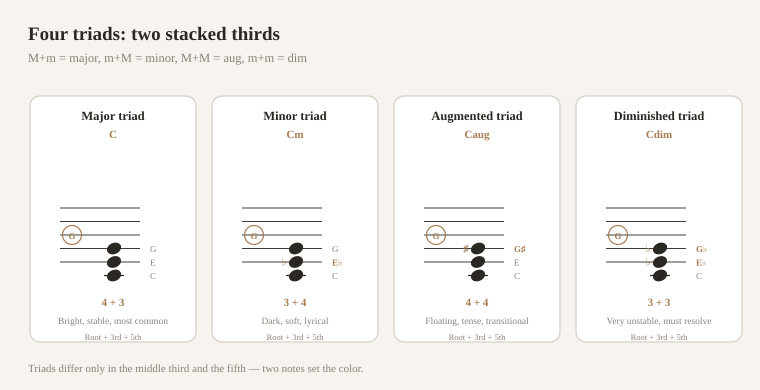
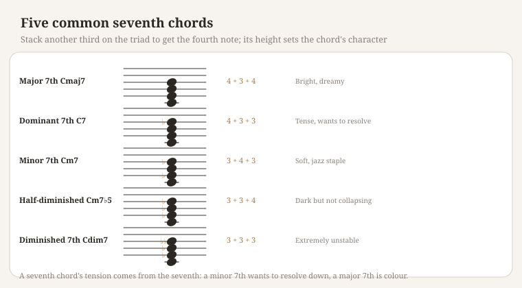
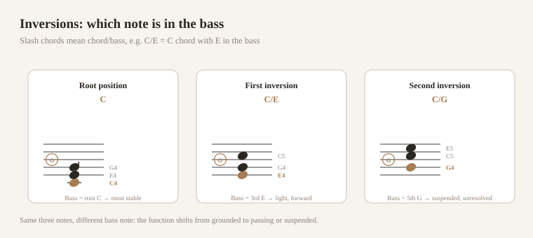
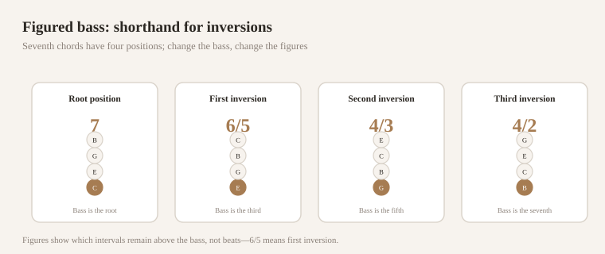
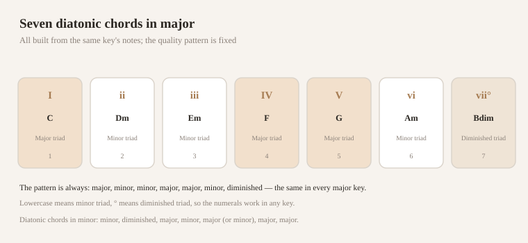
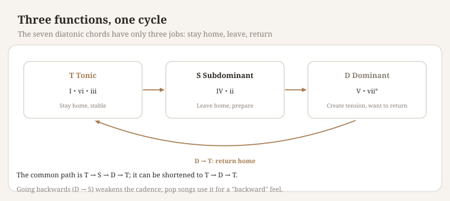
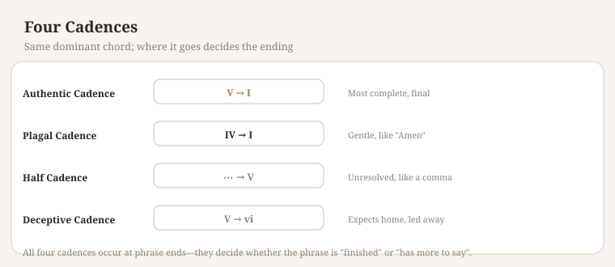
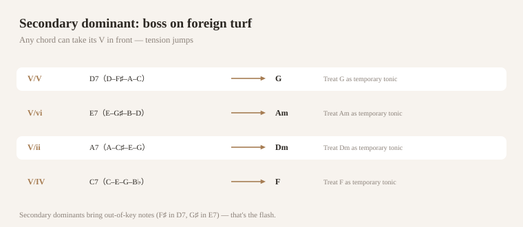
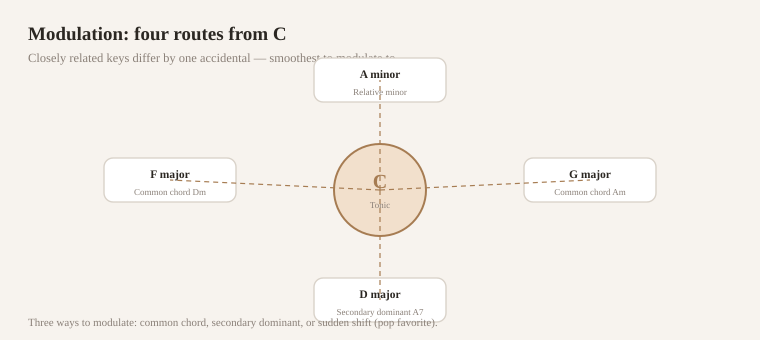

# Stage 6: Chords and Harmony

Three notes sounding together make a chord. Chords arriving one after another make harmony.

This is the stage where many people stall, and also the one that pays off most. We take chords apart first: how a triad is stacked, what the extra note in a seventh chord is doing, and what an inversion changes. Only then do we get to the grammar — what job each of the seven chords in a key does, why V insists on going back to I, and why some progressions simply sound right.

After six chapters you will not just have a pile of chord names. You will have a tool that explains why a song moves the way it does. The C–G–Am–F you see in every pop song stops being four isolated symbols.

## Chapter 24: The Structure of Triads — Major, Minor, Augmented, Diminished

A single note is a point, an interval is a line, and a chord is a surface. And the most basic kind of chord uses only three notes.

### **24.1 Three notes, two layers of thirds**

The definition of a **triad** is plain: start on a **root**, stack a third above it, then stack another third, and you have three notes in total.

Take C as the root: C (root) → E (third) → G (fifth). Stack those three notes and you get a C major triad, written C.

Why a third and not some other gap? Because stacked thirds give you a "root–fifth" frame, with a third wedged in the middle to set the colour. The root and fifth supply stability; the third in the middle supplies character — that is the design logic of a triad.

### **24.2 The four kinds of triad**

Each of the two layers of thirds can be major or minor, and the combinations give you four triads:

| Chord | Lower third | Upper third | Semitone structure | Example (C root) |
|---|---|---|---|---|
| Major triad | Major third (4) | Minor third (3) | 4 + 3 | C–E–G |
| Minor triad | Minor third (3) | Major third (4) | 3 + 4 | C–E♭–G |
| Augmented triad | Major third (4) | Major third (4) | 4 + 4 | C–E–G♯ |
| Diminished triad | Minor third (3) | Minor third (3) | 3 + 3 | C–E♭–G♭ |

All four chords share the same root, C. The only differences are the middle third (E or E♭) and the fifth above (G, G♯ or G♭): major and minor differ only in that middle note, while augmented and diminished push the fifth out or in by a semitone. You can boil the rule down to one line: **"major plus minor is major, minor plus major is minor, major plus major is augmented, minor plus minor is diminished."**

How to write chord symbols:

- Major triad: just write the root, **C**
- Minor triad: add a lowercase m, **Cm**
- Augmented triad: add aug or ＋, **Caug**, **C＋**
- Diminished triad: add dim or °, **Cdim**, **C°**

### **24.3 Why is a triad so stable?**

Because its three notes land exactly on the 4th, 5th and 6th harmonics of the harmonic series. With C2 (about 65 Hz) as the fundamental, the 4th, 5th and 6th harmonics are exactly C4, E4 and G4 — in other words, when you press a C major triad, you are really amplifying something a single note already contains.

That explains why a major triad sounds the most stable: it is not harmony added from outside, it is a structure the sound grows by itself. A minor triad (C–E♭–G) has no such direct match, so it sounds more reserved. An augmented triad (C–E–G♯) stacks two major thirds and has no stable fifth frame, so it sounds floating and unsettled, and is often used in transitions or suspenseful passages. A diminished triad (C–E♭–G♭) is even less stable and almost always has to resolve to the next chord.

### **24.4 Three notes are already enough to write a song**

The great majority of the chords you meet most often in pop music are built from these four triads (plus seventh chords). They are enough because a triad carries just the right amount of information: clear enough for listeners to remember, vague enough to let a melody move freely over it.

If you remember only one thing, remember this: **the middle third decides whether the chord is bright or dark; the fifth decides whether it is stable or unstable.** From now on, when you see any complicated chord, find those two notes first and you will not get lost.

### **24.5 Do it now**

Find C on the keyboard and move one note at a time:

1. C–E–G (major) → lower E by a semitone → C–E♭–G (minor)
2. Now lower G by a semitone → C–E♭–G♭ (diminished)
3. Take another route: go back to C–E–G, and this time raise G by a semitone → C–E–G♯ (augmented)

Press all four chords once and notice how the "colour" shifts one step at a time. This exercise is far more useful than memorising the table.

## Chapter 25: Seventh Chords and Extended Chords — From Three Notes to Four, and Then to More

A triad is clean and useful, but it only has four colors. If you want more layers, you have to add one more note on top.

### **25.1 Adding Another Third: Seventh Chords**

Stack another third on top of a triad. The fourth note is a seventh above the root, so it's called a **seventh chord**.

Take C: C–E–G–B. The extra B makes the whole chord's "flavor" complicated all at once — it's no longer just a still color, but carries a bit of "not finished yet" tension.

### **25.2 Five Common Seventh Chords**

| Chord | Semitone structure | Example on C | Symbol | Sounds like |
|---|---|---|---|---|
| Major seventh chord | 4 + 3 + 4 | C–E–G–B | Cmaj7 | Bright, dreamy, a little floating |
| Dominant seventh chord | 4 + 3 + 3 | C–E–G–B♭ | C7 | Tense, wants to resolve |
| Minor seventh chord | 3 + 4 + 3 | C–E♭–G–B♭ | Cm7 | Soft, the jazz standard |
| Half-diminished seventh chord | 3 + 3 + 4 | C–E♭–G♭–B♭ | Cm7♭5, Cø7 | Dark but not collapsing |
| Diminished seventh chord | 3 + 3 + 3 | C–E♭–G♭–B♭♭ | Cdim7, C°7 | Extremely unstable, like hanging in midair |

There's also a rarer but very beautiful **minor-major seventh chord** (Cm(maj7), also written CmΔ7: C–E♭–G–B, that is, a minor triad plus a major seventh). Its structure is 3 + 4 + 4, and it sounds like a ray of light shining through a minor key.

The one you need to watch most is the **dominant seventh chord (C7)**. It's the engine of all Western harmony: because it contains both a major third (E) and a minor seventh (B♭), its direction of resolution is the clearest — it almost only wants to go back to the F chord. Most of the "this song is about to end" feeling you hear comes from the dominant seventh chord. (The diminished seventh chord actually has more tension, but it has several directions of resolution, so it feels more like "hanging in midair" than "coming home.")

### **25.3 sus and add: Adding Notes Without Stacking Thirds**

Seventh chords aren't the only way to add notes. There are two other common variations:

- **sus** (suspension): replace the third with a second or a fourth. Csus4 = C–F–G, Csus2 = C–D–G. Because there's no third, the chord is neither major nor minor; it sounds "open, unresolved," and often appears before resolving back to C.
- **add** (added): keep the third and add another note on top. Cadd9 = C–E–G–D (with the D placed an octave higher). It's fuller than C, but not as "jazz" as Cmaj7.

**The difference between sus and add, in one sentence: sus replaces the third, add keeps the third and adds a note.** The easiest pair to confuse is Csus2 and Cadd9: the first is C–D–G (no third), the second is C–E–G–D (the third is still there). You see a D in both, but they sound like two completely different things.

### **25.4 Nine, Eleven, Thirteen: Stacking All the Way Up**

Keep stacking thirds upward and you get the ninth chord (C9 = C–E–G–B♭–D), the eleventh chord (add F), and the thirteenth chord (add A). In theory you can stack all the way to thirteen, but in practice you rarely press all of them — too many notes blur into a mush.

Jazz players "pick the important ones": leave out the fifth, keep the third and the seventh (these two decide the chord's quality), and put the ninth, eleventh, and thirteenth in the upper voice as color notes. So the C13 you see on the page might actually be played as just four notes: C–E–B♭–A.

### **25.5 Do It Now**

On the same piano, start from the C major triad and move the fourth note up one semitone at a time:

C–E–G–B♭ (C7) → C–E–G–B (Cmaj7) → C–E–G–C (the seventh is gone, and you fall back to a plain C major triad; the tension lets go completely)

Then try C–E♭–G–B♭ (Cm7) → C–E♭–G–B (Cm(maj7)).

Move only one note each time, and you'll clearly hear "which note is deciding what."

## Chapter 26: Inversions, Slash Chords, and Figured Bass — Who Is on the Bottom?

A C chord is C–E–G. But if I put E in the bass, does it still sound like a C chord? Answer: it is the same chord, but its **function and weight are completely different**. This chapter is about why the lowest note matters.

### **26.1 The Lowest Note Determines a Chord's Weight**

A chord has three (or more) notes, and their order changes the center of gravity of the whole sound. The lowest note is called the **bass**. It is the note closest to the bottom of what listeners perceive, and it is the note the bass player actually plays.

When the bass is the root, the chord sounds most stable and most "grounded." Change the bass to another note, and its stability and sense of direction change—first inversion is usually lighter and has a sense of forward motion; second inversion is less stable and more "hanging." This is the effect of **inversion**.

### **26.2 The Two Inversions of a Triad**

Take a C major triad as an example:

- **Root position**: C–E–G (bass is root C) → symbol C
- **First inversion**: E–G–C (bass is third E) → symbol C/E
- **Second inversion**: G–C–E (bass is fifth G) → symbol C/G

In notation, C/E is read as "C on E," meaning "C chord with E in the bass." This slash notation for the bass note is a **slash chord**.

The three arrangements (root position and two inversions) differ greatly in function: first inversion is lightest and works best as a transition; second inversion sounds suspended, with a feeling of "not finished yet." Traditionally it comes before the dominant chord, or it is used to create the tension of "standing up."

### **26.3 A Seventh Chord Has Four Positions**

A seventh chord has four notes, so besides root position it has three inversions. Classical theory labels them with **figured bass**:

| Position | Bass | Figures | Cmaj7 example |
|---|---|---|---|
| Root position | root | 7 | C–E–G–B |
| First inversion | third | 6/5 | E–G–B–C |
| Second inversion | fifth | 4/3 | G–B–C–E |
| Third inversion | seventh | 4/2 (or 2) | B–C–E–G |

These numbers are not beats. They show which intervals remain above the bass. Take first inversion 6/5 as an example: above the bass there is a fifth and a sixth (the third is assumed by default and left unwritten). Beginners get a headache from it, but it is actually a very efficient shorthand—the numbers tell you directly the relative position of the voices.

### **26.4 Why Use Inversions in Practice?**

Three reasons:

1. **The bass line needs to be smooth.** If every chord uses root position, the bass jumps around (C→F→G); with inversions, the bass can move by smaller steps (C→C/E→F, where E→F is only a semitone), and the whole song feels much more stable.
2. **Avoid "repeating the same note too many times."** If the piano's left hand keeps pressing the root, it sounds heavy and clumsy.
3. **Create tension and a sense of direction.** Second inversion (C/G) is especially good before the dominant chord: although its bass is G, the fourth (C) and sixth (E) above it are dissonant intervals, and they must resolve to B and D respectively, so it sounds "hanging, needing to land." Note that C/G itself is still the second inversion of the tonic chord, not the dominant chord.

In pop music, slash chords have another common use: **pedal point**. The chords change throughout a passage, but the bass keeps holding the same note, creating an effect of "stuck, building pressure." It is most often used before the chorus.

### **26.5 Do It Now**

Find a song you like and rewrite all its chords as slash chords: each time ask, "What if the bass were the third?" First play only the bass, and listen to whether that line goes up or down. **In a good chord progression, the bass can almost always be sung on its own as a song.**

## Chapter 27: Diatonic Chords — The Seven Chords in a Key

Now you can build chords. Next question: if you use only the seven notes of C major, what chords can you build? The answer is seven, no more and no less, and their order follows a fixed pattern.

### **27.1 Build a Triad on Every Degree of the Scale**

The method is simple: start on each note of C major, skip one, take one, skip one, take one, and use only notes in the key.

- Starting from C: C–E–G → **C major triad**
- Starting from D: D–F–A → **Dm minor triad**
- Starting from E: E–G–B → **Em minor triad**
- Starting from F: F–A–C → **F major triad**
- Starting from G: G–B–D → **G major triad**
- Starting from A: A–C–E → **Am minor triad**
- Starting from B: B–D–F → **Bdim diminished triad**

These seven chords are called the **diatonic chords** of C major. That means chords “made entirely from the notes of this key, with no outside notes borrowed.”

### **27.2 The Order Is Regular: Major, Minor, Minor, Major, Major, Minor, Diminished**

Notice the order of qualities: **major, minor, minor, major, major, minor, diminished**. This is not a coincidence. It is the necessary result of the major scale’s “whole–whole–half–whole–whole–whole–half”—because the half steps always fall between 3–4 and 7–8, the two stacked thirds in each triad automatically become major or minor.

So this pattern applies to **all major keys**. The diatonic chords of G major are also “major, minor, minor, major, major, minor, diminished”; only the chord names change to G, Am, Bm, C, D, Em, F♯dim.

### **27.3 Degrees: Communicating with Roman Numerals**

Instead of memorizing the chord names in twelve keys, remember the **degrees**. Use Roman numerals to mark which degree of the scale, and use uppercase or lowercase to show the quality:

| Degree | Chord (C major) | Quality | Functional role |
|---|---|---|---|
| I | C | Major | Tonic (home) |
| ii | Dm | Minor | Subdominant, prepares to leave |
| iii | Em | Minor | Substitute for tonic |
| IV | F | Major | Subdominant, strongest “leaving” |
| V | G | Major | Dominant, strongest pull “home” |
| vi | Am | Minor | Substitute for tonic (relative minor) |
| vii° | Bdim | Diminished | Substitute for dominant, very unstable |

Uppercase = major triad, lowercase = minor triad, lowercase plus ° = diminished triad. The advantage of this notation is that “I–V–vi–IV” works in any key; you do not have to say “C–G–Am–F” or “D–A–Bm–G.”

### **27.4 Diatonic Chords in Minor**

The pattern in natural minor is: **minor, diminished, major, minor, minor, major, major**. For A minor, for example: Am, Bdim, C, Dm, Em, F, G.

But in actual use, the fifth degree is often not Em but **E (major triad)**—this is exactly the purpose of raising the seventh degree in the “harmonic minor scale” from the previous stage. So minor-key diatonic chords have to be seen as two sets:

| Degree | i | ii° | III (III+ in harmonic) | iv | v (or V) | VI | VII (natural) / vii° (harmonic) |
|---|---|---|---|---|---|---|---|
| Natural minor | Am | Bdim | C | Dm | Em | F | G |
| Harmonic minor | Am | Bdim | C+ (C–E–G♯) | Dm | E | F | G♯dim |

The third degree of natural minor is the C major triad; once you raise G to G♯, the third degree becomes the augmented triad C+. Pop songs usually mix the two: **use C from natural minor for III, and E from harmonic minor for V**—very common in practice, but in theory it is “borrowing.” So when you see a minor-key chord table, first confirm which set it is written in, or the chords will not match up.

### **27.5 Why Is This Table So Useful?**

Because pop songs most often use diatonic chords (though secondary dominants and borrowed chords are also common). When you get a song and change its chords into degrees, you will find that hundreds of songs actually look much the same:

- Canon progression: I–V–vi–iii–IV–I–IV–V
- Common pop: I–V–vi–IV
- Sad type: vi–IV–I–V
- Old-school ballad: I–vi–IV–V

**The key changes; the degrees do not.** Once you learn to listen to songs in degrees, you start to “hear the structure.”

### **27.6 Do It Now**

Take a song, find its key, and change every chord into a degree. Then transpose the whole song to another key and work out the chords again from the degrees. After you do this once, you will never again be afraid of “what key is this song in.”

## Chapter 28: Functional Harmony and Cadences — What Chords Do

The previous chapter listed seven diatonic chords but did not explain their relationships. This chapter answers a more basic question: **Why do chords have to appear in a certain order?**

### **28.1 Seven Chords, Three Jobs**

Sort the seven diatonic chords by “function,” and there are only three groups:

| Function | Name | Chords included | What it does |
|---|---|---|---|
| T | Tonic function | I, vi, iii | Stays home, stable, ends |
| S | Subdominant function | IV, ii | Leaves home, sets up, prepares |
| D | Dominant function | V, vii° | Creates tension, strongly wants to go home |

The basic logic of musical progression is the cycle **T → S → D → T**: start from home, leave, build tension, return home. You can think of the three functions as three parts of a sentence: “I’m at home” → “I go out” → “I’m going home.”

Of course, real music does not always go through the whole cycle every time. The most common omission is “T → D → T” (skipping the subdominant). The most common reverse motion, “D → S,” needs special handling—it is a common pop device for a “backward” feeling. Classical theory would say it weakens the force of the cadence, but pop songs don’t care about this.

### **28.2 Why Does the Dominant Chord Want to Go Home So Much?**

The dominant chord (V) contains a key note: the **leading tone**. Take the G chord (G–B–D) in C major: B is the leading tone, only a semitone away from the tonic C. When B sounds, your ear automatically expects it to resolve upward to C.

At the same time, the dominant seventh chord (G7: G–B–D–F) adds an F. The interval between B and F is a tritone (three whole tones), the most unstable interval in the key, and its resolution is almost unique: B goes up to C, F goes down to E. The two notes resolve at the same time and land exactly on the root and third of the C major triad (add the original G and you get the complete C–E–G).

So “V → I” is so strong not just because of habit, but because **each of the two notes moves only a semitone**. This is one of the core conventions of Western tonal harmony—note that it is a “convention,” not a “law of physics”; music in other cultures does not have to resolve this way.

### **28.3 Four Kinds of Cadences**

The way a phrase ends is called a **cadence**. The four most common:

| Cadence | Progression | Feeling |
|---|---|---|
| Authentic cadence | V → I | Most complete, most “final” |
| Plagal cadence | IV → I | Gentle, like an “Amen” ending |
| Half cadence | Stops on V | Suspended, like a comma |
| Deceptive cadence | V → vi | You expect home but are taken elsewhere, like “Huh?” |

There is also one with a lot of character whose name is often used incorrectly: **♭VII → i** (for example, B♭ → Cm in C minor). Pop and rock love it, and it sounds Spanish or Andalusian—it is often called the “modal cadence,” and some call it the Andalusian cadence (the complete progression is i–♭VII–♭VI–V). As for the “Phrygian cadence” in classical theory, that is actually something else: the bass moves down by semitone from ♭6 to 5 (A♭ → G in C minor), usually written iv6 → V. Both are said to sound “Spanish,” but the chords and bass motion are different.

### **28.4 Harmonic Rhythm: How Fast Chords Change Is Also Expressive**

With the same progression, different chord-change speeds produce completely different effects.

- **One chord per bar**: broad and relaxed, good for a verse or a lyrical section.
- **Two chords per bar**: a sense of drive; most common in pop songs.
- **Four chords per bar**: urgent and tense; often used in the build-up before a chorus.

This “how often the chord changes” is called **harmonic rhythm**. It is one of the most easily overlooked parameters in arranging, yet one of the ones that can change the mood most. Take the same melody and slow the harmonic rhythm by half, and it immediately goes from “pushing” to “floating.”

### **28.5 Common Progressions and Their Functional Readings**

- **I–V–vi–IV** (C–G–Am–F): T–D–T–S. The most popular four-chord progression.
- **vi–IV–I–V** (Am–F–C–G): starts on a substitute for T; the mood is lower.
- **ii–V–I** (Dm–G–C): the complete S–D–T cycle, the backbone of jazz.
- **I–vi–IV–V** (C–Am–F–G): the all-purpose progression of old-school ballads, also called the “’50s progression.”
- **I–vi–ii–V** (C–Am–Dm–G): replace the IV of the previous one with ii, and you get the most common turnaround in jazz.

Do you see it? Most of these progressions revolve around the three functions T, S, and D, but the order and omissions differ—not every one follows T → S → D → T. I–V–vi–IV is actually T–D–T–S.

### **28.6 Do It Now**

1. In C major, play I–IV–V–I once, then change the final V–I to V–vi and listen for the “deceptive” feeling.
2. Halve the number of bars in the same progression (speed up the harmonic rhythm) and play it again.
3. Find a song you like and mark where its cadences are—usually the one or two bars where a section ends.

## Chapter 29: Secondary Dominants, Borrowed Chords, and Modulation — Borrowing from Other Keys

Diatonic chords are “legal” material, but what really gives music flavor is often the “illegal” notes. This chapter covers the three most common ways to break the rules.

### **29.1 Secondary Dominants: Acting Like the Boss on Someone Else’s Turf**

In C major, the dominant chord is G7, and it wants to return to C. But what if today I want the Dm chord to sound more important?

I can put an **A7** (A–C♯–E–G) before Dm. A7 is the dominant seventh chord of D, and it strongly wants to resolve to Dm—just as G7 wants to return to C. This A7 is called a **secondary dominant**, written **V/ii** (read as “five of two”).

- V/V (D7 in C major) → resolves to G
- V/vi (E7) → resolves to Am
- V/IV (C7) → resolves to F

Notice one detail: these chords contain **notes outside the key** (C♯ in A7, G♯ in E7, F♯ in D7). Those notes are exactly what make them “not belong to this key,” and they create extra tension. That is why music suddenly sounds “brighter” after you add a secondary dominant.

Secondary dominants can also appear as ii–V, for example Am7–D7–G (ii–V of V). This is the most common decoration in jazz.

### **29.2 Borrowed Chords and Modal Mixture**

Another way to “borrow” is to take chords from the **parallel key**. C major can borrow chords from C minor:

- **iv** (Fm) instead of IV (F): the most common borrowed chord; it suddenly sounds softer and darker.
- **♭VI** (A♭): strongly dramatic, often used in film scores.
- **♭VII** (B♭): has a rock, folk flavor.
- **♭III** (E♭): falls between the two.

This practice is called **modal mixture**: on the same tonic, you mix material from major and minor. It works because the listener’s sense of tonic is not broken—you only change the color, not the home.

### **29.3 The Neapolitan Chord: A Major Chord on the Lowered Second**

There is one more borrowed chord with a lot of character: the **Neapolitan chord**. You lower the second degree by a semitone and make it a major triad. In C major, that is the **D♭ major triad** (D♭–F–A♭). It usually appears in first inversion (F in the bass), then goes to V.

Its effect is very dramatic—like suddenly being pulled into a dark room, then returning from there to the tonic chord. It is common in the Classical period, and pop music and film scores like to use it too.

### **29.4 Modulation: Actually Moving House**

Everything above is “borrowing”; the tonic does not change. **Modulation** means the tonic really changes: from then on, the music makes its home on another note.

Three common methods:

1. **Pivot chord modulation**: both keys recognize the same chord, and you use it as a bridge. For example, to go from C major to G major, you can use Am (vi in C major, and also ii in G major) as the pivot.
2. **Secondary dominant modulation**: directly use the new key’s V chord to “announce” the new home. For example, D7 suddenly appears in C major, and then the music moves naturally into G major.
3. **Direct modulation**: no paving, just jump. It is most common in pop songs—the last chorus goes straight up a whole tone, with no bridge, and listeners do not get lost because the melody is still there.

In practice, modulation most often happens at: **the verse going into the chorus** (an emotional lift), **the final chorus** (raised by a semitone or a whole tone), and **the bridge** (leaving temporarily and then returning).

### **29.5 Do It Now**

1. In a I–vi–ii–V progression in C major, add a secondary dominant before each chord. It will sound very “jazz.”
2. Replace the IV in I–IV–V–I with iv (Fm), and feel the moment it suddenly turns dark.
3. Write 8 bars: the first 4 bars in C, the last 4 bars in G. Try using Am as the pivot so the modulation does not sound abrupt.
