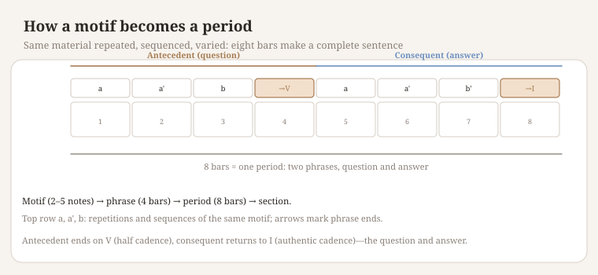
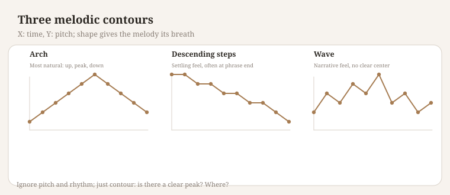
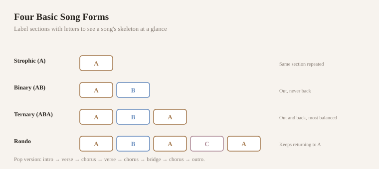
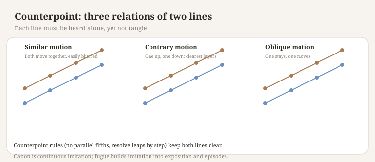
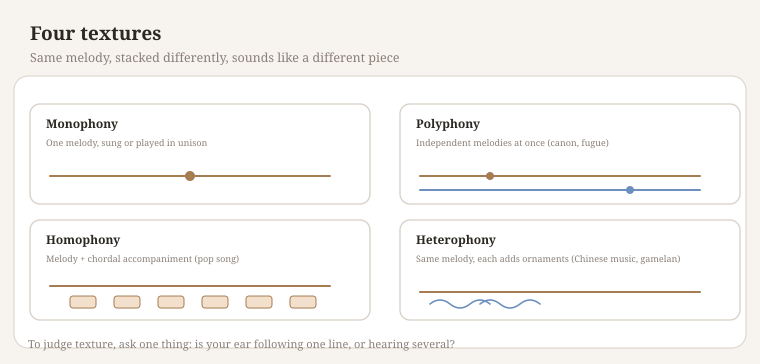

# Stage 7: Melody, Form and Counterpoint

Lay notes out sideways and you have a melody. Cut a melody into sections and you have form. Set two melodies going at once and you have counterpoint.

For six stages we have mostly worked with points and stacks: a note, a group of beats, an interval, a chord. This stage pulls the camera back to see how a whole piece is put together — how a two-bar motif grows into an eight-bar phrase, and a phrase into the sections of a song.

Four chapters cover motifs and phrases, the shape of a melody, common forms, and counterpoint with texture. This is the most essay-like stretch of the course, and the one most likely to change how you write and hear songs.

## Chapter 30: Motive and Phrase — The Smallest Units of Music

A song is not the sum of a pile of notes; it grows layer by layer. This chapter looks at the bottom two layers: the **motive** and the **phrase**.

### **30.1 Motive: Two or Three Notes Are Enough**

A **motive** is the shortest, most recognisable unit in a piece of music — usually just two to five notes, but you know it the moment you hear it.

Think of the opening of Beethoven's Fifth Symphony: three short notes, one long note. Those four notes are enough — almost the whole symphony grows out of them. Or the opening of the chorus in the most common Mandarin pop songs, which is often just four notes repeated.

A motive does not need to be "pretty". What it needs is to be **clear**: clear enough that listeners remember it, clear enough that a composer can take it and vary it.

### **30.2 Phrase: One Breath Every Four Bars**

Motives combine to become a **phrase**. In Western music, the most common phrase length is **four bars**, because that is roughly the length of one spoken sentence, and just about one natural breath.

Two phrases (4 + 4 bars) make up a **period** — a phrase is already a complete musical thought, and a period is a "question and answer" pair forming a larger unit. Eight bars is exactly the length of one section — a verse or a chorus — in a pop song.



Four bars is not an iron law, but it is the intuitive baseline. Phrase lengths that are not multiples of 4 (five bars, seven bars) can also be deliberate choices in folk and pop songs; what actually makes something feel "stuck" is usually harmony, accent or melodic direction that has not been handled well, not the bar count itself.

### **30.3 Antecedent and Consequent: One Asks, One Answers**

A complete period usually consists of two phrases:

- **Antecedent**: poses the question. It usually ends on a half cadence (stopping on V), and sounds "unfinished".
- **Consequent**: gives the answer. It usually ends on an authentic cadence (V → I), and finishes what was said.

The most typical example: the first four bars stop on the dominant chord (half cadence, sounding "unfinished"), and the next four bars return to the tonic chord (authentic cadence, finishing what was said). In C major, for instance, the antecedent closes on G and the consequent closes on C — that is the "question and answer". Many folk songs, children's songs and pop song sections are built on this structure (not all of them, of course: plenty of songs use eight-bar phrases, asymmetrical phrases, or through-composed writing).

### **30.4 Five Ways to Vary a Motive**

For one motive to carry an entire song, it relies on variation. The five most common techniques:

| Technique | What you do | Effect |
|---|---|---|
| Repetition | Play it again unchanged | Strengthens memory |
| Sequence | Move the whole motive up or down by some interval | Creates a sense of drive; the most common |
| Augmentation | Stretch the note values longer | The mood slows and grows heavier |
| Diminution | Shorten the note values | The mood grows urgent and lighter |
| Inversion | Flip the intervals upside down | Familiar yet strange |

These five techniques are not the exclusive property of composers. When you improvise and "play the same sentence again at a different height", you are in fact doing a sequence.

### **30.5 Do It Now**

Take a song you know well and write down its first four bars (numbered notation is fine). Then try to answer:

1. Which notes make up its motive?
2. How many times does this motive appear in the whole song? Which times was it changed?
3. When the first four bars end, does it sound like a "question" or an "answer"?

After this exercise, you will notice that the way you listen to songs has changed — you start hearing "structure", not just melody.

## Chapter 31: The Shape of Melody — Contour, Stepwise Motion, and Leaps

With motives and phrases in hand, the next question is: what makes a good melody good in terms of shape? This chapter has no formulas, but it gives you a few angles to observe.

### **31.1 Contour: The Direction of a Line**

Connect the pitches of a melody into a line, and you see a shape—this is **contour**. The three most common shapes:

- **Arch**: it climbs slowly, reaches a high point, then comes down slowly. This is the most natural and most common shape. It is like the rise and fall of emotion in speech.
- **Descending steps**: it starts high and moves down step by step. It often appears at the end of a phrase and has a settling effect.
- **Wave**: it goes up and down, with no clear center of gravity. It suits longer, more narrative passages.



A good melody usually has a clear **climax**—the highest point in emotion or structure. It usually appears only once. Note: the climax is not necessarily the highest note. It can also be the line with the densest rhythm, the fullest harmony, or the heaviest lyric. If every phrase pushes into high notes, listeners get tired. If the melody stays at the same height from start to finish, listeners lose focus.

### **31.2 Stepwise Motion and Leaps: Stairs or Elevator**

A melody moves in three ways:

- **Stepwise**: you move to the next note. It is smooth, easy to sing, and feels like speech.
- **Leap**: you move by more than one scale step (a third or larger), for example Do → Mi. It creates tension and drama, but a series of large leaps makes the melody hard to sing.
- **Repeated note**: the pitch stays the same, and the rhythm can stay the same or change. It often emphasizes, builds up, or creates a spoken feel.

A rule of thumb: after a large leap, the melody usually balances it with stepwise motion in the opposite direction (leap up, then walk down slowly). But this is a style convention, not a hard rule. If a melody keeps leaping, it sounds busy but has no direction.

### **31.3 Range: Who Is This Song For?**

The distance between the highest and lowest notes of a melody is its **range**. It decides who the song suits and how tiring it is to sing.

- Narrow range (within a sixth): easy to sing and easy to remember. Common in children's songs and folk songs.
- Wide range (a twelfth or more): it creates tension but needs technique. Pop choruses often use this to build a climax.

When you write a melody, a useful question to ask yourself is: Where does the high point of this song appear? If it appears in the first line of the chorus, the emotion has nowhere left to go. If it appears in the last chorus, the whole song builds beautifully.

### **31.4 Rhythmic Motive and Space**

A melody is not only pitch; it is also rhythm. The personality of a melody often comes from its **rhythmic motive**—for example, long–short–short or short–short–short–long.

The thing most easily overlooked in rhythm is **space**. A rest is not "no music." It gives listeners time to digest the previous phrase. Many classic melodies are memorable because they dare to stop—the beat where they stop makes you remember the notes before it.

### **31.5 Now Do This**

Take a melody you wrote (or like) and do three things:

1. Draw its contour line (draw only high and low, ignore rhythm). Is it an arch, steps, or a wave?
2. Mark which bar has the highest note. Does it appear at the emotional high point you want?
3. Change one leap to stepwise motion and listen to which version flows better.

Melody has no absolute right or wrong, but shape can be seen and adjusted.

## Chapter 32: Form — How a Melody Grows into a Song

We've covered motive, phrase, and period. The last layer is **form**: which sections make up the whole piece, and in what order they come.

### **32.1 Form is the order of sections, marked with letters**

The most common way to analyse form is to label each section with a letter: A is the first section, B is the second, A' is a varied version of A. So "A B A" means "first section, second section, back to the first section".

This labelling isn't for exams. It's so you can see at a glance: does this song repeat, how many times, and where does it change.

### **32.2 Four basic forms**

| Form | Structure | Character | Example (concept) |
|---|---|---|---|
| One-part form | A | The same section repeated, the simplest | Short songs, nursery rhymes |
| Binary form | A B | Two contrasting sections (the second often brings back a little of the first section's material) | Some folk songs, early songs |
| Ternary form | A B A | Go out, contrast, then return to A in full | Classical minuet, da capo aria |
| Rondo | A B A C A | Always coming back to A | Common in classical final movements |
| Verse–chorus form | A B A B… (A verse, B chorus) | The chorus keeps returning and acts as an anchor | The vast majority of pop songs |

Ternary form (ABA) is the most widespread because it fits how people listen: hear something, hear something fresh, come back to the familiar. **The idea of "coming home" shows up not only in chords but also in form.**



### **32.3 Two longer forms**

- **Theme and Variations**: first play a theme in full, then change it each time — add ornaments, change key, change rhythm, change instrument. The listener recognises the original while enjoying the change.
- **Sonata Form**: the most complex structure of the classical period, in three big parts: the **exposition** (states the themes, first in one key then in another), the **development** (takes the material apart and rebuilds it, the freest part), and the **recapitulation** (the themes return, but all in the same key). The first movement of nearly every symphony and sonata uses this structure.

The essence of sonata form is **the drama of keys**: the exposition has two keys (creating conflict), and the recapitulation unifies them into one key (resolving the conflict). So it isn't just an arrangement of sections; more centrally, it is **telling a story through key relationships**.

### **32.4 The form of pop songs**

Pop songs have their own logic, and it isn't quite the same as ternary form:

**Intro → Verse → Chorus → Verse → Chorus → Bridge → Chorus → Outro**

- Verse: narrative, lower range, more broken-up chords.
- Chorus: the hook, higher range, wider chords, repeated lyrics.
- Bridge: leaves the familiar harmony or key, creating the tension of "this has to resolve now".

This is called **verse–chorus form**: the verse is the narrative section (A), the chorus is the recurring anchor (B), the bridge is the contrasting section (C), and the whole thing is usually laid out as ABABCB. It is not ABA ternary form — ternary form requires a full return to A after the contrasting section, while a pop song is "A keeps coming back", relying on repetition rather than return. And "the last chorus goes up a semitone" is a key-level modulation (a key change) that pushes the emotion to its peak.

### **32.5 The 12-bar blues: the shortest complete form**

The blues has a very fixed 12-bar skeleton. Written in degrees, it is:

```
I  I  I  I
IV IV I  I
V  IV I  V
```

(The V in the last bar is a turnaround, used to lead the music back into the next round's I; if this section is to end, just change the last bar to I.)

The twelve bars use only three chords, yet tens of thousands of songs around the world rely on them. It lasts so long because the V → IV descent in bars 9–10 creates a tension of "stuck, not willing to give in", and only then does it return to I.

### **32.6 Do it now**

1. Take a pop song you like and try to mark out the A, B, C sections. You'll find most of them fall between 3 and 5 sections.
2. Find a 12-bar blues, count the bars along with it, and see whether the chords follow the table above.
3. Using an "A B A" structure, write a 24-bar melody (A 8 bars, B 8 bars, A 8 bars).

## Chapter 33: Counterpoint and Texture — How Two Melodies Walk Together

So far, most of the music we have talked about is "one melody + a set of chordal accompaniment." But half of the Western music tradition places **two or more independent melodies** together at the same time. This is counterpoint.

### **33.1 Counterpoint: Every Voice Is a Protagonist**

**Counterpoint** literally means "point against point"—one note against one note. Its goal is not to make one melody stand out, but to let every melody stand on its own while still sounding harmonious together.

This is a completely different aesthetic from the homophonic music we are familiar with (one main melody, other voices accompanying). Contrapuntal music asks you to "listen in" and hear several lines at once; homophonic music asks you to "sing along," with your attention on a single melody.

The golden age of counterpoint was the Renaissance and Baroque: Palestrina's choral music and Bach's fugues are works that pushed it to the extreme.

### **33.2 Three Basic Motions**

When two melodies move at the same time, there are only three relative motions:

- **Similar motion**: both lines go up or down together. Only when the interval stays the same is it **parallel**—parallel perfect fifths and octaves "blur together," and classical counterpoint avoids them.
- **Contrary motion**: one line goes up, one goes down. This is the motion with the strongest contrapuntal feel; the two lines make way for each other.
- **Oblique motion**: one line stays still, one moves. The contrast of stillness and motion is often used to create layers.

Classical counterpoint (especially 16th-century counterpoint teaching) has a detailed set of rules for these three motions: avoid parallel fifths and octaves; after a leap, usually proceed in contrary motion; dissonances must be introduced by legal means—passing tones, neighbor tones, suspensions—and then resolved to consonant intervals. These rules are not aesthetic preferences; they are there to make the two melodies **clear to hear**.

### **33.3 Imitation and Canon**

The simplest and most effective contrapuntal device is **imitation**: the second melody takes the phrase the first melody just played and plays it again exactly (or transposed up by some interval).

If the imitation continues all the way through, it becomes a **canon**. The songs you sang as a child, 〈兩隻老虎〉 (Two Tigers) and 〈Row, Row, Row Your Boat〉, are canons—the same melody entering at different times, yet harmonious when stacked.



A canon sounds good because it satisfies two conditions at once: every melody is the same (so it is familiar), but the entries happen at different times (so there are layers).

### **33.4 Fugue: Turning Imitation into a Building**

**Fugue** is the highest form of Baroque counterpoint. Like the canon, it is centered on imitation, but it is much freer—a canon requires the same melody to run strictly through the whole piece, while a fugue allows the subject to be transformed, new material to be inserted, and modulations.

The structure is roughly:

1. The **subject** appears alone in one voice.
2. The **answer** enters in another voice, usually a fifth higher or a fourth lower.
3. Other voices join one after another, forming the **exposition**.
4. The middle section uses **episodes** to break the subject apart, modulate, and vary it.
5. At the end the subject returns; some fugues use **stretto** (another voice enters before the subject has finished) to build a climax.

Bach's *The Art of Fugue* pushes this form to its limit. You do not need to be able to write a fugue, but knowing it exists will give you one more layer of understanding when you listen to Baroque music—those "lines running around" are not decoration; they have a strict structure.

### **33.5 Texture: More Than Just Counterpoint or Homophony**

**Texture** is "how the fabric of music is woven." There are four basic types:

| Texture | What it looks like | Example |
|---|---|---|
| Monophony | Only one melody, no accompaniment | Solo singing, unison playing |
| Polyphony | Multiple independent melodies moving at once | Canon, fugue, Renaissance choral music |
| Homophony | One melody + chordal accompaniment | The vast majority of pop songs |
| Heterophony | The same melody, with each voice adding different ornaments | Chinese orchestra ensemble, gamelan, Middle Eastern music |



The fourth type, heterophony, is worth noting: it is a classification term established by Western musicology, rare in Western art music, but normal in many Asian and Middle Eastern traditions. With the same melody, each person adds flourishes, slides, and ornaments in their own way; when stacked, it has a "rough-edged" quality—that is not untidiness; it is style.

### **33.6 Do It Now**

1. Gather a group (or record two tracks yourself) and sing the canon of 〈兩隻老虎〉. Notice which phrase is most harmonious when the two melodies stack.
2. Listen to a Bach fugue and count how many times the subject appears in total.
3. Take a simple melody and try writing a counterpoint in contrary motion: when the main melody goes up, you go down.
