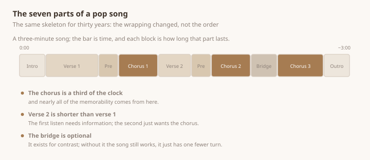
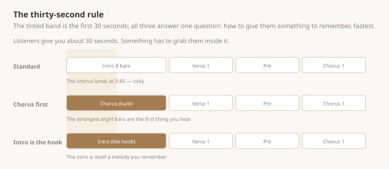

# Lesson 1: Take a Song Apart

## The short version

People who can't write songs usually aren't short of ideas. They don't know **which part they're writing**.

They sit down thinking "I'm going to write a song"—and a song is a very large object, large enough that you can't see what the next step is. Professional writers don't think "a song". They think "an eight-bar pre-chorus" or "the second line of a four-line chorus". **You can't build until you can take apart.**

We won't write a single word in this lesson. One job only: take your favourite song apart and see what the seven parts do, how long each one lasts, and where they sit. Once you've done that, you'll notice that the songs you think "just flow" are half built from the same skeleton.

## Common misconceptions

**"Writing a song is one burst of inspiration, from first line to last."**

It's the opposite. Almost every commercial song is built **in pieces**: a chorus melody, or one lyric line, or a chord loop comes first, and the rest grows outward from it. Verses are often written last—because you need to know what the chorus is saying before you know what the verse should set up.

Think of songwriting as a straight line and you'll stall on line one. Think of it as seven parts you can work on separately, and you'll always have something to do.

**"The chorus is the loud, exciting bit."**

Loudness is a result, not a definition. The chorus is **the part that repeats most, carries the most information, and sticks the hardest**. Some choruses are actually quieter—that still works, because they repeat.

The way to find the chorus isn't volume. It's "which part would I sing along to on the second listen?"

**"Structure is a formula; it kills creativity."**

Structure is a container. Nobody says a cup limits the shape of water—without the cup, the water is on the floor. What actually limits you isn't structure; it's the anxiety of **not knowing where you are in the song**.

And pop structure isn't a law, it's a set of defaults. Knowing the default is what lets you break it deliberately. People who don't know it think they're innovating when they're just being random.

## How it works

### 1. The seven parts

Every pop song is assembled from these, and each has a clear job:

| Part | Job | Typical length | Who notices it |
|---|---|---|---|
| Intro | Establish key, tempo and mood; signal "it started" | 4–8 bars | Almost nobody—but remove it and something feels wrong |
| Verse | Narrate. Who, what, when, where; set up the feeling | 8–16 bars | They hear it; they don't remember it |
| Pre-chorus | Push the verse's feeling upward; prepare the chorus | 4–8 bars | They can't name it, but without it the lift doesn't happen |
| Chorus | The point of the song. Most repeated, most memorable | 8–16 bars | The only part they remember |
| Bridge | Contrast. A different angle, chords, or mood | 4–8 bars | They'll notice "this part is different" |
| Solo | Rest for the ears and the voice | 4–8 bars | Some people skip it |
| Outro | End it. Fade, or stop on a chord | 4–8 bars | Usually never heard |

One important observation: **listeners only remember the chorus.** That isn't laziness on their part—it's what a pop song is designed to do. So the chorus deserves most of your effort; the verse only has to stay out of the way.



*Figure: In a three-minute song the chorus occupies less than a third of the clock, and decides what the song is.*

### 2. The three-minute proportions

A standard Mandopop song runs about 3:30 to 4:30. Take away the intro and outro and you're left with roughly two and a half minutes of singing. That has to hold four to six choruses, with the rest split between verses and pre-choruses.

The usual proportions:

- **Intro** 8 bars (about 20 seconds)
- **Verse 1** 8–16 bars
- **Pre-chorus** 4–8 bars
- **Chorus 1** 8–16 bars
- **Verse 2** 8–16 bars (usually shorter than verse 1—the listener already knows the setup)
- **Pre-chorus** 4–8 bars
- **Chorus 2** 8–16 bars
- **Bridge** 4–8 bars (not every song has one)
- **Chorus 3** (usually bigger, thicker, or a key change)
- **Outro**

See it? **Verse 2 is usually shorter than verse 1.** Not laziness: the first-time listener needs information, the second-time listener just wants to get back to the chorus. If you need to cut something to shorten a song, the first thing to cut is half of verse 2.

### 3. The thirty-second rule

Streaming changed the structure. People who used to listen to a whole CD now decide within about **thirty seconds** whether to skip.

So the first thirty seconds has to do one of two things: **bring the chorus forward**, or **make the intro itself memorable**.

That's why more and more songs open with the chorus—sometimes bare or half-arranged—and only then go to the verse. The version you hear in a car or in a short video is often cut this way.

Worth asking yourself while writing: **at what second does the strongest eight bars arrive?** If the answer is past thirty, the first thirty seconds has to carry the listener on its own.



*Figure: The same song, two thirty-second strategies: chorus first, or an intro that is itself the hook.*

### 4. How to take a song apart (three steps, no lyrics)

Taking a song apart isn't copying it. You're after the skeleton, not the content. Pick a song you've heard fifty times and do these three steps:

**Step 1: Mark the sections.** Listen and note the timecode where "something changed". You don't need terminology—"it turns into a different thing here" is fine. On the second pass, write down how long each section lasts.

**Step 2: Mark the chords.** Play along on whatever you can play and find which chords each section uses. **Don't worry about the key first—write the relative movement** (for example, "the loop is 1→5→6→4"). You don't need all of them, but you must get the chorus.

**Step 3: Mark the motif.** Take the first line of the chorus and draw its **pitch shape**—up, down, flat. That's enough; no staff notation needed. You'll find the same shape all over the song. That's the song's motif.

Three steps done and you have a table: which part, how long, which chords, what shape. **That table is the song's manual.** Later, when you write your own, you swap the table's contents for your own.

## An analogy

Writing a song is like **planning a wedding**.

You don't say "I'm going to hold a wedding" and start moving. You break it down: venue, guests, schedule, food, music, photos. Each can be prepared separately, each exists for a reason, and **the order matters**—you don't pick the menu before the venue is confirmed.

Songs are the same. The chorus is the couple walking in. The verse is the speeches beforehand (not too long, but the event is odd without them). The pre-chorus is the thirty seconds when the lights dim (nobody can say why, but without it you can't get to the entrance). The bridge is the slideshow in the middle (a different mood). The outro is seeing guests off.

And weddings share one iron rule with pop songs: **guests remember the entrance and the food. Whatever happens in between, however brilliant, is forgotten.** Put your best effort into the entrance; everything else only has to not go wrong.

## Try it now

**Exercise: take one song apart and draw a structure table.**

1. Pick a song you have heard **fifty times or more**. Not your favourite—your most familiar. Familiar enough that you know what happens next without concentrating, because that's when you can hear structure.
2. Get a sheet of paper (or a notes app) and draw this:

```
| Section   | Start time | Length (bars) | Chords | Melodic shape |
|-----------|-----------|---------------|--------|---------------|
| Intro     |   0:00    |               |        |               |
| Verse 1   |           |               |        |               |
| Pre-chorus|           |               |        |               |
| Chorus 1  |           |               |        |               |
```

3. Listen three times: mark sections, then chords, then melodic shape (chorus only is enough).
4. When it's filled in, answer three questions:
   - At what second does the chorus arrive? Past thirty?
   - Is verse 2 shorter than verse 1?
   - How many choruses are there, and how does the last one differ from the first?

**Don't skip this.** Most people read the lesson, feel they've understood, go straight to writing, and stall two lines in. This table isn't homework—it's the sheet you'll come back to in every lesson that follows.

## After the exercise

You now have a structure table and three answers. Keep them safe—when we write lyrics in lesson 2, you'll need to know **how many lines the chorus holds and how many words fit in a line**. That's this song's capacity.

Next lesson: writing lyrics, starting from a single sentence. Chorus first, then the verse—the opposite of what most people do, and the order that actually gets finished.
