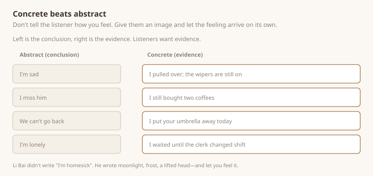

# Lesson 2: Lyrics — From One Sentence to a Whole Song

## The short version

Lyrics aren't prose. They're **Chinese that can be sung** (or English that can be sung—the constraints change, the method doesn't).

Prose aims to be clear. Lyrics aim to be *singable, memorable, and full of images*. Those goals fight each other: the most precise word is often the hardest to sing, and the most literary word is often the one with no picture in it.

So lyrics have their own rules. This lesson handles two things: **how to start** (where most people stall) and **how to avoid the line that falls apart the moment you sing it**.

The answer: **write one sentence first, then break it into four or eight singable lines.** Not first line to last—that's prose, not a song.

## Common misconceptions

**"Rhyme is the most important thing about lyrics."**

Rhyme is a bonus. **Repetition is the pass mark.**

What people remember from a song is usually the phrase that repeats most, not the rhyme that lands most neatly. Think of "Happy Birthday" or "Twinkle Twinkle"—barely a rhyme in sight, and the whole world sings them. Meanwhile plenty of songs rhyme beautifully and you can't recall a line.

Rhyme's real job is to make a line feel *closed*. It's punctuation, not content.

**"Lyrics should be poetic and deep."**

Lyrics should be **concrete**. Poetic and concrete are often opposites.

"I stood alone beneath the silver moon, and homesickness welled up within me"—literary, and there's no picture.

Li Bai, a thousand years ago: "Moonlight before my bed— / I took it for frost on the ground." Everyone pictures it instantly.

**"The chorus should make a point."**

The chorus should carry a **feeling**, not an argument. Leave the argument to the verse—or to yourself.

The chorus is what everyone sings together. It has to be something you can understand in one line and are willing to repeat three times. "I love you" beats "I believe our relationship requires redefinition"—not because it's shallower, but because it's **sturdier**.

## How it works

### 1. Start with a thesis line

A song needs one sentence. Not a poem, not a paragraph—one sentence.

The most efficient opening move is to write this, **with no rhyme, no polish, no judgement**:

> This song is about: ＿＿＿＿＿＿＿＿.

For example:

- "I want to go back to a home that doesn't exist any more."
- "I finally admit I wasn't that important to you."
- "We're fine. We're just not right."

That sentence may never appear in the song (or it might). Its job is to be **the place you can return to** when you lose the thread at line five.

**Without a thesis line you get a pile of individually decent lines that add up to nothing.** That's the most common way amateur lyrics die.

### 2. Concrete beats abstract

The standard move in pop lyrics is to **carry the emotion inside an object**, not to state the emotion.

| Abstract (don't) | Concrete (do) |
|---|---|
| I'm sad | I pulled over; the wipers are still on |
| I miss him | I still bought two coffees |
| We can't go back | I put your umbrella away today |
| I'm lonely | I waited until the clerk changed shift |

See the rule? **An abstract line is a conclusion; a concrete line is evidence.** You don't need to hand the listener the conclusion—they'll draw it themselves, and the conclusion they draw becomes theirs.

Li Bai didn't write "I'm homesick". He wrote moonlight, frost, a lifted head, a lowered head. **The last line delivers the emotion, and delivers only the emotion.**

*Figure: Left states the feeling; right hides it inside an image. The right column is always easier to sing and easier to remember.*

### 3. Tone: the trap unique to Mandarin lyrics

English lyrics only have stress. Mandarin lyrics also have **tone**. The same syllable with a different tone is a different word; if the melody moves against the tone, it sounds wrong—Taiwanese songwriters call it 倒音, "fallen tone".

The four Mandarin tones, roughly:

- **Tone 1**: high and level (mā, "mother")
- **Tone 2**: rising (má, "hemp")
- **Tone 3**: falls then rises (mǎ, "horse")
- **Tone 4**: falling (mà, "scold")

The check while writing is: **does the pitch movement of this line fight the tone of its words?**

For example, 我愛你 (wǒ-ài-nǐ) is tone 3, tone 4, tone 3. If the melody lifts and stretches 愛, it starts sounding like 矮 (ǎi, "short")—that's a fallen tone.

Conversely, 月亮 (yuè-liàng) is tone 4 followed by tone 4, both falling. A falling melody fits it perfectly.

**The practical check**: after writing a line, *say* it the way you'd naturally say it. Notice which words your voice lifts and which it drops. Then write the melody to follow that same shape. You're not obeying a rule—you're following your own speech, which is also the listener's.

*Figure: The dark line is the word's own contour, the accent line is the melody. Follow it and you're understood; fight it and it sounds like a different word.*

### 4. Repetition matters more than rhyme

A chorus has one design goal: **by the second listen, people can sing it.**

That's achieved with repetition—deliberate, generous repetition. The three usual devices:

1. **Repeat the ending**: the last two of four lines are nearly identical, one word changed.
2. **Repeat the opening**: every line starts with the same few words ("And I still…").
3. **Repeat the whole section**: the second chorus is simply the first chorus again. That isn't laziness; it's the design.

Rhyme can come too. The rule is: **make the lines repeat enough first, then use rhyme to close them.** Reverse that order and you get lyrics that rhyme perfectly and stick to nothing.

### 5. Verse narrates, chorus feels

Keep the division of labour clean:

- **Verse**: tell me what happened. Time, place, person, one concrete action.
- **Chorus**: tell me what it did to you—in a way that can be repeated.

What gets written backwards most often: the verse starts rhapsodising (becomes vague), and the chorus starts narrating (becomes a story that won't fit).

Two checks: cover the verse and read only the chorus—**the chorus should stand on its own** without the verse's context. Cover the chorus and read only the verse—it should look like a scene, not a reflection.

### 6. Capacity: count the slots first

Go back to the structure table from lesson 1. An eight-bar chorus holds roughly **four lines of 8–12 syllables** (slower songs fewer, faster songs more).

Count your slots before deciding what goes in them. **People rarely run out of words; they run out of room.** Four lines means four things. The fifth thing is for the next song.

*Figure: Count the slots first, then decide what fills them. Four lines is four things.*

## An analogy

Lyrics are **slides**, not an essay.

In a good talk, each slide carries one sentence. That sentence is large and clear—you can read it from the back row. The rest of the content comes from the speaker, just as the rest of a lyric's content is carried by the melody, the arrangement, and the singer's delivery.

Put paragraphs on a slide and the audience starts reading, then stops listening. Lyrics work the same way: **pack too many words into one line and the listener is busy decoding instead of feeling.**

So ask of every line: **can I understand this in three seconds?** If not, cut.

## Try it now

**Exercise: four chorus lines, then four verse lines.**

The order is counter-intuitive: **chorus first.** The chorus is the only part anyone remembers, so write the hardest part first—and once you have it, you know what the verse has to set up.

1. Write your thesis line: "This song is about ＿＿＿." (Any length, no judgement.)
2. **Write four chorus lines**: one job only—say what it did to you. Line 1 and line 4 can be the same line (repetition).
3. **Then write four verse lines**: pick one **concrete thing** from the thesis line as the scene (a place, an action, an object) and do two things only—show the scene, give evidence. **Don't conclude anything.**
4. Read it aloud and replace every word that snags. **If it doesn't read smoothly, it won't sing smoothly.**

No rhyme required, no literary polish, no need to finish. Those eight lines are your first lyric draft.

## After the exercise

You have a draft you can sing. It may still be rough, but the structure is right: the verse has an image, the chorus has a feeling, the lines read cleanly.

Next lesson we sing it—four notes, one chorus melody. Once there's a melody, half of the lines you thought were good will stop working. That's not failure; that's the filter doing its job.
