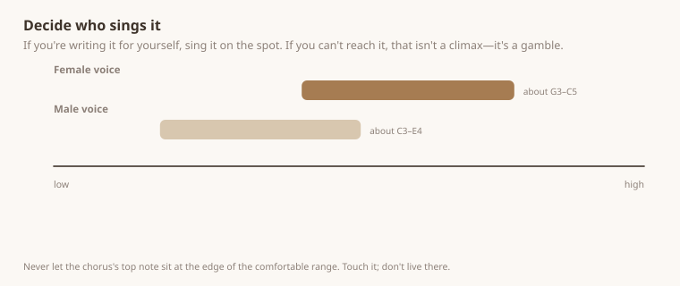

# Lesson 3: Melody — Four Notes Is Enough

## The short version

Melody is not a visitation. It's **designed**.

Most people imagine humming until something arrives. Humming is step one; what turns a hum into a song is the next three things: **a motif, repetition, and where each phrase lands.**

Good news: you don't need a complex melody. Pop choruses often use **four notes**—four notes repeated, moved, and re-landed is enough. Complex melodies are the ones people can't remember.

The goal of this lesson is concrete: **write a chorus you'll sing along to, using four notes.**

## Common misconceptions

**"A melody has to be difficult to be good."**

A melody has to be **memorable** to be good. Difficult melodies are achievements for the player; memorable ones are the ones an audience keeps.

"Twinkle Twinkle" uses six distinct pitches. "Happy Birthday" uses seven. Both are over a century old and everyone sings them. Meanwhile the melodies that leap all over the range are the ones you still can't hum after three listens.

**"You have to wait for inspiration."**

Inspiration is an outcome, not a precondition. The actual method is: **set constraints, then choose from what the constraints allow.**

"This chorus may only use five notes, the top note may appear twice, and every phrase ends downward"—the moment you set that, the options collapse from infinite to a dozen and you can start choosing. People without constraints are the ones always waiting.

**"Higher means more emotional."**

High notes are a **resource**, not an emotion. Stay high the whole song and there's no climax left.

What works is **contrast**: the verse talks low, the pre-chorus climbs, and the first word of the chorus jumps. The jump lands because everything before it stayed down.

## How it works

### 1. Decide who sings it: range

The first decision isn't "does it sound good", it's **can it be sung**.

- A typical male voice is comfortable around **C3–E4**
- A typical female voice around **G3–C5**

The chorus's highest note may **touch** the edge of that range; it must not live there. Write for yourself and sing it out loud on the spot. If the top notes leave you red-faced, that section isn't a climax—it's a gamble.

**Practical rule**: find your most comfortable note, make it the chorus's home base, and allow **exactly one note above it** in the whole chorus.

*Figure: The top note may touch the edge. It must not settle there.*

### 2. The motif: four notes is enough

A **motif** is a short, recognisable shape—usually three to five notes.

It can look like:

- **Rising**: 1-2-3 (expectation)
- **Falling**: 3-2-1 (closing)
- **Circling**: 3-4-3 (suspense, no movement)
- **Leaping**: 1-5 (surprise)

**The whole chorus is one motif plus its variations.** There are only three moves worth knowing:

1. **Repeat** — exactly the same again (strongest, most used)
2. **Sequence** — the same shape moved up or down (1-2-3 becomes 2-3-4)
3. **New ending** — same start, change only the last note (this is the landing technique below)

*Figure: Four notes are the seed. Repetition stretches it, sequence moves it, a new ending lets it land.*

### 3. Where the phrase lands: stable and unstable

Melodic phrases have commas and full stops, just like sentences. The difference is **which note the phrase ends on**.

In C major:

- **Stable**: 1 (Do), 3 (Mi), 5 (Sol)—it sounds finished
- **Unstable**: 2, 4, 6, 7—it sounds unfinished

A classic four-line chorus:

> Line 1 ends **unstable** (comma, pushes forward)
> Line 2 ends **unstable** (comma, pushes again)
> Line 3 ends **unstable or stable** (a breath)
> Line 4 ends **stable** (full stop, lands)

All four stable is flat—it stops talking. All four unstable is unmoored—nothing ends. **Hold it for three lines, release on the fourth.** That's what makes a chorus feel complete.

*Figure: The landing note decides whether a line is a comma or a full stop.*

### 4. Three ways to build a hook

The hook is the thing people remember. In pop it almost always sits in the **first four words of the chorus**, built one of three ways:

1. **Contrast in height** — verse stays low, the first word of the chorus jumps
2. **Repeated note** — several syllables on the same pitch (simplest shape, easiest to remember)
3. **A leap** — from low straight to high without passing through (most tension, but watch the tone)

Think of them as three ways to start a sentence: raise your voice, repeat a word, or shout. Pick one. Don't do all three.

## An analogy

Melody is **speech intonation**, not vocal technique.

When you ask "Really?" your voice goes up. When you say "That's how it is." it goes down. You've never studied music and you already use pitch to mean things—that's the language instinct.

Writing a melody takes that instinct and **enlarges it, slows it down, repeats it**. So the best check is: **say the shape out loud** (not sing—say it on "la" or "mm").

If it sounds like a sentence, it will sound like a melody. If it sounds like climbing stairs, it is stairs.

## Try it now

**Exercise: write a chorus from four notes.**

1. Take **the first line** of your chorus from lesson 2 (usually 8–12 syllables).
2. Choose four notes. Easiest: 1, 2, 3, 5 (Do Re Mi Sol).
3. Sing that line using **only those four notes**, with one rule: the highest note appears **once**, on the syllable you want to hit.
4. **Repeat the shape** for line 2 (same shape, or moved up slightly).
5. Line 3 takes a breath (slower, fewer notes). Line 4 returns to line 1's shape but **lands on 1 (Do)**.
6. Record it on your phone. **The recording isn't for release—it's because you won't remember what you sang.**

Then listen back and ask: **would I sing along on the second listen?** If not, cut and start again—that's not a talent problem, it's a design problem.

## After the exercise

You have four lines of chorus melody, and it was **designed**, not stumbled into. That means you can change it: too high, transpose it down; too flat, delete line 3.

Next lesson we lay a floor under it: chords. You'll find the same melody over different chords sounds like two different songs.
