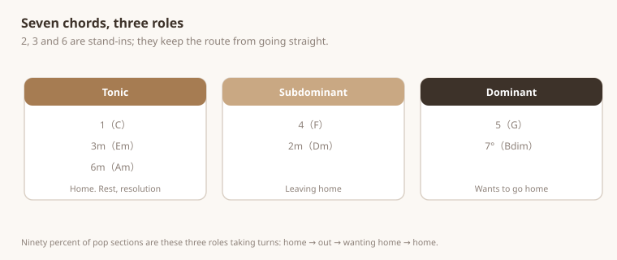
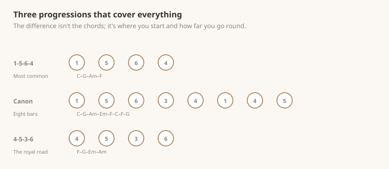

# Lesson 4: Chords — Four of Them Cover Everything

## The short version

Chords aren't "pick the pretty one". They're **pick what this position needs to do**.

The same chord can feel right in the first bar of a chorus and wrong in the last bar of a song. What decides isn't the chord; it's **where it stands**.

Good news: nine tenths of pop sections use three or four progressions, and there are only a handful in circulation. You don't need hundreds of chords. You need to know **what job these few are doing**.

## Common misconceptions

**"More chords means richer."**

The number of chords has nothing to do with richness. **The same four chords, reordered, become a different song.**

A song with two chords can work beautifully—if you vary rhythm, dynamics and arrangement. The beginner's real problem isn't too few chords; it's **changing every two beats, so nothing ever stands still**.

**"Complex chords are more advanced."**

Sevenths, ninths, suspended chords are **seasoning**, not the meal. Three spices make a broth; ten make a mess.

Pop skeletons are almost all triads (major and minor). Complex chords appear at specific moments: **the end of a line**, **the moment of a turn**, **the last chorus**. They matter, which is why they're rare.

**"Major is happy, minor is sad."**

Mode sets the baseline mood, but a major key can be devastating (plenty of Mandopop ballads are), and a minor key can be bright.

What decides the mood is **tempo, arrangement, delivery**, and where you put unstable chords. Instead of "major = happy", think: **does this chord make me want to keep going?**

## How it works

### 1. The seven basic chords and their jobs

In C major, the seven diatonic chords (written as degrees so you can move them to any key):

| Degree | Chord | Function | Feels like |
|---|---|---|---|
| 1 | C | Tonic (T) | Home. Rest, resolution |
| 2 | Dm | Subdominant (S) | Setting off, laying a path |
| 3 | Em | A stand-in for the tonic | A softer C; sits well after 1 |
| 4 | F | Subdominant (S) | The strongest step away from home |
| 5 | G | Dominant (D) | The chord that most wants to return to 1 |
| 6 | Am | A stand-in for the tonic | The usual way to "pretend to go home" |
| 7 | Bdim | Dominant (D) | Rarely used; too much tension |

Remember three things: **1 is home, 5 wants to go home, 4 walks away**. 2, 3 and 6 are stand-ins for those three, used to keep the route from being too direct.

Ninety percent of pop sections are these three functions taking turns: **home → out → wanting home harder → home.**

*Figure: Not seven independent chords—three roles, each with stand-ins. Learn the role, not the chord.*

### 2. Three progressions that cover most songs

**① 1-5-6-4 (C–G–Am–F)**

The most common of all. Every chord turns the direction, so it always feels like it's moving—good for verses in ballads.

**② The canon progression 1-5-6-3-4-1-4-5 (C–G–Am–Em–F–C–F–G)**

Eight bars per cycle. Compared with 1-5-6-4 it adds a dip and a climb. It became a classic because **almost any melody fits on top of it**—which is also why it's been worn out.

**③ 4-5-3-6 (F–G–Em–Am)**

The "royal road". Same four chords, but starting on 4, so it always feels like **you're already on the way somewhere**. Common in choruses.

Put side by side, they're the same story with different routes: **leave home, go round, come back.**

*Figure: The difference isn't the chords; it's where you start and how far you go round.*

### 3. How often you change chords

Density is the parameter people forget. The same progression, changed at different rates, gives completely different songs:

- **One per bar** — steadiest; ballads and slow songs; leaves the melody room
- **One every two beats** — drive; good for choruses
- **Split in half** — the front half one chord, the back half another; used in pre-choruses to make arrival feel imminent

Density also has a practical use: **to stretch a feeling, thin it out.** On the last chorus, hold one chord for two bars and the emotion lifts on its own—that works better than adding instruments.

*Figure: Density is the second dial. Same chords, different timing, different song.*

### 4. Melody and chords

One rule: **land the strong beat on a chord tone and it sounds right.**

On beat one of a C chord (C-E-G), any of C, E or G in the melody is solid; D or F floats—not wrong, deliberately suspended.

That gives you a practical check: **after writing the melody, look at the first note of each bar and see whether it's a chord tone.** If not, you have two choices: change the note, or change the chord.

The second is often better—melodies are harder to rewrite than chords, and chords are only the floor.

### 5. Think in degrees

Think "1-5-6-4" instead of "C–G–Am–F" and you can move it to any key instantly:

| Key | 1-5-6-4 |
|---|---|
| C | C–G–Am–F |
| G | G–D–Em–C |
| D | D–A–Bm–G |
| A | A–E–F#m–D |

**Degrees are relative positions; chord names are street addresses.** Use degrees while writing, chord names while talking to people.

That's also why "what key is this in?" is such a useful question: knowing the key gives you all the chords.

## An analogy

Chords are the **floor material**.

You don't walk on a floor thinking about the floor—you think about where you're walking. Wood, concrete, grass set the atmosphere; they don't set the route.

What sets the route is the **order** of chords. What sets the pace is **how often they change**. The beginner's mistake is endlessly changing floor material (hunting for special chords) while never deciding the route.

One more observation: **a good floor is one you forget.** If the listener is noticing the chords, it's usually because they're too crowded or too strange—and the fix is to remove, not add.

## Try it now

**Exercise: three progressions under your own melody.**

Can't play chords yet? Don't stall here—look at the [pop guitar course](/guitar/) or the [music theory course](/theory/) for the basics (both still in Chinese—English editions are coming), or use [the browser DAW](/tools/daw/) to play the chords as MIDI. This lesson practises **hearing and choosing**, not fingers.

1. Take the chorus from lessons 2 and 3 (lyrics + four notes).
2. Put it over each of the three progressions, one at a time:
   - 1-5-6-4
   - The canon (1-5-6-3-4-1-4-5)
   - 4-5-3-6
3. Play each at **one chord per bar** first, so the melody can settle.
4. Pick your favourite, then do two things:
   - Change the **last two bars** to one chord per bar (stretched), and listen for the lift
   - Change **one bar's first melody note** to a chord tone and hear what "solid" means

**Don't do it all.** One listen through each progression gives you body-knowledge of "same melody, different floor"—worth more than ten articles.

## After the exercise

You now have a chorus where chords, melody and lyrics agree. That's the core of a song.

Next lesson we attach the verse and deal with the last and hardest step: **when words and melody fight, which one do you change?**
