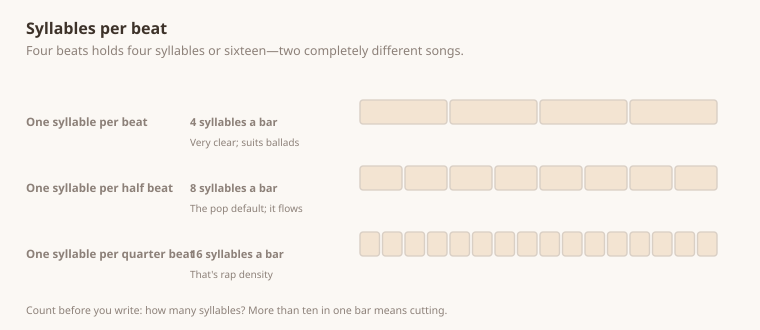
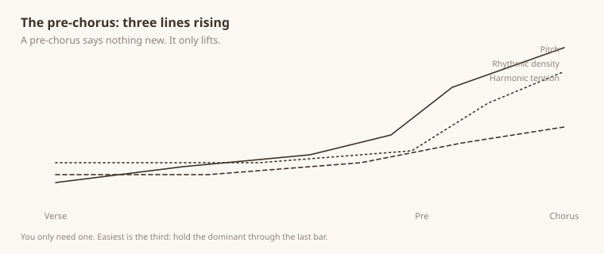

# Lesson 5: Words and Music Together

## The short version

When words and melody fight, **nine times out of ten it's because there are too many words**.

You write lyrics on paper, where words stand in a row. You write melody in time, where words get stretched. A sentence you read in two seconds can take six seconds to sing—and that extra time is where the fight happens.

This lesson does three things: **put the stressed word on the strong beat, cut the words that don't fit, and join the verse to the chorus.**

## Common misconceptions

**"One syllable per note is the clearest."**

It's clear, and flat. What makes a melody sing is often **one syllable over several notes** (a melisma)—hold a word across two or three pitches and the emotion arrives.

The rule isn't "one syllable per note", it's: **important words get extra notes; unimportant words get none.**

**"The chorus has to go higher."**

The chorus has to be **brighter**, not necessarily higher. Brightness can come from a slightly higher range, denser rhythm, thicker harmony, more instruments, or simply your own delivery.

Write the whole chorus at the top of your range and the result is: great the first time, exhausting by the third.

**"The pre-chorus is optional."**

The pre-chorus is **the clearest line between amateur and professional**. It carries no content; it does one thing: **lift the verse to the height of the chorus.**

Remove it and the verse jumps straight to the chorus—like an elevator skipping floors. Listenable, but you lose the breath.

## How it works

### 1. Stress on the beat

A bar of four beats is not evenly weighted: **beat 1 is heaviest, beat 3 next, beats 2 and 4 lightest.**

So the job is simple: **put the word that carries the meaning on beat 1.**

Take "I left the car by the road":
- with "**car**" on beat 1, it reads: *I left the **car** by the road*
- with "**left**" on beat 1, it reads: *I **left** the car by the road*

Same sentence, different emphasis, different meaning. That's not a music problem—it's **deciding which word the line is about**.

Practical method: after writing the lyrics, highlight **one word per line**—the one that carries the meaning—and check whether your melody puts it on a strong beat. If not, move the melody forward or back by one word. That usually fixes it.

*Figure: It's not "does it fit", it's "does the important word land on the right beat".*

### 2. Cut what doesn't fit

The usual symptom: twelve syllables crammed into one bar, sung like rap—not a writing mistake, an **overloaded capacity**.

A practical conversion (mid-tempo, four beats a bar):

- **One syllable per beat**: 4 syllables a bar—very clear, suits ballads
- **One per half beat**: 8 syllables—the pop default, it flows
- **One per quarter beat**: 16 syllables—already rap density

While writing, count: **how many syllables is this line?** More than ten and it has to fit in one bar, and you need to cut.

The way to cut is **drop adjectives, keep verbs and nouns**. "I sat by the window alone in the quiet evening" becomes "I sat by the window". Fourteen syllables to five, and the second is more vivid.

*Figure: Count first, write melody second. Density decides whether a line is a ballad or a rap.*

### 3. The pre-chorus: three lifts

The pre-chorus is usually four to eight bars. It doesn't tell the story; it **builds expectation**. Three tools—use one or stack them:

1. **Pitch climbs**: the pre-chorus sits above the verse and keeps rising until the chorus's first line.
2. **Rhythm thickens**: verses at one syllable per half beat, pre-chorus at one per quarter—the heartbeat quickens.
3. **Harmony leaves home**: the pre-chorus usually parks on the 5th degree and refuses to resolve, pushing you into the chorus.

The easiest version is the third: **four bars of pre-chorus, and the last bar just holds the 5 chord.** Do that alone and the chorus turns itself up.

*Figure: A pre-chorus carries no content. It only lifts. One line is enough; stacking all three is strongest.*

### 4. Three symptoms and their fixes

**Symptom 1: it snags on a certain word.**
Almost always **tone fighting melody** (see lesson 2). Fix: change that word's melodic movement, or swap in a synonym with a different tone.

**Symptom 2: you run out of breath halfway.**
The **breathing point is gone**. Spoken sentences have natural pauses; writing them as one continuous line removes them. Fix: split the line, or stretch one syllable so you can breathe inside it.

**Symptom 3: it sounds spoken, not sung.**
Everything is **too dense**. A song at one syllable per half beat throughout sounds like reading aloud. Fix: stretch one syllable at the end of each line—two beats, or four—and it immediately sings.

*Figure: Diagnose first, then fix. Changing all three at once usually breaks all three.*

### 5. Joining the sections: the three-minute skeleton

With a verse and a chorus in hand, the order is:

> Verse 1 (8 bars) → pre-chorus (4) → Chorus 1 (8) → Verse 2 (4–8) → pre-chorus (4) → Chorus 2 (8) → Chorus 3 (8, thicker or a key change)

Two details:

- **Verse 2 is shorter than verse 1.** The first listen needs information; the second just wants the chorus.
- **Chorus 3 must differ from the first two.** Higher, thicker, re-arranged, transposed—but not identical, or the listener feels the song has already ended.

## An analogy

Words and music together are **two people dancing**.

The lyric leads and decides where to go; the melody follows and decides how to get there. When they step on each other's feet, it's usually not the melody that can't dance—it's that **the lyric is walking too fast**.

So fix the words first, not the tune. Cut, re-stress, and the melody usually falls into place by itself, because the melody was written to follow the speech in the first place.

Doing it the other way round—bending the melody to accommodate words that don't fit—almost always fails: you end up with something nobody can sing and every note is "correct".

## Try it now

**Exercise: build the song, then sing it three times.**

1. Take the four-line chorus from lesson 3 and put it over the progression you chose in lesson 4. Sing it once, whole. **Ignore the verse for now.**
2. Use the four verse lines you wrote in lesson 2; if they no longer fit, rewrite them (same method: a concrete image). Put them over the first four bars of the same progression.
3. Insert four bars of pre-chorus: **the last bar holds the 5 chord and doesn't resolve.**
4. Assemble: verse → pre-chorus → chorus.
5. Sing it three times, one question per pass:
   - First pass: does any word snag? (symptom 1)
   - Second pass: where do I run out of breath? (symptom 2)
   - Third pass: which line sounds spoken rather than sung? (symptom 3)
6. Write down where the problems are. **Don't fix them yet**—next lesson we fix them all together.

## After the exercise

You now have a **structurally complete** song: verse, pre-chorus, chorus, chords, lyrics, melody. It may have three or four places that snag—but that's a fixing problem, not a writing problem.

Next lesson, the last one: record it as a demo, fix what snags, and decide **when it's ready for someone else to hear**.
