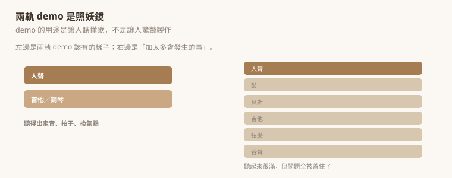
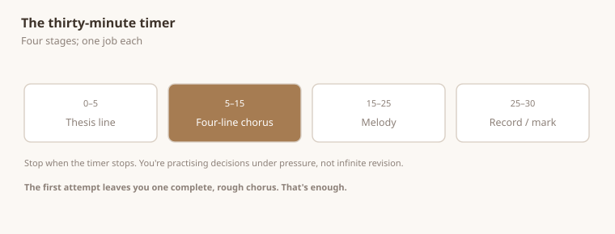
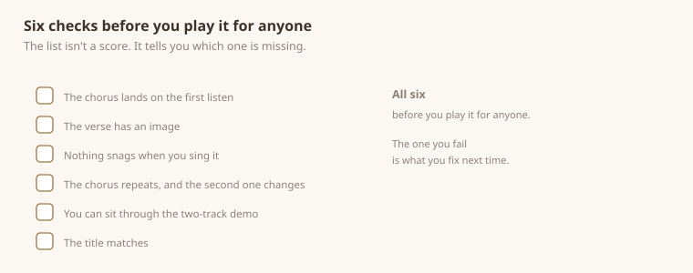

# Lesson 6: Finishing, and Letting It Out

## The short version

The gap between "half-written" and "a song" is usually not talent. It's **process**.

Most songs die at 70 percent—not because the writer ran out, but because **nobody defined what "finished" looks like**. Nobody finishes a race with no finish line.

This lesson gives you three things: a **two-track demo method**, a **thirty-minute timer**, and a **checklist for letting other people hear it**.

## Common misconceptions

**"A demo has to be well produced before anyone hears it."**

Backwards. **A demo exists so people understand the song, not so they admire the production.**

A fully arranged demo actively hurts you: listeners start evaluating tones, mixing, drum levels—anything but "is this a good song". Two tracks (one instrument plus voice) is the most honest format. It leaves the melody and lyric nowhere to hide.

**"You have to wait for inspiration to finish."**

Inspiration starts things. It doesn't finish them. Finishing is scheduling.

The professional routine is "I write from three to five this afternoon", not "I write when I feel it". That's not a question of romance; **creation needs a container**.

**"Finished means perfect."**

Finished means **ready to be heard**. Perfect doesn't exist, and people chasing it rarely finish anything.

What you're practising is "the best version I can make in the time available", not "the best version ever". The first has an end. The second doesn't.

## How it works

### 1. The two-track demo

You need: **an instrument that plays chords (guitar or piano) and a microphone (a phone is fine)**.

1. Record the instrument first, start to finish, with a metronome. (Don't play and sing at once—both will be off.)
2. Record the vocal second, wearing headphones so you hear the first take.
3. You now have two tracks. **Do not add a third.**

This version exposes everything: pitch, timing, words that don't fit, breathing points that don't exist. **That's its value**—problems announce their own addresses.

If the two-track version stands up, arrangement only makes it better. If it doesn't stand up, no amount of arrangement will save it.

*Figure: The two-track demo is a mirror. It can hear the problems, which is why it's the best checking tool you have.*

### 2. The thirty-minute timer

Give yourself thirty minutes. Set a timer. Follow this order:

| Time | Do this | Don't do this |
|---|---|---|
| 0–5 min | Decide the thesis line: "this song is about ＿＿" | Don't think about chords |
| 5–15 min | Write four chorus lines (chorus first, not verse) | Don't edit words |
| 15–25 min | Set the chorus to four notes; sing it three times | Don't rewrite |
| 25–30 min | Record one take; mark where it snags | Don't re-record |

**Stop when the timer stops.** Not because thirty minutes is enough to finish, but because **you're practising decisions under pressure**, not infinite revision.

Most people's first attempt produces a rough but **complete** chorus in thirty minutes. That has value on its own: you now know you can do it, and the excuse is gone.

*Figure: The timer isn't there to pressure you. It's there so a decision happens.*

### 3. The checklist: when it's ready to be heard

Six items. **All six before you play it for anyone**, or you'll get a pile of "yeah, nice" that helps nobody.

- [ ] **The chorus lands on the first listen**: someone hearing it once knows what the song is about
- [ ] **The verse has an image**: at least one concrete scene, not a reflection
- [ ] **Nothing snags**: you've sung it three times with no catch and no breathlessness
- [ ] **The chorus repeats, and the second one changes**: higher, thicker or transposed
- [ ] **The two-track demo holds up**: you can sit through it without wincing
- [ ] **The title earns its place**: it's the strongest phrase in the song, not the last thing you wrote

The sixth is the one people skip. **A title isn't a label, it's positioning**—it's the only word a listener sees in a playlist. If the title isn't the most memorable phrase in the chorus, change it.

*Figure: The checklist isn't a score. It tells you which one is missing.*

### 4. How to ask for feedback

When you play it for someone, **never ask "is it good?"** That question produces "yeah, nice".

Ask these three instead:

1. **"Which line do you remember?"** — tests the hook. If they can name one, you have a real hook.
2. **"What do you think this song is about?"** — tests the thesis. If it's far from your sentence, the lyric didn't land.
3. **"Would you listen twice? Why?"** — tests the whole. If not, ask what made them not want to; if yes, ask which moment made them want to.

Three questions, three people, beats ten people saying "nice" by a factor of ten.

### 5. What comes next

After your first finished song, the usual paths:

- **Write another.** It's the only guaranteed way to improve. The second goes faster because you know the process.
- **Get someone to arrange it.** Hand over the two-track demo; if an arranger understands the song from that, it's enough.
- **Arrange it yourself.** The site's [music production course](/tools/daw/learn/) exists for this—MIDI arranging through to mastering.
- **Release it.** Before you upload, make sure you own everything in it (melody, lyric, arrangement, recording). Covering someone else's song or sampling a recording needs separate clearance.

## An analogy

Writing a song is **cooking**.

Inspiration is "what do I feel like eating"—it happens before you shop. What actually puts food on the table is prep, heat, seasoning, plating: none of it romantic, all of it practiceable.

And one observation that maps exactly: **the most popular dish in a restaurant is rarely the most complicated one.** A bowl of noodles done well beats an ambitious dish done badly. So don't start by writing something complicated. Get the noodles right first.

## Try it now

**Exercise: thirty minutes, one chorus, finished.**

1. Set a timer for thirty minutes and follow the table above.
2. Stop when it stops, wherever you are.
3. Record the result (phone is fine), then score it against the checklist.
4. Write one sentence: **"Next time I'll fix these three things: ＿＿, ＿＿, ＿＿."**

Those three things are the direction for your next song. **Don't rewrite this one**—it has already done its job: it told you where you are.

## After the exercise

Six lessons, done. You now have: a way to take a song apart, a set of lyrics, a melody, a progression, a complete structure, and a two-track demo.

All of it is a reusable process, not a one-off piece of work. Next time you write, you don't start from zero—you run the process again.

If you finish something you want to share, the contact page is always there.
