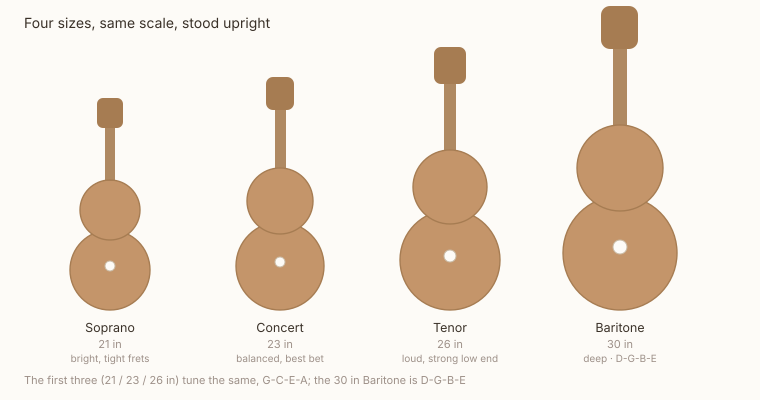
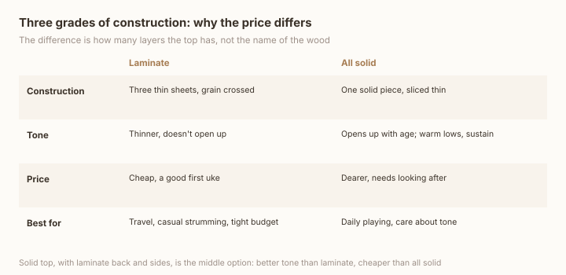
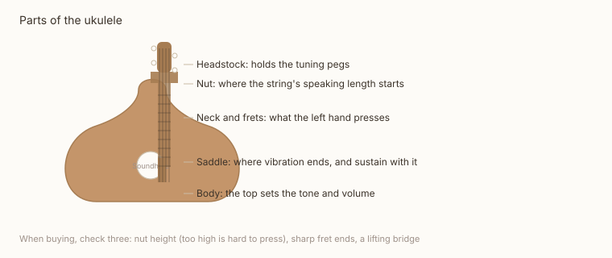
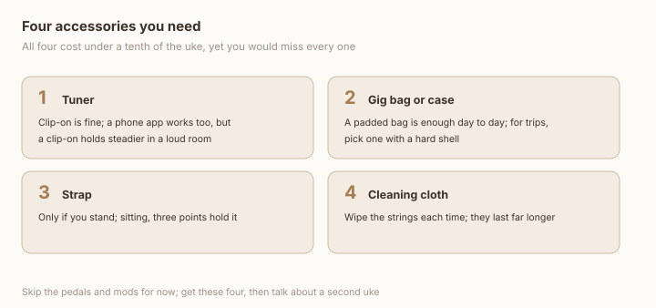

# Chapter 1: Choosing a Ukulele for Pop Singing and Playing

Before you pluck the first string in earnest, you have to know the instrument in your hands. Most people meeting a ukulele for the first time are baffled by the specs piled up online: "What's the difference between 21 inch and 23 inch?" "Laminate, solid top, all solid — do I have to buy the most expensive one?" "Why does one ukulele sound like a toy, and another as warm as a miniature acoustic guitar?"

This chapter takes the practical view of an **adult who wants to play pop songs and sing**, and walks you quickly through the ukulele's size categories, the tonal character of each wood, and the parts of the whole instrument. Whether you are about to buy your first one or want to check that the one you own will do, you can then judge precisely.

---

## 1.1 The four standard sizes: which one should an adult pop player choose?

A ukulele is loosely called "the four-string little guitar", but by total body length and by **scale length (the length of string that actually vibrates, from the nut to the saddle)** it falls into four standard sizes: **Soprano**, **Concert**, **Tenor** and **Baritone**.

For a young or adult learner, the size decides two things directly: whether the left hand finds the frets cramped, and whether the instrument sits comfortably against your body.

| Size | Chinese name | Total body length | Scale length | Typical number of frets | Standard tuning | Tone and feel | Recommended for |
| :--- | :--- | :--- | :--- | :--- | :--- | :--- | :--- |
| **Soprano** | high range (the standard size) | about 21 inch (53 cm) | about 330 mm (13 inch) | 12 ~ 15 frets | G - C - E - A | The brightest, crispest tone, full of the traditional Hawaiian island flavour; the frets sit close together | Women with smaller hands, children, travellers who want the most portable instrument |
| **Concert** | middle range | about 23 inch (58 cm) | about 380 mm (15 inch) | 15 ~ 20 frets | G - C - E - A | **The golden balance of feel and tone**: frets roomy rather than cramped, resonance warm and full | **Most adults starting out, and the first choice for pop singing** |
| **Tenor** | lower-middle range | about 26 inch (66 cm) | about 430 mm (17 inch) | 17 ~ 22 frets | G - C - E - A | Bigger body, more volume, better low-end resonance, the higher frets easy to reach, longer sustain | Men with larger hands, more advanced players, fingerstyle players |
| **Baritone** | low range | about 30 inch (76 cm) | about 480 mm (19 inch) | 18 ~ 22 frets | D - G - B - E | A deep, mellow tone, almost a small acoustic guitar; the chord shapes differ from the other three | Players who already play acoustic guitar and want to switch without pain |

*Figure: the four sizes drawn to actual length proportions. The 21, 23 and 26 inch models share the same tuning; the 30 inch baritone is D-G-B-E.*

### Straight talk from the editor's desk on what to buy

* **First choice: the 23 inch (Concert) and the 26 inch (Tenor).** The first three sizes (21, 23 and 26 inch) are tuned identically, so every chord diagram and every TAB in this book works on all of them. But given adult finger thickness and arm proportions, the 21 inch gets crowded when you fret a chord that uses several fingers, such as `G` or `E`; the fingers fight each other. The **23 inch Concert** keeps the ukulele's sweet, fresh character and still gives the left hand room to move, which makes it the choice least likely to go wrong for pop singing. If you are taller than average (175 cm or more), or you mean to take on showy fingerstyle solos later, go straight to the **26 inch Tenor**.

* **Avoid the 30 inch baritone as a first instrument.** It is tuned `D-G-B-E`, the same as the four thinnest strings of an acoustic guitar. It sounds good, but almost every ukulele method book and online chord chart is written for `G-C-E-A`, so a beginner who buys one finds that nothing on the page matches.

---

## 1.2 Wood and top construction: why prices run from a thousand to tens of thousands

Walk into a music shop and you will find 23 inch ukuleles carrying wildly different price tags. The key difference behind that is **how the wood is built up** and **which wood it is**.

### 1. The three grades of construction

1. **Laminate**: three thin sheets of wood glued together with the grain crossed. It is affordable (about NT$1,500 ~ 3,500), structurally tough, and tolerant of the humidity swings between a damp climate and an air-conditioned room, so it rarely cracks or warps. The downside is a thinner resonance: the tone does not open up as the years of playing go by.

2. **Solid top**: only the top — the part that makes the sound — is one piece of solid wood, while the sides and back are laminate. This is **the best value of the three** (about NT$3,500 ~ 8,000): you get the warm resonance and the dynamic range of solid wood, and you keep the durability of laminate sides and back. It is the one I would recommend to an adult reader who means to learn pop singing properly.

3. **All solid**: top, sides and back are all solid wood (about NT$8,000 and up, into the tens of thousands). The tone is the most open and three-dimensional, and the instrument has the property players call **opening up** — as the years of playing add up, the fibres of the wood loosen under vibration and the tone grows rounder. It is fussy about humidity, though, and needs careful looking after.

### 2. The tonal character of the common woods

| Wood | English label | Grain and colour | Tonal character | Pop styles it suits |
| :--- | :--- | :--- | :--- | :--- |
| **Mahogany** | Mahogany | Warm reddish brown, with a fine, even grain | Warm, solid low mids, sweet rather than piercing; it blends with a voice extremely well | Slow ballads, folk songs sung over the instrument, gentle pieces |
| **Acacia** | Acacia / Koa | Golden to dark brown, often with tiger stripes and flame figure | The classic Hawaiian wood; crisp, bright upper mids with plenty of separation between notes | Upbeat rhythms, reggae and island styles, fingerstyle solos |
| **Spruce** | Spruce | Pale milky white, with a straight, tight grain | Loud, with a wide dynamic range, strong projection and a quick response | Hard-strummed rock, and outdoor playing where you need volume |
| **Sapele** | Sapele | Reddish brown like mahogany, with a striped sheen | Close to mahogany, clear and bright, and good value | The all-round beginner practice instrument |

---

## 1.3 Anatomy of the whole instrument: what each part does

So that the instructions in the chapters ahead read without friction — "the left hand presses just inside the 3rd fret wire", "the right hand strums above the soundhole" — spend two minutes with the diagram below and learn the names of these seven core parts:

1. **Headstock and tuning pegs**: at the very top, they hold the strings and, through a set of gears, adjust the pitch. Good modern ukuleles mostly use **sealed gear tuners**, which turn smoothly and hold their tuning. Which peg belongs to which string varies by brand, so when you tune, turn a peg and watch which way the pitch moves.

2. **Nut**: the white (or bone) bar where the headstock meets the fretboard. Four slots in it set the spacing and the height of the four strings.

3. **Fretboard**: the dark board on the front of the neck (usually rosewood or ebony), the stage on which the left-hand fingers press.

4. **Fret wire and fret space**: the thin metal bars set into the fretboard are the **fret wires**, and the wooden space between two wires is a **fret space**. Counting down from the nut gives fret 1, fret 2, fret 3, and so on.

5. **Position markers (inlay dots)**: white dots set into the face of the fretboard (and the side of the neck), usually at frets **5, 7, 10 and 12**. Fret 12 usually has two dots, marking the octave. Glance down and you know where you are in a second.

6. **Soundhole**: the round hole in the middle of the top. The sound wave from the vibrating strings goes into the body, is amplified by the resonating box, and comes back out here. **The best place for the right hand to strum is usually above the soundhole, where it meets the end of the fretboard**; that is where the tone is most even and sweet.

7. **Bridge and saddle**: glued to the lower part of the top, they anchor the ends of the strings and, through the white **saddle**, pass the vibration of the strings into the whole top.

---

*Figure: the anatomy of the whole instrument. The nut marks where the scale length starts; the bridge and the body turn the vibration of the strings into sound.*

## 1.4 The four accessories to get when you buy

When you buy the instrument, get these four small items at the same time, along with a bag. They will save you an enormous amount of frustration in practice:

* **Clip-on tuner**: it clips onto the headstock and tunes by sensing the vibration of the wood. Even in a noisy café or living room it tunes accurately, far more so than a phone app listening through a microphone.

* **Ukulele capo**: in chapter 17 you will learn to use it to change key in one move, so any singer's song sits comfortably in your voice. Don't buy an acoustic-guitar capo by mistake: its spring is too strong and it is too wide, so it dents a ukulele's fretboard or pulls the tuning sharp.

* **One spare set of strings**: a fluorocarbon set (Worth, for example) or a synthetic Nylgut set (Aquila). New strings keep stretching for the first few days, and if you turn a peg too far and break one, a spare set on the shelf keeps the practice habit from breaking with it.

* **Strap (optional)**: if you want to sing standing up, or the right hand slides while you hold the instrument, fit a strap. Check whether the bottom of the body and the heel of the neck already have strap buttons; if not, a no-drill soundhole-hook strap will do.

---

### Chapter checklist

* [ ] I know which size the ukulele in my hands is (21, 23 or 26 inch), and that it takes standard `G-C-E-A` tuning.
* [ ] I can point to the headstock, the tuning pegs, the nut, fret 3, the position marker at fret 5 and the soundhole.
* [ ] I have a clip-on tuner ready, or a phone tuning app downloaded for now.

